# 编程语言解释器构建指南


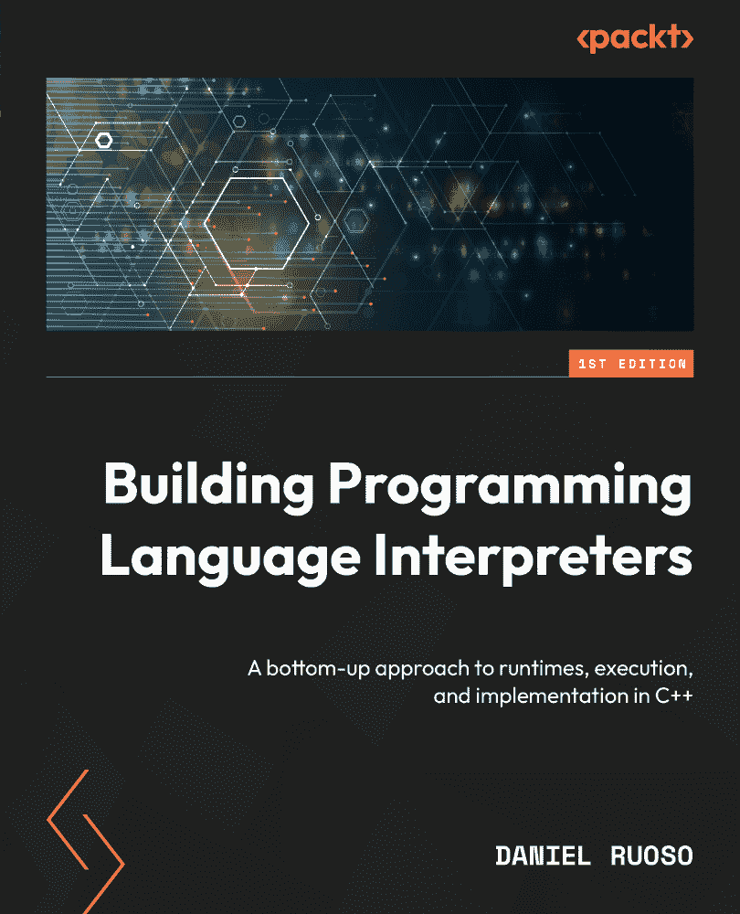


在 2000 世纪中期，我幸运地参与了 Perl 6 语言的开发。这可能是我作为软件开发人员生涯中学习曲线最陡峭的时期。在 IRC 上与唐颖（Audrey Tang）、Flávio Glock、Jonathan Worthington、Larry Wall、Moritz Lenz、Nelson Ferraz、Paweł Murias、Yuval Kogman 等许多优秀人士的长谈，为我理解编程语言和解释器设计提供了起点。如果没有他们，我可能根本对这个领域产生兴趣。

—Daniel Ruoso

# 贡献者

# 关于作者
Daniel Ruoso 拥有超过 20 年的软件开发经验。多年来，他参与了多个项目，专长构建工具、静态分析和自动化代码重构。他是 Raku 编程语言和 Debian 项目早期开发的贡献者。最近，他还为 ISO C++ 工作组的工具研究小组做出贡献。Daniel 还曾在 LLVM 开发者会议、C++Now 和 CppCon 上进行过演讲。

感谢我的父母 Karin 和 Sérgio，在我很小的时候就让我接触了技术，并在那个技术在 Iguatu 这个小镇完全不普及的年代为我提供了实验空间；感谢我的哥哥 Leonardo，他以所有正确的方式推了我，开启职业生涯；感谢我的妻子 Arêtha，在我通往今天道路的旅程中，对我所付出的每一次风险都给予了支持；感谢我的孩子们 Tito 和 Yann，激励我不断学习。

# 关于评审员
Tony Varghese 是一位编译器工程师和工程技术负责人，在 LLVM 和 MLIR 框架方面拥有丰富的实战经验。他为上游 LLVM 项目贡献了多个补丁，包括对 PowerPC 后端和优化阶段的贡献，并通过技术论坛和指导积极参与编译器开发社区。他的工作侧重于编译器优化、语言工具以及为复杂系统构建健壮的基础设施。Tony 对解决问题充满热情，并喜欢应对具有挑战性的编译器和解释器实现问题。他的开源贡献可以在 [`github.com/tonykuttai/`](https://github.com/tonykuttai/) 找到。在不处理编译器时，他喜欢和女儿待在一起以及打羽毛球。

我想感谢我的家人在本书技术评审期间给予给予的支持和鼓励。

Nikhil Kapoor 在人工智能和机器学习（`ML`）领域拥有超过 16 年的经验，在这些领域设计并实现了高级模型、智能平台以及大规模数据驱动的解决方案。他的专长扩展到在领先云服务提供商构建端到端平台和分布式应用程序，将 AI/ML 能力与云原生技术相结合以驱动创新。他将这些技能应用于多个领域——包括金融、投资管理、审计和电信研发——交付了智能、可扩展且适用于生产环境的系统。除了技术深度外，他还领导团队完成了整个软件开发生命周期。

# 在 Discord 上加入我们！
与其他用户、开发者、专家以及作者本人一起阅读本书。

提问、为其他读者提供解决方案、通过“任何提问”（Ask Me Anything）环节与作者聊天以及更多。扫描二维码或访问链接加入社区。


[`packt.link/deep-engineering-cpp`](https://packt.link/deep-engineering-cpp)

# 前言
我在巴西通过在 MSX 计算机上实验 BASIC 语言中长大的。那个时代的电脑会带有一份纸质说明书，上面有带有代码列表的小游戏和练习题，你必须手动输入代码才能看到发生了什么。当我的家里买了一台 486 PC 时，我转向了 QBASIC。我记得第一次从零开始构建了一个带有动画等功能的完整游戏。

后来，我转向了 Delphi，在其中我协助哥哥完成一些项目，并在学校展示了一个我们为了探索元素周期而构建的小型应用程序。那时，我也正在转向 GNU/Linux 并探索 C 语言编程。

学习了 Perl 之后，我才真正成为一名“真正的”软件开发者。那是 1998 年，我哥哥买了《Learning Perl》和《Programming Perl》两本书。我还在说 Larry Wall 所说的“婴儿期 Perl”（baby Perl），过了几年，我才有足够的信心向 CPAN 发布我的第一个模块。

我成为了 Perl 语言的狂热拥护者，开始发布各种 CPAN 模块并参加会议。我记得在 perlmonks.org 上度过的无数时光，以及我的名字终于出现在“书中的圣人”页面上的那一刻。

虽然在世纪之交，Perl 是“互联网的胶带”，但到了 21 世纪初，行业内对它存在非常强烈的反对情绪。我必须接受自己不能仅仅是一个 Perl 开发者；我必须成为一名全能型开发者。

这导致我在观察编程语言和解释器设计时采取了完全不同的视角。跳出“是什么”，开始询问“为什么”。为什么 Python 选择使用全局解释器锁（GIL）？为什么 Perl 在多线程方面采用无共享方法？为什么 C++ 语言在编程和元编程上有两套完全不同的系统？


正是基于这一观点，我得出了本书的前提：只要我们还需要编写代码，就永远不会停止创建新的编程语言。但这并不仅仅是一个审美偏好的问题。某些小众问题需要小众解决方案，而构建编程语言解释器是为现有问题引入新颖解决方案的一种方式。

同时，编程语言很大程度上受到其目标运行时环境的影响，但也可以针对特定的编程语言构建自定义的运行时环境。

现有的文献倾向于将这些领域视为从根本上相互独立的，而我觉得，如果不将编程语言的设计、实现及其目标运行时环境视为一个连贯的整体来考虑，将会遗漏很多。

这就是为什么在编写本书时，选择一种自底而上的方法对我来说非常重要。我希望你将编程语言和解释器设计与实现的整个问题视为一个单一单元。

在本书结束时，我希望你发现自己像我一样，对与编程语言及解释器设计实现相关的所有技术和非技术方面感到着迷。

# 本书的读者群体

本书为中高级软件开发人员量身定制，特别是那些对语言设计和实现感兴趣的人士。它对于寻求扩展技能树并高效解决复杂问题的程序员来说是理想的。从事软件工程师、语言设计师或系统架构师等职位的专业人士将从书中提供的实践见解和动手经验中受益。建议对 `C++` 编程有良好的理解并基础掌握语言设计概念，以充分掌握内容。

# 本书内容

- **第 1 章**，*定义范围*，从反思我们为什么不断引入新的编程语言以及它们能带来什么好处开始，然后为书中练习中将使用的编程语言设定问题陈，并设定该语言最小可行性产品的目标和验收标准。
- **第 2 章**，*原生代码、虚拟机与解释器之间模糊的边界*，讨论了现代硬件架构不能再以看待历史架构的方式来思考，以及在思考其能力方面，解释器与硬件有许多相似之处。
- **第 3 章**，*指令、并发、输入与输出*，探讨了书中将构建的解释器通用架构的决策，并讨论了其他解释器使用的各种替代方法。
- **第 4 章**，*原生类型、用户类型与扩展点*，探索了类型系统的选择如何影响编程语言，语言的选择如何影响运行时，以及这些选择如何汇聚并指导设计。
- **第 5 章**，*整合一切：做出权衡决策*，完成了解释器和语言运行时的整体设计过程，对比了特定选择的后果以及它们如何影响解释器。
- **第 6 章**，*编程语言范式回顾*，回顾了不同的编程语言使解决特定问题变得更容易或更的各种方式，某些范式如何在特定场景下提供帮助，以及对于书中设计和实现的语言来说，哪种方法最合理。
- **第 7 章**，*值、容器与语言元模型*，讨论了不同的编程语言在处理值、变量和容器方面的不同方法，以及它们如何与运行时类型信息、拷贝和引用进行交互。
- **第 8 章**，*词法作用域*，涵盖了语言如何处理名称、名称如何解析为变量、其他语言如何处理该问题，以及我们将为语言关注的权衡。
- **第 9 章**，*整合一切并创建连贯的愿景*，汇总了关于如何将编程语言设计转化为连贯设计的各个方面。
- **第 10 章**，*初始化与入口点*，涵盖了解释器项目的整体结构，从骨架 `CMake` 项目开始，然后解释如何通过测试驱动开发、操作树是如何实现的，以及解释器是如何在其上执行的。
- **第 11 章**，*执行帧、栈与延续*，涵盖了编程语言如何处理栈中比简单操作树更高级的概念，包括函数的执行。
- **第 12 章**，*运行与测试语言运算符*，汇总了操作符如何被实现、测试和执行，达到解释器能够解析并编写整个消息的。
- **第 13 章**，*词法分析：将文本转换为 Token 流*，开始过渡到实际运行编程语言代码的能力，从词法器开始，词法器将源代码中的字符分解为 Token 序列。
- **第 14 章**，*解析：将 Token 流转换为解析树*，探讨了语言语法的定义，以及如何在 `C++` 中实现它，包括一个使用现代 `C++` 特性的自定义语法引擎。
- **第 15 章**，*分析：将解析树转换为抽象语法树*，强调了解析树如何侧重于源代码本身的形状，而语言可能有不同的抽象结构，以及抽象语法树如何表示这种更高层次的结构。
- **第 16 章**，*生成：将抽象语法树转换为指令*，弥合了抽象语法树与解释器支持的操作之间的差距，并以一个端到端测试解释器的测试结束。
- **第 17 章**，*证明其有效性*，实现了解释器用户编写的代码以测试端到端的体验，并验证我们是否实现了开始时设定的目标。

# 如何充分利用本书

前两部分主要是理论性的，但当我们进入实现部分时，你将从跟随实现中受益。

| 书中涵盖的软件/硬件 | 操作系统要求 |
| :--- | :--- |
| `CMake` | Windows, macOS 或 Linux |
| `GCC`（至少 12 版本）或 `Clang`（至少 17 版本） | |

确保你能够使用交互式调试器。如果集成在你的编辑器中更好。

# 下载示例代码文件

本书的代码包托管在 GitHub 上：[`github.com/PacktPublishing/Building-Programming-Language-Interpreters`](https://github.com/PacktPublishing/Building-Programming-Language-Interpreters)。我们丰富的书籍和视频目录中还有其他代码包，请位于：[`github.com/PacktPublishing`](https://github.com/PacktPublishing)。去看看吧！

## 下载彩色图片


我们还提供了一个 PDF 文件，其中包含了书中使用的截图/图表的彩色版本。您可以在此处下载：[`packt.link/gbp/9781837638079`](https://packt.link/gbp/9781837638079)。

## 使用的约定

本书中使用了多种文本约定。

`CodeInText`：表示文本中的代码词、数据库表名、文件夹名、文件名、文件扩展名、路径、虚拟 URL、用户输入和 Twitter 标识。例如：“C++ 语言提供了一种使用 `std::variant` 以类型安全的方式处理该情况。”

代码块的设置如下：

```
template <typename OT>
concept OperationConcept = requires(OT op, OT::Arguments args) {
    {
        std::tuple_size<typename OT::Arguments>::value
        } -> std::convertible_to<std::size_t>;
    { op(args) } -> std::convertible_to<Value>;
};
```

任何命令行输入或输出均如下所示：

```
Date is: 2024-12-31
```

**粗体**：表示新术语、重要词汇或屏幕上显示的单词。例如，菜单或对话框中的单词将以这种形式出现在文中。例如：“这也被称为 `actor model`。”

警告或重要注释显示如下所示。

提示和技巧显示如下所示。

> 引用如下所示。

## 与我们联系

我们随时欢迎读者的反馈。

**一般反馈**：如果您对本书的任何方面有疑问，或有任何一般反馈，请发送电子邮件至 `customercare@packt.com` 与我们联系，并在邮件主题中注明书名。

**勘误**：尽管我们已尽一切努力确保内容的准确性，但错误在所难免。如果您在书中发现了错误，我们将不胜感激您能向我们报告。请访问 [`www.packt.com/submit-errata`](http://www.packt.com/submit-errata)，点击 `Submit Errata` 并填写表单。

**盗版**：如果您在互联网上发现我们作品的任何形式的非法复制版，我们将不胜感激您能提供所在地址或网站名称。请通过 `copyright@packt.com` 与我们联系并附上材料链接。

**如果您感兴趣成为作者**：如果您在某个领域拥有专长并对编写或贡献书籍感兴趣，请访问 [`authors.packt.com/`](http://authors.packt.com/)。

## 分享您的想法

一旦您读完 *Building Programming Language Interpreters》（构建编程语言解释器），我们想听听您的想法！请[点击此处直接进入本书的 Amazon 评论页面](https://packt.link/r/1837638071) 并分享您的反馈。

您的评论对我们以及技术社区至关重要，并将帮助我们确保交付高质量的内容。

## 书籍赠送的福利

本书附带支持您学习的免费福利。现在激活它们即可立即访问（说明请参阅“*如何解锁*”章节）。

以下是您购买后可以立即解锁内容的快速概述：

| **PDF 和 ePub 副本** | **下一代 Web 端阅读器** |
| :--- | :--- |
|  |  |
|  | 获取本书的无 DRM  PDF 副本，可在任何设备上的任何地方阅读。 |  | **多设备进度同步**：在任何设备上从上次离开的地方继续。 |
|  | 使用您喜爱的电子阅读器配合无 DRM 的 ePub 版本使用。 |  | **高亮和笔记**：捕捉想法并将阅读转化为持久的知识。 |
| | |  | **书签**：在需要时保存并重新访问关键章节。 |
| | |  | **深色模式**：通过切换到深色或褐色主题来减少眼睛疲劳。 |

### 如何解锁

扫描二维码（或访问 [packtpub.com/unlock](http://packtpub.com/unlock)）。按名称搜索本书，确认版本，然后按照页面上的步骤操作。 |  |

| **注意**：请妥善保存发票。直接从 Packt 购买不需要发票。 |

## 第一部分

## 编程语言运行时环境建模

在部分中，你将深入研究编程语言运行时环境设计的背景，并研究我在开发书中介绍的解释器时所承诺的具体权衡。为了使这些设计决策落地，我将首先从更宏观的角度观察问题空间，并介绍引导你完成全书实践的项目。目标是从最低级到最高抽象级进行导航，让你对编程语言运行时如何工作有一个宽广的视角。

本部分包含以下章节：

*   *第 1 章, *定义范围*
*   *第 2 章, *原生代码、虚拟机与解释器之间的模糊边界*
*   *第 3 章, *指令、并发与输出*
*   *第 4 章, *原生类型、用户类型与扩展点*
*   *第 5 章, *整合一切：做出权衡*

## 1. 定义范围

在本章中，我们将专注于定义贯穿本书开发的目标语言和解释器。我们将涵盖以下方面：

*   反思用新想法完善编程语言格局的持续需求
*   探索领域语言如何解决问题
*   理解构建解释器如何有助于语言设计
*   定义作为练习的用例
*   讨论该语言如何与现有生态系统交互

在本章结束时，你将对生态系统中编程语言的多样性产生新的认识。你也将更了解书中开发的项目。

## 书籍赠送的福利

您的购买包含了本书的 PDF 副本或其他专属福利。请查看引言中的“书籍赠送的福利”章节以立即解锁并最大化您的学习体验。

## 技术要求

书中所有的代码均可在 GitHub 上获取：[github.com/PacktPublishing/Building-Programming-Language-Interpreters](https://github.com/PacktPublishing/Building-Programming-Language-Interpreters)。

## 我们为什么不断创建新语言？

> 我认为，如果你手里只有一把锤子，你就会把一切都看作钉子。

> 

> ——亚伯拉罕·马斯洛，1966 年，《心理学》

我们往往低估了所使用的编程语言如何定义我们编写代码的方式以及我们处理问题的方式。解决方案的形状受到工作时所用工具的影响。

我们使用的编程语言的环境和生态系统塑造了我们开发者。我们有时可以识别出开发者从一种编程语言转换到另一种语言时带有“口音”，需要大量的努力和代码审查才能熟悉另一种语言并开始*像母语一样交流*。


Fortran 是一个非常好的例子。它在科学计算社区中经历了重要的复兴。它具有直观的语义，对数值类型有很好的支持，并且在处理大量数值运算时效率极高。这些特征使其在这一领域极其有用，而且 Fortran 从字面上讲是仍在在使用的最古老的编程语言，这一点并不重要。

生态系统在解决问题方面也定义了许多内容。C++ 在代码复用管理方面存在显著缺陷，特别是在跨项目时。它仍然没有统一的包管理，尽管为了使其构建能够正常工作，它可能是最需要语言外部支持的语言。C++ 中的仅头文件库（Header-only libraries）是开发者对这种生态系统缺陷的回应，这已成为该语言库制作的一个决定性方面。

当然，有时我们只是想表达对代码编写方式的审美偏好。编程并不是一项数学练习；它更像是在讲故事——当然，是你讲给计算机听的故事，但也是讲给其他开发者听的故事。人们很容易低估软件开发者对解决编程问题所做出的选择会有有多强烈的感情。

这些选择并不总是基于经验证据——更多时候，它们源于围绕特定社区建立的文化。例如，Perl 社区深受语言本身“条条多路”（There is more than one way to do it）原则的影响。这也可以从库的设计中看出，拥有更灵活的接口，以及目标是让解决问题变得简单的想法。

这最终变成了许多对 Perl 批评的来源，对它的反对意见变成了 Python 设计的驱动力，在 Python 中，“应该只有一种——且最好只有一种——明显的方法来完成任务。”

你可能在阅读之前的段落时认为，我将向你展示一种讨论编程语言设计最重要方面的确定性方法，并回答这个问题：“什么是最好和最糟糕的编程语言？”但我将采取完全相反的方向。

与其尝试寻找一种终极语言，我们的目标应该是使用最适合我们正在尝试解决的特定问题的编程语言。有时，我们可能对该编程语言有强烈的意见，但如果它允许我们更轻松地解决问题（也许该生态系统中有一个适合我们问题的库），那么我们应该优先解决问题，而不考虑我们对该特定编程语言的意见。

有时，变革来自意想不到的地方，一种采用不同方法的语言将允许开发者为现有问题创建更好的解决方案。这可以创造一个转折点，并吸引许多人启动一个完全全新的社区。我们已经看到 Rust 流行得有多快，以及它的内存管理模型如何改变人们在该语言中解决问题的方式。

其他时候，变革发生在我们不需要替换任何现有语言的情况下。专注于关注小众用例可以创造解决问题的完全新方法。在下一节中，我们将关注这类场景。

# 领域特定语言 (Domain-specific languages)

某些用例受益于专注于特定问题的完全独立的语言。我们把这些称为 `领域特定语言`（`DSLs`）。它们解决了与现有编程语言不契合的特定类型问题。它们消除了对并非问题组成部分的需求，允许我们关注问题本身。

SQL 是一个被广泛使用的语言佳例，但大多数人不会考虑在目前用途之外的情况下使用它。它是一种专注于以直观方式表达复杂关系代数的语言，你不需要指定与你正在解决的问题无关的操作，这意味着代码中出现错误的机会更少。

正则表达式是一个极其强大的工具，已成为大多数编程语言不可或缺的特性。如果开发者无法访问该特定语言，指定如何根据复杂规则匹配字符串将极易出错。

提供的两个例子恰好属于与开发者编写更广泛应用程序代码时使用的范式完全不同的语言，这并非巧合。正则表达式的声明式性质使其与其通常使用的语言的命令式性质截然不同。而这种易于从命令式转向声明式的能力正是 DSL 最强大的力量所在。在`第 6 章`《编程语言范式回顾》中，我将讨论各种编程语言范式。

在进入我们将在书中要设计的编程语言之前，后退一步思考我们的代码将如何运行是重要的。

# 编译器和解释器 (Compilers and interpreters)

编译器和解释器的开发大致与大多数程序员被要求为目标架构编写原生代码的时间一致。通常，编译器会将高级编程语言代码翻译成由 CPU 执行的原生代码。另一方面，解释器会将编程语言翻译成一系列抽象操作，由解释器间接执行这些操作。某些问题空间需要最小的开销，这是直接翻译成原生代码可以提供的，而其他空间可以承受这种开销，并优先考虑编写代码与执行代码之间更更容易的迭代。

在`第 2 章`《原生代码、虚拟机和解释器之间的模糊边界》中，我将讨论这种区别随着时间的推移如何变得越来越脆弱。然而，原则仍然存在：当我们区分编译型语言和解释型语言时，我们仍然考虑执行是直接由原生架构完成的，还是存在一个用户级抽象来根据抽象操作执行代码。

使用解释器工作的最大优势之一是，你可以定义你的编程语言运行时的所有特征。这使得在开发编程语言时可以进行快速迭代，因为你不需要担心底层的机器行为。更重要的是，这并不会阻止你最终从中生成原生代码。

即使问题空间最终可能需要编译器的低开销，但从解释器开始所赋予的自由也能让你更快地获得可运行的原型。

在下一节中，我们将回顾之前几节的内容，定义我们将在书中实现的用例。

# 我们将在书中完成的练习

本书将带你走过创建一个`自定义编程语言`和解释器的旅程。这段旅程将分为四个部分：

*   在第一部分，我将讨论运行时、它们如何影响语言设计，以及有哪些权衡可用
*   在第二部分中，我将讨论编程语言设计，以及它如何影响不同类型的解决问题方法
*   在第三部分中，我将专注于解释器运行时的实现，使其达到解释器可以运行程序的阶段


- 在第四部分，我将重点关注该语言语法的处理，并由此导出一个功能性的解释器。

这种自下而上的方法旨在让你对整个问题空间有一个广泛的理解，而不仅仅是解析代码。我相信，通过反思构建解释器的这些更深层次的，将使你在开始实现自己的解释器和编程语言时，拥有一个更敏锐的视角。

为了让这次练习富有意义，我们将创建一个自定义语言，它能解决现实世界中的问题，并可以在未来的项目中使用。

请注意，每当你考虑编写自定义语言和解释器时，都应该从我现在开始的相同起点出发，并思考以下问题：

* 你对该语言有什么什么目标？
* 第个版本将包含哪些内容？
* 初始阶段哪些内容是在范围之外的？

考虑这些问题非常重要，因为编写自定义编程语言和解释器很容易导致范围蔓延（scope creep）和无休止的重新设计。我的建议是抵制这种冲动，专注于交付你设定的第一个版本包含的内容。一旦你完成了这一点，你就可以在现实世界中使用你的自定义语言，从而指导其后续版本的方向——很有可能你所考虑的用例直到很以后才会被需要。

话虽如此，让我们开始看我们将在书中完成的练习。我想关注以下问题空间：编写与网络协议交互的代码，这非常容易出错。在管理实现更复杂网络协议所需的状态机时，错误很常见。这是因为通常情况下，编程语言没有提供足够高级的抽象来处理这些问题。

我在写这本书时为自己提出的挑战是设计一种用于指定网络协议的 DSL（领域特定语言）。解释器将执行必要的操作并管理正确实现协议所需的所有状态机，而语言将指定在协议的哪些部分 DSL 和原生语言之间转移控制流。

我不认为我们创建的解释器会是一个可以处理任何网络协议的完整解决方案，因为那会让这本书变得难以完成。相反，我们将关注几个基本需求，并为这种新的自定义编程语言指定`最小可行产品 (MVP)`的验收标准。

这个解释器需要具备以下特征：

* 能够支持同步请求-响应协议，例如 `HTTP/1.1`。
* 允许在多个点将控制转移到外部语言，以便在处理之前拒绝请求。例如，由于 HTTP 请求中给路径不存在，请求可能会被拒绝。
* 允许捕获并通信到外部语言。
* 允许使用捕获的值定义通信本身的某些方面，例如 HTTP 中的 `Content-Length` 头部，它指定了正文长度。

同样，某些方面将被刻意忽略：

* 对使用并发消息和异步状态的协议的支持，例如 `HTTP/2`
* 支持跨网络中断的持续
* 支持在语言中进行通用计算
* 支持为每个连接使用多个线程

这并不是说这些功能永远不会成为该语言和解释器的特性，但目标是防止范围蔓延成为语言第一个版本的一部分。

该语言第一个版本的验收标准如下：

* 当守护进程初始化时，必须能够通过提供源文件来启动解释器
* 它必须给解释器提供一个连接的 socket，以便其驱动网络协议
* 它必须让解释器返回控制权，以便在解释程序定义的位点执行特定函数

在下一节中，我们将讨论由于该解释器将如何与现有生态系统交互，以及我们如何让它尽可能有用。

# 解释器将如何集成？

一个处理网络协议的自定义编程语言如果无法连接到任何正在处理 `input/output` (`I/O`) 的代码，将不会很有用，因为你可能正在使用不同的库和方法来实现 `concurrency`。

为了让这种自定义语言有用，需要仔细考虑解释器的设计。输入输出的处理方式以及需要支持并发的方式将直接影响解释器使用的场景。

在我们情况下，关键的集成点将是 I/O 层，因为该语言关注的是 socket 如何通信。其他语言可能会有其他更具主导性的方面。这里是一些其他场景，说明了不同的语言在集成方面可能会有非常不同的重点：

* 专注于大型数学计算的语言必须在很大程度上关注并发处理以及如何高效地传输值
* 专注于消息传递的语言需要一个精细调整的调度器，以减少管理消息队列花费的时间
* 专注于实时处理的语言需要对所有可能给执行带来非计划延迟的操作进行严密控制

当你开始为你的语言启动设计过程时，你必须理解运行时特性。这将是主导方面，特别是如果它是一个旨在嵌入现有系统中的 DSL 时。这是因为运行时特性将极大影响你的解释器需要如何设计以及它将如何被集成。

尝试涵盖多个场景可能会让这本书大得多，因此我将只专注于提出一种语言。遵循这段设计旅程将让你对该过程有一个良好的视角，并让你思考你语言的重要方面。

正如我之前提到的，我们将开发的语言的关键方面是它将如何集成 I/O 层。在编写时，处理 I/O 事件的生态系统是非常碎片化的。许多独立的库和框架被用于不同的情况，仅提交其中一种将显著限制此解释器的使用范围。

例如，如果你在 socket 上执行普通的读取操作，它将阻塞直到接收到字节。另一方面，如果你使用非阻塞读取，你仍然需要知道何时有东西可以读取。

## 理解 I/O 模型——阻塞、非阻塞、同步和异步

编程语言与 I/O 操作之间的交互由两个主要方面主：

* 执行将等待操作完成（`阻塞`）还是允许不完成的操作（`非阻塞`）。
* 控制流是由程序管理（`同步`）还是由操作本身控制（`异步`）。在前一种情况下，程序在操作完成后才继续，而在另一种情况下，程序不等待操作完成并可以执行其他操作。

不同的 I/O 库将就此做出特定的选择，从而定义程序必须如何编写。让我们看一些例子：

* `libuv` 使用异步和非阻塞机制，这意味着与该库集的代码将由回调函数和外部状态管理来定义。


* 常用的 POSIX 函数（如 `read()` 和 `write()`）始终是同步的，这意味着你的程序管理着整个控制流。然而，这些函数可以等待直到请求的字节数被读取或写入（阻塞），或者在操作无法在当时完成时立即返回（非阻塞）。

我们还可以考虑的另一个例子是 Node.js，它使用 `libuv` 来实现其 I/O 操作。如果你尝试将 Node.js 嵌入到主要使用 `Boost.Asio` 的进程中，那么在集成两者时你将面临许多挑战，因为它们的 I/O 处理方法从根本上说是不同的。

绕过此问题的一种方法是利用 `sans I/O` 方法。在这种方法中，API 不再支持特定的并发和一组 I/O 原语，而是构建一个可以粘接到任何现有框架的 API，从而最大限度地复用代码。

在实践中，这意味着解释器不会执行任何直接的读取或写入操作，而是提供某些机制，让集成层知道解释器正在尝试读写。

当然，任何使用 `libuv` 的人（例如）将需要编写它与解释器之间的胶接代码。然而，这里的重点是解释器本身并不假定应该使用特定的集成方式；相反，它拥有一个接口，允许集成其中的任何一个框架。

我在验收标准中定义的另一个方面是，语言将具有回调点，这些点会将控制流交还给外部语言。这强调了关于我们的解释器在并发和内存管理方面的重要方面。

这里有两种可能性：第一是回调完全在解释器循环内部完成，这意味着它将保留在原生调用栈上；而第二是回调被返回，以便它们由外部调度器启动。

这对内存管理的方式具有重大影响。如果回调是从解释器循环内部执行，那么解释器可以使用栈来存储其部分状态，从而简化了内存管理。如果回调在解释器循环之外执行，那么回调的执行可以分离到与解释器本身运行不同的线程中。

*图 1.1* 比较了回调与原生代码调用栈集成的两种方式。*图 1.1* 的左侧显示，如果我们仅仅使用原生栈在原生代码和解释器之间切换，那么这些层级都将被完全封闭，这将限制原生代码的集成方式。另一方面，图的右侧展示了我们可以执行每一步，但不是在内部调用下一步，而是系统返回有关执行必须继续的位置的信息。这将允许执行不受原生栈限制地继续、中断或重排序：

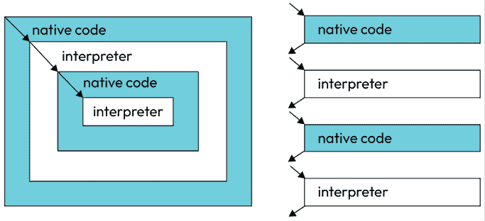

图 1.1: 比较如何与原生调用栈集成的各种方法

在这种情况下，我的目标是最大限度地提高该解释器使用位置的灵活性，因此我们的设计将尽可能委托给外部语言。从解释器内部创建回调可能会限制它的用法，特别是当更复杂的操作由代码处理时。因此，我将让回调从处理协议本身的帧之外运行。

由于我在第一个版本中将范围限制在同步协议上，我只需要为每个 socket 支持一个执行线程。然而，由于我们是从解释器之外执行回调，它们将能够调度额外的异步工作。

此外，可能会有许多 socket 运行着解释器的不同实例，以便处理多个并发请求。为了避免多次解析代码，我们需要创建一个只能初始化一次并可以为每个连接复用的引导环境。

这距离解释器如何工作的完整设计还很很遥远，但它为我们设定必须设置的约束和要求提供了一个良好的起点。这同样说明了构建一个解释器包含多少复杂性。

# 总结

编程语言是我们作为软件工程师和开发者文化中不可或缺的一部分——它们定义了我们如何看待想要解决的问题。这种文化的重大变化有时是由引入完全全新的通用编程语言驱动的，但通常情况下，专注于非常有限用例的 DSL 对各种编程语言中解决问题的方式的影响往往要深得多。

设计和实现一种新编程语言需要仔细考虑第一个版本中需要支持的内容，以及哪些可以推迟到未来的实现中。在书中，我们将重点缩小到一个专注于实现网络协议的 DSL，其中第一个版本限制在如 HTTP/1.1 等同步请求-响应协议。

除了定义范围之外，我们还必须定义一些更具体的指南，例如我们将如何使用 `sans I/O` 方法来允许编程语言被用于更多场景中。

同样，我们将避免将解释执行代码的执行与原生栈耦合，这将为任何使用解释器的人提供关于如何处理并发、回调和执行的各种选择。

在下一章中，我们将关注编程语言所使用的各种抽象层级的重要性，这些抽象层如何使特定类型的问题变得更容易解决。

## 获取本书的 PDF 版本和独家额外

扫描二维码（或访问 [packtpub.com/unlock](http://packtpub.com/unlock)）。按名称搜索本书，确认版本，然后按照页面上的步骤操作 |  |

| **注意**：请保留好发票。直接从 Packt 购买不需要发票。 |

# 2

# 原生代码、虚拟机与解释器之间模糊的边界

在本章中，我们将探索由运行时建模驱动的编程语言执行模型——原生代码、虚拟机和解释器——之间的区别如何变得日益模糊。具体来说，这些是我们将涵盖的主题：

* 现代计算机**指令集架构** (**ISAs**) 不再能简单地映射到硬件中的具体操作
* 解释器如何也作为特定虚拟机的模型运行
* 对抽象化复杂性的影响以及这些抽象所产生的开销进行推理
* **即时编译** (**JIT**) **编译器**如何改变我们对解释型语言性能的思考
* 以及最后，在设计你自己的语言时如何思考这些主题

在本章结束时，你将获得足够的背景知识，来帮助思考什么种抽象级别对于自定义编程语言是有意义的，以及这种抽象如何为未来的优化留出空间。

## 现代 ISA 是某种虚拟机

早期的微处理器和微控制器在汇编代码中的指令与实际硬件操作之间有着非常直接的关系。这对于今天的一些简单架构（如某些用于嵌入环境的架构）仍然适用。然而，当我们目标是现代**通用架构**时，情况发生了显著变化。


这一章节的目标不是给你上一门关于 CPU 如何工作的课程，但我认为我确实需要确保大家具备基础性的理解，对于那些可能没有考虑过代码如何在硬件中实际执行的人来说。浅的描述是：“根结底，一切都是 0 和 1。”虽然事实如此，但这并不是一个能引发对问题更深层次理解的描述。

让我们从一个非常简单的架构开始，逐渐添加现代指令集（ISA）中出现的某些复杂性。这绝不是要详尽的；这只是为了说明在你的面前隐藏了多少层抽象。插图 `2.1` 描述了一个简单的假设硬件架构模型。

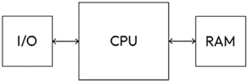

图 2.1: 一个简单的硬件架构

该图看起来足够简单。内存中存在可执行代码，CPU 将读取并执行它们，CPU 的某些操作将读取和/或写入内存和/或输入输出。一些非常简单的微处理器和微控制器仍然以此方式运行。

在这里，从内存中取一个字（word）所需的时钟周期并不等同于两个数字相加所需的时钟周期，后者更快，因为它在 CPU 内部发生。增加复杂度的是，内存的时钟可能与 CPU 的时钟显著不同。

在简单架构中，这通过厂商规定在与内存交互的指令与其他任何内存指令之间，以及任何接触这些操作所用寄存器的指令之间，存在最小数量的 CPU 操作来解决。编译器可能会在你的代码中添加一些 `NOP` 指令（`no operation` 的缩写）以确保满足这些约束。

随着我们在系统设计中增加更多复杂性，那种简单的方法可能不再适用。让我们假设硬件现在支持用于内存访问的片上缓存。插图 `2.2` 直视觉化描述了这一点。

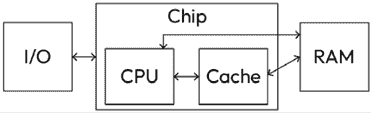

图 2.2: 一个简单的硬件架构，现在有了片上缓存

图 `2.1` 中的模型与图 `2.2` 中的模型之间的区别非常简单。我们只是在 CPU 内部添加了一个缓存层，这样如果你反复从内存中提取相同的地址，我们就可以使用这种更快的访问方式，而不必等待内存所需的所有同步约束。与整体内存相比，这是一个非常小的缓存，但它对紧密操作的益处是不可否认的。

将该缓存直接暴露在指令集中也是可能的。你只需要添加几个直接操作缓存的运算，例如：

*   检查页面 `0xDEADBEEF` 是否在缓存中。如果在，则返回缓存地址。
*   将 `0xDEADBEEF` 取到内存中并报告其存储的缓存地址。
*   将寄存器 `R1` 中的值存储在缓存地址中。
*   将此缓存地址中的值推送到实际内存地址。
*   驱逐此缓存地址中的条目。

现在再增加一个部分。插图 `2.3` 描述了一个我们现在同时拥有片上缓存和片外缓存的架构。这些组件之间的连接数量应该让你直观看到这引入了多少额外的复杂性。

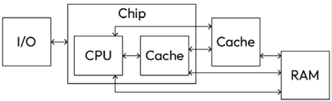

图 2.3: 一个简单的硬件架构，现在有了片上和片外缓存

让我们想象，当你从没有 CPU 内部带有这种小缓存的架构升级到带有该缓存的架构时，刚刚花了大量时间优化你的代码。你规划了所有的访问模式，以确保只有在真正值得时才使用缓存，以避免驱逐你预知很快就会需要的内存。

现在，厂商向你发送了他们下一代 CPU 的规范，他们在 CPU 之外又添加了一个新的缓存层，这一层比内部的慢，但仍然比直接访问内存要快一个数量级。第二层缓存也显著大于第一层，尽管仍然远未达到实际内存容量。

如果该缓存引入了整套新指令，就意味着你的程序可能需要重写（如果你是直接用汇语言编写的话），以利用新功能。

在我们结束这段讨论之前，我想在结束本节之前先将热度推向高潮。在插图 `2.4` 中，我们可以看到一个更接近现代架构复杂性的模型。它提出了不同的挑战，即同步和缓存失效，更宽泛地描述为缓存一致性（cache coherency）。

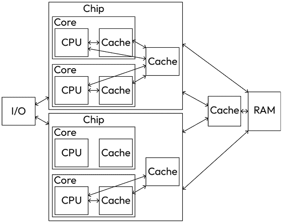

图 2.4: 一幅更接近现代架构的图，具有不同层的缓存和多处理能力

假设运行在不同 CPU 上的代码正在读写同一个内存地址。如果 CPU 只接受来自自己缓存的值，它可能会返回过时的值。因此，需要一种协调机制，每当值发生变化时，使缓存每一层中的值失效。

现在想象，如果对缓存失效的控制作为 ISA 的一部分暴露出来，并期望程序自行管理。这将导致极其大量的复杂性，并且更容易出错。但可能重要的是，这意味着在程序针对新 CPU 进行构建之前，提供新功能的 CPU 新版本将是无法被使用的。每个应用程序都必须针对所使用的特定 CPU 模型进行构建。

尽管如此，当你听我说出时，可能不会感到惊讶：现代指令集（如 `x86_64`）并没有向程序暴露操纵各级缓存和同步的指令，而是仅提供非常高级的原语来影响缓存一致性的实现。


最终结果是，程序中的指令无法直接映射到硬件执行上。相反，它们由底层的 `CPU` 指令控制逻辑处理，该逻辑位于 `ISA` 和底层电路之间。

该控制逻辑的实现方式取决于 `ISA` 和 `CPU` 设计方法的取舍。例如，在 `x86_64` 中，这是通过微码（microcode）处理的，微码是 `CPU` 的内部固件，用于将 `ISA` 指令转换为特定的低层硬件操作。这些微操作是 `CPU` 私有的，这允许厂商灵活地更改它们，而无需重新编译程序。

`精简指令集计算机`（`RISC`）架构，例如`高级 RISC 机器`（`ARM`）或 `RISC-V`，采用了不同的方法。由于指令简单得多，`CPU` 将使用硬件电路来操纵执行序列、同步点以及执行的其他方面，而无需依赖微码。

我们要得出的结论是，在如今，利用直觉来优化代码是不现实的。优化性能的唯一有效方法是通过测量和实验。

这种观点在当今编译语言中的适用程度可能并不完全显而易见。内存访问模式是目前影响现代架构上运行的大多数应用程序性能最重要的因素。此外，不同架构之间执行模型的差异性也导致了显著不同的性能特征。

## 原生编程语言也有虚拟机模型

正如运行在我们现代架构中的原生代码一样，原生编程语言也不是运行代码的计算机物理架构的直接表示。如果是那样，这种编程语言将无法真正在多个架构上工作。或者，可能更重要的一点是，在语言原始设计之外的新架构上将没有优化的空间。

以 `C++` 语言为例，标准实际上描述了该虚拟机是什么、它的能力是什么、它需要提供什么样的保证，以及更重要的是，它不需要提供什么样的保证。标准中使用的术语是`抽象机器`（`abstract machine`）。符合规范的 `C++` 实现需要遵守这些要求和保证。

实现所所需的保证的一个示例是：不同的内存位置应该能够被独立线程访问，使得对一个位置的写入不会改变另一个位置的值。

这与我之前描述的位于不同缓存层级的内存位置的并发访问以及对缓存一致性要求的管理相似。但这里存在显著的区别，因为物理架构会根据物理地址和缓存行来实现缓存，而 `C++` 抽象机器则根据内存位置来规范行为。这种区分很重要，因为它为实现留下了空间，可以优化内存访问模式以有利于特定的缓存策略或其他策略，具体取决于目标架构。

同样，该抽象机器的某些特征被特意未指定，这允许在实现执行 `C++` 代码的策略时拥有自由。例如，函数调用参数列表中表达式的计算顺序是没有定义的。这意味着，如果你的代码期望一个参数的表达式对另一个参数产生副作用，你将无法获得特定的行为保证。这意味着实现允许改变执行发生的顺序。除非受到顺序要求的限制，否则用户不允许期待特定的行为。

我在这里描述的内容听起来可能像是关于 `C++` 标准构思的复杂细节。事实上，每种编程语言都有一个抽象模型，说明要求和保证是什么，以及哪里有实现优化的空间。只是由于 `C++` 有多种实现，这些要求需要更仔细地指定。

理解你所使用的编程语言的抽象机器将使你编写出更符合该语言的代码，并可能在无意中依赖未定义行为的情况下避免许多意外。

同样，在设计编程语言时，更有意识地为你的语言设计抽象机器将使你受益。

## 作为虚拟机的解释器

正如前面提到的，现代 `ISA` 就像虚拟机。同样，解释器也是一种与执行硬件保持距离的执行模型，因为它在软件和硬件之间引入了一层抽象。

将 `Python` 或 `Perl` 等解释器理解为虚拟机并不是显而易见的。从历史上看，原生代码和解释型代码之间的区别要清晰得多，直到 `JVM` 在仍然是解释型代码的基础上引入了显式的编译步骤。`Java` 中的编译步骤明确了在高级语言和执行之间存在着某种东西。然而，任何深层钻研过任何解释器的人都会知道，这种区别一直存在。

解释器最终所做的是针对一个距离原生 `ISA` 还有几个抽象层级的运行时环境。确实，解释型语言虚拟机的结构比针对原生 `ISA` 的编译器需要考虑的要高抽象得多。然而，解释器需要提供将原生平台封装在其执行环境中的抽象。

无论是 `JVM`、`.NET 通用语言运行时`（`CLR`），还是诸如 `Python` 或 `Perl` 等语言核心的字节码解释器，每个解释器都定义了一种执行模型，将高层编程语言的语义翻译为托管环境内的运行时行为。

在下一节中，我将强调即使我们在技术上与原生机器隔着几层，解释器实际上可能比原生语言更好地解决特定问题。

## 复杂性的抽象与执行开销

在理想的世界里，我们只需要解决一次任何问题，然后该解决方案就会出现在任何出现相同问题的其他语文中。然而在现实中，这是一个要复杂得多的问题。主要的挑战在于，每一层间接都会在计算成本和内存使用上引入开销，而这些成本在复杂系统中很容易累积。

平衡抽象和开销一直是编程语言解释器实现中最大的权衡。一方面，你不想让你的解释器针对任何特定环境（无论是操作系统还是 CPU 架构）高度专门化。另一方面，你为了使其通用而引入的每种抽象都会导致潜在的开销。

然而，在某些情况下，抽象封装了大量的复杂性，以最优化的方式执行它可能是最佳选择。我在上一章中提到了正则表达式，很少有例子像它那样有力地说明正确的抽象实际上可以导致更少的开销。


为了方便说明，也为了帮助那些没有编写正则表达式经验的读者，我将仅使用一个场景来演示这种抽象实际上是如何产生更高效代码的。别担心——我会进行拆解并解释：

```
\(([^()]+|(?R))*\)
```

这个正则表达式将匹配文本中平衡的括号。假设你有如下以下文本：

```
This is text with (a balanced (but recursive)) set of parenthesis (maybe more than one).
```

它将匹配任何被平衡括号对包围的文本。第一个匹配是：

```
(a balanced (but recursive))
```

第二个匹配是：

```
(maybe more than one)
```

它的工作原理如下：

- 开头和结尾的 `\(` 和 `\)` 匹配左括号和右括号字符本身。
- 内部的 `(` 和 `)*` 创建了一个可以重复零或多次的分组。
- 在该组内部，有两个备选项，由 `|` 表示：
    - `[^()]+` 匹配一个或多个不是左括号或右括号的字符。
    - `(?R)` 当字符是左括号或右括号时，递归并尝试再次匹配整个正则表达式。

在这一行代码中，我们指定了一个复杂的递归状态机，它将扫描文本并返回带有平衡括号的文本片段。我把这留给你作为一个练习，让你自己想象一下用你喜欢的语言需要编写多少代码才能实现相同的功能。

这不仅仅是表达能力的问题。执行正则表达式匹配的引擎可以进行微优化和精调到完美，因为它的输入和输出要窄得多。但更重要的是，这些优化在任何使用正则表达式时都是可复用的。

将“编写一个遍历文本以寻找匹配项的复杂状态机”这一抽象进行封装，也许是高级抽象带来显著性能提升的最强有力的例子之一。当语言本身具有较高的执行开销时（例如解释型语言的情况），这种情况下变得尤为相关。

但即使你考虑在原生语言（如 `C++`）中进行实现，普通工程师也很可能产生无法像正则表达式引擎那样优化的代码，至少不付出巨大的努力。

找到合适的抽象并展示出来，无疑是整个练习中最困难的部分。正如我在章节较早之前讨论的那样，如果 `ISA` 架构包含了让用户管理缓存的原语，那么处理器中的微代码将没有更小的空间来优化代码。

统一内存访问的抽象概念并不真正符合现代机器架构的工作方式。浅显的分析会认为它限制了性能，因为这意味着巨大的开销。然而实际上，这种抽象为优化创造了非常大的空间，这些优化是原始设计者可能从未考虑过的。

我希望到这里，你已经清楚了为什么我针对这个主题进行了这段略显刻意的旅程。我想作为练习留给你的是：去思考一下你的新编程语言和运行时将引入什么样的抽象，这些抽象不仅能为表达能力开启重要途径，还能为实现中的优化留出空间。

到目前为止，我已经展示了选择原生运行时和解释型运行时之间存在权衡，并且计算需要考虑这样一个事实：更高级的概念可能允许解释器实现更优化的代码。`JIT` 编译器的使用使得这些计算变得更难以评估。我将在下一节中重点讨论这一点。

# JIT 编译器如何改变性能计算

虽然抽象在非常特定的情况下可以带来更高的性能，但解释器执行直观的命令式代码始终会引入大量的开销。然而，随着 `JIT` 编译器的出现，即使是这种开销也变得难以预测了。解释器现在可能会根据编写代码的程序员所不可见的启发式算法，为代码中的特定位置生成原生代码。

为了说明这一点，我将关注编程语言设计中的一个重要特征，即它是静态类型还是动态类型。动态类型语言的一个论点是，编写更具复用性的代码容易得多，而在静态类型语言中，这种可复用性取决于更高级的语言特性，例如 `C++` 中的模板，因为编译器需要知道值的确切二进制表示才能生成代码。

然而，为了实现这种灵活性，动态类型语言不可避免地具有额外的开销，因为这些决策被推迟到运行时，解释器需要在运行时保留整个类型系统的信息，并用每个值的类型封装所有值。这不仅导致了额外的内存消耗（因为你不能仅仅将一个整数存储为四个字节），而且意味着在执行任何操作之前，你还有额外的步骤。

让我为你提供一个简单的代码片段来说明这一点。以下是一个 `Python` 函数，用于返回斐波那契序列中的下一个项：

```python
def next_fibonnaci(a, b):
    return a + b
```

由于 `Python` 解释器无法预测 `a` 和 `b` 的真实底层类型是什么，甚至不知道 `+` 运算符对这些类型想要做什么，它唯一的选择是在运行时内省这些类型是什么，并识别在对两个数字求和之前是否需要应用运算符重载。

当你考虑评估你代码的性能时，你很清楚这种开销将至关重要。你不一定知道的是，`Python` 解释器可能会使用启发式算法识别出你的代码非常频繁地带有两个整数参数调用此函数，因此生成该函数的 `JIT` 编译版本是有意义的。

`JIT` 编译器可以做的是实现静态类型语言的有限优势，因为代码库的特定部分可以转换为更高效的原生代码，例如，数字仅以四个字节表示，而没有动态类型系统的开销。决定何时执行这种优化的仪器所需的成本，以及运行 `JIT` 编译器本身的成本，需要在整体性能图中进行考虑，但经验表明这些通常会产生良好的权衡。

我在这里的目标不是给你提供关于 `JIT` 编译器如何工作的完整视角，我也没有计划在本书中实现一个。然而，我认为这个视角展示了这些计算实际上是么难以预测。而且，专注于让你的编程语言变得有用，比过早地优化掉每一个开销更重要。

在下一节中，我将开始为我将开发的编程语言做出权衡决策。


*   Haskell 完全抽象了关于执行顺序调调的命令式概念。这允许编译器隐式地将计算分散到不同的执行线程中，包括决定将启动多少个执行线程，甚至决定是否会发生执行。
*   Perl 抽象了文本、数字和布尔值之间的区别。操作符将值强制转换为它们所需的特定语义，而这些值本身并没有类型。这允许运行时通过仅计算一次这些强制转换来优化，而不是每次转换都允许运行任意代码。同样，类型检查也被极大地简化了。
*   正则表达式抽象了评估复杂匹配规则所需的一系列复杂的状态机和递归。这使得实现层可以根据给定正则表达式的具体情况选择截然不同的策略。
*   SQL 将关系代数抽象为一种直观的语言，该语言表示基本的代数运算，而没有指定数据库为了执行这些操作必须使用的特定机制。这使得数据库能够根据数据库本身的内容选择精细定制的执行计划。
*   Erlang 为这种以消息传递作为主要通信形式的语言抽象了可靠性机制。这允许运行时实现不同的策略，取决于消息是在同一地址空间内的对象之间发送，还是跨越不同的网络实体发送。

我在这里建议的练习是，当你考虑你自己的编程语言时，你应该尝试识别出哪些是提供独特能力的抽象。由于这种抽象，哪种事情会变得更容易实现？

对于我们在书中作为练习要构建的语言，我想关注在两个特定的抽象上：

*   **将输入输出操作和调度抽象化**：这意味着该语言将不提供管理这些事项的操作，而是运行时将拥有完全控制权，以根据特定上下文来优化执行。
*   **抽象命令式控制流**：该语言将描述网络协议，而控制流将完全由发送和接收内容之间的关系来表示。这将限制使用该语言本身编写的代码中的复杂性，意味着解释器能够将更多的执行降低为原生操作。

我想引起你注意的是，这个决定是在决定任何语法细节之前、或者在编写任何解释器代码之前做出的。我正在尝试阐述的论点是，这可能是你自定义编程语言影响影响的一个方面，它将指导之后出现的许多方面的设计。

# 总结

现代架构和现代编程语言有许多不同的抽象层。这些抽象允许硬件和工具链的设计在实现上具有很大的自由度，这是实现优化的最重要方式之一。

内存访问的方式以及代码执行的排序是抽象模型的一个重要部分，对于硬件和编程语言都是如此。

更重要的是，有时更高层次的抽象允许更强大的结构，这些结构可能更不容易出错，并为优化留出更多空间。正则表达式语言就是此类抽象产生重大影响的良好例子。

对于我们在书中将完成的练习，我们将专注于为网络通信创建高层抽象，这意味着所有的状态机以及与部分读/写的交互都将由解释器隐式处理，从而为优化留出大量空间。

在下一章中，我们将重点讨论并发模型、输入/输出以及指令的建模。

## 获取本书的 PDF 版本和独家额外内容扫描二维码（或访问 [packtpub.com/unlock](http://packtpub.com/unlock)）。按名称搜索此书，确认版本，然后按照页面步骤操作。 |  |

**注意**：请保留好发票。直接从 Packt 购买不需要发票。

# 3 指令、并发、输入和输出

在本章中，我们将观察不同的编程语言如何处理指令的执行。我们还将完成我们自定义编程语言的决策过程。

我们将讨论以下方面：

*   什么让指令成为编程语言的基础抽象构建模块
*   使用操作符栈与寄存器处理计算的区别
*   语言栈与解释器栈的区别
*   在解释器设计中（无论是在原生语言中还是在解释语言中）如何需要考虑控制流的干扰
*   原生代码的执行对于解释型语言来说如何是另一种形式的中断
*   不同语言如何处理并发执行，以及这如何影响解释器的设计
*   如何结合所有这些方面来指导我们解释器的设计

到本章结束，你将对编程语言的不同设计方面如何对指令执行建模有细致的理解，以及它们应该如何指导你的设计。

## 作为构建模块的指令

紧随我们在上一章的讨论，我想进一步跳出基础抽象，深入到编程语言如何工作的具体具体方面。特别是，我想关注任何执行环境的最小工作单元：指令。

在特定硬件平台的指令集架构中，一条指令的边界非常容易识别。指令的特定实现被抽象掉了，微代码将该指令解码为一组由实现定义的微指令，在任何外部观察者看来，这似乎是单一步骤。

将指令概念化为单一步骤是一个非常有用的抽象，它允许硬件设计人员在演进微架构时，不受限于之前硬件迭代中所做出的特定选择限制。

同样，在 `C++` 语言中，这些指令是根据特定的操作定义的，即使这些操作为了完成可能包含几个步骤。例如，当你调用一个虚方法时，该操作向用户呈现为单条指令，即使 `C++` 规范的实现需要执行额外的步骤，如下：

1.  解析该特定对象的虚表地址
2.  从该虚表中获取要调用的实际函数的地址
3.  根据本地调用约定，设置异常回溯信息、函数执行后的返回点、函数参数以及返回值管理
4.  跳转到正在执行的具体函数的开头

**虚函数表**

虚表也被称为 `vtable`。它包含了 `C++` 代码中定义的所有虚函数的指针，其值指向为创建的实际对象所属类的正确解析的成员函数。


将所有这些操作抽象为单一的离散单元，为优化提供了大量空间，并能够适应编译器的实现方式。如果虚拟方法调用没有被指定为单一操作，编译器将无法为该实现选择不同的策略。

在某种程度上，设计解释器就像设计一个新的硬件平台。你正在设计特定的抽象点，对于正在执行的代码来说，这些抽象点将视作一个不可分割的单一步骤，无论底层需要发生多少次操作。这类似于在内存中存储一个值在编译器看来像是一个单次操作，而实际上，它涉及到对许多许多层级缓存的管理以及数据同步需求。

接下来，我们将重点关注组织这些指令处理的两种不同策略。

## 操作符栈与寄存器

硬件指令通常组织为线性操作序列，这些序列使用本地存储空间作为临时区域，将数据从一个执行点传递到下一个执行点。寄存器是处理该操作序列中中间值的机制。

让我们考虑 C++ 中的以下语句：

```cpp
i = j % 5;
```

硬件指令集架构很可能没有这样一条指令：直接从内存中一个变量的地址读取值、执行取模运算，并将结果存储在另一个变量的地址中。

相反，指令更有可能执行以下操作：

1. 从内存读取变量 `j` 的值并将其存储在 `register 1` 中
2. 将 `register 1` 的值除以 `5`，并将余数存储在 `register 2` 中
3. 将 `register 2` 中的值存储到变量 `i` 的地址

虽然这并不复杂，但它说明了我想表达的观点：寄存器是数据跨越线性执行指令进行流动的机制。这是大多数原生指令集架构的工作原理。

在设计解释器的执行模型时，可以通过创建虚拟寄存器并提供一种在这些寄存器上运行虚拟指令集架构来复制相同的方法。这种方法的一些著名示例如下：

* 通用语言运行时 (CLR)，支持 C# 语言的基础
* LLVM 中间表示 (`IR`)
* Lua 语言解释器
* Dalvik 虚拟机，Android 的一部分

这些也被称为寄存器机（register machines），它们并不是指令执行建模的唯一方式。在编程语言解释器背景中使用寄存器机是一项较近的进展。

大多数解释型编程语言使用不同的模型来表示指令以及值如何从一条指令流到另一条指令。在栈机中，操作符被组织成一棵树，其中给定操作的输入是一个或多个其他操作的结果。

如果我们看之前作为示例的相同代码，代码将被翻译成操作树，每个节点取其子节点的结果作为输入，如下所示：

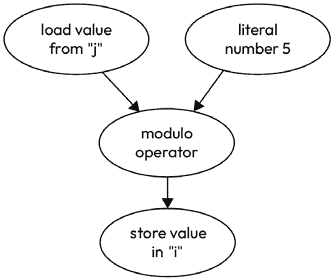

图 3.1: 在栈机中表示 `i = j % 5`

前面的图显示了树中的每个节点代表一个操作，该操作以其他节点的形式接收零或多个值作为输入，并本身产生一个可以作为另一个操作输入的值。

将执行建模为操作栈的最大优势是，从语言语法到解释器需要完成的工作转换非常容易。不需要担心可用寄存器的数量、给定操作是否期望值在特定类型的寄存器中，或者在进入和离开函数调用时保存寄存器的状态。解释器只需对操作符树进行深度优先遍历并将值向下传递。

以下是一些实现为栈机的解释器的著名示例：

* Java 虚拟机 (JVM)
* Python
* Perl
* Ruby

广泛的研究和文献比较了栈机和寄存器机的优缺点。我的目标不是解决这个问题，甚至不是深入研究这些比较。我的目标是向你提供足够的背景，以便如果你对这个主题感兴趣，可以进行更详细的研究。只需说，成功的解释器和虚拟机已经使用这两种方法被创建出来了。

对于本书书中正在创建的语言，我将专注于构建一个栈机。做出这一选择的原因是，这将更容易关注设计的其他元素，特别是当我们从解析编程语言中的文本转向设置解释器中的操作时。

接下来，我将通过从单个操作移动到语言如何表示每个执行帧（frame），在我们的解释器抽象上提升一级。

## 解释器栈与语言栈

在解释器和编程语言的上下文中，`stack`（栈）一词可以有许多含义。在寄存器机的语境下，栈是在进入新函数时寄存器的保存状态。这使得一个函数的执行能够使用寄存器，而无需知道调用它的函数正在使用哪些寄存器。

然而，在栈机的情况下，操作符本身形成了一个栈，但在那种情况下这个词具有不同的含义，因为它不代表语言本身中栈帧（stack frames）的高层抽象。

这种区别在于：作为语言本身特性的函数调用栈、如何传递参数以及如何产生返回值，与解释器执行其指令的实现细节之间的区别。

实现为栈机的解释器仍然需要一个更高层次的结构来表示语言本身中的执行作用域（scopes）。在这种情况下，栈帧通常代表单个函数的执行状态。调用函数是一个操作，结果是将当前帧推入（push）向下。

让我们考虑下面的示例，它展示了一个计算阶的简单递归函数：

```cpp
unsigned int factorial(unsigned int i) { 
    if (i <= 1) { 
        return i; 
    } else { 
        return i * factorial(i-1); 
    }
}
```

如果我们将其翻译成假设栈机的操作符，它看起来就像图 3.2 所示：

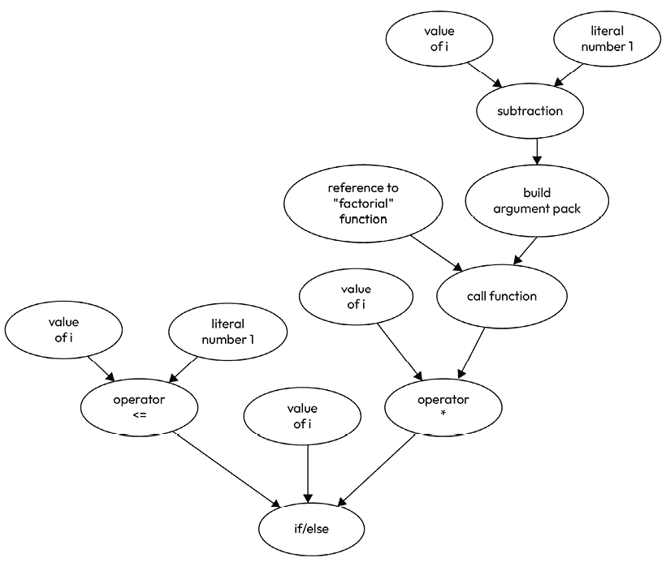

图 3.2: 递归阶乘函数的栈表示

这里需要注意的是，我们有操作符在获取变量 `i` 的值，但无法知道要获取哪一个特定的变量实例。

这特别相关，因为这是一个递归函数，所以当执行 `call function` 操作符时，它需要将当前上下文推入并启动一个新的执行上下文。执行上下文是栈帧，它现在根据编程语言本身的高层抽象定义。栈帧需要持有局部变量和当前的执行状态。

语言栈帧将持有关于执行上下文来源的信息，允许解释器在当前帧执行完毕后知道返回到哪里。


*图 3.3* 展示了语言栈帧之间的关系，并希望通过与栈机操作的提供足够的对比，以清晰地界定它们的区别：

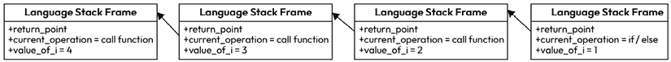

图 3.3: 以 4 为参数执行递归阶乘函数的函数调用栈

在前面的图中，我们看到了从参数 4 开始的阶乘函数执行过程。当栈机到达“调用函数（call function）”操作操作时，它会创建一个新的语言栈帧。新的栈帧持有指向返回点的引用并启动执行过程。在这一特定状态下，最内层的帧在被以参数 1 传调用时，已准备好返回 1。

在之前描述的假设栈机中，求值是纯函数的，执行的唯一方法是完成树中的操作。你可能已经注意到，尽管原始示例代码显式使用了 `return` 关键字，但栈机中的操作只是让值流通过了 `if`/`else` 操作。

在下一节中，我们将关注控制流并不总是操作符树的纯遍历的不同方式，以及在设计解释器时如何考虑这些情况。

## 控制流的中断

从技术上讲，可以将任何控制流重写为栈机形式。然而，除非你有特定的技术理由要那样构建你的解释器，否则允许执行过程中的控制流被中断并移动可能更有意义。

一个简单的例子是当 `return` 语句深嵌套在多个条件语句中的情况。可以重新组织操作，使执行始终流回栈机，但通过允许一个“return”操作来中断栈机的求值并直接回溯（unwinds）语言栈帧，可能会更简单。

但 `return` 只是我们在大多数现代编程语言中看到的控制流中断中最简单的一种。以下是其他几种情况：

- 跳出循环（Breaking out）
- 异常处理
- 短路逻辑运算符

支持此类情况的栈机需要停止对操作树的特定子集的求值，并跳转到另一个部分。在异常处理等情况下，它可能需要遍历多个语言栈帧，直到可以调用异常处理代码。

这些设计方面在事后集成到你的解释器中要困难得多。尝试在一个成熟的解释器中补救异常处理的支持，将比从一开始就考虑它困难得多。

相反，你的编程语言的能力需要与你解释器的能力对齐。尝试为一种在解释器中缺乏机制的编程语言特性添加支持，会让事情变得极其困难。

我想向你提出的挑战是，思考控制流被中断的不同方式，以及这将如何改变你解释器的设计——特别是存储在每个语言栈帧中的数据如何变化。

在下一节中，我将关注与原生语言的关系如何影响解释器中的控制流机制。

## 跨越原生代码和解释代码的延续

解释器执行的所有内容并不都会映射为解释器指令。正如我之前描述的，构建新编程语言的最重要工具之一是创建强大的抽象，允许解释器构建不同的方式来解决问题。

与输入输出的交互通常需要你的解释器将语言的高层结构与底层原生编程语言及操作系统的低级概念建立接口。

例如，你的编程语言可能处理编码后的文本，但底层的操作系统通常按字节（octets）运行。因此，你的解释器将承担翻译这些不同语义的责任。

这种情况发生的一个例子是：你可能会进行部分读取，从而给你一个 Unicode 代码点的一半，如果你的解释器想要向用户展示文本，它需要为用户透明地处理这些部分读取。

## Unicode 代码点

Unicode 代码点是一个抽象概念，整个数据库中的任何字符都被分配了一个唯一的数字。不同的文本编码会以不同的方式表示内容，这通常导致单个字符需要多个字节。

考虑这种问题的一种方式是：解释代码的执行被阻塞在原生调用的处理上，只有在这些原生调用完成后才能恢复。

从网络套接字读取和写入套接字的示例是解释器需要挂起以处理原生操作的最明显的情况。在其他情况下也如此：

- 将执行控制权移交给原生代码中的扩展点
- 计时器，例如 `sleep` 系统调用
- 处理进程信号

可以实现这些情况，让解释器按照执行顺序执行这些操作。这就是 Perl 和 Python 处理这些情况的方式。一个交织了解释器调用和原生调用的 Python 程序的原生栈轨迹，直接表示了这一点。

另一种方法是使用“延续（continuations）”来表示原生代码和解释代码的执行。我在之前的一个章节中简要提到过这一点，但现在我想详细说明这个概念。

C++ 程序的执行由原生栈帧表示，它包含一组寄存器的状态，其中包含指向要执行指令的指针。挂起或恢复程序的执行通常由操作系统控制。

虽然预计系统调用可能会阻塞执行，但在调用阻塞期间发生什么完全由操作系统控制。

这并不是说你不能写一个非阻塞方式管理系统调用的 C++ 程序，但指令的顺序执行是抽象机器的基本特征。即使操作系统执行了上下文切换，对于正在运行的代码也是不可见的，而且没有机制可以从编程语言控制这些上下文切换。

虽然你也可以通过 `setjmp` 和 `longjmp` 等调用直接操作执行，但它们只是重定向顺序执行，而不能阻止或中断阻塞的系统调用。

然而，解释器可以提供不同的抽象。解释代码的顺序执行可以被视为一个受管理的任务，这意味着解释器将像操作系统调度进程一样调度它的执行。在这种情况下，解释器负责调度和执行这些任务。

Node.js 解释器是代表解释代码执行这种调度的解释器示例。I/O 操作以回调的形式表示，大多数会阻塞原生执行的调用也是如此。解释器跟踪所有管理任务，无论它们是阻塞在特定事件上，还是已调度并准备好执行。


然而，这并不限制原生代码（native code）。由执行该调度任务的解释器所调用的原生代码需要遵循解释器的约定；否则，它可能会阻塞其执行，因为原生代码是不受管理的。

延续（Continuations）是代表待由解释器调度的执行状态的抽象：

*   解释器延续将引用正在执行的语言栈帧（language stack frame）。
*   原生延续将代表将执行的执行权委托给非托管代码。

当解释器为可能阻塞执行的系统调用提供抽象，并提供建立信息流和延续执行就绪状态的机制时，它将为解释器留出空间，使其以一种将原生栈（native stack）与解释器栈解耦的方式调度该执行。

在下一节中，我将重点关注延续的概念如何与并发管理相关，以及这将如何允许解释器产生一个更健壮的执行模型。

# 并发模型

在复杂的应用程序中管理可能阻塞的操作并不是一项简单的任务。在最简单的设计中，代码将仅以阻塞的方式执行系统调用，并发执行将由操作系统管理。你为每个任务创建一个线程，并以线性方式执行操作。

然而，这大大增加了你的应用程序需要进行的上下文切换次数，而优化这种执行就变成了一个不可移植的操作系统调优游戏：

*   亲和性（Affinity）需要显式管理；否则，共享信息的任务可能会落到不同的 CPU 上，导致大量的同步需求。同时，完全独立的线程可能会落在同一个 CPU 上，产生竞争。
*   调度优先级需要显式管理；否则，负责延迟敏感操作的线程可能最终与执行单个请求的线程具有相同的优先级。通常，每个请求的时间并不如开始处理新请求的延迟重要。
*   线程池的大小需要管理。


*   将初始化一个执行实例，它指向该不可变数据，并仅保留该执行的特定上下文。可以独立地多次执行此操作，一次执行的数据不会与任何其他执行共享。

*   每个执行实例都将有一个续点表，每个续点都带有一个状态，允许执行实例调度已就绪的线性执行代码的续点。在第一个版本中，我们预计此表一次只包含一个续点，但它仍然会跟踪该续点是否正在等待读取或写入等。

*   在转移控制权时（例如从解释型代码跳转到原生代码），将使用延续传递风格（continuation-passing style）完成，这意味着当调用原生代码时，它将获得一个在原生代码执行完毕后应该恢复的执行点。这允许对执行进行各种形式的中断，原生代码可以将执行引导至不同的方向，并丢弃该特定的续点或将其传递下去在跳转后继续执行。当没有更多可运行的续点时，执行结束。未来的版本将允许在执行实例中创建和管理并发续点。

*   语言将不会提供对续点并发执行的控制。相反，它将根据网络协议的需求来表示并发点，尽管这在第一个版本中不会被实现。

解释器和语言需要仔细设计，以确保语言所需的原语对解释器可用。它们还必须确保这些原语具有足够的高级性，以便精炼执行和并发模型。

# 总结

解释器提供的指令是建模抽象的机制，它们是强大的工具，允许解释器在未来精炼它们的执行方式。

某些语言和解释器使用寄存器机器，其中指令操作这些寄存器，因为这些指令的执行是线性的。其他语言使用栈机器，其中指令表示为操作树，执行过程是对该树进行遍历，树中向下节点的输出代表了它们所连接的下游节点的输入。

然而，栈机器可能仍然需要一个语言栈帧来表示更高层的状态，例如对变量的递归访问。

解释器还需要考虑如何中断执行，例如当你有一个 `return` 语句时，或者当你处理可能会阻塞代码执行的调用时。

续点（continuation）代表执行在任何给定一点的状态，这种抽象应该允许我们管理解释型代码与原生代码之间的关系。

不同的语言和解释器具有不同的并发模型，语言提供的抽象级别将赋予解释器更多或更少控制代码如何执行的权利。

我为这本书编写的语言和解释器在第一个版本不需要支持解释型代码中的大量并发，尽管它应该支持多个独立的执行实例。然而，我还需要确保它不会阻碍未来的开发。

在下一章中，我将关注建模解释型语言使用的数据类型、用户如何指定类型，以及这如何影响与原生语言的关系。

## 获取本书的 PDF 版本和独家额外奖励

扫描二维码（或访问 [packtpub.com/unlock](http://packtpub.com/unlock)）。按名称搜索此书，确认版本，然后按照页面上的步骤操作。 |  |

**注意**：请保留您的发票。直接从 Packt 购买不需要发票。 |

# 第 4 章：原生类型、用户类型和扩展点

在本章中，我们将研究不同的语言如何使用不同的类型系统、用户如何创建自己的类型，以及为你自己的语言建模类型系统的不同方法。我们还将研究这与需要与解释型语言类型系统交互的原生代码的关系。

我们将讨论以下方面：

*   不同语言使用的类型系统类型
*   原生语言类型和用户定义类型有何不同以及它们如何交互
*   如何思考建模类型系统
*   类型系统如何与原生语言交互

到本章结束时，你将对类型系统如何与解释器交互有细致的理解，语言设计如何影响并被类型系统影响，以及如何开发一个框架来帮助思考不同语言中类型系统的不同特征。

## 不同类型的类型系统

与执行模型一样，`类型系统`在不同的编程语言中也是多样化的，建模你自己的语言的类型系统与决定解释器的执行模型一样重要。

类型系统编码了语言理解从内存中存储和检索的可能值的方式，以及可以对这些值执行何种类型的操作。类型系统的细节定义了语言在操作方面的许多选择（即哪些操作是廉价的或昂贵的），这些选择与语言能够呈现的抽象级别相关。从这个意义上说，类型系统是语言抽象机器处理值的方式。

为了使这个解释易于理解，我希望你将类型视为所有可能表示值的集合的表示。你抽象机器中的内存最终必须以内存区域中的位（bits）来编码所有内容。因此，类型描述了如何以连贯的方式解释这些内存区域。

## 静态类型与动态类型

在 C 语言中，例如 `int` 类型表示 `INT_MIN` 和 `INT_MAX` 之间所有可能的整数值，而 `unsigned int` 类型表示 `0` 到 `UINT_MAX` 之间所有可能的整数值。由于这些值的内存区域具有相同的大小（通常为 32 位），相同的位序列将根据类型被不同的不同的解释。

虽然编译器知道特定内存区域应该被如何解释，但由于程序员在源代码中指定了它，这些信息并没有编码在值本身中。运行时没有关于该值的元数据，这减少了执行程序所需的内存。但这也意味着该值永远不会具有与源代码中指定的不同的类型。这使得大量的优化成为可能，因为从代码的运行时特征中可以推导出更多内容。

这就是所谓的`静态类型`（static typing）。这意味着对该特定内存区域的解释没有其他可能的解释。让我们再次查看 `factorial` 函数以理解它的含义：

```
unsigned int factorial(unsigned int input) { 
    if (input <= 1) { 
        return input; 
    } else { 
        return factorial(input-1) * input; 
    }
}
```

输入参数被声明为 `unsigned int`，与返回的类型相同。因为 C 是一种静态类型语言，这意味着内存输入只有一种方式。因此，语言不需要在运行时检查它是否为无符号整数；它可以直接接受这 32 位并对其进行操作。


它允许调用约定进行一项重要的优化，即输入和输出通过寄存器传输，而不是作为指向内存的指针传递。第一行的条件判断可以生成两条简单的指令：

```
 cmp     edi, 1
        jbe     .L10
```

第一条指令将寄存器中的值与常量值进行比较，并根据结果的特征设置标志位。第二条指令如果在比较结果显示值小于或相等时进行跳转。

现在，让我们将其与 Python 语言中的等效函数进行对比：

```python
def factorial(input):
    if input <= 1:
        return input
else:
        return factorial(input-1) * factorial
```

在这种情况下，对于 `input` 变量所使用的内存可以表示哪些值集合没有任何限制。这意味着解释器不能简单地假设它知道如何进行比较。

相反，解释器需要携带关于变量的元信息，这些信息描述了如何解释存储在内部的值，并在运行时发现如何执行比较。

在**动态类型**中，执行将根据所发送值的具体情况进行条件分发，解释器必须在运行时执行这些元操作。

选择动态类型系统是有明确代价的。然而，在我们否定它之前，让我们再深入观察一下。首先运行这个 Python 函数：

```python
print(factorial(13))
```

这将产生值 `6227020800`，计算器将确认这是 `13` 阶乘的正确值。现在，让我们在 C 中调用相同的代码：

```c
printf("%u\n", factorial(13));
```

当我们运行该代码时，得到的值是 `1932053504`，这是不正确的。那么发生了什么？让我们看看将这些数字转换为二进制时发生了什么：

| 6227020800 | | 47 | 0 | 0 | 0 | 0 | 0 | 0 | 0 | 0 | 0 | 0 | 0 | 0 | 0 | 0 | 0 | 0 | 1 | 32 |
| 31 | 0 | 1 | 1 | 1 | 1 | 0 | 0 | 1 | 1 | 0 | 0 | 0 | 1 | 0 | 0 | 0 | 0 | 1 | 16 |
| 15 | 1 | 1 | 0 | 0 | 0 | 1 | 1 | 0 | 0 | 0 | 0 | 0 | 0 | 0 | 0 | 0 | 0 | 0 | 0 | 0 |
| 1932053504 | | |4 | |40 | 0 | 0 | 0 | 0 | 0 | 0 | 0 | 0 | 0 | 0 | 0 | 0 | 0 | 0 | 0 | 0 | 0 | 32 |3| | 1 | 0 | 1 | 1 | 1 | 0 | 0 | 1 | 1 | 1 | 0 | 0 | 1 | 0 | 1 | 0 | 0 | 0 | 0 | 16 |
| 15 | 1 | 1 | 0 | 0 | 0 | 1 | 1 | 0 | 0 | 0 | 0 | 0 | 0 | 0 | 0 | 0 | 0 | 0 | 0 | 0 |


然而，C 语言的类型系统不支持组合之外的其他关系。也就是说，你可以有一个包含另一个结构体的 `struct`（结构体），但语言并不支持通过继承创建一个扩展它的类型，因此你无法在不修改原始类型定义的情况下添加新字段。这对该语言中库的设计方式产生了直接影响。

## 命名类型与结构性类型

让我们来看看 C++ 是如何提供一种“替代”关系的，即一个类型可以被用在指定另一个类型的地方。让我们想象一个简单的游戏引擎：

```
struct entity2d {
    point center;
    rect bounding_box;
};
struct polygon : public entity2d {
    std::vector<point> vertices;
};
struct circle : public entity2d {
    unsigned int radius;
};
```

在这种情况下，`polygon` 和 `circle` 都在扩展 `entity2d` 结构体；结果是，如果我们有像下面的函数，我们可以在函数期望 `entity2d` 的地方使用 `polygon` 或 `circle`，并且同一个函数能够检查 `polygon` 和 `circle` 的包边界是否存在重叠：

```
bool do_entities_overlap(entity2d &a, entity2d &b);
```

大多数面向对象的语言都实现了这种行为。

这就是所谓的**命名类型**（nominal typing），即类型由其名称定义，而可替代性取决于类型之间的关系，而不是它们的属性。如果两个类型的名称不同，即使它们在其他方面完全相同，它们也无法互相替代。

另一种方法是考虑类型的属性，而不是它的身份。在 Go 和 OCaml 语言中使用的**结构性类型**（structural typing）中，如果类型共享了足够的结构，它们就可以互相替代，即使没有建立继承关系。

让我们看看 Go 语言中的这个例子：

```
type polygon struct {
    center point
    bounding_box rect
    vertices []point
}
func (p polygon) get_center() point {
    return p.center
}
func (p polygon) get_bounding_box() rect {
    return p.bounding_box
}
type circle struct {
    center point
    bounding_box rect
    radius int
}
func (c circle) get_center() point {
    return c.center
}
func (c circle) get_bounding_box() rect {
    return c.bounding_box
}
type entity2d interface {
    get_center() point
    get_bounding_box() rect
}
func do_entities_overlap(a entity2d, b entity2d) bool {
    …
}
```

在这种情况下，没有任何东西将 `polygon` 和 `circle` 的声明结合在一起。类型的身份完全相互断开，也与 `entity2d` 的定义断离开。然而，语言将接受任何实现了 `entity2d` 接口所要求的类型作为该函数的参数。

经验丰富的 C++ 开发者会注意到，这些正是 C++20 引入的**概念**（concepts）所提供的完全相同的内容。这很好地说明了语言如何同时跨越不同的范式。

事实上，C++ 模板在很大程度上也作为结构性类型发挥作用，因为模板参数的解析完全基于参数的属性，而不是其类型的身份。

## 鸭子类型（Duck typing）

当我们把结构性类型应用于动态语言时，通常会得到所谓的**鸭子类型**（duck typing），即语言不执行任何命名类型检查，而是完全依赖类型动态提供所需的接口。

在结构性（但静态的）类型语言与执行鸭子类型的语言之间，需要区分一个非常重要的区别。当我们看之前的 Go 示例时，编译器仍然可以在编译时执行**方法解析顺序**（method resolution order），即当继承层次结构存在多个同名方法时调用方法的顺序，这意味着不需要将用于该解析所需的信息带到运行时。

在允许鸭子类型的动态语言（如 Python）中，调用哪种方法的解析需要带到运行时。

为了实现这一点，语言需要指定它将如何内省对象、类信息以及类型之间的关系。当代码调用对象中的方法时，必须有一个良好的指定方式来解析它；我们称该运行时环境为**元对象协议**（**Meta-Object Protocol**, **MOP**），它允许在运行时检查类型的特征以决定需要发生什么。

这并不是该语言的普通用户经常交互的内容。提供反射机制的语言（例如能够获取类成员的名称和类型）使得许多非常强大的编码模式成为可能，而在其他情况下是无法实现的。

某些语言提供只读反射机制。另一些语言则允许用户操作类型系统，就像它是语言中的另一个值一样。

Raku 语言拥有最强大的 MOP 定义之一。你不仅有一种方法导航和操作用于创建对象的类，它实际上还引入了二阶抽象。不仅对象的类本身是解释器中的一个值，类工作方式的实现也是如此，而且可以在同一个程序中并存存在方法解析顺序的替代实现。

在 Python 语言中，对象和类是携带额外元数据的字典，但它们仍然都是在运行时定义的。为了说明这一点，让我们来看下面的代码：

```
def create_accessors(classobj, name):
    def getter(self):
        return getattr(self, name)
    def setter(self, value):
        setattr(self, name, value)
    setattr(classobj, f"get_{name}", getter)
    setattr(classobj, f"set_{name}", setter)
class Foo:
    pass
o1 = Foo()
create_accessors(Foo, "a")
o1.set_a(1)
print(o1.get_a())
```

这表明我们可以将 `Foo` 类对象视为运行时值，并且影响了调度。此外，我们可以看到运行时查找是从对象到类的，因为当我们修改 `Foo` 类时，已经创建的对象也会受到影响。

# 类型系统建模方法

没有确定的方法可以判断一个给定的类型系统是否另一个更好。事实上，大多数情况下可以将一种类型系统的语义翻译到另一种类型系统中，有时很容易，有时则需要很多间接层。

在你开发自己的语言时，要问自己的重要问题是，你想让什么事情变得容易，你想让什么事情变得困难。

例如，如果你想制作一种能更容易编写高性能并行代码的语言，你可能想设计一种所有值都是只读的类型系统，并且只能通过创建副本来做出更改。这将更容易编写出避免跨 CPU 缓存失效的代码，但会让管理更大的数据结构变得更困难。


经典的面向对象模型适用于那些需要对许多不同实体及其关系的用例，并且在不同类型之间存在共同点、这些共同点可以被抽象并在抽象基类中重用的场景。但它使得提供定制点变得更加困难。例如，C++ 语言使用了非面向对象的概念，如模板和参数依赖查找（argument-dependent lookup），这使得库所有者更容易在他们的 API 中提供定制点。

Haskell 语言所使用的模式匹配函数分发，使得对复杂数据结构进行遍历并合成复杂的输出变得非常容易，但它使得人们很难从全局角度理解与单个类型相关的所有代码，因为代码是按函数族分组的，而不是按类型族分组的。

## 你语言的内置类型

归根结底，这一切取决于你的语言的目标。类型系统将是决定你的解释器和编程语言能力的重要因素。这对于`领域特定语言`（domain-specific languages）特别有益，因为你可以针对你非常狭的用例来定制类型系统。

如果你的目标是一门通用语言，那么你仍然需要在灵活性与其他运行时特性（如内存占用和性能）之间进行平衡。

我将通过练习来梳理我在编程语言中想要让变得更简单的事情，这也是本书的一项练习。我的预期这将启发你如何思考你自己的语言的需求。

重要的是，要意识到即使在为语言编写语法之前，我已经在进行这项设计练习了。这是刻意为之，因为我想在花时间考虑它看起来如何之前，先思考语言的能力。

由于这是一门领域特定语言，我不需要一个非常灵活的类型系统，因为预期是用户编写的任何通用代码无论如何都是另一种语言编写的。但我需要能够通过其他语言轻松访问我语言中的数据。

与类型系统的主要交互将通过匹配特定网络协议的规则、给定的输入以及任何可能作为协议部分的字面量来实现。

我将从识别哪些类型应该是语言的内置的类型开始：

*   数字（Numbers）：
    *   不同的大小
    *   不同的编码（网络序、原生序、表示为字符串）
    *   整数或浮点数
*   字节流（Octets）：
    *   不同的大小或动态大小
    *   表示形式（原始字节、Base64 编码、mime 编码）
    *   流或内存
*   文本（Text）：
    *   不同的大小或动态大小
    *   不同的编码（7bit-ascii、utf8、utf16、utf32、iso8859-1 等）
    *   流或内存
*   列表（Lists）：
    *   动态大小
    *   相同类型的成员
*   结构体（Structures）：
    *   固定成员
    *   不同类型的值
*   映射（Maps）：
    *   固定类型的键
    *   固定类型的值

创建这个列表的练习很大程度上在于想象语言将用到的特定情况，并尝试观察我们需要能够表示什么类型的值。

例如，你可能会注意到，在数字部分，我包含了数字编码的一个方面。这是因为网络协议将指定数字的表示方式，而协议规范之间的转换是 bug 的持续性源头。因此，将该部分作为类型系统的基本部分将允许类型检查来防止这些 bug 的产生。

同样，在考虑 HTTP 头部如何工作时，我添加了映射，这意味着应该很容易查找是否存在特定名称的头部以及发送了什么。然后我添加了列表，因为我记得多次发送同一个头部是合法的，所以你需要对特定头部的查找返回一个值列表。

字节流和文本之间的区别也源于允许类型检查防止乱码 bug（mojibake，由于字符编码不匹配导致文本损坏）的愿望，其中值以字节流的形式进入，并被假设为给定的编码。同样，字节流的表示可以是原始字节，也可以是以 Base64 编码的形式发送。

现在是过渡到思考用户类型的良好时机。当我写这个列表时，我意识到，如果某些协议使用了我的语言不支持的编码，并且用户没有办法扩展语言来支持它，这将极大地限制我的自定义语言的实用性。

## 用户将如何声明自己的类型

因此，我的类型系统将围绕这样一个想法：大小和编码是内置类型的参数，这些应该是用户的定制点。

这很好地说明了你作为新语言和解释器设计者所拥有的力量。你可以自由地以不受限制的方式看待问题，并思考你可以做出哪些决策来使语言有用，而这些用途是你仅通过在现有语言中编写库无法轻易实现的。

找到避免类型系统中系统中不必要的复杂性的机会也同样重要。这门语言将拥有在实现特定网络协议时用到的类型。不同协议之间通过其他协议来定义并不常见。

因此，代码复用并不是这门语言的一个重要驱动需求。对于类似的协议，让相似的类型拥有独立的定义可能更合适，而不是尝试它们建立共同的共享类型。

这允许这门语言的类型系统采用更简单的方法，我们不需要支持多态。我们可以实现一个简单的名义类型系统，用户声明静态结构，并将其用于编码网络会话的数据。

能够减少特定用例的复杂度是领域特定语言提供通用语言无法提供的优势之一。

我希望这很好地说明了在设计自己的语言的类型系统时需要做哪些决策。不要被现有设计束缚，在不需要的时候不要羞于移除复杂性。

在下一节中，我将关注你的解释器如何与原生语言交互，无论是构建扩展还是当解释器被嵌入时。

# 与原生扩展的交互

解释器表示数据的方式是实现解释器集成的核心工作，无论是在嵌入式解释器中（如 Lua 解释器中常见），还是当你需要原生库绑定到通用解释器时（如大多数通用解释器那样）。

从解释器类型翻译到原生语言类型的开销是在设计类型系统时需要考虑的重大成本，特别是因为在原生语言中编写代码的人将无法以与语言相同的方式使用这些类型；相反，他们大多数将通过你的 `MOP` 进行操作。


你仍然将面临解释器知道如何与这些类型交互的挑战，但如果你已经引入了代码生成，那么可以用相同的方法解决该问题。

如果你不想将自定义代码的解析作为原生语言的构建步骤，那么在与语言类型交互方面你有两条主要途径：

*   第一种是使用一种动态方式来请求原生语言中特定类型的值，如果用户发出了无效请求，则进行强制转换或错误检查。
*   第二种是使用泛型类型，它可以表示解释器可以处理的任何值，在 `C++` 中，这可以用值可能拥的所有不同类型的 `std::variant` 来表示。

由于访问从网络读取或需要写入网络的数据的性能是使该语言实用的基本特性，我计划选择包含代码生成：既允许用户从我们嵌入的 `C++` 版本的 DSL 中访问数据，也使用代码生成允许解释器访问原生语言中的数据结构。

但由于这会导致该语言在完全动态的环境（例如来自 `Python`）中变得不可用，因此绑定器能够适应不同类型的数据结构，并支持动态表示所有数据结构是至关重要的。

这些要求的最终结果是，我的解释器运行时需要能够执行以下操作：

*   为特定的集成定制化类型表示
*   在与 `C++` 集成时，在构建时为解释器生成数据
*   在与 `Python` 集成时动态生成数据

我希望这能说明解释器运行时的设计在很大程度上是如何受到早期设计问题启发的，以及为什么在为它编写任何代码之前考虑这些问题是重要的。

# 总结

在为你的自定义语言设计类型系统时，你需要在静态类型和动态类型之间进行权衡，在优化机会与语言使用的的灵活性之间取得平衡。

你还需要平衡你想要让语言遵循强类型模型还是弱类型模型，在语言的易用性与类型检查可以提供的正确性保证之间取得平衡。

类型可以根据其身份定义，称为**名义类型**（nominal typing），也可以根据其属性和使用位置定义，称为**结构性类型**（structural typing）。后者使得函数复用变得更容易，而前者将迫使用户在代码复用之前创建更多的共享类型。

无论做出这些选择，你都需要为你的语言设计 MOP（元对象协议），因为这是解释器内部将使用的内容。你仍然可以决定将多少 MOP 反射功能暴露给语言用户，或者将其保留在解释器内部以管理对象和类。这影响到语言的简单性、灵活性和安全保证。

在决定类型系统设计时，思考语言的用例是有用的，这可以让你能够接受必要的复杂度并消除不必要的复杂度。

最后，你还需要决定解释器如何与其他语言交互，那里的选择也将深远地影响你的设计。

在开始编写解释器的第一行代码之前回顾所有这些问题，将允许你确保已经制定了正确的需求。

在下一章中，我们将目前讨论的各个方面整合成一个连贯的解释器设计，并评估所做的所有权衡。

## 获取本书的 PDF 版本和专属额外

扫描二维码（或访问 `packtpub.com/unlock`）。按名称搜索此书，确认版本，然后按照页面上的步骤操作。 |  |

| 注意：请妥善发票。直接从 Packt 购买不需要发票。 |

# 5

# 整合一切：做出权衡决策

在本章中，我们将重点通过将之前章节所有的讨论整合到一个连贯的视野中，为我们的自定义编程语言解释器获取最终设计。

我们将查看必须做出的不同权衡决策以及做出特定选择背后的逻辑。具体来说，我们将关注于：

*   解释器与现有代码集成并允许使用现有 I/O 库的方式
*   在使用解释器时启用并发的具体选择
*   将解释器的内存模型和执行模型最终确定为连贯的形式

到本章结束时，你将能够在思考自己解释器设计时，使用我在这里介绍的设计决策和权衡。

## 设计执行模型


当 Python 解释器执行此操作时，它实际上会在操作本身的评估过程中执行读取系统调用（read system call）。如果你在进程等待数据时为该进程挂载调试器，你将在原生栈（native stack）中看到整个执行线程被阻塞，并且何时恢复执行的决策权被交给了操作系统。

虽然在 Python 中编写非阻塞并发代码是可能的，但该语言和解释器的设计决策使得阻塞行为成为默认，你可能需要对整个代码库进行递归分析，以确保没有在意想不到的地方执行阻塞操作。

相反的方法需要一种对`实时计算`（real-time computing）有硬性要求的编程语言，在这种，解释器不仅要避免阻塞系统调用，还要避免任何需要`上下文切换`（context switch）的系统调用。

我对这个项目所提出的要求并没有达到那种程度。我只想确保解释器可以用于在同一操作系统线程中处理多个连接的应用程序。因此，确保解释器和语言没有任何可能阻塞线程执行的操作是至关重要的。

结果是，解释器需要知道每个延续体（continuation）相对于代码中 I/O 操作的执行状态，正如在第 3 章](#Chapter_3.xhtml__idTextAnchor042)《指令、并发、输入与输出》（Instructions, Concurrency, Inputs, and Outputs）中所讨论。解释器需要映射 I/O 句柄和延续体，跟踪它们的状态以及它们之间的连接。

工作原理是：每当解释器操作需要 I/O 操作时，它将标记自身阻塞并在解释器中注册该操作。代码随后能够检查所有待处理 I/O 操作的进度，并等待特定句柄上特定操作的延续体。

## 识别就绪执行的延续体

直接暴露操作系统线程的解释器（如 Python）不需要考虑这个问题，但由于我为自己设的目标是在解释器中阻塞操作系统线程，这意味着我还需要管理解释器如何决定在何一点运行哪些延续体。

我已经讨论过`continuation`（延续体）与描述其是否正在等待 I/O 操作的信息相关，而且我们明确知道不应该尝试运行一个被阻塞的延续体。

那么，剩下的就是要有一种机制，在多个延续体可能运行的时间点决定运行哪一个延续体。考虑到我想允许解释器在多个线程中处理同一个连接，我需要在不同的操作系统线程中运行来自同一个解释器的延续体。

然而，如果我简单地让多个线程与调度器竞争，可能会在访问延续体集合时产生不希望的竞争。

内存竞争（特别是对于非只读数据）是多线程应用程序中性能最大的障碍之一；因此，我不会让每个线程去决定它们必须执行哪些延续体，而是将把这一权力交给用户，允许用户在不同的线程上调度不同的延续体。

这样，延续体将由用户分配给某个线程，用户可以选择将它们拆分到不同的执行器中（每个线程一个执行器），但一旦完成了该配置，在访问需要执行的延续体集合时就不会产生竞争。

我应该指出，这是解决该问题的可能方案之一。如果你的解释器旨在拥有整个执行过程，你可能决定在跨线程之间分配工作的不同方法。一个值得研究的有趣例子是`Glasgow Haskell Compiler`（`GHC`）如何管理何时将任务分发到不同线程的决策。

解释器应该处于一个良好的位置，以衡量代码的运行情况，识别特定的 CPU 是否过载，并将部分工作移动到另一个 CPU。然而，这远超了我想在这里探索的内容，所以我将其留给你们作为练习。

我也不会尝试为调度器实现任何优先级系统，而是在给定时间点就绪执行的所有延续体之间进行简单的轮询（round-robin）。这也是一个非常广泛的主题，我在这里不会涵盖，但关于具有不同优劣的各种调度策略有大量的文献。

如果你感兴趣了解更多任务调度策略，Andrew S. Tanenbaum 的《现代操作系统》（*Modern Operating Systems*）是一个非常好的起点。

## 执行解释操作

到此时，我们已经很好地理解解释器将如何跟踪它正在等待或阻塞的延续体，以及它将如何决定运行哪一个。下一步是弄清楚在运行延续体时到底发生了什么。

这是一个我们与现有解释器（如 Python）汇合的领域。无论我们是如何到达知道要运行下一个解释器操作的这一点的，我们现在必须执行它。

解释器使用一种称为`蹦床函数`（trampoline function）的技术是很常见的，它本质上对解释器的状态进行操作，而不会在栈栈上实际执行递归。基本概念是：被解释的操作（无论是寄存器机器还是栈机器）将被执行，操纵解释器中的状态，并立即返回。

这就是为什么，当你查看 Python 程序的原生栈时，你看不到所有不同的 Python 函数调用。Python 解释器将该状态与原生栈完全分离，即使它在调用原生代码时使用了原生栈。

我之前描述过我将使用一个栈机器。执行单元自然地是操作栈中的节点；节点的执行会产生下一个操作的输入，解释器随后可以执行该操作。

在单步操作中执行更多操作可能是很有吸引力的，如果你的解释器对执行有完全控制权，你完全可以决定这种情况如何发生。然而，由于我提出了一项要求与现有环境更无缝地集成，我需要确保尽可能一致地向原生代码让（yield）。

## 实现原生回调

我意识到我在重复，但我认为重申这一点是有的：这完全取决于你选择的设计。如果你的解释器（如 Python）只是使用原生栈，那么这基本上不是你需要的问题（尽管你需要独立地为每个操作系统适配解释器）。然而，你可能仍然想要弄清楚解释器函数与原生函数交替执行。在该领域有很多例子可以借鉴。

由于我提出了一项要求，以便管理解释代码与原生代码之间的差异，如果我将原生回调视为一个独立的概念，将容易得多。这将允许我的解释器的用户决定由哪个操作系统线程运行原生回调，并可能避免阻塞专注于用户代码 I/O 的线程。


具体的结果是，我需要考虑延续（continuation）的阻塞不仅可能由 I/O 操作引起，还可能由于等待原生回调（native callbacks）运行引起。我之前没有提到我们如何将发生在不同线程上的操作回溯到解释器状态。如果我们不使用原生堆栈来确定如何从原生调用返回，我们就需要引入一种不同的机制。

同样，我们的解释型语言无法在运行时真正将地址解析为原生函数（以一种在任何地方都有效的方式），因此，我们需要一种机制，让用户注册在启动原生回调时要运行哪些代码。

我在这里采用的方法是：解释型语言需要为这些回调指定标识符，然后用户需要在原生语言中运行时填充这些标识符，以便解释器知道应该调用哪个原生函数。

这是一个说明解释器设计如何影响语言设计的良好示例。我们刚刚根据我们希望解释器工作的方式，为语法设定了一项要求。这种语言将需要一种机制来指定原生回调的标识符。

原生操作将发送到原生代码中，而完成执行的部分代码将是设置返回值，这将解除延续的阻塞。

由于这是解释器 API 中一个完全独立的步骤，用户可以轻而地将其移动到不同的操作系统线程，从而允许解释器的其他延续继续运行，而无需等待它。

我希望这能让你对解释器执行的一般设计过程有一个良好的理解。设计还有许多我没有探索过的路径，而且通过观察其他解释器的工作原理，你可以获得许多其他影响。

我诚恳建议研究不同的解释器如何解决这一特定挑战。对比一下主要设计为嵌入式的语言（如 Lua）与设计为独立运行的语言（如 Python）之间的差异。

在下一节中，我们将探索并发如何影响解释器的设计。

# 嵌入式语言中的并发

在运行基于操作系统的模型的解释器中，并发在很大程度上受到内存管理*方式*的影响。不同的内存管理方法带有截然不同的权衡。

例如，Python 解释器使用`全局解释器锁`（Global Interpreter Lock）来保证原生 Python 结构一次只有一个线程在进行操作。这之所以有效，是因为性能敏感型代码通常会被降低到 C 或 C++。任何在 Python 中编写并发代码的人都知道这一局限性，并会此设计他们的应用程序。

这种方法最大的优势在于其简单性，以及解释器的大部分不需要使用其他的并发控制来编写。结果是，需要内核挂起线程执行以满足对特定值的更细粒度锁的操作减少了。

另一方面，Perl 解释器采取了截然不同的方法，实现了一种“无共享”（share-nothing）的方法。Perl 解释器中的一个线程几乎像一个新进程，拥有一个完整的`写复制内存管理模型`（也就是说，如果一个线程修改了某些内存，会先创建一个副本，该副本成为该线程使用的版本，而其他线程则继续看到原始值）。然后，任何需要在线程之间共享的数据都会被特殊地标记为此类，并且仅在这些情况下才实现并发控制。

解释器还可能为并发执行提供不同层次的抽象。Ruby 解释器既有代表操作系统调度的`threads`（线程），也有由解释器管理的`fibers`（纤程），有时被称为“绿色线程”。你可以在单个操作系统线程中拥有多个纤程，而让出执行（yield）是用户的责任，以便不同的纤程获得执行的机会。

`Java 虚拟机`（`JVM`）通过直接使用操作系统线程而不是全局解释器锁，处于这一领域的另一端。本质上，JVM 的内部必须以线程安全的方式实现，以便解释器操作可以并行运行。用户代码可能仍需要使用并发控制（如锁）来保证数据的高级一致性，但用户不需要担心解释器本身因为并行工作进入不一致状态。

最后，最后的方法是完全向用户隐藏工作调度的命令式控制，而是让解释器本身（或嵌入解释器的环境）来控制代码的并发执行。

我正在构建的解释器就是这种情况。解释器不会提供任何显式控制并发和并行的机制。相反，解释器将假设其运行的环境将控制跨多个线程的执行拆分。

任何给定的延续一次只会在单个线程中执行，这将允许解释器限制哪些部分的代码需要是线程安全的。解释器在执行每个操作时的状态可以在没有任何额外并发控制的情况下实现。

与解释器并发执行操作互补的主题，是它用于管理跨线程共享内存的机制。

在下一节中，我将关注解释器的内存模型，并考虑并发需求。

# 内存管理

这是一个由几本书专门讨论的主题，因此我不会假装进行广泛介绍。然而，我认为有几个方面对于解释器或语言运行时的设计过程特别相关。在跳转到我在这里将做的设计决策之前，我想简要讨论这些内容。

## 内存访问模式

内存访问模式（特别是写访问）目前是任何系统性能特性的最大驱动因素之一。程序中并行线程执行期间统一内存访问的一致性要求意味着，如果你尝试从多个处理器读写同一块内存，会导致多层缓存失效，从而导致代码执行变慢，而这在之后很难优化。

优化内存访问模式目前是设计应用程序时最重要的活动之一。语言运行时的设计和语言本身的特征以非常深刻的方式影响着这些应用程序的设计。

例如，在 C++ 中，语言的面向对象特征可能会导致开发出一种模型：根据试图实现的概念的抽象表示来设计数据访问。这可能导致频繁修改的数据被放置与多个线程并发读取的数据相同的区域，从而对性能产生严重后果。

为了应对这些挑战，一种自 21 世纪中期以来在 C++ 应用中新型设计范式受到了广泛关注，即`数据面向设计`（data-oriented design）。在这种方法中，你根据数据如何被访问来组织数据并开始设计。


为了说明这一点，让我们来看 `std::shared_ptr`。它所模拟的概念是你对一个指针拥有一个引用计数，这允许你根据该对象是否仍被需要来管理其生命周期。如果你从传统的角度开始设计这种类型，你可能会倾向于将引用计数的值与被管理的指针放在一起。

然而，这意味着每当你更改引用计数时，你都会导致指针本身的缓存失效。这意味着，如果你在多个线程中共享同一个共享指针，每当你添加一个引用时，都会导致其他线程上的任何只读访问产生性能开销。

相反，一种面向数据的设计（data-oriented design）方法会认为，将这两部分数据尽可能保持在远的地方要重要得多。在考虑这一约束的情况下，实现方案可能会倾向于在一个独立的数组中维护一个引用计数器池，并在共享指针本身中仅存储该数组的索引。这一简单改变的结果是，当创建新引用时，仅解引用指针的线程其缓存永远不会被失效。

在设计解释器或语言运行时，记住设计决策将如何影响用户设计他们自己的代码是非常重要的。如果你设计了一个能为面向数据的设计提供激励的运行时，那么用户编写的代码更有可能遵循那种模式。另一方面，这可能会导致代码编写上的额外复杂性；毕竟，一个将所有所需数据完全封装在单个连续内存区域的 `C++` 类，比一个数据分散的数据结构更容易理解。

## 管理可变性（Managing mutability）

对可能发生变化的内存进行并发访问除了缓存失效问题外，还带来了额外的挑战。虽然现代架构提供了一些原子操作的能力，但通常无法以原子的方式管理整个数据结构。当你拥有一个复杂的数据结构时，你很可能需要执行多次操作，而另一个线程对看到的中间状态的读取可能会导致你的程序出现 Bug。

为了说明这一点，假设你有一个用于 `Date` 的数据结构，它将日、月、年作为独立的整数存储。（是的，我知道有更好的方法设计日期。这只是一个演示性的例子。）让我们假设以下 `C++` 类：

```cpp
struct Date {
    int year;
    int month;
    int day;
    Date(y,m,d) :year(y), :month(m), :day(d) {}
    void increment_day() {
        day = day + 1;
        if (day > max_day_for_month(year, month)) {
            day = 1;
            month = month + 1;
    }
    if (month > 12) {
       month = 1;
       year = year + 1;
    }
  }
}
```

现在，让我们想象以下用法：

```cpp
Date d(2024,12,31);
// 在一个线程中
d.increment_day()
// 在另一个线程中：
std::cout << "Date is: "
  << d.year << "-" << d.month << "-" << d.day << std::endl;
```

在这种情况下，有两种预期的输出。第一个是你希望输出的如下：

```
Date is: 2024-12-31
```

第二个应该是：

```
Date is: 2025-1-1
```

然而，由于整个递增操作不是原子的，而且没有任何任何并发控制，你可能会得到以下任何一种输出：

```
Date is: 2024-12-31
Date is: 2024-12-32
Date is: 2024-12-1
Date is: 2024-13-1
Date is: 2024-1-1
Date is: 2025-1-1
```

数据竞态是多线程程序中 Bug 的常见来源，而且这还没有考虑对同一个数据结构的并发写入，并发写入很容易导致函数产生完全无效的状态。

因此，管理共享数据如何突变是代码正确性中一个至关重要的方面。运行时可以做几件事来帮助用户：

*   **将共享数据与本地数据分离**：这可以通过多种方式实现，包括严谨的写时复制（copy-on-write）机制（如 `Perl` 解释器所做的那），或者通过分配数据使得本地数据对其他线程完全可见，例如使用线程本地存储。
*   **对不可变性的支持（Support for immutability）**：解决数据竞态最简单的方法是永远不要突变数据。这对当数据实际上需要更改时的成本有巨大影响，但它显著简化了许多可以轻松实现的优化。`GHC` 是从不可变性中获得广泛收益的典型示例。
*   **软件事务内存（Software transactional memory）**：这是一种有些外显的方法，使用与数据库提供的同类保证来管理内存。`GHC` 也有这种方法的实现。
*   **并发控制原语（Concurrency control primitives）**：这是最简单的实现，你只需支持锁原语，并依靠用户设置正确的边界来防止数据竞态。

这不是一个完整的列表。我的目标是启发你研究哪些方法对你的特定情况最有意义。

## 数据所有权（Data ownership）

处理此问题的完全不同方法是始终让数据有一个所有者线程（无论是读取还是写入），并用消息来表示所有操作。`Erlang` 就是这样实现的，它允许运行时不仅能够跨线程工作，还能透明地跨主机工作。这被称为 Actor 模型（actor model）。

然而，还有其他使用所有权来管理内存的机制。`Rust` 语言将所有权概念作为其内存管理的基石。这允许运行时断言内存只能在一个地方被突变，并且保证当某人在读取值时，你不能对其进行突变。

我不会详细介绍 `Rust` 如何工作，甚至不会解释为什么这些设计选择为内存管理的正确性提供了特定的重要保证。许多人已经写过那个主题了，对于一个设计解释器的人来说，这绝对是一个有趣的话题。

然而，我想强调的是，这是一个对于设计来说如此基础的选择，以至于几乎无法将其后期到现有系统中。如果这种方法对你的用例来说是有趣的，那么在设计早期尽早考虑它是非常重要的。

## 生命周期管理（Life cycle management）

解释器通常会代表用户完全管理内存的生命周期。这通常通过实现垃圾回收来实现，当内存不再被用户代码使用时，垃圾回收会自动释放内存。

实现垃圾回收有许多方法，从 `Perl` 解释器使用的最简单的引用计数，到 `JVM` 或 `Common Language Runtime` (`CLR`) 利用的要复杂的许多架构。

也可以设计一种语言，使得生命周期是静态已知的。再次，`Rust` 语言就是这很好的例子。如果编译器可以静态地跟踪引用，它就能静态地知道何时释放内存。

这再次是一个从根本上影响编程语言很多面貌的话题，在设计过程后期进行激进变更是非常困难的。


如果你想深入探讨这个主题，有大量的文献可以参考。我想推荐 Richard Jones 和 Rafael D. Lins 编写的 `Garbage Collection: Algorithms for Automatic Dynamic Memory Management`，以及 Simon Peyton Jones 编写的 `The Implementation of Functional Programming Languages`。

## 完善我的设计

在处理网络协议时，并没有很多情况是在处理一组输入的结果需要数据具有很高的可变性。然而，数据能够被其他线程轻松访问是非常重要的，因为我不希望对网络消息的响应绑定到执行 I/O 操作的线程上。

同时，并不是处理协议所需的所有内存都需要提供给响应协议的代码，而且这些数据也不需要被那样限制。因此，我采取的方法是：默认情况下，将所有数据视为延续（continuation）的私有，除非显式标记为可共享的数据；这些可共享的数据将是不可变的。

为了优化包含共享数据的内存的访问模式，它将被维护在与延续的私有数据不同的存储位置中。

最后一个大问题是如何管理这些值的生命周期。最简单的实现方法是简单为所有值添加引用计数。然而，考虑到我们正在解决的问题的本质，我们可以进行一种特定的简化。

我知道语言必须能够表示网络协议的状态机；因此，可以根据这些离散状态来设计解释器本身。

我采用的方法是让内存生命周期由这些状态定义，这意味着值的分配和释放将取决于协议当前所处的状态。共享值仅在状态完成时存在。执行处理 I/O 以确定确定将处于何种状态的过渡期仅在私有内存中运行，并且一旦达到稳定状态即可释放。

最后，为了确保状态中的共享数据在另一个线程中的用户代码在使用时不会被释放，该状态的数据帧（data frame）本身将通过引用计数进行管理。由于我们对整个数据帧进行引用计数，这种开销应该是可以接受的。

# 总结

在设计解释器时，你需要记住应该优先考虑的特定用例，因为你所做的选择将导致重要的权衡，这对最终产品产生非常广泛的影响。

解释器受这些权衡影响的重要方面之一，是解释器如何与系统调用（如 I/O 操作）或原生回调的执行交互。这包括让某些用例变得可行但让另一些用例变得可能的权衡。

同样，你的解释器建模并行执行的方式（无论是直接使用操作系统线程还是使用更复杂的模型）都会缩小该语言变得有用或不那么有用的领域。

早地将所有约束整合在一起将允许你为你的解释器构建一个更连贯的愿景，因为以后更改这些设计方面将困难得多。

到此时，你应该能够开始为你自己的解释器建模你优先考虑的用例，并根据这些用例做出指导你解释器整体架构的决策。

在下一章中，我们将开始关注编程语言本身的设计，解释器的所有设计选择将对语言的特性产生重大影响。

## 获取本书的 PDF 版本和独家额外

扫描二维码（或访问 `packtpub.com/unlock`）。按书名搜索此书，确认版本，然后按照页面上的步骤操作。 |  |

| 注意：请妥善发票。直接从 Packt 购买的物品不需要发票。 |

## 第二部分

## 建模编程语言语法

在这一部分，你将专注于开发语言的语法，同时练习设计编程语言的过程——从通用编程语言范式，到语言的类型系统和实体命名，最后到具体的语法。

本部分包含以下章节：

* *第 6 章, *编程语言范式回顾*
* *第 7 章, *值、容器与语言元模型*
* *第 8 章, *词法作用域*
* *第 9 章, *整合一切并创建连贯的愿景*

# 6

## 编程语言范式回顾

在本章中，我将对主要的编程语言范式进行简要回顾，并通过示例对其进行对比。在设计新语言时，你必须做出设计决策，即每种范式在多大程度上帮助你解决你领域的特定问题。我们将学习以下概念：

* 命令令式编程如何允许按直接顺序顺序执行指令
* 函数式编程如何为编译器留出大量空间，以决定执行程序的最优方式
* 声明式编程如何以抽象掉复杂性的方式表达复杂的状态机和规则
* 逻辑编程如何允许指定约束和要求，而无需指定评估它们所需的指令
* 最适合我们关注的用例的范式

在本章结束时，你将拥有一个框架来思考编程语言范式的哪些方面对解决你的特定案例最有帮助。

## 命令令式编程

当你考虑计算机运行的现代概念化方式时（例如图灵机和冯·诺依曼架构），你会发现它们以 `instructions` 为主要构造结构。计算机程序将执行指令序列，随着这些指令的执行而改变机器的状态。

这是驱动命令式编程范式的基本原理，它从早期处理器支持的原始二进制指令演变为汇编语言（汇编很大程度上是相同结构的不同编码），最后演变为 Fortran——这是第一种带有优化编译器的编程语言。

这种将高层语言中的指令直接映射到处理器执行的指令的映射原理，仍然是大多数命令式编程语言的根本驱动原理。

C++ 语言并不是这一原则的例外，即使当你考虑泛型编程等特征时也是如此。最终，它仍然是一种根据模板参数生成不同指令集的方法。通用的预期是代码将大致翻译（即使是以极其间接的方式）为由处理器按大致相同顺序执行的特定指令。

当然，优化器会做很多聪明的事情来使你的指令序列执行得更快，例如考虑目标处理器的流水线需求，但 C++ 标准中分配给顺序要求的文字数量，很好地说明了该语言在多程度上是由操纵状态的指令序列所定义的，就像原始的理论图灵机一样。


随着编程语言的演进，它们与原生指令之间的关系变得越来越抽象。编写 `Python` 代码的开发者不太可能考虑执行某段代码时涉及的指令数量和寄存器数量。但这种原理被保留了；只是现在我们不再使用原生机器，而是使用解释器作为原生宿主的代理。

这并不是说程序所执行的一切都必须用编程语言来表达。例如，解释型语言通常不会暴露对原始内存管理的访问权限，而是对其进行了抽象。

例如，`Java Virtual Machine`（`JVM`）使用了一个很大程度上不受用户控制的垃圾回收器。程序员没有方法去推理内存分配和释放发生的具体过程。一个新值可能会使用已分配段内存中的某个区域，而且在离开作用域时，内存不会被立即回收的情况也是很常见的。

然而，重要的是承认这一领域存在着巨大的光谱。为了说明，`Perl` 解释器也使用垃圾回收器，但值的生命周期结束仍然基于词法作用域的结束具有确定性。从这个意义上说，`Perl` 解释器提供了比 `JVM` 更强的顺序保证。

偏好命令式模型最重要的原因是，它赋予了用户对代码执行的大量控制权。例如，高性能计算领域，由于能够通过推理代码的具体执行过程来更容易地驱动优化，这使得命令式编程变得特别适用。

另一方面，任何高层次的抽象也必须用这些相同的原理来表示。这意味着某些类问题的解决将变得显著复杂得多。当然，仍然可能通过代码复用来抽象这些复杂性，但有时一种不同的范式在概念上要简单得多，以至于将其交给专门的语言（如正则表达式的情况）反而更有意义。

在接下来的章节中，我们将介绍其他三种主要的编程范式，从最接近数学工作方式的一种开始。

## 函数式编程

每当我向新工程师介绍函数式编程时，听得最多的问题是“但这一切是如何发生的呢？”这个问题说明了函数式编程与命令式范式在与硬件执行的实际指令的关系上，是多么地对立对立。

但这恰恰是关键点所在：将指令的渲染推迟到编译器能够更完整地理解问题的程度。其目标是让用户能够根据函数之间的关系来指定问题。

这从根本上改变了用户指定要解决问题的方式。也许解释这种区别最简单的方法是通过数字列表的概念以及我们如何思考对它们的排序。

在命令式范式中，思考数字列表的自然方式是想象一个内存区域，其中离散的子区域代表每个数字。对这些数字进行排序的算法将根据如何读取特定索引中的值、比较它们以及交换它们来描述。你从一个内存区域包含未排序数字的状态开始，执行若干指令，最后，状态变成一个包含排序数字的内存区域。

相反，函数式范式将从将数字列表描述为值的概念开始。对该列表的排序被表示为为了产生一个输出为有序序列的函数所必需函数之间的关系。

为了说明这一点，让我们看看 `Haskell` 是如何实现合并排序的：

```Haskell
 -- 获取一个支持排序的值列表，
-- 使用“合并排序”算法返回一个排序后的列表
mergesort :: Ord a => [a] -> [a]
 -- 只有一个元素的列表已经是排序的
mergesort [a] = [a]
 -- 不含元素的列表已经是排序的
mergesort [] = []
 -- 否则，将其一分为两半，对每一半进行排序
 -- 然后将它们合并为一个列表
mergesort xs =
 mergesorted
    (mergesort (take halfway xs))
    (mergesort (drop halfway xs))
 where halfway = div (len xs) 2
-- 将两个已经排序的列表合并为一个排序
-- 列表
mergesorted :: Ord a => [a] -> [a] -> [a]
 -- 如果其中一个列表为空，则返回另一个
mergesorted [] xs = xs
mergesorted xs [] = xs
 -- 否则，通过选取最小的首元素并递归处理剩余部分来组装列表
mergesorted (x:xs) (y:ys)
 | x <= y = x:mergesorted xs (y:ys)
 | x  > y = y:mergesorted (x:xs) y
```

我不会深入探讨 `Haskell` 的语法，但我希望这些注释能很好地引导语法所代表的含义。如果你从将此代码与命令式语言的实现对比的角度来阅读它，你会发现没有循环，也没有条件判断。只有相对于其他函数声明的函数。

当然，最后，实现必须将这种表示转换为一系列硬件指令，这些指令必须检查值并决定调用哪个版本的函数。

然而，这种方法带给我们的是一种让编译器观察代码执行的方式，这种方式不受顺序限制的影响，也不受每条指令之间与机器状态相互作用的影响。

当你将遍历列表的代码执行描述为函数之间的关系时，你会发现，对代码执行可以做出的假设进行推理，这比推理一个增加代表列表遍历中当前索引的局部状态变量的循环要容易得多。

例如，如果编译器可以看到函数将把列表一分为两半并独立地处理它们，那么透明地转换该执行以使列表排序并行化就变得可行了。不仅如此，这些操作的并行程度还可以根据输入列表的特征和所使用的特定硬件在运行时进行微调。而这一切无需更改代码本身的任何内容。

同样，这种使值在概念上变为不可变的方法也允许编译器决定原地修改值更好还是复制该值更好。在命令式语言中，该决定必须体现在源代码中，而运行时环境对此没有控制权。

在下一节中，我们将探索将复杂状态机管理转换为简单系列语句的范式。

## 声明式编程

在之前的章节中，我已经花了一些时间讨论正则表达式作为一种语言，如何表示在其他语言中可能很难表达的问题。

这种区别的根源在于语言本质，在语言中，你并没有指定按顺序执行的指令，就像命令式语言那样。但此外，与函数式语言不同，你也没有通过应用函数来指定事物。

相反，你指定的是规则，描述了程序可能处于的不同状态，以及如何适应这些状态以完成请求的执行。


在正则表达式的情况下，该语言的假设是有一个正在被操作的字符串以及一个带有关联捕获（captures）的光标栈，这些获存储了匹配文本的部分。最终结果无论如何，都是关于表达式是否成功结束以及执行了哪些捕获的描述。而这一切都不需要用户去描述其中任何一个操作。

让我们看一个简单的表达式作为示例：

```
^a(bd)?be$
```

这本质上只会匹配字符串 `abe` 和 `abdbe`。隐含的说明是，当你匹配到第一个 `b` 时，它需要开始一个捕获，以防后续字符是 `d`；但如果后续字符是 `e`，则要准备好回溯且不执行该捕获。正则表达式的代码指定了这种行为，而无需对其对其进行任何显式的描述。

然而，更有趣的一点是，我之前描述的状态机并不是实现它的唯一方法。一种优化的实现会跳过整个过程，简单地在查看内容之前从开始检查字符串的长度，如果长度不是 3 或 5，则立即失败，最后与两个固定字符串之一进行比较，如果匹配，则产生捕获的静态结果。

与上一节中的函数式编程示例一样，声明式代码不可避免地转换为一系列硬件指令，如果我们以命令式的方式描述了那个悲观的版本，优化器检测到那种可能性的难度将大大增加。

也就是说，完全可以用命令式的方法编写代码，其优化程度可以与声明式语言编译器生成的代码一样出色，但这里的点在于，这种语言的设计允许编译器本身执行这些优化，而不是让程序员去考虑这些。

在继续之前，我想我想用另一种声明式语言来阐明这些语言的特化性。让我们看看 GNU Make 的示例：

```
%.c: %.c.in config.json
    generate-code --config config.json $< $@
    g++ -o $@ -c $^
myexecutable: foo.o bar.o baz.o
    g++ -o $@ $^
```

这六行代码隐含地声明了，GNU Make 将必须构建一个规则图，其看起来类似于 `图 6.1` 中的图表：

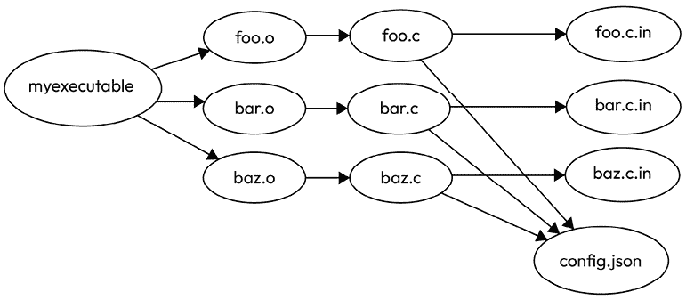

图 6.1：makefile 中描述的依赖图

当您运行 `make myexecutable` 时，它必须执行图遍历以识别哪些子图与该目标相关，然后从没有依赖的节点开始，检查它们是否比依赖它们的节点新。每当某个依赖项更新新，就会递归地失效所有依赖于它的目标。

与正则表达式一样，Make 编程语言的设计是针对特定用例的。因为它可以对自己将如何被使用做出假设，因此它可以代表用户抽象掉图操作和文件操作。

专注于特定用例的这种选择使得 Make 语言能够提供一种极其简单的机制来处理这些用例（正如早期的示例所示），减少了用户为了实现所需结果而必须指定的数量。

在下一节中，我将关注编程语言范式中最后一类主要范式。

## 逻辑编程

这种范式通常是最奇奇异的，特别是对于那些来自命令式编程背景的人来说。可以说，它是离硬件上运行的实际指令最远的。我这里的目标是为你提供一个宽广的视角，看看什么对于你的特定用例最有意义。我希望这能让你对编程语言的样貌提供一点不同的视角。

当用例可以被描述为缩小满足所有声明约束的可能解的过程时，逻辑编程语言是最有用的。你可以将其认为为从给定解决方案的所有可能值的集合开始，并使用约束将可能答案的空间缩小到在该特定情况下有用的答案。

解决数独谜是一个逻辑编程语言大放异彩的极佳例子。在这种情况下，编写代码的过程变成了一项制定描述你特定情况的规则的练习。

让我们先用人类语言来描述数独谜的规则：

- 有一个 9x9 的网格
- 网格还分为九个 3x3 的正方形网格
- 网格中的每个单元格将包含一个 1 到 9 之间的整数
- 网格行中的单元格必须具有不同的值
- 网格列中的单元格必须具有不同的值
- 正方形内的单元格必须具有不同的值

当你想要找到一组满足这里阐述的所有约束的答案时，你会使用逻辑编程语言，特别是当某些单元格中已经有一些预设值时。

与其他范式在方法上的主要区别在于，你假设你的编程语言的运行时知道如何评估这些规则，而不是由你来实现探索该空间的搜索算法。

如果你精通命令式语言，可能可以想出一组操作，通过迭代和递归地缩小搜索空间，直到你得到符合所有规则的答案。

然而，使用逻辑编程语言，你将该搜索委托给语言环境执行，你的目标仅仅是以足够精确的方式描述规则，以便运行时能够正确找到解决方案。

我将展示 Prolog Prolog 中数独解决方案的代码，由 SWI-Prolog 解释器支持：

```prolog
% 用于求解有限域约束的模块
:- use_module(library(clpfd)).
% 描述数独谜的规则
sudoku(Rows) :-
    % 必须有 9 行
    length(Rows, 9),
    % 创建一个代表列的不同视图
    transpose(Rows, Columns),
    % 列的长度也为 9
    length(Columns, 9),
    % 所有值在 1 到 9 之间
    append(Rows, Vs), Vs ins 1..9,
    % 所有行和列都有不同的值
    maplist(all_distinct, Rows),
    maplist(all_distinct, Columns),
    % 我们使用递归技巧来声明
% 正方形，稍后
Rows = [As,Bs,Cs,Ds,Es,Fs,Gs,Is],
    square(As, Bs, Cs),
    square(Ds, Es, Fs),
    square(Gs, Hs, Is).
% 正方形是递归定义的。
% 这允许我们减少编写的代码量，
% 但你可以用完全展开的网来指定。
% 定义是基于三行的。
% 它从每行提取三列并递归
% 定义另一个正方形。当我们到达末尾时，
% 它将是一个空列表，我们将设置为有效的
% 结果。
square([], [], []).
square([N1,N2,N3|Ns1], [N4,N5,N6|Ns2], [N7,N8,N9|Ns3]) :-
    % 正方形内的所有值必须不同
    all_distinct([N1,N2,N3,N4,N5,N6,N7,N8,N9]),
    % 这些行的剩余列
% 必须形成另一个正方形，或者它用完了列。
    square(Ns1, Ns2, Ns3).
```


我希望你注意，这段代码并没有指定我们应该如何应用这些约束。这正是其点所在。运行时可以使用高级算法来找到满足所有约束的解决方案，而程序员则完全专注于如何定义规则和约束。

特定的 Prolog 实现所具备的能力，正是你选择某一个而不是另一个的原因。某个特定的运行时会以不同的方式实现约束求解，这使得它更适用于手头的某个特定问题。

事实上，这些差异正是人们考虑获得商业许可 Prolog 解释器许可的理由，因为给定问题中的约束集可能足够复杂，至于某个厂商提供的结果效率可能显著高于其他厂商。

希望大家很容易看出逻辑编程语言的用例与其他所有范式有何不同，以及在逻辑编程语言中指定起来非常直观的问题，在命令式编程语言中可能需要数百行代码才能指定。而且这还没有考虑到你可以在不需要重写任何代码的情况下选择不同的求解策略。

在下一节中，我将回到书中练习的用例，并关注哪种范式应该为我们提供最大的指导。

## 为我们的语言选择范式

由于我们专注于解决如何指定网络协议的问题，驱动我们决策的主要方面是：它主要关于如何管理状态机，以正确表示通信在指定协议中的位置。

为了设计练习，让我们看看这里讨论的每种范式如何帮助解决这一特定的用例：

*   命令式范式会促使我们让用户指定导致状态之间特定转换的操作。在现实中，这就是目前大多数网络协议在命令式语言中的实现方式。因此，与原生语言实现协议相比，选择命令式风格提供的益处并不多。
*   函数式范式，特别是具有像 Haskell 那样强模式匹配语义的范式，允许你以一种有趣的方式指定协议。然而，网络协议的瞬时性将迫使我们进入语言的边缘情况，因为我们需要尝试管理副作用（例如从套接字发送和接收的数据），以便我们尝试与远程主机交互。
*   逻辑编程范式在这一特定用例中最是最难证明采纳的合理性，因为它最适用于静态约束和值，而这与与网络协议交互的现实情况不符。
*   最后，留给我们的是声明式范式。它与正则表达式已经有了显著的重叠，因为我们需要指定在任何给定点可接受的输入和输出规则。但我们还需要声明程序不同状态之间的关系，并允许运行时为用户管理这些转换。

考虑到我刚才描述的，这个练习最有趣的方法是让我们的编程语言设计深受声明式范式的影响。

需要注意的是，编程语言并不非完全致力于单一范式。许多语言（包括 `C++` 和 `Python`）都提供了命令式和函数式风格的混合。因此，我们应该始终开放心态，考虑不同范式的哪些方面会对我们特定的编程语言有益。

# 总结

编程语言的设计在如何指定代码方面穿越了许多不同的范式。某些语言比其他语言更严格地遵循一种风格，但考虑这些广泛的类别仍然是有用的。

命令式范式侧重于描述计算机为了解决特定问题必须执行的操作。代码与计算机实际执行的操作之间存在一种预期的映射。

函数式范式将问题推向函数如何转换值的空间，而不是如何通过特定操作操纵状态。这样，运行时就可以可以在不更改代码的情况下选择不同的执行策略。

声明式编程语言倾向于关注特定环境，并使得在该特定空间内解决问题变得显著简单。它们允许运行时决定如何解决操作问题以实现预期结果。

另一方面，逻辑编程语言采取了截然不同的方法，代码描述的内容与运行时实际发生的情况之间几乎没有联系。它们特别适合需要选择灵活方法进行约束求解的问题。

对于书中的练习，声明式范式可能是最合适的，因为它允许用户声明网络协议经过的不同状态，而不需要用户自己实现状态机。

在下一章中，我们将关注编程语言如何看待值、这些值如何贯穿代码逻辑，以及值在程序生命周期内是如何被管理的。

| 获取本书的 PDF 版本和独家额外内容 | 扫描二维码（或访问 [packtpub.com/unlock](http://packtpub.com/unlock)）。按名称搜索此书，确认版本，然后按照页面步骤操作。 |  |
| **注意**：请妥善保存发票。直接从 Packt 购买不需要发票。 |

# 7

# 值、容器与语言元模型

编程语言处理变量、值和复杂数据结构的方式定义了在该语言中编写的代码的外貌。在本章中，我们将介绍以下主题：

*   编程语言如何区分“值”的抽象概念与变量的瞬时状态
*   编程语言对持有值的容器所做的区分
*   值的可变性如何影响语言设计
*   设计中对拷贝、引用和共享值的支持
*   如何创建一个连贯的设计以满足所有需求

在本章结束时，你将对上述方面如何影响语言设计以及在该语言中编写的代码产生理解。

## 变量与值

在命令式语言中实现算法的讨论中，通常会交替使用变量和值。这两个术语之间的区别对代码推理通常不会产生重大影响，特别是在语义简单的语言中。

例如，`Python` 语言有一种简单的模型，变量只是指向值，而这些值的寿命取决于它们是否可以通过现有变量直接或间接地被触及。


语义更复杂的语言，例如 `C++`，要求用户在脑中记住这种区别。该语言的高级用户需要对这种区别有细致的理解，以避免特定类型的错误。

例如，`C++` 中的变量代表的不仅仅是该值的引用——它们还代表了独立于值本身的内存存储规范，并且对该值的生命周期有更直接的责任。

作为这种复杂性在 `C++` 中如何体现的例子，我们可以观察自动存储期（automatic duration）的变量，它们的存储是在函数入口处创建的。然而，当这些变量未被初始化时，它们具有 `indeterminate`（不确定）值，这意味着尽管变量存在，但它的值还不存在。

其他语言采取了截然相反的方向，例如 `Haskell`，在那里，讨论变量并不描述一个像 `Python` 或 `C++` 那样可以随时间推持有不同值的存储位置。变量只是一个符号化的方式，用于引用作为函数输入给的值。在像 `Haskell` 这种每个值都是不可变的语言中，将存储与值分离的概念完全在用户的控制范围之外。

在设计编程语言时，这种权衡是你需要平衡的重点。如果你想让语言在允许值、其存储及其生命周期方面更具命令性，让用户更显式地管理，那么向接近 `C++`的方向是有意义的。但如果你的意图是让用户以更抽象的方式思考值，并在算法上下文中移除对生命周期和存储细节的某种程度控制，那么追求接近 `Haskell` 的解决方案将带来许多益处。

在显式控制和抽象之间找到正确的平衡始终具有挑战性。考虑值在它们即时创建和管理之外将如何被利用也很重要——这在我们为这种语言设计练习中构建的嵌入式解释器等情况下尤为相关。

在我正在构建的语言中，主要目标是轻松地从远程端发送的数据流中提取信息。我将避免赋予用户对值的特定生命周期和存储决策的控制。我打算使用协议本身的状态机来为用户隐式地管理这些。

现在我们涵盖了值与变量的区别，在下一节中，我将关注单一值与容器之间的区别，以及语言设计如何受到这些需求的影响。

## 值与容器

除了值和变量之间的区别，不同类型的值可以赋值给这些变量。有些代表非常直接的东西，例如数字。另一些则代表其他值是如何存储和访问的。这些被称为 `containers`（容器）。

这种区别在 `C++` 等语言中重要得多，因为对值的生命周期有大量的控制。相比之下，如果唯一关注的是高效访问容器内部的值，情况就会简单得多。尽管如此，无论什么类型的语言，容器的作用都是提供一种处理常见用例的高效方法。

关于语言用户预期构建容器的程度与语言本身为大多数用例提供功能的程度之间，也存在区别。对比 `Python` 和 `C++` 再次是语言设计者可以采取不同方法的另一种有趣方式。如果你将 `C++` 语言和 `C++` 标准库视为两个独立的实体，你会发现语言提供了 `arrays`（数组）、`structs`（结构体）、`pointers`（指针）和 `templates`（模板）供用户管理复杂的数据结构，但它并没有超出此范围。

标准库提供了强大的容器抽象和可以在这些容器上运行的算法。如果一种语言只提供原始数组，标准库提供了 `std::array`，它提供了语言用户所需的大功能。语言的构建方式使得用户应该能够构建与标准库一样高效的自定义容器和算法。

另一方面，`Python` 语言将高层容器作为语言本身的一部分。并不期望用户能够产生一个与解释器自带的同高效的容器，而且该语言的用户更多地关注他们正在构建的高层应用和系统。例如，不期望任何 `Python` 程序员能够创建一个与原生 `list` 一样高效的 `list` 自定义实现。`dictionaries`（字典）或其他你在 `C++` 标准库中找到的其他容器类型也是如此。

从这次讨论中得到的教训是，选择特定的用例也将决定语言将如何被使用和演变。`C++` 语言的设计旨在提供完全的控制，以尽可能充分利用底层硬件的性能，其中用户只为他们直接使用的抽象成本付出代价。另一方面，`Python` 语言的设计是为了解决更高层次的问题，其中性能并不是设计的主要约束。

语言设计者无法兼顾所有用例；他们必须专注于那些让特定语言变得有用的特定用例。如果你的目标是实现构建高层系统和应用程序的能力，那么专注于提供大多数用户需要的容器可能更有用，并在知道用户无法通过在解释型语言中编写代码来实现相同性能的情况下，将这些容器尽可能做得高效。

然而，如果你的目标是允许用户优化其容器的数据结构并对其进行细微调整以提取尽可能多的性能，那么你可能希望让你的语言更接近 `C++`。

在我为这本书编写的语言中，我将专注于为语言的常见用例提供容器。我甚至不会尝试在语言中提供创建自定义容器的机制。我预计这种语言的用户将更多地关注他们正在实现的网络协议细节，而不是试图优化解释代码。

## 可变性

当你设计一种主要关注单线程执行的语言时，值和容器的可变性问题相对容易忽略。很少会有会阻碍直接在内存中覆盖该值并继续。

但即使在单线程用例中，也有需要考虑的微妙之处。例如，考虑哈希映射（hash map）等数据结构。你可能会陷入这样的情况：添加到哈希映射中的键值对变得完全无法访问，因为键被插入到了一个桶中，但随着它的变异，它没有被重新分配到另一个桶中。


也许所有方法中最简单的一种是 Perl 解释器使用的方法，其中哈希表的键在概念上是一种不同类型的值——它始终是一个不可变字符串。每当某个东西被用作键时在计算其哈希值之前，它会被强制转换为字符串。

如果你查看解释器的内部，你会发现这些字符串在整个代码中都是一个特例情况。这允许解释器对数据结构进行优化，而如果允许使用任意值作为键，这种优化将是不可能的。

C++ 语言与此完全相反，因为该语言没有做出特定的选择，并将对数据结构的控制权留给了用户，包括确保被用作键的对象保持不可变的责任。语言中没有任何东西能阻止你使用可变值作为键，这可能导致键变得无法被访问。但由于哈希值也是用户定义的，用户拥有灵活性安全地实现一种类型，在该类型中，只有影响哈希计算的特定成员是不可变的，而其他成员可以被修改。再次，C++ 专注于赋予用户对语言行为的完全控制权。

Python 语言采取了折中方案，你可以使用数据类（data class）作为字典的键，但前提是你必须让它变得不可变，如果你尝试将可变键分配给字典，将抛出 `TypeError`。这在允许某些灵活性的同时，防止了用户犯下常见的错误。这种方法也有其权衡，因为它无法像 Perl 哈希表那样被优化，因为它允许用户类型，但它仍然为用户可能犯的常见错误设置了护栏。

当你设计一种语言时，你需要在提供灵活性、效率和安全性之间找到正确的平衡。通常情况下，你必须在其中至少一个点上做出妥协。这些选择将对该语言在特定场景下的实用性产生深远影响。

由于我正关注处理网络协议的用例，我预计最重要的需求是将是将端发送的信息传输到处理事件并产生所需响应的本地语言中。我不预认为用户会需要对值进行大量的变异。

考虑到这一点，该语言将遵循所有值都是不可变的原则工作，任何需要包含其他值的数据结构都将能够在该假设的基础上进行优化。

## 拷贝、引用和共享值

在关于值和容器如何影响语言设计的讨论中，我想要包含的最后一个方面是语言如何处理诸如拷贝、引用和共享值等操作的模型。为了探索这个话题，我想回到 C++ 和 Python 的对比中。

在 Python 中，值的生命周期由解释器根据其用性进行管理。这意味着只要至少有一个引用（直接或间接）指向它，该值就会保留在内存中。一旦解释器确定一个值不再能从程序的任何部分访问，它就会自动收回该值所占的内存。

Python 语言的设计方式使得当你将一个对象赋值给另一个变量或将其插入现有的容器时，所发生的情况几乎没有歧义。Python 中某些值的不可变性也为解释器留下了空间，可以在它们指向相同内容时优化掉拷贝。

在 C++ 中，语言显式地赋予了用户对值上执行什么操作的控制权，这意味着语言需要暴露不同的机制来创建拷贝或传递引用。这非常重要，因为语言运行时并不保证如果你对一个值创建引用，该值的生存时间会比引用长。事实上，这实际上是 C++ 代码中 bug 的频繁源头。另一方面，对何时创建拷贝和引用，以及何时分配和释放内存进行非常刻意的控制，也是为了优化 C++ 代码性能的一个非常重要的特性。

再举一个例子，Perl 解释器对引用有显式支持，但引用的存在就足够保持值的存活。这意味着解释器完全控制内存的分配和释放。垃圾回收（Garbage Collection）作为管理内存分配运行时特性可以使用多种策略实现，从 Perl 那种简单的引用计数，到 Python 那种基于可达性的规则，甚至是更复杂的方法，如在 .Net CLR 中使用的方法。

这并不意味着你不能编写由运行时管理内存的 C++ 代码。C++ 标准库通过使用 `std::shared_ptr` 在程序的不同部分之间共享相同的值提供了特定支持，其中标准库实现了与 Perl 垃圾回收非常相似的内存管理。区别在于语言运行时可以提供的保证：一旦你把控制权交给用户，你就失去了这些保证。

为了完成这个插说明，我想强调 Haskell 是如何反转这一点的。在 Haskell 中，从概念上说，所有值都是不可变的。但由于用户无法控制这些值如何被管理，某些情况下编译器可以确定原始值将不再被使用，因此它会省略拷贝并在原地（in place）更新该值。

在下一节中，我将整合所有方面，并对值和容器的处理方式如何影响设计提供一个更完整的描述。

## 语言元模型

设计一种编程语言是一项平衡各种冲突需求的练习，做出与该特定语言目标最契合的选择，并创建一个连贯的愿景，引导用户最有效地解决问题。

每当语言在这些设计原则上出现不一致时，它就会导致语言用户之间持续的困惑。当然，通过文档和静态检查工具（linting tools）持续引导围绕该语言社区社区可能的。然而，这些手段远不如语言给用户解决特定问题的自然引导。

在这里，语言元模型代表了驱动语言及其运行时管理用户操作值的底层原则（有时是显式的，有时则不是）。

我将从观察一种拥有最简单元模型之一的语言开始：POSIX shell。在 във语言中，一切都是字符串，值根据输入字段分隔符进行切片。数字以十进制字符串的形式存储和操作。

起初，这看起来是处理值的一种非常素的方法。然而，当你考虑到 POSIX shell 的使用方式时，它开始变得非常有道理。

如果你更仔细地考虑这一点，你会发现，对于预期使用 shell 语言的简单场景，拥有对不同类型值、拷贝、引用和容器的额外支持反而会让更简单的用例变得难以处理。

与此同时，每当 shell 脚本开始变得复杂时，语言就会引导用户意识到，shell 可能不再是适合那项工作的工具了。


有趣的是，这正是 Perl 语言最初被创建的原因——为那些对于 `shell`、`sed` 和 `awk` 来说过于复杂的用例提供更好的工具。

Perl 的类型系统也极其简单。它引入的主要区别是内置的数组和哈希（hash）容器。在 `Perl 5` 之前，该语言在元模型上并没有 `shell` 强大多少。它不支持面向对象，甚至不支持引用。在 `Perl 5` 之后，随着对包（packages）和引用的支持，语言变得强大得多，但它仍然没有为数字或字符串值设置特定的类型，即使它在需要为了降低处理开销而同时存储这两种形式。

因此，`Perl` 在系统管理员中极受欢迎并不是偶然的，他们需要在 Unix 环境或早期的 Web 中创建更复杂的集成，或者使用通用网关接口（`Common Gateway Interface`, `CGI`）创建动态界面。在 20 世纪 90 年代，`Perl` 被称为“互联网的胶带”。

这些只是两个相对简单的元模型例子。其他语言的复杂度要高得多。例如，`C++` 拥有多个类别的类型和值，以满足用户对该语言所期的灵活性。

`Raku` 语言（以前称为 `Perl 6`）拥有一种“元对象协议”（`Meta-Object Protocol`），这意味着类的定义以及它的工作方式可以直接在语言本身中指定。这包括对类层次结构中方法解析顺序（method resolution order）算法的自定义。它还允许显式自定义对象数据的存储位置，支持组织代码组织方式，甚至允许用户定义自己的存储和组织策略。

在我为这本书创建的语言中，我不希望鼓励在语言中指定复杂的操作。这种语言的目标是提供一种简单的方法来指定给定网络协议状态机的不同部分，并提供一种方式将该通信的输入和输出传递到另一种语言，由后者执行实际操作。

然而，我确实需要考虑到具有中间计算的协议。例如在 `HTTP` 中，某些头部为请求体提供了上下文，因此我确实需要允许将值绑定到命名变量中并能够对这些值执行操作，但我不需要支持面向对象或更复杂的范式。这种语言的目标是处理网络协议的状态机并将复杂的逻辑委托给另一种编程语言。

当用户在执行任何预期用例之外的操作时，这种语言会引导他们转向另一种语言。

这个主题很容易就能成为一整本书的主题，但我希望这段简短的介绍能让你对语言设计的某些方面有更细致的理解，而这些方面你可能之前没有考虑。

# 总结

不同的语言表示值的方式以及变量如何引用这些值。在某些语言中，这仅仅是一种符号机制，而在其他语言中，它扩展到了对值生命周期的管理。

当需要表示更复杂的数据结构时，编程语言会引入另一类值。例如，“容器（container）”是一个持有其他值的值。在某些语言中（如 `Python`），容器是内置在语言本身中的，为这些容器创建替代实现的空间非常小。在其他语言中（如 `C++`），容器完全在语言本身中实现，用户可以访问所有必要的设施来使容器像标准库（`Standard Library`）提供的那样高效。

然而，值的可变性（mutability）可能会对容器的操作产生重大限制。例如，哈希映射需要给定键的哈希值是不可变的；否则，你可能会陷入键无法再次访问的情况。不同的语言在这方面采取了不同的方法。作为语言设计者，你的角色是在灵活性、性能和安全性之间找到特定的平衡。

拷贝、引用和共享值是语言设计的另一个维度，语言在这些方面采取了非常不同的方法，从几乎不让用户控制所用机制（如 `Python` 中的情况），到让用户对值在整个程序生命周期中的存在方式拥有完全控制权（如 `C++` 的）。

所有这些方面共同构成了我所说的语言元模型。在那个领域创建一个连贯的设计将使你的语言能够更好地引导用户用正确的方法解决正确的问题。有时，让特定类型的问题变得难以解决以使其他问题变得更容易是重要的。这是一场非常微妙的平衡动作，作为语言设计者，你的职责是让它符合你预期的用例。

在下一章中，我将关注理解编程语言如何处理变量和其他语法术语的命名，因为这些是用户用来引用值和容器的机制。

## 获取此书的 PDF 版本和专属额外

扫描二维码（或访问 `packtpub.com/unlock`）。按名称搜索此书，确认版本，然后按照页面上的步骤进行操作。 |  |

| 注意：请妥善发票。直接从 Packt 购买不需要发票。 |

# 8

# 词法作用域

变量和值存在于不同的作用域，不同的编程语言对用户可用的作用域类型做出了不同的选择。在本章中，我们将涵盖以下内容：

* 引入词法补丁（`lexical pad`）的概念
* 不同的语言如何定义给定函数内部的名称作用域
* 支持块级词法作用域（`block lexical scopes`）增加的灵活性和复杂度
* 由闭包（`closure`）定义的词法作用域（`lexical scope`）
* 不同语言处理全局作用域（`global scope`）的方式以及如何影响代码复用

在本章结束时，你对语言如何处理来自不同作用域的命名会有更细致的理解，以及它如何影响代码复用

## 词法补丁

在代码的任何特定表达式中，给定名称都需要解析为特定的变量，编译器或解释器需要无歧地识别它。

在第 7 章 (#Chapter_7.xhtml__idTextAnchor94）*值、容器与语言元模型*中，我讨论了变量、值和容器之间的区别。现在，我必须澄清，变量在本质上是一种非常特殊的容器；只有编译器或解释器有权操作它。

用户在表达式中写的符号名称与关联该值的容器之间的映射就是我们所的词法补丁（lexical pad）。它可以通过多种方式实现，但结果是相同的：当代码中出现名称时，它需要识别的是哪个特定的容器。


对于解释型语言，整个词法表（lexical pad）通常在运行时是完全可用的。然而，在静态编译语言中，通常这些信息不再需要，调试除除外。这就是为什么如果你想要调试代码并检查给定变量的值，编译器对 `C++` 就需要特殊的指令，因此编译器会将这些额外信息储存在你的对象文件的调试段（debug section）中。

通常情况下，在特定的代码段内，所有的名称解析都具有相同的结果。这种结果成立的区域被称为词法作用域（lexical scope）。不同的编程语言在如何定义语言的词法作用域上有不同的选择。

在接下来的章节中，我们将探索定义语言词法作用域的不同方法。

## 函数词法作用域

在某些语言中，函数内部变量的作用域总是整个函数。让我们来看以下 `Python` 代码：

```python
def do_something():
    for a in 1,2,3:
        print(a)
    print(a)
```

如果 `Python` 是你的主要语言，那么这里的输出是显而易见的，因为名称的作用域始终由函数本身定义。因此，变量 `a` 将具有它在循环最后一次迭代的值。输出如下：

```
1
2
3
3
```

如果你来自其他语言（例如 `Perl`），你可能会认为这段代码是无效的，因为变量是在循环内部定义的，因此在循环完成后它不应该是可触及的。

然而，这为解释器提供了一些简化，因为它只需要为整个函数初始化一个词法表，并且函数内部定义的每个变量都将直接从该表中引用。

这种选择还涉及到风格问题，因为同一个变量没有可能引用不同类型的值（例如）。当在 `Python` 中使用类型提示（type hinting）时，你只需要为每个名称标注一次，如果你恰好对同一个变量使用了不同的类型，它将被视为一个错误。

在下一节中，我们将考察块级词法作用域，作为函数级作用域的替代方案。

## 块词法作用域

将变量的作用域与整个函数绑定的常见替代方案，是赋予单个块更大的意义，无论它们与给定的函数有什么关系。

让我们用这段 `C++` 代码作为示例：

```cpp
void foo() {
    {  int a = 1; }
    {  double a = 1; }
    {  short a = 1; }
}
```

在这种情况下，名称 `a` 在函数内的每个块中都具有完全不同的含义。如果你尝试在这些块之外引用该名称，编译器将给你一个错误。

现在让我们使用之前在 `Python` 中讨论过的示例，将其重写为 `C++` 来看：

```cpp
#include <stdio.h>
int main() {
    for (int a = 1; a < 3; a++) {
        printf("%d\n", a);
    }
    printf("%d\n", a);
}
```

在这种情况下，因为词法作用域是由 `for` 块定义的，所以变量在外部是无效的。尝试使用 `gcc` 编译该代码将得到如下输出：

```
/tmp/foo.cpp: In function 'int main()':
/tmp/foo.cpp:6:24: error: 'a' was not declared in this scope
    6 |        printf("%d\n", a);
      |                        ^
```

这对于 `C++` 来说是非常重要的，因为这意味着变量的生命周期也限于其定义时所在的块的作用域。这有一个重要的副作用，因为这意味着编译器可以在不同块之间复用内存空间。

在具有三个不同类型的变量独立声明的示例中，编译器可以自由地为所有变量使用同一块内存空间，因为没有代码路径可以导致它们同时有效。

在下一节中，我将探索函数词法作用域和块词法作用域的一个特殊情况，即闭包（closures）的创建。

## 闭包词法作用域

有一种特殊的词法作用域，当函数在另一个词法作用域内定义时创建，并且该函数定义的生命周期超过了所引用变量的作用域。它被称为闭包。让我们来看 `JavaScript` 中的以下示例：

```javascript
function makeGreeter(greeting) {
    function doGreeting(who) {
        return greeting + ' ' + who + '!';
    }
    return doGreeting;
}
greet = makeGreeter('Hello');
console.log(greet('World'));
```

这是函数式编程语言中的常见模式。当 `doGreeting` 函数引用 `greeting` 变量时，闭包被创建，该变量的生命周期被限于 `makeGreeter` 函数的执行，但局部函数被返回了，导致它保留了在函数定义上闭包的变量副本。

这里的重要区别是，闭包的创建需要运行时对变量存储提供额外级别的管理。被捕获变量的生命周期需要扩展到内部函数本身的生命周期，内部函数保留了对捕获变量的引用。

实现一种支持闭包的语言需要能够扩展变量的生命周期，并且对该函数的引用存在，就要保持词法表活跃。

我不会尝试证明为什么这个功能是重要的，以防你还不熟悉。我将把它留给练习，让你实验这种函数模式来解决重复问题。

但除了闭包是编程语言中支持的功能之外，它凸显了变量和变量名管理可能变得复杂，以及为什么彻底评估你试图解决的问题是重要的。

在下一节中，我将查看一种取决于代码当前点的调用链的作用域。

## 全局词法作用域

在理想世界中，影响函数运行的每一个可能的因素都将作为参数传递给该函数。这将使得代码更容易测试和针对特定场景进行定制。

然而在现实中，通常的情况是，一个使用了很长时间的函数突然有了新的定制需求。修改整个代码库以便该新参数可以通过所有其他层级传递是解决该问题的一种昂贵方法。

解决该问题的常见方法是支持使用全局词法作用域，变量可以从代码的任何部分访问。这允许创建预先无法预测的定制点，即使这些点不是所调用函数的显式输入。

然而，不明显的是，大多数语言将全局词法作用域作为发现函数和类型的默认机制。

例如，`C++` 中的类名对于整个程序都是全局的。事实上，该语言允许通过对类进行前向声明来仅通过名称使用类，这意味着在特定的单元文件中未看到类的实际声明，该名称也可以在作用范围内。

`Python` 中的包和包成员也是如此。当你的代码指定 `import subprocess` 时，该名称对于整个解释器都是全局的，并且该包的成员无论在代码的何处发生都是相同的。


这在 Python 这样的语言中尤为相关，它可以操作给定名称的词法表（lexical pad）并将其替换为其他内容。这就是 Python 测试库能够在测试执行期间模拟（mock）和补丁（patch）各种函数的原因。全局包临时更改以替换特定成员，一旦测试完成，它将恢复到原始值。

对类型和函数使用全局作用域更重要的结果是，它使得代码库的不同部分使用统一词汇变得容易得多。你可以通过检查断言，一个 C++ 编译单元中调的 `std::string` 在另一个编译单元中将是同一个东西。

# 总结

词法表（lexical pad）是我们赋予解释器或编译器用于将代码中的名称映射到存储相应值的容器的机制的名称。

不同的编程语言对编译器或解释器在“如何查询和操作词法表”方面有不同的要求。代码中某些区域对名称具有统一可见性，这些被称为该特定编程语言的词法作用域（lexical scopes）。

某些语言（如 Python）的作用域与函数体匹配。函数中定义的任何变量在整个函数持续期间都是可见的。其他语言（如 C++）的作用域缩小到特定的代码块，这意味着语言为用户对变量生命周期提供了更细粒度的控制。

除了这两个选择外，支持某些函数式习惯的语言还支持闭包作用域（closure scopes），在这种作用域中，从比自身作用域存长的函数引用的变量将与函数本身保留。这为运行时增加了额外的复杂度要求，但为最终用户提供了一个非常重要的工具。

全局作用域是创建类型和函数标识的最常见形式。将这些名称设置为全局实际上是使代码复用更简单的基础部分，因为代码库的不同部分可以轻松共享相同的词汇。

这是我最后一个关注与编程语言设计相关的各种概念的章节。在下一章中，我将把这些概念整合成一个完整的语言设计。

## 获取本书的 PDF 版本和独家额外资源

扫描二维码（或访问 [packtpub.com/unlock](http://packtpub.com/unlock)）。按书名搜索此书，确认版本，然后按照页面上的步骤操作。 |  |

| 注意：请妥善保存发票。直接从 Packt 购买的物品不需要发票。 |

# 9：整合一切并创建连贯的愿景

到目前为止，我一直关注编程语言设计中更抽象的特性。在本章中，我将关注编程语言本身第一个版本的语法设计，将包含以下主题：

* 基于遵循声明式编程范式的决定的语言通用格式
* 值和容器将如何被定义和使用
* 变量将如何被声明和引用
* `HTTP/1.1` 协议的一个具体用例，用于练习整体语言设计

在本章结束时，你将对编程语言设计中涉及的微之处有更细致的理解，并拥有一份如何设计你自己的语言的蓝图。

## 声明式语言的形状

定义编程语言最终设计的第一步是确定代码的整体形状将是什么。在*第 6 章*(#Chapter_6.xhtml__idTextAnchor085）编程语言范式回顾中，我解释了声明式范式如何适合描述实现网络协议所需的复杂状态机。

我首先需要澄清的是，通信中有双方——客户端和服务器。每个软件代理都将扮演特定的角色，但没有理由让协议规范有所不同。毕竟，客户端和服务器都使用相同的协议进行通信，所以它们之间的描述不应该有不同。解释器必须从服务器或客户端的角度考虑它，但无论如何，`领域特定语言`（`DSL`）中的代码都是相同的。

对于这种语言的第一个版本，我将只实现基于数据流的简单客户端-服务器连接的支持。这是一个重要的限制，以减少我必须处理的复杂范围。某些协议（如 `SSH`）支持在同一个连接中创建多个并行通信流，这意味着解释器需要在这些点上能够分支执行，而较简单的协议（如 `HTTP/1.1`）对整个协议只有一个单一状态机。

从实践上来说，这将涵盖客户端与服务器建立连接，并它们交换数据直到其中一方关闭连接的协议。因此，我将在语言本身中使用 `client` 和 `server` 术语。服务器始终绑定到给定地址的那一个，而客户端始终与该地址建立连接的那一个。

由于这种语言实际上不会以任何方式管理 socket，也不会协调如何将 socket 分配给不同的原生执行线程，该语言中程序的生命周期从双方连接 socket 时开始。我将使用术语 `open` 作为该语言每个程序的入口状态。

当连接结束时，socket 在双方都被认为已关闭。因此，我将使用术语 `closed` 来表示每个程序的最终状态，解释器应该在该处退出。

此时，我应该能够编写一个网络协议的代码，该服务器接受连接但立即关闭它。

## 指定空程序

这是最简单的情况。我不需要指定任何传输的数据；只需指定我有有 `Open` 和 `Closed` 状态，并且我需要一个从 `Connected` 到 `Closed` 的无条件转换。

然而，这里有一个重要的细节，即从 `Open` 到 `Closed` 的转换应该是由一方发起的。这很好地说明了使用实际场景引导设计有多么重要。因此，空程序需要指定一个由服务器发起的、从预定义的 `Open` 状态到预定义的 `Closed` 状态的转换。

这很好地提示了程序最重要的部分不是状态的描述，而是转换的描述。

基于以上所有，我提议了一种描述上述内容的语法：

```
transition "服务器自动关闭" {
    agent: Server;
    from: Open;
    to: Closed;
}
```

接下来，让我们尝试通过让服务器在断开之前发送消息来让这变得复杂一点。

## Hello，世界！

是的，这毕竟是编程中经典的第一个例子。但为了让它更有趣，让我们委托原生语言告诉我们问候语应该是什么，然后描述客户端捕获消息的方式。

这突显了我们问题的另一个方面，即客户端和服务器具有独立但关联的状态机。它还突显了我需要能够指定这些变量是什么。


我构思这一过程的方式是让特定的数据与状态关联，并让条件与转换关联。让我尝试模拟一下这个示例的语法结构：

```
transition "Server Decides Greeting" {
    agent: Server;
    from: Open;
    to: DecidingGreeting;
}
state DecidingGreeting {
    greeting: str<Ascii7Bit>;
}
transition "Server Sends Greeting" {
    agent: Server;
    from: DecidingGreeting;
    to: Closed;
    tokens: {
        greeting, " World!"
    };
}
```

这看起来是一个有趣的方法，而且对服务器端非常好用。然而，目前还不清楚客户端是如何管理的；完全没有描述针对客户端的任何状态转换，也不清楚它将如何收集从服务器发送的数据。

也许同时表达来自客户端和服务器端的转换会更好。但问题随之，我该如何将服务器发送的数据与客户端的状态关联起来呢？

也许与其指定转换，我不如将它们指定为消息，消息也代表了服务器和客户端状态的变化；因此，数据将与消息关联，而不是与转换关联。让我尝试另一种方法：

```
message "Server Sends Greeting" {
    agent: Server;
    when: Open;
    then: Closed;
    data {
        greeting: str<Ascii7Bit>;
    }
    tokens {
        greeting, " World!";
    }
}
```

在这种方法中，我接受客户端和服务器运行在一个单一的状态机上。因此，这种语言可以专注于指定消息的格式、协议状态机的整体形状，以及与每个状态关联的特定数据。

然而，这意味着我需要重构第一个示例看看它是否仍然适用。它看起来可能有点笨拙，但你可以理解关闭连接也是一种消息，所以这种新方法中的空程序看起来像这样：

```
message "Server Automatically Closes" {
    agent: Server;
    when: Open;
    then: Closed;
}
```

能够改变我最初对设计的想法是这一过程中的重要组成部分，这也是为什么我也会向你们展示失败的设计。接下来，让我们尝试通过引入一些请求-响应机制来增加一些复杂性。

## 你好，是谁？

Hello World 编程练习的自然扩展是允许通过一个参数来指定*谁*应该被问候。我将给客户端一个先发送消息以指定要问候谁的选项，然后服务器将交付它的问候：

```
message "Client specifies who" {
    agent: Client;
    when: Open;
    then: WaitingGreeting;
    data {
        who: str<Ascii7Bit>;
    }
    tokens: {
        who, "\n";
    }
}
message "Server sends greeting" {
    agent: Server;
    when: WaitingGreeting;
    then: Closed;
    data: {
        message: str<Ascii7Bit>;
    }
    tokens: {
        message, "\n";
    }
}
```

我认为这个设计看起来更有前景。我可以更清楚地看到用户将如何引用从客户端或服务器发送的数据，以及何时期望获得这些数据。

消息中的 `tokens` 属性对于发送消息的一方非常好用，因为很清楚消息是与换行符拼接的。然而，在另一端，并不清楚消息本身是否可以包含换行符。

现在，在通用编程语言中，解决这个问题困难得多，但由于我正在开发的是一个专注于网络协议的 DSL（领域特定语言），我可以利用这样一个事实：这些协议非常常见地赋予特定字符以数据终止符的语义。我将更改 `tokens` 部分，并为消息终止符添加一个新部分。我不会重复整个代码，这里只是有不同的部分：

```
 tokens: { message }
    terminator: { "\n" }
```

我设计这一部分的目的是为了说明设计语言的过程。你必须探索替代方案，但如果语言的整体形状并不完全符合你预期的用例，不要害怕回溯并更改语言的整体结构。

我不会在这里叙述整个语言的设计过程，因为这主要涉及对不同用例的持续实验，并缓慢地完善整体设计，直到它完美符合预期的用例。

在下一节中，我将关注语言将如何处理值和容器，以及用户将如何与它们交互。

## 不变性、容器与值

为了探索这些概念，我将想象一种协议：客户端请求一定数量的消息，服务器将恰好返回相应数量的消息。

这将要求语言根据客户端消息，将响应编码在一个包含值的容器中。让我尝试用代码将其写出来：

```
message "Quote Request" {
    agent: Client;
    when: Open;
    then: ExpectResponse;
    data: {
        number: int<8, AsciiInt>;
    }
    tokens: { number }
    terminator: { "\n" }
}
message "Quote Response" {
    agent: Server;
    when: ExpectResponse;
    then: Closed;
    data: {
        messages: array<str<Ascii7Bit>>, "Quote Request"
    }
    parts: {
        for message in messages {
            tokens: { message }
            terminator: { "\n" }
        }
    }
}
```

这个示例允许我们不仅研究语言如何处理单个值（例如来自客户端的数量和来自服务器的消息），还研究它们如何聚合到容器中，在这种情况下，我使这些值是不可变的，这意味着在代码的其他部分引用它们变得简单。输入数量由客户端提供，然后可以用来标识消息的数量。

现在也是讨论语言如何指定值和容器类型的好时机。到目前为止，我已经在示例中使用了一些类型规范，但我想详细说明设计，从单个值的类型开始。

## 值类型

从字符串开始，作为我使用的第一个示例之一，它看起来是：

`greeting: str<Ascii7Bit>`

我借用了 C++ 模板的概念，其中我接受类型泛泛地通信一个概念，而特定参数驱动实现细节。

在这一特定情况下，字符串有一个参数来指定值将拥有的编码。虽然编程语言通常有一种运行时编码，但网络协议通常更具体，强制进行转换是不可取的，这不仅是因为成本很高，还因为用户可能需要访问由另一个代理发送的原始数据。

然而，类型的其他方面可能也需要参数化，例如它具有动态大小还是静态大小，如果是动态大小，它是否有允许的长度限制。这在网络协议中尤为相关，因为它告知了尝试一次性读取是否是安全的，还是它应该作为流提供给用户进行惰性消费。

这足以表明，随着时间的推移我发现新参数或参数依赖于其他参数，通过位置方式使用这些参数可能会成为问题。

考虑到这一点，我将修改设计，使类型的参数变为命名的而不是基于位置的，这样相同的字符串声明将看起来如下所示：

```
greeting: str<encoding=Ascii7Bit, sizing=Dynamic, max_length=255>
```


另一方面，如果我有一个固定大小的字符串，它看起来会像这样：

```
greeting: str<encoding=Ascii7Bit, sizing=Static, length=10>
```

接下来，我把相同的方法应用于 `"Quote Request"` 示例中的数字。我将首先将其重写，以包含命名参数：

```
number: int<encoding=AsciiInt, bits=8, unsigned=True>
```

`encoding` 参数也专门针对网络协议的用例，因为我想提供一种简单的方法来指定数字如何在传输中进行编码，并允许无歧地访问它们的实际数值。

为了补充这个示例，我将考虑如果将数字改用二进制形式表示会是什么样子：

```
number: int<encoding=NetworkByteOrder, bits=32>
```

这表达了应该无条件地读取 4 个字节，并且在提取实际数值时，这些字节应该以特定的方式解释。

接下来，我将探索容器类型是什么样的。

## 容器类型

在 `"Quote Response"` 示例中已经有一个数组的示例了。我将首先对其进行修改，包含命名参数，并包含我处理字符串时相同的逻辑：

```
messages: array<element_type=str<encoding=Ascii7Bit, sizing=Dynamic, max_length=255>, sizing=Static, length="Quote Request".number>
```

同样，如果我有一个动态大小的数组，我也想允许指定最大元素数量：

```
messages: array<element_type=str<encoding=Ascii7Bit, sizing=Dynamic, max_length=255>, sizing=Dynamic, max_length=1024>
```

这对于那些场景效果很好，但也有必要考虑，我需要能够在同一个容器中表示不同类型的值，即构建一个元组（tuple）。

编程语言设计归根底是一个创造性过程，你需要想出适用于特定用例的解决方案。

我一直在自言纠结，为元组引入一种专门的语法是否有意义，因为所有参数名称本质上都是针对特定类型静态定义的，例如字符串的 `max_length`。

使用自定义语法的看起来可能如下所示：

```
header: tuple {
    key: str<encoding=Ascii7Bit, sizing=Dynamic, max_length=255>;
    value: str<encoding=Ascii7Bit, sizing=Dynamic, max_length=2048>
}
```

相反，如果我借用其他类型使用的命名参数，它看起来将是：

```
header: tuple<key=str<encoding=Ascii7Bit, sizing=Dynamic, max_length=255>, value=str<encoding=Ascii7Bit, sizing=Dynamic, max_length=2048>>
```

现实情况是，这些方法之间在本质上没有优坏之分。在语言被大量使用之前，很难评估哪种方案将带来更好的结果。

而在这种情况下，你刚开始只能不得不依靠你的直觉，做出决定，并准备好在未来改变主意。

在这种特殊情况下，我将倾向于重用命名参数语法，因为我设这可能会在解析代码时让我的生活更轻松。但我必须接受，一旦语言开始有某些实际用途，可能就值得重新考虑。

在下一节中，我将检查如何引用值和变量。

## 变量与引用

在编程语言中使用不可变值的主要优势是，你不需要区分*按值*传递还是*按引用*传递。所有的使用都指向值本身更抽象的概念，而值的生命周期完全由语言管理。

在这种特定语言的情况下，我知道这些值的生命周期可以与网络协议本身的特定消息和状态绑定。

在其中一个示例中，我有以下代码片段：

```
messages: array<element_type=str<encoding=Ascii7Bit, sizing=Dynamic, max_length=255>, sizing=Static, length="Quote Request".number>
```

这里的假设是值与特定的消息绑定，且这些消息可以通过名称调用，并且数据部分可以直接被引用。当必须写入或读取 `"Quote Response"` 消息时，该消息的值已经设置好了。

这导致了一个重要的复杂性，即对之前消息的引用需要被限制在特定的历史中，如果状态机不是有向无环图，那么要识别引用的是哪一个特定的消息实例将是不可能的。

另一种方法是，每条消息都列出允许在状态之间传递的整个数据集；因此，词法作用域（lexical pad）始终完全局限于该条消息。我将保留引用之前消息的可能性，但我不会在语言的第一版本中追求这一点。

由于解释器的用户将是决定发送哪些消息的人，因此让同一段代码也跨消息携带额外数据将变得显著简单。

当我做出这个决定时没有立即察觉的一处好处是，这将限制处理网络代码时的一类类错误，即乱序数据的泄露，因为没有关于在任何给定时间点哪些数据应该是可用的完整规范。

再次说明，这说明了设计过程应该是迭代的，允许你返回并重新考虑之前的决定。在下一节中，我将用这种语言指定 HTTP/1.1 协议，以验证最终的设计。

## 最终语言设计

玩具示例对于说明设计的特定方面非常有用，但归根结底，是实际使用才能证明它有多用。从开始，我就设定了用那种语言描述 HTTP 的目标，现在是实现这一目标了。

HTTP 本质上由一个请求和一个响应组成。客户端可能会请求多个响应，这意味着在状态机中有一个循环图。

我将从最外层的元素开始处理，然后进入每个内部元素的细节：

```
message "HTTP Request" {
    when: Open;
    then: AwaitResponse;
    agent: Client;
    data { ... }
    parts { ... }
}
message "HTTP Response" {
    when: AwaitResponse;
    then: Open;
    agent: Server;
    data { ... }
    parts { ... }
}
message "Client Closes Connection" {
     when: Open;
     then: Closed;
     agent: Client;
}
```

该语言描述了整个协议的高层状态机，其中转换通过客户端或服务器发送的消息来描述。在 HTTP 的情况下，该高层状态机可以用下面的图描述：

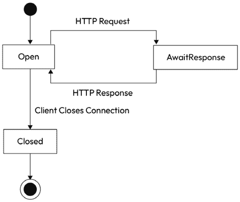

图 9.1: HTTP 高层状态机图

该图说明了在什么点预期哪些消息，以及在收到给定消息后机器应该移动到什么状态。

这些消息中的每一个都有一个在其作用域内的数据。正如之前过的，这意味着这是解释器在写入消息时唯一的可用数据，也是解释器被允许从消息中读取的唯一数据。

这也这意味着执行权交给解释器用户的点是在整个消息结束时，解释器与用户之间的数据传输发生在那个点，并且具有良好定义的、完整的数据元素。

现在，让我处理一下定义 `"HTTP Request"` 消息数据的代码看起来像什么：


```cpp
data {
    verb: str<
        encoding=Ascii7Bit,
        sizing=Dynamic,
        max_length=10
    >;
    request_target: str<
        encoding=Ascii7Bit,
        sizing=Dynamic,
        max_length=32768
    >;
    major_version: int<
        encoding=AsciiInt,
        unsigned=True,
        bits=8
    >;
    minor_version: int<
        encoding=AsciiInt,
        unsigned=True,
        bits=8
    >;
    headers: array<
        element_type=tuple<
            key=str<
                encoding=Ascii7Bit,
                sizing=Dynamic,
                max_length=32768
            >,
            value=str<
                encoding=Ascii7Bit,
                sizing=Dynamic,
                max_length=32768
            >
        >,
        sizing=Dynamic,
        max_length=100
    >;
    contents: stream;
}
```

这里之前已经提到过大部分元素，但 `stream` 类型除外。引入 `stream` 类型是因为 HTTP 没有规定消息的终止符。相反，长度是由 `Content-Length` 头部定义的。因此，这种类型表示解释器的用户将需要处理连接。

我将不再列出 HTTP 响应的数据代码，因为它与之前的“HTTP 请求”消息非常相似。相反，我将开始描述消息的 `parts` 部分：

```cpp
parts {
    tokens { verb }
    terminator { " " }
    tokens { request_target }
    terminator { " " }
    tokens {
        "HTTP/" major_version "." minor_version
    }
    terminator { "\r\n" }
    for header in headers {
        tokens { header.key }
        terminator { ":" }
        tokens { header.value }
        terminator { "\r\n"}
    }
    terminator { "\r\n" }
    stream { contents }
}
```

对于发送消息的代理来说，它只是描述了必须通过套接字发送哪些字节序列。但对于接收消息的代理来说，它充当了一个独立的底层状态机，告诉它如何将流与预期的消息格式进行匹配。

因此，尽管客户端和服务器运行相同的代码，解释器也能根据上下文对执行进行专门化。此外，对于特定的消息，它可以确定自己承担的是发送者的角色还是接收者的角色。

为了清晰起见，我将服务器接收到的“HTTP 请求”消息翻译为以下状态图：

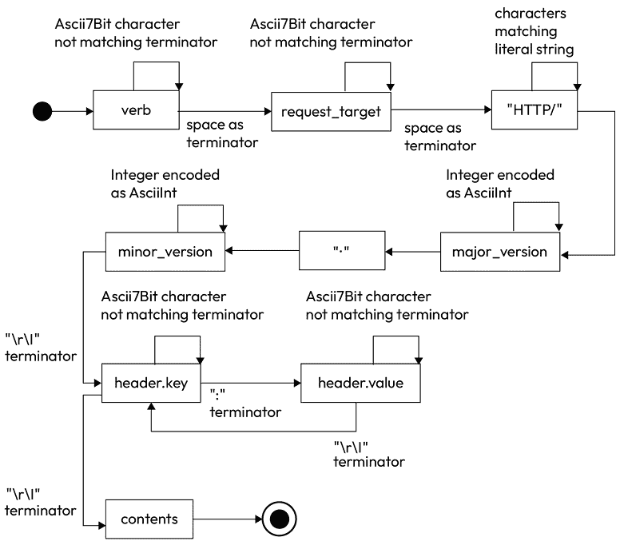

图 9.2：处理“HTTP 请求”消息的状态图

HTTP 响应消息的状态机看起来会和这个非常相似，只是替换了几个部分，但我希望到目前为止，已经可以视觉化出解释器为了执行这段代码实际上需要做什么。

它还阐说明了解析器必须完成的转换，因为最终状态机的结构与代码的实际描述之间存在显著差异。这就是为什么我选择声明式编程范式，因为它允许我们描述协议本身，而不是解析消息所需的逻辑。

这使我为这种编程语言的整体设计画上了句号，并清晰地了解了该语言如何导致解释器执行操作。

# 总结

为了完成编程语言的设计，从语言的整体轮廓开始是重要的，使用特定的用例来驱动该设计的变更。然后，可以不断完善整体轮廓，直到所有的用例都能以连贯的方式满足。

一旦确定了语言的整体轮廓，就需要考虑语言设计与类型系统设计之间的交互。用户指定所用类型的方式也需要通过特定的用例进行评估，就像语言的整体轮廓一样。

设计还需要建立对值的生命周期的清晰定义，并解释如何获取引用以及用户应该如何使用这些引用。

最后，只有当使用完整的用例对设计进行练习时，你才能真正验证该设计。你还没有解析器或解释器并没有关系，但能够视觉化代码最终如何被解释器翻译成实际操作是非常重要的。

这标志着语言设计的完结。在下一章中，我将开始实际解释器的实现。

## 获取本书的 PDF 版本和独家额外奖励

| 扫描二维码（或访问 [packtpub.com/unlock](http://packtpub.com/unlock)）。按按书名搜索本书，确认版本，然后按照页面上的步骤操作。 |  |
| **注**：请保留好发票。直接从 Packt 购买不需要发票。 |

# 第 3 部分

## 实现解释器运行时

在这一部分，我将开始用 C++ 实现实际的解释器。从一个骨架 CMake 项目开始，实现通过基础解释器接口、解释器循环和运行时栈不断演进，并通过引入基本操作结束。

本部分包含以下章节：

* 第 10 章初始化与入口
* 第 11 章执行帧、栈和延续
* 第 12 章运行与测试操作符


正如之前承诺的那样，可以通过查看拉取请求 [`github.com/PacktPublishing/Building-Programming-Language-Interpreters/pull/1/files`](https://github.com/PacktPublishing/Building-Programming-Language-Interpreters/pull/1/files) 来查看代码状态，其中包含了我目前为止所做的所有更改，并允许你检查项目此时的状态。

从现在起，我将始终把特定章节引入的更改作为拉取请求提交到 GitHub 仓库，并使用与 GitHub 相同的约定对它们进行引用，即拉取请求或 issue 的编号。

在下一个章节中，我将创建全局解释器状态对象，并规划解释器本身的生命周期。

### 全局解释器状态

在第 5 章 *整合一切：做出权衡决策* 中，我描述了解释器的整体设计。现在，是时候将其以 C++ 代码的形式写下来了。

## 被解释的程序与解释器

我个人认为，从使用的角度来设计 API 是最好的，而测试用例是我让这项练习尽可能真实的最佳工具，因此让我展示一下该 API 的用法将将是什么样的：

```
std::string test_file =
  "data/002-empty-program.networkprotocoldsl";
networkprotocoldsl::InterpretedProgram program(test_file);
networkprotocoldsl::Interpreter interpreter =
  program.get_instance();
```

这种设计方法的主要特点是，我期望两个对象——`InterpretedProgram` 和 `Interpreter`——通过对象自身的生命周期完全管理它们所需的任何内存。

由于我将 `InterpretedProgram` 和 `Interpreter` 视为具有独立生命周期的独立对象，以后可能需要采用一些额外的内存管理，但从可用性的角度来看，我认为最好让这些考虑保持在解释器内部，而不是用户需要关心的事情。此时代码的状态可以在拉取请求 #2 ([`github.com/PacktPublishing/Building-Programming-Language-Interpreters/pull/2/files`](https://github.com/PacktPublishing/Building-Programming-Language-Interpreters/pull/2/files)) 中看到。

我还没有解析器，所以提供源文件路径并没有那么有用。因此，我为 `InterpretedProgram` 添加一个新构造函数，它接收已经解析的操作树，这将允许我在此时更广泛地练习该 API。

这引出了问题：如何表示程序将要执行的不可变指令，与由动态参数驱动的操作树执行的可变状态。

## 操作树与可变解释器状态

正如第 3 章 *指令、并发、输入和输出* 中讨论的，执行是以解释器需要遍历的操作树的形式进行的。每个操作接收若干值作为输入并返回一个值作为输出。因此，第一步是定义值的样貌。

正如第 4 章 *原生类型、用户类型和扩展点* 中讨论的，我需要表示多种类型的值。因此，第一步是创建一个代表解释器知道原生处理的任何类型的类型。C++ 语言提供了一种使用 `std::variant` 以类型安全的方式处理这种情况的方法。

C 和 C++ 语言的长期用户会熟悉 `union` 关键字，它允许特定的内存区域被不同的类型使用。然而，使用 `union` 关键字需要用户跟踪代码中任何一点实现了哪种具体的值。

`variant` 允许语言运行时本身跟踪运行时值的实际类型，并以类型安全的方式处理可能性的导航。

例如，`std::variant<int, float>` 在语义上等同于 `union` `{ int i; float f;}`，但它提供了类型安全的访问器，如 `std::holds_alternative<int>(v)` 和 `std::get<int>(v)`，这些访问器在使用之前会验证值的实际类型。

在第一步中，我将不会尝试涵盖所有需要的类型。相反，我将专注于支持单一类型，尽管我将通过类型擦除机制来实现此，这将允许以后进行扩展。目前，值的定义如下：

```
using Value = std::variant<int32_t>;
```

这在以后会被重构，以对解释器支持的类型有更复杂的定义，但目前，这对于练习操作如何工作的基础就足够了。

现在我有了值的定义，可以开始定义操作的样的了。基本机制是操作接收零或多个输入值并解析为一个输出值。其中一些值将在解析时定义，另一些将在执行时定义。

为了让这个练习更完整，我将仅设置一个代表字面量值的操作和一个执行两个值相加的操作。这应该足够让我开始启动解释器、执行某些代码并检查结果的值。

与 `Value` 类似，`Operation` 也是一个 `std::variant`（我稍后会定义具体的操作）：

```
using Operation = std::variant<operation::Int32Literal, operation::Add>
```

为了编码操作所需的样式，我可以使用 C20 中引入的概念（concepts）：

```
template <typename OT>
concept OperationConcept =
    requires(OT op, typename OT::Arguments args) {
        {
            std::tuple_size<typename OT::Arguments>::value
        } -> std::convertible_to<size_t>;
        { op(args) } -> std::convertible_to<Value>;
    };
```

虽然本书的目标不是介绍新的 C++ 特性，但我认为值得简要研究概念，因为它们是语言引入的特性。

概念允许你轻松地定义对模板参数的预期。在这种情况下，我的意思是如果我请求 `OperationConcept` 模板参数，只有当满足概念中指定的规范时模板才会被实例化。

在这种情况下，`OT` 类型必须有一个 `OT::Arguments` 成员类型，其中 `std::tuple_size` 返回 `size_t`。它还必须有一个 `operator()`，其求值可以转换为 `Value`。

在引入概念之前，这仍然可能的，但必须通过复杂的**替换失败不是错误**（SFINAE**）来实现，而概念让这种方法变得简单得多。

这个特定的概念将验证所有操作都有一个描述动态参数的元组别名，这些参数将在调用操作时作为参数发送，操作应该返回一个值。声明这个概念将允许我在以后简化 `Operation` 变体的某些访问模式。

然而，某些操作将在源代码中定义参数，这意味着它们需要被构造。解析器的责任是根据源代码中的信息初始化它们，例如产生字面量值的操作：

```
class Int32Literal { 
    int32_t int32_v;
public:
    using Arguments = std::tuple<>; 
    Int32Literal(int32_t v) : int32_v(v) {} 
    Value operator()(Arguments a) { return int32_v; } 
};
static_assert(OperationConcept<Int32Literal>);
```


`Arguments` 内部类型描述了该操作接受一个空元组作为动态参数，而 `operator()` 描述了该操作将返回传递给构造函数的值。为了确保操作类型符合该概念（concept），我添加了 `static_assert`，如果操作未能实现预期的接口，它将在该处编译失败。

另一方面，`Add` 操作不接受任何静态参数，而是接受两个动态参数：

```cpp
class Add {
public: 
    using Arguments = std::tuple<Value, Value>; 
    Value operator()(Arguments a) { 
        return std::visit( 
            &a -> Value {
            return std::visit(&v1 -> Value { 
                return v1 + v2; }, 
                std::get<1>(a)); 
        }, 
        std::get<0>(a)); 
    }
};
static_assert(OperationConcept<Add>);
```

这段代码开始展示你在编写处理动态类型的代码时需要处理的一些复杂性。现在操作需要根据 `std::visit` 来实现。`Arguments` 内部类型的使用允许我以类型安全的方式实现这一点，优点是当引入新类型的新值时，编译器会识别出所有需要调整的地方。

可以通过通过 `std::holds_alternative` 检查 variant 的每种类型来命令式地遍历所有可能的成员。然而，这会导致 variant 中包含的类型与消费该 variant 的代码之间强耦合。

`std::visit` 提供了一种类型安全的机制，确保你处理了所有备选方案（alternatives）。它通过在编译时为 variant 的每种类型实例化访问者（visitor）来实现这一点。

将 variant 与 `std::visit`、参数依赖查找（argument-dependent lookup）以及模板参数结合起来，后续将允许我在为 `Value` 类型添加更多备选方案时，显著简化代码。

仅凭这两个操作，我写不了很多程序，但它们对于练习操作树的实例化以及解释器如何评估该树来说应该足够了。

操作树是一个简单的数据结构，表示一个节点树，其中每个节点指向一个操作以及作为该操作动态输入的子节点：

```cpp
struct OpTreeNode {
    Operation op;
    std::vector<OpTreeNode> children;
}
class OpTree {
    OpTreeNode root;
public:
    OpTree(OpTreeNode r) :root(r) {};
};
```

由于我不想强迫用户管理 `InterpretedProgram` 生命周期与 `Interpreter` 对象生命之间的关系，我实际上需要将操作树存储在共享指针中，以便两个对象可以共享相同的数据，而不会产生一个比另一个存久的风险。

最后，如第 5 章所示，我需要解释器能够同时执行不同的延续（continuations），因此我需要引入 `Continuation` 类并使其成为 `Interpreter`的一部分。在此之前，我需要解释操作实际上是如何发生的。

由于操作树是只读的，我需要额外的数据结构——建模为 `ExecutionStackFrame` 类——来表示操作栈的执行。代码的解释实际上是以双向运动的方式进行的。首先，你向下遍历树直到一个准备好执行的点，将所有等待输入的的操作推入栈中。然后，一旦你到达一个准备好执行的操作，就可以调用该操作，并将该操作的结果积累为栈中下一个项的输入。

## 执行树中的操作

我首先需要设置 `ExecutionStackFrame` 类，它将处理单个操作的执行以及作为输入的值的积累。`ExecutionStackFrame` 对象通过 `OpTreeNode` 构建，它描述了需要执行的内容。

`ExecutionStackFrame` 类将具有以下私有成员：

```cpp
const OpTreeNode &optreenode;
std::vector<Value> accumulator;
```

这里之前对 `OperationConcept` 的定义变得很有用，因为我将能够对任何符合该概念的操作进行类型安全的执行。

类类中需要支持的首个操作是判断此操作是否准备好执行，或者解释器是否需要向下遍历到子节点。`is_ready` 方法使用 `std::visit` 实现了这一点：

```cpp
bool is_ready() {
    return std::visit(
        this {
            return is_specific_operation_ready(o); },
                optreenode.operation);
}
```

这里需要一点间接，因为我不能直接将 `OperationConcept` 作为类型用于 lambda 表达式的参数。因此，我使用 `auto`，它会为 variant 的每个成员展开。然后我调用了一个需要该概念的 `template` 函数：

```cpp
template <OperationConcept O> bool is_specific_operation_ready(const O &o) {
    if (accumulator.size() <
        std::tuple_size<typename O::Arguments>::value) {
    return false;
    } else {
        return true;
    }
}
```

这允许对 `Operation` variant 进行完全的类型擦除，并在我执行操作之前检查是否积累了足够的输入值。

同样，当操作准备就绪时，操作的执行将使用类似的技术：

```cpp
Value execute() {
    return std::visit(
        this {
            return execute_specific_operation(o);
        },
        optreenode.operation);
}
```

`execute_specific_operation` 的定义如下：

```cpp
template <std::size_t... Indices>
auto make_argument_tuple(const std::vector<Value> &v,
                         std::index_sequence<Indices...>) {
     return std::tuple(v[Indices]...);
}
template <OperationConcept O>
Value execute_specific_operation(const O &o) {
    typename O::Arguments args(make_argument_tuple(
        accumulator, std::make_index_sequence<
            std::tuple_size<typename O::Arguments>::value>()));
    return o(args);
}
```

这段代码的不同之处在于我还需要将 `accumulator` 向量转换为操作所需的元组。`make_argument_tuple` 模板将从向量中展开所需的元素。

最后，帧最后的操作是在输入缺失时返回下一个操作：

```cpp
const OpTreeNode &next_op() { 
    assert(!is_ready()); 
    return optreenode.children[accumulator.size()];
}
```

现在我可以定义 `Continuation` 本身，它由 `ExecutionStackFrame` 对象栈组成，并用 `OpTreeNode` 初始化：

```cpp
class Continuation {
    std::stack<ExecutionStackFrame> stack;
    std::optional<Value> result;
public:
    Continuation(const OpTreeNode &o) {
        stack.push(ExecutionStackFrame(o));
    }
    bool step() {
        if (stack.size()) {
            while (!stack.top().is_ready()) {
                stack.push(stack.top().next_op());
            }
            result = stack.top().execute();
            stack.pop();
            if (stack.size()) {
                stack.top().push_back(*result);
                return true;
            } else {
                return false;
            }
        } else {
            return false;
        }
    }
    std::optional<Value> get_result() { return result; }
};
```

这就是双向遍历发生的地方。当 `Continuation` 被构造时，它将 `OpTreeNode` 设置在栈根部，这是该延续的起点。

当执行一步操作时，首先（如果栈不为空），它需要向下遍历 `OpTree` 并不断推入栈，直到找到一个可以执行的操作。


一旦操作准备就绪，我会执行它并将其从栈中移除，存储结果，同时将栈中下方的元素推入（如果它为空）。最后一步的 `result` 值始终会被存储在 `Continuation` 中，以便于内省。

此时，我可以根据 `Continuation` 来定义 `Interpreter` 对象，并基于其从 `OpTree` 构建的，而 `OpTree` 是维护在 `InterpretedProgram` 类中的：

```cpp
class Interpreter {
    std::shared_ptr<const OpTree> optree;
    Continuation continuation;
public:
    Interpreter(std::shared_ptr<const OpTree> o)
        : optree(o), continuation(o->root){};
    bool step() { return continuation.step(); }
    std::optional<Value> get_result() {
        return continuation.get_result(); }
};
```

稍后我将必须在同一个解释器中添加对并发`continuations`的支持，但目前这足够运行我目前构建的内容了。

最后，为了总结解释器的整体全局状态，我可以查看 `InterpretedProgram` 的结构：

```cpp
class InterpretedProgram { 
    std::string source_file;
    std::shared_ptr<const OpTree> optree;
public: 
    InterpretedProgram(std::string sf) 
        : source_file(sf), 
            optree(std::make_shared<const OpTree>( 
                OpTree({operation::Int32Literal(0), {}}))) {} 
    InterpretedProgram(std::shared_ptr<const OpTree> o) 
        : source_file("-"), optree(o) {} 
    Interpreter get_instance() { 
        return Interpreter(optree); 
    };
};
```

目前，如果提供了源文件名，我会通过返回单个字面量操作（`operation::Int32Literal`）作为解析器的占位符。不过，我还有一个直接接收 `OpTree` 的构造函数。

至此，我大致确定了全局解释器状态将如何维护。为了测试这一点以及目前为止的所有代码，我可以编写一个用例，逐步执行一个操作树的执行，该树的操作等同于 `10 + 20` 表达式：

```cpp
TEST(operations, literal) { 
    using namespace networkprotocoldsl; 
    operation::Int32Literal il1(10); 
    operation::Int32Literal il2(20); 
    operation::Add a1; 
    auto optree = std::make_shared<OpTree>( 
        OpTree({a1, {{il1, {}}, {il2, {}}}})); 
    InterpretedProgram p(optree); 
    Interpreter i1 = p.get_instance(); 
    Interpreter i2 = p.get_instance();
    ASSERT_FALSE(i1.get_result().has_value()); 
    ASSERT_FALSE(i2.get_result().has_value()); 
    ASSERT_TRUE(i1.step()); 
    ASSERT_TRUE(i2.step()); 
    ASSERT_EQ(Value(10), *(i1.get_result())); 
    ASSERT_EQ(Value(10), *(i2.get_result())); 
    ASSERT_TRUE(i1.step()); 
    ASSERT_TRUE(i2.step()); 
    ASSERT_EQ(Value(20), *(i1.get_result())); 
    ASSERT_EQ(Value(20), *(i2.get_result())); 
    ASSERT_FALSE(i1.step()); 
    ASSERT_FALSE(i2.step()); 
    ASSERT_EQ(Value(30), *(i1.get_result())); 
    ASSERT_EQ(Value(30), *(i2.get_result()));
}
```

这个测试证明了我可以从手动创建的 `OpTree` 初始化单个 `InterpretedProgram` 实例，然后从该程序实例化两个不同的解释器，并逐步执行解释器中的所有步骤，直到 `step()` 返回 `false`结束，且 `continuation` 的结果在每一步都具有预期的值。

之前的更改可以在 GitHub 仓库中的 pull request #3 ([`github.com/PacktPublishing/Building-Programming-Language-Interpreters/pull/3/files`](https://github.com/PacktPublishing/Building-Programming-Language-Interpreters/pull/3/files)) 中查看。

在下一节中，将探索如何让解释器易于嵌入到其他系统中。

# 使其易于嵌入

如果一种语言负责执行整个程序本身，那么不深究解释器将如何嵌入到现有进程中会更合理。

然而，这种编程语言专门设计为在现有程序的上下文中执行。因此，我需要确保 API 是协作的，并将调度决策推留给语言的用户。

考虑到我目前的实现进度，主要需要注意的是确保解释器要执行的各个步骤对用户来说是可用的。

另一个重要方面是定义解释器如何与原生语言通信，以及它如何推迟解释器的执行，直到原生代码信号准备好继续。

正如在 *第一章* *定义范围*（Defining the Scope）中所讨论的，这将涉及确保我将原生代码与解释代码之间的切换表示解释器本身的一个顶层概念，允许原生回调的执行在用户的控制下。这表现为确保原生回调不在常规操作内部进行。

在上一节中，我仅仅有一个布尔值来表示操作是否准备好执行，这不足以区分操作实际上需要等待原生回调结果的情况。

我将用一个 `enum class` 替换该布尔值，以标识额外的状态：

```cpp
enum class ExecutionStackFrameState {
    MissingArguments,
    WaitingForCallback,
    WaitingCallbackData,
    Ready,
    Exited
};
```

你可以在 GitHub 仓库的第 4 号 pull request #4 ([`github.com/PacktPublishing/Building-Programming-Language-Interpreters/pull/4/files`](https://github.com/PacktPublishing/Building-Programming-Language-Interpreters/pull/4/files)) 中看到引入 `enum class` 所需的更改。


` 标签处中断了，且包含了重复的代码块）。根据您提供的上下文和要求，我为您翻译了您给出的部分内容。

以下是翻译结果：

[content]

```cpp
template <OperationConcept O>
ExecutionStackFrameState is_specific_operation_ready(
    const O &o) {
        if (accumulator.size() <std::tuple_size<typename O::Arguments>::value) {
            return ExecutionStackFrameState::MissingArguments;
        } else {
            callback_key = o.callback_key();
            if (callback_key.has_value()) {
                if (callback_called) {
                    return ExecutionStackFrameState::WaitingCallbackData;
                } else {
                    return ExecutionStackFrameState::WaitingForCallback;
                }
        } else {
            return ExecutionStackFrameState::Ready;
        }
    }
}
```

最后，我需要提供一种方法，使用执行过程中累积的动态参数来执行回调本身。我首先在 `ExecutionStackFrame` 中添加了内省方法：

```cpp
std::optional<std::string> get_callback_key() {
    return callback_key;
}
void set_callback_called() {
    callback_called = true;
}
```

然后，我将这种可见性传递给 `Continuation`，并支持告知回调已执行，这将会将该操作从堆栈中弹出：

```cpp
void set_callback_return(Value v) {
    assert(stack.size() > 0);
    assert(stack.top().get_callback_key().has_value();
    result = v;
    stack.pop();
    if (stack.size()) {
        stack.top().push_back(v);
    }
}
```

这些方法也存在于 `Interpreter` 类中，它只是简单地转发给 `continuation`。现在，我可以引入一个接收单个值并用于管理回调的回操作：

```cpp
class UnaryCallback {
    const std::string key;
public:
    UnaryCallback(std::string c) :key(c) {}
    using Arguments = std::tuple<Value>;
    Value operator()(Arguments a) const { return 0; }
    std::optional<std::string> callback_key() const {
        return key;
    }
};
```

有了这些基础设施，我现在可以测试回调机制了：

```cpp
TEST(interpreter_global_state, callback) { 
    using namespace networkprotocoldsl; 
    operation::Int32Literal il1(10); 
    operation::UnaryCallback uc1("multiply_by_2"); 
    auto optree = std::make_shared<OpTree>(OpTree({uc1, {{il1, {}}}})); 
    InterpretedProgram p(optree); 
    Interpreter i = p.get_instance(); 
    ASSERT_FALSE(i.get_result().has_value()); 
    ASSERT_EQ(ExecutionStackFrameState::WaitingForCallback, i.step()); 
    ASSERT_EQ(Value(10), *(i.get_result())); 
    ASSERT_EQ(ExecutionStackFrameState::WaitingForCallback, i.step()); 
    ASSERT_EQ("multiply_by_2", *(i.get_callback_key())); 
    i.set_callback_called(); 
    ASSERT_EQ(ExecutionStackFrameState::WaitingCallbackData, i.step()); 
    i.set_callback_return( 
        std::get<int32_t>(*(i.get_result())) * 2); 
    ASSERT_EQ(ExecutionStackFrameState::Exited, i.step()); 
    ASSERT_EQ(Value(20), *(i.get_result()));
}
```

这证明了解释器的用户可以检查执行状态、分发其回调、报告结果，然后在解释器中继续执行。这里引入的更改位于 GitHub 仓库中的 pull request #5 ([`github.com/PacktPublishing/Building-Programming-Language-Interpreters/pull/5/files`](https://github.com/PacktPublishing/Building-Programming-Language-Interpreters/pull/5/files))。

在下一节中，我将探讨如何扩展解释器以支持多种类型的操作。

# 针对多种类型操作的重构

此时，我已经对需要通过回调产生值的操作处理了特殊情况。处理来自事件循环的输入和输出将需要另一组特殊情况。

我最终还将关于回调键的信息添加到了操作本身的概念（concept）中，这并不理想，因为其他类型的操作可能需要它们自己的数据。这产生了一个遗憾的副作用，即操作树中的所有内容都将使用所有特定需求并集所占的空间。

虽然我可能在实现原生回调支持时就能预见到这种需求，但我也想展示持续评估代码中所做的设计决策是有多重要。出于这个原因，我将显式地引导通过重构解释器，以抽象出不同类型的操作。

在我最初的设计中，操作的执行只能返回一个值，当调用发生时，预期是所有前提条件已经满足。

当我引入第一种依赖于外部输入的操作时，我意识到解释器需要管理那种额外的交互，因此我将其添加到通用操作接口中。现在当我遇到第二种类型的操作时，我想起了那句话：在计算机科学中，软件设计问题只有三个有效的整数答案：0、1 和无穷大。

那么，我如何抽象掉特定操作的需求呢？我唯一看到的结论是需要增加操作的概念。目前我识别出的操作需求如下：

*   原生回调需要一个标识符以便用户提交数据
*   I/O 操作可以读取或写入
*   I/O 操作需要发送到网络的字节缓冲区，或从网络读取的字节缓冲区
*   I/O 操作需要通信完成

我还需要记住，代表代码本身的不可变数据结构与跟踪特定操作类型的可变状态之间存在区别。

此更改的第一步是将外部信息是否可用的决策委托给操作本身。然而，这意味着我需要一种方法让操作描述它继续执行所需的内容。

这是一个我需要决定接口通用性的点。这是一个微妙的平衡，因为太通用有利于支持更广泛的用例，但也会引入显著的复杂性；而太窄则意味着我将硬编码过多的细节。

这个问题没有标准答案。它变成了一系列复杂的权衡决策，有时判断标准更多基于审美而非客观标准。

在这种特定情况下，我决定考虑我有不同类型操作的想法。这些操作在运行时关联不同的数据结构，解释器的用户将负责为正确的操作提供正确的数据集。

现在很清楚，不同类型的操作将具有不同的接口，因此我需要为这些接口不同的概念，从重构期望回调的操作开始。

我将首先简化 `OperationConcept`，使其仅描述 `Arguments` 元组：

```cpp
template concept OperationConcept =
requires(OT op, typename OT::Arguments args) { 
    { std::tuple_size::value } -> std::convertible_td::size_t;
};
```

现在，我可以引入 `InterpretedOperationConcept`，它将用于任何完全由解释器内部处理的操作，不需要执行堆栈之外的任何运行时上下文：

```cpp
template <typename OT>
concept InterpretedOperationConcept = 
  requires(OT op, 
           typename OT::Arguments args) { 
    {OperationConcept<OT>}; 
    { op(args) } -> std::convertible_to<Value>;
};
```


你会注意到 `operator()` 仅从执行栈中获取 `value` 参数。然而，回调操作需要额外的运行时数据，因此我引入了 `CallbackOperationContext`：

```cpp
struct CallbackOperationContext {
    std::optional<Value> value;
    bool callback_called = false;
};
```

最后，我定义了 `CallbackOperationConcept`，它支持获取回调键以及报告回调状态和取值的接口，并为 `operator()` 了一个了一个不同的签名，允许操作的执行能够操纵上下文：

```cpp
template <typename OT>
concept CallbackOperationConcept = 
  requires(OT op, 
           typename OT::Arguments args, 
           Value v, 
           CallbackOperationContext ctx) { 
    {OperationConcept<OT>}; 
    { op.callback_key(ctx) } 
        -> std::convertible_to<std::string>; 
    { op(ctx, args) } 
        -> std::convertible_to<OperationResult>; 
    {op.set_callback_called(ctx)}; 
    {op.set_callback_return(ctx, v)};
};
```

此时，我已成功地重新架构了描述不同类型操作的机制。为了证明这种方法在我目前探索的基础上之外确实有效，我将开始描述 I/O 操作将是什么样的。

由于解释器的目标之一是与任何特定库解耦，我决定采用简单的方法，即解释器将持有一个数据流入或流出的缓冲区：

```cpp
struct InputOutputOperationContext {
    std::string buffer;
};
```

`InputOutputOperationConcept` 将描述任何与缓冲区交互并处理读取或写入的操作。与 `CallbackOperationConcept` 一样，运行时值需要传递给 `operator()`：

```cpp
template <typename OT>
concept InputOutputOperationConcept =
 requires(OT op,
 typename OT::Arguments args,
 InputOutputOperationContext ctx) {
    {OperationConcept<OT>};
    { op(ctx, args) }
        -> std::convertible_to<OperationResult>;
    { op.handle_read(ctx) }
        -> std::convertible_to<std::size_t>;
    { op.handle_write(ctx) }
        -> std::convertible_to<std::size_t>;
};
```

借此，我可以将 `ExecutionStackFrame` 中的硬编码属性替换为持有不同操作概念上下文信息的 `variant`（变体）。作为此更改的一部分，我还将报告阻塞操作的逻辑移动到了操作本身，而不是由解释器来处理它。

这里的模式是：操作的分发将通过匹配三种不同的操作概念来实现，而 `variant` 是根据具体的操作定义的。单个操作对于解释器来说是类型擦除（type-erased）的，只要它们符合三种操作概念之一，解释器就不需要为每个操作编写专门的代码。

我还借此机会对代码进行了通用的重构，使其更易理解，方法是更好地分离实现与接口，并将类移动到它们各自特定的编译单元中。此重构中的更改可以在 GitHub 仓库的 pull request #6 ([`github.com/PacktPublishing/Building-Programming-Language-Interpreters/pull/6/files`](https://github.com/PacktPublishing/Building-Programming-Language-Interpreters/pull/6/files)) 中进行评审。

在下一节中，我将关注 I/O 操作的接口。

# 设计 I/O 接口

正如第 1 章 (#Chapter_1.xhtml__idTextAnchor019) 所示，目标是让解释器独立于特定的事件循环框架，允许解释器在尽可能多的场景中使用。

这一选择的另一个结果是，我只需要与输入输出操作中与该语言支持的协议需求相关的部分进行交互。特别是，这意味着我真的只需要能够处理读取和写入的需求。

我将回到无阻塞 I/O 方法，这种方法只需要一种接收字节的机制，并通信哪些字节需要被写入。

在上一节中，我为 `InputOutputOperation` 有了一个占位符 API；现在让我对其进行精炼。

现在有一个相关的细微之处，即从网络接收到的字节序列并不一定与该特定操作所需的字节数匹配。如果字节较少，操作必须累积它们并保持阻塞状态继续。如果字节较多，操作必须能够通信它没有消耗掉输入中的所有字节。

同样，`write` 操作可能无法完全写入操作需要输出的所有内容，此时操作应保持阻塞，等待下一次继续写入的机会。

我将考虑数据被读取并作为 `std::string_view` 给予解释器，而操作将返回从该输入中消耗了多少字节。如果消耗了足够的字节，它将停止消耗更多输入，`step` 函数将返回。

然而，`write` 操作将分两步进行。第一步提供对需要写入的缓冲区的访问，第二步允许通知从该缓冲区写入了多少字节。

考虑到这些，这是 `InputOutputOperationConcept` 的最终接口：

```cpp
template <typename OT>
concept InputOutputOperationConcept
 = requires(OT op,
            typename OT::Arguments args,
            InputOutputOperationContext ctx,
            size_t s) {
    {OperationConcept<OT>};
    { op(ctx, args) } -> std::convertible_to<OperationResult>;
    { op.handle_read(ctx, std::string_view) }
        -> std::convertible_to<std::size_t>;
    { op.get_write_buffer(ctx) }
       -> std::convertible_to<std::string_view>;   
    {op.handle_write(ctx, s)};
};
```

现在，我应该能够引入一个测试来运行 `ReadInt32Native` 操作，该操作从输入读取四个字节并返回一个作为 `Value` 的整数。

为了让测试更有趣，我将从输入读取两个数字，使用 `Add` 操作获取和，并使用 `WriteInt32Native` 操作产生最终的整数。

该测试将说明与特定 I/O 操作集成最终需要完成什么，尽管我可能会提供更多的辅助函数来使其对用户来说更加符合直觉。

GitHub pull request #7 ([`github.com/PacktPublishing/Building-Programming-Language-Interpreters/pull/7/files`](https://github.com/PacktPublishing/Building-Programming-Language-Interpreters/pull/7/files)) 包含了全部代码，但我将突出其中的一些操作：

```cpp
operation::ReadInt32Native r;
operation::Add add;
operation::WriteInt32Native w;
auto optree =
    std::make_shared<OpTree>(OpTree(
        {w, {{add, {{r, {}}, {r, {}}}}}}));
InterpretedProgram p(optree);
Interpreter i = p.get_instance();
```

解释器使用 `optree` 初始化，它将读取两个原生整数，将它们相加，然后写入结果。这里是尝试执行一步操作的代码片段，在向解释器提交输入之前，它最终处于阻塞状态：


```
ASSERT_EQ(ContinuationState::Blocked, i.step());
ASSERT_EQ(ReasonForBlockedOperation::WaitingForRead, 
    std::get<ReasonForBlockedOperation>(i.get_result()));
int input1 = 42;
int input2 = 900;
char buffer[8] = {};
std::memcpy(&(buffer[0]), &input1, 4);
std::memcpy(&(buffer[4]), &input2, 4);
size_t amount_read;
amount_read = i.handle_read({buffer, 2});
ASSERT_EQ(2, amount_read);
ASSERT_EQ(ContinuationState::Blocked, i.step());
ASSERT_EQ(ReasonForBlockedOperation::WaitingForRead, 
    std::get<ReasonForBlockedOperation>(i.get_result()));
amount_read = i.handle_read({&(buffer[2]), 3});
ASSERT_EQ(2, amount_read);
ASSERT_EQ(ContinuationState::Ready, i.step());
ASSERT_EQ(Value(42), std::get<Value>(i.get_result()));
```

最后，在之后，当 `Add` 操作返回后，下一个步骤将再次被阻塞，直到写入的数据从解释器中消耗：

```
ASSERT_EQ(ContinuationState::Blocked, i.step());
ASSERT_EQ(ReasonForBlockedOperation::WaitingForWrite,
    std::get<ReasonForBlockedOperation>(i.get_result()));
std::string_view write_buf = i.get_write_buffer();
ASSERT_EQ(4, write_buf.length());
ASSERT_EQ(4, i.handle_write(4));
int output;
memcpy(&output, write_buf.begin(), 4);
ASSERT_EQ(942, output);
ASSERT_EQ(ContinuationState::Exited, i.step());
ASSERT_EQ(Value(0), std::get<Value>(i.get_result()));
```

我理解这里涉及很多内容。因此，我建议查看拉取请求 `#7` 处的代码，并进一步熟悉正在发生的一切。我将继续关注关注传递运行时设计过程的特定点，以及用于实现该实现的技术。

至此，代码已经处于一个可以被识别为解释器的阶段。这里有一个静态填充的操作树，就像从解析器生成的那样。解释器随后可以逐步执行，向调用者提供关于是否可以继续的反馈。

# 总结

以有利于测试驱动开发的方式构建你的 C++ 项目，将使你能够非常容易地对日益复杂的功能进行迭代，同时降低破坏现有功能的风险。我们在本章中学习到了这一点。`Git` 仓库中记录的历史对于理解项目如何演进也起着重要作用，正如我们在本章中所看到的。

在 `C++` 中构建一个栈机器可以从类型擦除中大大获益，使得处理栈的代码不需要不断地操作每一种操作类型。相反，你应该能够根据操作需要解释器提供的接口对操作进行分类，这将允许你在不损失类型安全性的情况下减少需要编写的代码量。这一点也被涵盖了。

同时，始终持续重新评估代码的整体结构是非常重要的，正如章节中提到的，后退一步并重新组织代码以便易于进一步扩展，通常是一个好主意。

我们还看到将操作执行的运行时上下文与操作本身解耦对解释器设计有益。这种解耦允许操作树在整个执行期间完全保持不变。

解释器现在为用户提供了继续逐步执行代码的机制，只要没有东西阻塞执行。一旦某些东西阻塞了它（无论是由于需要回调原生代码还是由于需要 I/O 操作），解释器的用户将获得允许通过提供步骤来推进执行的接口。这使得解释器很容易被嵌入到许多不同的场景中，因为解释器从不阻塞，也不会递归。

在下一章中，我将抽象向上移动一级，从单个操作到带有调用和返回的函数、词法作用域（lexical pads）以及其他允许执行真实程序的重要功能。

## 获取本书的 PDF 版本和专属额外内容

扫描二维码（或访问 [packtpub.com/unlock](http://packtpub.com/unlock)）。通过名称搜索此书，确认版本，然后按照页面上的步骤操作。 |  |

| **注意**：请保留好发票。直接从 Packt 购买不需要发票。 |

## 第 11 章：执行帧、栈与延续（Continuations）

在上一章中，我开始了实现解释器栈机器的过程。然而，该实现尚未能够处理控制流操作，例如条件判断或函数。在本章中，我将添加这些功能，并讨论解释器如何跨多个延续（continuations）管理执行。

具体来说，本章将处理以下内容：

* 操作树如何被视为一个值，以便允许重定向执行
* 解释器动态选择调用什么的方式
* 函数如何由一系列操作、控制流和变量作用域组成
* 解释器如何处理函数调用
* 如何实现一个函数声明及其调用的端到端示例

在本章结束时，你将对解释器如何跨不同操作集管理栈有实务的理解。

## 代码作为值

栈机器的实现假设操作的所有输入都必须解析。这意味着操作树被深度优先地遍历，直到解释器找到操作。

然而，这不足以表示复杂的控制流。让我们来看一个条件判断，使用 Python 语言：

```if a == 5:
    something()
else:
    something_else()
```

朴素的表示如下：

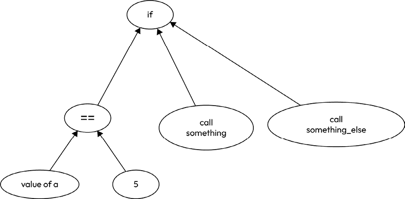

图 11.1：条件判断的朴素操作树

然而，如果我们考虑栈机器目前的实现方式，这将导致在评估条件本身之前就评估两个分支。这并不是我们预期的。

为了解决这个问题，我们首先需要能够将条件每个分支中的可执行代码表示为解释器的值。

由于栈机器需要能够将可执行代码作为条件运算符的参数，我们需要修改 `Value` 类型以包含可执行代码的表示。

由于操作需要值，而值现在可以包含操作树，我们的类型系统变得相互递归：`Value` 必须包含 `OpTree` 的表示，而 `OpTree` 节点必须引用 `Value`。在实践中，这意味着需要前向声明和仔细的头部排序。为了清晰，我在这里只显示最小代码；完整的头部安排可以在仓库中找到。

我首先引入一个新的类来表示可调用值（在 value 命名空间中）：

```cpp
struct Callable {
    std::shared_ptr<const OpTree> tree;
};
```

下一步将其添加到 `Value` variant 中：

```cpp
using Value = std::variant<int32_t, value::Callable>;
```

此时，所有的操作都无法编译，因为它们只知道如何处理原生整数，但由于该值可能是新类型，因此这种情况也需要被处理。

这意味着我们还需要一个新值来表示类型错误（同样在 value 命名空间中），如果你尝试将 `add` 运算符应用于可调用值的话：


```cpp
enum class RuntimeError {
    TypeError
};
```

然后，`RuntimeError` 类型也被添加到了 `Value` 变体中：

```cpp
using Value = std::variant<int32_t,
                           value::Callable,
                           value::RuntimeError>;
```

这告诉了机制我们将如何传播错误：栈机中的操作符在接收到错误时，只需返回该错误参数。以下是更改后 `add` 操作的实现：

```cpp
static Value _add(int32_t lhs, int32_t rhs) {
    return rhs + lhs;
}
static Value _add(int32_t lhs, value::Callable rhs) {
    return value::RuntimeError::TypeError;
}
static Value _add(int32_t lhs, value::RuntimeError rhs) {
    return rhs;
}
static Value _add(int32_t lhs, Value rhs) {
    return std::visit(&lhs -> Value {
                            return _add(lhs, rhs_v); },
                      rhs);
}
static Value _add(value::Callable lhs, Value rhs) {
    return value::RuntimeError::TypeError;
}
static Value _add(value::RuntimeError lhs, Value rhs) {
    return rhs;
}
Value Add::operator()(Arguments a) const {
    return std::visit(&a {
                        return _add(lhs, std::get<1>(a)); },
                      std::get<0>(a));
}
```

该代码的工作原理是在第一次访问操作符的左侧参数时使用 `_add` 函数，然后当该参数具有正确类型时，再次对右侧参数使用 `std::visit`。此部分的代码更改位于存储库中的 pull request #8 ([`github.com/PacktPublishing/Building-Programming-Language-Interpreters/pull/8/files`](https://github.com/PacktPublishing/Building-Programming-Language-Interpreters/pull/8/files) )。

现在，我可以开始实现一个能够根据可调用值启动不同延续操作（continuation）的操作符了。

## 调用可调用值

可调用值最简单的用法是在条件运算符中，它需要执行不同的分支并将它们作为参数。重新回顾图 11.1 中的操作树，我们得到如下：

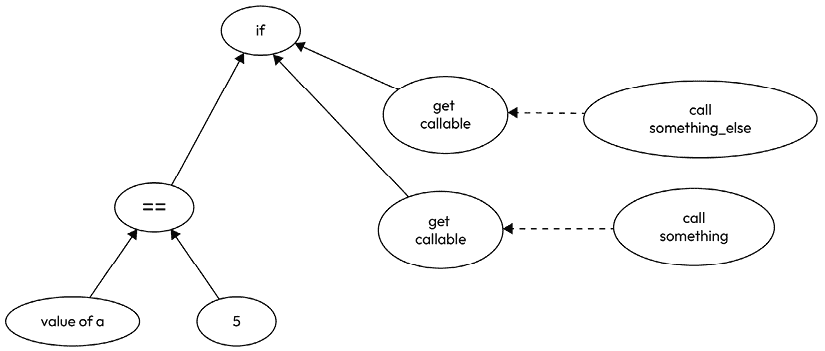

图 11.2：带有可调用值的操作树

图中的虚线表示传递给产生可调用值的操作符的操作树是静态生成的，就像处理整数时一样。

我不会在书中列出每一处代码更改，但在实现条件逻辑之前，我还需要引入 `bool` 作为一种值类型并引入等值运算符。此更改不需要与我之前所做的任何不同技术。你可以在 pull request #9 ([`github.com/PacktPublishing/Building-Programming-Language-Interpreters/pull/9/files`](https://github.com/PacktPublishing/Building-Programming-Language-Interpreters/pull/9/files)) 中看到这些更改。

考虑到操作树在代码执行期间是恒的，我将需要创建一种机制，让条件运算符能够通知解释器它需要切换到不同的延续。我们在 I/O 或原生回调中已经有了类似的机制。

因此，第一步是为改变控制流的操作创建一个新概念，并带上相应的上下文对象：

```cpp
struct ControlFlowOperationContext {
    std::optional<Value> callable;
    std::optional<Value> value;
    bool callable_invoked = false;
};
template <typename OT>
concept ControlFlowOperationConcept =
 requires(OT op,
          typename OT::Arguments args,
          Value v,
         ControlFlowOperationContext ctx) {
    {OperationConcept<OT>};
    { op.get_callable(ctx) } -> std::convertible_to<Value>;
    { op(ctx, args) } -> std::convertible_to<OperationResult>;
    {op.set_callable_return(ctx, Value v)};
    {op.set_callable_invoked(ctx)};
};
```

`ControlFlowOperationContext` 类型描述了执行 `ControlFlowOperationConcept` 的操作所需的数据。存储在上下文对象中的状态为操作提供追踪其状态的方法，从尚未决定调用哪个可调用值，到已经调用，最后获取其评估结果。

`callable` 和 `value` 成员初始为 `null`，这表示操作仍需决定使用哪个可调用值。一旦设置了可调用值，操作就知道可以将该可调用值交给解释器。当解释器调用可调用值时，它会通知操作，从而防止重复调用。最后，一旦可调用值完成评估，将返回结果，作为操作的结果。

此外，我将在 `ReasonForBlockedOperation` 枚举中添加新成员，以描述操作何时在等待可调用值被调用，这将允许解释器检测何时需要创建新的延续。

最后，在此时，我可以实现条件操作了。此实现使用了与之前操作相似的技巧，但它需要三个参数——一个用于条件，一个用于条件为 `true` 时的可调用值，另一个用于条件为 `false` 时的值：

```cpp
class If {
public:
    using Arguments = std::tuple<Value, Value, Value>;
 OperationResult operator()(
 ControlFlowOperationContext &ctx,
 Arguments a) const;
 Value get_callable(ControlFlowOperationContext &ctx)
        const;
    void set_callable_invoked(ControlFlowOperationContext &ctx) const;
    void set_callable_return(ControlFlowOperationContext &ctx,
 Value v) const;
};
static_assert(ControlFlowOperationConcept<If>);
```

此操作的实现与其他操作有一些相似之处，因为它只有在可调用值被调用后才会返回真实值，而且它还提供了一种追踪该调用是否已经发生的机制。

该状态也会通过延续传递。我不会详细介绍如何在延续中添加该支持，因为这与已有的代码没有区别。我不会再详细介绍为静态操作树返回可调用值的操作，因为那里也没有什么新新意。

重要的更改实际上在解释器本身，因为现在它需要对延续阻塞在可调用值的情况做出反应并调用它。虽然这可能不是最终的设计，但目前我将仅仅创建一个延续栈，当栈顶部的延续退出时，我们将其弹出并将返回值传给上一个延续。

这种实现方式是使用 `OperationResult` 来识别操作已阻塞并等待可调用值被调用，然后解释器实例化一个新的延续并将其推入栈。与此同时，当一个延续退出时，解释器会检查是否有另一个延续需要恢复。

当遇到函数调用时，解释器将新的延续推入栈中。当该函数返回时，延续被弹出，将其结果传回给调用者。这避免了原生递归并防止了栈溢出。


```
ContinuationState step() {
    ContinuationState s = continuation_stack.top().step();
    if (s == ContinuationState::Blocked) {
        ReasonForBlockedOperation reason =
            std::get<ReasonForBlockedOperation>(continuation_stack.top().get_result());
        if (reason == WaitingForCallableInvocation) {
            value::Callable callable =
                std::get<value::Callable>(continuation_stack.top().get_callable());
            continuation_stack.top().set_callable_invoked();
            continuation_stack.push(Continuation(callable.tree));
            return continuation_stack.top().prepare();
        } else {
            return s;
        }
    } 
    else if (s == ContinuationState::Exited) {
        Value r = std::get<Value>(continuation_stack.top().get_result());
        if (continuation_stack.size() > 1) {
            continuation_stack.pop();
            continuation_stack.top().set_callable_return(r);
            return continuation_stack.top().prepare();
        } else {
            return s;
        }
    } 
    else {
        return s;
    }
}
```

该过程首先从执行栈顶部的延续点（continuation）开始。这将让我们获得执行完成后的状态。如果延续点被阻塞，解释器会检查它是否是因为等待可调用对象而阻塞，如果是的话，它会向栈中推入一个新的延续点。同样，如果延续点已退出，它将从栈中弹出，并将结果传递给现在位于顶部的上一个延续点。在所有其他情况下，解释器将直接委托给其标准的状态处理逻辑。

此部分的更改位于 pull request #10（[`github.com/PacktPublishing/Building-Programming-Language-Interpreters/pull/10/files`](https://github.com/PacktPublishing/Building-Programming-Language-Interpreters/pull/10/files)）中，其中包含了此实现所需的所有代码更改。你可以详细看到，新操作在本质上与之前的操作没有太大区别。这些更改还包含一个用于此新功能的测试用例。

接下来，我将开始定义什么是函数上下文（function context），以及它与简单的可调用值（callable value）有何不同。

## 创建函数

目前仅具有转移控制流到不同操作树的能力。虽然这种方式可以表示许多不同的问题，但我们通常与函数相关的还有其他能力：

*   执行语句序列
*   中断控制流以立即离开函数
*   使用变量并定义其名称的作用域

到目前为止，每个操作只执行一次，且执行的形状是由运算符参数元组的静态类型决定的。让我们看 Python 中的以下示例：

```python
print("Hello")
print("World!")
```

如果我们将其翻译为操作树，它看起来像这样：

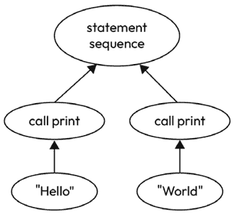

图 11.3: 语句序列的操作树

但如果我们尝试像现在这样在代码中描述这个“语句序列”运算符，我们会发现无法预先知道参数元组的大小。它将由解释执行代码的形状决定。

另一个值得探讨的方面是我们如何处理运行时错误。仅仅忽略第一条语句中的错误并继续执行第二条语句是没有意义的。我们可能希望在语句结束时出错时中断执行。

我应该简要讨论一下错误处理。我为这个解释器采用的方法受到了函数式编程语言的影响，错误通过返回值传播。也就是说，返回值要么是预期值，要么是错误值。还有其他可以考虑的方法。

第一种是 C 编程语言的做法，即将将错误处理完全交给语言的使用者，使得运行时实际上并不知道它。这就是为什么在 `C` 中，返回代码通常是一个整数，以便用户知道操作是否成功，或者失败的原因。

更常见的方法是拥有一完全独立的体系，通过异常通过调用栈抛出错误，`C++` 本身以及大多数其他编程语言（如 `Python`、`Java` 和 `JavaScript`）都是这样做的。我将研究这些机制的工作原理留给你们作为练习，因为如果我要涵盖这些，至少需要书中的一整章。

我将从定义语句序列运算符开始。现在，这是特殊的，因为它看起来不像任何其他运算符，因此它实际上不会符合 `OperationConcept`。事实上，它并不是真正的运算符；它只是指示解释器在到达操作树中的语句序列节点时，对执行执行不同的操作。

`OpSequence` 运算符的定义非常简单：

```cpp
class OpSequence {};
```

它不符合 `OperationConcept` 这一事实实际上使其实现非常简单。我只需要为执行栈帧背后的逻辑中的几个函数提供重载。当访问操作的变体（variant）以实现特定行为时，会被这些重载。

## 重载解析

在这一节中，我大量使用了 `C++` 语言中的重载解析规则。模板参数推导和依赖性查找（ADL）之间的关系被用来允许这种特定的执行。如果你对这些不熟悉，一个很好的起点是 `cppreference.com` 上的“重载解析”（Overload Resolution）文档（[`en.cppreference.com/w/cpp/language/overload_resolution.html`](https://en.cppreference.com/w/cpp/language/overload_resolution.html)）。

第一个需要重载的函数是 `initialize_context`，只需返回一个布尔值，因为这个操作不需要任何上下文：

```cpp
static OperationContextVariant initialize_context(
 const operation::OpSequence &o) {
    return false;
}
```

我想强调它是如何工作的，因为在现在看来可能有点像魔法。毕竟，我们做的只是添加了一个新的函数重载定义；它是如何产生不同行为的？

查看调用 `initialize_context` 的地方，你可以看到它是通过对操作使用 `std::visit` 来工作的，根据实际激活的变体来分发不同的代码：

```cpp
ctx = std::visit(
     this { return initialize_context(o); },
     optreenode.operation);
```

这实际上会为变体的每个备选项扩展 lambda。然后，`initialize_context` 函数需要接受特定变体的参数。

到目前为止，实现使用了符合特定概念的参数的模板，这意味着只有当操作实现了该概念时，这些实例化才是有效的。由于新操作不符合这些要求，这些模板对它来说是无效的。

考虑到 `OpSequence` 操作的行为如此特殊，我们可以直接为函数提供一个具体类型的重载，从而解析该变体中 lambda 的实例化。

解决这些问题后，我可以处理下一个需要重载的函数：


```cpp
static bool operation_has_arguments_ready(
    ExecutionStackFrame *frame,
    const operation::OpSequence &o) 
{
    std::vector<Value> &acc = frame->get_accumulator();
    if (acc.size() < frame->get_children_count() &&
        !(acc.size() > 0 &&
          acc.back().holds_alternative<value::RuntimeError>()))
    {
        return false;
    } 
    else 
    {
        return true;
    }
}
```

在这里，我们实际上让解释器遍历 `OpSequence` 的子节点并按顺序执行它们。

该函数的原始实现是一个要求参数符合 `OperationConcept` 的模板，它会检查参数元组的大小与累加器的大小是否匹配。在这个重载版本中，它检查的是树中子操作的数量，该数量是根据其形状动态决定的。

我想强调条件的的第二部分：

```cpp
!(acc.size() > 0 && 
  std::holds_alternative<value::RuntimeError>(acc.back())
```

这实际上就是我们在某个操作发生运行时错误时停止执行所需要做的所有工作。如果我们已经累积了一个值，且最后一个值是运行时错误，我们就希望停止执行。

到此时，我成功说服了解释器该操作尚未准备就绪，只要还有要运行的操作，它就应该遍历其子节点，并且在发生运行时错误时能够退出。

这引出了我指定的最后一个重载：

```cpp
static OperationResult execute_specific_operation(
    ExecutionStackFrame *frame,
 const operation::OpSequence &o
) {
    return frame->get_accumulator().back();
}
```

这就是为什么操作本身不需要任何成员：执行过程实际上并没有做任何事情，而是仅仅返回上一个评估的操作的结果。

与操作序列有关的更改（包括测试）可以在 pull request #11 中查看 ([`github.com/PacktPublishing/Building-Programming-Language-Interpreters/pull/11/files`](https://github.com/PacktPublishing/Building-Programming-Language-Interpreters/pull/11/files))。

现在，我几乎拥有了一个看起来像函数的东西。最后缺少的是支持命名变量并使其在函数局部作用域内生效，以及通过名称调用函数的能力。

我在`第 8 章` *词法作用域* 中讨论了词法填充（lexical pad）的概念，现在是时候编写代码了。不同的解释器和编译器对此采取不同的方法，具有不同的特性和性能特征。

词法填充是一个绝对有优化空间的区域，例如尽早地将名称解析为扁平结构，甚至更进一步在解析时解析填充中的所有名称。

语言设计也影响了词法填充的设计。在 Python 中，变量只在运行时解析，这意味着按如下方式声明函数是有效的：

```python
def foo():
 print(a)
```

即使在静态上我们无法确定变量将指向什么，如果在代码执行时没有人定义该变量，它在运行时将导致 `NameError`（我将其作为 `RuntimeError` 枚举类的另一个成员添加）。

相反，在 C++ 中，所有变量都需要进行静态解析，这意味着没有识别变量是否有效及其位于何处的运行时开销。

另一个重要的设计选择是是否可以创建变量本身的引用。例如，在 C++ 中，你可以写如下代码：

```cpp
const char* something() {
    static const char* foo = "something";
    return foo;
}
```

这意味着语言运行时并没有控制所有可能改变变量值的机制。这意味着你需要将对变量的“引用”或“指针”作为语言的一等特性来支持。

另一方面，在 Python 中，无法获取变量的“指针”，解释器可以静态地判断值何时可能变化。

这一选择的结果是，你可以将词法填充作为一个简单的字典，并知道只有解释器允许覆盖变量的值。

为了这个练习，我将采用一种简单的方法，将词法填充表示为有向无环图，其中每个填充可选地指向父作用域，在父作用域中可以解析额外的名称。不支持对变量的引用。借此，我可以引入 `LexicalPad` 类：

```cpp
class LexicalPad {
    std::unordered_map<std::string, Value> pad;
    std::optional<std::shared_ptr<LexicalPad>> parent;
public:
    LexicalPad(std::shared_ptr<LexicalPad> _parent)
      :parent(_parent) {}
    LexicalPad() {}
    Value get(const std::string &name);
    Value set(const std::string &name, Value v);
    void initialize(const std::string &name, Value v);
    void initialize_global(const std::string &name, Value v);
};
```

我想在这里做出的重要区别是 `set` 和 `initialize` 方法之间。在这个设计中，`set` 操作只能为已经初始化的变量赋值，这意味着它负责将更新传播到父节点。

这些方法的实现相当直观。`get` 操作是一个简单的查找。如果未找到名称，它会尝试其父节点；否则返回 `NameError`：

```cpp
Value LexicalPad::get(const std::string &name) { 
    auto it = pad.find(name); 
    if (it == pad.end()) { 
        if (parent.has_value()) { 
            return parent.value()->get(name); 
        } else { 
            return value::RuntimeError::NameError; 
        } 
    } else { 
        return it->second;
    }
}
```

`set` 操作也差不多；它要么返回旧值（如果变量已经初始化），要么返回 `NameError`：

```cpp
Value LexicalPad::set(const std::string &name, Value v) {
    auto it = pad.find(name);
    if (it == pad.end()) {
        if (parent.has_value()) {
            return parent.value()->set(name, v);
        } else {
            return value::RuntimeError::NameError;
        }
    } else {
        Value old = it->second;
        it->second = v;
        return old;
    }
}
```

`initialize` 方法要简单得多，因为它只需要将新名称添加到填充中：

```cpp
void LexicalPad::initialize(const std::string &name, Value v) {
    pad[name] = v;
}
```

最后，`initialize_global` 在初始化值之前只需搜索根词法填充：

```cpp
void LexicalPad::initialize_global( 
 const std::string &name, Value v) { 
    if (parent.has_value()) { 
        parent.value()->initialize_global(name, v); 
    } else { 
        pad[name] = v; 
    }
}
```

现在我已经有了词法填充的定义，我需要将其集成到解释器中。目前，没有操作需要词法填充，当我尝试将其集成到当前代码时，将很清楚需要多深度集成。具体来说，词法填充需要与执行的整体状态一起维护。

目前，我将让解释器实例持有根词法填充（它将包含任何全局值），并在创建任何延续（continuations）时使用它来创建子填充，并使用延续栈顶部的填充。


文本块。

[content]
但这还不是正确的行为，因为我们不希望函数能够访问调用它的函数的变量。相反，我们需要一种方法来创建一个新的延续（continuation），其词域包（lexical pad）直接以根词域包为父，而不是使用当前延续的词域包。

由于我们已经有了可调用值，简单的解决方案是添加一个简单的布尔成员，用于描述它应该在一个新的词域包中运行，而不是继承自调用者：

```cpp
bool inherits_lexical_pad = true;
```

为了完成这一工作，解释器中为可调用值实例化新延续的代码需要在 `step` 方法中正确地为新延续选择延续的父级词域包：

```cpp
std::shared_ptr<LexicalPad> parent_pad = 
    callable.inherits_lexical_pad ? 
    continuation_stack.top().get_pad() : rootpad;
continuation_stack.push(Continuation( 
    callable.tree, 
    std::make_shared<LexicalPad>(parent_pad)));
```

这将允许被调用函数的词域包与执行调用的函数的词域包断开。

我现在已经非常接近定义一个完善函数所需的所有了。唯一缺少的是操作词域包的操作——为我们之前定义的每个方法各提供一个操作。

像我之前做的那样，第一步是为需要访问词域包的操作引入一个新的操作概念：

```cpp
template <typename OT>
concept LexicalPadOperationConcept = requires(
      OT op,
      typename OT::Arguments args,
      std::shared_ptr<LexicalPad> pad) {
    {OperationConcept<OT>};
    { op(args, pad) } -> std::convertible_to<Value>;
};
```

我在这里不会详细介绍这些操作的实现细节，因为它们与其它操作的实现方式没有区别。它们本质上只是对词域包类的封装。

另一个相关的变化是在 `ExecutionStackFrame`，它为了支持额外的上下文，但它遵循我已经在其他操作概念中使用过的相同方法，因此我将在此不再涵盖它。

引入对词域包支持的代码、用于操作它们的相关操作以及相应的测试，可以在仓库的 pull request #12（[`github.com/PacktPublishing/Building-Programming-Language-Interpreters/pull/12/files`](https://github.com/PacktPublishing/Building-Programming-Language-Interpreters/pull/12/files)）中看到。

既然我可以定义函数了，我需要能够调用它，这就是我下一节涵盖的内容。

## 调用函数

关于如何调用函数的约定是任何运行时（无论是否是解释执行）的根本组成部分。函数需要能够接收参数并产生结果。在 C++ 语言中，例如这被指定为特定平台应用二进制接口（ABI）的一部分。

在这个解释器中，我将保持简单。函数的参数将表示为一个封装了动态值列表的数值，然后这些值将绑定到函数的参数上。

`FunctionCall` 操作的调用约定将是将 `Callable` 作为第一个参数，并将 `DynamicList` 作为第二个参数。参数名称将在 `Callable` 中描述，`FunctionCall` 操作将根据它们的位置将这些参数绑定到 `LexicalPad` 中。

因此，第一步向 `Value` 变体添加一个新类型，我将其命名为 `DynamicList`。这仅仅是一个值的向量。我将不会详细介绍这一点，因为这没有什么新意。你可以在 pull request #13（[`github.com/PacktPublishing/Building-Programming-Language-Interpreters/pull/13/files`](https://github.com/PacktPublishing/Building-Programming-Language-Interpreters/pull/13/files)）中看到添加新类型的更改。

下一步是创建产生将在函数调用中使用的列表的操作。组装列表看起来与 `OpSequence` 操作非常相似，区别在于它收集了所有评估后的值，而不仅仅是最后一个。

`OpSequence` 和 `FunctionCall` 之间的相似性为这些仅处理其他操作的操作创建一个新的概念提供了合理性。这将允许它们两者复用代码：

```cpp
template <typename OT>
concept DynamicInputOperationConcept = 
    requires(OT op, std::shared_ptr<std::vector<Value>> args) { 
        { op(args) } -> std::convertible_to<Value>; 
    };
```

借此，我可以重构特定于 `OpSequence` 的重载，使它们现在根据这个概念进行定义。该操作将简单地返回参数中的最后一个条目。

与此同时，我还进行了小的重构，使 `ExecutionStackFrame` 中的累加器成为 `std::shared_ptr`，这样就可以在将其转换为 `Value` 时避免向量的拷贝。这些更改可以在 pull request #14（[`github.com/PacktPublishing/Building-Programming-Language-Interpreters/pull/14/files`](https://github.com/PacktPublishing/Building-Programming-Language-Interpreters/pull/14/files)）中看到。我将不会讨论细节，因为没有新技术。


这种实现相当简单。它没有检查是否真的提供了参数，也没有检查是否存在多余的参数。它还不允许命名参数。但对于目前来说这足够了，因为在函数内部对无界参数的使用都会导致 `NameError`。

最后一部分是实际 `FunctionCall` 操作的实现。它在实现上与条件运算符非常，因此我不会进行详细介绍。主要的区别在于它将从操作的输入中获取调用对象和参数列表，将它们存储在上下文中并管理执行状态：

```
static OperationResult _function_call(ControlFlowOperationContext &ctx,
               value::Callable callable,
               value::DynamicList arglist) {
    ctx.callable = callable;
    ctx.arglist = arglist.values;
    return ReasonForBlockedOperation::WaitingForCallableInvocation;
}
```

这足以让解释器使用它自己的栈（pad）和参数绑定来分发函数的执行。引入新操作的代码更改可以在仓库的 pull request #15 ([`github.com/PacktPublishing/Building-Programming-Language-Interpreters/pull/15/files`](https://github.com/PacktPublishing/Building-Programming-Language-Interpreters/pull/15/files)) 中看到。

在下一节，我将通过一个具体的示例将所有内容整合。

## 端到端示例

到目前的设计有一个特征，这从目前组合的所有部分可能并不完全清楚：函数声明本身就是解释器执行的一部分。

让我解释一下。在针对原生代码的语言中，通常所有函数在编译时都是已知的，并且有一种静态机制来解析这些函数。例如在 C++ 中，这是通过链接器完成的，链接器知道包含给定函数指令的地址。然而，在解释器运行时，对函数进行运行时查找是非常常见的。

这种区别的意义在于，它允许解释器在启动后插入用于函数解析的新条目。这导致了解释器起初并存在哪些函数，而程序启动的一部分是将被解释代码中的声明转换为解析机制中的条目。

这实际上是一种非常常见的方法。例如，当 Python 代码首次启动时，第一步是进行函数声明，然后执行顶层代码。就像我在这里实现的一样，声明函数是一个与其他操作一样的操作。

为了方便理解，我将展示一个定义阶阶函数然后调用该函数的操作树，如图 11.4 所示。

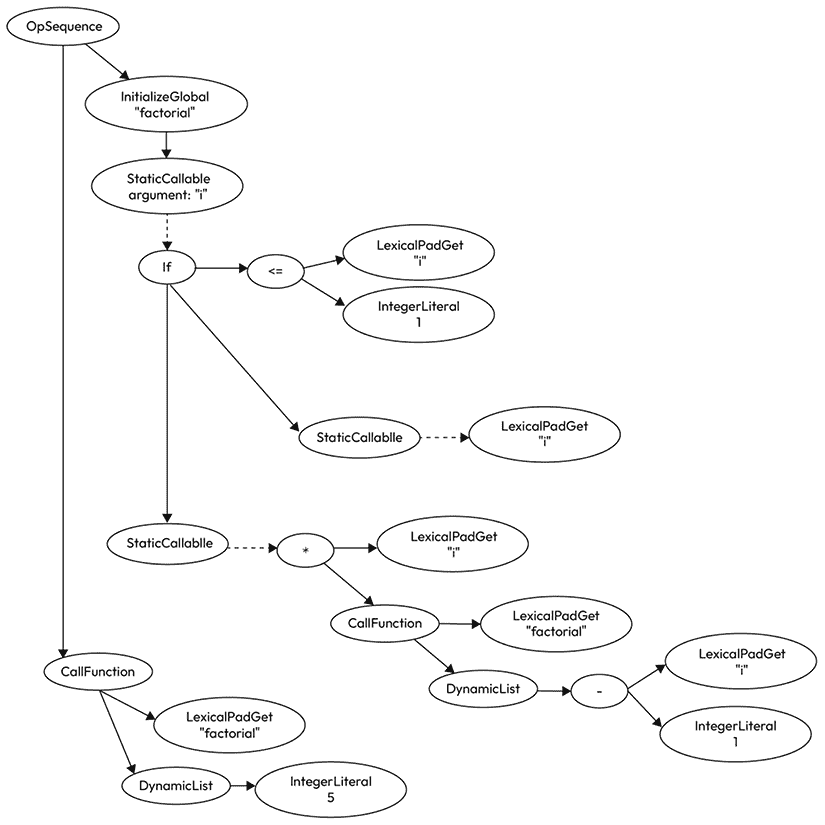

图 11.4: 一个声明递归阶乘函数并用 5 作为参数调用它的程序的完整操作树

这些操作等同于 Python 中的以下代码：

```
def factorial(i):
 if i <= 1:
 return i
 else:
 return i * factorial(i - 1)
factorial(5)
```

首先发生的是泛函数的声明。这创建了一个可调用值，用 `factorial` 命名存储它，并记录它接受一个参数 `i`。然后，调用该函数。

图中的虚线表示操作仅由期望 `Callable` 的对象求值，例如 `if` 运算符和 `CallFunction` 运算符。

现在我在解释器中已经拥有了足够的基础设施来完成整棵操作树。我只需要添加几个缺失的操作，例如小于等于、乘法和减法。然后，我就可以有一个最终的测试用例，它包含了整个树并测试了本节为止引入的所有更改。所有这些都可以在 pull request #16 ([`github.com/PacktPublishing/Building-Programming-Language-Interpreters/pull/16/files`](https://github.com/PacktPublishing/Building-Programming-Language-Interpreters/pull/16/files)) 中看到。

# 总结

我们目前实现的栈机对于简单的执行已经足够，但它无法处理更复杂的控制流操作。

为了实现对条件的支持，我引入了让栈机引用可执行代码作为值的能力，以及解释器开始执行该值的能力。这很重要，因为操作树中的分支在操作选择采取哪条路径之前不应该被遍历。

解释器本身需要能够识别何时需要从执行一个特定的栈切换到开始执行另一个栈。这里使用的方向是将这些不同的栈表示为不同的延续点（continuations），通过延续点的状态允许解释器透明地管理它们。

除了条件语句，还有必要支持操作序列以及函数的参数列表。这需要一种新的的操作概念，它不依赖于静态的输入数量，而是取决于操作树本身的形状。

为了构建函数，支持符号名称的查找及其到函数的解析也是重要的。为此，引入了词法栈（lexical pad），并建立了延续点与词法栈之间的关系。

函数如何调用的调用约定通过将可调用对象和参数列表作为函数调用的输入来定义。

最后，解释器的端到端示例展示了为什么需要在运行时定义函数以填充词法栈。


然而，这仍然需要被翻译成更底层的操作，才能真正被目前为止构建的解释器所使用。目前，解释器的操作树还无法表示我们在那里所描述的状态和转换。

当你考虑到编程语言及其高层状态机旨在涵盖该协议的客户端和服务器端，而在这些情况下，执行过程本身必须是截然不同的时，这一点就尤为重要了。

在我开始进行这种翻译之前，我需要在这个解释器中定义一个目标执行。这起有两个目的：它证明了解释器具备实现 HTTP 服务器和客户端的能力，并为后续章节提供指导——在后续的章节中，我会将高层状态机翻译成我在这里产生的操作树。

我正在做的是同时从两端着设计：在建立对解释器运行时能力信心的同时，对语言的未来形态开发出一种更敏锐的感知。这将引导两端在后期收敛，从而为实现奠定基础并避免陷入死胡同。

### 整体执行流

我想考虑的第一步是执行的整体流程。有一个高层状态机用于描述整个协议的状态，还有一个低层状态机用于描述每个特定消息的规则。在处理输入数据方面，这意味着我需要能够检查传输进来的内容，然后根据检查结果做出控制流决策。

这可能应用于状态机的两个层级——比方说，在某一点可能接受多条消息的情况下。在我之前提供的简单 HTTP 描述中，情况并非如此，但在低层状态机中是成立的，因为它需要做出控制流决策，以判断下一行（例如）是另一个 HTTP 请求头，还是请求头的结束和内容的开始。

随着解析的进行，解释器还需要开始累积所有已解析的数据，例如接收到的动词（verb）和客户端请求的 HTTP 版本。这一切都必须遵循操作树的执行模型进行，该模型最终应该产生消息的数据。

### 操作树语法

在之前的章节中，我使用了操作树的图形化表示，但那种表示方法对于这里需要呈现的代码量来说是不切实际的，因此我将使用基于文本的语法：

```
(operation <static-parameters, ...> dynamic_parameters, …)
```

在这里，静态参数是在运行时不进行求值的的参数，例如 `LexicalPadGet` 操作中变量命名的参数；而动态操作则是作为其他操作递归求值的那些。

### 服务器端处理

废话不多说，这里是处理 HTTP 请求服务端处理的操作树：

```
(OpSequence
  (LexicalPadInitialize <"verb">
   (ReadOctetsUntilTerminator <" ">) ),
  (LexicalPadInitialize <"request_target">
   (ReadOctetsUntilTerminator <" ">)),
  (ReadStaticOctets <"HTTP/">),
  (LexicalPadInitialize <"major_version">
   (ReadIntegerFromASCII)),
  (ReadStaticOctets <".">),
  (LexicalPadInitialize <"minor_version">
   (ReadIntegerFromASCII)),
  (ReadStaticOctets <"\r\n">),
  (LexicalPadInitialize <"headers">
   (GenerateList
    (StaticCallable
      <(OpSequence
        (TerminateListIfReadAhead <"\r\n">),
        (DynamicList
         (ReadOctetsUntilTerminator <":">),
         (ReadOctetsUntilTerminator <"\r\n">)))>))),
  (DynamicList
   (LexicalPadGet <"verb">),
   (LexicalPadGet <"request_target">),
   (LexicalPadGet <"major_version">),
   (LexicalPadGet <"minor_version">),
   (LexicalPadGet <"headers">)))
```

让我们一步步分析发生了什么。首先要注意到，它被封装在一个 `OpSequence` 操作符中。正如之前讨论的，该操作符会一次执行一个参数，在发生错误时停止并返回最后一个值。让我单独提取出这部分，以便使其更清晰：

```
(OpSequence
  ...
  (DynamicList
   (LexicalPadGet <"verb">),
   (LexicalPadGet <"request_target">),
   (LexicalPadGet <"major_version">),
   (LexicalPadGet <"minor_version">),
   (LexicalPadGet <"headers">)))
```

在这种情况下，`OpSequence` 中的最后一个操作简单地返回在词法填充（lexical pad）中设置的值。在我编写这个操作树的过程中，我意识到我初始化的变量只有属于返回数据结构的那些。事实证明，这是我可以做的一个有趣的简化；我并不是从初就有这个主意的。

我想表达的点恰恰是，解释器的设计过程必须是一个迭代过程，通过在真实代码的执行中从自而上构建，来学习如何让解释器写起来更简单。

### 词法填充初始化

现在，我可以涵盖各种值是如何被添加到那个词法填充中的，其中一些值看起来非常相似：

```
 (LexicalPadInitialize <"verb">
   (ReadOctetsUntilTerminator <" ">) )
```

`ReadOctetsUntilTerminator` 操作符是我在画那个状态图时就预料到的，因为这种特定的用法非常频繁。它读取字节直到遇到终止符，并返回读取的值。然后，该值作为参数传递给 `LexicalPadInitialize` 操作，填充最终返回。

然而，头部是键值对列表，因此它们需要特殊的处理。让我提取那部分：

```
 (LexicalPadInitialize <"headers">
   (GenerateList
    (StaticCallable
      <(OpSequence
        (TerminateListIfReadAhead <"\r\n">),
        (DynamicList
         (ReadOctetsUntilTerminator <":">),
         (ReadOctetsUntilTerminator <"\r\n">)))>))),
```

这里首先要注意的是 `GenerateList` 和 `TerminateListIfReadAhead` 对。它们共同决定了列表何时结束，并允许多次调用 `StaticCallable` 来生成列表的每个值。

另一个是 `DynamicList` 操作符，当参数具有从流中消耗数据的副作用时，它按顺序消耗参数直到到达各自的终止符。

HTTP 请求的剩余部分旨在作为流处理，因此解释器在其中并没有起什么大作用。现在，是时候考虑相反的情况了，即客户端发送消息。我首先需要理解数据将如何发送给解释器。当然，这里有多种选择，但我手头有一个简单的方案，即再次使用词法填充。

我将假设在调用编写 HTTP 请求的代码时，它将接收作为函数参数的参数。让我先看整个代码：


```
(StaticCallable
 <(OpSequence
   (WriteOctets (LexicalPadGet <"verb">)),
   (WriteStaticOctets <" ">),
   (WriteOctets (LexicalPadGet <"request_target">)),
   (WriteStaticOctets <" ">),
   (WriteStaticOctets <"HTTP/">),
   (WriteOctets
    (IntToAscii(LexicalPadGet <"major_version">))),
   (WriteStaticOctets <".">),
   (WriteOctets
    (IntToAscii(LexicalPadGet <"minor_version">))),
   (WriteStaticOctets <"\r\n">),
   (FunctionCallForEach
    (LexicalPadGet <"headers">),
    (StaticCallable
     <(OpSequence
      (WriteOctets (LexicalPadGet <"key">)),
      (WriteStaticOctets <":">),
      (WriteOctets (LexicalPadGet <"value">)),
      (WriteStaticOctets <"\r\n">)))>
      ("key", "value")>)),
   (WriteStaticOctets <"\r\n">)),
    ( "verb", "request_target", "major_version",
    "minor_version", "headers" )>)
```

现在，让我将其拆解为各个部分，从最外层开始：

```
(StaticCallable
 <(OpSequence
   ...)
  ( "verb", "request_target", "major_version",
    "minor_version", "headers" )>)
```

在上一章中，当讲解函数调用和词法填充（lexical pad）时，我定义了函数的参数将以列表的形式传递，而参数的名称将作为可调用对象构造的静态参数。这意味着调用者只需要组装一个值列表，并将其赋值给填充（pad）的每一个成员。

需要注意的是，我为写入器（writer）使用的输入序列与我从解析器（parser）返回的序列是相同的。这意味着对 HTTP 消息有一个稳定的表示。

然后，我们可以执行顺序写入，这些操作看起来非常相似：

```
(WriteOctets (LexicalPadGet <"verb">)),
(WriteStaticOctets <" ">),
```

这部分没什么奥秘。然而，在某个时刻，我们需要遍历头部信息（headers）：

```
(FunctionCallForEach
  (LexicalPadGet <"headers">),
  ...),
```

同样，实现这种功能有很多方法，但一种非常简单的方法是意识到，由于头部是一个列表的列表，我可以使用内部列表作为函数调用的参数列表。因此，此操作将简单地遍历头部，使用带有键和值的列表作为函数的参数。这引出了以下内容：

```
(StaticCallable
     <(OpSequence
       (WriteOctets (LexicalPadGet <"key">)),
       (WriteStaticOctets <":">),
       (WriteOctets (LexicalPadGet <"value">)),
       (WriteStaticOctets <"\r\n">))>,
       ("key", "value")>))
```

与外部可调用对象一样，键和值被翻译为词法填充（lexical pad）中的条目，然后用于 `OpSequence` 以写入头部信息。

这次练习的目标是证明解释器的执行模型实际上有能力运行该程序。目前，我们仍然可能需要回到早早的设计，并重新思考我们所做的一些选择。但更重要的是，现在还足够早，做出这些更改对项目来说不会是灾难性的。

接下来，我将专注于识别、实现和测试我们目前列出的所有运算符和数据结构。

# 识别和实现操作符

可以将我刚刚介绍的操作符分为类：I/O 运算符（从网络套接字读取或向网络套接字写入）和列表运算符（消耗列表或产生列表）。

### I/O 运算符

我想考虑的第一对操作符是 `ReadStaticOctets` 和 `WriteStaticOctets`。这些是静态字节操作符，并且相当简单，意义在于它们写入或预期读取的值是静态定义的，因此它们甚至不需要动态参数。

我将从实现 `WriteStaticOctets` 操作符开始。它的实现使用了之前在 第 10 章 初始化和入口点中使用的相同概念——`InputOutputOperationConcept`——该概念包含了执行所需的上下文。

该操作的声明与 `ReadInt32Native` 操作的声明非常相似，因此我将重点关注关键方法的定义，从 `operator()` 开始，它负责操作的实际执行：

```
OperationResult WriteStaticOctets::operator()(
  InputOutputOperationContext &ctx,
  Arguments a) const {
  if (ctx.buffer.length() == 0) {
    ctx.buffer = contents;
    ctx.it = ctx.buffer.begin();
  }
  if (ctx.it != ctx.buffer.end()) {
    return ReasonForBlockedOperation::WaitingForWrite;
  } else {
    return 0;
  }
}
```

当上下文初始化时，缓冲区是空的，因此操作知道需要将缓冲区设置为静态内容的值，并为操作初始化迭代器。只要迭代器未到达末尾，操作就会被阻塞。

为了补充这一点，我们需要 `get_buffer` 和 `handle_write` 的实现：

```cpp
std::string_view WriteStaticOctets::get_buffer(
  InputOutputOperationContext &ctx) const {
  return std::string_view(ctx.it, ctx.buffer.end());
}
```

随后，`handle_write()` 函数负责移动上下文中的迭代器，以便在下一轮中，当解释器请求写入缓冲区时，它将指向任何未写入的内容。

```cpp
size_t WriteStaticOctets::handle_write(
  InputOutputOperationContext &ctx, size_t s) const {
  size_t consumed = 0;
  while (s > 0 && ctx.it != ctx.buffer.end()) {
    s--;
    consumed++;
    ctx.it++;
  }
  return consumed;
}
```

然而，`ReadStaticOctets` 操作确实有些不同之处，因为它在预期内容未发送时需要能够中断执行。如果发送的内容与预期不符，该操作应该以运行时错误失败：

```
OperationResult ReadStaticOctets::operator()(
  InputOutputOperationContext &ctx,
  Arguments a) const {
  if (ctx.buffer.length() < contents.length()) {
    return ReasonForBlockedOperation::WaitingForRead;
  } else {
    if (strncmp(ctx.buffer.c_str(), contents.c_str(),
        contents.length()) == 0) {
      return true;
    } else {
      return value::RuntimeError::ProtocolMismatchError;
    }
  }
}
```

操作执行的第一件事是检查缓冲区是否接收了足够的字节以匹配常量值。如果不是，操作指示其处于阻塞状态，等待更多数据。然而，如果有足够的数据，操作将检查接收到的字节是否匹配常量值；如果没有，将抛出一个运行时错误，表示数据不符合协议。

为了补充这一点，我们需要 `handle_read` 方法：

```cpp
size_t ReadStaticOctets::handle_read(
  InputOutputOperationContext &ctx,
  std::string_view in) const {
  if (in.length() < contents.length()) {
    return 0;
  } else {
    ctx.buffer = std::string(in.begin(),
      contents.length());
    return contents.length();
  }
}
```

在 `handle_read` 方法中需要考虑的重要点是，它接收一个输入缓冲区，就像 POSIX `read` 方法一样，它返回操作实际消耗的字节数。这里的假设是输入数据将一直追加直到缓冲区达到正确大小，此时操作就可以进行消耗并评估。


引入静态字节操作（包括读取和写入）的完整代码可以在 pull request #17 ([`github.com/PacktPublishing/Building-Programming-Language-Interpreters/pull/17/files`](https://github.com/PacktPublishing/Building-Programming-Language-Interpreters/pull/17/files)) 中看到。

处理字节的动态操作能够将字节范围表示为一个值，因为这些操作需要能够从其他操作的结果动态地读取和写入字节。为此，我在 `Value` 变体引入了 `Octets` 替代方案，它是一个指向 `const` 字符串的共享指针：

```cpp
struct Octets {
  std::shared_ptr<const std::string> data;
};
```

这将允许实现需要处理动态字符串的操作。此时，我们可以看到使用 `variant` 和 `visit` 的通用方法如何使代码变得更易于维护，因为为 `Value` 添加替代方案对任何其他操作都没有产生任何影响。

`WriteOctets` 操作与 `WriteStaticOctets` 非常相似；唯一的区别是字节的值是从操作树中接收的，而不是在构造函数中静态定义的。因此，在操作执行期间，操作会将此值拷贝到作为 I/O 操作上下文的缓冲区。与其他操作符一样，该过程始于访问值以分发特定操作：

```cpp
OperationResult WriteOctets::operator()(
  InputOutputOperationContext &ctx, Arguments a) const {
  return std::visit(&ctx {
    return _execute_operation(ctx, arg);
  }, std::get<0>(a));
}
```

下一个实在值类型错误时返回一个错误：

```cpp
static OperationResult _execute_operation(
 InputOutputOperationContext &ctx, auto unknown) {
  return value::RuntimeError::TypeError;
}
```

接下来是将数据从值拷贝到上下文缓冲区中的重写：

```cpp
static OperationResult _execute_operation(
  InputOutputOperationContext &ctx, value::Octets &oct) {
  if (oct.data->length() == 0) {
    return 0;
  } else if (ctx.buffer.length() == 0) {
    ctx.buffer = *(oct.data);
    ctx.it = ctx.buffer.begin();
  }
  if (ctx.it != ctx.buffer.end()) {
    return ReasonForBlockedOperation::WaitingForWrite;
  } else {
    return 0;
  }
}
```

`handle_write` 方法最终与 `WriteStaticOctets` 中的方法相同，因为它只需要确保迭代器被消耗掉。

最后，由于需要写入的某些值是整数（例如 `major_version`），我还需要一种机制将 `int32_t` 值转换为 `Octets` 值。为此，我引入了 `IntToAscii` 运算符，它执行简单的转换。我将不再重复访问值的代码，因为它与我已经展示的内容非常相似。转换逻辑如下：

```cpp
static Value _inttoascii(int32_t v) {
  std::ostringstream os;
  os << v;
  return value::Octets{
    std::make_shared(std::string(os.str()))
  };
}
```

在 pull request #18 ([`github.com/PacktPublishing/Building-Programming-Language-Interpreters/pull/18/files`](https://github.com/PacktPublishing/Building-Programming-Language-Interpreters/pull/18/files)) 中，你可以看到 `IntToAscii` 和 `WriteOctets` 操作实现的完整代码。

消耗动态值可以发生在 `ReadOctetsUntilTerminator` 和 `ReadIntFromAscii` 操作中。它们与 `ReadStaticOctets` 之间的唯一区别是它们对输入消耗条件略有不同。

由于读取的动态性，我必须向上下文对象引入一个新的的 `ready` 成员，每当满足结束读取的条件时，就可以由 `handle_read` 方法设置该成员。

在 `ReadOctetsUntilTerminator` 的情况下，`handle_read` 方法如下：

```cpp
size_t ReadOctetsUntilTerminator::handle_read(
  InputOutputOperationContext &ctx,
  std::string_view in) const {
  auto pos = in.find(terminator);
  if (pos == in.npos) {
    return 0;
  } else {
    ctx.buffer = std::string(in.begin(), pos);
    ctx.ready = true;
    return pos + 1;
  }
}
```

在这里，只有在找到终止符后才会进行处理。

在 `ReadIntFromAscii` 的情况下，它只会在找到非数字字符后才会处理读取：

```cpp
size_t ReadIntFromAscii::handle_read(
  InputOutputOperationContext &ctx,
  std::string_view in) const {
  size_t consumed = 0;
  auto it = in.begin();
  for (; it != in.end() && *it >= '0' && *it <= '9'; it++) {
    consumed++;
  }
  if (it != in.end()) {
    ctx.buffer = std::string(in.begin(), consumed);
    ctx.ready = true;
    return consumed;
  } else {
    return 0;
  }
}
```
（注：原文中 `ReadIntFromAscii` 的文本在某些处是碎片或不完整的，我根据上下文重新构建了了逻辑。）


然后，我需要添加 `ControlFlowInstruction` 作为 `Value` 变体的替代方案，这将要求我修改每一个操作，使其中断执行并传播该值。基本上，在每个特殊处理了 `RuntimeError` 的地方，我们也必须同样处理 `ControlFlowInstruction`。

我不会列出所有的更改，因为它们都非常相似，但我将展示在 `Add` 运算符的 `_add` 函数中添加了哪些重载方法：

```cpp
static Value _add(
  int32_t lhs,
  value::ControlFlowInstruction rhs) {
  return rhs;
}
static Value _add(
  value::ControlFlowInstruction lhs,
  auto rhs) {
  return lhs;
}
```

这允许控制流指令被传播，并由期望它的运算符进行处理。你可以在拉请求 #20 中看到引入此内容的完整代码（[`github.com/PacktPublishing/Building-Programming-Language-Interpreters/pull/20/files`](https://github.com/PacktPublishing/Building-Programming-Language-Interpreters/pull/20/files)）。

借此，实现 `TerminateListIfReadAhead` 操作变得非常简单。`handle_read` 方法会执行视读并将数据存储在缓冲区中，但永远不会实际消耗任何内容：

```cpp
size_t TerminateListIfReadAhead::handle_read(
  InputOutputOperationContext &ctx,
  std::string_view in) const {
  ctx.buffer = in;
  return 0;
}
```

但这为操作本身提供了决定的是否应该中断列表的上下文：

```cpp
OperationResult
TerminateListIfReadAhead::operator()(
  InputOutputOperationContext &ctx, Arguments a) const {
  if (ctx.buffer.length() == 0) {
    return ReasonForBlockedOperation::WaitingForRead;
  } else if (ctx.buffer.length() < terminator.length()) {
    if (ctx.buffer ==
        terminator.substr(0, ctx.buffer.length())) {
      return ReasonForBlockedOperation::WaitingForRead;
    } else {
      return false;
    }
  } else {
    if (ctx.buffer.substr(0, terminator.length()) ==
        terminator) {
      return
        value::ControlFlowInstruction::InterruptGenerator;
    } else {
      return false;
    }
  }
}
```

该操作唯一的特殊之处在于它会视读输入字节，但随后永远不会实际消耗它们；如果终止符字节在输入缓冲区中，则返回 `ControlFlowInstruction`。你可以在拉请求 #21 中看到此更改的完整代码（[`github.com/PacktPublishing/Building-Programming-Language-Interpreters/pull/21/files`](https://github.com/PacktPublishing/Building-Programming-Language-Interpreters/pull/21/files)）。

对应的 `GenerateList` 运算符将简单地调用一个可调用对象，累积值直到收到 `ControlFlowInstruction`，并返回它累积的值列表。我将从函数的最外层逻辑开始，然后解释每个细节：

```cpp
OperationResult GenerateList::operator()(
  ControlFlowOperationContext &ctx,
  Arguments a) const {
  if (ctx.callable.has_value()) {
    // 将在下一个块中解释
  } else {
    return std::visit( &ctx {
     return _generate_list(ctx, callable);
    }, std::get<0>(a));
  }
}
```

当运算符首次执行时，还没有可调用对象的上下文，因为那是操作树中的一个动态值。因此，在第一种情况下，我们需要访问该值并将其设置在上下。我不会列出那部分代码，因为它与本章之前介绍的示例相似。

一旦设置了可调用对象，运算符就会反复调用它，直到控制流信号指示中断列表。但首先，解释器必须确保可调用对象已经被调用并且结果是用的。因此，函数的下一层如下：

```cpp
if (ctx.callable_invoked) {
  if (ctx.value.has_value()) {
    // 将在下一个块中解释
  } else {
    return
ReasonForBlockedOperation::WaitingForCallableResult;
  }
} else {
  return
ReasonForBlockedOperation::WaitingForCallableInvocation;
}
```

该逻辑实现了与可调用对象交互的机制，正如上一章中描述的那样，我们使用上下文的 `callable_invoked` 和 `value` 成员来驱动解释器中的状态机。最后，一旦我们获得了由可调用对象产生的值，就可以应用控制流指令的逻辑：

```cpp
if (std::holds_alternative<value::ControlFlowInstruction>(
    ctx.value.value())) {
  if (std::get<value::ControlFlowInstruction>(
       ctx.value.value()) ==
      value::ControlFlowInstruction::InterruptGenerator) {
    return value::DynamicList{ctx.accumulator};
  }
}
ctx.accumulator->push_back(ctx.value.value());
ctx.callable_invoked = false;
ctx.value.reset();
return
  ReasonForBlockedOperation::WaitingForCallableInvocation;
```

只要可调用对象返回 `InterruptGenerator` 以外的任何值，该值就会被添加到上下文的累加器中，并通过重置 `callable_invoked` 和 `value` 来重置状态机。一旦收到指令，操作将产生一个动态列表。你可以在拉请求 #22 中看到此的完整代码（[`github.com/PacktPublishing/Building-Programming-Language-Interpreters/pull/22/files`](https://github.com/PacktPublishing/Building-Programming-Language-Interpreters/pull/22/files)）。

最后，我们还可以实现 `FunctionForEach` 操作，它将对它的每个参数调用可调用对象。为了简单起见，我在这里偷了懒。由于此运算符用于头部，我可以依靠头部是列表且第一个元素是键，第二个是值的。然后，这些被绑定到可调用对象的参数。

但在大多数情况下，你需要封装元素以处理非列表和列表参数。这种形式对于当前的问题已经足够。在设计解释器运算符时，这是一个值得考虑的问题：有时你需要在不同的上下文中使用相同的操作。

该运算符将两个动态参数，第一个是要调用的可调用对象，第二个是要迭代的列表。正如我之前提到的，这里假设参数是列表列表，每个内部列表将包含调用调用的参数。再次，我不会列出收集动态值到操作的代码，因为它与之前的做法相似。相反，我将关注执行本身。

这种实现与 `GenerateList` 运算符非常相似，因为它也需要多次调用同一个可调用对象。我将关注内部块，因为那是两个运算符不同的地方：

```cpp
ctx.accumulator->push_back(ctx.value.value());
if (ctx.accumulator->size() < ctx.arglist->size()) {
  ctx.value.reset();
  ctx.callable_invoked = false;
  return
   ReasonForBlockedOperation::WaitingForCallableInvocation;
} else {
  return value::DynamicList{ctx.accumulator};
}
```

与 `GenerateList` 一样，`FunctionCallForEach` 也在累积可调用结果并产生输出。它同样重置 `callable_invoked` 和 `value` 成员以触发解释器内部的状态机转换。这里要注意，它正在将其累积的数量与收到的参数列表进行比较。这种行为通过 `get_argument_list` 方法实现得到了补充：

```cpp
std::shared_ptr<const std::vector> FunctionCallForEach::get_argument_list(
  ControlFlowOperationContext &ctx) const {
  return std::get<value::DynamicList>(
    ctx.arglist->at(ctx.accumulator->size())
  ).values;
}
```


该方法将仅返回上下文对象中与目前累积值数量相对应的参数列表元素。这将导致调用对象被执行，直到输入列表中的所有元素都被遍历完毕。你可以在拉请求 #23 中看到完整代码（[`github.com/PacktPublishing/Building-Programming-Language-Interpreters/pull/23/files`](https://github.com/PacktPublishing/Building-Programming-Language-Interpreters/pull/23/files)）。

当此示例所需的所有运算符都实现后，我终于可以开始创建测试了，以演示我们的 HTTP 解析器和写入器的执行情况。

# 测试运算符

出于练习的考虑，我没有创建像通常建议的那样多的单元测试。（我没有在文中详细介绍单元测试的细节，但你可以在仓库中查看。）这只是对该解释器并非用于实际生产环境这一事实的简化。一个构建真实解释器的项目，其单元测试数量应该比我在这里写的要多得多。

尽管如此，除了单元测试之外，创建在更复杂环境中测试这些操作集成的测试用例也是同样重要的。这将是我现在关注的重点。

第一步是为我想测试的代码列出 `OpTree`。这本质上是代表解释器编译器必须执行的操作的数据结构。这将直接在 C++ 中完成。

在上一一章节实现阶乘示例时，我曾使用这种方法来检查控制流运算符。这个案例只是使用了一组更大的运算符。目标是从一个代表 HTTP 消息的字符串开始，将该字符串交给解析器，然后获取解析器的输出并发送给写入器，最后对两者进行比较，因为输出应该与原始输入匹配。

由于写入器代码所需的数据结构与解析器产生的数据结构相同的，我们可以直接构建一个 `OpTree`，其中我们使用读取器的输出调用写入器：

```
(FunctionCall ( CallableForWriter ),
  ( FunctionCall ( CallableForReader ) ) )
```

在这里，`CallableForWriter` 和 `CallableForReader` 将被 C++ 代码替换，这些代码负责创建代表我在章节开头描述的操作的 `OpTreeNode` 对象。

这个测试很重要，因为它将演示解释器用户如何与输入和输出进行交互。为了测试目的，我们仅使用固定字符串作为输入，并将输出附加到字符串流（stringstream）中。

你可以在拉请求 #24 中看到测试的完整代码（[`github.com/PacktPublishing/Building-Programming-Language-Interpreters/pull/24/files`](https://github.com/PacktPublishing/Building-Programming-Language-Interpreters/pull/24/files)），但我将详细分解实际测试代码的功能。我在这里不会跳过 `main_optree` 的声明，因为这与我们之前做的没有什么新内容。

第一步是初始化 `InterpretedProgram`，然后获取解释器的实例，就像我们在所有其他测试中所做的那样：

```
InterpretedProgram p(main_optree);
Interpreter i = p.get_instance();
```

然后，我们创建一个代表解析器输入的字符串、一个表示我们读取进度的游标，以及一个用于捕获器输出的 `stringstream` 接收端：

```
std::string input = "GET /foo/bar/baz HTTP/1.1\r\n"
"Accept: application/json\r\n"
"Host: Test Value\r\n"
"\r\n";
auto input_cursor = input.cbegin();
std::stringstream
   output_message_stream(std::ios_base::out);
```

现在，我们可以进入主解释器循环。我将先讨论循环的最外部分，然后填充细节：

```
 while (true) {
    ContinuationState s = i.step();
    if (s == ContinuationState::Blocked) {
      // 稍后填充
    } else if (s == ContinuationState::Exited) {
      break;
    }
  }
  ASSERT_EQ(input, output_message_stream.str());
```

基本上，我们持续运行解释器直到它告诉我们已退出程序。一旦完成，我们可以断言发送给读取器的输入与写入器产生的输出匹配。

现在是有趣的部分，即集成输入输出操作。第一步是理解为什么操作被阻塞。同样，我将先关注最外部分：

```
auto reason =
 std::get<ReasonForBlockedOperation>(i.get_result());
 if (reason ==
     ReasonForBlockedOperation::WaitingForWrite) {
   // 处理写入的代码
 } else if (reason ==
     ReasonForBlockedOperation::WaitingForRead) {
   // 处理读取的代码。
 }
```

在这种情况下处理写入非常简单，因为我们所做的只是获取等待写入的缓冲区，而且由于永远不会阻塞，所以我们可以一次性写入整个内容：

```
auto buffer = i.get_write_buffer();
output_message_stream.write(buffer.cbegin(), buffer.size());
i.handle_write(buffer.size());
```

最后一步是告诉解释器我们成功写入了整个缓冲区。

处理读取稍微有点复杂，因为我们需要考虑距离返回的是有符号整数，而读取的字节数是无符号的。因此，我们需要断言距离为正，然后将其静态转换为无符号整数（`size_t`）：

```
int buffer_left = std::distance(input_cursor, input.zend());
ASSERT_GT(buffer_left, 0);
if (movement <= static_cast<size_t>(buffer_left)) {
   std::advance(input_cursor, movement);
} else {
   input_cursor = input.cend();
}
```


你可以在 pull request #27 中查看为引入 EOF 支持所做的完整更改（[`github.com/PacktPublishing/Building-Programming-Language-Interpreters/pull/27/files`](https://github.com/PacktPublishing/Building-Programming-Language-Interpreters/pull/27/files)）。

最后，我还需要为用户提供一种向解释器发送输入参数的方法，这通过在 `InterpretedProgram` 类的 `get_instance` 方法中添加一个额外的参数来实现，以便初始化 `argv` 全局变量：

```
 Interpreter get_instance(
    std::optional<Value> arglist = std::nullopt) {
    std::shared_ptr<LexicalPad> rootpad =
        std::make_shared<LexicalPad>(LexicalPad());
    if (arglist.has_value()) {
      rootpad->initialize_global("argv", arglist.value());
    }
    return Interpreter(optree, rootpad);
  };
```

这一更改可以在 pull request #28 中看到（[`github.com/PacktPublishing/Building-Programming-Language-Interpreters/pull/28/files`](https://github.com/PacktPublishing/Building-Programming-Language-Interpreters/pull/28/files)）。

完成这些后，我就可以开始创建解释器的实际用法了，这也是我将在下一节要做的，即组合出一个看起来更像用户将使用的实际 API 的东西。

# 完成集成

到目前为止，所有示例的创建目标仅仅是为了练习到目前编写的代码。现在，我们终于到了可以创建一个场景的阶段，该场景能够真实反映解释器用户如何与它交互。

该解释器的每个用户都必须做好几件事；因此，引入一些基础设施来管理这些操作是有意义的。我将从处理多个线程时需要的一些底层支持类型开始。

第一个是 `MutexLockQueue`。它提供了一个线程安全的队列，用于线程之间的通信。这非常重要，因为我们可以按顺序发送数据（例如读和写操作），在处理 I/O 的线程和处理解释器的线程之间进行通信。

第二个是 `NotificationSignal`，它封装了条件变量，允许不同的线程阻塞等待其他线程，例如当所有解释器都在等待网络传来的数据时。然后，I/O 线程能够向解释器线程发出它现在有工作要做。

最后，第三个是 `TransactionalContainer`，它实现了一种无锁机制来对对象进行更改并在并在对该数据进行更改时防止数据竞态。

这些类型只是标准 C++ 设施的封装，使得剩余的解释器代码更容易编写。它们对于解释器本身的开发来说稍微有些离题，但它们的代码可以在 pull request #29 中看到（[`github.com/PacktPublishing/Building-Programming-Language-Interpreters/pull/29/files`](https://github.com/PacktPublishing/Building-Programming-Language-Interpreters/pull/29/files)）。

转向解释器用户需要交互的实际基础设施，我将从 `InterpreterContext` 结构体开始：

```
struct InterpreterContext {
  Interpreter interpreter;
  support::MutexLockQueue<std::string> input_buffer;
  support::MutexLockQueue<std::string> output_buffer;
  support::MutexLockQueue<std::pair<
      std::string, const std::vector<Value>>>
      callback_request_queue;
  support::MutexLockQueue<Value> callback_response_queue;
  std::promise<Value> interpreter_result;
  void *additional_data;
  std::atomic<bool> eof = false;
  std::atomic<bool> exited = false;
  InterpreterContext(const Interpreter &interp)
    : interpreter(interp) {}
  InterpreterContext(Interpreter &&interp)
    : interpreter(std::move(interp)) {}
  InterpreterContext() = delete;
  InterpreterContext(const InterpreterContext &) = delete;
  InterpreterContext &operator=(const InterpreterContext &)
    = delete;
};
```

该结构体表示了管理 `Interpreter` 对象所需的信息。因此，它首先包含解释器本身，然后有四个队列：用于读取的输入、用于写入的输出、需要执行的回调以及这些回调的响应。这些队列将允许解释器在自己的线程中运行，与 I/O 线程以及处理原生调用的代码分离开。

下一个成员是 `interpreter_result`，它是一个 `std::promise<Value>` 对象，代表解释器执行结束时产生的值。换句话说，这就是解释器用户能够查询解释器返回的值的方式。例如，如果你有一个 HTTP 客户端，将需要能够接收来自解释器的响应。

`additional_data` 成员是一个简单的 `void` 指针，允许用户存储与解释器关联的任意数据。这使得避免全局变量并保持解释器上下文的自包含成为可能。

`eof` 成员是 I/O 线程将使用的机制，用于指示何时无法再读取或写入，并指导操作如何处理这种情况。

`exited` 成员向其他线程通信该解释器不再执行，并且可以被清理。

然而，这样的解释器在系统中很少作为单实例使用。例如，如果你有一个 HTTP 服务器，你可能希望以中心化的方式管理每个连接的实例。这就是 `InterpreterCollection` 类型派上用场的地方：

```
struct InterpreterSignals {
  NotificationSignal wake_up_interpreter;
  NotificationSignal wake_up_output;
  NotificationSignal wake_up_input;
  NotificationSignal wake_up_callback;
};
struct InterpreterCollection {
  const std::unordered_map<
     int, std::shared_ptr<InterpreterContext>> interpreters;
  const std::shared_ptr<InterpreterSignals> signals =
      std::make_shared<InterpreterSignals>();
};
```

这代表了时刻运行的一组解释器，以及管理这些解释器所需的通知通道。`unordered_map` 中的整数键代表解释器附加的文件描述符。

以这种方式使用文件描述符显然只在这个特定解释器的语境下才有合理的设计决策。到目前为止我们所做的决定都导致了这种格式。当你构建自己的解释器时，你需要设计一个适用于你场景的设计。

意识到 `InterpreterCollection` 只有 `const` 成员很重要；因为这使得它可以安全地跨线程共享，以检查运行状态并使用 `InterpreterContext` 中的各种成员与解释器通信。

那么，如果集合是常量，且解释器集合启动时没有任何解释器，用户该如何启动它们？这就是 `InterpreterCollectionManager` 派上用场的地方：

```
class InterpreterCollectionManager {
  support::TransactionalContainer<InterpreterCollection>
    _collection;
public:
  const std::shared_ptr<const InterpreterCollection>
 get_collection();
  std::future<Value>
 insert_interpreter(int fd, InterpretedProgram program,
                     std::optional<Value> arglist =
                      std::nullopt,
 void *additional_data = NULL);
  void remove_interpreter(int fd);
};
```

这提供了一个线程安全的接口，用于插入新的解释器（附加到给定的文件描述符）并在不再需要时移除解释器。


该原理是：任何线程都可以在任何时刻获取集合的不可变快照并使用它，然后在下一时刻再次请求，并可能获得一个更新后的版本。

它是通过我之前描述的 `TransactionalContainer` 实现的。该实现中有一些值得讨论的部分。我将只介绍其中一个方法——`insert_interpreter` 的细节，因为其他方法的实现非常相似：

```cpp
std::future<Value> InterpreterCollectionManager::insert_interpreter(
    int fd, InterpretedProgram program,
    std::optional<Value> arglist,
    void *additional_data) {
  std::shared_ptr<InterpreterContext> ctx =
    std::make_shared<InterpreterContext>(
       program.get_instance(arglist));
  ctx->additional_data = additional_data;
  _collection.do_transaction(
      &fd, &ctx
          -> std::shared_ptr<const InterpreterCollection> {
        auto new_interpreters = current->interpreters;
        new_interpreters.insert({fd, ctx});
        return std::make_shared<InterpreterCollection>(
            std::move(new_interpreters), current->signals);
      });
  _collection.current()->
     signals->wake_up_interpreter.notify();
  return ctx->interpreter_result.get_future();
}
```

这创建了一个新的解释器上下文，存储额外数据并转发参数列表。然后，它使用 `do_transaction` 方法将当前集合原子地替换为包含额外解释器的集合。

最后，它向解释器线程发送唤醒信号，因为它在那个时刻可能无事可做，然后返回与该解释器关联的 promise 的 future。

此，我们现在可以展示真正驱动解释器的接口——`InterpreterRunner`：

```cpp
struct InterpreterRunner {
  using callback_function =
    Value (*)(const std::vector<Value> &);
  std::unordered_map<std::string, callback_function>
    callbacks;
  std::atomic<bool> exit_when_done = false;
  void interpreter_loop(InterpreterCollectionManager &mgr);
  void callback_loop(InterpreterCollectionManager &mgr);
};
```

`callbacks` 成员将持有通过其关联键注册的本地回调的函数指针。`exit_when_done` 成员用于告知运行器，当没有更多工作可做时循环应该结束。

`interpreter_loop` 和 `callback_loop` 方法将一直运行任何可执行的任务，直到它们准备离开为止。其设计思想是：有一个线程运行解释器循环，另一个线程运行回调循环，其他线程负责管理 I/O。

这两个方法具有相似的结构，即存在一个无限循环，当所有解释器执行完毕且不再预期有新解释器时，该循环会被打破。`exit_when_done` 布尔值提供了一种机制，用于处理由于没有活动连接而导致解释器用尽、但我们仍在接收新连接的情况形。一旦我们不再期待任何新连接，我们就希望确保任何现有的解释器都有机会运行完毕。

我将深入探讨循环。第一步是为本次循环迭代初始化一些重要的变量：

```cpp
auto collection = mgr.get_collection();
```

这代表了特定时间点的集合。由于数据结构被构建为指向 `const` 值的 `shared_ptr`，这意味着在整个迭代期间，我们可以安全地持有该集合的这个快照。

接下来，我们初始化一个计数器来跟踪集合中当前活跃的解释器数量：

```cpp
int active_interpreters = 0;
```

这个计数器非常重要，因为我们希望能够识别出没有工作可做，并等待直到工作可用。

接下来是两个函数开始分化的地方。在 `interpreter_loop` 情况中，我们需要跟踪在这一步之后还有多少解释器准备就绪执行：

```cpp
int ready_interpreters = 0;
```

而在回调循环中，我们需要跟踪本次迭代中是否执行了任何回调，如果没有，我们希望等待通知：

```cpp
int callbacks_count = 0;
```

随后，这两个方法都将遍历集合中的所有解释器：

```cpp
for (auto &[fd, context] : collection->interpreters) {...}
```

这两个循环的实现是两个方法变得真正不同的地方，因此在进入之前，我将先介绍主循环迭代是如何结束的。在两种情况下，我们都从以下代码开始：

```cpp
if (mgr.get_collection() == collection) {...}
```

当集合变化时，循环永远不会中断，因为很可能有新的工作可做；但如果没有变化，我们就可以考虑处理迭代的结束：

```cpp
if (active_interpreters == 0) {
  if (loaded_exit_when_done) {
    // 通知可能正在等待的线程
break;
  } else {
    // 等待通知
  }
} else {
  // 可能等待通知
}
```

这里处理了 `exit_when_done` 逻辑。如果没有活跃的解释器且我们准备好退出，就是跳出主循环的时候。但这里也是需要向其他线程发送通知的地方，或者是线程等待其他线程通知的地方。

现在更具体地查看 `interpreter_loop` 方法，每当没有工作可做时，线程都会等待解释器通知：

```cpp
if (ready_interpreters == 0) {
  collection->signals->wake_up_interpreter.wait();
}
```

而在 `callback_loop` 中，当我们没有触发回调时，线程等待回调通知：

```cpp
if (callbacks_count == 0) {
  collection->signals->wake_up_for_callback.wait();
}
```

这确立了循环的大致。它们将为每个解释器执行工作，并且当没有其他事情时，要么在系统关闭时退出循环，要么等待通知。

现在，如果 `interpreter_loop` 和 `callback_loop` 都在等待通知，某些东西需要唤醒它们，那是代码中的另一部分。我将先关注 `callback_loop` 并解释它是如何唤醒 `interpreter_loop` 的：

```cpp
auto cbdata = context->callback_request_queue.pop();
if (cbdata.has_value()) {
  callbacks_count++;
  const auto &key = cbdata.value().first;
  const auto cb_it = callbacks.find(key);
  if (cb_it == callbacks.end()) {
    context->callback_response_queue.push_back(
      value::RuntimeError::NameError);
  } else {
    auto fp = cb_it->second;
    context->callback_response_queue.push_back(
      fp(cbdata.value().second));
  }
  collection->signals->wake_up_interpreter.notify();
}
```

`callback_loop` 不直接与解释器交互，而是与 `callback_request_queue` 和 `callback_response_queue` 交互，这些队列与每个解释器关联。每当有一个回调请求时，它会在回调映射中被解析，调用函数的结果会被提交到 `callback_response_queue`。最后，回调循环通知解释器现在已解除阻塞。

这就是实现解耦回调调用与解释器设计目标的方法。同样重要的是，使用线程池来实际执行回调而不是使用单线程是相当容易的。事实上，两种实现可以很容易并存。

回调不是解释器阻塞的唯一方式；我们识别出的其他可能导致这种情况的操作是 I/O 操作。尽管如此，我们明确不想提交到任何特定的实现。用户在适配他们使用的特定 I/O 库时，使用队列进行输入输出并相应地通知解释器是用户的责任。


话如此，我将深入介绍 `interpreter_loop` 如何遍历集合中的解释器。迭代的大致结构如下：

```
auto state = context->interpreter.step();
switch (state) { ... }
```

每次迭代都会让解释器执行一步并检查其状态。对于每种状态，我将逐一分析其每种情况：

```
case ContinuationState::MissingArguments:
case ContinuationState::Ready:
  ready_interpreters++;
  active_interpreters++;
  break;
```

这些是与普通解释操作相关的状态。解释器在每次操作后都会让出（yield），以便通过所谓的“蹦床函数”（trampoline function）在同一线程中执行多个解释器。在这些情况下，解释器不会等待通知；它只是会在下一次迭代中重新运行：

```
case ContinuationState::Exited:
  context->exited.store(true);
  collection->signals->wake_up_for_output.notify();
  OperationResult r = context->interpreter.get_result();
 if (std::holds_alternative<Value>(r)) {
    Value v = std::get(r);
   context->interpreter_result.set_value(v);
 } else {
   context->interpreter_result.set_exception(
     std::make_exception_ptr(
       InterpreterResultIsNotValue(r)));
 }
 break;
```

在上述块中发生了两个重要事件。首先，每当解释器退出时，`wake_up_for_output` 都会被通知。这允许 I/O 层代表被解释程序关闭连接（例如发生协议不匹配时）。其次，已退出解释器的输出被设置为该解释器的承诺（promise）。但如果解释器结束时的结果不是一个值，那么它就会导致一个异常。

最后，我们可以处理解释器被阻塞的情况：

```
case ContinuationState::Blocked:
 active_interpreters++;
 if (handle_blocked_interpreter(
      *context, *collection->signals)) {
   ready_interpreters++;
 }
 break;
```

现在我将深入研究 `handle_blocked_interpreter` 函数，但在之前，我想指出这一点：每当我们能够对阻塞的解释器做某些处理时，我们需要确保它能回到下一次迭代，而不是阻塞它。`ready_interpreters` 变量正是确保此点的关键：

```
OperationResult r = context.interpreter.get_result();
if (std::holds_alternative<ReasonForBlockedOperation>(r)) {
   ReasonForBlockedOperation reason = std::get(r);
   switch (reason) { ... }
}
return true;
```

这段代码解包了 `OperationResult`，然后评估解释器可能阻塞的原因。由于某种原因该评估没有通过，则假设解释器循环应该运行另一个迭代。

现在，我将进入各种状态。

### 内部原因
首先，让我们看看解释器被阻塞的内部原因：

```
case ReasonForBlockedOperation::WaitingForCallableInvocation:
case ReasonForBlockedOperation::WaitingForCallableResult:
      return true;
```

这些对应于解释器正在处理可对象（callables），所以我们可以直接告诉解释器继续执行。

### I/O 操作
接下来，是 I/O 操作：

```
case ReasonForBlockedOperation::WaitingForRead:
  return handle_read(context, signals);
case ReasonForBlockedOperation::WaitingForWrite:
  return handle_write(context, signals);
```

这是数据从解释器上下文中 I/O 缓冲区推入和拉取的地方。当解释器需要执行输入或输出时，在这里通知 I/O 层。

`handle_read` 函数将从输入队列中提取数据并传递给解释器，但它需要处理操作可能不会消耗完整序列的情况，因此它需要继续追加它们。我将对其分解，从最外层开始：

```
auto buffer = context.input_buffer.pop();
if (buffer.has_value()) {
  // 将将扩展
} else {
  if (context.eof.load()) {
    context.interpreter.handle_eof();
  } else {
    signals.wake_up_for_input.notify();
  }
}
return false;
```

如果解释器被阻塞并在等待读取，但队列中为空，我们需要检查 socket 是否已关闭并将该信息传递给解释器。否则，我们唤醒 I/O 线程检查是否有内容可读。取决于所使用的 I/O 库，该通知可能不会被使用，但我想保持设计与那些在没有要求时不尝试读取的库兼容。结尾的 `return false` 语句表示解释器仍处于阻塞状态。

现在，让我进入缓冲区中有值的情况：

```
size_t consumed =
  context.interpreter.handle_read(buffer.value());
if (consumed == 0) {
  // 将将扩展
} else {
  if (consumed < buffer.value().size()) {
    context.input_buffer.push_front(
      buffer->substr(consumed));
  }
  return true;
}
```

正如我在本章早期讨论的那样，`handle_read` 函数将返回消耗了多少字节（octets）。如果解释器消耗的少于读取的，剩余数据必须推回队列头部。但另一方面，如果并非所有数据都被消耗，我们应该检查队列中是否有其他内容：

```
auto nextbuffer = context.input_buffer.pop();
if (nextbuffer.has_value()) {
  auto joined = buffer.value() + nextbuffer.value();
  consumed = context.interpreter.handle_read(joined);
  if (consumed < joined.size()) {
    context.input_buffer.push_front(
      joined.substr(consumed));
  }
  return true;
} else {
  context.input_buffer.push_front(buffer.value());
}
```

这是另一个关于特定设计选择如何导致运行时特性的良好说明。通过拒绝读取不完整的数据，复杂性被转移到了解释器的其他部分，现在我们在那里拼接输入。

### 写操作
另一方面，`handle_write` 函数最终变得简单得多，因为我在这里在这里执行 I/O，而是将数据推送到 `output_queue`。因为语言没有提供如何处理 socket 写入系统调用的原语，我可以大幅简化这一点，只需假设数据放入输出队列等同于实际写入：

```
if (context.eof.load()) {
  context.interpreter.handle_eof();
  return true;
} else {
  auto buffer = context.interpreter.get_write_buffer();
  std::string copy(buffer);
  context.output_buffer.push_back(copy);
  context.interpreter.handle_write(buffer.size());
  signals.wake_up_for_output.notify();
  return true;
}
```

与 `handle_read` 一样，它也通知了队列中有输出，以防 I/O 库正在等待。

### 回调状态
最后，我们有回调状态：

```
case ReasonForBlockedOperation::WaitingForCallback:
 return handle_start_callback(context, signals);
case ReasonForBlockedOperation::WaitingCallbackData:
 return handle_finish_callback(context, signals);
```

这是推入回调请求、将回调响应拉入解释器以及每当有需要调用的回调时解释器通知回调线程的地方。

我将从 `handle_start_callback` 开始：

```
context.callback_request_queue.push_back(
  std::make_pair(
    context.interpreter.get_callback_key(),
    context.interpreter.get_callback_arguments())); context.interpreter.set_callback_called();
signals.wake_up_for_callback.notify();
return true;
```


这会将回调键及其参数推入之前讨论过的由回调处理的队列中，然后通知该线程使其唤醒并执行调用。

最后，`handle_finish_callback` 从队列中获取响应并将其发送给解释器：

```
auto v = context.callback_response_queue.pop();
if (v.has_value()) {
  context.interpreter.set_callback_return(v.value());
  return true;
} else {
  return false;
}
```

如果队列中为空，则意味着解释器仍在阻塞状态。

这里的关键点在于运行解释器不同部分的各个线程、原生代码以及通过队列和条件变量由用户管理的 I/O 层之间的关系。数据通过每个解释器上下文中中的 `MutexLockQueues` 在线程间进行通信，并且每当一个线程执行了可能解除另一个阻塞的操作时，它都会通过通知发送信号。

这强化了我一直以来在完善的设计原则，即通过将解释器与 I/O 处理以及原生代码的运行隔离来，确保数据流通过线程安全的队列，从而允许用户决定如何调度这些队列。如果我在此之前做了不同的选择，我得到的可能是一个完全不同的局面。我的目标是让这成为过程的一个实用示例，而不仅仅是一份教程。你可以在拉取请求 #30 ([`github.com/PacktPublishing/Building-Programming-Language-Interpreters/pull/30/files`](https://github.com/PacktPublishing/Building-Programming-Language-Interpreters/pull/30/files)) 中查看完整的代码。

在此时，已经可能通过编写一个不完整的 HTTP 服务器、将其附加到套接字（socket）、接受新连接、运行解释器读取请求、调用原生函数进行处理，然后使用回调的返回值写入响应，从而组合出解释器的实际用法。

到目前，我们拥有了一个功能性的解释器运行时，尽管我们还无法运行为我们设计的语言所编写的代码。这使得通过模拟解释器用户的行为，成为验证设计和实现的一个良好时机。

因此，我在仓库中实现了一个测试用例，它使用一个特定的库作为 I/O 层，并按照本章描述的方式与解释器集成。它仍然通过组装硬编码的 `OpTreeNode` 对象来构建 `InterpretedProgram` 对象，但它已足以证明，一旦我们组装好操作树，就能在真实世界中执行它。

我将此留给你们作为练习，尝试使用不同的 I/O 库来实现不同的方案。我的目标不是在这里进入任何这些库的细节，但如果你对用户此时将如何使用该解释器感兴趣，可以查看拉取请求 #31 ([`github.com/PacktPublishing/Building-Programming-Language-Interpreters/pull/31/files`](https://github.com/PacktPublishing/Building-Programming-Language-Interpreters/pull/31/files))。

使用测试来展示解释器的真实用户将如何进行集成，是建立信心的一种良好方法，确保你构建的东西确实符合你最初设定的用例。

# 总结

在实现解释器运行时，视觉化语言用法的实际示例非常重要，以确定哪些操作符需要实现。在这种情况下，列出编写和解析 HTTP 消息的操作有助于识别各种新操作符，并有助于创建测试用例来证明它们按预期工作。

在确定了这些特定需求后，我可以专注于实现每个操作符，并以一个测试用例作为结束，展示解释器能够将消息解析为数据结构，然后使用该数据结构重现相同的消息。

由此，我可以构建库用户的 API 应该有的样子，并构建一个在非常真实的场景中测试解释器的测试用例，与特定的 I/O 库集成，使基础 HTTP 服务器和客户端通过真实的网络套接字进行通信。

这标志着解释器运行时工作的结束。在下一章中，我将开始将将语言源代码翻译成解释器已经知道如何执行的操作树。

## 获取本书的 PDF 版本和独家额外内容

扫描二维码（或访问 [packtpub.com/unlock](http://packtpub.com/unlock)）。按名称搜索此书，确认版本，然后按照页面上的步骤操作。 |  |

**注意**：请保留好发票。直接从 Packt 购买的不需要发票。

# 第 4 部分

## 解释源代码

在这个部分，完整解释器的第一个版本将汇合。我将处理处理源代码所需的四个不同层——词法分析、解析、分析和生成——直到源代码实际运行。到结束时，我将像该语言的用户一样，对该语言进行具体使用。

本部分包含以下章节：

*   *第 13 章, *词法：将文本转换为令牌流*
*   *第 14 章, *解析：将令牌流转换为解析树*
*   *第 15 章, *分析：将解析树转换为抽象语法树*
*   *第 16 章, *生成：将抽象语法树转换为指令*
*   *第 17 章, *证明其有效*

# 13 - 词法分析：将文本转换为令牌流

现在我已经有了可以执行我的语言所需的指令的解释器运行时，是时候开始将源代码转换为指令了。

过程的第一步是将字符序列转换为令牌序列。这使得后续步骤可以在比纯文本更高的抽象级别上工作，从而简化语言语法的规范。

在本章中，我将完成以下工作：

*   识别语言中不同的令牌类型以及每个类型需要的数据
*   指定匹配这些令牌的规则
*   评估用于实现词法分析器的不同库，并与从零开始编写进行对比
*   实现字符序列转换为令牌序列的实际过程

在本章结束时，你将获得为自己的编程语言设计和实现词法分析器的实践经验。

## 识别令牌类型及其数据结构

在*第 9 章, *整合并创建贯愿景* 中，我确定了定义网络协议的编程语言格式。让我从中提取一些片段开始讨论：

```
message "HTTP Request" {
    when: Open;
}
```

在词法分析阶段，目标不是建立含义之间的任何层次结构，而是识别哪些文本块在理解它时扮演什么角色。

观察前面的片段，输出可以是令牌列表，如表 13.1 所示：

| **令牌类型** | **附加数据** |
| :--- | :--- |
| 关键字 | `message` |
| 字符串 | `HTTP Request` |
| 左括号 |  |
| 标识符 | `when` |
| 键值分隔符 |  |
| 标识符 | `Open` |
| 语句结束 |  |
| 右括号 |  |

表 13.1：令牌类型及其关联数据


这允许在之后根据这些标记（tokens）来指定语法，例如“*当你发现 message 关键字，后面紧跟一个字符串和一个左括号时，意味着你正在开始一个消息块，该块将以匹配的右括号结束*’”

但我还没有开始写语法。我只是在编写词法分析器（lexer），因此我必须问的关键问题是：为了以后能够编写语法，我需要哪些类型的标记，以及我将为它们存储什么数据？

词法分析器专门化的一个常见例子是标识符（identifiers）和关键字（keywords）之间的区别。在前面的示例中，我决定对 `message` 使用 `keyword`，而对 `Open` 使用 `identifier`。

关于应该如何做出这些选择，并没有明确的规则，但一个合理的原则是：每当你拥有某个对语言具有结构性的内容时，你可能希望将其设置为关键字；而当你拥有的内容发生变化但结构意义保持不变时，你就希望将其设置为标识符。

即使是使用 `keyword` 和 `identifier` 这样的词，也是我现在正在做的一个任意选择，尽管这在语言实现中是一个相当常见的选择。你定义这些类型的方式将决定你之后解析的工作方式。

但在目前你不需要过度担心。随着编程语言的演进，词法分析器的实现方式也会发生变化以满足特定需求。随着你实现的演进，你很可能会同时迭代词法分析器和解析器（parser），因为它们之间的操作是极其紧密的协作。

直接上手可能更好。我将回到我在 *第 9 章 中定义的完整源代码，对该示例中使用的所有标记的词法分析器类型进行第一轮定义。

通常会用枚举（enum）来表示标记，然后定义一个包含该枚举的标记类型，并为需要额外数据的标记类型留出槽位。然而，我采取了不同的方法：我将使用 `std::variant` 而不是枚举来表示标记类型。

这种这种选择的一个重要副作用是，对于所有不需要额外数据的标记，该类型可以是一个空结构体，如下例所示：

```cpp
namespace networkprotocoldsl::lexer::token::keyword {
    struct For {};
    struct In {};
    struct Message {};
    struct Parts {};
    struct Terminator {};
    struct Tokens {};
}
```

在其他情况下，例如标识符或字面量，我们需要一些额外数据：

```cpp
namespace networkprotocoldsl::lexer::token::literal {
    struct Integer { int value; };
    struct String { std::string value; };
}
```

在这些情况下，我们只需要存储一个带有特定数据的成员即可。

最终的 `Token` 类型看起来如下：

```cpp
namespace networkprotocoldsl::lexer {
    using Token = std::variant<
     token::Identifier,
     token::keyword::For,
     token::keyword::In,
     token::keyword::Message,
     token::keyword::Parts,
     token::keyword::Terminator,
     token::keyword::Tokens,
     token::literal::Integer,
     token::literal::String,
     token::punctuation::AngleBracketClose,
     token::punctuation::AngleBracketOpen,
     token::punctuation::Comma,
     token::punctuation::CurlyBraceClose,
     token::punctuation::CurlyBraceOpen,
     token::punctuation::Equal,
     token::punctuation::KeyValueSeparator,
     token::punctuation::StatementEnd
    >;
}
```

使用 `variant` 而不是枚举的原因是，它允许使用标记的代码使用 `std::visit` 而不是 `switch` 语句。这提供了一种处理与每个标记关联数据的类型安全方法，而如果标记是枚举，这种安全性将不得不推到运行时。

我在拉取请求 #32 中引入了目前识别的初始类型（[`github.com/PacktPublishing/Building-Programming-Language-Interpreters/pull/32/files`](https://github.com/PacktPublishing/Building-Programming-Language-Interpreters/pull/32/files)）。

在下一节中，我将开始定义词法分析器应该如何工作。

# 指定词法分析器的规则

词法分析器通过将输入文本与一组规则进行匹配并根据这些规则执行操作来工作。我们需要的操作是将标记附加到流中，或者在某些情况下忽略它。

这些规则可以很容易定义为一组命名的正则表达式。词法分析器将为这些正则表达式中的每一个寻找最长匹配项以执行相应的操作，并使用规则指定的顺序来解决歧义。

以下是目前已识别的每个标记类型的正则表达式列表：

| 标记名称 | 正则表达式 |
| :--- | :--- |
| `KeywordFor` | `for` |
| `KeywordIn` | `in` |
| `KeywordMessage` | `message` |
| `KeywordParts` | `parts` |
| `KeywordTerminator` | `terminator` |
| `KeywordTokens` | `tokens` |
| `LiteralInteger` | `[0-9]+` |
| `LiteralString` | `\"(\\[\"\\ntr]&#124;[^\"\\])*\"` |
| `PunctuationAngleBracketClose` | `>` |
| `PunctuationAngleBracketOpen` | `<` |
| `PunctuationComma` | `,` |
| `PunctuationCurlyBraceClose` | `}` |
| `PunctuationCurlyBraceOpen` | `\{` |
| `PunctuationEqual` | `=` |
| `PunctuationKeyValueSeparator` | `:` |
| `PunctuationStatementEnd` | `;` |
| `WhiteSpace` | `[ \t\n]+` |
| `Identifier` | `[a-zA-Z][a-zA-Z0-9]*` |

表 13.2：定义每个标记类型的正则表达式。

大多数词法分析库只需接受规则列表及其对应的正则表达式。更复杂的语言自然会有更复杂的词法规则，但在本语言的情况下，目前还非常简单。

由于它如此简单，人们可能会想手动实现词法分析的状态机。但没有必要重造轮子。

在下一节中，我将评估几种不同的库选项。

# 评估不同的词法分析库

词法分析器最传统的实现无疑是 Flex ([`github.com/westes/flex`](https://github.com/westes/flex))。它被许多编程语言使用，或者至少是许多语言的起点。它通过代码生成器工作，将匹配正则表达式所需的代码与需要执行的操作交织。

它的主要优势是无处不在：可能没有哪个操作系统是无法让 Flex 运行的，而且多年来它经过了大量的优化和审查。它的主要缺点是其代码生成器的规则很奇怪，你被要求在 Flex 解析的词法规则中编写 C 代码，然后这些代码会被转换为最终的 C 文件。

re2c ([`re2c.org/`](https://re2c.org/)) 和 RE/flex ([`github.com/Genivia/RE-flex`](https://github.com/Genivia/RE-flex)) 是采取与 Flex 类似方法的词法分析器，意味着你有一套与代码交织的独立编程语言，然后生成目标编程语言。它们都将正则表达式转换为确定性有限自动机。

优点是生成的代码将是极其高效的，因为它在单个处理循环中使用简单的跳转一次性考虑所有规则。与 Flex 一样，主要的缺点是你拥有一个具有不同语法的代码生成步骤，这使得 IDE 集成和静态分析变得更加困难。


最后一个我想介绍的库是 `lexertl` ([http://www.benhanson.net/lexertl.html])。这个库旨在提供与 `Flex` 相同的功能，但它是完全集成在 `C++` 中的。这意味着你不需要学习一种不同的语言，也不需要处理在构建过程中添加代码生成的复杂性。纯粹的 `C++` API 让学习如何创建词法分析器的人更容易上手，也正因如此，我选择在本次练习中使用它。你通过它获得的知识，如果你以后需要，可以很容易地转换为高效的实现。

值得注意的是，在实践中，许多用于词法分析和解析的库和框架实际上提供的是一个同时执行词法分析和解析的单一集成接口。我将在下一章更具体地介绍这些内容。在本章中，我只关注专门负责词法分析的库。

我选择将词法分析和解析分开，以便在稍后实现解析器时有更大的灵活性。它们的实现也足够简单，即使我最后将它们合并，也不会耗费太大的精力。我还想确保我们练习了独立实现两者的过程，以防你决定不使用带有集成词法分析器的解析器。

在下一节中，我将关注词法分析器的具体实现。

## 获取标记流

分词器实现的通用形状是：你声明一组规则，然后对输入进行迭代。词法分析器会信号它匹配了某个特定规则，或者未能匹配到任何规则（这意味着输入未被识别）。

在实践中，这意味着每当匹配到规则时，我需要执行特定的代码。由于目标是产生一个标记向量（vector of tokens），我可以声明一个简单的 `struct` 来定义规则以及我想要运行的操作：

```
struct TokenRule {
    std::string_view pattern;
    std::function<void(std::vector<Token> &,
                       const std::string_view &)> pusher;
};
```

这个声明允许我在同一个地方同时拥有规则的正则表达式和当词法分析器匹配到该规则时执行的代码。第一个参数是用作标记累加器的向量，而第二个参数（`std::string_view`）包含了被匹配的文本。

现在，我可以将之前创建的规则转换为标记规则向量：

```
const std::vector<TokenRule> token_rules = {
    {"for",
     [](std::vector<Token>& tokens, const std::string_view &)
       { tokens.push_back(token::keyword::For()); }},
       …
```

这是一个不需要额外数据的标记类型的良好示例。操作代码所做的仅仅是将对应类型的标记对象推入累加器中。

我不会包含所有标记的代码，因为它们看起来非常相似。那些需要对文本进行处理的标记（例如 `Identifier` 标记）略有不同：

```
 {"[a-zA-Z][a-zA-Z0-9]*",
     [](std::vector<Token>& tokens,
        const std::string_view & str)
       { tokens.push_back(
         token::Identifier{std::string(str)}); }}
```

在这里，我们可以看到 `Identifier` 标记包含了标识符名称，该名称被创建并推入向量中。

这里是我们什么都不做的情况，即匹配空白字符时：

```
 {"[ \\t\\n]+",
     [](std::vector<Token> &, const std::string_view &)
     {}}, // 空白字符不执行操作
```

空白字符在语言中并不重要；因此，它们不应该出现在标记流中。

我最后一个想给出的例子是 `LiteralString` 标记，因为它展示了在转义正则表达式以及移除词法分析器匹配但并不属于字面量本身的字符时所需的谨慎：

```
{"\\\"(\\\\[\"ntr]|[^\"\\\])*\\\"",
 []( std::vector<Token> &tokens,
     const std::string_view &str) {
   tokens.push_back(token::literal::String{
     unescape_string(
       std::string(str.substr(1, str.length() - 2)))});
 }},
```

字面量还需要额外的步骤来解释转义字符（例如 `\n`），通过将原始文本中的双字符序列转换为对应的转义字符来实现。我在这里介绍介绍替换该序列的简单循环。

需要注意的是，到目前为止我们还没有任何针对 `lexertl` API 的内容；我们仅有一组在匹配规则时要执行的操作。这些都只是常量定义。

现在我可以开始构建实际的 `tokenize` 函数了。我将从外层布局开始，然后逐步进行：

```
std::optional<std::vector<Token>> tokenize(
    const std::string &input) {
    std::vector<Token> ret;
    // 下一步将展开
return ret;
}
```

该函数返回一个 `optional` 类型，因为这是我们在词法分析器找到不匹配任何规则的内容时传达失败信息的方式。然后，我们声明了一个本地累加向量，它将在最后被返回。


现在我使用 Google Test 宏来验证该函数是否产生了一个值，并且它包含八个标记，这些标记我在章节开头列出：

```
ASSERT_TRUE(
    std::holds_alternative<lexer::token::keyword::Message>(
        output->at(0)));
ASSERT_TRUE(
    std::holds_alternative<lexer::token::literal::String>(
         output->at(1)));
ASSERT_EQ("HTTP Request",
    std::get<lexer::token::literal::String>(
         output->at(1)).value);
```

最后，测试验证了向量中的每个元素都具有我们预期的类型和内容，验证了我们确实从代码段中获得了预期的标记列表。你可以在拉请求 #33 中查看词法器和测试的完整代码（[`github.com/PacktPublishing/Building-Programming-Language-Interpreters/pull/33/files`](https://github.com/PacktPublishing/Building-Programming-Language-Interpreters/pull/33/files)）。

# 总结

创建词法器时，第一步是识别你有哪些类型的标记，以及每个标记需要存储什么数据。在这次练习中，我决定将标记建模为一个变体（variant），并为每个标记设置不同的类型。

然后，你需要定义用于匹配每个标记的正则表达式，这将设定你的语言中接受何种输入的规则。我着手记录了为之前列出的示例代码所需的标记。

你自己实现词法器很可能并不会获益；因此，评估现有库的各种选项是非常重要的。我决定使用 `lexertl` 库，因为它具有纯 C++ API，这使得它更易教学。

最后，我通过直接使用 `lexertl` API 实现了词法器，将我之前识别的规则进行了翻译。我包含了一个测试，以验证在处理特定输入时我获得了正确的标记集。

在下一章中，我将抽象层次再提高一级，开始实现解析器，解析器会将标记序列转换为层次化数据结构，即被称为解析树（parse tree）。

## 获取本书的 PDF 版本和独家额外内容

扫描二维码（或访问 [packtpub.com/unlock](http://packtpub.com/unlock)）。按名称搜索此书，确认版本，然后按照页面上的步骤操作。 |  |

注意：请妥善保存发票。直接从 Packt 购买的不需要发票。

# 14

# 解析：将标记流转换为解析树

分词器产生的标记序列比原始文本更易处理，但如果你尝试直接将这些标记转换为操作，你会发现自己会感到非常吃力。原因在于，大多数编程语言在代码表示上都有一个层次结构，为了理解代码，我们需要它在更高层次的抽象上进行表示。

在本章中，我将重点关注将标记序列转换为解析树的过程，解析树是我们赋予表示代码如何读取方式的数据结构的名称。为了实现这一点，我们将执行以下操作：

*   识别我们需要哪些数据结构来以封装其层次结构的方式表示代码
*   定义一个语法，指定如何匹配标记以组装这些数据结构
*   评估帮助实现解析器的各种库和框架的选项
*   使用现代 C++ 特性实现自定义解析器引擎
*   将所有内容整合在一起，并将完整的解析器实现添加到解释器代码库中

在本章结束时，你将对如何将抽象层次从标记提升到解析树有实际的理解，并获得实现它的经验。

# 解析节点类型及其数据结构

与词法分析一样，当你对语言代码进行解析时，你希望能够用一种表示代码样貌的数据结构来表示它。这很重要，因为你将需要分析该数据结构，以便后续对代码的含义以及应该如何执行产生语义理解。

然而，与词法器不同，代码解析的输出不是以序列表示的，而是以树的形式表示，代表了代码的语法结构。因此，解析树以层次化的方式表示代码的语法，你能够遍历语法的逻辑组织，而不是平坦的标记流。

我将用于定义节点类型的策略将遵循从内向外的语法层次结构，因为我知道消息的语法将包含属性，但属性不会包含消息。

我们可以从查看消息的顶层属性开始。该语言中相关的代码部分如下：

```
 when: Open;
```

每个消息中都存在一些属性。出于这个原因，我们现在不需要担心定义它们。它们将成为外部消息类型的一部分，因此我们将关注属性本身。

在这个基础示例中，值侧可以存在的唯一类型是标识符。因此，我将从定义一个表示对标识符引用的节点开始：

```
struct IdentifierReference {
    std::string name;
};
```

这是一个显示此过程开始是多么简单的良好示例。

现在让我们看看数据部分，那里有类似下面的一行：

```
 major_version: int<encoding=AsciiInt,
                           unsigned=True,
                           bits=8>;
```

在这种情况下，情况要复杂得多。我们有一个标识符，但也有它的参数。因此，遵循相同的从内向外的方法，我们可以注意到属性中存在几种不同类型的值。让我们为每种值创建类型：

```
struct BooleanLiteral {
    bool value;
};
struct IntegerLiteral {
    int value;
};
```

现在，我需要一种方法指定类型参数的值可以是其中任何一个：

```
using TypeParameterValue = std::variant<
    BooleanLiteral,
    IntegerLiteral,
    IdentifierReference
>;
```

有了这个，我们现在可以创建一个代表类型所有属性的映射：

```
using TypeParameterMap = std::map<
    std::string,
    std::shared_ptr<const TypeParameterValue>
>;
```

到此时，我们终于可以为类型本身创建一个节点：

```
struct Type {
    std::shared_ptr<const IdentifierReference> name;
    std::shared_ptr<const TypeParameterMap> parameters;
};
```

现在，如果我们看来自编程语言的以下代码片段，我们会注意到有一个问题：

```
element_type=tuple<
    key=str<encoding=Ascii7Bit,
            sizing=Dynamic,
            max_length=32768>,
    value=str<encoding=Ascii7Bit,
            sizing=Dynamic,
            max_length=32768>>,
```

类型参数值实际上可能引用带有自身参数的其他类型。因此，我需要调整 `TypeParameterValue` 以允许包含 `Type` 类：

```
class Type; // 前向声明
using TypeParameterValue = std::variant<
    BooleanLiteral,
    IntegerLiteral,
    IdentifierReference,
    Type
>;
```

我不会详细介绍我为解析树创建的所有类型的所有细节，因为对于我需要支持的所有语法元素，该过程几乎是相同的。

这种从内向外方法的最终类型是 `ProtocolDescription` 类，它允许遍历整个语言的语法：

```
using ProtocolDescription = std::map<
    std::string,
    std::shared_ptr<const Message>
>;
```


整组类型的代码可以在拉取请求 #34 ([`github.com/PacktPublishing/Building-Programming-Language-Interpreters/pull/34`](https://github.com/PacktPublishing/Building-Programming-Language-Interpreters/pull/34)) 中查看。如果你从 `ProtocolDescription` 类型开始向下遍历，你将能够探索该语言的整个解析树。

在下一节中，我们将专注于规范该语言的语法并对其最终语法进行形式化。

# 规范解析器的语法

在开始实现之前，将语言将使用的语法形式化是非常重要的。这一点很重要，因为它提供了一个关于解析器需要做工作的完整蓝图，并将成为实现的参考标准。

与定义解析树类型一样，我们将采用一种“由内而外”的方法，逐渐向外直到完整语言的定义。事实上，我们将遵循与定义类型时完全相同的顺序。

为了表示语言的语法，此时我们将使用一种类似于 `扩展巴科斯-诺尔范式` (`EBNF`) 的语法，这是一种描述语法的标准语言（我将在使用它时解释其格式）。我们将通过在上一章中定义的 token 前加上 `token::` 来引用它们，这样我们就不需要在这里再次指定它们。

我不会遍历每一个步骤，但我将遍历到 `Type` 定义：

```
IdentifierReference ::= token::Identifier
BooleanLiteral ::= token::literal::Boolean
IntegerLiteral ::= token::literal::Integer
TypeParameterValue ::=
   <BooleanLiteral> |
   <IntegerLiteral> |
   <IdentifierReference> |
   <Type>
TypeParameter ::=
   token::Identifier token::punctuation::Equals
   <TypeParameterValue>
TypeParameters ::= <TypeParameter>
   (token::punctuation::Comma <TypeParameter>)*
Type ::= token::Identifier
   [ token::punctuation::AngleBracketOpen
     <TypeParameters>
     token::punctuation::AngleBracketClose ]
```

如果你熟悉 EBNF 语法，我将解释这里使用的元素：

- `A ::= …` 语句定义了一个新规则，稍后可以引用
- 角括号中的项引用语法中的另一个规则，而不带括号的项指代 token
- 项序列意味着它们在语法中按顺序出现
- 使用方括号意味着该序列是可选的
- 圆括号创建一个分组，该分组可以接受饰符，例如 `*`，表示零次或多次出现

通过这些解释，你应该能够阅读目前为止的语法，并看到它是如何与上一节中定义的类型对齐的，并理解我们可能如何直接从语法翻译到解析树。

但我想引起大家注意 `TypeParameterValues` 规则。在我们的解析树类型中，我将其设为映射（map）而不是列表（list），即使在语法上它看起来像是一个序列。这意味着作为解析的一部分，还需要一些额外的转换。

这是一个很好的例子，说明解析过程也是一个机会，可以证明我们在解析编程语言时，也可以提高语义的抽象层级。

定义语法的剩余工作本质上是遵循相同的过程。我不会涵盖所有内容，但你可以在拉取请求 #35 中看到最终语法 ([`github.com/PacktPublishing/Building-Programming-Language-Interpreters/pull/35/files`](https://github.com/PacktPublishing/Building-Programming-Language-Interpreters/pull/35/files))。

在下一节中，我们将评估不同的库选项来实现此解析器。

# 评估不同的解析器库

与词法分析器一样，有各种实现语法引擎的库选项。这些库提供了不同的权衡，考虑哪一个对你的项目最有益是非常重要的。

我想要我们考虑的第一个库是 `ANTLR`，因为它是一个用于构建词法分析器和解析器的非常复杂的框架。如果你认为你的语言将演变成非常复杂，考虑它可能会是有益的。它的主要缺点是涉及代码生成器的额外复杂性，这可能使调试变得更有挑战性。

ANTLR 也会实现自己的词法分析器，并根据语法生成它自己的解析树。如果你想增加解析树的语义含义（例如将列表转换为映射），这需要在后处理步骤中完成。

你还需要了解 `Bison`，它是 `Flex` 的对应物。它可能是最成熟的语法引擎之一。然而，由于它是基于对代码进行预处理的，你需要混合使用 C 和 C++。由于这个原因，与更复杂的 C++ 类型集成可能会导致系统变得非常复杂。

尽管如此，很容易低估一个成熟引擎的重要性。如果你计划让语言支持更广泛的平台，这可能是一个有趣的选择。

`Boost.Spirit` 作为 Boost 项目的一部分，也是一个成熟的库。它使用 C++ 运算符的各种重载，使语法看起来像你在编写语法本身。它是一个相当灵活的语法引擎。如果你喜欢将一切保留在 C++ 中，那绝对是一个优势，但值得指出的是，它对运算符的不常见使用可能会让不熟悉它的开发者难以阅读或维护。

最后，我想提到 `PEGTL`，它是对一种相当新的形式化的实现，这种形式被称为 `解析表达式语法`（parsing expression grammar），它通过使某些歧义无效来限制语法的类型。它还通过建立规则声明的顺序来确定采取的路径，解决某些歧义，即使这些在其他情况下是有歧义的。

这种限制使得引擎的使用要简单得多，但前提是，如果你的语法中存在歧义，它将无法产生有效的解析器。对于简单的语言，永远不需要支持冲突规则；事实上，作为语言设计者，可以接受这种限制，只需不引入任何引入冲突的特性即可。

这些库在网上都有大量的文档可用，在大多数情况下，我可能会建议使用其中一个。ANTLR 特别地成熟，它是新解析器的事实性标准。花时间熟悉这些库绝对是值得的。

尽管如此，我想探索另一种方案，即自己构建解析引擎，特别是由于我一直在探索使用 C++ 语言新功能可以做的趣事，例如 `variant`、`lambdas`、`visit` 和 `concepts`。

# 使用 C++ 构建语法引擎

当你阅读词法分析器和解析器，或者阅读它们的实现时，通常 token 和解析树对象的分类是通过枚举或继承定义的。然而，在这个项目中，我使用变体（variants）构建了大部分的组合。

我也有在 Haskell 中构建解析器的经验，这总是给我留下了一种印象，即那里使用的模式匹配是描述语法最方便的方法。

虽然我们在 C++ 中还没有模式匹配（目前），但我们完全可以通过使用 concepts、variants 和访问者模式来模拟它。


这产生了一个非常重要的结果，即语言本身拥有一种类型安全的方式来遍历变体的不同类型，使用 `std::visit`。这意味着我们不需要实现 `switch` 语句来处理多种类型，也不需要使用运行时类型信息（RTTI）来推断解析树中节点的实际类型。

更重要的是，这意味着编译器可以自己生成各种类型安全的代码路径，而不需要我们来手动操作这些代码。

现在，让我们来看看如何实现一个解析器。

第一步是考虑解析器需要遍历标记（tokens）。我将选择使用迭代器来表示这种遍历，因此我将首先定义 `begin` 和 `end` 迭代器作为 `parse` 函数的主要输入。

`parse` 函数的输出需要能够告知解析是否成功、返回特定的树对象，并显示迭代器留下的位置。

由于我想让这个引擎尽可能通用，我将从定义一个 `template` 类开始，该类表示给定解析器的特征（在 `support` 子命名空间内）：

```cpp
template <typename TOKENITERATOR, typename NODEVARIANT>
struct ParseStateTraits {
    using TokenIterator = TOKENITERATOR;
    using ParseNode = NODEVARIANT;
    struct ParseStateReturn {
        std::optional<ParseNode> node;
        TokenIterator begin;
        TokenIterator end;
    };
};
```

`TokenIterator` 类型将能够解引用各种类型的标记，在项目中，这自然源于词法分析器返回一个 `std::vector<lexer::Token>` 值这一事实，而 `lexer::Token` 本身就是一个变体。因此，我只需要为它创建一个别名：

```cpp
using TokenIterator = 
    std::vector<lexer::Token>::const_iterator;
```

另一方面，`ParseNode` 的声明本身也将是解析器可以产生的所有不同树对象的变体，可以简单地定义如下：

```cpp
using NodeVariant =
    std::variant<
      std::shared_ptr<const tree::BooleanLiteral>,
      std::shared_ptr<const tree::IdentifierReference>,
      std::shared_ptr<const tree::IntegerLiteral>,
      std::shared_ptr<const tree::StringLiteral>,
      std::shared_ptr<const tree::Type>,
      std::shared_ptr<const tree::TypeParameterPair>,
      std::shared_ptr<const tree::TypeParameterMap>,
      std::shared_ptr<const tree::TokenSequence>,
      std::shared_ptr<const tree::TokenPart>,
      std::shared_ptr<const tree::Terminator>,
      std::shared_ptr<const tree::ProtocolDescription>,
      std::shared_ptr<const tree::MessageSequence>,
      std::shared_ptr<const tree::MessagePart>,
      std::shared_ptr<const tree::MessageForLoop>,
      std::shared_ptr<const tree::MessageDataPair>,
      std::shared_ptr<const tree::MessageData>,
      std::shared_ptr<const tree::Message>>;
```

借此，我们可以定义决定通用解析器需要如何行为的参数：

```cpp
using ParseTraits =
 support::ParseStateTraits<TokenIterator, NodeVariant>;
```

到这里，你可能已经开始注意到某些有趣的事情——`NodeVariant` 类型定义了所有可能的树节点，而这些类型也是用于构建复合树节点的类型，如下：

```cpp
struct IdentifierReference {
    std::string name;
    std::optional<
        std::shared_ptr<const IdentifierReference>> member;
};
```

该节点表示对标识符的引用，它可能包含一个成员访问，该访问本身是另一个标识符引用。使用指向常量结构的智能指针的一致性意味着我们能够轻松访问正在解析的节点，以直接构建解析树。

有了，我们可以开始转向解析引擎本身。到目前为止，我已经确定了它的入口将是什么，类似于下面的代码：

```cpp
ParseStateReturn r = MyGrammar::parse(begin, end);
```

现在，让我们来看看 `parse` 方法中需要发生什么。这是一切汇聚的地方。这里的目标是允许通过对标记变体进行访问（visit），通过匹配标记序列来定义语法。

为了方便解释，我将从实际进行匹配内容的地方开始。在实现 `IdentifierReference` 的语法之前，让我先开始定义 `IntegerLiteral` 的语法，它是一个更简单的规则。我将仅从匹配的条件开始：

```cpp
class IntegerLiteral {
public:
    static ParseStateReturn match(
        TokenIterator begin, TokenIterator end,
        lexer::token::IntegerLiteral i) {
            return {
                std::make_shared<tree::IntegerLiteral>(i.value),
                  begin, end};
}
}
```

现在，我该如何从标记迭代器将特定的标记类型传递给名为 `match` 的方法？我们又如何知道 `match` 方法是否存在呢？

这里的诀窍是将 `parse` 方法变成一个带有变长模板参数的模板，如下：

```cpp
template <typename... Args>
static ParseStateReturn parse(TokenIterator begin,
 TokenIterator end, Args... args) {
    if constexpr (is_match<ParseTraits,
                  ParserContext, Args...>::value) {
        return match(begin, end, args...);
    } else {
        // ... (逻辑后续)
    }
}
```
（注：此处根据上下文逻辑补全了未写完的代码结构）
*纠正原文截断部分，完整逻辑如下：*

```cpp
template <typename... Args>
static ParseStateReturn parse(TokenIterator begin,
 TokenIterator end, Args... args) {
    if constexpr (is_match<ParseTraits,
                  ParserContext, Args...>::value) {
        return match(begin, end, args...);
    } else {
        auto next = *begin++;
        return std::visit(
        &{
            return parse(begin, end, args..., next);
        }, next);
    }
}
```

在这里，`is_match` 条件通过检查是否存在该特定方法来完成大量工作。这可以使用概念（concepts）和 `constexpr` 表达式来实现：

```cpp
template <typename ParseStateTraits,
          typename T, typename... Args>
concept has_match = requires(typename ParseStateTraits::TokenIterator begin,
          typename ParseStateTraits::TokenIterator end,
          Args... args) {
    {T::match(begin, end, args...)};
};
template <typename ParseStateTraits,
          typename T, typename... Args>
struct is_match {
    static constexpr bool value =
        has_match<ParseStateTraits, T, Args...>;
};
```

该概念采用了我们在 `parse` 方法中使用的变长模板参数，然后检查是否存在接收这些参数的 `match` 方法。然后，`is_match` 只是为了方便创建一个我们在 `if constexpr` 条件中使用的 `constexpr` 表达式。

因此，此时 `parse` 方法将跨越变体的不同类型进行递归展开。然而，这会迅速爆炸成大量的方法调用。事实上，在这种形式下，它实际上会导致无限模板展开。

因此，我需要引入一种限制展开的方法。我们称之为部分匹配（partial match）。借此，我们的 `parse` 函数体看起来如下所示：

```cpp
 if constexpr (is_match<ParseTraits,
                  ParserContext, Args...>::value) {
        return match(begin, end, args...);
    } else if constexpr (is_partial_match<ParseTraits,
                 ParserContext, Args...>::value) {
         auto next = *begin++;
         return std::visit(
             &{
         return parse(begin, end, args..., next);
         }, next);
    } else {
        return { std::nullopt, begin, end };
    }
```

注意，`partial_match` 函数从未被实际调用。它仅用于指示特定的语法规则需要更多数据。它告诉引擎需要移动迭代器并将输入标记作为参数添加到对 `parse` 函数自身的再次调用中。

现在，如果没有部分匹配，模板递归将立即停止，完全切断了我们之前会看到的指数级爆炸。借此，`IntegerLiteral` 类将如下所示：


```
class IntegerLiteral {
public:
    static void partial_match() {}
    static ParseStateReturn match(
      TokenIterator begin, TokenIterator end,
      lexer::token::IntegerLiteral i) {
        return {
            std::make_shared<tree::IntegerLiteral>(i.value),
              begin, end};
}
```
这已经运行得相当不错了。`parse` 的第一次调用将看到对空参数集的的部分匹配，然后对第一个 token 执行一次访问（visit）。当 token 的类型正确时，它将展开为对 `match` 的调用，但对于其他任何 token 类型，它将返回 `std::nullopt`。

重要的是，`RecursiveParser` 中的 `is_partial_match` 检查是迭代器推进的地方。因此，不期望 `match` 函数执行任何迭代器的推进操作。它简单地返回匹配结束时停止位置的迭代器，这意味着机制将已经从下一个 token 继续执行。此外，解析节点的类型旨在用于表示解析树对象，即使输入是一个 token 对象也是如此。这样我就可以在消耗 token 的过程中，将它们转换为解析树。

现在，为了完成这第一轮，我们需要让 `IntegerLiteral` 语法类真正支持 `parse` 方法。为此，我们将结合 `RecursiveParser` 模板类使用**奇异递归模板模式**（`CRTP`）：

```
template <class ParserContext, typename ParseStateTraits>
class RecursiveParser {
public:
    using ParseStateReturn =
        typename ParseStateTraits::ParseStateReturn;
    using TokenIterator =
        typename ParseStateTraits::TokenIterator;
    using ParseNode =
        typename ParseStateTraits::ParseNode;
    template <typename... Args>
    static ParseStateReturn parse(TokenIterator begin,
            TokenIterator end, Args... args) {
    // 之前的代码片段内容
    }
};
```

然后，我只需要在 `IntegerLiteral` 类中添加继承即可：

```
class IntegerLiteral
    : public support::RecursiveParser<IntegerLiteral,
                                      ParseTraits> {
    // 之前的代码
}
```
这样之后，我应该能够将整数字面量 token 解析为整数字面量解析树节点，并为它编写一个简单的测试：

```
TEST(LiteralsTest, IntegerLiteralMatch) {
    std::vector<lexer::Token> tokens =
      {lexer::token::literal::Integer(42)};
    auto result =
      parser::grammar::IntegerLiteral::parse(
         tokens.cbegin(),
         tokens.cend());
    ASSERT_TRUE(result.node.has_value());
    auto v = std::get<
                std::shared_ptr<
                  const parser::tree::IntegerLiteral>>(
                    result.node.value());
    ASSERT_EQ(v->value, 42);
}
```
这很棒，但它仍然不是很有用。我们需要能够从每个规则相互引用不同的规则。为此，让我们回到 `IdentifierReference`，它的语法稍微复杂一点，因为它也包含成员访问。

利用我们目前为止实现的内容，我们可以开始匹配标识符 token。然而，我们需要能够递归，并且处理标识符没有成员访问的情况（例如，`foo` 与 `foo.bar`）。

为此，我们可以引入一个新的 `constexpr` 条件判断：

```
} else if constexpr (is_recurse_maybe<ParseStateTraits,
                                      ParserContext,
                                      Args...>::value) {
    ParseStateReturn r =
        recurse_maybe<ParseStateTraits, ParserContext,
                    Args...>::type::parse(
            begin, end);
    if (!r.node.has_value()) {
        return ParserContext::parse(begin, end, args...,
                                std::nullopt);
    } else {
        return std::visit(
          = {
             return ParserContext::parse(r.begin, end,
                                     args..., t);
        },
        r.node.value());
    }
```

在这种情况下，目标是从迭代器所在的位置尝试一个不同的解析器。如果成功，我们将解析节点作为模板参数中的下一个元素进行访问访问；如果失败，我们则在模板参数中添加一个 `std::nullopt` 值。

这可能并不看出我想这样做做什么，但它允许我做以下操作：

```
class IdentifierReference
    : public support::RecursiveParser<IdentifierReference,
                                      ParseTraits> {
public:
    static void partial_match() {}
    static IdentifierMemberAccess*
 recurse_maybe(lexer::token::Identifier) {
        return nullptr;
    }
    static ParseStateReturn
 match(TokenIterator begin, TokenIterator end,
            lexer::token::Identifier i, std::nullopt_t) {
        return {std::make_shared<const
                tree::IdentifierReference>(i.name), begin,
                end};
    }
    static ParseStateReturn
 match(TokenIterator begin, TokenIterator end,
          lexer::token::Identifier i,
          std::shared_ptr<
 const tree::IdentifierReference> member) {
        return {std::make_shared<const
                tree::IdentifierReference>(i.name, member),
                begin, end};
    }
};
```

所以，这意味着在对标识符进行部分匹配后，解析器将递归进入一个不同的类。当然，我仍然需要定义 `IdentifierMemberAccess`，它看起来如下：

```
class IdentifierMemberAccess : public
      support::RecursiveParser<IdentifierMemberAccess,
                               ParseTraits> {
public:
    static void partial_match() {}
    static IdentifierReference*
 recurse_one(lexer::token::Dot) {
            return nullptr;
    }
    static ParseStateReturn
 match(TokenIterator begin, TokenIterator end,
          lexer::token::Dot,
          std::shared_ptr<const tree::IdentifierReference> m) {
              return {m, begin, end};
    }
};
```

正如你可能注意到的，这还需要一个新的 `recurse_one` 情况，它将递归回到 `IdentifierReference` 并返回 `IdentifierReference`。这允许解析器递归地捕获成员访问表达式，例如 `foo.bar.baz`，返回一个 `foo` 访问 `bar` 成员的树结构，而 `bar` 又访问 `baz` 成员。`recurse_one` 和 `recurse_maybe` 的区别在于它们是否表示解析中的可选元素。在 `IdentifierReference` 中，可能没有成员访问，但 `IdentifierMemberAccess` 必须在点之后匹配 `IdentifierReference`。

这一切都是在编译时以类型安全的方式展开，轻松地构建符合语言本身结构的解析树。

我将不再引入 `RecursiveParser` 实现的所有细节，因为它实际上只是这一相同主题的变体，以支持选项和多次匹配。


在上一节中，我介绍了语法的几个初始部分，构建了 `IdentifierReference`。代码中还包含了字面量和数据类型声明。

我之所以这样开始是有原因的。你总是像构建树对象一样，从内向外构建语法，因为外部的语法元素需要引用内部元素。

从现在点起，整个过程只是简单的扩展语法并编写测试，直到整个语法完整为止。

为此，我将从消息的数据部分开始，它首先需要一个定义变量名称及其类型的对：

```
param: int;
```

因此，我们有一个标识符、一个冒号和另一个标识符，后面跟着一个分号。使用语法引擎，这得如下声明：

```cpp
class MessageDataPair : public
    support::RecursiveParser<MessageDataPair, ParseTraits> {
public:
    static void partial_match() {}
    static void partial_match(lexer::token::Identifier) {}
    static Type *recurse_one(lexer::token::Identifier,
        lexer::token::punctuation::KeyValueSeparator) {
        return nullptr;
    }
    static void partial_match(lexer::token::Identifier,
        lexer::token::punctuation::KeyValueSeparator,
        std::shared_ptr<const tree::Type>) {}
    static ParseStateReturn match(
        TokenIterator begin, TokenIterator end,
        lexer::token::Identifier identifier,
        lexer::token::punctuation::KeyValueSeparator,
        std::shared_ptr<const tree::Type> type,
        lexer::token::punctuation::StatementEnd) {
        auto pair =
            std::make_shared<const tree::MessageDataPair>(
             identifier.name, type);
        return {pair, begin, end};
    }
};
```

`MessageDataPair` 类代表语法中的一条规则。它使用 `partial_match` 声明来匹配数据成员名称的标识符标记。然后，它递归进入之前描述的 `IdentifierReference` 规则，如果成功将产生一个 `std::shared_ptr<const tree::Type>`。在到达最后的 `match` 声明并找到 `token::StatementEnd` 之前，这仍然是一个部分匹配。

随后，`match` 函数的内容将把标记序列转换为解析树对象 `MessageDataPair`。因此，每当该规则被匹配时，它只需返回带有名称和类型的对。现在，我只需要包含外层壳：

```
data: { foo: int; }
```

我将不会包含整个类，因为这将开始变得非常重复，但有趣的部分是 `match` 方法：

```cpp
 static ParseStateReturn
    match(TokenIterator begin, TokenIterator end,
          lexer::token::Identifier identifier,
          lexer::token::punctuation::KeyValueSeparator,
          lexer::token::punctuation::CurlyBraceOpen,
          std::vector<std::shared_ptr<const
               tree::MessageDataPair>> fields,
               lexer::token::punctuation::CurlyBraceClose) {
        auto map = std::make_shared<tree::MessageData>();
        for (auto &pair : fields) {
            map->emplace(pair->first, pair->second);
        }
        return { map, begin, end };
    }
```

我想强调的部分是这里已经发生的转换，即匹配过程已经在将对列表转换为映射。这在以后将有用得多，并且为语法的语义提供了更好的表示，即使解析过程需要中间的对列表。

我们可以通过一个测试来结束这里，检查我们正在构建的是预期的解析树：

```cpp
TEST(MessageDataTest, MessageDataMatch) {
    auto maybe_tokens = lexer::tokenize(
      "data: { param: int; other: foo<bar=42>; }");
    ASSERT_TRUE(maybe_tokens.has_value());
    std::vector<lexer::Token> &tokens = maybe_tokens.value();
    auto result =
        parser::grammar::MessageData::parse(tokens.cbegin(),
        tokens.cend());
    ASSERT_EQ(result.begin, tokens.cend());
    ASSERT_TRUE(result.node.has_value());
    auto map = std::get<std::shared_ptr<const
        parser::tree::MessageData>>(
        result.node.value());
    auto p1 = map->at("param");
    ASSERT_EQ("int", p1->name->name);
    auto p2 = map->at("other");
    ASSERT_EQ("foo", p2->name->name);
    auto p2map = p2->parameters;
    auto p2v1 = p2map->at("bar");
    ASSERT_EQ(42,
      std::get<std::shared_ptr<
        const parser::tree::IntegerLiteral>>(p2v1)->value);
}
```

测试从对字符串进行标记化开始。生成的标记列表随后被交给 `MessageData` 类的 `parse` 函数。该测试继续验证数据结构是否具有预期的格式和预期的值。

我没有涵盖消息中 `tokens` 部分解析的实现，因为它看起来与我在这里介绍的代码相似。你可以在 pull request #39 ([https://github.com/PacktPublishing/]) 中看到该部分的完整代码，包括测试。


我不会详细介绍其中的每一个项。你可以在拉取请求 #41 中查看已完成语法的完整代码：[`github.com/PacktPublishing/Building-Programming-Language-Interpreters/pull/41`](https://github.com/PacktPublishing/Building-Programming-Language-Interpreters/pull/41)。最终测试实际上会读取一个包含我一直使用的完整程序的文件，并验证树是否包含了预期的数据。

# 总结

创建一个解析器是将标记序列（tokens）序列转换为层次化数据结构的练习，该数据结构代表了语言的语法。这还未描述代码将如何运行，但它是此之前重要的一步。

第一步是识别你在解析树中需要的哪些数据类型，以及语言语法的语义将如何在这些对象中表示。

这将与语言的语法法直接相关。以一种简单的方式探索语言定义以获得完整的视图是至关重要的。在那个阶段，你可能会发现缺陷，而且在实际实现解析器之前进行任何更改都会更容易。

在编写解析器时，评估现有库你可以选择的所有不同选项、它们的优点和缺点是非常重要的。不同类型的语法需要不同复杂程度的语法引擎。但作为语言设计者，同样重要的是记住你也有权避免那些让实现变得复杂的语言设计选择。

话虽如此，有了 C++20 的功能（如 concepts），语言本身拥有了巨大的力量。这意味着，直接实现解析器并不一定是个坏主意。在这种情况下，我证明了在不到 400 行代码内实现一个能够处理领域特定语言的整个语法引擎是可能的。

最后，一旦你选择或构建了解析库，就会进入从语法内部规则到外部规则的迭代过程，因为它们相互引用。在解析完成后，你需要使用预先设计的类型来组装解析树。

在下一章中，我将重点关注将解析树转换为抽象语法树，这将使我们更接近能够实际执行代码。

## 获取本书的 PDF 版本和专属额外内容

| 描述 | 图像 |
| :--- | :--- |
| 扫描二维码（或访问 [packtpub.com/unlock](http://packtpub.com/unlock)）。按名称搜索此书，确认版本，然后按照页面上的步骤操作。 |  |

**注意**：请保留您的发票。直接从 Packt 购买的不需要发票。

# 15 分析：将解析树转换为抽象语法树

## 15.1 引言：解析树与抽象语法树的区别

解析树并不一定能以一种易于处理代码意图的方式呈现。通常情况下，它包含了冗余信息，或者其组织方式侧重于允许以无歧的方式指定语法。因此，在我们生成实际指令之前，我们需要将解析树转换为一个能更好地表示语言语义的数据结构。

在本章中，我将重点关注产生一种代码表示的过程，该表示代表了代码执行的语义，即使它尚未对应实际的解释器操作。这将包括以下内容：

* 探索解析树与抽象语法树之间的差异以及它们各自扮演的不同角色
* 建模我们表示语言语义所需的类型
* 梳理执行该转换所需的代码

在本章结束时，你将获得将编程语言语义建模为抽象语法树的实践经验，并执行实际转换。

在实现解析器时，拥有一个能够正确表示代码语义的结构是关重要的，无论解析树如何。因此，在我们生成实际指令之前，我们需要将解析树转换为一个能更好地表示语言语义的数据结构。

在本章中，我将重点关注产生一种代码表示的过程，该表示代表了代码执行的语义，即使它尚未对应实际的解释器操作。这将包括：

* 探索解析树与抽象语法树之间的差异以及它们各自扮演的不同角色
* 建模我们表示语言语义所需的类型
* 梳理执行该转换所需的代码

在本章结束时，你将获得将编程语言语义建模为抽象语法树的实践经验，并执行实际转换。

### 15.2 建模节点类型及其数据结构

与我们设计解析树时不同，在 AST 的情况下，从顶层类型开始比从细节开始更有意义。这不仅是偏好问题——这里的建模旨在更高层面上描述语言的语义。

因此，我将从 `Protocol` 类开始，它是 AST 的顶层节点：

```
struct Protocol {
    std::shared_ptr<const Agent> client;
    std::shared_ptr<const Agent> server;
};
```

协议的描述取决于你考虑的是哪一个代理——客户端或服务器。因此，我采取的方法是创建表示客户端和服务器语义的独立部分。

在解析树中，这些是嵌入在语法中的，但在这里，这是主要元素。客户端和服务器代理的语义从语法中的简单标识符变成了语义中的一等公民。

接下来，我将关注 `Agent` 类：

```
struct Agent {
    std::map<std::string,
             std::shared_ptr<const State>> states;
};
```

```这种设计将解析树反转了过来：它不再表示消息，而是表示每个代理的状态。解析树是以消息名称为索引的，状态是每条消息的属性；而 AST 将以状态为索引，消息是每个状态下有效的转换。

这非常重要，因为这些状态定义了语言所描述的实际语义，即使语法侧重于消息。

现在，让我们转向 `State` 类：

``` evenstruct State {
    std::map<std::string,
        std::pair<Transition, std::string>> transitions;
};
```

```

现在我们终于在树中看到了消息的名字。例如，当客户端处于 `"Open"` 状态时，由于这些状态是实际执行的，有两种可能的转换：客户端可能会关闭连接或发送请求。

除了知道转换看起来是什么样之外，我们还需要知道在执行转换后代理将处于什么状态。


在进入转换阶段之前，我想用伪代码举说明，目前为止 HTTP 协议代码的 AST（抽象语法树）看起来是什么样的：

```
Protocol(
  client=Agent(
    states={
      "Open": State(
        transitions={
          "HTTP Request": <Transition(…), "AwaitResponse">
          "Client Closes Connection":
            <Transition(…), "Closed">
        }
      ),
      "AwaitResponse": State(
        transitions={
          "HTTP Response": <Transition(…), "Open">
        }
      ),
      "Closed": State(transitions={})
    }
  )
  server=Agent(
    states={
      "Open": State(
        transitions={
          "HTTP Request": <Transition(…), "AwaitResponse",
          "Client Closes Connection":
            <Transition(…), "Closed"
        }
      ),
      "AwaitResponse": State(
        transitions={
          "HTTP Response": <Transition(…), "Open"
        }
      ),
      "Closed": State(transitions={})
    }
  )
```


你可能已经注意到客户端和服务器部分目前看起来其实是一样的，这是完全在预期之中的，因为两个智能体的高层状态机是相同的。然而，当我们涉及到转换（transitions）时，情况就会变得变得非常不同。为了解释这一点，让我先从 `Transition` 本身的定义开始：

```
struct AbstractTransition {
    std::shared_ptr<const parser::tree::MessageData> data;
    std::vector<Action> actions;
    AbstractTransition(
    const std::shared_ptr<const parser::tree::MessageData>
     &d,
    const std::vector<Action> &a)
    : data(d), actions(a) {}
};
struct ReadTransition : public AbstractTransition {
    using AbstractTransition::AbstractTransition;
};
struct WriteTransition : public AbstractTransition {
    using AbstractTransition::AbstractTransition;
};
using Transition = std::variant<std::shared_ptr<const ReadTransition>,
              std::shared_ptr<const WriteTransition>>;
```

这并不是必须的，但对于高层状态机理解智能体在特定转换中扮演的角色是非常重要的。虽然可以通过 `enum` 来编码转换是读取还是写入，但使用 C++ 语言的类型系统来编码这些语义允许编译器捕获错误用法，使得某些非法状态更难被表示。

本质上，当服务器处于 `"Open"` 状态时，两个转换都是 `ReadTransition` 对象，这意味着服务器的执行是被动的。另一方面，当客户端在 `"Open"` 状态下有两个 `WriteTransition` 对象时，意味着客户端在某一点扮演着主动的角色。

我还决定不从解析树中转换 `MessageData`，因为已经已经以归一化的形状包含了必要的语义字段（名称、类型和终止符）。如果解析树包含许多额外的、不必要的结构，那么提取一个经过清理的语义版本数据将是有意义的。这里的准则是是：在构建 AST 时移除不必要的数据，但当表示形式已经足够好时，没有需要创建新的数据类型。

现在到了 AST 在客户端和服务器之间将看起来截然不同的点。我们必须表示出智能体为了执行该转换实际上实际上需要做的操作：

```
using Action = std::variant<
    std::shared_ptr<const action::ReadStaticOctets>,
    std::shared_ptr<const action::ReadOctetsUntilTerminator>,
    std::shared_ptr<const action::WriteFromIdentifier>,
    std::shared_ptr<const action::WriteStaticOctets>,
    std::shared_ptr<const action::Loop>>;
```

令人惊讶的是，这些就是我在分析 HTTP 协议代码时唯一需要定义的操作。让我们逐一查看它们，从两个写入操作开始：

```
struct WriteFromIdentifier {
    std::shared_ptr<const parser::tree::IdentifierReference>
        identifier;
};
struct WriteStaticOctets {
    std::string octets;
};
```

它们大部分是自言自语的。第一个是从由 `identifier` 标识的变量中写入数据。转换的数据部分包含了类型信息以及执行它所需的任何其他细节。在写入静态字节（static octets）的情况下，我们可以直接将它们直接存储在 AST 节点中。

现在我们来看两个读取操作：

```
struct ReadStaticOctets {
    std::string octets;
};
struct ReadOctetsUntilTerminator {
    std::string terminator;
    std::shared_ptr<const parser::tree::IdentifierReference>
         identifier;
};
```

它们在程度上镜像了两个写入操作，但在读取动态内容的情况下，除了需要知道需要写入哪个变量之外，我们还需要知道终止符是什么。

最后，我们需要讨论的最后一个操作是循环操作（loop action）：

```
struct Loop {
    std::shared_ptr<const parser::tree::IdentifierReference>
         variable;
    std::shared_ptr<const parser::tree::IdentifierReference>
         collection;
    std::string terminator;
    std::vector<Action> actions;
    // 为了简洁省略了构造函数
};
```

这表示了哪个变量包含了集合，以及哪一个将在循环中使用。它还包含了在该循环中执行的操作的递归定义。

我不会详细介绍每一个转换，因为那样会非常重复；我将使用相同的伪代码语法来表示 HTTP 消息的写入和读取。

首先是客户端写入消息的操作：

```
WriteTransition(
    data=…,
    actions=[
        WriteFromIdentifier("verb"),
        WriteStaticOctets(" "),
        WriteFromIdentifier("request_target"),
        WriteStaticOctets(" "),
        WriteStaticOctets("HTTP/"),
        WriteFromIdentifier("major_version"),
        WriteStaticOctets("."),
        WriteFromIdentifier("minor_version"),
        WriteStaticOctets("\r\n"),
        Loop(
            collection="headers",
            variable="header",
            terminator="\r\n",
            actions=[
                WriteFromIdentifier("header.key"),
                WriteStaticOctets(":")
                WriteFromIdentifier("header.value")
                WriteStaticOctets("\r\n")
            ]
        )
    ]
)
```

你可以看到，在此时，它与解析树几乎没有相似之处，我们是在专门表示执行语义。作为对比，让我们来看看服务器接收请求消息的操作：

```
ReadTransition( 
    data=…, 
    actions=[ 
        ReadOctetsUntilTerminator(identifier="verb", terminator=" "), 
        ReadOctetsUntilTerminator(identifier="request_target", terminator=" "), 
        ReadStaticOctets("HTTP/") 
        ReadOctetsUntilTerminator(identifier="major_version", terminator="."), 
        ReadOctetsUntilTerminator(identifier="minor_version", terminator="\r\n"), 
        Loop( 
            collection="headers", 
            variable="header", 
            terminator="\r\n", 
            actions=[ 
                ReadOctetsUntilTerminator(identifier="header.key", terminator=":"), 
                ReadOctetsUntilTerminator(identifier="header.value", terminator="\r\n") 
            ] 
        ) 
    ]
)
```

此时此时，我非常有信心我们可以正确地表示执行的语义，更重要的是，我们正越来越能够直接从这里生成解释器操作。

每当你设计你自己的 AST 时，这是你应该追求的主要目标。尝试移除任何仅与解析阶段相关的信息，并将数据的语义带到接近实际生成可执行代码所需的程度。

此外，就像在本例中一样，可以自由地引入在解析树中完全不存在的新概念。


在下一节中，我将重点关注将解析树转换为 AST（抽象语法树）所需的代码。

## 将一棵树转换为另一棵树

有多种方法来实现转换。在某些情况下，手动对解析树进行导航是合理的；而在另一些情况下，使用更高级的技术来匹配结构并生成新结构会更有意义。

在这个特定的 AST 案例中，我最终采用了两者的结合。在组装高层状态机时，我使用了手动遍历，但在生成动作时，我必须切换到类似于访问者模式（visitor pattern）的方法。

无论使用哪种技术，这仍然是一个接收一棵树并返回另一个树的函数：

```
std::optional<std::shared_ptr<const ast::Protocol>>
analyze(std::shared_ptr<
    const parser::tree::ProtocolDescription> &protocol);
```

在这一步处理失败有不同的方法。如果失败是常见的且属于控制流的一部分——例如在 IDE 中的增量解析期间——通常最好返回 `std::optional` 对象或错误对象以避免抛出异常。如果失败是异常的，并且表示程序员错误或不可恢复的解析状态，那么抛出带有丰富诊断信息（如源位置或消息）的异常可能是合适的。我的示例使用了 `std::optional`，因为它适合一个由调用者决定如何报告/聚合错误的流水线。

对于树的转换，正如设计类型一样，我倾向于先从外部开始解释，然后随着代码的演进进入细节。

那么，让我们来看主 `analyze` 函数：

```
 auto maybe_client = analyze_agent(protocol, "Client");
    auto maybe_server = analyze_agent(protocol, "Server");
    if (maybe_client.has_value() &&
        maybe_server.has_value()) {
            return std::make_shared<ast::Protocol>(
                    maybe_client.value(),
                    maybe_server.value());
        }
    return std::nullopt;
```

这非常自而易懂。正如上一节中讨论的，AST 在最开始就被分为协议的客户端解释和服务器端解释。

由于我们通过 `"Client"` 和 `"Server"` 字符串识别它们，我们只需要告诉 `analyze` 函数它需要查看哪一边即可。当我们移动到 `analyze_agent` 函数时，事情开始变得有趣起来。

在这一过程的第一部分，我将实现一种手动遍历技术，因为解析树的形状是非常静态的，因此没有什么需要发现的。

当然，转换深度取决于解析树和 AST 的数据类型是什么，因此实现将根据具体的上下文而异。

在我的情况下，我需要识别消息触发的转换以及代理的状态。让我先从提取转换的签名开始：

```
static std::optional<std::map<std::string, ast::Transition>>
analyze_transitions(
        std::shared_ptr<
            const parser::tree::ProtocolDescription> &protocol,
        const std::string &agent_name);
```

此函数返回一个 map，其中字符串键是消息名称，值是转换本身。`ProtocolDescription` 在上一章中引入，它是一个 map，键是消息名称，值是解析树中的 `Message` 节点。有了它，我应该能够组装状态：

```
 // 获取每个消息生成的转换
auto maybe_transitions = analyze_transitions(protocol,
          agent_name);
    if (!maybe_transitions.has_value()) {
        return std::nullopt;
    }
    auto &transitions = maybe_transitions.value();
    // 将状态和转换组合在一起
    std::map<std::string, std::shared_ptr<ast::State>> states;
    for (const auto &message : *protocol) {
        auto when_state = message.second->when->name;
        auto then_state = message.second->then->name;
        // 确保状态已创建
for (const auto &state_name:{when_state, then_state}) {
            if (states.find(state_name) == states.end()) {
                states[state_name] =
                std::make_shared<ast::State>();
            }
        }
    // 我们需要添加此消息从
    // when_state 到 then_state 的转换
    states[when_state]->transitions[message.first] =
        std::make_pair(transitions[message.first],
                       then_state);
    }
```

这同样相当自而易懂。我只是反转了数据结构，从一个基于转换的（更接近解析树）转到一个基于状态的。后者对语言的语义更有用，这可能也是你在自己的语言中会做的事情。

下一步是在 `analyze_transitions` 函数中生成转换：

```
 auto transitions = std::map<std::string,
                                ast::Transition>();
    for (const auto &message : *protocol) {
        auto maybe_transition =
            message.second->agent->name == agent_name
            ? analyze_write_message(message.second)
            : analyze_read_message(message.second);
        if (!maybe_transition.has_value()) {
            return std::nullopt;
        }
        transitions[message.first] = maybe_transition.value();
    }
    return transitions;
```

这正是编码代理对消息语义的地方。例如，在处理 HTTP 请求时，我会为客户端调用 `analyze_write_message`，而为服务器调用 `analyze_read_message`。

在手动遍历的最后一步，我定义转换本身：

```
static std::optional<ast::Transition>
analyze_write_message(const std::shared_ptr<
    const parser::tree::Message> &message) {
    auto maybe_actions =
        parts_to_write_actions(message->parts);
    if (!maybe_actions.has_value()) {
        return std::nullopt;
    }
    return std::make_shared<const ast::WriteTransition>(
          message->data, maybe_actions.value());
}
static std::optional<ast::Transition>
analyze_read_message(const std::shared_ptr<
    const parser::tree::Message> &message) {
    auto maybe_actions =
        parts_to_read_actions(message->parts);
    if (!maybe_actions.has_value()) {
        return std::nullopt;
    }
    return std::make_shared<const ast::ReadTransition>(
            message->data, maybe_actions.value());
}
```

这实现了 `ReadTransition` 和 `WriteTransition` 两种不同的类型，它们定义了我们 AST 中代理在特定转换上的行为。


我不会同时涵盖读和写操作的分析，因为它们在结构上非常相似，但我认为完整地梳理一遍读取的情况是值得的。

如果你仔细考虑，转换树的过程与解析标记序列的过程并不十分相似，但它确实有几处不同之处，我希望这些差异能随着我的后续介绍而变得清晰。

由于我使用了与解析解析器相同的引擎，我需要首先定义一些一些性（traits）：

```cpp
using ParseStateTraits =
    parser::support::ParseStateTraits<
        std::vector<
            parser::grammar::ParseTraits::ParseNode
        >::const_iterator,
        std::variant<
            std::vector<ast::Action>,
            ast::Action
        >
    >;
```

复习一下，`ParseStateTraits` 的第一个参数定义了解析器遍历的迭代器类型。由于我正在处理的是解析树，我可以使用生成解析树时使用的原始 `variant` 作为输入。第二个参数定义了输出，它将是一个单个动作或动作列表。

这样，我应该能够定义 `parts_to_read_actions` 函数了：

```cpp
std::optional<std::vector<ast::Action>> parts_to_read_actions(const std::shared_ptr<
        const parser::tree::MessageSequence> &parts) {
    auto full_sequence = unroll_variant(*parts);
    auto r = PartSequenceToReadActions::parse(
        full_sequence.cbegin(),
        full_sequence.cend());
    if (r.node.has_value()) {
        return flatten_actions(r.node.value());
    } else {
        return std::nullopt;
    }
}
```

这里有几点可能显而易见。第一是解析树对消息部分有更具体的类型，因此我需要将其转换为匹配预期输入的类型：

```cpp
template <typename V>
inline std::vector<ParseStateTraits::TokenIterator::value_type>
unroll_variant(const V &v) {
    auto r = std::vector<
        ParseStateTraits::TokenIterator::value_type>();
    for (const auto &part : v) {
        std::visit(& { r.push_back(arg); },
            *part);
    }
    return r;
}
```

`unroll_variant` 函数将在多个场合使用，因为我们要处理来自解析树的具有更具体类型的不同节点列表。这有一点性能劣化（pessimization），因为它导致了 vector 的拷贝，本可以优化掉，但那会让剩余的代码变得复杂得多。

第二个不显而易见点是将动作扁坦化到单一 vector 中。当我们处理解析树时，可能会得到各种动作的 vector，因此我们需要确保最终得到的是一个扁平列表的动作列表：

```cpp
inline void append_actions(
        std::vector<ast::Action> &actions,
 const std::vector<ast::Action> &new_actions) {
    actions.insert(
        actions.end(),
        new_actions.cbegin(), new_actions.cend());
}
inline void append_actions(
        std::vector<ast::Action> &actions,
        ast::Action new_action) {
    actions.push_back(new_action);
}
inline std::vector<ast::Action>
flatten_actions(ParseStateTraits::ParseNode node) {
    std::vector<ast::Action> actions;
    std::visit(& {
        append_actions(actions, t);
    }, node);
    return actions;
}
inline std::vector<ast::Action>
flatten_actions(
    std::vector<ParseStateTraits::ParseNode> nodes) {
    std::vector<ast::Action> actions;
    for (const auto &node : nodes) {
        auto flattened = flatten_actions(node);
        actions.insert(actions.end(),
            flattened.cbegin(), flattened.cend());
    }
    return actions;
}
```

基本上，你可以用各种不同的输入调用 `flatten_actions`，并且总是能返回一个单一的、归一化的动作 vector。这在以后会变得更有用。

有了这些设置，现在我可以开始声明实现消息部分解析的类了。让我们从最外层的开始：

```cpp
class PartSequenceToReadActions
    : public parser::support::RecursiveParser<
        PartSequenceToReadActions, ParseStateTraits> {
public:
    static PartSequenceFragmentToReadActions
        *recurse_many() { return nullptr; };
    static void partial_match(std::vector<ast::Action>){};
    static void
 partial_match(std::vector<std::vector<ast::Action>>){};
    static void partial_match(std::vector<ParseNode>){};
    static ParseStateReturn match(
        TokenIterator begin, TokenIterator end,
        std::vector<ast::Action> actions, EndOfInput) {
        return {actions, begin, end};
    }
    static ParseStateReturn match(
        TokenIterator begin, TokenIterator end,
        std::vector<std::vector<ast::Action>> actions,
        EndOfInput) {
        std::vector<ast::Action> result;
        for (const auto &a : actions) {
            result.insert(result.end(), a.cbegin(), a.cend());
        }
        return {result, begin, end};
    }
    static ParseStateReturn match(
        TokenIterator begin, TokenIterator end,
        std::vector<ParseNode> others, EndOfInput) {
        return {flatten_actions(others), begin, end};
    }
};
```

与解析文法一样，理解这段代码的关键在于遵循参数，所以当 `PartSequenceToReadActions` 开始时，它会调用 `PartSequenceToReadActions` 的 `recurse_many`。换句话说，在第一阶段，解析器将匹配多个片段并确保没有遗留部分。如果是那样，解析将失败并停止。

这个过程的第一部分是以继承 `RecursiveParser` 的类形式为解析引擎定义规则。我将逐一深入该类的方法：

```cpp
class PartSequenceToReadActions
 : public parser::support::RecursiveParser<
    ParseStateTraits> {
public:
    // 稍后覆盖
}
```

第一步是为空序列以及解析树中的标记序列指定部分匹配。本质上，我正在遍历消息的所有部分，并希望在尝试特定匹配之前确保它们被消费，无论是标记序列还是 `for` 循环：

```cpp
 static void partial_match(){};
static void partial_match(
    std::shared_ptr<const parser::tree::TokenSequence>){};
static void partial_match(
    std::shared_ptr<const parser::tree::MessageForLoop>){};
```

现在我们可以看看标记序列后面紧跟着终止符的具体情况。在此处，我们可以组装一个与标记序列及其终止符相关的单一动作。接下来的示例说明了这种情况：

```text
tokens { a b c }
terminator { " " }
```

你可以注意到这将显式地递归进入 `TokenSequence` 的 `parse` 函数，以便将标记转换为 AST 节点：

```cpp
 static ParseStateReturn
    match(TokenIterator begin, TokenIterator end,
        std::shared_ptr<const parser::tree::TokenSequence>
         token_sequence,
        std::shared_ptr<const parser::tree::Terminator>
         terminator) {
    // 解析标记序列，但将终止符添加到末尾
    auto full_sequence =
        unroll_variant(token_sequence->tokens);
    full_sequence.push_back(terminator->value);
    auto r = TokenSequence::parse(
        full_sequence.cbegin(), full_sequence.cend());
    return {r.node, begin, end};
    }
```


当一个标记序列（token sequence）位于消息末尾时，它并不一定需要终止符。由于之前的 `match` 需要一个终止符，末尾的序列将无法匹配。在消息部分的最后一个序列中，代码看起来如下：

```
tokens { " " }
```

为了解决这个问题，我们在 `match` 函数的签名中专门使用了 `EndOfInput`：

```cpp
 static ParseStateReturn
 match(TokenIterator begin, TokenIterator end,
        std::shared_ptr<const parser::tree::TokenSequence>
            token_sequence, EndOfInput) {
        // 解析标记 序列
auto full_sequence =
            unroll_variant(token_sequence->tokens);
        auto r = TokenSequence::parse(
            full_sequence.cbegin(), full_sequence.cend());
        return {r.node, begin, end};
    }
```

最后，现在我们可以处理带有终止符的 `for` 循环情况。`for` 循环的代码如下：

```
for var in collection { … }
terminator { " " }
```

处理 `for` 循环的代码与处理标记序列的情况不同，因为它本质上需要递归返回到 `PartSequenceToReadActions` 规则，因为 `for` 循环体与外部消息体遵循相同的规则：

```cpp
 static ParseStateReturn
    match(TokenIterator begin, TokenIterator end,
          std::shared_ptr<const parser::tree::MessageForLoop>
            loop,
          std::shared_ptr<const parser::tree::Terminator>
            terminator) {
    auto l = std::make_shared<ast::action::Loop>(
        loop->variable, loop->collection,
        terminator->value->value);
    auto full_sequence = unroll_variant(*(loop->block));
    auto r = PartSequenceToReadActions::parse(
      full_sequence.cbegin(),
      full_sequence.cend());
    if (r.node.has_value()) {
      std::visit(& {
         append_actions(l->actions, t); },
                 r.node.value());
      return {l, begin, end};
    } else {
      return {std::nullopt, begin, end};
    }
  }
};
```

解析器首先对空序列执行 `partial_match` 函数，然后对 `TokenSequence` 进行部分匹配，并对 `Terminator` 或 `EndOfInput` 进行匹配。它还可以允许 `MessageForLoop` 后接 `Terminator`。

在 `for` 循环的情况下，它会递归进入 `PartSequenceToReadActions`，后者会再次执行相同的逻辑，生成动作列表，但将其封装在循环动作中（因此不会被扁平化）。

在 `TokenSequence` 后接 `Terminator` 的情况下，解析器展开变体并将 `Terminator` 添加到列表中。当后接 `EndOfInput` 类型时，它仅处理标记。

`TokenSequence` 的处理稍有不同，因为它需要启动一个新的上下文进行处理。它递归进入一个完全全新的 `parse` 函数，在一个新的输入序列上操作——在这种情况下，就是 `tokens` 内部的内容。

接下来，我将介绍 `TokenSequence` 本身：

```cpp
class TokenSequence : public parser::support::RecursiveParser<
                  TokenSequence, ParseStateTraits> {
public:
    static IndividualTokenAction *recurse_many() {
        return nullptr; };
    static void partial_match(std::vector<ast::Action>){};
    static ParseStateReturn match(
          TokenIterator begin, TokenIterator end,
          std::vector<ast::Action> actions, EndOfInput) {
        return {actions, begin, end};
    }
};
```

就像消息部分的外部一样，这个解析器只是递归遍历许多标记动作，只需确保它到达输入的末尾。至此，我们得到了最后一部分：

```cpp
class IndividualTokenAction
    : public parser::support::RecursiveParser<
          IndividualTokenAction, ParseStateTraits> {
public:
    static void partial_match(){};
    static ParseStateReturn
 match(TokenIterator begin, TokenIterator end,
          std::shared_ptr<const parser::tree::StringLiteral>
          lit) {
        return {std::make_shared<
          const ast::action::ReadStaticOctets>(lit->value),
          begin, end};
    }
    static void partial_match(std::shared_ptr<
 const parser::tree::IdentifierReference>){};
    static ParseStateReturn
 match(TokenIterator begin, TokenIterator end,
          std::shared_ptr<const parser::tree::IdentifierReference>
          id, std::shared_ptr<const parser::tree::StringLiteral>
          lit) {
        return {std::make_shared<
            const ast::action::ReadOctetsUntilTerminator>(
            lit->value, id),
            begin, end};
    }
};
```

在此阶段，解析器期望一个字符串字面量（意味着一个直接的 `ReadStaticOctets` 动作），或者一个标识符（其后面需要接一个字符串字面量来告知终止符是什么）。

这基本上就是将解析树转换为 AST 所需的所有代码。当然，你的语言可能有非常不同的需求，但我希望这次练习能带给你启发。


*   遍历 AST 节点并将其转换为操作树，包括识别并创建任何缺失的操作
*   为整个程序生成最终的操作树
*   整合解释器的最终接口，从源代码到执行
*   在测试环境中运行解释器

在本章结束处时，你将获得关于如何从 AST 中识别正确的操作、如何将它们翻译为操作树以及如何生成最终解释器的实践经验。

# 将 AST 节点与解释器操作进行匹配

到目前为止，我的一直是在一个受限的上下文中练习解释器的执行。在第 9 章 *整合一切并创建一个连贯的愿景*中，我为代码执行展示了两个级的状态机。在较高层，有一个状态机定义了何时可以预期不同的消息以及它们代表什么种状态转换。在较低层，它定义了每条消息需要如何产生或消费。

在第 12 章 *运行和测试语言操作符*中，我实现了在读取和写入上下文中处理单个消息状态所需的操作。

现在，看到在第 15 章 *分析：将解析树转换为抽象语法树*中产生的 AST，很显然我缺少了处理高层状态机的操作。

这是一个说明该过程对于你自己的解释器将像什么样子的好方法，因为我是从 AST 中的第一个节点——高层状态机开始的，然后我尝试视觉化它的执行是如何发生的。

回看第 9 章中描述 HTTP 的示例源代码，我可以看到服务器需要能够决定从 `"Open"` 状态开始的两个转换中采取哪一个，这需要在解释器主动消费数据之前发生，因为消息本身决定了会发生什么。

当你自己在自己的解释器上走过这个过程时，你可能需要创建新的操作，这在很大程度上是一场想象力练习，因为你必须为执行的发生创建机制。

让我们从引入这样一个操作开始——`TransitionLookAhead`。

## 引入 TransitionLookAhead 操作

到目前为止，在读取消息时，只有三种可能性：

*   我们预期一个静态字符串，例如服务器用 `HTTP` 开始响应时
*   我们预期一个字符串后跟一个终止符，例如客户端在请求中发送 `GET` 后跟一个空格时
*   我们预期连接关闭，例如客户端不想再发送任何请求时

回看 AST，我们知道转换具有动作，因此意图是该操作可以根据给定状态下每个转换的第一个动作来初始化。

基于此，我可以定义以下类型：

```
struct EOFCondition {};
struct MatchUntilTerminator {
  std::string terminator;
};
using TransitionCondition =
    std::variant<EOFCondition,
                 MatchUntilTerminator,
                 std::string>;
```

这允许我根据目前识别出的三种可能性来表达转换匹配的条件。

基于此，我可以定义操作本身。它将实现 `InputOutputOperationConcept` 并具有以下成员：

```
std::vector<std::pair<TransitionCondition, std::string>>
    conditions; // 条件和目标状态的对
```

这个操作不需要任何运行时参数，它可以通过通过检查解释器接收到了哪些数据并返回带有匹配转换名称的 `value::Octets` 来实现。

与第 12 章引入的 `TerminateListIfReadAhead` 操作一样，此操作实际上永远不会消费任何输入，但它将查看解释器一直在积累的缓冲区，同时将数据留给实际消息中的操作处理。`handle_read` 方法只需将缓冲区存储在操作上下文中返回 `0` 表示它将不会消费任何内容：

```
std::size_t TransitionLookahead::handle_read(
    InputOutputOperationContext &ctx,
    std::string_view sv) const {
  ctx.buffer = sv;
  return 0;
}
```

在执行前瞻查找时，有两种可能的结果。第一是转换的条件尚未匹配，因为输入仍然太短，第二是已经不匹配，且操作不需要进一步查看即可知。

我将用一个名为 `match_condition` 的函数来表示这一点，它将用于 `TransitionCondition` 变体的 `std::visit` 中。让我们先看 `EOFCondition`：

```
std::pair<bool, bool>
TransitionLookahead::match_condition(
   InputOutputOperationContext &ctx,
 const EOFCondition &) {
  if (ctx.buffer.empty()) {
    if (ctx.eof) {
      return {true, true};
    } else {
      return {false, false};
    }
  } else {
    return {false, true};
  }
}
```

元对中的第一个布尔值表示条件是否已经匹配，第二个表示它已经确定不匹配。因此，如果转换的条件是连接关闭，且连接已经关闭，那么它已经匹配了，这就是第一个 `return` 的含义。

如果转换的条件是连接关闭，而连接尚未关闭，那么在发送额外数据之前仍可能关闭。当等待终止符时，代码简单一些：

```
std::pair<bool, bool>
TransitionLookahead::match_condition(
    InputOutputOperationContext &ctx,
 const MatchUntilTerminator &c) {
  auto it = ctx.buffer.find(c.terminator);
  if (it != std::string::npos) {
    return {true, false};
  } else {
    return {false, ctx.eof};
  }
}
```

如果找到了终止符，意味着条件满足。否则，只有在连接关闭时条件才不满足。

最后，我们可以处理预期静态字符串的条件：

```
std::pair<bool, bool>
TransitionLookahead::match_condition(
    InputOutputOperationContext &ctx,
 const std::string &c) {
  if (ctx.buffer.size() <= c.size()) {
    if (ctx.buffer.compare(0, ctx.buffer.size(),
                  c.substr(0, ctx.buffer.size())) != 0) {
      return {false, true};
    } else {
      return {false, ctx.eof};
    }
  } else {
    if (ctx.buffer.compare(0, c.size(), c) == 0) {
      return {true, false};
    } else {
      return {false, true};
    }
  }
}
```

在比较静态字符串时，我们知道在获得确定答案之前需要读取多少，即使字符串是不完整的，我们也知道它已经没有匹配。

现在终于可以进入操作本身的执行了。我将从方法的最外层开始，然后深入细节：

```
OperationResult TransitionLookahead::operator()(
  InputOutputOperationContext &ctx,
 const Arguments &) const {
  bool all_permanently_invalid = true;
  for (const auto &condition : conditions) {
    // 稍后详述
  }
  if (all_permanently_invalid) {
    return value::RuntimeError::ProtocolMismatchError;
  }
  return ReasonForBlockedOperation::WaitingForRead;
}
```

`TransitionLookAhead` 操作将遍历所有的条件。如果它们全部失效，它将返回 `ProtocolMismatchError`，但如果它们尚未匹配且至少有一个条件可能有效，它将只返回正在等待更多数据。

现在我可以进入循环体内部了：


```
const auto &cond = condition.first;
const auto &target_state = condition.second;
auto [is_valid, is_permanently_invalid] = std::visit(
    & {
      return match_condition(ctx, c);
    }, cond);
if (is_valid) {
  return value::Octets{std::make_shared<std::string>(
    target_state)};
}
if (!is_permanently_invalid) {
  all_permanently_invalid = false;
}
```

该代码首先对 `TransitionCondition` 变体调用 `std::visit`，使用依赖参数的查找（ADL）来调用早之前列出的适当重载函数。如果条件匹配成功，该操作将返回一个带有目标状态名称的字节串（octet），但如果不匹配，它将检查该条件是否仍然有效。

我在这里想要传达的是为 `AST` 变得可执行而创建机制的过程。创建自己的解释器的主要益处之一是，你可以创建最适合你代码执行的操作。因此，如果创建一个创建一个过于特定的操作能让你的解释器变得更好，请不要担心。

这提供了 `StateMachineOperation` 所需的逻辑，它是下一节的主题。你可以在 pull request #44 中查看 `TransitionLookAhead` 操作的完整代码（[`github.com/PacktPublishing/Building-Programming-Language-Interpreters/pull/44`](https://github.com/PacktPublishing/Building-Programming-Language-Interpreters/pull/44)）。

## 引入 StateMachineOperation

现在我有了一种机制让解释器在状态中的不同读取转换（transitions）之间做出选择，我还需要实现高层状态机的管理。

我突出显示这个操作是因为它很好说明了通过为你编程语言的特定用例引入细化的操作，可以多大程度上自定义解释器。这个操作将为解释器承担大量工作。它将不会有任何运行时参数——其所有的行为都将在操作树本身中定义。

此时，我还必须决定状态机的通用执行模型，所以我决定采用以下方案：

* 当进入状态时，操作执行一个 `OpTree`
* 该执行的返回应该是一个包含两个元素的 `value::DynamicList`
* 第一个元素应该包含一个带有正在执行的转换名称的 `value::Octets`
* 第二个元素应该包含一个将在转换中使用的 `value::Dictionary`
* 当转换开始时，字典中的值将被翻译为该转换的操作树的参数名
* 转换的操作树始终返回一个包含单个 `value::Dictionary` 元素的 `value::DynamicList`
* 转换有一个静态的目标状态，而 `value::Dictionary` 成为该状态操作树执行的参数
* `"Open"` 和 `"Closed"` 状态是特殊的：该操作将自动转换到 `"Open"` 状态，并在到达 `"Closed"` 状态时自动结束执行。

我觉得可以说，这是一个相当复杂的操作，但这种复杂性允许整个状态机管理集中在这一个操作中。老实地说，我花了大量的尝试才得到这种特定的执行模型，但这是这里最重要的教训。

开放心态，以最符合你所拥有的特定用例的方式来思考你解释器的执行。在这个例子中，这是一次通过一组稳定的规则来使集成更简单的练习。

我构思的该过程如下：

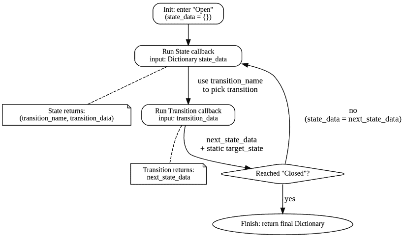

图 16.1: StateMachineOperation 的高层描述

* 知道如何读取或写入消息的操作树在转换内部运行，要么从消息中获取数据，要么返回数据
* 所有转换均为写入转换的状态将作为对解释器用户的原生回调，用户将在此指定要执行哪种转换及其对应的参数
* 所有转换均为读取转换的状态将通过使用 `TransitionLookAhead` 操作来确定是哪种转换

为了编码这些信息，我定义了以下数据结构：

```
struct TransitionInfo {
  std::shared_ptr<const OpTree> callback_optree;
  std::vector<std::string> argument_names;
  std::string target_state;
};
using StateTransitionMap =
  std::unordered_map<std::string, TransitionInfo>;
struct StateInfo {
  std::shared_ptr<const OpTree> callback_optree;
  StateTransitionMap transitions;
};
using StateMap = std::unordered_map<std::string, StateInfo>;
```

然后操作本身有一个数据成员：

```
StateMap states;
```

这种结构编码了状态机的整个行为。

`StateMachineOperation` 实现了 `ControlFlowOperationConcept`，这允许它提交回调并处理它们返回的值。为了能够跟踪状态，第一步是向 `ControlFlowOperationContext` 对象添加新成员：

```
std::any additional_info;
```

这个 `additional_info` 成员是必要的，因为状态机需要跟踪它是在处理一个转换，还是在处理某个状态的回调。在这种情况下，使用 `std::variant` 代替 `std::any` 是可能的，但这将暴露实现细节。

为了表示这些模式，我们定义了以下 `enum class`：

```
enum class ProcessingMode {
  Transition,
  State,
};
```

为了将每个状态或转换与其名称关联，我们定义了以下对类型：

```
using StatePair = std::pair<std::string, StateMachineOperation::StateInfo>;
using TransitionPair = std::pair<std::string, StateMachineOperation::TransitionInfo>;
```

最后，我们将所有内容结合，包括我们是从哪个状态（在转换到 `"Open"` 状态时可能不存在）、正在执行哪个转换以及目标状态：

```cpp
struct ProcessingInfo {
  ProcessingMode processing_mode;
  std::optional<StatePair> from_state;
  std::optional<TransitionPair> transition;
  StatePair to_state;
};
```

这个结构体完全封装在操作实现内部，防止了实现细节的泄露。这就是使用 `std::any` 为我们提供的控制。现在，我可以开始实现操作的执行，从外层代码开始，然后深入：

```
OperationResult
StateMachineOperation::operator()(
  ControlFlowOperationContext &ctx,
  Arguments a) const {
  if (ctx.callable.has_value()) {
    // 将在后续覆盖
  } else {
    auto it = states.find("Open");
    if (it == states.end()) {
      return value::RuntimeError::NameError;
    }
    ctx.accumulator = std::make_shared<std::vector>(
      std::vector{value::Dictionary()});
    ctx.additional_info = ProcessingInfo{
      ProcessingMode::Transition,
      std::nullopt,
      std::nullopt,
      *it
    };
    return _start_state_callback(ctx, states);
  }
}
```

假设在操作初始化之后，该操作总会有一个关联的回调。因此，如果没有回调函数，状态机将转换到 `"Open"` 状态，为 `"Open"` 状态初始化一个空字典（因为 `"Open"` 不能有任何参数），并填充上下文的 `additional_info` 成员以包含正在转换到 `"Open"` 状态的信息。

`_start_state_callback` 函数反过来初始化状态回调，并允许解释器执行它。


```cpp
static OperationResult _start_state_callback(
  ControlFlowOperationContext &ctx,
  const StateMachineOperation::StateMap &states) {
  ProcessingInfo &info = std::any_cast<ProcessingInfo &>(
    ctx.additional_info);
  auto &s = info.to_state.second;
  ctx.callable = value::Callable{
    s.callback_optree, {"dictionary"}, true};
  ctx.value = std::nullopt;
  info.processing_mode = ProcessingMode::State;
  return
   ReasonForBlockedOperation::WaitingForCallableInvocation;
}
```

这描述了状态回调将具有一个参数，该参数是一个包含导致该状态的完整消息的字典。在 `"Open"` 状态下，它是空的。然后它告诉解释器需要调用该回调。

这现在看起来可能有点多余，因为 `"Open"` 状态的代码可以直接完成它。然而，任何状态的回调启动代码都是相同的，通过这个函数进行操作，可以让我们在处理其他情况时减少重复代码。

现在我可以回到操作执行，在设置了回调的情况下，查看我之前跳过的代码块：

```cpp
if (ctx.callable_invoked) {
  if (ctx.value.has_value()) {
    // 关于这一点稍后会介绍
  } else {
    return
      ReasonForBlockedOperation::WaitingForCallableResult;
  }
} else {
  return
   ReasonForBlockedOperation::WaitingForCallableInvocation;
}
```

执行了与解释器的常规交互：调用回调并提交结果。之后，我们终于可以进入回调本身的处理：

```cpp
ProcessingInfo &info = std::any_cast<ProcessingInfo &>(
  ctx.additional_info);
if (info.processing_mode == ProcessingMode::Transition) {
  if (!info.transition.has_value()) {
    return value::RuntimeError::NameError;
  }
  return _process_transition_return(ctx, states);
} else {
  return _process_state_return(ctx, states);
}
```

调用的两个函数——`_process_transition_return` 和 `_process_state_return`——解包可调用对象返回的值，如果该值没有预期的类型，则返回错误。一旦参数被正确识别，它们就会实际执行操作。在状态情况下，状态回调返回两个参数：正在执行的转换名称，以及带有该转换数据的字典：

```cpp
static OperationResult _process_state_return_with_args(
  ControlFlowOperationContext &ctx,
  const StateMachineOperation::StateMap &states,
  const value::Octets t,
  const value::Dictionary d) {
  ProcessingInfo &info =
   std::any_cast<ProcessingInfo &>(ctx.additional_info);
  if (info.to_state.first == "Closed") { return d; }
```

此外，这里对 `"Closed"` 状态进行了特殊处理，导致操作返回导致此点的最后一条消息的数据字典。

接下来，先的 `to_state` 变为新的 `from_state`：

```cpp
 info.from_state = info.to_state;
```

然后我们尝试在 `t` 的值中找到给我们的转换，如果转换名称未列在状态中，则返回 `NameError`：

```cpp
 auto &s = info.to_state.second;
  auto it = s.transitions.find(*t.data);
  if (it == s.transitions.end()) {
    return value::RuntimeError::NameError;
  }
```

由于回调告诉我们正在执行哪种转换，我们也知道目标状态是什么，并且需要验证它是一个有效状态：

```cpp
 auto target_state_name = it->second.target_state;
  auto it2 = states.find(target_state_name);
  if (it2 == states.end()) {
    return value::RuntimeError::NameError;
  }
```

最后，我们可以从字典中提取用于转换执行的命名参数，并触发转换回调的开始：

```cpp
 auto maybe_args = _extract_arguments(
    it->second.argument_names, d);
  if (!maybe_args.has_value()) {
    return value::RuntimeError::TypeError;
  }
  ctx.accumulator = maybe_args.value();
  info.transition = *it;
  info.to_state = *it2;
  return _start_transition_callback(ctx, states);
```

`_extract_arguments` 函数只是遍历转换的参数名称，并按照转换的 `StaticCallable` 参数的要求将字典转换为列表：

```cpp
static std::optional<std::shared_ptr<std::vector<Value>>>
_extract_arguments(
  const std::vectorstdstd::string &names,
  const value::Dictionary &d) {
  auto args = std::make_shared<std::vector<Value>>();
  for (const auto &arg_name : names) {
    auto it = d.members->find(arg_name);
    if (it == d.members->end()) {
      return std::nullopt;
    } else {
      args->push_back(it->second);
    }
  }
  return args;
}
```
抱歉，原文文本的最后部分出现了错误。让我根据你的规则提供正确格式化的提供的文本。

[content]
```cpp
static OperationResult _start_state_callback(
  ControlFlowOperationContext &ctx,
  const StateMachineOperation::StateMap &states) {
  ProcessingInfo &info = std::any_cast<ProcessingInfo &>(
    ctx.additional_info);
  auto &s = info.to_state.second;
  ctx.callable = value::Callable{
    s.callback_optree, {"dictionary"}, true};
  ctx.value = std::nullopt;
  info.processing_mode = ProcessingMode::State;
  return
   ReasonForBlockedOperation::WaitingForCallableInvocation;
}
```

这描述了状态回调将具有一个参数，该参数是一个包含导致该状态的完整消息的字典。在 `"Open"` 状态下，它是空的。然后它告诉解释器需要调用该回调。

这现在看起来可能有点多余，因为 `"Open"` 状态的代码可以直接完成它。然而，任何状态的回调启动代码都是相同的，通过这个函数进行操作，可以让我们在处理其他情况时减少重复代码。

现在我可以回到操作执行，在设置了回调的情况下，查看我之前跳过的代码块：

```cpp
if (ctx.callable_invoked) {
  if (ctx.value.has_value()) {
    // 关于这一点稍后会介绍
  } else {
    return
      ReasonForBlockedOperation::WaitingForCallableResult;
  }
} else {
  return
   ReasonForBlockedOperation::WaitingForCallableInvocation;
}
```

执行了与解释器的常规交互：调用回调并提交结果。之后，我们终于可以进入回调本身的处理：

```cpp
ProcessingInfo &info = std::any_cast<ProcessingInfo &>(
  ctx.additional_info);
if (info.processing_mode == ProcessingMode::Transition) {
  if (!info.transition.has_value()) {
    return value::RuntimeError::NameError;
  }
  return _process_transition_return(ctx, states);
} else {
  return _process_state_return(ctx, states);
}
```

调用的两个函数——`_process_transition_return` 和 `_process_state_return`——解包可调用对象返回的值，如果该值没有预期的类型，则返回错误。一旦参数被正确识别，它们就会实际执行操作。在状态情况下，状态回调返回两个参数：正在执行的转换名称，以及带有该转换数据的字典：

```cpp
static OperationResult _process_state_return_with_args(
  ControlFlowOperationContext &ctx,
  const StateMachineOperation::StateMap &states,
  const value::Octets t,
  const value::Dictionary d) {
  ProcessingInfo &info =
   std::any_cast<ProcessingInfo &>(ctx.additional_info);
  if (info.to_state.first == "Closed") { return d; }
```

此外，这里对 `"Closed"` 状态进行了特殊处理，导致操作返回导致此点的最后一条消息的数据字典。

接下来，先的 `to_state` 变为新的 `from_state`：

```cpp
 info.from_state = info.to_state;
```

然后我们尝试在 `t` 的值中找到给我们的转换，如果转换名称未列在状态中，则返回 `NameError`：

```cpp
 auto &s = info.to_state.second;
  auto it = s.transitions.find(*t.data);
  if (it == s.transitions.end()) {
    return value::RuntimeError::NameError;
  }
```

由于回调告诉我们正在执行哪种转换，我们也知道目标状态是什么，并且需要验证它是一个有效状态：

```cpp
 auto target_state_name = it->second.target_state;
  auto it2 = states.find(target_state_name);
  if (it2 == states.end()) {
    return value::RuntimeError::NameError;
  }
```

最后，我们可以从字典中提取用于转换执行的命名参数，并触发转换回调的开始：

```cpp
 auto maybe_args = _extract_arguments(
    it->second.argument_names, d);
  if (!maybe_args.has_value()) {
    return value::RuntimeError::TypeError;
  }
  ctx.accumulator = maybe_args.value();
  info.transition = *it;
  info.to_state = *it2;
  return _start_transition_callback(ctx, states);
```

`_extract_arguments` 函数只是遍历转换的参数名称，并按照转换的 `StaticCallable` 参数的要求将字典转换为列表：

```cpp
static std::optional<std::shared_ptr<std::vector<Value>>>
_extract_arguments(
  const std::vectorstd::string &names,
  const value::Dictionary &d) {
  auto args = std::make_shared<std::vector<Value>>();
  for (const auto &arg_name : names) {
    auto it = d.members->find(arg_name);
    if (it == d.members->end()) {
      return std::nullopt;
    } else {
      args->push_back(it->second);
    }
  }
  return args;
}
```


现在，`construct_state_map` 变得有意思了。特别是解释器的一个重要局限性在这里显而易见。

如果一个状态混合了读转换和写转换，我们无法让其正常工作，因此我们需要首先检查所有转换是否为同一种类型。为此，我首先定义了一个枚举，用于跟踪转换类型：

```cpp
enum class TransitionType { Read, Write };
```

在这里，将转换本身表示为读和写转换之间的变体（variant）变得至关重要。这允许我创建一个 `visit_transition` 函数，它既可以用于为定的转换生成 `StateMachineOperation::TransitionInfo`（我稍后会介绍），也可以用于收集相关信息。让我们先看看它是如何处理 `WriteTransition` 的：

```cpp
static std::optional<
  std::pair<TransitionType,
            StateMachineOperation::TransitionInfo>>
visit_transition(
    const std::shared_ptr<const sema::ast::WriteTransition>
    &transition, const std::string &target_state) {
  auto maybe_info = generate_transition_info(
     transition, target_state);
  if (!maybe_info)
    return std::nullopt;
  return {{TransitionType::Write, *maybe_info}};
}
```

然后我们看 `ReadTransition`，它几乎相同，但返回的是不同的枚举值：

```cpp
static std::optional<
  std::pair<TransitionType,
            StateMachineOperation::TransitionInfo>>
visit_transition(
    const std::shared_ptr<const sema::ast::ReadTransition>
    &transition, const std::string &target_state) {
  auto maybe_info = generate_transition_info(
     transition, target_state);
  if (!maybe_info)
    return std::nullopt;
  return {{TransitionType::Read, *maybe_info}};
}
```

为了解释该函数的作用，我将首先讨论遍历状态的通用结构，在其中我们本质上构建了将逐个返回状态的状态 map：

```cpp
StateMachineOperation::StateMap state_map;
for (const auto &state_pair : states) {
  StateMachineOperation::StateInfo state_info;
  // ... 我稍后会介绍这个
  state_map[state_pair.first] = state_info;
}
return state_map.empty()
  ? std::nullopt
  : std::optional<
     StateMachineOperation::StateMap>{state_map};
```

现在我可以深入探讨如何处理每个状态，首先是创建一个变量来跟踪我们已经见过哪些类型的转换。这很重要，因为该语言不支持一种状态无法定义下一个哪个代理（agent）将执行写入的协议。稍后，代码将检查我们是否从同一个状态既有读转换又有写转换，并将其视为语义分析失败：

```cpp
std::optional<TransitionType> state_transitions_type =
   std::nullopt;
```

然后，我们可以遍历该状态中的所有转换，为每个转换调用 `visit_transition`，并将生成的转换信息存储在 `state_info` 中。最后，我们检查是否存在混合的转换类型：

```cpp
for (const auto &transition_pair :
     state_pair.second->transitions) {
  const auto &transition = transition_pair.second.first;
  const auto &target_state = transition_pair.second.second;
  auto maybe_transition =
    std::visit(& {
       return visit_transition(t, target_state); },
    transition);
  if (!maybe_transition)
    return std::nullopt;
  auto [transition_type, transition_info] =
    *maybe_transition;
  state_info.transitions[transition_pair.first] =
    transition_info;
  if (state_transitions_type.has_value()) {
    if (state_transitions_type != transition_type) {
      return std::nullopt;
    }
  } else {
    state_transitions_type = transition_type;
  }
}
```

我将在下一节中介绍转换信息的生成。现在我将完成创建状态信息的逻辑。

首先，我需要特殊地处理 `"Closed"` 状态，正如我之前描述的那样：

```cpp
if (state_pair.first == "Closed") {
  state_info.callback_optree = std::make_shared<OpTree>(
      OpTree(OpTreeNode{UnaryCallback(state_pair.first),
             {{LexicalPadGet{"dictionary"}, {}}}}));
}
```

当状态关闭时，它将仅调用 `"Closed"` 状态的回调并将其返回，这将结束状态机操作的执行。

现在我可以关注其他情况。首先，我需要处理状态中没有转换的特殊情况，并假设它是一个读状态：

```cpp
if (!state_transitions_type)
  state_transitions_type = TransitionType::Read;
```

然后我可以决定不同的逻辑，从最简单的写转换开始，因为这个决定必须由解释器的用户做出的，因此我们完全将其委托给一个回调：

```cpp
switch (state_transitions_type.value()) {
case TransitionType::Write:
  state_info.callback_optree = std::make_shared<OpTree>(
      OpTreeNode{UnaryCallback(state_pair.first),
             {{LexicalPadGet{"dictionary"}, {}}}}));
break;
```

然而，读转换需要生成 `lookahead` 操作，因此将其拆分为一个独立的函数：

```cpp
case TransitionType::Read: {
  auto maybe_optree = generate_state_callback(state_pair.second);
  if (!maybe_optree)
    return std::nullopt;
  state_info.callback_optree = *maybe_optree;
}
break;
```

`generate_state_callback` 函数实现通过遍历该状态中的转换来累积 lookahead 的不同条件：

```cpp
std::vector<std::pair<operation::Transitionahead::TransitionCondition,
       std::string>> conditions;
for (const auto &transition_pair : state->transitions) {
  const auto &transition = transition_pair.second.first;
  const auto &target_state = transition_pair.second.second;
  // 稍后更多
}
if (conditions.empty())
  return std::nullopt;
return std::make_shared<OpTree>(
  OpTreeNode{operation::DynamicList{conditions}, {}},
{operation::DictionaryInitialize{}, {}});
```

现在进入循环体，再次从指向 `"Closed"` 状态的特殊情况开始，这取决于转换的结束：

```cpp
if (target_state == "Closed") {
   conditions.emplace_back(
     operation::Transitionahead::EOFCondition,
     transition_pair.first);
}
```

然后我们可以通过访问转换将其转换为条件来处理剩余情况：

```cpp
auto maybe_condition = std::visit(
    [](auto &t) {
       return get_transition_condition(t); }, transition);
if (maybe_condition) {
   conditions.emplace_back(*maybe_condition,
                           transition_pair.first);
} else {
  return std::nullopt;
}
```

`get_transition_condition` 函数是一系列取决于条件类型的重载。我不会列出所有的，因为它们非常相似，但为了演示目的，我会包含其中一个：

```cpp
static std::optional<
   operation::Transitionahead::TransitionCondition>
get_transition_condition(
 const std::shared_ptr<const sema::ast::ReadTransition>
   &read_transition) {
  if (!read_transition->actions.empty()) {
    return get_transition_condition(
       read_transition->actions.front());
  }
  return std::nullopt;
}
```

`get_transition_condition` 函数将查看读转换的第一个动作，然后将访问该动作：

```cpp
static std::optional<
  operation::Transitionahead::TransitionCondition>
get_transition_condition(const sema::ast::Action &action) {
  return std::visit([](const auto &a) {
    return get_transition_condition(a);
    }, action);
}
```

它最终解析到特定的动作类型并将其转换为条件。


```cpp
static
std::optional<
    operation::TransitionLookahead::TransitionCondition>
get_transition_condition(
 const std::shared_ptr<
 const sema::ast::action::ReadOctetsUntilTerminator>
    &read_action) {
  return
    operation::TransitionLookahead::MatchUntilTerminator{
      read_action->terminator};
}
```

到此为止，我已经构建了整个状态机操作。剩下的唯一工作就是实际生成用于读取或写入消息的代码。

我想回过一下这段代码，即使它不一定完全符合你编写代码生成器的方式，因为这展示了针对程序主结构对 AST（抽象语法树）进行简单命令式遍历的一个示例。在某种情况下，它处理的是编程语言的高层级状态机。

当你编写自己的生成器时，你的语言可能也具有这些高层结构（例如 Java 中的包），将它们与处理更细粒度控制流的部分隔离开来可能是很有用的。此外，考虑是否应该像我在这里做的那样创建专门的操作符来处理它们也是非常重要的。

在下一节中，我将涉及到生成编程语言的低层控制流——消息的读写。

## 生成整个程序

在上一节中，我跳过了 `visit_transition` 函数，该函数将处理程序的低层控制流。这种区分是非常重要的，因为在这里用户对程序做什么有更大的灵活性，因此使用更灵活的范式将变得重要。

让我从一个示例开始，说明它是如何变得复杂的。在编程语言中，每条消息都有一个数据部分（描述消息中使用的数据类型）以及一个部分部分（描述它们是如何被使用的）：

```
message "HTTP Response" {
    when: AwaitResponse;
    then: Open;
    agent: Server;
    data: {
        major_version: int<encoding=AsciiInt,
                           unsigned=True,
                           bits=8>;
        … other data
    }
    parts {
        tokens {
            "HTTP/" major_version "." minor_version
        }
        … other parts
```

到目前为止，我们还没有真正将两者连接起来。AST 仅仅提到，对于读取代理，它需要读取 `major_version` 数据，直到遇到 `"."` 作为终止符；而对于写入代理，它需要写入 `major_version` 数据，然后是一个 `"."`。但我们希望这些数据实际上具有语言中描述的类型；因此，我们需要将名称映射到特定类型。

情况变得更加复杂，因为我们还存在 `for` 循环：

```
for header in headers {
   tokens { header.key }
   terminator { ":" }
   … other parts
}
terminator { "\r\n" }
```

这意味着为了解析变量名，翻译还需要知道 `for` 循环引入了一个新变量，并且它需要根据 `headers` 元素的定义来导航类型。

为了这一点，我将使用一个高阶函数，它知道如何在特定上下文中发现某个名称的类型，但如果该名称在该上下文中不存在，它可以委托给外层上下文。为了做到这一点，我们定义了该函数的类型：

```
using ExtractTypeClosure =
    std::function<
     std::optional<
     std::shared_ptr<const parser::tree::Type>>(
            const std::string &)>;
```

该函数将在我们遍历 AST 时作为参数传递，每当需要新的上下文时，我们只需要将其封装在另一个函数中。

在最外层的函数中（即开始跳转遍历的函数），从名称解析类型的简单定义如下：

```cpp
 auto get_type = & {
    return extract_type(transition->data, name);
  };
```

注意的是，`transition` 和 `name` 变量被捕获到了 `get_type` 函数中，这意味着即使在栈的更深处调用 `get_type` 时，它们也可以被引用。

最外层的 `get_type` 只需要根据名称查找数据部分顶部的成员，因为那是该点对应的上下文。但在循环的情况下，函数需要更智能一点，因为它必须识别循环变量的名称并从集合的属性中提取它：

```cpp
static std::optional<ExtractTypeClosure>
create_get_type_wrapper(const ExtractTypeClosure &get_type,
 const std::string &variable,
 const std::string &collection) {
  auto maybe_type = get_type(collection);
  if (!maybe_type)
    return std::nullopt;
  auto params = maybe_type.value()->parameters;
  auto it = params->find("element_type");
  if (it == params->end())
    return std::nullopt;
  auto element_type = it->second;
  return =
      -> std::optional<std::shared_ptr<
          const parser::tree::Type>> {
    if (name == variable) {
      if (std::holds_alternative<
          std::shared_ptr<const parser::tree::Type>>(
              element_type)) {
        return std::get<
          std::shared_ptr<const parser::tree::Type>>(
              element_type);
      } else {
        return std::nullopt;
      }
    }
    return get_type(name);
  };
}
```

如前所述，这是定义变量的最外层上下文，并且会被发送给 `actions_to_optreenodes` 函数。


```cpp
std::vector<OpTreeNode> operations;
for (const auto &action : actions) {
  auto maybe_op = std::visit(
    & {
          return visit_action(transition, get_type, a);
       }, action);
  if (!maybe_op)
    return std::nullopt;
  operations.push_back(maybe_op.value());
}
return operations;
```

在这里，我们对 actions 使用了最后的访问者模式（visitor pattern），通过它可以将每个 action 转换为它自己的 `OpTreeNode`。如果一个 action 需要多个节点，它始终可以将它们封装在 `OpSequence` 中。

我不会关注所有的 actions，因为它们非常相似，你将在最终代码中看到它们，但我确实想展示展示一个来完善整个图景。为此，我将查看 `WriteFromIdentifier` action 的代码。我首先获取标识符（identifier）和类型：

```cpp
auto &identifier = action->identifier;
auto maybe_type = get_type(identifier->name);
if (!maybe_type)
  return std::nullopt;
```

现在，如果标识符没有成员访问（member access），我们可以直接根据标识符的类型写入字节（octets）：

```cpp
auto member = identifier->member;
if (!member.has_value())
  return write_octets_from_value(maybe_type.value(),
                                 variable_access);
```

然而，如果存在成员访问，情况就会变得有趣起来。我们需要遍历所有的成员来处理变量访问。标识符的最外层名称必须是词法路径（lexical pad）中的内容。因此，我们这样开始：

```cpp
OpTreeNode variable_access =
   OpTreeNode{LexicalPadGet(identifier->name), {}};
```

现在我们可以生成 `OpTree`，它将递归地消耗尽可能多的成员，并封装最外层的变量访问：

```cpp
auto maybe_access = recursive_variable_access(
    maybe_type.value(), member.value(), variable_access,
    std::nullopt);
if (!maybe_access)
  return std::nullopt;
auto [last_access, last_type] = *maybe_access;
return write_octets_from_value(last_type, last_access);
```

这里我们检查变量的类型并实现成员访问。外部类型需要包含一个与成员名称匹配的参数，并且我们能够识别它的类型：

```cpp
auto it = type->parameters->find(identifier->name);
if (it == type->parameters->end()) {
  return std::nullopt;
}
auto member_type =
  std::get<std::shared_ptr<const parser::tree::Type>>(
    it->second);
if (!member_type) {
  return std::nullopt;
}
```

现在，我们需要检查这是否是最后一个成员访问，如果是，只需返回一个 `DictionaryGet` `OpTreeNode`，将标识符名称作为静态值并将当前访问作为子节点：

```cpp
if (!identifier->member.has_value()) {
  auto last_access =
     OpTreeNode{DictionaryGet(identifier->name),
                              {current_access}};
  return std::make_tuple(last_access, member_type);
```

如果还有更多需要遍历，我们需要递归直到末尾，但仅当成员类型为元组（tuple）时才如此：

```cpp
} else if (member_type->name->name == "tuple") {
  auto outer_access =
     OpTreeNode{DictionaryGet(identifier->name),
                              {current_access}};
  return recursive_variable_access(
         member_type, identifier->member.value(),
         outer_access, std::nullopt);
} else {
  return std::nullopt;
}
```

我跳过了代码中的一些复杂性，但我希望能够展示在遍历 AST 时，操作树是如何递归构建的。

我确实想展示一个我跳过的特定部分，即 `write_octets_from_value`：

```cpp
if (type->name->name == "int") {
  return OpTreeNode{WriteOctets{},
                    {{IntToAscii{}, {value}}}};
} else if (type->name->name == "str") {
  return OpTreeNode{WriteOctets{}, {value}};
}
return std::nullopt;
```

这里循环终于结束了。它处理实际值的类型（该值是静态类型的），并为写入操作生成正确的操作树。

我知道这一章已经很长了，但我确实想让你直观地感受到编写这类生成代码是什么样子的，以及在这种背景下如何使用 C++ 特性来有效地编写这些代码。

最后，这个解释器最小实现中的整个代码生成步骤仍然相当易于理解。到目前的完整代码可以在 pull request #46 ([`github.com/PacktPublishing/Building-Programming-Language-Interpreters/pull/46`](https://github.com/PacktPublishing/Building-Programming-Language-Interpreters/pull/46)) 中看到。我建议你阅读一遍，因为其中有很多有趣的细节，但这里并不完全需要文字解释。

在下一节中，我将完成用户如何实例化解释器的接口工作。

# 集成到解释器中

到为止，我们一直在一步步地工作。现在是时候向用户呈现一个最终的接口了，用户可以提供文件并获得一个可以执行的内容。

从一开始我们就知道这种接口不是好的。首先，我们需要能够有两个不同的构造函数——一个用于客户端，一个用于服务器；其次，我们需要能够处理错误。因此，与其使用构造函数，不如将这些逻辑移动到静态方法：

```cpp
static std::optional<InterpretedProgram> generate_client(const std::string& fs);
static std::optional<InterpretedProgram> generate_server(const std::string& fs);
```

我们从客户端和服务器共同的部分开始：分词、解析和分析代码：

```cpp
std::optional<std::shared_ptr<const sema::ast::Protocol>> parse_protocol(const std::string& fs) {
  auto maybe_tokens = lexer::tokenize(fs);
  if (!maybe_tokens.has_value())
    return std::nullopt;
  std::vector<lexer::Token> &tokens = maybe_tokens.value();
  auto maybe_ast = parser::parse(tokens);
  if (!maybe_ast.has_value())
    return std::nullopt;
  return sema::analyze(maybe_ast.value());
}
```

最后，我就可以生成客户端或服务器解释器：

```cpp
std::optional<InterpretedProgram> InterpretedProgram::generate_client(const std::string& fs) {
  auto maybe_protocol = parse_protocol(fs);
  if (!maybe_protocol.has_value())
    return std::nullopt;
  auto maybe_client = generate::client(maybe_protocol.value());
  if (!maybe_client.has_value())
    return std::nullopt;
  return InterpretedProgram(maybe_client.value());
}
std::optional<InterpretedProgram> InterpretedProgram::generate_server(const std::string& fs) {
  auto maybe_protocol = parse_protocol(fs);
  if (!maybe_protocol.has_value())
    return std::nullopt;
  auto maybe_server = generate::server(maybe_protocol.value());
  if (!maybe_server.has_value())
    return std::nullopt;
  return InterpretedProgram(maybe_server.value());
}
```

通过这种方式我可以修改测试来使用这些新函数。你可以在 pull request #47 中看到新接口的使用 ([`github.com/PacktPublishing/Building-Programming-Language-Interpreters/pull/47`](https://github.com/PacktPublishing/Building-Programming-Language-Interpreters/pull/47))。这把整个接口带到了一个易于使用的点。

并且考虑解释器的入口点，特别是当编程语言旨在作为库使用时，这会对用户产生很大影响。当然，如果该解释器旨在作为一个独立的可执行文件，那么它的入口接口同样重要，在决定方案之前，你应该研究各种提供的接口。


在下一节中，我将介绍解释器的实际执行过程，展示该语言的用户如何使用此种解释器。

# 首次在我们的编程语言中执行代码

当我在第一部分解释状态机操作时，我解释了与用户代码交互的形式将是怎样的，现在终于是时候看到它的实现了。

解释器为用户提供的交互的主要机制是为客户端或服务器可能处于的各种状态定义一组回调。这追溯到*第 12 章*中描述的 `InterpreterRunner`，现在在编程语言的背景下，它变得非常有意义了。让我向你们展示服务器的代码，回调函数中的实际代码留稍后说：

```
InterpreterRunner server_runner{
  .callbacks =
    {
     {"AwaitResponse",
      [](const std::vector<Value> &args) -> Value {
         // ...
      }},
     {"Closed",
      [](const std::vector<Value> &args) -> Value {
         // ...
       }},
    },
  .exit_when_done = true};
```

前面的代码本质上定义了执行的哪部分将与用户代码交互。这是状态机操作设计的直接结果。它决定了在何调用回调以及返回值如何被使用。

为了让这更具体，让我过一下 `AwaitResponse` 回调的代码。我将将其拆分为步骤以便于理解。第一步是获取导致进入此状态的转换结果的字典，该转换是从客户端读取请求的转换：

```
value::Dictionary dict =                      
   std::get<value::Dictionary>(args[0]);
std::cerr << "Member count: " << dict.members->size()
          << std::endl;
std::cerr << "Server received request: "
          << std::get<value::Octets>(
              dict.members->at("request_target"))
              .data->c_str()
          << std::endl;
```

这段代码打印了一些信息，用来说明字典的成员就是协议中描述的数据成员。

现在，状态的返回值非常重要，因为它不仅必须指示将采取哪种转换，还要指示该转换的参数是什么，这些参数同样应该与协议中定义的数据匹配：

```
return value::DynamicList{
 {_o("HTTP Response"),
  value::Dictionary{
  {{"response_code", 200},
   {"reason_phrase", _o("Looks good")},
   {"major_version", 1},
   {"minor_version", 1},
   {"headers",
    value::DynamicList{
     {value::Dictionary{
      {{"key", _o("Some-Response")},
       {"value", _o("some value")}}},
      value::Dictionary{
      {{"key", _o("TestHeader")},
       {"value", _o("Value")}}}}}}}}}};}};
```

为了让这段代码更简单，我将 `value::Octets` 的创建封装在了小的 `_o` 函数中。这里的重点在于我返回了解释器知道如何处理的数据，但它仍然用普通的 C++ 语法表示，可以方便地使用大括号语法创建。

最后，这里是 `"Closed"` 回调的代码，它仅仅确认了关闭。其字典中的数据将成为解释器返回的最终值：

```
std::cerr << "Server Close" << std::endl;
return value::DynamicList{{_o("N/A"), args.at(0)}};
```

文件 `tests/027-translate-ast-to-optree.cpp` 中的代码包含了这一完整的交互，包括实际启动多个线程，并在随后断言跨 I/O 层交换的数据实际上符合预期结果。

我不会详细介绍这些，因为它与*第 12 章*中引入的测试非常相似。然而，将本章的代码与该章的代码进行对比，将有助于你理解我们是如何从简单的解释器运行时变为一个完整的端到端解释器的。

与该章一样，我也包含了实现与现有 I/O 库集成的代码，和以前一样，我将考虑如何集成其他库留给你们的一项练习。

# 总结

始终开放重新评估你的解释器是否需要新操作是非常重要的。如果你在某些情况下，在原生代码中实现行为比使用解释器的其他原语要容易得多，这一点就尤为相关。

此外，在实际将 AST 转换为解释器操作时，你可能会发现自己必须在命令式和函数式范式之间切换。有时高层结构并不那么灵活，直接组装更为实用。但当你遍历用户具有更多灵活性的语言区域时，函数模式可以提供更直观的解决方案。

完成所有这些后，你将能够确定通过简单的接口获取从源代码到执行的整个翻译的最终方式。

最后，我们可以拥有看起来像用户会创建的代码，并通过解释器运行来管理协议。在这里，我们可以看到真实的使用场景，并获得解释器确实从端到端工作的信心。

在下一章中，我将对整个轨迹以及目标是否达成进行反思。


在这个领域，我可以肯定地说，解释器确实充了实用的概念证明，展示了这里提出的 DSL 有效地从用户中抽象了协议的状态机。在随后的*通过示例*（Working through an example）章节中，我将带你遍历一个极其复杂的语言使用示例，这将说明解释器处理了多少状态机相关的工作。

## 同步请求-响应协议

这既是一个目标的声明，也是一个非目标的声明。本质上，我将问题陈述限制在一个特定的网络协议子集中——特别是那些具有简单请求和响应的协议。

在上一章中，我演示了解释器能够处理简化的 HTTP 协议，并能正确处理请求-响应行为。为了进一步证明这一设计，我将使用这种编程语言来建模`简单邮件传输协议`（`SMTP`），这将是该语言的一个很好的测试练习。

## 多点控制权转移

起初，我的目标是在提交查询路径时立即拒绝 HTTP 请求，而无需处理整个请求。这是一个很好的例子，说明该功能最终从编程语言的第一版本中删除了。该语言确实提供了控制转移点，但目前，这种转移发生在消息的末尾，而不是任意点。

简化这一过程的决定源于我意识到，虽然这对于通用语言来说是一个很好的特性，但在处理过程中我很清楚，它对于`最小可行性产品`（`MVP`）来说并非必须。更重要的是，仍然可以分割 HTTP 请求，允许单独处理动词（verb）。因此，虽然语言没有直接支持上述功能，但你仍然可以实现目标。

## 将值传递到原生语言

一个知道如何读取 HTTP 请求但不能告诉你它是什么的解释器将不是一个特别实用的解释器。我们对此有了一个可行的解决方案，在消息末尾，会将一个字典发送到原生语言。

从第一个版本中移除的一个功能是能够以除解释器原生格式以外的其他格式表示这些数据结构。从 `MVP` 中移除这一功能的决定是自然而然的，因为意识到可以使用这种语言在直接对解释器值进行操作时实现客户端和服务器。

这显然是一个未来开发将获益的领域，但我认为可以说，使用解释器的原生类型系统并不会让它变得不可用。但这只有通过示例才能给出答案。

## 在协议内部使用捕获的值

我在列出这个目标时想到的例子是，我将能够使用 HTTP 中的 `Content-Length` 头部的值来解析请求体。这也被从语言的第一版本中删除了，使协议格式完全静态化。对流（streams）的支持最终从 `MVP` 中被移除，因为许多协议并不需要它，尽管这是解释器未来版本的明确高优先级任务。

将项目的第一版本范围缩小到真正的 `MVP` 规模的历程是软件开发的一个重要方面。处理这些决策以及到达该 `MVP` 的历程也是该过程的重要部分，我想将其作为叙述的一部分与你们分享。

在下一节中，我将回顾我在`第一章`中设置的验收标准。

# 检查我们的验收标准

虽然缩小目标范围是实现任何软件产品首次发布的的自然结果，但验收标准为成功设定了更精确的准则。

就像目标一样，让我带你遍历其中的每一个标准。

## 初始化一次解释器

对于一个处理网络协议的解释器，我设定了一项原则：解释器应该只初始化一次，特别是在网络服务器的情况下，因为它必须多次处理同一种协议。在解释器的设计和实现过程中，我始终牢记这一点。从一开始开始，我就从 `InterpretedProgram` 类型开始，它包含一个针对程序的只读执行模型。

这不仅驱动了解释器本身的设计，还驱动了将源代码翻译成只读 `OpTree` 对象形式的可执行指令，使得这些对象可以在所有执行实例中被重用，从而在可执行指令与执行栈中的运行时数据之间创建了清晰的隔离。

这种设计代表了一种限制解释器能力的选择，因为它不像其他解释器那样可以访问并重写自身的代码。虽然这可能会显著降低解释器的灵活性，但对于一个旨在处理网络协议的解释器来说，这实际上是一个理想的限制。

## 让解释器驱动与网络的交互

这也许是主要的标准，因为其原则是减少处理任何给定协议状态机时的编程错误数量。构建的最终解释器实际上完全向用户隐藏了网络通信，因为用户只能看到以协议本身描述的结构化数据形式显示的消息。

我认为可以说，这一特定的验收标准从编程语言和解释器的设计底层开始就已经满足了。

## 在特定点转移控制权

最后一个要求是解释器与原生代码之间的转换将发生在执行的特定点。这一概念通过原生回调（native callbacks）来表示，回调在协议进入某种状态时执行，而转换则由解释器本身实现。

这意味着我们不仅减少了处理特定消息即时状态机的错误概率，还建立了对哪些数据可以在消息之间传输的控制。这可能并不显而，但跨顺序消息的高级状态泄漏也是处理网络协议时一个特别危险的错误来源。

现在，为了确认到目前为止讨论的所有内容，让我们遍历一个涵盖解释器端到端使用的更完整的示例。

## 通过示例

到目前为止，我一直在处理简化的示例和最小版本的 HTTP 协议。现在，是时候在实际用例中测试解释器了，同时针对处于语言限制范围内的协议。

一个很好的例子是 `SMTP`，它是互联网电子邮件基础设施的基础，因为它比纯 HTTP 有更多样的状态。在 SMTP 中，某些状态是跨多个消息保留的，解释器需要能够传递这些状态。

我不会对协议进行全面的解释，但在本节结束时，你应该对它的工作原理有一个坚定的理解。

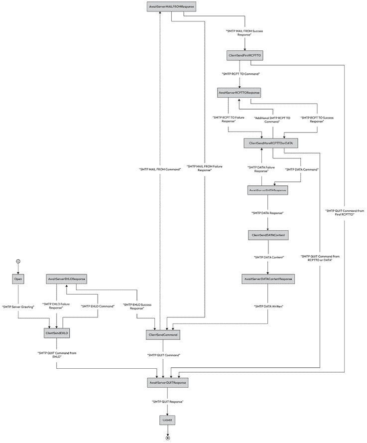


图 17.1：SMTP 状态机图（此图仅用于可视化目的。请检查图形包获取高分辨率版本。）

我将对该图进行简要描述。状态由方框表示，转换由箭头表示。这些将直接映射编程语言中的概念。

协议从 `Open` 状态开始，接着由服务器发送问候消息，由客户端进行响应。如果服务器识别了客户端，协议将进入客户端命令循环，允许通过使用 `MAIL FROM` 命令发送消息。如果服务器接受了发送者，协议将进入另一个循环，客户端将使用 `RCPT TO` 命令指示邮件的收件者。一旦指定了所有收件者，`DATA` 命令将启动邮件内容，内容由一系列 `CRLF` 结束，紧接着是一个点（.），然后是另一个 `CRLF` 序列，最后返回主命令循环。

我想要特别强调关于 SMTP 协议工作原理的一点：如果你遵循该图，你会注意到在某些情况下状态处于循环中。第一个循环开始于 `ClientSendCommand` 状态。该状态位于客户端识别之后，这意味着包含 `ClientSendCommand` 状态的循环中所有消息的上下文都发生在同一个客户端会话的上下。

同样，有一个循环开始于 `AwaitServerRCPTTOResponse` 状态之后，客户端可能会为同一条消息发送多个收件人地址，服务器将累积这些地址，直到客户端最终发送 `DATA` 命令，这最终会将状态带回 `ClientSendCommand`。

我强调这一点的原因是它展示了 SMTP 如何维护和重置状态信息：虽然在 `EHLO` 消息中引入的客户端域数据必须在所有后续消息中保留，但在 `MAIL FROM` 和 `DATA` 命令结束之间收集的信息在状态返回 `ClientSendCommand` 时需要被丢弃。

## 在 DSL 中表示 SMTP

现在，我可以处理用我们的 DSL 表达 SMTP 的代码了。让我们从连接首次建立时服务器发送的问候开始：

```
message "SMTP Server Greeting" {
    when: Open;
    then: ClientSendEHLO;
    agent: Server;
    data: {
        code_tens:
          int<encoding=AsciiInt, unsigned=True, bits=8>;
        msg:
         str<encoding=Ascii7Bit, sizing=Dynamic,
         max_length=1024>;
    }
    parts {
        tokens { "2" code_tens " " msg }
        terminator { "\r\n" }
    }
}
```

值得注意的是，我在协议中编码了百位数字，用于编码成功和失败消息。由于成功或失败会导致状态机产生不同的转换，通过这种显式设置可以让解释器本身处理这些转换。

之后，是客户端提交 `EHLO` 消息，该消息描述了客户端域：

```
message "SMTP EHLO Command" {
    when: ClientSendEHLO;
    then: AwaitServerEHLOResponse;
    agent: Client;
    data: {
        client_domain:
          str<encoding=Ascii7Bit, sizing=Dynamic,
          max_length=256>;
    }
    parts {
        tokens { "EHLO " client_domain }
        terminator { "\r\n" }
    }
}
```

此时，服务器可能会拒绝客户端，将其送回 `ClientSendEHLO` 状态：

```
message "SMTP EHLO Failure Response" {
    when: AwaitServerEHLOResponse;
    then: ClientSendEHLO;
    agent: Server;
    data: {
        code_tens:
          int<encoding=AsciiInt, unsigned=True, bits=8>;
        msg:
          str<encoding=Ascii7Bit, sizing=Dynamic,
          max_length=1024>;
    }
    parts {
        tokens { "5" code_tens }
        terminator { " " }
        tokens { msg }
        terminator { "\r\n" }
    }
}
```

同样，我在这里编码了百位数字，以便协议描述以一种影响状态机的方式指示其含义。这意味着使用这种语言的客户端就不需要手动处理这一点。

我不会涵盖所有的错误情况，因为它们看起来非常相似。现在让我看看成功路径：

```
message "SMTP EHLO Success Response" {
    when: AwaitServerEHLOResponse;
    then: ClientSendCommand;
    agent: Server;
    data: {
        client_domain:
          str<encoding=Ascii7Bit, sizing=Dynamic,
          max_length=256>;
        code_tens:
          int<encoding=AsciiInt, unsigned=True, bits=8>;
        msg:
          str<encoding=Ascii7Bit, sizing=Dynamic,
          max_length=1024>;
    }
    parts {
        tokens { "2" code_tens }
        terminator { " " }
        tokens { msg }
        terminator { "\r\n" }
    }
}
```

这里需要注意的是，我们有一个用于 `client_domain` 的数据成员，但它实际上并不在状态机中。这说明了 `client_domain` 必须在转换之间保持保留。此时，协议进入 `ClientSendCommand` 状态，那里有一个命令循环。主命令是 `MAIL FROM` 命令：

```
message "MAIL FROM Command" {
    when: ClientSendCommand;
    then: AwaitServerFROMResponse;
    agent: Client;
    data: {
        client_domain:
          str<encoding=Ascii7Bit, sizing=Dynamic,
          max_length=256>;
        sender:
          str<encoding=Ascii7Bit, sizing=Dynamic,
          max_length=320>;
    }
    parts {
        tokens { "MAIL FROM:<" sender ">" }
        terminator { "\r\n" }
    }
}
```

如前，`client_domain` 在此转换中保留，服务器将接受或拒绝。以下转换显示了成功情况：

```
message "MAIL FROM Success Response" {
    when: AwaitServerFROMResponse;
    then: ClientSendFirstRCPTO;
    agent: Server;
    data: {
        client_domain:
          str<encoding=Ascii7Bit, sizing=Dynamic,
          max_length=256>;
        sender:
          str<encoding=Ascii7Bit, sizing=Dynamic,
          max_length=320>;
        code_tens:
          int<encoding=AsciiInt, unsigned=True, bits=8>;
        msg:
          str<encoding=Ascii7Bit, sizing=Dynamic,
          max_length=1024>;
    }
    parts {
        tokens { "2" code_tens }
        terminator { " " }
        tokens { msg }
        terminator { "\r\n" }
    }
}
```

你现在可以看到这种模式了：此转换累积了 `client_domain` 和 `sender`。你也可以注意到目标状态是 `ClientSendFirstRCPTO`。之所以这样做是因为我们需要状态机对何时可以接受 `DATA` 命令是确定性的，这只有在第一个 `RCPT TO` 命令之后，因为必须至少有一个收件人：

```
message "RCPT TO Command" {
    when: ClientSendFirstRCPTO;
    then: AwaitServerRCPTTOResponse;
    agent: Client;
    data: {
        client_domain:
          str<encoding=Ascii7Bit, sizing=Dynamic,
          max_length=256>;
        sender:
          str<encoding=Ascii7Bit, sizing=Dynamic,
          max_length=320>;
        recipient:
          str<encoding=Ascii7Bit, sizing=Dynamic,
          max_length=320>;
    }
    parts {
        tokens { "RCPT TO:<" recipient ">" }
        terminator { "\r\n" }
    }
}
```

对第一个 `RCPT TO` 命令的响应将引导一个允许服务器累积收件人的状态。


```
message "SMTP RCPT TO Success Response" {
    when: AwaitServerRCPTTOResponse;
    then: ClientSendMoreRCPTTOorDATA;
    agent: Server;
    data: {
        client_domain:
          str<encoding=Ascii7Bit, sizing=Dynamic,
          max_length=256>;
        sender:
          str<encoding=Ascii7Bit, sizing=Dynamic,
          max_length=320>;
        recipient_list:
          array<element_type=
           str<encoding=Ascii7Bit,
           sizing=Dynamic, max_length=32768>>;
        code_tens:
         int<encoding=AsciiInt, unsigned=True, bits=8>;
        msg:
         str<encoding=Ascii7Bit, sizing=Dynamic,
         max_length=1024>;
    }
    parts {
        tokens { "2" code_tens }
        terminator { " " }
        tokens { msg }
        terminator { "\r\n" }
    }
}
```

现在我引入了一个新的数据成员——`recipient_list`——它从不是任何消息的直接部分。它允许服务器累积客户端发送的接收者。现在的目标状态允许客户端发送额外的接收者，或者进入 `DATA` 部分。

由于额外的 `RCPT TO` 消息看起来非常相似，我将跳过它，直接进入用户发送 `DATA` 命令的节点：

```
message "SMTP DATA Command" {
    when: ClientSendMoreRCPTTOorDATA;
    then: AwaitServerDATAResponse;
    agent: Client;
    data: {
        client_domain:
          str<encoding=Ascii7Bit, sizing=Dynamic,
          max_length=256>;
        sender:
          str<encoding=Ascii7Bit, sizing=Dynamic,
          max_length=320>;
        recipient_list:
          array<element_type=
            str<encoding=Ascii7Bit, sizing=Dynamic,
            max_length=32768>>;
    }
    parts {
        tokens { "DATA" }
        terminator { "\r\n" }
    }
}
```

这很清楚了，当客户端发布 `DATA` 命令时，整组数据已经属于状态机了。服务器会响应允许客户端发送数据，而客户端将发送邮件的全部内容：

```
message "SMTP DATA Content" {
    when: ClientSendDATAContent;
    then: AwaitServerDATAContentResponse;
    agent: Client;
    data: {
        client_domain:
          str<encoding=Ascii7Bit, sizing=Dynamic,
          max_length=256>;
        sender:
          str<encoding=Ascii7Bit, sizing=Dynamic,
          max_length=320>;
        recipient_list:
          array<element_type=
            str<encoding=Ascii7Bit, sizing=Dynamic,
            max_length=32768>>;
        content:
          str<encoding=Ascii7Bit, sizing=Dynamic,
          max_length=65536>;
    }
    parts {
        tokens { content }
        terminator { "\r\n.\r\n" }
    }
}
```

这终于让我们达到了这一点：服务器拥有了处理到达邮件的完整结构化数据，并且实际上可以实现对其的处理。如果服务器接受该消息，状态将返回 `ClientSendCommand`，只保留 `client_domain` 并丢弃在其他状态中累积的所有额外数据。

我没有涵盖协议中的每条消息，因为其中许多消息并没有就该语言如何使用提供太多背景信息。现在，我们可以开始实际实现代码的使用了。

## 实现一个 SMTP 服务器

在第 12 章 *运行与测试语言操作符*]以及第 16 章 *生成：将抽象语法树转换为指令*]中，我提到过我通过与特定的 I/O 库集成来实现测试的。当我达到这一点时，很明显对于该解释器的用户来说，能够自己复用这种集成将是受益的。为了支持这一点，我向项目中添加了一个新库，将解释器的各个部分与 `libuv` 库的机制集成在一起。

由于这种集成本身并不是解释器代码的一部分，而且主要关于 `libuv` 本身如何工作，我在这里不会涉及该实现的具体细节。我也将其留给你们作为一个练习，思考其他集成会是什么样子。你可以在拉取请求 #49 中看到与 `libuv` 的完整集成代码（[`github.com/PacktPublishing/Building-Programming-Language-Interpreters/pull/49`](https://github.com/PacktPublishing/Building-Programming-Language-Interpreters/pull/49)）。

现在，我可以专注于服务器本身的实现了。我将从外部开始，进入每一个细节，从 `main()` 函数开始。

第一步是加载被解释的程序：

```
auto maybe_program = smtpserver::load_interpreted_program();
if (!maybe_program) {
  std::cerr
    << "Failed to load the program.";
  return 1;
}
```

然后，初始化 `libuv` 循环：

```
uv_loop_t *loop = uv_default_loop();
protocoldsl_uv::AsyncQueue async_queue(loop);
```

现在，我们在线程中启动 `libuv`：

```
std::thread io_thread([&]() {
  uv_run(loop, UV_RUN_DEFAULT);
});
```

在这里，运行服务器：

```
smtpserver::main(args, *maybe_program, async_queue);
```

最后，一旦服务器退出，我们可以清理一切并离开进程：

```
async_queue.shutdown().wait();
io_thread.join();
return 0;
```

现在，让我们深入获取解释程序的 `load_interpreted_program` 函数：

```
std::string source_code = std::string(
#ifndef SMTP_PROTOCOL_LITERAL
#error "SMTP_PROTOCOL_LITERAL not defined"
#endif
#include SMTP_PROTOCOL_LITERAL
);
return networkprotoldsl::InterpretedProgram::
  generate_server_from_source(source_code);
```


到此，我们实际上可以将服务器绑定到配置的端口，并确保绑定已成功：

```cpp
auto bind_future =
  server_wrapper.start(config.bind_ip, config.bind_port);
bind_future.wait();
auto bind_result = bind_future.get();
if (std::holds_alternative<std::string>(bind_result)) {
    std::cerr
        << "Bind failed: "
        << std::get<std::string>(bind_result)
        << std::endl;
    return std::nullopt;
}
```

此时，我们知道服务器已经绑定并正在等待连接，因此我设置了一个条件变量，它由 `SIGINT` 信号触发，最终通知服务器停止：

```cpp
// 设置针对 SIGINT 的信号处理。
std::signal(SIGINT, signal_handler);
std::cerr
 << "Server is running; press Ctrl+C to stop." << std::endl;
{
  std::unique_lock<std::mutex> lock(signal_mtx);
  signal_cv.wait(lock, [] { return stop_signal_received; });
}
std::cerr << "Stopping server... " << std::flush;
server_wrapper.stop();
```

一旦接收到信号，`main_server` 函数将返回 `main()`，由 `main()` 展开 `libuv` 并退出进程。

## 实现回调

现在，我终于可以进入定义回调的部分。由于这是服务器的实现，我只需要为服务器作为代理的状态指定回调。让我先从 `get_server_callbacks` 函数开始吧：

```cpp
networkprotocoldsl::InterpreterRunner::callback_map
get_server_callbacks(const ServerConfiguration &config) {
  return InterpreterRunner::callback_map{
      {"Open",
       &config -> Value {
         return onOpen(config, args);
       }},
      {"AwaitServerEHLOResponse",
       &config -> Value {
         return onAwaitServerEHLOResponse(config, args);
       }},
      {"AwaitServerMAILFROMResponse",
       &config -> Value {
         return onAwaitServerMAILFROMResponse(config, args);
       }},
      {"AwaitServerRCPTTOResponse",
       &config -> Value {
         return onAwaitServerRCPTTOResponse(config, args);
       }},
      {"AwaitServerDATAResponse",
       &config -> Value {
         return onAwaitServerDATAResponse(config, args);
       }},
      {"AwaitServerDATAContentResponse",
       &config -> Value {
         return onAwaitServerDATAContentResponse(
                   config, args);
       }},
      {"AwaitServerQUITResponse",
       &config -> Value {
         return onAwaitServerQUITResponse(config, args);
       }},
      {"Closed",
       &config -> Value {
         return onClosed(config, args);
       }}};
}
```

在这里，我使用 lambda 捕获来闭包 `config` 参数，然后它将被传递给每个回调。这就是这些回调将能够访问的唯一状态，确保了每个状态可用的唯一数据就是流经状态机的数据。

我不会详细介绍每一个回调，但我将阐述几个具有代表性的回调来说明这一点。让我们从处理 `EHLO` 响应的回调开始：

```cpp
static Value
onAwaitServerEHLOResponse(const ServerConfiguration &config,
                          const std::vector<Value> &args) {
  // 从传入的消息中提取数据字典。
  value::Dictionary dict =
     std::get<value::Dictionary>(args[0]);
  auto client_domain_member =
     dict->members->at("client_domain");
  std::string client_domain =
     *std::get<value::Octets>(client_domain_member).data;
  if (config.blocked_client_domains.find(client_domain) !=
      config.blocked_client_domains.end()) {
    return value::DynamicList{
    {_o("SMTP EHLO Failure Response"),
     value::Dictionary{
       {{"client_domain", client_domain_member},
        {"code_tens", 55},
        {"msg", _o("Bad client, go away!")}}}}};
  }
  return value::DynamicList{
      {_o("SMTP EHLO Success Response"),
       value::Dictionary{
         {{"client_domain", client_domain_member},
          {"code_tens", 50},
          {"msg", _o("Hello, pleased to meet you")}}}}};
}
```

在这种情况下，服务器将检查客户端域名是否在黑域名列表中，如果是，则指示协议执行 `"SMTP EHLO Failure Response"` 转换；否则，继续执行 `"SMTP EHLO Success Response"` 转换。转换中应包含的数据将由回调通过其输出字典相应转发。`_o` 函数是一个简单的包装器，返回 `value::Octets`。

为了最终演示实现，我将带你通过将邮件写入 `maildir` 的回调。我将从提取传入字典的上下文开始逐一说明：

```cpp
value::Dictionary dict = std::get<value::Dictionary>(args[0]);
auto client_domain = dict->members->at("client_domain");
auto sender = dict->members->at("sender");
auto recipient_list = std::get<value::DynamicList>(dict->members->at("recipient_list"));
auto content = *std::get<value::Octets>(dict->members->at("content")).data;
```

重要的是，在这里使用 `std::get` 是安全的，因为数据在流过状态转换时具有正确的类型。对于你的开发构建，包含运行时断言可能仍然很有趣，但就本次练习而言，我想关注的是 SMTP 服务器的细节。此时，记录传入邮件的所有数据均可用。

我将不会涵盖写入 `maildir` 文件的细节，因为这对于解释器来说没有什么特别的，所以让我跳到结尾：

```cpp
return value::DynamicList{
    {_o("SMTP Written"),
     value::Dictionary{
        {"client_domain", client_domain},
         {"code_tens", 50},
         {"msg", _o("Message accepted for delivery")}}}};
```

由于此转换将回到可以发送另一个命令的状态，输出字典将包含 `client_domain`，确保没有来自之前状态的其他数据泄露。

你可以在拉请求 #50 中看到示例 SMTP 服务器的所有代码（[`github.com/PacktPublishing/Building-Language-Interpreters/pull/50`](https://github.com/PacktPublishing/Building-Language-Interpreters/pull/50)）。

最后，为了证明一切正常，我将启动服务器并通过 telnet 送消息：

```bash
$ telnet localhost 8080
Trying 127.0.0.1…
Connected to localhost.
Escape character is '^]'.
220 Welcome to the SMTP server
EHLO mydomain.com
250 Hello, pleased to meet you
MAIL FROM:<ruoso@test.com>
250 Sender OK
RCPT TO:<user1@example.com>
250 Recipient OK
RCPT TO:<user2@example.com>
250 Recipient OK
DATA
354 Start mail input; end with <CRLF>.<CRLF>
From: ruoso@test.com
To: user1@example.com
Subject: Test
This is a test email.
.
250 Message accepted for delivery
QUIT
221 Closing connection, goodbye
Connection closed by foreign host.
```

我这一节的目标是帮助你评估你自己的解释器。关键点是找到一个用例，它能够实际证明你的编程语言和解释器能够交付一个在原生语言中更难交付的价值。


如果你正在构建一种通用语言，有许多练习可以用来评估你的语言如何为特定类型的练习提供益处，以及你所选择的特定权衡如何为用户带来更好的体验。

在下一节中，我将对这项整体练习得出结论，并对结果进行反思。

## 值得吗？

在讨论这些努力是否值得之前，考虑涉及的成本至关重要。当然，并非所有成本都是可以衡量的，但我在设计阶段确实花费了大量时间。尽管如此，`source lines of code`（`SLOC`）计数并不是一个完全不合理的考虑指标。

使用 `sloccount` 工具，以下是项目不同部分使用的代码行数总结：

| 代码行 | 目录 |
| :--- | :--- |
| 6,329 | `src/networkprotocoldsl` |
| 653 | `src/networkprotocoldsl_uv` |
| 2,850 | `tests/` |
| 408 | `Examples/` |

表 17.1：跨项目的源代码行

当然，这远不是一个完整的解释器，在它可以被视为生产级之前，仍然会有大量工作要做。但我个人实际上预计在实现这个初始版本之前，需要多得代码。

我认为，能够像我在整个旅程中那样对问题的每个部分进行推理，使使我能够开发出构造相当良好的组件，这些组件最终组合在一起时没有出现太多的意外。

引导你走过这段旅程的主要目标之一，是为了揭示构建一个解释器到底有多复杂，我希望我能够传达出它比你之前想象的要容易得得多。

我的次要目标是展示 C++ 语言的最新特性如何让解决这类复杂问题变得显著有趣，我希望我能够激励你深入研究这些特性，因为这可能对你在其他领域也产生益处。

如果这只是某个产品的实际基础设施，那么判断这项投资是否有意义将简单得多。例如，如果你处于游戏开发领域，你可能会看到为艺术家提供更好的工具以将内容集成到游戏中的机会。

我确实有一个要向你坦白，这种描述网络协议的 DSL 想法在过去的 20 年里一直存在于我的脑海中，尽管它从未符合我目前所从事的任何项目，也许这让我产生了一种偏见，认为这绝对是值得的。我想我将看看更多人是否同意我的这种兴趣，所以我想我在 pull requests（拉请求）中见。

# 总结

在评估结果时，回到你开始项目时设定的原始目标始终是重要的。一些目标将坚持到最后，而另一些目标将成为未来版本的要求。

在初始目标和 MVP（最小可行性产品）范围之间找到平衡是困难的。这就是为什么对你认为真正的成功测试标准进行精确描述会有帮助。这形成了验收标准。从这个意义上说，开发新的编程语言和解释器与其他软件开发项目没有太大区别。

然而，不同的一点是，新的编程语言和新解释器只能通过在以前没有练习过的新场景中尝试使用它们来证明，并观察它们的端到端性能。这样，你将对它们有多用有一个非常具体的想法。

归根结底，构建一个新编程语言和一个新解释器的经济价值在很大程度上取决于背景，并需要像任何其他项目一样进行仔细的成本-效益分析。尽管如此，我希望这段旅程能向你证明，成本可能并没有你想象的那么高。

## 获取本书的 PDF 版本和独家额外福利

扫描二维码（或访问 [`packtpub.com/unlock`](http://packtpub.com/unlock)）。搜索书名，确认版本，然后按照页面上的步骤操作。 |  |

**注意**：保留好发票。直接从 Packt 购买的商品不需要发票。 |

# 18

# 解锁你的独家福利

你手中的这本书包含以下独家福利：

*  下一代 Packt Reader
*    无 DRM 的 PDF/ePub 下载

按照下面的指南解锁它们。该过程只需几分钟，只需完成一次。

# 3 个简单步骤解锁本书的免费福利

## 第 1 

准备好购买发票以备 `Step 3` 使用。如果你有纸质版，使用手机扫描并保存为 PDF、JPG 或 PNG。

关于如何找到发票的更多帮助，请访问 [`https://www.packtpub.com/unlock-benefits/help`](https://www.packtpub.com/unlock-benefits/help)。

**注意**：如果你直接从 Packt 购买此书，不需要发票。完成 `Step 2` 之后，你可以立即访问你的独家内容。 |

## 第 2

扫描二维码或访问 [`packtpub.com/unlock`](http://packtpub.com/unlock)。 |  |

在打开的页面上（类似于桌面上的 `Figure 18`），通过书名搜索本书并选择正确的版本。


## 第 3

选择你的书籍后，登录你的 Packt 账户或创建一个。然后上传发票（PDF、JPG，最大 10 MB）。按照屏幕上的指令完成。

| 需要帮助？ | 如果你遇到困难并需要帮助，请访问 `https://www.packtpub.com/unlock-benefits/help` 查看有关查找发票的详细常见问题。此二维码将带你进入帮助页面。 |  |

**注意**：如果你仍然遇到问题，请联系 `customcare@packt.com`。


[packtpub.com](http://packtpub.com)

订阅我们的在线图书馆，即可访问 7000 多本书和视频，以及帮助你规划个人发展和职业发展的行业领先工具。更多信息，请访问我们的网站。

# 为什么要订阅？

* 通过来自 4000 多名行业专业人士的 eBook 和视频，减少学习时间并增加编码时间
* 通过专为你定制的技能计划提高学习
* 每月获得免费电子书或视频
* 全文搜索以便获取关键信息
* 复制、粘贴和书签内容

# 你可能感兴趣的其他书籍

如果你喜欢这本书，可能对 Packt 的其他书籍感兴趣：


**LLVM 代码生成**

Quentin Colombet

ISBN: 9781835462577

* 理解核心编译器概念，如 SSA、支配和 ABI
* 构建并扩展 LLVM 后端以创建自定义编译器特性
* 通过操作 LLVM 的中间表示来优化代码
* 为 LLVM 开源项目和开发做出贡献
* 开发 LLVM 优化和 Pass 的调试技能
* 掌握在编译器上下文中编码和（反）汇编的工作原理
* 利用 LLVM 的 TableGen DSL 创建自定义编译器模型


## C++ 程序员的思维

Sam Morley

ISBN: 9781835888438

*   将计算思维应用于复杂的 C++ 问题
*   使用抽象将问题拆分为各个组件
*   在 `C++` 中有效使用算法和数据结构
*   设计模块化且可重用的 `C++` 代码
*   分析并改进算法性能
*   解析、转换和解释多种格式的数据
*   通过并发、GPU 和分析工具进行扩展

## Packt 正在寻找像你这样的作者

如果你有兴趣成为 Packt 的作者，请访问 [authors.packt.com](http://authors.packt.com) 并在今天提交申请。我们已经与成千上万像你这样的开发者和技术专业人员合作过，帮助他们向全球技术社区分享见解。您可以提交通用申请、申请我们正在招募作者的特定热门话题，或提交您自己的想法。

## 分享您的想法

现在你已经完成了《构建编程语言解释器》（Building Programming Language Interpreters），我们想听听你的想法！如果你是从亚马逊购买的书，请[点击此处直接进入该书的亚马逊评论页面](https://packt.link/r/1837638071) 并分享你的反馈，或在您购买的网站留下评论。

您的评论对我们以及技术社区至关重要，并将帮助我们确保交付卓越的内容。

## 订阅 Deep Engineering

加入数千名开发者和架构师的行列，他们想要了解软件是如何变化的，加深专业知识并构建持久的系统。

Deep Engineering 是一份面向经验丰富的从业者的每周专家主导，包含原创分析、技术采访以及关于架构、系统设计和现代编程实践的精选见解。

扫描二维码或访问链接免费订阅。


[`packt.link/deep-engineering-newsletter`](https://packt.link/deep-engineering-newsletter)

## 索引

### A

*   复杂性的抽象与执行开销 22-24
*   抽象机器 20
*   抽象语法树 (`AST`) 254 对比 解析树 254
*   验收标准检查 312
*   控制，在特定点转移 313
*   解释器，初始化一次 312
*   解释器，与网络进行驱动交互 312
*   Actor 模型 73
*   高级 RISC 机器 (ARM) 20
*   ANTLR 236
*   `AST` 节点，匹配，到解释器操作 276

### B

*   Bison 236
*   块词法作用域 105, 106
*   Boost.Asio 11
*   Boost.Spirit 237

### C

*   `C++` 4
*   语法引擎，构建 238-247
*   可调用值，调用 157-161
*   闭包词法作用域 106, 107
*   代码，在编程语言中执行 305-307
*   代码值值 154-156
*   通用网关接口 (CGI) 100
*   编译器 6
*   概念 132
*   嵌入式语言中的并发 9 68, 69
*   并发模型 39-41
*   Actor 模型 41
*   编舞式编程 41
*   结构化并发 41
*   容器 95 对 值 95, 96
*   容器类型 19
*   上下文切换 65
*   延续 38, 65 跨原生和解释器代码 37, 38
*   控制流 36
*   副本 98
*   写时拷贝模型 69
*   奇异性递归模板 (CRTP) 243

### D

*   数据驱动设计 70
*   声明式语言 111, 112
*   指定的 112, 113
*   Hello World! 114
*   声明式编程 84
*   领域特定语言 (DSL) 6, 55, 112
*   动态类型 53, 54
*   静态类型 47

### E

*   嵌入式语言并发 [152]
*   端到端示例 173-175
*   执行流 178-183
*   执行模型 42, 43
*   识别的延续 65, 66
*   设计 63, 64
*   与输入输出交互 64, 65
*   执行解释器操作 66, 67
*   原生回调 67, 68
*   执行开销与复杂性的抽象 22-24
*   扩展巴克斯-诺尔范式 (EBNF) 235

### F

*   纤程 69
*   最终语言设计验证 121-126
*   Fortran 4
*   函数调用 170-173
*   创建 161-170
*   函数式编程 81-83


# 函数词法域 104, 105

## G
### 垃圾回收 99
### 通用架构 16
### 格拉斯哥 Haskell 编译器 (GHC) 66
### 全局解释器锁 68
### 全局解释器状态 130
### 解释执行程序 130
### 解释器 130
### 可变解释器状态 131-135
### 运算符树 131-134
### 树操作，执行 135-140
### 全局词法域 107, 108
### 目标，重新回顾
### 捕获的值，在协议内使用 311
### 控制，在多点传输 310
### DSL，用于指定网络协议 310
### 同步请求-响应协议 310
### 值，传输到原生语言 311

## 语法引擎
### 使用 C++ 构建 238-247
### 绿色线程 69

## H
### 硬件架构 16
### 带有片上和片外缓存 17, 18
### 带有片上缓存 17
### Haskell 94

## I
### 不可变性 116, 117
### 过程式编程 80, 81
### 指令
### 作为构建块 30, 31
### 指令集架构 (ISAs) 16
### 集成
### 最终完善 200-214
### 解释器 6
### 作为虚拟机 21
### 整合 303-305
### 使适用于嵌入式环境 140-143
### 解释器栈
### 对比语言栈 33-35
### I/O 接口
### 设计 148-151
### I/O 模型 11
### 异步的 11
### 阻塞的 11
### 非阻塞的 11
### 同步的 11
### I/O 运算符 184-189

## J
### Java 虚拟机 (JVM) 19, 69
### 即时编译 (JIT) 性能，修改 25, 26

## L
### 语言元模型 99-101
### 语言栈
### 对比解释器栈 33-35
### 语言类型
### 对比用户类型 50, 51
### 词法分析 223
### 实现 225
### 库，评估 224
### 规则，指定 223
### 词法库
### 引用链接 224
### 词法填充 103, 104
### 词法域
### 块词法域 105, 106
### 闭包词法域 106, 107
### 函数词法域 104, 105
### 全局词法域 107, 108
### 列表运算符 190-196
### 逻辑编程 86-88

## M
### 内存管理 70
### 访问模式 70
### 数据所有权 73
### 设计，最终完善 74
### 生命周期管理 74
### 可变性，管理 71-73
### 元对象协议 (MOP) 53
### 方法解析顺序 53
### 最小可行性产品 (MVP) 8, 310
### 现代 ISA 16-20
### 可变性 97, 98

## N
### .NET 通用语言运行时 (CLR) 22
## 原生扩展
### 交互 58, 59
## 原生编程语言
### 虚拟机模型 20, 21
### 嵌套数据结构 97
### Node.js 11
### Node.js 解释器 38
## 节点类型
### 数据结构 254-260
### 建模 254-260
### 命名类型 51
### 对比结构化类型 51-53
### 无操作 (NOP) 指令 16

## O
### 操作概念 141
### 操作
### 针对多类型的重构 144-148
### 运算符
### 识别 183
### I/O 运算符 184-189
### 列表运算符 190-196
### 测试 196-200
### 运算符栈
### 对比寄存器 31, 32

## P
### 范式选择
用于语言 89
### 节点节点
### 数据结构 232-234
### 类型 232-234
### 词法分析器
### 语法，指定 234-236


## 库
评估 236, 237

## 解析树
组装 247-251
转换 261-273
对比抽象语法树 254
解析表达式文法 237
PEGTL 237
`POSIX functions` 11

## 程序
生成 296-303
编程语言 4, 5
代码，执行 305-307
解释器集成 9-13
模型，决定使用 26, 27
Python 解释器 68

## R
Raku 语言 101
re2c 库

## URL
224
实时计算 65
精简指令集计算机 (RISC) 20

## 参考文献
98, 120
RE/flex 库
引用链接 224

## 寄存器机
32
寄存器
对比操作栈 31, 32

## S
无 I/O 方法 11
脚手架 129
共享值 98
简单邮件传输协议 (SMTP) 310, 314
回调，实现 326-329
示例 313
在 DSL 中表达 315-322
实现 322-325
状态机图 315
sloccount 工具 330
源代码行数 (SLOC) 计数 330
栈式机 32
标准库 95
`StateMachineOperation` 281-288
为代码代码 289-295
静态类型 46, 47
强类型系统 49
结构化类型 52
对比标记化类型 51-53
替换失败不是错误 (SFINAE) 133

## T
线程 69
分词器
实现 225-228
测试 228, 229
标记类型
数据结构 220-222
识别 220-222
蹦床函数 67, 208
`TransitionLookAhead` 操作 276-280
类型系统建模
方法 55
自定义类型，声明 58
语言原生类型 55-57
类型系统 45, 46
静态类型对比动态类型 46-48
强类型对比弱类型 49

## U
Unicode 码码点 37
用户定义类型
对比语言类型 50, 51

## V
值 94
不确定值 94
对比容器 95, 96
值类型 118, 119
变量 93, 94, 120
虚表 30

## W
弱类型系统 49

