# C++ 程序员思维指南


*献给 Saba*

# 关于作者

Sam Morley 是牛津大学的一名研究软件工程师和数学家，他在那里负责 `DataSig` 项目。他是流式数据数据科学中计算粗糙路径 `RoughPy` 库的首席开发者，以及 `C++` 和 `CUDA` 中其他几个高性能加速库的开发者。Sam 曾是数学讲师，是 *Applying Math with Python* 的作者。他非常喜欢逻辑谜题，经常看到他在苦思难题般的数独游戏。

我想感谢我在牛津大学的朋友和同事、整个 `DataSig` 团队，以及来自图灵灵学院的朋友们。我还想感谢我的家人，特别是我的父母，他们一直对我给予巨大的支持。

# 关于评审员

Alexei Kondratiev 是一位任务关键型软件和嵌入式系统工程师，在医疗、汽车、高级驾驶辅助系统（ADAS）和航天领域的低延迟、高吞吐并发及异步 `C++` 软件开发方面拥有 20 多年的经验。他在网络编程与协议、分布式系统、系统和嵌入式编程、故障排除、开源项目集成、性能分析和优化方面拥有深厚的背景。

他是 `LTA Research` 的 `C++` 软件开发者，这构建实验性和认证载人飞艇的航空研发公司。

在 `LTA`，他是 `Soft Real-Time Embedded Linux Airship Helium Cells Volume Monitoring System`、`Soft Real-Time Hardware Simulation System` 以及 `Soft Real-Time Dynon Avionics SkyView HDX Emulator of the Glass Cockpit Electronic Flight Instrument System R&D C++` 项目的所有者。

Julian Faber 拥有 30 多年的 `C++` 软件设计和开发经验，曾任职于全球最大的投资银行之一。他对软件工程中的创造力充满热情，近期的重点是交易系统的延迟敏感性和增强易用性。他工作的一个特点是设计完全可测试的系统，他是软件完整测试的坚定倡导者。

# 在 Discord 上加入我们吧！

如需加入本书的 Discord 社区——你可以在那里分享反馈、向作者提问并了解新发布——请扫描下方二维码：

[`packt.link/deep-engineering-cpp`](https://packt.link/deep-engineering-cpp)


# 前言

解决问题是编写代码的大部分。有时这些是我们几乎没有察觉的小问题，而有时它们是起初看起来不可逾越的宏大挑战。无论你从事哪个领域，无论什么问题，解决问题都是一个迭代的过程，会有错误的尝试和死胡同，直到你最终找到“正确”的路径——这是正常的。在解决了一些大问题后，你会开始识别这个过程中的一些共同特征：将问题分解成更小的部分、制定或寻找良好的抽象、识别出现在其他类型问题中的模式，以及制定一个需要遵循的步骤列表以构建问题的解决方案。在计算机科学中，这种解决问题的框架被称为**计算思维**。

当然，制定抽象解决方案和算法只是解决问题的一部分。另一部分是将解决方案实际实现为软件并交付，无论其形式是什么。这意味着你必须首先选择正确的工具来构建这些软件，包括选择要使用的编程语言。有时这种选择是为你指定的，但其他时候，选择取决于许多因素。当性能至关重要时，`C++` 是一个明显的选择。

现代 `C++` 非常强大，拥有庞大的高性能库生态系统。过去十年许多重大更新将 `C++` 带入了现代编程语言时代。最重要的是，`C++` 提供的是控制力。其他语言在某些地方可以实现性能，但在其他领域往往会表现不足。很少语言可以在不牺牲控制力、灵活性或易用性的情况下提供与 `C++` 相同的性能。

精通使用 `C++` 解决问题当然需要你对 `C++` 和标准技术良好的良好。实现性能与灵活性之间的正确平衡通常需要理解代码运行的广泛背景：操作系统、硬件、处理器特性以及特定的加速硬件。

在选择数据结构和设计算法时考虑到所有这些因素可以给你带来优势。但不仅于此。理解这些概念还将帮助你更容易地选择良好的抽象并识别有用的模式。`C++` 与解决问题之间的联系是双向的，而这本书的主题。

# 本书适合读者

本书适用于已经熟悉 `C++` 编程基础，并希望能够更好地解决复杂问题的人员。我们不假设读者具备理论计算机科学背景；在涉及此类内容时，我们会保持细节的简洁，并提供更详细解释的教科书参考。

这不是一份解决问题的分步指南。相反，这是一场关于 `C++` 语言、特性、功能与计算思维框架之间相互作用的讨论。我们解释了在 `C++` 环境工作时应该记住的背景，以及它如何与解决问题的过程相关。

# 本书涵盖

*第 1 章*，*计算思维*，介绍了用于解决问题的计算思维框架。我们讨论了计算思维的不同组件以及这些组件可能如何体现在解决问题的过程中。我们还讨论了贯穿本书的一些现代 `C++` 特性和和良好的编码实践。


# 第 2 章, *详细抽象*，更深入地探讨了抽象。具体而言，我们查看了 C++ 中的抽象机制，以及这些机制如何帮助我们在我们正在解决的问题的数据或方法论中发现有用的抽象。

# 第 3 章, *算法思维与复杂度*，讨论了算法的设计与分析。我们讨论了计算复杂度和不同类型的算法，以及在设计自己的算法时可以使用不同类型算法的一些设计特征。

# 第 4 章, *理解机器*，讨论了现代计算机硬件和操作系统，以及理解这些内容如何帮助我们编写运行更快的代码（即使我们无法降低复杂度）。

# 第 5 章, *数据结构*，讨论了不同的数据结构及其特性。我们讨论了不同的内存使用模式以及这些模式如何影响实践中的性能。

# 第 6 章, *代码复用与模块化*，考虑了使用 C++ 机制使代码可复用和模块化的不同机制：函数、类、命名空间等。我们还讨论了将整个编译组件封装为库。

# 第 7 章, *概述挑战*，描述了一个我们将在下来的五章中解决的巨大挑战。这包括使用计算思维的原理来寻找应对整个挑战的策略。

# 第 8 章, *构建简单的命令行界面*，是我们的挑战的第一章。在这里，我们设计了一个允许用户交互的简单接口。

# 第 9 章, *从不同格式读取数据*，是我们的挑战的第二章。我们讨论了从常见格式摄取数据的问题。

# 第 10 章, *在文中查找信息*，是我们的挑战的第三章。它涵盖了正则表达式的使用。

# 第 11 章, *数据聚类*，是我们的挑战的第四章。我们实现了 `k-means` 算法。

# 第 12 章, *反思我们构建的内容*，是我们的挑战的最后一章。我们回顾了所构建的内容。

# 第 13 章, *规模问题*，研究我们可能如何扩展计算。

# 第 14 章, *处理特殊硬件*，查看了 `OpenMP`、`CUDA` 和 `SYCL`。

# 第 15 章, *代码分析*，我们在这里检查代码消耗时间的地方。

在书中，我们假设你拥有 C++ 的基础知识。大部分代码使用 C++20 或 C++23 编写。我们在 Windows、macOS 或 Linux 上运行。

如果你在书中发现错误，如果向我们报告，我们将不胜感激。请访问 [`www.packt.com/submit-errata`](http://www.packt.com/submit-errata)，点击 **Submit Errata**（提交错误表），并填写表单。

## 使用的约定

书中使用了多种文本约定。

`CodeInText`：表示文本中的代码词、数据库表名、文件夹名、文件名、文件扩展名、路径名、虚拟 URL、用户输入以及 Twitter/X 账号。例如：“此函数只需调用 `std::signal`，如下。”

代码块设置如下：

```cpp
void setup_signals() {
    std::signal(SIGINT, &sigint_handler);
}
```

任何命令行输入或输出如下所示：

```
cmake -B build -S . -GNinja -DCMAKE_BUILD_TYPE=Release
cmake --build build --config=Release
```

**粗**：表示新术、重要单词或你在屏幕上看到的单词。例如，菜单或对话框中的单词在文中显示如下。例如：“有时，基于**大语言模型**（**LLM**）的编程助手可以非常有帮助。”

警告或重要注释显示如下。

提示和技巧显示如下。

## 与我们联系

我们欢迎读者的反馈。

**一般反馈**：如果你对本书的任何方面有疑问或有任何一般反馈，请发送电子邮件至 `customercare@packt.com` 并在邮件主题中中注明书名。

**错误表**：尽管我们已尽努力确保内容的准确性，但错误确实会发生。如果你在书中发现错误，如果向我们报告，我们将不胜感激。

**盗版**：如果你在互联网上遇到任何形式的我们作品的非法副本，如果你为我们提供地址或网站名称，我们将不胜感激。请通过 `copyright@packt.com` 与我们联系并附上材料链接。


如果你对成为作者感兴趣：如果你在某个领域专长，并且对编写或为书籍贡献感兴趣，请访问 [`authors.packt.com/`](http://authors.packt.com/)。

# 分享您的想法

在读完*The C++ Programmer’s Mindset* 后，我们非常想听听您的想法！请[点击此处直接进入本书的亚马逊评论页面](https://packt.link/r/1835888437) 并分享您的反馈。

您的评论对我们以及技术社区都非常重要，并将帮助我们确保提供高质量的内容。

# 书籍附带免费福利

本书附带了免费福利以支持您的学习。现在激活它们即可立即访问（请参阅“如何解锁”章节查看说明）。

以下是您购买后可以立即解锁的内容概览：

| PDF 和 ePub 副本 | 下一代 Web 阅读器 |
| :--- | :--- |
|  |  |
|  | 获取此书的无 DRM 限制 PDF 副本，随时随地在任何设备上阅读。 |  | **多设备进度同步**：在任何设备上从上次离开继续。 |
|  | 使用喜欢的电子阅读器配合无 DRM 限制的 ePub 版本。 |  | **高亮与笔记**：捕捉想法并将阅读持久持久知识。 |
| | |  | **书签**：需要时保存并重新访问关键章节。 |
| | |  | **深色模式**：切换到深色或褐色主题减轻眼睛疲劳。 |

## 如何解锁

扫描二维码（或访问 [packtpub.com/unlock](https://packtpub.com/unlock)）。按名称搜索本书，确认版本，然后按照页面上的步骤操作。 |  |

**注意**：请妥善保管发票。直接从 Packt 购买的不需要发票。

# 1. 计算思维

解决问题是程序员的核心部分，也是日常生活中用的技能。无论你在哪里看，这种方法论大都是相同的：识别更小、更易处理的挑战；将这些挑战识别为一类问题的实例；解决中间挑战；并将所有内容整合为一系列简单的步骤，以解决更大的问题。在计算机科学中，我们将其称为计算思维。

本章从高层次介绍了计算思维的基本组件。其目标是为书中后续更详细的分析和深度示例奠定基础。章节的第一部分介绍了计算思维的四个组成部分（分解、抽象、模式识别和算法设计）。章节的后半部分涉及 `C++`，并确定了 `C++` 语言和标准库的某些方面，这些方面不仅可以帮助实现高效解决方案，还能帮助您思考问题本身。

重要的是，计算思维的四个组成部分并不是解决问题的逐步指南。学习这些不同组件如何以及何时结合在一起以提供解决方案，取决于你作为解决者对可用工具和方法论的良好掌握，以及你过去的经验。本章将帮助你开始构建必要的理论基础，并为构建一些基础示例奠定基础，让你稍后开始处理更大、更复杂的问题。

解决问题是一个迭代过程。会有许多失败的尝试和错误。这是该过程中必经的一部分。章节的最后部分介绍了良好的软件实践，这些实践将使你能够对设计进行快速轻松的迭代，并更快获得正确且用的解决方案。

在本章中，我们将涵盖以下主要主题：

*   计算思维的组件
*   分解问题
*   构建抽象和识别常见模式
*   理解算法
*   使用现代 `C++` 和良好实践

# 书籍附带免费福利

您的购买包含此书的免费 PDF 副本以及其他专属福利。查看前言中的*Free Benefits with Your Book*章节以立即解锁它们并最大化您的学习体验。

# 技术要求

在本章中，我们讨论了计算思维的理论和方法论。因此，本章不包含很多代码。然而，后的一些章节确实有一些 `C++` 代码示例，并且和本书的其他部分一样，我们预期读者对 `C++` 有一定的了解。由于后章节描述了处理代码的良好实践，本书的 GitHub 仓库中的 `Chapter-01` 文件夹 ([`github.com/PacktPublishing/The-CPP-Programmers-Mindset`](https://github.com/PacktPublishing/The-CPP-Programmers-Mindset)) 包含了这些代码示例以及单元测试。这些测试不属于本章的内容。

# 计算思维的组件

解决问题是一个迭代过程。在每一步都有许多需要考虑因素。随着某些挑战被克服，其他挑战将会出现。计算思维为决定下一步采取哪一步提供了框架。与所有迭代过程一样，会有某些步骤行不通，因为你得出的解决方案不如人意或根本不起作用，但这都是过程的一部分。

在继续之前，我们需要讨论我们所指的“问题”。*对于本书来说，问题是一个具有定义约束和参数的具体任务。*任务的实际性质可以很简单，也可以非常复杂，只要它是具体的。约束的性质也可以很广泛：它们可以是管理上的（时间限制、截止日期）、技术上的（性能）或领域特定的（物理限制）。参数描述了为了解决任务而提供的数据和其他信息。

计算思维的四个组成部分如下：

*   分解
*   抽象
*   模式识别
*   算法设计

解决问题过程中的每一步都会涉及一个或多个此类组件，但它们本身并不是必须遵循的步骤。例如，某些步骤将属于一类已知问题，这些问题有“现成”解决方案，可以轻松实现。其他步骤将是复杂的，需要分解成许多小问题。此外，这些组件不能孤立考虑。如果不理解问题的本质要素，或者不能从可能相关的上下文信息背景噪音中识别标准模式，就无法分解问题。你必须同时考虑所有组件。

在解决微小而微妙的问题时，有时很容易忽略大局——特别是你的解决方案如何与更大的系统交互。这可能是你的解决方案所在的更大的软件，或者是客户与你的软件交互的方式。这些问题也是你需要解决的问题的一部分，并可以使用计算思维组件来指导你。


随着经验的积累，你所识别的模式和标准问题的数量将会增加，得出有用抽象的速度也会提高。在开始阶段，这些方面将是最令人困扰的。在本书的其余部分，我们将介绍常用的技巧和一些标准问题，它们将帮助你开始解决问题。遗憾的是，我们无法简单地给你一个完整的模式和抽象目录：如果所有问题都已经被解决，那么就不需要解决问题的框架了。

解决问题不仅是一个迭代过程，还是一个动态过程。某些选择会对过程的其余部分甚至可能对之前的步骤产生影响。例如，选择一种编程语言（如 `C++`）将对你设计算法、选择抽象、可用的标准模式以及进一步分解问题的方式产生巨大影响。例如，如果用 `Python` 解决问题，人们可能会尝试依赖许多高性能库，而这些库可能提供或不提供所需的精确功能。然而，在 `C++` 中，你有更大的自由来来实现自己的高性能原语操作。

有时会有你必须撤销过程中的几个步骤的时候，特别是当你仍在积累经验时。这里的重要的是理解这是学习过程中必不可少的的步骤。你必须努力理解为什么那个特定的调查方向失败了，以及如何将这些知识整合到下一次迭代中。不要害怕回到起点（时间允许的情况下）并重新开始。有时这是进步的唯一途径。

在本章的其余部分中，我们将更详细地讨论计算思维的四个组成部分。目前，我们只泛泛讨论这些部分。在后面的章节中，当我们查看真实示例以及如何使用 `C++` 应用这些概念时，将会详细回顾这些部分。

## 通用建议

解决问题可能是困难的，当你对某个领域、语言、工具或工作环境非常陌生时。以下是一些如何让这变得更容易、更有趣的通用建议。

*   记录一份模式、抽象和其他信息的日志，以便在新问题出现时可以查阅。随着经验的增加，你会内化其中许多内容，但总会有一些你忘记的内容，在将来你可能需要用到。
*   寻找小问题来磨练你的。诸如 `LeetCode` (`https://leetcode.com/`) 等网站拥有海量的小问题库，旨在教授特定的模式和技巧。这非常有帮助，特别是在刚开始还没有自己的目录可以参考时。你看到的问题种类越丰富，在解决全新的问题并寻找模式和抽象时，你可以运用的资源就越多；问题不需要完全相同，只要足够相似以提供灵感即可。
*   在适当的情况下，与同事和朋友讨论问题。有时解释问题的行为本身可以帮助让你思路更清晰，有时会直接帮助你解决问题。如果你能找到愿意帮助的资深或经验丰富的同事，他们可以与你分享自己的专业知识，这有时可以帮助你更快地找到解决方案。如果没有同事或朋友，即使是和你的橡鸭谈谈这个问题也有帮助——而且它们总是愿意倾听。

## 一个过于数学化的例子

在详细讨论计算思维的组成部分之前，我们应该先看一个许多这些想法得以体现的例子。我们将使用的例子是解决初微积分中的一个特定的微分方程。不要被本部分出现的方程吓跑。这里使用的实际数学并不是重点；我们解决问题的方式才重要。尽管如此，由于这个之所以之所以是一个很好的选择，恰恰是因为这种额外的复杂性；你将有时要在舒适区之外操作。

微分方程涉及函数的一个或多个导数的方程，该函数根据另一个变量演变 。微分方程被用于许多领域，描述系统如何根据各种因素演变。例如，`牛顿`的力学理论是用微分方程描述的（他发明微积分是为了通过这些方程描述世界）。我们在这里考虑的方程要简单得多；它涉及  的一阶和二阶导数，记为 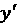 和 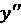，其系数是简单的常数。方程是

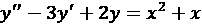

带有一些初始条件 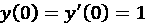。这里的目标是找到函数  关于  的表达式，当它被“代入”这个方程的左侧时，得到右侧的结果。要解决这个问题，必须将其分解成更小的部分；它不能作为一个整体被直接解决（至少不容易这样做）。

第一层分解涉及解决两个独立的问题：首先，我们找到右侧为零的较简单方程的解；其次是找到一个“位移”第一个子问题解的表达式，以获得正确的右侧。这类似于为一组数据拟合直线；首先，你找到斜率，然后上下移动直线直到它拟合。

让我们关注第一个子问题，找到“通解”。这看起来很棘手，直到人们意识到这类方程的解看起来像 。这些导项的导数是  和 ，因此将它们代入方程得到 。最右侧的表达式有两种方式为零。第一种是函数  恒为零（这不可能是，因为 ），或者二次方程  成立。

所谓的辅助方程  可以分解为 ，这意味着两个根（即二次项等于  的  值）是  或 。因此，我们简单微分方程的通解由  和  的线性组合给出，类似于


为了找到两个常数  和  的值，我们需要使用两个初始条件。条件  应用非常直接，因为我们只需要在方程中替换  和  得到


对于第二个方程，我们需要进行求导，但这并不太难：

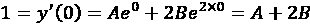

这是数学中一种常见的模式，被称为`同时方程组`（再次，这在高中数学中经常会被）。我们可以通过从后一个方程减去前面的方程来求解它，得到 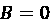，留下 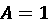。（如果你没见过这个，不用太担心；这并不重要。）这意味着我们的通解现在是 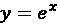。

现在我们有了一个在形状上表现正确的解，但它并没有求解我们的原始方程。为了这一点，我们需要找到一个“偏移量”，将我们的通解转换为真实解。为了做到，我们观察原始方程的右侧 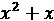。一个合理的假设是，我们需要平移通解的因子与该表达式的形式相似，也许类似于 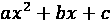，其中 、 和  是我们需要找到的常数。

我们需要将建议的平移代入微分方程，因此我们需要对其进行求导。一阶导数为 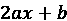，二阶导数就是 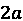。。（再次，如果你没跟上这个过程，不要担心；这并不重要。）因此，我们需要求解新方程

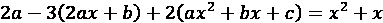

这是数学中另一种常见的模式，被称为左右两侧的“系数比较法”（两个二次表达式相等，当且仅当每对对应的系数都相等时）。让我们重新排列左侧以使其更清晰：

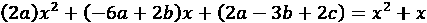

由此我们看到，我们需要每个方程 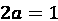、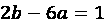 和 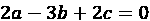成立（右侧没有常数项）。再次，我们发现自己回到了求解同时方程组。为了避免重复该过程，解为 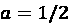、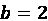 和 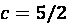。现在将所有内容整合在一起，得到了解

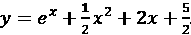

现在是重要的部分，反思我们所做的事情。在解决这个单一数学问题时，我们实际上将其分解成了若干较小的问题，这些问题需要的数学知识要少得多。我们将初始问题分为两个：较简单的问题（通解）以及平移问题（特解）。

*   在**通解分支**中，我们识别了方程的形式（模式识别**）。寻找辅助方程的根是另一个子问题——一个与主问题完全孤立的问题——然后求解方程组以获得通解是另一个子问题。这给了我们通解的形式，然后我们必须使用两个初始条件将其转换为实际的通解，这又是一个子问题。我们对通解的形式求导并应用初始条件得到一个方程组。我们可以应用求解此类方程组的标准技术（**模式识别**）来获得真正的通解。

*   在问题的**特解分支**中，我们意识到平移的形式与原始方程的右侧相似，这促使我们找到通义二次表达式的导数（两个子问题，后者取决于前者）。在将这些导数代入方程后，我们观察到可以通过比较系数（**模式识别**）得到另一个需要求解的方程组。

在解决了两个分支后，我们必须将所有内容整合以获得完整解。这实际上是关键一步，而且通常并非易事，特别是当分解为较小问题变得更加复杂且存在相互依赖关系时。

你可能会好奇抽象以及在较小程度上算法是如何引入这个问题的。数学问题在本质上是抽象的；它们已经是一个更大、特定问题的实例，其中关键组件已被提取。然而，这并不意味着在这个问题内部没有抽象的空间。例如，寻找二次表达式的根和求解线性方程组都是如此。

算法设计的问题讨论起来更为棘手。显然，`高斯消元法`（我们求解方程组的过程）是数值代数中一个众知的算法。既然我们已经看到了解决多方面问题的示例（尽管背景不同），我们可以更详细地检查计算思维的组成部分。

# 分解问题

一个主要的障碍之一，特别是在开始阶段，是将问题分解为可处理的部分。人们倾向于尝试整体处理问题，而不是尝试将其分解为较小的部分。这种情况有两个常见原因。第一个是求解者缺乏分解的技能，这在初学者中很常见。第二个在稍有经验的求解者中更常见，是因为担心丢失大局。显然，人们必须关注全局；客户不会接受一个只解决了他们问题某方面而没有解决整体软件。必须在寻找可行路径与不丢失全局之间找到平衡。


有些问题具有显而易见的分解方式，但情况并非总是如此。当这种情况发生时，这些易定义的子问题几乎总是进展的最佳方式。随着你信心和经验的增加，越来越多的问题将看起来像这样，即使是复杂问题，其部分之间也会有明显的划分。

## 分解一个简单的思想实验

假设你正在计划一顿晚餐。这个问题包含已经定义明确的部分：前菜、主菜、甜点和饮料。每一部分都是一个需要解决的具体问题，尽管它们之间存在一些微弱的联系。（例如，主菜的选择会影响葡萄酒的选择，这是一种技术上的依赖。晚餐在前菜之后上菜，这是一种时间上的依赖。这两者都是微弱的，因为从技术上讲，你可以为任何主菜点任何葡萄酒，而且前菜也可以和主菜一起上菜。）如果没有复杂的因素（例如特定的饮食要求），那么这些中的每一个问题都可以相当容易地解决。无论如何，为了成功地为客人提供晚餐，总是需要以某种方式解决这三三个部分。

要解决这个问题，人们可以从选择主菜开始。然后可以（分别）选择前菜和甜点来搭配主菜。最后，可以选择饮料来配合其他每个组件。通过这种方式，我们减少了因为菜品不兼容而必须回溯的可能性；主菜是最重要的部分，所以先解决这个问题。

## 分解问题的通用策略

并不是所有问题都能很容易分解。有时，在开始尝试分解问题之前，你必须为问题制定一个抽象。其他时候，分解来自于意识到该问题与某些已知类型的问题相似。通常，它是两者的结合，并伴随着大量的尝试错误。随着时间的推移，这个过程会变得容易，但它绝不简单。

关于如何分解问题，有一些通用策略，但通常有许多“正确”的分解方式。在寻找最佳分解与寻找足以解决问题的分解之间，确实存在权衡。归结底，最成功的策略是简单的尝试错误，在显而易见的步骤出现时采取它们，而在其他情况下则依赖经验以及与其他问题的相似性。有时，在分解的路径出现之前，你需要精炼（或创建）你的抽象。

将问题的各个部分收集成连贯子问题的一个良好方法，是就问题或其部分内容提出合理的问题：这个问题中最困难的部分是什么；我为了解决该部分需要哪些信息；我是否需要在在使用这些信息之前对其进行任何预处理；我是否需要在将结果返回给用户之前对其进行任何后处理？

大多数编码问题至少包含三个组件。第一个是从用户处获取数据并将其转换为可以使用的形式。第二个是完成问题所需的实际工作。最后一步是执行任何后处理并将结果返回给用户。这有时涉及通过编程语言提供的抽象机制（例如，`classes`）。

## 计算平均年度温度差

假设你有一个数据库，其中包含了多年来世界各地定期采集的区域温度读数。在这种情况下，问题是计算每个地区每年温度的平均同比变化。一种非常简单的方法是只需计算每个地区每年的平均温度，计算其与上一年的差异，然后将这些差异收集起来。然而，这并没有完全捕捉到问题的细微差别。

这个问题最困难的方面是考虑年度周期内发生的季节性变化。仅仅计算年度平均值之间的差异无法考虑到这一点。好得多的方法是计算连续之间对应值之间的差异，然后在全年中对这些差异取平均值。然而，即使这样也不完美，因为没有考虑到温度的短期波动性。如果我们有足够的数据，一种更好的方法是计算一年内给定时段的指示温度。我们可以在问题时间周围的短滑动窗口内计算平均温度，以“平滑”局部天气的波动。这些平滑后的值在每年之间应该是具有可比性的。

这里以及许多类似问题中可能出现的另一个问题是，所有的测量是否使用相同的单位进行：在许多地方，摄氏度是温度的首选测量单位，但在某些地方，华氏度是首选单位。历史上，许多错误由于没有考虑到测量单位而引起，有时会导致灾难性的后果。理想情况下，在进行任何计算之前，所有测量值都应该转换为 `Kelvin`（绝对标度上的温度国际制单位）。

为了制定分解方案，我们首先查看三个高层组件。第一个是加载和预处理数据，这涉及转换为 `Kelvin`并将标准化后的数据放在一个我们以后可以找到它的地方（例如，在磁盘上或在 `RAM` 中）。第二个是计算平均差异的实际工作。这将涉及上述概述的许多子问题。最后一个高层组件是对结果进行后处理以返回给用户。对于这个问题，几乎完全没有需要执行的后处理，但有时这将是一个重要步骤。

计算平均区域差异是主要的挑战。在这里有几个子问题需要解决。描述此处涉及的操作顺序的流程图如`图 1.1`所示。

*   对于每个数据源，我们需要计算全年的滑动时间窗口的平均值。这些计算中没有一个依赖于任何其他计算，因此它们是并行化的有力候选者。
*   我们需要计算对应窗口平均值之间的年度差异。这也可以并行完成。
*   最后，我们需要对每个地区每对连续年份的窗口差异取平均值。

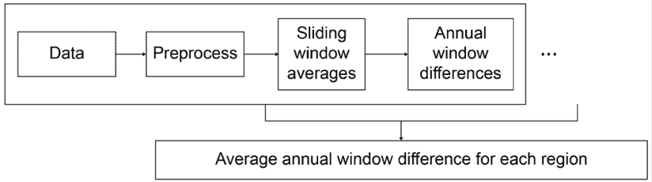

图 1.1: 描述此处涉及的操作顺序的流程图，包含其中数据对之前的步骤的依赖性，以及解决方案可以并行化的的地方

# 构建抽象和识别常见模式

具体问题通常是杂乱的。它们包含许多组件，并且提供的信息通常比解决问题实际需要的多。这些额外信息往往会分散注意力并阻碍问题的解决。为了解决这个问题，你需要提取核心信息，丢弃无关的过度，并识别出数据和过程的一般概念。这一过程被称为抽象。


抽象是对概念或数据的泛化视图，它只保留了概念的核心信息和属性。设计良好的抽象允许人们为原本复杂且晦涩的问题设计出简单优雅的解决方案。构建这些抽象需要时间，但回报可能是巨大的。一个良好的抽象将适用于很大类的问题，并成为未来有用的工具。它们可以帮助你将问题看作一类更通用的问题，或者发明一种可以在其他地方使用的的新类型通用类解决方案。

旁白

作者受过数学训练。在该领域，那里的处理过程完全相同，尽管他们以以在抽象这一步上走得比可能需要的程度更远一点而闻名。

抽象不仅是将问题简化为更具通用性的内容的工具。作为程序员，你一直在使用抽象，例如函数、类、系统内存和文件系统。抽象在编程中非常重要，因为它们允许你构建在许多场景下运行的可重用代码，而不是针对每个特定问题。C/C++`runtime libraries`提供了分配和释放内存的函数，这些函数可以在许多不同的情况下被用于许多不同的任务。

抽象在几个地方确实至关重要。第一，也可能是最直接实用的，是用于数据的初始摄取和预处理。在编写软件时，你需要决定程序将如何获取解决问题所需的数据。它是一个直接从终端（`stdin`）或磁盘文件读取的 Unix 命令行工具吗？是一个用户直接输入数据的 GUI 应用程序吗？还是一个供其他开发者使用的接口的库的一部分？这些每项看起来都不同，但通过设计良好的抽象，你就可以足够灵活地回答这些任何一个设计目标。

抽象你的输入数据的另一个原因是确保它符合你的要求。如上所述，测量单位在世界范围内并不统一，假设所有测量都使用相同的单位是危险的。在你的应用程序的接口上使用抽象，可以允许你无论输入类型如何，都能以正确的单位对数据进行工作（假设已提供单位信息）。我们稍后还会回到这个观点。

在设计算法时，抽象也是有用的，正如我们以后将看到的。例如，如果你的数据属于或可以轻松嵌入数学结构中（如向量空间），那么该结构的操作和方法论就可以被用来设计算法。这在几个方面是有优势的。数学结构经过了充分的研究——也许是过度了——因此可以使用它们来对算法提供强有保证。其次，数学运算（特别是涉及向量空间的操作）经过了充分的研究，并且有许多优化后的实现。

## 识别数据中的共性

数据是构建抽象的一个明显之处。如前所述，围绕提供的数据源和性质形成抽象可以简化数据的获取、验证和处理。然而，在我们执行此操作，我们需要过滤掉与问题无关的信息。当然，这是一个经典的“先有鸡还是有蛋”的问题，因为有时在实际解决问题之前，无法判断哪些信息是相关的。

寻找这些通用性始于对你的数据提出一些基本问题。数据本质上是数值型的吗？如果是，是什么种数字？数值数据可能符合某种数学结构。它具有自然顺序，这些顺序可能与你的问题相关，也可能无关；更具体地说，它们之间存在“相等可比较性”（`==` 操作针对数值进行了定义）。它还有算术运算（`+`、`-`、`*`、`/`），这些运算与排序和相等比较有定义良好的交互。这些都是数字恰好拥有的抽象属性。任何给定的问题可能要求你的数据是有序且可比较的（如搜索和排序），或者具有某些或所有算术运算，但实际上并不依赖底层数据的实际形式。

文本数据是抽象类数据的一个绝佳例子。文本是取自特定“字母表”的字符序列，例如 ASCII 代码表或 UTF-8 编码表。这些字符的实际性质可能很重要。例如，ASCII 字符由单个字节表示，而 UTF-8 既有多字节字符也有单字节字符。对于特定的文本数据使用哪种字母表并不一定重要，但你如何识别单个字符、比较它们或或对它们进行操作是很重要的。

广而言之，通过考虑数据部分必须满足的特征（具有顺序的、相等可比较的、可迭代等的），许多问题可以被泛化。有时，预先识别所需的特征是容易的（搜索通常需要可迭代和可比较的），但有时这并不是可能的。有时，你需要通过具体数据来解决问题，以意识到它可以被泛化。有时，它根本无法泛化。

## 识别问题中的结构

有时可以抽象的不仅仅是数据。有时，问题本身具有一个可以识别和利用的通用结构。这一个典型的例子是将问题的某部分识别为理论框架的一个实例。例如，如果问题的某一个步骤是在数据中寻找特定模式，对于文本来说，这通常通过正则表达式完成（这就是模式识别）。抽象来自于理解正则表达式的计算理论是`deterministic finite automata`（`DFA`），这正是我们所寻求的抽象。这类抽象可能很难发现，但通常会导致高质量的结果。

寻找这样的抽象可以为你提供一个理论框架，在这个框架中找到主问题的解决方案。有限自动机（和有限状态机）是一种非常强大的模式，可以用于许多情况。一旦你知道问题的某部分涉及这种构造，你就可以开始寻找其他也符合该模型的其他。这可能不会成功，但它至少为从哪里寻找以及如何进行提供了选择。

对这些一些基础理论的良好理解，显然让识别这类抽象以及理解它们具有什么能力变得更容易。正则表达式这样的主题已经被非常透彻，即使它们在实践中有时难以使用。还有其他几个类似的模式是你应该理解的；排序和搜索算法是另一个绝佳例子。求解线性组、约束优化和图算法（如最短路径）的数值方法都是极佳的例子。数值算法习惯于出现在意想不到的地方。

### 关于数独的插叙

许多常见的谜题和游戏最终要求解题者或玩家在游戏背景下识别模式。这在数独谜题中尤为明显。在这里，目标是将数字 1-9 放在 9x9 网格中，使得每个数字在每行、每列和每个 3x3 宫中出现一次。简单的数独只需要基础技巧，例如识别数字对或给定行或列中的其他类型的互斥关系。然而，更难的谜题要求解题者在网格内识别更复杂的模式。


例如，更困难的数独谜需要解题者识别中间模式，例如“X 射线”。在这里，解题者确定两行（或两列）和一个数字，该数字在每行中的唯一有效位置都出现在一对列中。由于这两行都必须包含该数字，且该数字不能在两行中出现在同一列，我们可以推断出，该数字在确定的两个列中的唯一有效位置就在给定的两行内，从而允许我们从这些列的其他位置中消除该数字。（如果从一对列开始，逻辑上是对称的）。数独中有很多模式，成为一个优秀的解题者要求人们能够识别并利用这些模式提供的推论。

### 注意

国际象棋是另一个例子，识别走法模式的能力对于成为一名优秀选手至关重要。这让玩家能够快速识别获胜路径以及可以用于获胜的反击策略。学习玩这些游戏的一部分是学习出现的一些常见模式以及如何使用或反制它们。解决问题也是无异。成为一名高效的程序员需要你学习一些常见模式、它们的用途以及如何将它们整合到解决方案中。

### 常见的函数模式

有很多你应该熟悉的函数式模式。我们已经提到了几个。排序模式涉及根据排序谓词对元素按顺序排列。搜索是一个相关问题，它使用条件或谓词在数据集中寻找特定的元素或范围。其他模式包括过滤（以及相关的随机采样）、洗牌和一组数据的排列组合。这些是编程中频繁出现的有用模式，有时以其标准形式出现，但通常以不那么明显的形式出现。

许多问题最终都会归结为解决数值问题，例如求解方程组、约束优化或图算法。这些问题通常需要花一些精力找到问题的正确数学公式。同样，这在某些情况下显而易见，而在另一些情况下并非如此。更重要的模式来自于统计学和概率。生成高质量随机数是一个复杂的课题。具有统计成分的问题通常是；只要测量或方法中存在不确定性，可能就需要统计学。

**组合数学**是处理（有限）集合各种组合方式的数学分支——元素如何排列、配对等。这一分支包括图论，图论在编程问题中经常出现。显式使用图论的问题包括依赖解析（项目的依赖关系通常表示为有向图）、调度（结果是一个图着色问题）以及路径规划（取决于目标，它是最短路径问题还是遍历问题）。

### 常见的结构模式

识别函数模式通常是解决问题过程中的早期步骤。结构模式通常出现在最后阶段，即设计算法或最终实现解决方案时。结构模式包括特定语言的设计模式和惯用法，它们允许你设计接口并使代码高效。（关于设计模式的经典书籍将“结构模式”作为主题之一；我们对该术语的使用包含了书中描述的所有内容，而不仅仅他们描述为结构模式的内容。）我们将使用许多结构模式。

例如，策略模式（或策略模式）是封装一组不同但可交换的方法的一种，这些方法可以在不同情况下用于获取结果。例如，可以定义不同的从文件读取数据的算法作为策略，并根据文件类型更改策略。我们将在书的后部分多次使用这种模式。

其他值得提到的模式还有适配器模式、外面模式、重量类模式和代理模式。这些都是适应给定对象或类的接口的模式，允许其在其他语境下使用。另一个有用的模式是装饰器，通过包装类来扩展对象的能力。

### 注意

C++ 中大量使用的一种模式是“模板方法”模式，其中算法的框架通过一些通用（占位符）操作来描述，这些操作可以由具体的实现进行自定义。C++ 标准模板库充满了这类模式的示例，特别是在 `algorithm` 头文件中。这种模式在产生可以在许多不同语文中出现的通用且灵活的算法实现时表现出色。

# 理解算法

算法是一组指令，用于在满足某些**前置条件**的情况下处理数据并产生某些**后置条件**的输出。能够表述、阐述和理解算法是任何编写软件的人的必备技能。算法通常用伪代码语言编写，以与语言无关的方式描述步骤，对于任何熟悉基本编程结构的人来说应该是理解的。

对算法进行推理并理解它们的计算复杂度是一个庞大的课题，我们将在*第三章*中回来。在本节中，我们关注如何阅读算法并理解它们在做什么。

在继续之前，我们需要理解一些基础计算理论。广义来说，有两种（等效的）计算模型：**顺序**（图灵机）和**函数**（lambda 演算）。在顺序模型中，从开始处一次执行一步，直到任务完成；而在函数模型中，通过对例程递归调用来处理问题的部分。大多数编程语言倾向于其中一种模型，尽管从两种模型中借鉴方面是很常见的。例如，C++ 主要是顺序的，尽管 C++ 模板是函数的。另一方面，**Haskell** 是一种纯函数语言。无论你是否显式地使用任一模型，了解这两种模型是如何运作的都是。

讨论算法最好的办法是通过示例。我们现在来看一个非常简单的算法，它将作为术语的良好介绍，并学习如何阅读算法步骤的伪代码描述。

## 寻找列表的最大值

假设你有一个数字列表（为了简单起见，假设这些都是整数），你想找到其中包含的最大值。实现此目的非常简单的方法如下：

1. 取第一个元素并将其存储为当前最大值。
2. 对于剩余的每个元素，与当前最大值进行比较，如果更大则替换。
3. 返回当前最大值，它现在应该包含全局最大值。

除非知道更多信息，否则很难比此更好。要确定你拥有最大值，你必须将建议的最大值与列表的所有元素进行比较，并检查没有其他元素超过它。

这是一个算法，尽管它没有以上述的伪代码语言呈现。为了形式化该过程，我们应该将上面的自然语言翻译成伪代码，这与代码写法更相似。这里给出了寻找数字列表最大值的算法示例。


```
INPUT: L is a list of numbers with at least one element
OUTPUT: Maximum value of L
max <- first element of L
WHILE not at end of L
  current <- next element of L
  IF current > max
    max <- current
  END
END
RETURN max
```

大写单词是`keywords`，表示常见的操作，如条件判断、循环、输入、输出和返回输出。`OUTPUT` 语句声明了 `RETURN` 语句提供的值的后置条件。`<-` 表示赋值。这是为了将其与等号运算符 `=` 完全区分。请注意，这种形式没有引用任何访问数据的具体方法；那是由实现根据提供的数据形式来定义的。让我们来看看它是如何转换为标准 C++ 的。我们可以将其编写为一个函数模板，接受一个具有 `begin`、`end` 以及支持 `<` 的依赖类型 `value_type` 的“容器”。

```cpp
template <typename Container>
typename Container::value_type max_element(const Container& container) {
    auto begin = container.begin();
    auto end = container.end();
    if (begin == end) {
        throw std::invalid_argument("container must be non-empty");
    }
    auto max = *begin;
    ++begin;
    for (; begin != end; ++begin) {
        const auto& current = *begin;
        if (max < current) {
            max = current;
        }
    }
    return max;
}
```

这是一个非常通用的实现，基本上不对容器的形式或其包含的元素类型做任何假设。如果容器为空，我们会抛出一个异常，这是处理这种情况的一种“正确”方法。空集合的最大值是未定义的；对于任何值，其定义条件在空情况下都是真的。另一个选项是将返回类型更改为 `optional<...>` 在这种情况下返回一个空值。这样做的优点可能允许在函数声明中添加 `noexcept`，从而减少调用该函数的运行时成本。当然，此实现仅用于演示；你应该使用来自 `algorithm` 头文件的受限算法 `std::max_element`。

请注意，实现的通用结构与伪代码中所列出的完全一致。这是设计如此。你甚至可能想为代码的某些部分注释，以指示具体正在实现算法的哪部分。这有助于其他开发者（包括未来的你自己）理解你是如何实现算法的，以及这些特定部分应该做什么。

我们可以通过接受一个可选的比较运算符来代替 `>` 进一步泛化这种实现，但这是复杂的，因为对于某些序关系，最大值是一个良定义且唯一的值是有前提条件的。例如，在某些序关系中，并不是所有的值都是可比较的，这要求在实现中进行特殊处理。这超出了我们目前的能力。

## 算法的特征

并不是所有的指令列表都是算法。要获得这种区分，它们必须满足某些合理的条件：

- **有限性（Finiteness）**：算法必须在有限次迭代后终止。实际的迭代次数通常取决于输入（和输出），迭代次数可能会迅速增长，但它最终必须终止。
- **确定性（Definiteness）**：算法的步骤应该描述得精确且无歧义。目标是将算法转换为计算机代码，因此必须具备足够的信息以便合理地做到这一点。
- **输入（Inputs）**：算法应该有零或多个属于良定义集合的输入（由上述提到的前置条件定义）。
- **输出（Outputs）**：算法应该有一个或多个输出，这些输出通过算法的步骤从输入中得出。
- **有效性（Effectiveness）**：算法应该能够从输入参数产生所需的输出。单个步骤应该足够基础，以便可以使用纸笔精确地执行该过程。

人们通常通过数学证明的严谨性来证明算法满足这些属性。例如，可以使用数学归纳法来证明算法是有效的。算法所需的步骤数通常取决于输入（以及可能的输出）的大小性质。这种关系被称为算法的 `complexity`（复杂度），我们将在以后在 *第三章 中详细讨论。

在算法良好的实现中，通常应该检查输入的前置条件。这可以通过静态类型（如 C++ 中的类型）隐式完成，也可以通过条件语句显式完成。当然，有多种方法来实现，取决于这些检查执行得有多稳健。

编写算法时，另一个额外的考虑因素是清晰度。算法只有当它可以被理解和实现时，对你和他人才有用。在展示算法的伪代码时，你应该努力确保步骤呈现清晰且易于遵循。正如分解可以帮助解决问题一样，它也可以帮助阐述解决方案，特别是当这种分解是“显而易见”的。

让我们检查我们寻找数字列表最大值的算法是否具有这些属性。算法“访问”列表的每个元素一次，所以对于一个包含  个元素的列表，算法将在恰好  步后终止。因此满足有限性条件。算法编写清晰且无歧义。遍历列表的具体模式没有指定，但正如我们在 C++ 实现中看到的，这是为了适应不同形式的“列表”（并非所有语言都支持索引访问）。唯一的输入是数字列表，它必须满足非空的前置条件。唯一的输出是一个数字，它满足是列表最大值的后置条件。最后一个条件是有效性。列出的步骤确实产生了有效的最大值，并且每个步骤都精确说明（尽管不具体）了一个必须执行的操作。

## 递归算法

并不是所有问题都有容易编写的算法。让我们来看一个更复杂的例子。考虑由以下文法定义的非常简单的“语言”：

```
letter ::= 'a' | 'b'
word   ::= letter | '[' word ',' word ']'
```

这种语言由“单词”组成，单词由单个“字母”（取自由字母‘a’和‘b’组成的字母表）或一对由方括号围绕并用逗号分隔的单词组成。出现在引号中的字符是 `literals`，它们与其显示的形式完全相同。其他术语如语言定义。例如，以下所有内容都是该语言中有效的单词：

```
a
[a,a]
[a,[a,b]]
[[a,a],[a,[a,b]]]
```

请注意，这种语言具有递归性。单词可能包含一对单词，因此处理这种语言的算法自然也是具有递归性的。


假设我们想要设计一个算法，从字符串中提取第一个有效单词的结束位置。这个问题是复杂的，因为我们需要确保每一个左括号都都与其对应的右括号正确匹配。有方法可以在不使用递归的情况下做到（简单地计数括号可能足够了），但本示例的目的是演示递归算法。以下是该算法可能的定义方式。

```
INPUT: 以有效单词开头的字符串 s
OUTPUT: 第一个有效单词最后一个字符的位置
character <- get first character from s
IF character = 'a' or character = 'b'
    RETURN 0
END
position <- 0
# s[0] is a '['
position <- position + 1
# find the first word after '['
a <- substring of s starting from index position
i <- end index of first word from a
position <- position + i
# s[position+1] is ','
position <- position + 1
# get the end of first word after ','
b <- substring of s starting at index position
j <- end index of first word from b
position <- position + j
# s[position + 1] is a ']' matching s[0]
position <- position + 1
RETURN position
```

以 `#` 前缀的行是仅用于说明的注释。注意，当存在一个非字母的单词时，该算法会调用自己两次。这是确保始终包含正确数量匹配对的最佳方法。这就是我们可能在 C++ 中实现上述算法的方式。

```cpp
size_t end_of_first_word(std::string_view s) noexcept {
    if (!s.starts_with('['))  {
        return 0;
    }
    size_t position = 0;
    assert(s[position] == '[');
    position += 1;
    auto a = s.substr(position);
    auto i = end_of_first_word(a);
    position += i;
    position += 1;
    assert(s[position] == ',');
    position += 1;
    auto b = s.substr(position);
    auto j = end_of_first_word(b);
    position += j;
    position += 1;
    assert(s[position] == ']');
    return position;
}
```

这不是一个最优实现，但目前这并不重要。这是将算法中出的伪代码到 C++ 的精确翻译，包含了对注释的断言，这些注释描述了如果我们的算法是正确的应该出现的情况。

我们正在利用 C++17 中的 `string_view` 类，与使用原始的 `const char*` C 风格字符串相比，它是处理非所有权字符串更好的方法。使用 `string_view` 有助于确保我们不会访问字符串之外的内存，而这在 C 风格字符串中是很容易实现的。此外，它还提供了许多便利方法，如 `substr` 和 `starts_with`。另一种方法是直接使用一对定义值范围的迭代器来工作，但这与使用 C 风格字符串相比并没那么好到哪里。

在这一实现中，除了断言之外，我们没有包含任何错误检查，并且该函数被标记为 `noexecpt`。这意味着在不以有效单词开头的字符串上调用此函数将导致未定义行为。对字符串的前置条件是字符串以有效单词开头，因此确保该条件成立是调用者的责任。这在程序的“热路径”（hot path）上可能是必要的，因为在这些地方检查无效字符串的成本可能太高。

递归地编写计算过程通常比按顺序编写更容易，但必须记住，像 C++ 这样的语言并不是为这种工作方式设计的。递归实现的性能可能比顺序实现更差，因为在 C++ 中调用函数是一个开销较大的操作。现代优化编译器可能能够通过尾递归优化或其他方式内联函数调用或减少调用这些函数的成本。然而，如果递归次数在编译时无法确定，那么选择就是有限的。以下是一个如何实现不依赖于递归的算法的示例。

```cpp
size_t end_of_first_word(std::string_view s) noexcept {
    size_t position = 0;
    int depth = 0;
    for (const auto& c : s) {
        switch (c) {
            case '[': ++depth; break;
            case ']': --depth;
            default:
                if (depth == 0) {
                    return position;
                }
        }
        ++position;
    }
    return position;
}
```

你可能会发现这种实现更难推理。此外，如果需要执行其他操作，而不仅仅是寻找第一个有效单词结束的位置，那么这种实现就不能轻易地泛化。

灵活性与性能之间的权衡是程序员面临的共同困境。理解你的解决方案的属性并根据上下文的要求设计算法至关重要。如果不考虑灵活性，那么进一步优化并切断添加功能的路径也是可以的。然而，在没有衡量性能且已知算法性能不佳之前，永远不应该进行优化；量两次，切一刀（measure twice, cut once）。

这结束了计算思维的四个组成。现在我们可以看到 C++ 的现代特性和良好的软件工程实践如何也能帮助解决问题。

# 使用现代 C++ 和良好实践

使用 C++ 解决问题有很多原因，但选择 C++ 的主要原因是你需要构建高性能的解决方案。在本节中，我们将查看 C++ 的某些可以在不损害性能的情况下编写快速代码的特性。

在开始之前，我们需要明确一点。仅仅因为 C++ 提供了微优化你代码的工具，并不意味着你应该使用它们。现代编译器产生优化代码的能力比经验丰富的程序员编写的代码更好。信任编译器工具链来优化你的代码，只在绝对必要时才花时间进行微优化。

尽管如此，理解并非所有代码都能产生最优性能是很重要的。我们已经看到一个例子，解析字符串的递归算法无法实现最高性能。但正如我们在该算法注释中提到的，首要任务是解决问题并获得正确的解决方案。然后，只有那时考虑算法是否具有所需的特性。

跟踪代码中性能真正重要的部分是一个好主意。例如，对（可能的）大型数据集执行操作的密集循环可能需要优化，但从数据库获取记录的函数则不需要，因为这始终受到数据库连接的限制。这允许你在优化代码时关注最核心的部分。

另一个我们需要尽早解决的问题是内存管理。不要用 `new` 和 `delete` 手动管理内存——更糟糕的是使用 `malloc` 和 `free`。这会创建内存泄漏和引发未定义行为的配方。使用标准容器（如 `std::vector`）、智能指针（`std::unique_ptr`、`std::shared_ptr`）以及标准模板库（或其他高质量库，如 Boost 和 Abseil）提供的其他机制。当你利用多线程时尤其是如此，因为确保内存管理是线程安全的至关重要的。

## 使用 CMake 构建 C++ 项目


这是一个讨论我们如何在本书中配置和构建 C++ 项目的良好切入点。`CMake` 是一个跨平台的构建系统生成器，它可以从项目根目录下的名为 `CMakeLists.txt` 的源文件构建一组构建文件（Makefiles、Ninja 配置或其他格式）。它的语法起初可能让人感到有些困惑，但你很快就会适应它（如果你还没有习惯的话）。

现代 CMake 将代码和依赖项组织成目标（targets），这些目标通常是静态库、共享库或可执行文件。它通过 `find_package` 函数拥有一套复杂的机制来查找依赖项，此后可以将这些依赖项链接到我们的目标中，提供必要的 `include` 目录和链接行，以便将依赖项的功能成功集成到我们的项目中。CMake 还提供了各种函数来控制编译器的配置，例如以一种可移植的方式为特定的 C++ 标准设置适当的标志。这真的消除了配置跨平台构建的痛苦。一个非常基础的 C++ 项目骨架 `CMakeLists.txt` 如下所示。

```cmake
cmake_minimum_required(VERSION 3.30)
project(MyProject)
set(CMAKE_CXX_STANDARD 20)
set(CMAKE_CXX_STANDARD_REQUIRED ON)
add_executable(MyExecutable main.cpp)
```

第一行指定了配置项目所需的 CMake 版本。（在编写时，3.30 是 CMake 的一个相当新的发布版本。）下一行声明项目，这是 CMake 执行某些后台任务点，例如查找编译器和检查各种设置。接下来的两行设置了 C++ 标准并将该标准设置为强制性，如果编译器不支持该标准，CMake 将抛出错误。最后，我们添加一个名为 `MyExecutable` 的可执行文件，它关联了一个名为 `main.cpp` 的源文件。我们可以使用这一行来链接依赖项或其他我们在 CMake 文件中声明的外部目标：

```cmake
target_link_libraries(MyExecutable PRIVATE MyDep)
```

在这里，`MyDep` 是要链接的目标名称（通过 `add_library` 构建或通过 `find_package` 调用）。`PRIVATE` 标识符声明链接信息不需要随我们的目标传播。这对于可执行文件来说是合理的，因为可执行文件不能被另一个目标链接，但对于库目标可能并不合适。

要配置构建系统，可以使用命令行中的 `cmake` 可执行文件，或通过你选择的 IDE 集成。（CLion 拥有出色的 CMake 支持，VSCode 也有 CMake 扩展。Visual Studio 也支持 CMake 项目）。在命令行上，可以使用以下调用以以发布模式配置并构建项目。

```bash
cmake -B out/Release -S . -DCMAKE_BUILD_TYPE=Release
cmake --build out/Release --config=Release
```

配置好的构建文件放在由 `-B` 参数指定的 `out/Release` ，源文件由 `-S` 参数指定（使用 `.` 表示当前工作目录）。最后一个参数将配置的构建类型设置为发布。在大多数构建系统中，这对于以发布 模式构建已经足够，但某些构建系统（如 MSBuild）支持多种配置，在这种情况下，下一行的 `--config=Release` 参数就变得必要的。

CMake 的优势之一是用户可以附加多个不同的包管理器，例如 `vcpkg` 或 `conan`，使得获取、查找和链接依赖项变得更容易。此外，CMake 比目前的一些类似工具（如 Bazel 和 Meson）功能更全且更容易使用。它的文档非常具有读性，并且极其灵活。

在本书的剩余部分以及相应的代码仓库中，你将看到许多 CMake 文件示例以及如何使用它们，特别是在第 7 章和和第 12 章中。

## 视图、范围和算法

C++20 标准为 C++ 引入了许多在其他语言中已标准多年的特性。这些包括无拷贝的内存视图（`string_view` 和 `span`），以及范围（ranges）和受限算法。与以前基于迭代器的接口相比，这些是巨大的改进，因为它们允许编写更简洁、更安全的代码。

字符串视图和 span 可以被看作是其中元素在内存中连续存储的范围。（所有字节都按顺序存储在单个块中，之间没有间隙。）`string_view` 是不可变的，因为范围内的元素不能被修改。（原地修改字符串是危险的，因为新的 UTF-8 字符可能比它替换的字符需要更多空间，从而强制进行新分配。）`span` 提供了对元素块的可变或不可变访问。

范围（range）是对容器通常迭代器访问的一层抽象。粗略来说，范围是任何暴露 `begin` 和 `end` 并允许顺序访问容器元素的对象；更准确的描述可以在 [`en.cppreference.com/w/cpp/ranges`](https://en.cppreference.com/w/cpp/ranges) 找到。范围的力量在于它们可以与视图（views）组合，视图对底层的迭代器范围提供修改。例如，`enumerate` 视图修改范围以返回索引和值的值对。结合基于范围的循环，这些使得可以编写出非常简单且易读的代码。例如，我们可以使用这种机制如下重写之前更优化的单词查找函数：

```cpp
size_t end_of_first_word(string_view s) noexcept {
    int depth = 0;
    for (const auto [position, char] : std::views::enumerate(s)) {
        switch (char) {
            case '[': ++depth; break;
            case ']': --depth;
            default:
                if (depth == 0) {
                    return position;
                }
        }
    }
}
```

这与之前的实现没有实质性区别，但它使意图更加清晰。现在非常明显 `position` 变量应该跟踪迭代的当前索引。此外，这还有一个额外的好处是不会污染周围的作用域，因为 `position` 在基于范围的 `for` 循环上下文中进行初始化。这不是问题，但有助于保持代码整洁。

## 模板与概念

模板可以说是 C++ 最强大的特性之一，也是最困难、最令人沮丧的特性之一；任何调试过模板元编程 bug 的人都会理解。它们之所以如此强大，是因为它们允许编码者编写一段代码，并根据需要应用于许多类型，而无需为给定程序中的每种类型组合编写新的实现。这也有缺点：模板实例化对编译器来说开销很大且非常复杂，而且错误非常难以发现和调试。


模板本身实际上构成了一个完整的编程语言。它们可以用于在编译时计算值，从而将使用这些值的运行时开销降低到有效零。模板（类、函数或值）由编译器针对其所使用的每种类型组合进行`instantiated`（实例化），这意味着编译器会获取模板体，并将模板参数替换为代码中提供的特定类型。例如，我们的 `max_element` 模板函数可以通过下面的代码段进行实例化。这种实例化是递归执行的，如果编译器在此过程的任何一个点遇到了无效的表达式，它就会抛出编译错误。这些错误可能非常难以诊断，因为错误的原因可能距离检测到错误的地方要远得多。

概念（Concepts）是模板机制的扩展，允许用户预先声明模板所需的精确需求集合。这意味着编译器不需要递归地实例化模板来判断其是否有效；它只需要检查该概念对于该类型是否有效，如果不是，则输出错误。这为编码员提供了更友友的错误信息，并可能提高编译速度。我们 `max_element` 函数的基本概念可以定义如下：

```cpp
template <typename T>
concept OrderableContainer = requires(const T& t) {
    // 拥有一个名为 "value_type" 的依赖类型，通过 < 进行排序
    std::totally_ordered<T::value_type>;
    // 拥有在 Const T& 上有效的 begin 和 end 方法
    t.begin();
    t.end();
};
```

这不是完整的描述，因为我们没有指定 `begin` 和 `end` 方法应该返回迭代器。此外，我们还没有检查 `value_type` 是否可拷贝构造。幸运的是，我们不需要重新发明轮子；我们可以像这里这样扩展标准库中的 `forward_range` 概念。

```cpp
template <typename T>
concept OrderableContainer = std::input_range<const T>
    && std::totally_ordered<std::range_value_t<const T>>
    && std::copy_constructible<std::range_value_t<const T>>;
```

这种实现检查了 `const T` 是否是一个 `input_range`，这意味着它拥有 `begin` 和 `end`，返回可以按前向迭代模式读取值的迭代器，并且该输入范围中的值是有序的。这实际上比我们定义的要通用得多，因为范围的声明方式除了指向第一个元素和最后一个元素之后元素的迭代器之外，还有其他方式。为了考虑到这种泛化，我们真的应该利用 `range` 库，而不是直接使用 `begin` 和 `end` 方法。这具有创建更简洁代码的优点，如下：

```cpp
template <OrderableContainer Container>
std::range_value_t<Container> max_element(const Container& container) {
    auto begin = std::ranges::begin(container);
    const auto end = std::ranges::end(container);
    if (begin == end) {
        throw std::invalid_argument("Container must be non-empty");
    }
    auto max = *begin;
    ++begin;
    for (; begin != end; ++begin) {
        if (max < *begin) {
            max = *begin;
        }
    }
    return max;
}
```

注意，我们仍然必须检查容器是否为空。这只能在运行时进行测试，而概念是编译时的构造。唯一的真实区别是使用 `ranges::begin` 和 `ranges::end` 函数来获取迭代器。对于这样一个简单的函数来说，这可能是大材小用了，但在尝试构建问题的抽象时，从概念的角度进行思考会有很大帮助。此外，你使用的概念越多，在调试大型、复杂的模板化代码体时的体验就越好。这涵盖了如何灵活且高效地处理数据。下一节将展示如何处理出现问题的情况。

## 在 C++ 中处理错误

在实现问题的解决方案时，你应该始终考虑可能出现的问题。总会有问题发生：前置条件可能被违反、算法可能无法产生结果（例如，数值方法无法收敛）、数据可能是格式不正确或不支持的格式、可能会达到强制实施的限制（例如限制单次计算可以花费的时间）。你的实现应该有一种机制来优雅地处理这些可能发生的此类错误。

值得指出的是 `failure`（失败）和 `error`（错误）之间的区别。例如，如果我们实现一个搜索算法，那么它可能无法找到满足条件的条目。这是一个失败，但不是错误。当程序进入无效状态或遇到它无法处理的问题时，就会发生错误。失败应该作为常规问题来处理，使用如 `std::optional` 或在搜索失败时返回 `end` 迭代器等构造。错误应该传播到可以优雅处理它们的地方或终止应用程序。

长期以来，C++ 中处理错误的方法有两种。

*   我们可以使用内置的异常机制，它的优点是全局性的，除非正在执行的异常被 `try-except` 块显式捕获，否则它将带有有意义的错误信息终止整个应用程序。这在某些情况下是理想的，但有时并不是。异常机制有好处，但它也是处理错误相当昂贵的方式。它导致编译器添加大量的错误处理代码。异常在 API 边界或处理远程过程调用时特别棘手。
*   或者，我们可以使用 C 风格的错误，函数返回一个整数，如果没有错误则返回 0，如果发生了错误则返回非零错误代码。这非常轻量级，对于许多不应导致程序终止的应用程序来说是合理的。缺点是这种机制能够传递的信息量非常有限。

理想情况下，应该有一种既像 C 风格错误码一样轻量，又像异常模型一样表达灵活的替代方案。在 C++23 中，`expected` 模板被添加到 C++ 标准库中，它允许返回一个该对象可以是函数调用的有效结果，也可以意外的（错误）值，且永远不为空。这种方法的优点是允许使用非常轻量的错误处理机制，它是局部的（除非显式传播），这提供了巨大的灵活性，特别是在接口边界。

注意

如果无法使用 C++23，Abseil 拥有 `Status` 模板类，具有类似的功能，Boost 有 Leaf 库，拥有类似的 `result` 模板类。

## 测试你的代码


即使是非常简单的软件项目也应该包含测试。每个新功能都应该添加新的测试。每个报告的 bug 应该应该通过添加测试来确认。这是确保你的代码“正确”且运行恰当的唯一途径。你应该包含以下几个层级的测试：`unit tests`（单元测试）、`integration tests`（集成测试）和 `end-to-end tests`（端到端测试）。完整的测试套件应该包含这三种测试，并尽可能覆盖整个包。

1. 第一层包含 `unit tests`，它们测试较小的、隔离的功能单元，例如单个函数、算法或类接口。这些测试用于对软件的小部分部分提供非常细粒度的诊断，旨在识别实现不正确的特定组件，并确保它们运行且不会引起意外的错误或崩溃。这些测试通常规模较小、运行速度快，且数量较多。单元测试套件会在开发过程中定期运行，并在准备部署时运行。

2. 第二层包含 `integration tests`，它们测试共同运行的较大功能组，例如协同工作以解决特定问题（或其部分）的算法集合。这些测试的规模通常比单元测试大，但仍仍在较小的规模上运行。它们往往是较大的测试，每个测试共同执行包的几个不同部分。这些测试可能比单元测试花费更多时间，运行频率也没那么高——可能只在新功能完成后、在部署过程之前或作为过程的一部分运行。

3. 最后一层包含 `end-to-end tests`，它们测试软件的整个生命周期，通常比单元测试和集成测试更大且耗时更长。这些可能只在准备发布项目新版本时运行，而不是作为开发周期的一部分。通常，只有少数端到端测试涵盖了软件的主要工作流。

C++ 提供了几种可用的测试框架。最常用的两个是 `GoogleTest` 和 `Catch2`。`GoogleTest` 是一个非常灵活的库，很容易设置和使用，并且扩展性极强。`Catch2` 是一个更简单的库，灵活性较低但更容易设置和使用。`Catch2` 是一个仅头文件的库，不需要链接到外部运行时，而 `GoogleTest` 需要链接到 `gtest.(so|dll)` 库。本书代码中包含的测试使用了 `GoogleTest`。

## 版本控制

`Git`（以及 `GitHub`）是维护源代码版本控制和管理代码库的事实标准。它是执行此任务的非常有效的工具。即使是相对简单的软件项目也应该保持版本控制——这不需要公开，甚至不需要存储在某个服务器上。这出于几个原因。首先，在某些时刻，由于错误或性能退化，你可能需要将代码恢复到过去的某个状态。第二个原因（对于非常小的项目可能不是问题）是与更大的开发者团队（甚至是你自己的个人电脑之间）共享代码。

`GitHub` 和 `GitLab` 等服务提供了持续集成测试的能力，这有助于识别任何破坏现有功能的更改或其他发现问题。这也有助于确保你的代码可以在你支持的所有不同平台（Windows、Linux、macOS 以及各种不同的架构）上运行。没有一台计算机可以独立测试所有这些配置。持续集成工具让这变得简单。

# 总结

本章介绍了计算思维的四个组成部分，它们构成了解决大型复杂编程问题的框架。这仅仅是基础。要有效地解决问题，需要理解理论并拥有丰富的示例可供参考。在接下来的章节中，我们将深化理论知识，并开始在解决问题的理论与 C++ 语言提供的设施之间建立桥梁。这将帮助我们理解在解决问题时应该寻找什么样的模式和抽象。我们还讨论了一些良好的实践，这些实践将加速解决方案的迭代，并允许我们快速为困难问题开发正确且高效的解决方案。在下一章，我们将更详细介绍如何在问题中构建抽象，以及 C++ 中提供的促进抽象思维的机制。

## 获取本书的 PDF 版本和专属额外资源

扫描二维码（或访问 [packtpub.com/unlock](https://packtpub.com/unlock)）。按书名搜索此书，确认版本，然后按照页面上的步骤操作。 |  |

| `Note`: 请妥善保存发票。直接从 Packt 购买不需要发票。* |

# 2

# 详细介绍抽象

抽象（Abstraction）是一个在许多不同背景下使用的术语，即使在本书中也是。在`第 1 章`中，我们讨论了在问题领域内制定抽象，例如数据抽象和结构抽象。用于实现解决方案的编程语言也有抽象机制，这些机制显然与问题中的抽象相关。本章的目的是理解与 C++ 特别相关的抽象。

C++ 提供了许多抽象机制来使编写复杂代码变得更容易，但这些机制也可以教我们如何思考问题。在本章中，我们将查看来自 C++ 的抽象机制以及它们如何帮助引导我们在新问题中找到实用的抽象。毕竟，语言的特性和标准库的功能正是为了促进这一点而存在的。我们将关注 C++ 中的四种设施：标准库中的算法、函数、类和模板。

这些讨论的目的是理解人们在分解问题或制定抽象时可能追求的目标。粗略了解解决方案可能向何处发展总是有帮助的，这样你就可以留意沿这条路线可能出现的特性和标准模式。这正是我们在这里尝试做的。本章也提醒了我们自己在 C++ 中可以使用的某些强大功能，以及通过这些功能可以实现什么。

在本章中，我们将涵盖以下主要主题：

*   常见问题分类
*   理解标准算法
*   何时使用函数
*   何时使用类
*   使用模板

# 技术要求

本章的重点是建立现代 C++ 语言和库特性之间的联系。假设读者对 C++ 有一定了解，但我们会尝试解释你之前可能没有遇到过的更现代的特性。与本章相关的练习可以在本书 GitHub 仓库的 `Chapter-02` 文件夹中找到：[`github.com/PacktPublishing/The-CPP-Programmers-Mindset`](https://github.com/PacktPublishing/The-CPP-Programmers-Mindset) . 一些代码片段在该仓库中也有测试。


在我们开始之前，我们需要对不同类型的问题有一定的了解。这非常重要，因为这构成了我们构建抽象的背景信息，从而指导我们对如何实现解决方案的选择。所有问题都可以通过一系列归约（reductions）被分解为一组基础问题。这些基础问题就是你可能已经知道如何解决它们的问题——例如，使用经典的数据结构和算法。随着经验的增长，在大多数情况下，需要的归约将会减少，你将识别出复杂度日益增加的问题并知道如何解决它们。从广义上来说，基础问题分为四个领域（至少就本文的讨论而言），每个领域都有许多子类并存在一些重叠的概念：

*   组合问题，包括排序和搜索
*   `Input-output` (`IO`) 问题，以及与宿主系统的交互
*   数值问题，包括生成随机数
*   接口问题，包括与用户的交互

### 组合问题
`Combinatorial problems`是指涉及计数、排序（或其他重排）、搜索（针对单个值或一个值范围）、在范围内以其他方式组合元素以及图论的问题。这描述了计算机科学中一个非常大且通常被良好理解的分支，涵盖了大多数经典的数据结构和算法课程。在识别公共子串或在字符串中查找特定模式（正则表达式）实例方面，有优秀的算法。这还包括路径查找（或图遍历）等任务。该类别中大多数简单的问题示例包括查找或排序简单的线性数据——这些数据可以自然地排列成线而不会丢失上下文信息。然而，它也涵盖了并不那么简单的问题。在二维或三维空间中寻找路径、绕过环境中的障碍物就是其中一个例子（例如使用 `A*` 算法）。

### 输入输出问题
`Input-output problems`是指涉及查找和加载待处理数据的问题，例如在磁盘上定位文件并将其加载到程序地址空间内的字节序列中，在其中可以可以直接访问，或者反之亦然。大多数（如果不是所有）操作系统都包含一个复杂的文件系统，它允许在计算机用户空间运行的用户和程序在磁盘上定位数据。（这本身就是如何使用抽象的一个极佳示例。）文件提供了一个允许程序获取数据的接口。数据可能并不位于磁盘上；它可能位于通过网络连接访问的另一个设备上，或者可能不存在于任何地方（例如一个不断传输读取数的传感器）。从这些源获取数据可能更加棘手，尤其是当数据是瞬态的时。一旦程序完成对输入数据的处理，它将存储或以其他方式显示结果。此类类别还包括在同一系统的设备之间移动数据的问题，例如将数据移动到 `GPU` 并启动计算（尽管计算的性质很可能属于下一个类别）。

### 数值问题
`Numerical problems`是指本质上是数学的问题：直接对数据进行计算；编码/解码（或加密/解密）数据；解决优化问题；统计分析或推断；以及许多其他。这些问题无处不在——你是否想过视频流媒体服务是如何为你生成建议的？在“现实世界”识别数值问题可能相当困难。这主要是因为该类别的范围很广，而且为了理解这一通用类别中的问题，通常需要进行一些额外的工作。将一个推荐问题转化为线性代数问题需要一些思考。识别问题的数值特征并识别数据中的需求以及最终结果的可行性是这一过程的一部分。

### 接口问题
`Interface problems`略有不同，与 IO 问题有些联系，尽管目的截然不同。这类类别涉及其他用户或程序将如何与你的解决方案交互。这是一个简单的命令行应用程序吗？这是一个编程接口（API）吗？它是一个网站吗？这些每一个都涉及一组（相关的）挑战。这是所有与编程相关问题的核心组成部分；如果没有人能与你的解决方案进行交互，那么它就并不存在。有时这种挑战会被掩盖，因为你正在为已经具有良好定义接口的软件添加新功能，但它仍然存在并需要关注。实现不良好的接口可能意味着程序无法使用、频繁崩溃或变得难以维护。

# 抽象作为一种机制
抽象是使能够将一个复杂问题实现为一个或多个基础问题的主要机制。抽象的性质取决于问题以及它所交叉的基础类别。例如，对于分类类问题，我们通常会在数据和操作中寻找抽象。排序算法是相同的，无论排序是通过小于还是大于来完成的。对于 IO 类型的问题，抽象通常出现在程序与计算机操作系统之间的接口周围，可能出现在数据的形式和格式周围。对于数值问题，数据和方法论可能是抽象路径，可能涉及对输入输出的某些转换，以便对其进行数值化操作。（例如，大语言模型处理的是整数标记 token，而不是包含单词或字母的字符串。）对于接口问题，与消费者交互的机制就是抽象。构成用户界面的 `functions` 和 `classes` 隐藏了实际实现的细节。

## 使用 C++ 抽象机制连接问题

C++ `语言` 和标准库包含了许多交付抽象的有用工具。棘手的部分在于理解何时以及如何使用这些工具来解决问题；本质上，这就是本书的主题。第一步当然是尝试识别存在于你的问题背景下的上述宽泛类别。可以肯定的是，至少接口会参与其中，且 `IO` 也可能是一个组件。除非你的问题是专门的 IO 问题，否则它几乎肯定会涉及至少一个其他类别。（识别涉及的不同类别当然是开始将你的问题分解为较小部分的一个好方法。）

C++ 语言提供了几种机制来封装和抽象程序的特定方面。例如，它允许我们抽象一组用于将输入数据转换为输出数据的操作链。这些机制本身就是这组操作链的封装，允许高层用户利用 `function` 转换输入到输出，而无需理解实际的实现。

这是语言特性中的一种常见模式；许多特性的设计是为了封装某些功能，以便可以重复使用或由于其他原因对用户隐藏（例如，知识产权保护）。这些机制主要适用于设计接口以及与实现通用问题解决方案的库交互（例如用于线性代数的 `LAPACK`）。


语言中还包含了强大的模板（template）和概念（concept）特性。这些机制允许我们编写一段代码，并用于多个 C++ 类型。编译器会在编译时为这些类型填充正确的代码。C++ 标准库的大部分都是基于模板构建的，因此可以灵活使用，而不需要库本身包含针对每种可能的类型组合的编译后代码（即使这样做，也无法比拟模板的灵活性）。概念是模板系统的扩展，允许程序员精确地指定传递给模板的类型要求，主要用于调试模板代码。概念是思考数据和功能的一种极佳方式。每当你遇到一个新问题时，尝试从概念的角度去理解其需求是什么。这是为你的数据制定抽象的一部分（请参阅第 1 章）中的讨论）。

C++ 标准库是针对特定任务的标准抽象集合，例如：处理文件系统和与文件交互；以各种形式存储数据；处理基础数学运算（`exp`、`log` 等）；处理文本、字符串和正则表达式；标准算法；以及更多内容。这些是帮助我们与系统、用户以及编程问题中常见的标准算法进行交互的构建块。我们在上一个章节中已经介绍了 `algorithm` 头文件，将在下一节中再次讨论它。它包含了许多组合算法的实现（排序和搜索是最主要的）。这些函数模板非常灵活，可以用于任何出现这些问题的地方。

# 使用 C++ 进行输入和输出

本章的大部分内容将致力于使用 C++ 语言和库来定义、实现并与某些类问题的解决方案进行接口交互。然而，在深入这些细节之前，有一个方面值得讨论。这就是加载（或以其他方式“输入”）数据以及保存、存储或打印结果的功能。C++ 中的大多数 IO 都是使用“流（streams）”接口处理的，这些接口封装在如 `iostream` 等各种头文件中。从根本上说，一个（输入）流是某种对象，允许用户以结构化或非结构化的方式读取一个或多个字节。（`istream` 对象还有其他要求，但它泛泛支持了 `read` 功能。）

该接口非常灵活，并且非常适用于从磁盘上的文件（`ifstream`）或从终端（`cin`）读取数据。它允许人们从文件中读取原始字节，或者使用 `operator >>` 中的流读取结构化数据，如整数或浮点数。例如，下面的代码块从 `cin` 读取字节以构造一个 `double`。

```
double value;
std::cin >> value;
```

这假设当前的字节序列定义了我们预期的格式的有效 `double` 值。（在这种情况下，一组与我们在代码本身中编写的相同的数字序列。）如果此假设失败（例如该字节模式包含字母‘a’），则会设置错误状态（通过 `failbit` 或异常，取决于流的配置）。当然，`double` 有许多方式可以存储为原始字节序列——文本表示只是其中一个例子。这个主题被称为 `序列化（serialization）`。

序列化是取一个值并产生一个表示形式的过程，这种形式独立于程序的内部状态，可以稍后加载，并“精确地”恢复原始值。有许多不同的方法来实现这一点；JSON、XML 和 Protocol Buffers 都是将复杂对象序列化为文本或原始字节的格式示例，这些格式可以传输或存储，然后在其他加载。标准库的流接口比这些要原始得多——大多数序列化库都是在这个接口之上构建的。

之所以跳转到 IO，部分是为了解释我们在编写代码时如何应对这些挑战，但它也是一个完美的演示，展示了如何通过堆叠相对简单的抽象来构建解决复杂问题的强大工具。这个概念在书中将多次出现。

# 使用标准算法

算法是编程的基石，我们将在下一章中详细描述这一主题。标准库 `algorithm` 头文件本身并不是算法，而是解决常见抽象问题的常用（系列）算法的实现。（这些算法大多涵盖了经典计算机科学课程中经典数据结构和算法课程中的问题。）它们出奇地有用，并出现在很多地方。这些函数的威力源于它们在操作的每个方面都使用了模板：不同的搜索谓词、不同的比较和排序、间接和投影。

正如我们之前看到的，真正的技巧在于找到可以使用这些函数的地方，通过简单操作或定制内容来实现。有时看起来这些函数没一个都不适用，直到你以正确的方式（通过抽象）来界定问题。标准库的这部分包含了涵盖几类算法的函数。主要的列在此处：

*   **搜索操作**：在范围内查找满足某些项。
*   **复制操作**：复制或移动数据。
*   **转换操作**：将一个范围内的项转换为另一个范围的项。
*   **排列**：改变范围内项的顺序。
*   **排序和分区**：根据谓词对项进行排序并分割排序后的范围。
*   **二分查找**：搜索，但通过排序提高速度。
*   **生成操作**：以各种方式填充范围。

有效使用这些函数所需的推理对于当前问题是非常特定的。有时这涉及到找到一种（高效地）遍历你的问题空间的方法，或者找到实现该目标的问题空间的代理。或者，它可能意味着找到正确的谓词或排序。通过示例来说这一点最好。

## 遍历领域

假设你的任务是设计一个系统，寻找网格中给定位置附近的正信号。信号由强度评分定义，可以使用网格位置定位。为了简单起见，假设网格是一个 ![22390_02_001.png] 网格，观察者位于中心位置。一种方法是从左上开始逐行搜索整个网格，找到所有的正信号。然后我们可以执行第二步找到距离起始位置最近的信号。对于中等大小的网格效果良好。但是，如果网格很大且起始位置不在网格的左上角，那么这样做非常浪费。代码如下：

```cpp
int dim_x = 5;
int dim_y = 5;
double compute_signal_intensity(int x, int y);
double detection_intensity = 5.0;
// 网格位置的简单抽象
struct Pos {
    int x;
    int y;
};
std::vector<Pos> signals;
signals.reserve(dim_x*dim_y);
for (int y = 0; y < dim_y; ++y) {
    for (int x = 0; x < dim_x; ++x) {
        if (compute_signal_intensity(x, y) > detection_intensity) {
            signals.emplace_back(x, y);
        }
    }
}
```

一旦找到所有的正信号，我们可以使用 `std::min_element` 配合自定义排序来找到距离起始位置最近的信号。


```
Pos start {2, 2}; // middle of the grid
auto dist_to_start = &start {
    return std::max(std::abs(pos.x - start.x),
                    std::abs(pos.y - start.y));
}
auto ordering = &dist_to_start {
    // a simple distance metric that will work nicely
    return dist_to_start(a) < dist_to_start(b);
}
auto closest_pos = std::min_element(signals, ordering);
```

这是一种相当粗暴的方法，而且我们没有利用任何显式抽象，这导致了一个虽然可行但效率下的解决方案。我们遗忘的关键信息是：搜索并不是对整个网格的全局搜索——我们并不关心距离起始位置很远的信号，除非没有更近的信号。引入少量的抽象并使用更合适的算法，将产生一个更好、更高效且灵活的方法，我们稍后可以对其修改。

我们的目标是利用 `std::find`（这是一种更合适的算法）来找到第一个信号（它应该是最近的那个）然后终止。我们需要找到一种从起始位置向外迭代的方法。假设我们有一个描述这种迭代的 `range` 对象，称其为 `ExpandingSearchRange`，那么我们就可以通过以下非常简单的代码找到最近的位置。

```
auto predicate = detection_intensity {
    return compute_signal_intensity(x, y) > detection_intensity;
}
ExpandingSearchRange range(pos_x, pos_y);
auto closest_pos = std::ranges::find(range, predicate);
```

假设 `ExpandingSearchRange` 的行为符合预期，这保证能够找到距离起始点 `(pos_x, pos_y)` 最近的信号位置。由于它在找到第一个谓词函数返回 `true` 的位置就会停止，因此 `compute_signal_intensity` 的预期评估次数远小于我们第一次尝试中保证的 `dim_x*dim_y` 次评估。此外，如果我们的目标发生变化或者实施了额外的约束，我们可以简单地将 `ExpandingSearchRange` 替换为满足更新后标准的修改版本。

我们在这里不会实现 `ExpandingSearchRange`，但你应该考虑如何实现它。在下一节中，我们将详细查看如何最好使用函数（以及类函数对象）来分离算法的不同部分，并作为抽象本身的一部分。

## 何时使用函数

`函数`（Functions）封装了一个计算单元，它们通常用于允许该计算单元在许多地方被使用。在纯形式下，它们对一个或多个输入值进行操作并产生一个或多个输出值。（当然，C++ 函数只能有一个返回值，但我们稍后回到这一点。）“纯”一词意味着函数本身独立于全局程序状态；只有输入数据对输出有任何影响。非纯函数也有它们的用处，但它们推理起来要困难得多。由于这个原因，我们在这里主要将注意力限制在纯函数上。

`纯函数`（Pure functions）是一个数学概念，定义为两个集合之间的一种关系，在该关系下，“输入”集合中的每个成员都恰好与“输出”集合（上域）中的一个元素相关。也就是说，任何给定的输入配置都应该产生相同的输出。这显然是一个非常通的概念，但记住这一点可以很好地提醒我们应该如何使用它们。一个函数应该代表单一的计算，可能是数值计算或更通用的计算，并返回其结果。

正如我们提到的，C++ 函数只能返回一个值，但这并不意味着不能返回多个值。例如，我们可以利用聚合对象（如 `std::pair` 或 `std::tuple`）将多个值封装成一个可以返回的单一对象，或者我们可以采用更像 C 语言的方法，将结果写入作为指针参数传递的一个或多个地址。这两种方法都有它们的用处。C++ 函数也与它们的数学灵感不同，因为它们可能由于各种原因而无法完成计算。在数学中，函数的定义域可以受到任意数量的限制限制而 C++ 只能通过类型来限制函数参数；值的检查必须在运行时进行，这会导致错误。

函数也可以被视为从更广泛的程序中隐藏实际实现细节的手段。它们是极低成本的（特别是内联时）抽象特定细节的手段，例如点之间的距离函数、排序或其他比较，或者用于搜索的谓词函数。函数应该用于逻辑上组织实现，并作为为问题领域提供灵活性的手段。例如，在前一节中，`compute_signal_intensity` 可能有几种可能的实现方式，产生不同的搜索特性。

## 基于函数创建接口

函数最重要的用处之一是作为外部用户（库的使用者或直接通过 GUI 或其他接口）的主要接口。函数的优势在于它是一个简单的概念，可以很好地跨越边界。例如，C++ 函数可以被为使用 C 调用约定，使其可以在其他知道如何调用 C 风格函数的语言中使用。（许多语言都具有链接到用 C 编译的库并使用这些函数的能力。）一旦进入接口函数内部，你就可以自由地利用你所拥有的任何机制来实现你的解决方案。

函数是定义接口的好方法，因为它们简单易于理解，但仍然具有很强的表达能力。如果需要更多功能，可以使用更复杂的配置对象。该对象可以设置合理的默认值（当然，取决于问题），因此只需要基本功能的用户不需要花费大量时间进行配置。这是一种非常灵活的方法，在运行时成本和程序员开销方面都相对较小。

考虑以下示例。假设问题是从用户提供的若干数据源加载数据，然后产生一组统计数据（均值、标准差、最小值、最大值等）。一个非常简单的接口可能包含一个包含统计数据的简单 `struct`，一个接收一系列描述数据位置字符串的函数（例如使用统一资源标识符），以及一个允许用户自定义实际产生的统计结果的配置。（我们无法从返回的 `struct` 中省略这些内容，但我们可以简单地不计算它们。）定义如下：

```
struct SummaryStatistics; // 定义省略，并不重要
class Configuration {
    bool b_include_mean = true;
    bool b_include_std = true;
    // 更多带有默认值的字段
public:
    bool include_mean() const noexcept { return b_include_mean; }
    void include_mean(bool setting) noexcept {
        b_include_mean = setting;
    } 
    // 用户可以使用的函数
};
std::vector<SummaryStatistics>
compute_statistics(const Configuration& config, std::span<const std::string> sources);
```

注意 `Configuration` 对象完全完全内联的，但它仍然程序接口的一部分。事实上，如果这个类发生了变化（例如增加了新的设置），那么该函数必须重新编译，并且可能会破坏向后兼容性。


有一种充分的理由支持将你的编程接口设计得尽可能精简，利用内联函数或非常简单的类来适配更复杂的驱动程序例，而不是导出所有内容。（这可能是理想的，但并不总是可行的。）

有时，函数可能不足以完全描述你需要的接口。在这种情况下，你可能不得不转向使用基于类的接口。这在灵活性方面具有一些优势，但它会暴露一些关于实现的额外细节，而这些细节人们希望保持私有（例如，为了保护知识产权）。虽然有办法解决这个问题，但没有一种方法像基于函数的接口那样简单。

## 作为构建模块的函数

函数在解决组合问题或数值问题时非常有用。通常，这类问题包含多个活动部分。在外部层，通常会有某种驱动操作，对问题域进行迭代。在这个驱动器内部，包含一个计算方面和一个决策方面。在排序问题中，计算涉及对元素对进行比较，而决策是是否交换两个元素的位置。这在许多涉及数据集合的数值算法中也是如此。（显然，对单个数字或少量数字集合进行的计算通常不需要这样的复杂性。）函数是隔离这些方面并使最终解决方案更易理解的理想选择。

例如，假设我们想要找到实数  在未知（连续）函数 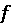 值为零的点。一种方法是使用重复二分法。这个问题需要三条信息：第一个是（连续）函数本身，它接受一个参数并返回一个数字；第二个是域中函数取正值的某个点；第三是函数取负值的一个值。我们可以如下实现该算法：

```cpp
#include <cmath>
// 省略辅助函数的定义
template <typename Function, typename Real>
Real find_root_bisect(Function&& function, Real pos, Real neg, Real tol)
{
    auto fpos = function(pos);

    // 驱动循环
    while (compare_reals_equal(pos, neg)) {
        auto m = midpoint(pos, neg); // 计算中点 (pos + neg)/2
        auto fm = function(m);
        // 如果函数已经（接近）0，则提前退出。
        if (std::abs(fm) < tol) { return m; }
        // 寻找下一个检查点的决策逻辑
        if (std::signbit(fm) == std::signbit(fpos)) {
            pos = m;
            fpos = fm;
        } else {
            neg = m;
        }
    }
    return fpos;
}
```

此实现中有两个“构建模块”函数。第一个（`compare_reals_equal`）是一个用于判断两个实数是否可以区分的函数——记住 C++ 的 `double` 精度最多大约只有 15 位小数。第二个函数（`midpoint`）用于计算两个给定值之间的中点。这在目前这种情况下并不是严格必要的，因为计算中点非常简单，但其他类似的算法会使用更复杂的逻辑来确定下一个应该检查哪个点。这两个构建模块都可以被更细致的实现取代，这些实现可以改变迭代方法的特性。将它们保持为函数允许我们稍后更容易地替换它们（抽象算法），可能使用额外的模板参数和类函数对象（见下一节）。至少，在这里使用函数允许我们对 `Real` 类型保持灵活性。例如，我们可能使用一种没有重载 `operator+` 但可以在算法中运行的类型。

让我们花点时间理解该算法的要求。第一个约束是函数的数学要求。我们要求函数接受一个实数，返回一个实数，是连续的——如果绘制这个函数的图，线段将没有跳跃——并且它至少有一个正值和一个至少的负值。我们无法在代码中检查该函数是否是连续的。

如果不符合这些条件，函数仍然会运行，但可能产生没有意义的答案（垃圾进，垃圾出）；这在数值算法中非常典型。其他条件是可以检查的。例如，我们可以简单地检查函数在一个值处为正，在另一个值处为负，但我们在前面的代码中省略了这些检查以节省空间。

## 类函数对象

在 C++ 中，我们可以定义拥有 `operator()` 成员函数的类，这允许类的实例像函数一样被调用。这些对象惊讶地有用，因为它们与模板机制的交互更好。（函数指针无法进行有意义的默认构造，但类函数对象可以。）标准库在 `functional` 头文件中包含了几个类函数对象，包括 `std::less` 和 `std::hash`。这些对象被用作容器（如 `std::map` 和 `std::unordered_map`）的默认模板参数，也用于算法。

类函数对象还包括 lambda 函数，它们实际上是编译器在编译期间转换为类定义的语法糖。捕获的变量只是该类的成员变量，并被注入到调用函数体中。Lambda 是声明类函数对象的一种非常有用的手段。我们之前的示例完美地说明了这一点。

更通地说，可调用类可以表示携带内部状态的函数（非纯函数）。这种用性的很好的例子是，如果你的函数具有某些隐式的随机状态。该类可以维护随机生成器（例如 `std::mt19937`），在每次调用函数时用于注入随机状态。这是一个示例：

```cpp
#include <random>
class FunctionWithNoise {
    std::mt1937 m_rng;
    std::normal_distribution<double> m_dist;
public:
    double operator()(double arg) noexcept {
        auto noise = m_dist(m_rng);
        return 2.*arg + 1 + noise;
    }
};
```

这种函数在模拟数据时非常有用，因为我们需要生成大量遵循已知趋势但包含某些随机生成噪声的数据。例如，该类可以用于测试推理流水线的性能。

函数非常有用，但它们受到通常无法持有状态的限制。函数对象可以携带状态，但这并不能反映完全面向对象编程的灵活性威力。在下一节中，我们将看到如何利用类和继承的所有特性来构建真正灵活的系统。

## 何使用类

类是数据和行为的封装，应该以两种方式之一使用。第一种是作为结构化容器，维护某些不变属性，这些属性可以通过其方法在算法中使用并查询（例如 `std::vector<...>`）。第二种是作为隐藏细节的抽象接口，类似于函数隐藏实现细节的方式。这允许你针对抽象接口编写代码，并使用任何实现它的对象——例如 C++ 标准库中的 IO 流接口。


当我们谈论基于类的抽象接口时，我们通常指的是`动态多态`（尽管并不总是如此）。`多态`（字面意为“多种形式”）是一种手段，使得一个类（接口）可以被任何实现该接口的类（实现类）所取代。在 C++ 中，这是通过虚函数实现的；指向方法实现的指针被放置在一个查找表中，在运行时查询该表以找到要使用的正确实现。（虚函数是一个非常深的话题，有着数十年的开发和优化，而这仅触及了皮毛。更多信息，请参阅 [`en.wikipedia.org/wiki/Virtual_function`](https://en.wikipedia.org/wiki/Virtual_function) 以及其中包含的。）这会带来很小的性能开销，但非常强大。

如上所述，多态在运行时带有性能开销。因此，我们应该避免在性能敏感的代码部分使用多态对象，因为调用虚函数所增加的时间消耗会迅速累积。另一方面，在接口边界上使用多态对象（特别是在程序与用户之间或涉及 I/O 操作的边界处），可以有效地隐藏函数查找带来的额外开销。这使得多态对象成为与外部关注点交互的理想选择，因为操作本身的延迟才是最大的成本。

## 使用类为原始数据提供行为

使用类的基本方法之一是封装一组结构化的数据和行为。其思想是，为了使用某些工具（如 `std::find`），数据必须具有某种标准接口（例如可等性测试或可等性比较）。例如，假设我们的问题是检查地址簿以找到特定区域内的条目。地址簿中的一个基本条目如下：

```
struct AddressBookRecord {
    size_t id;
    int house_number;
    std::string street_address;
    std::string city_and_state;
    int zip_code;
    // 其他与问题无关的数据字段
};
```

在这里，我们使用 `struct`，使得所有这些字段对外部定义的函数都是可见，但在实践中，人们可能希望编写访问器方法（accessor methods）来向外部用户隐藏这些细节，并防止（或便于）修改。`id` 字段是一个唯一标识符；每条记录的 `id` 必须与其他记录不同。其他字段不具备这一属性。这意味着我们可以为这些记录编写一个非常简单的等价运算符，如下：

```
inline bool
operator==(const AddressBookRecord& lhs, const AddressBookRecord& rhs) noexcept
{
    return lhs.id == rhs.id;
}
```

虽然 `id` 可以用于唯一标识，但它没有为记录提供有用的排序。对于这一点，人们需要查看列出的其他字段。有很多不同的排序可以选择。一个合理的选择是反向排序，从 `zip_code` 开始，然后是 `city_and_state` 等，按照类似字典的顺序进行。（实现部分相当长，所以这里留给你们作为练习。）当然，这可能不是你特定问题所需的特定排序，你可能需要定义其他的排序。

遗憾的是，`operator<` 只能实现一次，但无论如何，为这些运算符命名有助于提高代码的可读性。

```
bool compare_house_humber(const AddressBookRecord&, const AddressBookRecord&);
bool compare_zip_code(const AddressBookRecord&, const AddressBookRecord&);
```

在这个示例中，该类包含了所有数据的拷贝，但这并不总是如愿的。移动数据是昂销的，因此请使用包含引用的轻量级视图，这些可以是实际引用（`&`）、指向原始数据的指针（`*`），或对数据某些字段的视图选择（例如 `string_view`）。所有这些都有用途，但至少在前两种情况下，会有指针间接访问的微小开销。这可以用于廉价地在原始数据之上实现一个新的接口：

```
class RecordView {
    const AddressBookRecord* p_data;
public:
    size_t id() const noexcept { return p_data->id; }
    // 构造函数和其他方法
}
inline bool operator==(const RecordView& lhs, const RecordView& rhs) noexcept
{
    return lhs.id() == rhs.id();
}
```

这种方法的额外好处是，如果需要不同的行为，可以简单地更改视图类型。例如，如果需要不同的数据排序，就可以更改接口。C++ 的类型系统使这变得有点笨拙，但有时是有用的的。

## 表示物理对象的类

类频繁出现的另一个地方是面向对象编程。在这里，我们结合使用了精确描述必须提供的方法的抽象接口，以及提供一个或多个接口具体实现的实现类（我们在本节引言中称之为多态）。在这种设置中，类接口的消费者不需要确切知道这些接口是如何实现的，只需要知道它们已实现即可。接口可以堆叠和组合（带有一些我们这里不讨论的限制），以提供一个丰富的生态系统，我们可以在此构建功能。

这些类和对象的层次结构通常最好用于描述物理对象（存在于现实世界的物体）或运行在计算机系统上的对象（桌面窗口、存储设备和文件等）。通过类层级使用多态具有真实的运行时开销，这使得它们在处理原始数据时效率低下。

如所述，物理对象都具有远大于抽象成本的巨大运行时开销。例如，桌面窗口在每次显示器刷新时都会重绘，刷新频率可能是 60Hz（每秒 60 次）。这意味着用于判断何时重绘的逻辑需要少于 16 毫秒，这远大于方法调用的开销。

假设我们的问题是监控某些设备的温度传感器系统并报错。温度传感器可能以不同的方式与计算机交互，或以不同的格式报告温度。从我们的角度来看，我们需要原始温度，形式为单个 `float`，表示开尔文（温度的国际 单位）的测量值。我们可能还需要某种 ID，以便向用户提供有用信息。接口可能是这样的：

```
class TempSensor {
public:
    virtual ~TempSensor() = default;
    virtual std::string_view id() const noexcept = 0;
    virtual float temperature_kelvin() const noexcept = 0;
};
```

这两个方法都是纯虚的，因此实现必须提供两者。为了明确起见并帮助避免混乱，使用温度函数的名称并包括测量单位。这是提醒程序员在添加新的实现时，应该返回开尔文而不是华氏度或摄氏度。检查传感器的函数可以根据此接口轻松编写：

```
#include <format>
#include <span>
#include <stdexcept>
void check_sensors(std::span<const TempSensor*> sensors, float threshold) {
    for (const auto& sensor : sensors) {
        auto temp = sensor->temperature_kelvin();
        if (temp > threshold) {
            throw std::runtime_error(
                std::format("Sensor {} reports temperature {}",
                            sensor->id(), temp)
            );
        }
    }
}
```


这种抽象接口使函数变得非常简单，并允许我们编写不使用不需要的信息的代码。（我们只在温度超过阈值时才调用 `id` 方法）。通常情况下，接口应该是足够且最小的，以实现它们所解决的目标。`TempSensor` 同时了这两个条件；它不要求任何未使用的内容，也不提供任何非必需的内容。

类和动态多态是以运行时性能为代价的。在某些语文中这可能无关要，但在性能关键的区域，这种额外的开销可能是毁灭性的。在下一节中，查看我们如何利用模板和概念（concepts）执行静态多态，将开销转移到编译器。

# 使用模板

`Templates` 是 C++ 最强大的特性之一，至少在 C++26 引入原生反射支持之前如此。这种机制允许用户编写使用占位符类型的代码，这些类型在编译器看到模板的使用时会在实例化期间进行解析。正如我们之前描述的，模板机制使用了*先尝试，失败后回溯*策略。（这种机制通常被称为 `SFINAE` 或“替换失败不是错误”——请参见 [https://en.cppreference.com/w/cpp/language/sfinae.html] 或 [1]。）概念的工作方式略有不同。在这里，要求应该提前列出，并在模板实例化之前进行检查（至少在理论上是）。

更重要的是，模板和概念是强大的抽象机制，允许我们编写能够处理多种数据或不同算法的代码，只要它们在宏观上表现得正确（通过暴露正确的方法等）。虽然很少有人一开始为了解决某个问题就写着编写模板代码，但从模板的角度思考有时有助于找到抽象的正确表述。

应该提出的正确问题是诸如：哪些方法需要存在，我期望它们做什么？这些正是一个在提取问题相关部分时应该问的问题。我们在讨论标准算法时已经见过这样的例子了。例如，`std::find` 适用于任何暴露“前向范围”（forward range）接口的“数据”，这些数据的值可以通过谓词（predicate）进行评估（例如与给定值进行比较）。我们可以在数据和新问题中的寻找类似的属性。

概念迫使我们提前思考这些属性。如果我们提前投入工作来理解实现目标所需的最小需求集，我们就能更好地设计我们的算法。要理解的核心点是如何从问题领域中提取一个问题，并使用 C++ 特性——在此语文中为模板和概念——来实现这些抽象。我们已经看到了一些来自 `algorithms` 头文件的函数如何处理问题本身的结构示例。

## 针对基础数据的概念

在最基础的层，问题将涉及某种基础数据单元。这可能是一个非常简单的东西，例如单个网格坐标，也可能是更复杂的东西，例如数据库中的特定记录。概念允许我们在编译时对类型提供的接口进行细粒度的检查，使我们能够更容易编写泛型算法。

例如，让我们考虑之前定义的 `Pos` 结构。`x` 和 `y` 坐标是整数，因为它们描述了网格中的位置。从算法的角度来看，只需 `Pos` 拥有这两个成员，因此我们可以写一个概念来检查是否满足了该条件。

```cpp
#include <concepts>
#include <type_traits>
template <typename T>
concept GridPosition = requires(T t) {
    std::is_same_v<decltype(t.x), int>;
    std::is_same_v<decltype(t.x), int>;
};
```

只要类型 `T` 拥有两个类型均为 `int` 的成员 `x` 和 `y`，该概念就会被满足。我们之前写的代码可以替换为使用此概念但操作方式完全相同的泛型代码。这可能稍微有点限制，因为 `int` 的大小可能不足以容纳网格的全部范围。这只是一个为了展示哪些检查是可能的浅子级示例，并不打算用于实际应用。

更广泛地说，概念可以用于检查类型是否满足高级要求，例如是有序的（参见 `std::totally_ordered` 概念），这是排序算法的要求；或者是可拷贝或可移动的。

我们还可以检查函数类对象以查看它们是否具有正确的形状。例如，`std::predicate` 测试该类型是否是函数类的，并且返回一个可以转换为 `bool` 的内容。还有特定的要求，例如 `std::input_range`（我们在*第 1 章*中描述过）以及相关的 `std::input_iterator`。

当面对一个问题时，它不可避免地伴随着某种数据。这些数据可能是通过程序的其他部分提供的（例如通过 `std::span` 传递），可能是你必须从磁盘或其他地方获取的内容，也可能是某些定义不明确的内容。如果它是一个数据集合——例如来自数据库的记录——就有许多概念需要考虑。首先是集合的形式，人们希望它是某种类似范围（range-like）的东西，以便对其进行迭代。（不同的数据库驱动程序可能提供不同的接口，不需要多次复制数据。）然后我们必须考虑单个记录。在这种情况下，如果你决定更改数据库驱动程序，使用概念编写泛型代码可能会让你的代码以后更容易维护。

## 使用 traits 来自适应行为

我们还可以使用模板来标准化或扩展接口，而无需对对象本身添加额外内容。标准库包含了许多此类示例。例如，`std::iterator_traits` 是一个提供迭代器类型信息的模板，它抽象了迭代器本身的本质。这允许我们实现接受任何迭代器的算法，并利用 `traits` 对象来查询提供的类型，而不是为每种类型的迭代器要求完全不同的模板函数。尽管如此，出于性能考虑，人们可能对某些类型的迭代器进行特化。这种机制可以被认为是抽象接口类的编译时等价物。它们不会产生运行时开销，而是增加编译时间。

Traits 显然与概念某些联系。你可以将概念视为 traits 的子集。概念是 C++ 模板和类型系统的扩展。`Traits` 要复杂得多，因为它们通常用于根据较小的接口或外部因素来扩展或修改类的能力。

这种外观（facade）可以作为一种非常轻量的方法与纯数据类型（如之前的 `AddressBookRecord`）交互。如果算法的不同部分需要以不同的方式解释数据（这些方式在编译时是知的），而不需要任何显式的拷贝或转换操作，这将非常有用。

然而，更常见的用法是作为固定接口（涉及一组类型和功能）与可以满足此接口的泛型类型之间的桥梁。用于类型间转换的泛型接口在这里是一个很好的例子。


假设你正在实现一个用于数值类型之间进行精确转换的框架。32 位整数可以被精确地表示为 `double`，因为 `double` 具有 53 位二进制精度，但 64 位整数则不能。反过来情况显然是不成立的。C++ 语言允许通过简单的 `static_cast` 在这些类型之间进行转换，但它对精确性不提供任何保证。显然，我们无法更改内置类型以实现安全转换，因此我们可以定义一个 trait（特性类）。

该特性的将源类型和目标类型作为模板参数，并仅在可以精确转换时才执行转换，否则将抛出异常。我们可以如下所示定义接口：

```cpp
template <typename From, typename To, typename=void>
struct ExactConversionTraits {
    using from_ref = const From&;
    using to_ref = To&;
    static void convert(to_ref to, from_ref from)
    {
        throw std::runtime_error("invalid exact conversion")
    }
};
```

最后一个模板参数是为了允许我们使用模板参数进行编译时检查。例如，我们可以通过此模板的特化版本来实现整数类型的转换。在这里，我们使用 `std::integral` 概念来检查两个输入是否都是整数，但在最后一个模板参数中，我们也可以使用 `std::enable_if_t` 和 `std::is_integral_v` 来达到相同的效果（C++20 之前）。

```cpp
#include <concepts>
#include <limits>
template <std::integral From, std::integral To>
struct ExactConversionTraits<From, To>
{
    using from_ref = const From&;
    using to_ref = To&;
    static void convert(to_ref to, from_ref from) {
        if (from <= std::numeric_limits<To>::max
            && from >= std::numeric_limits<To>::min) {
            throw std::runtime_error("invalid exact conversion");
        }
        to = static_cast<To>(from);
    }
};
```

我们实际上可以通过执行编译时检查来移除运行时不必要的边界检查，使代码变得好得多。这意味着如果 `From` 是 32 位符号整数而 `To` 是 64 位符号整数，那么使用该 trait 的运行时开销为零，因为后者保证能够精确表示前者。我们将为浮点数特化此 trait 留作了一个练习题。

敏锐的读者会注意到，我们在 `convert` 函数的签名上做了一些有趣的事情。我们没有接收一个 `const From&` 参数并返回一个 `To` 实例，而是接收两个由 trait 中的成员类型定义的引用参数。这样做是为了适应可能难以构造的类型，例如必须隐藏在指针后的类型。一个具体的例子是 `GNU 多精度 (GMP)` 有理数 `mpq_t`，它通常以指针的形式传递，因为它用 C 实现。这种设置允许比其他方式更大的灵活性。当然，没有任何可以阻止你扩展该 trait 以包含这些其他函数。

# 总结

在本章中，我们检查了 C++ 语言和标准库提供的各种抽象机制和标准算法。在追求复杂问题的解决方案的过程中，这些有两个作用。第一个是帮助指导我们在问题内部构建抽象的方法，例如识别数据的关键属性和支持的操作。第二个是提供我们可能采取的路线，并暴露我们可能在问题中寻找的模式、抽象以及算法。这加速了使用计算思维解决问题的过程。

标准库算法为许多组合和数值算法提供了高质量、高性能的实现。这些算法通常封装在模板函数中，使其极其灵活并提供了非常简单的接口。函数和类构成了封装和抽象的基础构建模块，可以处理几乎任何问题。模板和概念极大地增强了这些能力，并将工作交给编译器，进一步提高了运行时性能。

现在我们已经很好地理解抽象机制以及它们如何应用于各种情况，我们可以继续了解更多算法以及如何对它们进行推理。

# 参考文献

1. Vandevoorde, D., Josuttis, N.M. and Gregor, D. 2018. *C++ templates: the complete guide*. Boston, MA: Addis on-Wesley.

## 获取本书的 PDF 版本和独家额外

扫描二维码（或访问 [packtpub.com/unlock](http://packtpub.com/unlock)）。按名称搜索此书，确认版本，然后按照页面上的步骤操作。 |  |

| 注意：请妥善保存发票。直接从 Packt 购买的物品不需要发票。 |

# 3

# 算法思维与复杂度

`算法` 是将输入转换为输出的逐步指令。这是问题的理论解决方案与代码中实际实现之间的桥梁。正式地写出算法允许我们从数学角度对其进行分析，以理解算法将如何运行。我们寻找的主要特征是算法的 `复杂度`，它衡量了根据输入和输出的大小，执行算法获取解决方案所需的时间。

算法是对解决特定问题需要完成的工作的与语言无关描述。这很重要，因为从一种语言翻译到另一种语言可能并不容易，但抽象的描述意味着新程序员不需要去处理语言特定的细节。


在`第 1 章`中，我们给出了算法的定义并列出了它的基本属性。在本节中，我们将讨论如何验证这些属性以及对算法进行形式化推理。正如你可能猜到的，这个主题是一个广泛的研究领域，许多书籍都讨论了这一话题；Cormen 等编写的《算法导论》（*Introduction to Algorithms*）是该领域的经典著作 [1]，Donald Knuth 编写的《计算机程序设计》（*The Art of Computer Programming*）[2] 是另一本。本节旨在提供足够的信息供本章其余部分，而不是对理论进行详尽探讨。

回想`第 1 章`，它对于某个非负整数  为真或假。如果我们能证明以下条件成立，那么就可以推导出 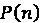 对于所有的  都成立。这些条件如下：

1. 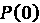 为真。
2. 如果 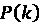 对于任意的 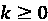 为真，那么 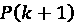 也为真。

这里发生的情况是，第一个条件告诉我们  为真。第二个条件接着告诉我们  为真意味着 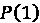 也为真。那么  为真意味着 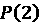 为真，以此类推，适用于每一个 。第一个条件有时被称为 `base case`（基础情况）。第二个条件是 `inductive step`（归纳步骤）。假设对于某个 ， 为真通常被称为 `inductive hypothesis`（归纳假设）。通常，基础情况是谓词在  处成立，但并非必须如此。例如，它可以从  或  开始。相应的语句随后被证明适用于所有大于等于基础情况的值。这里有一个使用归纳法证明数学语句的经典示例。

### 示例

考虑以下语句。前  个正整数的和可以如下计算：

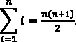

我们可以使用归纳法证明该语句对于所有的 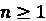 都成立。

首先，考虑基础情况 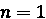。在这种情况下，左侧之和为 1。在右侧，表达式为 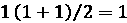。这两者显然相等，因此基础情况得到了证明。

接下来，假设对于某个 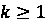，该语句为真。为了检查长度为 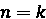 的序列，首先检查 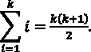 项，然后检查最后的 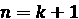 项。这就是归纳假设。

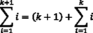

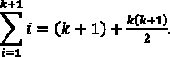

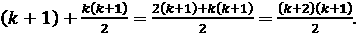

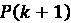


复杂度通常用“大 O”表示法记录，例如 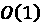 ， 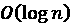 ， 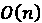 ，以及 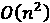。这里出现的数字是对于足够大的  而言决定理论执行时间的主项。在这里， 代表常数复杂度，无论输入大小如何，操作所需的时间都是恒定的； 意味着运行时间与输入的大小呈线性关系。二次复杂度  意味着理论运行时间由输入参数大小的平方决定。

### 示例

对内存数组进行基于索引的查找具有常数复杂度 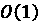。访问数组所需的时间不取决于数组本身的大小。（这是理想情况；实际上在物理上无法实现这种复杂度的，至少以目前的技术来说。）

线性搜索，例如上一节描述的 `find` 算法，具有线性复杂度 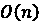。为了搜索整个序列，我们必须（最坏情况下）访问序列中的每个元素。每次访问都是常数复杂度，因此整体复杂度仅取决于序列中元素的数量。

在有序序列中通过二分查找寻找任何特定元素具有对数复杂度 ，这优于  复杂度。在这里，我们可以利用数据的顺序来判断元素是在序列的前半部分还是后部。重复这个过程会导致  次拆分以找到该元素（或确定其不存在）。

最好的排序算法在最坏情况下的复杂度为 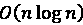；某些算法在最佳情况下表现更好（我们在这里不描述这意味着什么），但  是可以达到的最优结果。简单的插入排序算法具有 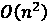 复杂度。

形式上，如果算法 （取决于 ）具有复杂度 ，对于某个函数 ，如果存在常数  和正整数 ，使得当  时，运行时间  满足 。这是一个非常技术性的定义，所以让我们拆解一下部分。首先，注意我们只关心大的（正的）整数； 是关于算法 `asymptotic behavior`（渐近行为）的陈述，而不是针对  小值的行为。（ 小值处的行为往往会被算法的其他时间成本掩盖。）其次，我们允许任意的灵活性常数。在实践中，这个常数可以很大，但对于大的  来说并不重要。这是运行时间的上界，表示最坏情况。许多算法具有更低的平均复杂度或最佳情况复杂度。

计算算法的复杂度（至少是非正式的）只需要检查步骤并相加操作次数。如果步骤足够简单且涉及已知复杂度的操作，这种方法就有效。然而，必须小心。很容易漏掉复杂度的来源，或者复杂度可能会更复杂。

另一个重要说明是  )  只需要报告。例如， 的  的  的  的  的  的  的  的  的  的  的  的  的  的  的  的  的  的  的  的  的  的  的  的  的  的  的  （（此处原文似乎存在重复占位错误，已按要求维持翻译逻辑）

### 复杂度之间的关系

显然，不同的复杂度类之间存在内在的顺序。例如，线性复杂度  显然优于二次复杂度 ，但对数复杂度处于什么位置？最低可能的复杂度是常数复杂度 。这意味着该算法完全不取决于输入的大小。我们已经注意到线性数组中的元素查找具有常数复杂度（至少理论上是）。对数复杂度紧随其后（例如二分查找），因为它位于常数复杂度和线性复杂度  之间。多项式复杂度  随着次数而增加 。出现过的、即使是规律性的最大的复杂度类是指数复杂度 。然而，这些算法的运行时间增长如此快，以至于往往是不实用的。

为了说明，在对数轴尺度下绘制的一组代表性复杂度的差异如图 3.1 所示。

 

### 摊销复杂度

有时，算法的复杂度并不是均匀的。在某些情况下，在算法执行过程中会半定期地触发非常昂贵的操作。大 O 复杂度反映了使用算法的最坏情况成本，这通常是峰值的总和，而不是通常的平均情况。


例如，考虑 `std::vector` 中 `push_back` 操作的复杂度。在大多数情况下，在 vector 尾部插入元素的复杂度为 ；这仅仅是增加指向活动缓冲区末尾的指针并构造新值的开销。然而，如果没有剩余的分配空间，则 vector 必须重新分配内存并将所有数据从旧缓冲区拷贝/移动到新缓冲区中，而新缓冲区的大小（通常）是旧缓冲区的的两倍。这种重新分配和数据移动具有线性复杂度，因为每个元素都必须被访问一次。但是，由于 vector 缓冲区每次大小都会翻倍，随着元素数量的增加，这些重新分配发生的频率会降低。在这种情况下，我们可以说 `push_back` 操作的代价是`摊销常数`。

在这里我们可以更精确一点。向 vector 中第  次插入的  成本，如果  是 2 的幂，则为 ，否则为 1。因此，前  次插入的成本为  加上在  次插入之后进行的所有重新分配的贡献。由于增长策略，重新分配的次数是  的以 2 为底的对数的整数，记作 。第  次重新分配的成本为 。（如果  是  的幂，则在第  次插入时发生分配，即当 。）将这些加起来，我们得到以下方程：


因此，前  次插入的总成本为 ，这意味着摊销成本是 ，一个常数！

现在我们已经对算法的属性和分析有了基本的了解，我们可以看看如何开始设计自己的算法，这是下一节的内容。

# 设计你自己的算法

设计算法并不总是一项复杂的任务。大多数问题都相对简单，至少当你剔除那些可以识别为标准问题（带有标准解决方案）的组件后是这样。在知名算法的基础上构建并从几个此类算法组合成解决方案，从时间和效率的角度来看，这无疑是首选方法。在前两个章节中，我们花费了大量篇幅通过各种方式来识别这些标准问题。原因很简单：不要重复轮子。追求性能和算法效率通常需要离开基础模式，并需要对问题和技术的特定了解。要设计基础算法，需要理解一些基础算法设计模式。算法设计与数据结构紧密相连，但我们直到 *第 5 章 才会涉及这一点。

遗憾的是，并不是所有新问题都是已知问题的实例或组合。因此，程序员能够为这些新问题开发自己的算法始终是重要的。在这种情况下，我们可能无法提供一个标准的算法来使用，但我们可以提供一些通用算法类和技术的建议，你可以利用它们来构建自己的算法。这是本节的主题。再次强调，记住算法设计和数据结构是紧密相连的。在我们讨论构建算法的一些通用概念时，请记住这一点。

通常，在解决问题的过程中开发算法时，解决问题的其他方面（分解、抽象和标准模式）使得开发算法变成了一个相当“显而易见”的过程——如果它不显而易见，可能表明你还没有找到良好的抽象——算法几乎是自己写出来的。开发一个比现有算法复杂度更好的新算法是一项复杂的事，显然不是本章的主题。数学家长期以来认为，计算矩阵  积的最佳算法具有  复杂度。当然，直到 Strassen 的分治算法广为人知并具有  的复杂度为止。那是多年研究的成果，并取得了相对的改进。真正的收益来自于与硬件工作以提高算法的（不是）。我们将在下一节介绍其中的一些。

## 迭代算法

遍历输入的一种简单方法是逐个处理项（我们在这里泛指 item 一词，因为输入可能不是序列）。这个过程描述了一个迭代算法。例如，标准库中的 `std::min_element` 和 `std::max_element` 函数就是迭代算法的示例。这种方法的优点是它非常简单，但它对复杂度也有影响。即使每个处理步骤只有常数复杂度，迭代算法也将具有线性复杂度。

话虽如此，在开发新算法时，编写一个简单的迭代算法是一个明显的起点。就像解决问题一样，开发算法本身就是一个迭代过程，涉及到多次尝试才能得到可以接受的任务解决方案。编写最简单的迭代算法的另一个理由是为了测试。简单的算法可能更容易证明正确性并实现代码，因此可以作为测试未来实现是否正确的手段。

迭代算法围绕循环展开。在循环内部，我们执行一组操作，当迭代结束时，我们的数据将满足算法的后条件。为了实现这一点，我们建立了一个在每次迭代中必须保持不变的不变量。这个不变性是证明算法有效性的要素。例如，在 *第 1 章寻找最大元素的算法中，我们使用了迭代模式来寻找最大元素。我们首先将最大元素设置为序列中的第一个元素，并标记为 。从那里开始，我们遍历序列中的剩余元素。这里的不变性是  大于或等于我们目前为止的所有元素。将  与当前元素中的值值交换的操作维护了这一不变性。因此，当我们结束时， 就是序列中最大的元素。


选择正确的不变式并不总是简单的，但从不变式的角度思考会使算法设计变得更容易，并使证明它们确实有效成为可能。不变式必须存在，即使它看起来是微而易见的。这形成了证明算法有效性（通过归纳法）的关键要素。思考不变式就像抽象。一旦你为问题找到了“正确”的不变式，编写算法就会变得容易得多。

## 递归算法

一个递归算法包含两个部分。第一部分处理递归的不可分“基准情况（base case）”。这是算法中不需要进一步递归即可处理的部分。在前面的示例中，这就是指数为 或 的地方。第二部分是将问题分为两个并递归地处理每一部分。如果这种递归是我们已经处理过的那些不可分情况之一，那么它可能是平凡的；它也可能是递归到两个或多个等大小的部分（或其他）。

许多问题可以更容易地用递归表示；一个输入的解决方案取决于上一个输入的解决方案（例如规模较小的输入）。这种设计算法的通用方法也有优点。在最基础的实现中，递归算法简单地模仿迭代模式，通过递归到 情况来求解，单独求解 情况，然后将两者结合。理论上讲，这与执行简单迭代完全相同。然而，从递归的角度思考可以开启拆分数据的替代手段，从而产生更高效的算法。

### 示例

编写一个计算数字的整数幂的算法有一个显而易见的迭代解决方案。为了计算某些  的 （为了简单起见，不为零）以及某个正整数 ，我们可以使用一个非常简单的循环：

```cpp
template <typename T>
T power(T x, unsigned n) {
    if (n == 0) { return T(1); }
    T result = x;
    while (--n > 0) {
        result *= x;
    }
    return result;
}
```

这具有线性复杂度（但它非常简单）。使用一个相对简单的递归算法，可以达到对数复杂度。这是**分治（divide and conquer）**类型算法的一个示例，我们将在下一节中讨论。实现如下：

```cpp
template <typename T>
T power(T x, unsigned n) {
    if (n == 0) { return T(1); }
    if (n == 1) { return x; }
    const auto pow2 = power(x, n / 2);
    T result = (n % 2) == 0 ? T(1) : x;
    return result * pow2 * pow2;
}
```

这显然不像迭代解决方案简单，因为我们必须处理边界情况（当 次来计算 。该链中的每次调用最多需要三次乘法（以及一些条件判断），这些具有常数级复杂度。

特别对于 C++ 来说，可以利用 `constexpr` 函数或甚至更原始的模板方法在编译时计算值。在 C++11 中，你只能在 `constexpr` 函数中使用递归，但更现代的标准已经扩展了这一点，包含了循环和其他构造结构。然而，效率在这里仍然重要，因为低效的编译时计算会大幅增加代码的构建时间。

递归算法可能是表示计算的一种非常方便的方法，但在 C++ 中实现时它们也有一些缺点。在 C++ 中，递归函数可能受益于尾递归优化，这本质上是编译器将递归调用栈展开为高效的汇编代码。这只能在某些情况下应用。当编译器无法这样做时，将适用于函数调用的规则。每调用一次函数，栈中就会添加一个新的栈帧。向栈中添加新帧的代价虽然不大但并非零，因此大规模的递归会对运行时性能产生实际影响。在极端情况下，大量栈帧所需的空间可能会导致其他问题，例如栈溢出。

## 分治算法

许多问题涉及在由输入数据定义的某种域上进行计算。当搜索域的不同部分相互独立时，我们可以将该域划分为相同问题的较小实例，并孤立地处理这些较小实例。这就是分治技术。在我们上一节的示例中，我们通过两个较小实例是等等计算这一事实提高了效率，从而在每一步都消除了一半的工作。分治类型算法的有限性是由我们每次都让问题变小这一事实保证的；正整数序列会在有限步数后终止。标准库中的分治示例包括 `std::upper_bound` 和 `std::lower_bound` 等二分查找。

分治算法有三个基本步骤：划分（divide）、处理（process）和合并（combine）。正如名称所示，它将空间划分为相同问题的较小实例。第二个步骤处理每个较小问题。最后，一旦解决了所有较小问题，我们在顶层合并解决方案以完成问题。合并步骤可能仅仅是较小实例结果的结果，也可能复杂得多。然而，如果我们智能地划分工作，就可以避免频繁执行这些合并操作。

分治算法的分析由于“主定理（master method）”也可以相当简单。分治算法的执行时间可以表示为递归关系。在这里，规模问题的运行时间表示为涉及 规模问题的表达式，其中 小于 ，例如 。主定理处理递归关系如下，给定常量 

此类递归关系在分治方法中很常见。定理本身见《算法导论》[1]的第 4.5 节，给出了三种情况下的复杂度表达式。我们在这里不陈述定理以避免技术细节。泛来说，这种递归的复杂度由 决定。一种特殊情况是当 与 相当时，。


分治算法的一个经典示例是 `quicksort`（快速排序）算法。该算法通过首先围绕一个基准元素（pivot）对序列进行划分来排序。然后，对基准左侧和右侧的数据应用快速排序。快速排序算法非常简单，但在代码划分方式上有多种选择。以下是 C++ 的基本实现：

```cpp
template <typename T>
std::ptrdiff_t partition(std::span<T> data)
{
    auto& pivot_value = data.back();
    std::ptrdiff_t pivot_pos = 0;
    for (auto j=0; j<data.size() - 1; ++j) {
        if (data[j] <= pivot_value) {
            std::swap(data[pivot_value], data[j]);
            ++pivot_pos;
        }
    }
    std::swap(data[pivot_pos], pivot_value);
    return pivot_pos;
}
template <typename T>
void quicksort(std::span<T> data)
{
    if (data.empty()) { return; }
    auto pivot = partition(data);
    quicksort(data.subspan(0, pivot));
    quicksort(data.subspan(pivot+1));
}
```

在这个算法中，没有合并步骤。一旦两个解决步骤都完成，就不再需要进一步的工作了。该算法的大部分工作是在划分步骤完成的。这一步不仅找到了划分应该发生的位置，还执行了初步的排序，将值划分为基准值以下和以上部分。在这一实现中，我们选择最后一个元素作为基准。可以选择任何其他元素（甚至随机选择一个），而不会改变算法的特性。

# 图与图算法

`graph`（图）由一组`vertices`（顶点）中，`path`（路径）是连接一个顶点到另一个顶点的边序列。`cycle`（环）是起点和终点都是同一个路径。许多图算法要求图是 `acyclic`（无环的），这意味着它不包含任何环。每个顶点都通过路径连接的无环图被称为 `tree`（树）。

图的顶点和边可以携带额外信息。标注图中边最常见的方法可能是为它们分配方向或权重（或两者兼有）。这些权重可以代表许多不同的事物，例如距离、交通容量、成本等。在图中寻找两个节点（包括带权重的图）之间的最短路径是图论和图科学中的一个经典问题，可以通过 Dijkstra 算法来解决。

算法本身对于这次特定的讨论并不重要，但处理图的通用策略是重要的。许多图算法是所谓的 `greedy algorithms`（贪心算法），其中根据某些相关的数值来选择顶点或边。例如，人们可能会从度最大的节点开始选择（顶点的度是起始或结束于该顶点的边数）。这包括如 Dijkstra 算法等算法。

搜索图可以通过两种不同方式之一进行。第一种是 `breadth-first`（广度优先），在选择一个方向之前搜索所有相邻顶点，然后重复。相比之下，`depth-first`（深度优先）搜索在回溯并选择下一个方向之前，会尽可能地沿着每条路径向下延伸。不同的策略有不同的用途，取决于问题的需求。

图也可以用于对算法进行推理。许多过程可以被建模为某种类型的计算树，这允许我们从数学角度对该过程进行推理。例如，我们对 `power` 的实现是通过构建计算数字幂的计算树来实现，并进行重新平衡，使得树的每个分支携带更多的“叶子”。树也大量出现在数据结构中（例如 B 树）。结合启发式方法，如果我们能够确定某个工作树分支永远不会通向解决方案（或不太可能），我们就可以可能从工作树中剪掉整个分支。

# 优化算法

`Optimization`（优化）是一个出现在许多领域的问题，但它主要是一个数值问题。这类问题的目标是最大化或最小化目标函数，该函数可以是各种事物的代理，例如成本或收益率。广义上，该领域分为两类：线性与非线性。线性优化涉及寻找线性约束方程的解。在这里，目标函数是线性的——即形式为 。

求解受限线性优化的基本方法是单纯形法（simplex method）。问题中的线性不等式组定义了一个可行区域，我们在该区域寻找目标函数的最大值。该区域的形状是一个单纯形（simplex）——多个半平面（由线性不等式定义）的交集——这也就是该方法的命名来源。

求解受限线性优化的基本方法是单纯形法。问题中的线性不等式组定义了一个可行区域，我们在该区域寻找目标函数的最大值。该区域的形状是一个单纯形（simplex）——多个半平面（由线性不等式定义）的交集——这也就是该方法的命名来源。

优化问题的另一类涉及涉及非线性系统。在这里，目标函数是非线性的（通常是复杂的）。这些问题可能比线性优化要复杂得多；线性函数是极其简单的。如果导数已知，可以使用梯度下降法来寻找最小值。如果目标函数的导数未知（或已知不存在），则有其他方法。Nelder-Mead 算法就是此类算法之一，属于无导数优化。当然，不使用导数的代价是算法寻找数值的效率较低。

在树上优化通常可以利用分支定界算法（branch and bound algorithms），其中我们利用启发式方法确定哪个分支最可能包含最优解并剪剪搜索空间。这降低了复杂度，有效地收缩了搜索空间。

## 梯度下降

梯度下降方法因其计算效率和灵活性而非常流行。如果可以计算目标函数的梯度，就可以很容易地最小化函数本身。然而，并不是所有函数都是可微的，即使是可微函数也可能表现出异常。梯度下降方法的一个常见缺点是它们可能会“卡”在局部最小值（想象成函数图中的一个碗），从而无法找到函数的全局最小值。有一些方法可以缓解这种风险。

梯度下降的核心假设是，通过在最陡峭的方向向下（相对于函数）移动，可以快速找到目标函数实现最小值的地方。数学上，最陡峭下降由梯度的负值决定。这种最陡峭下降的步长有时被称为学习率。为了更清楚，让我们来看一个简单的例子。

**示例**


考虑由  给出的函数。这个函数非常简单，很容易看出它在  处达到最小值，在该处取得值为  以及一个最大步长 。我们可以执行梯度下降来向最小值“迈进”。

我们首先需要的是梯度，在这种情况下，梯度可以很很容易地计算为 。因此，我们应该采取的步骤应该是方向 。由于我们从  开始，我们的第一步应该是方向 ，步长为 ，这意味着我们的新位置是 。再次重复该过程，我们计算  处的负梯度为 ，并在该方向上迈出长度为  的步，落在位置 。这个过程实际上从未到达 ，但迭代序列确实收敛于它。（在经过大量的迭代后，该点本质上与  无异。）这是很典型的；梯度下降并不总是会最终落在最小值上。

当函数的梯度无法以显式形式未知时（如这种情况），人们可以通过多种方法估计导数数据。机器学习生态系统中常用的一种方法是，通过标记数据并跟踪所应用的基础操作来计算导数。这些信息可以用于计算梯度。这是一个相当复杂的话题，所以我们在这里不会介绍它。

### 动态规划

动态规划与计算思维本身一样，通过将问题分解为更小的部分来解决问题。这里的区别在于，动态规划中的子问题是重叠的（并且通常与主问题本身的形式相同）。优势在于，当人们记住（`memoizes`）较小子问题的解决方案时，在解决依赖于这些问题的较大子问题时可以使用它们。（是的，子问题形成了一个图，箭头表示子问题之间的依赖关系。）

并不是所有问题都适用于动态规划解决方案；找到图中顶点之间的最短路径可以使用动态规划解决，但寻找最长路径可能不能。显然，问题必须是可以分解为更小的子问题的。此外，为了使动态规划方法有效，问题还必须满足额外的约束。第一是问题的最优解应该是其涉及的子问题的最优解的聚合。这在《算法导论》[1]中被称为 `optimal substructure`（最优结构）。第二是子问题应该是重叠的。子问题重叠得越多，记忆这些子问题解决方案的收益就越大，从而运行时间缩短得越多。

使用动态规划方法解决问题的最后一步是通过考虑所有组成问题来重构最终的（最优）解决方案。这一步可能相对简单。在最短路径问题中，需要考虑在删除原始起点后的图中，从与原始起点连接的每个顶点寻找最短路径的子问题。在这种情况下，考虑到遍历从原始起点到每个路径起点的边开销，真正的最短路径是这些路径中最短的一个。最短整体路径并不总是最短的子路径，因为添加新的初始边的成本可能会改变总和，使得另一个选择变得更优。

### 随机算法

`Randomness`（随机性）是一个强大的工具。如果我们理解提供算法的数据分布，就可以计算算法的平均复杂度。我们对复杂度的衡量代表最坏情况，但在许多情况下这些情况并不多见。例如，在对序列进行排序时，最坏情况是元素反序的。然而，这只是大量可能配置（）中的一种。因此，任何随机数据序列的性能都可能比最坏情况更好。我们可以进行这种分析，是因为我们知道给定大小此类序列排列的分布。这并不是处理算法时使用随机性的唯一用途。我们有时可以向问题注入随机性以隐藏某些复杂性。例如，随机梯度下降利用随机性（无论它是问题中固有的还是以某种方式注入的），来改进下降的收敛性或属性。

# 要求与考虑

在为性能关键部分设计算法时，理解有助于或阻碍性能的因素是重要的。为了这一点，我们将讨论现代处理器的架构、内存以及对后续有影响的其他方面。本节旨在强调我们可以避免瓶颈的方法。

最重要的事情之一是利用标准工具（包括 C++ 语言或标准库之外的），这些工具经过了高度优化，且性能几乎总是优于手写的解决方案。这实际上是编写算法之前的抽象和模式识别的一部分，但将问题的部分识别为已知问题（如线性代数）意味着你可以使用库函数，而不是手动编写这些部分。

在实现递归算法时，记住 C++ 不是一种函数优先的编程语言。递归函数调用带有大量的开销（设置堆栈等）。编译器有时可以识别函数是否是递归调用链的一部分并优化掉开销——这被称为 `tail-call optimization`（尾调用优化）——但这并不总是适用。这里的另一个有用的事情是让递归函数内联。有时，我们可以依赖于事实，即递归调用的次数相对于总工作量来说较少（如分治类算法所示），这样函数调用开销就被分摊了。然而，在实现算法时，你应该记住这一点。

## 缓存感知算法

现代 CPU 非常快，快到可能可能会花费大量时间等待从内存中传输数据以进行计算。缓存位于 CPU 和主内存之间，离 CPU 更近，在那里访问数据快得多，延迟也低得多。通常，处理器（以及操作系统或程序本身）会对将需要的数据做出预测，并将这些数据预取到缓存中以备使用。以可预测的方式访问数据的算法有助于促进这种预取。


矩阵乘法是许多现实世界操作中的基础操作（它确实无处不在！）。问题在于，数据存储在连续的内存块中，第二行的数据存储在第一行所有数据之后，以此此类推。这意味着按列访问矩阵元素涉及到内存块中的长跨度跳转。这对于缓存性能是毁灭性的，至少如果实现时没有考虑到这一点。最优解决方案是确保尽可能少地从主内存加载数据，因此我们在每个元素从缓存中剔出之前，尽可能充分利用每一个元素。现代`基础线性代数子系统`（`BLAS`）实现之所以包含快速的矩阵乘法，是因为它们利用了这些对缓存更友好的“分块”算法（以及其他）。

## 向量化操作与 SIMD

CPU 设计者知道，许多对数字（整数或浮点数）的操作通常不是针对单个数字，而是针对一个中等规模的数字数组进行的。因此，处理器具有专门的硬件，可以同时处理多个数字。这种专用硬件通过所谓的`单指令多数据流`（`SIMD`）指令和扩展来访问。这些指令同时对 2、4、8、16 甚至 32 个数字执行相同的操作，这可以极大提高处理器的吞吐量（假设内存能跟上这种对数据的渴求）。

SIMD 已经存在相当长了，所有现代 64 位 x86 处理器至少实现了 SSE2 指令集，该指令集提供了可以处理多达 128 位“向量”（两个 `double` 或四个 `float` 类型）的指令。许多编译器会假设情况如此，并自动对适当循环进行向量化以利用这些指令。然而，大多数处理器的能力远超 SSE2；许多处理器实现了 AVX2 甚至 AVX512 指令集，它们分别可以处理多达 256 位或 512 位的“向量”（吞吐量翻倍或四倍）。

本章内容关于算法设计，因此现在的问题是，当存在这种能力时，如何设计可以被向量化的算法。与缓存友好型算法一样，关键在于在操作之前组织数据，以便编译器能够执行向量化。通常，这简单来说意味着确保要操作的数据存储在连续内存中，并按顺序访问（从索引 `0` 开始）。某些编译器比其他编译器更擅长识别这些场景。即使是使用 `std::vector` 的迭代器也可能足以阻止向量化。使用 `std::ptrdiff_t` 整数作为索引并直接访问数据（使用如 `std::span` 等）通常是确保编译器识别这一机会的最佳方法。

使用 SIMD 的另一个考虑是必须确保数据没有别名（alias）。当两个引用或指针引用内存中重叠的对象时，就会发生别名。例如，如果一个缓冲区包含另一个，可能会发生这种情况。编译器无法对可能存在别名的数据操作进行激进优化，因为它无法保证操作顺序保持不变。帮助编译器理解数据没有别名并不容易——目前，C++ 标准尚未提供此种机制。`restrict` 关键字可以在 C 语言中使用，但 C++ 中并不存在。这并不意味着这是可能的。例如，存储在两个不同 vector 中的（基础）数据不会产生别名，因为 vector 管理它们自己的内部存储，所以为此类两个 vector 获取的 spans 不可能别名。但是，必须小心确保这种推理链足够简单，以便编译器能够做出此类推断（或者可以使用编译器属性和内联函数）。

## 分支预测与推测执行

现代 CPU 的某些性能源于其复杂的预测预测和推测执行。通过分支预测，处理器尝试确定将采取哪条执行路径，以便从内存获取数据以及与路径相关的指令。推测执行则更进一步，同时执行两条备选路径，同时由计算决定取结果中的哪一个以及丢弃哪一个。

理解推测执行可以带来提高性能的一些有趣机会，但它也带来了相当大的风险。推测执行机制是几年前严重漏洞的根源。这些功能非常强大，但如果你正在处理安全敏感型组件，请确保你正在降低推测执行带来的风险。然而，这超出了本书的范围。

在代码中非性能关键的部分，条件判断是常见的、必要的，且通常对性能没有影响。至关重要的地方是性能关键区域中所谓的“紧凑循环”（tight loops）。`紧凑循环`是指在大块数据上执行的一小段代码，通常是某种数值计算，需要尽可能快地执行。在这里，每一秒都至关重要，因此许多分支指令的累积成本将产生巨大的累计影响。然而，有时这种条件判断是避免的。在这种情况下，推测执行可以帮助缓解成本，但前提是每个分支都足够简单。

# 总结

本章完全关于算法。算法是一组指令，它以与语言无关的方式告诉程序员如何解决特定问题。算法具有复杂度，复杂度描述了算法根据输入的大小完成任务所需的时间。例如，具有线性复杂度的算法  的运行时间与参数的大小成正比，而具有常数复杂度的算法无论输入大小如何，所需时间相同。设计高效的算法是让你的解决方案更快的方法之一。（当然，现实情况比这复杂得多。）

有时你可能找不到复杂度更低的算法，但你可能改变算法的设计使其更适应硬件。设计缓存感知型算法可以减少到内存的加载和存储的次数，或者重新排列这些操作，使得这些加载对性能产生巨大影响，即使复杂度没有变化。（构建低复杂度的算法是一项巨大的时间投入，而且有时并非必要。）在下一章中，我们将探索现代计算机架构的设计，以及我们如何在解决问题时利用这一点取得优势。

# 参考文献

1.  Cormen, Thomas H., Leiserson, Charles E., Rivest, Ronald L., Stein, Clifford. 2001\. *Introduction To Algorithms* . 4(th) ed. Cambridge, MA: MIT Press.

2.  Knuth, Donald E. 1997\. *The Art of Computer Programming* . 3rd ed. Boston, MA: Addison-Wesley.


现代硬件极其复杂，并拥有许多让代码运行更快速、更高效的设施。对于程序员来说，在解决问题（特别是在追求性能时）理解所使用的所有工具至关重要，这无疑包含了计算机硬件以及与硬件紧密协作的操作系统。

在本章中，我们将简要回顾一些关键的硬件部分，包括处理器的各个部分（如缓存内存和 `single instruction multiple data`（`SIMD`）扩展）以及主内存。我们将看到一些示例，展示我们如何设计算法来利用处理器的缓存并利用 `SIMD` 指令来极大提高处理器的吞吐量。我们将通过使用 OpenMP 进行多线程来看更高层次的并行性，并利用操作系统设施来确保应用程序在运行过程中获得充分的支持。我们还将探讨处理器的一些更为复杂的方面，例如分支预测和投机执行，看看这些技术如何对性能产生意想不到的影响。

在本章中，我们包含的细节有限。硬件制造商（例如 Intel 或 AMD）为特定硬件提供了大量的资源。Agner Fog 写了一本关于硬件及其对性能影响的非常详尽的，可以在此处找到：[`www.agner.org/optimize/`](https://www.agner.org/optimize/)。这是理解如何利用硬件实现性能最大化的极佳资源。

在本章中，我们将涵盖以下主要主题：

*   理解现代处理器设计
*   存储体系
*   SIMD
*   分支预测和投机执行
*   操作系统

# 技术要求

本章重点关注现代硬件的特性，以及我们应该如何将这些特性的知识整合到代码中。本章中有许多代码示例主要关注 x86（64 位）架构的特性。大部分讨论也适用于其他架构（如 ARM），但我们使用的某些机制（例如 `cpuid` 指令）并不那么容易获取，可能需要与内核交互。为了保持代码简单，我们限制在在 x86 上运行的代码以及可以在任何地方运行的通用代码。

本章的代码可以在本书的代码仓库的 `Chapter-04` 文件夹中找到：[`github.com/PacktPublishing/The-CPP-Programmers-Mindset`](https://github.com/PacktPublishing/The-CPP-Programmers-Mindset)。

# 理解现代处理器设计

在计算早期，处理器是相对简单的电路。它们能够完全按照程序员提供的顺序执行单个操作。现代处理器是完全不同的“怪兽”。它们拥有多个核心，每个核心运行多个线程，其指令可以同时执行多个操作，某些指令同时在多个数据上进行操作。此外，它们以惊人的速度实现了这一点；即使是相对平庸的 3GHz，单个时钟周期也小于半个纳秒（  ）。凭借这些强大的性能，现代处理器可以以惊人的速度完成任务。

当然，作为 C++ 程序员，我们希望确保尽可能利用这些力量来尽快完成我们的任务。理解处理器的特性并设计易于处理器的算法将极大地加速你的代码。然而，请记住，优化代码是一项微妙且耗费时间的任务，应该只在必要的时间和必要的地方进行。

在本节中，我们将检查处理器的基本部分，并简要概述这些部分如何协作完成完成任务。我们从处理器的基本组件开始。

## 基本组件

处理器的基本组件自计算早期以来并没有真正发生变化。*图 4.1* 显示了处理器的简化框图，它说明了这些组件位于处理器的近似位置以及它们彼此之间的关系。处理器的核心部分是`算术逻辑单元`（`ALU`），它执行基础逻辑操作和整数算术。它在存储在若干`寄存器`之一中的数据上运行。寄存器必须从内存获取数据，这由`内存管理单元`（`MMU`）处理。要执行的指令也通过`指令解码器`电路从内存中读取。


图 4.1：显示双核现代处理器主要组件的简化框图。缓存布局在不同处理器之间有所不同；例如，L2 缓存可能是共享而非每个核心专用

在核心本身和 MMU 之间存在多层缓存内存。这些是极快速内存的小型库，可以填充处理器需要的数据，从而跳过访问主内存检索数据或指令的需求。缓存分为三种：数据缓存、指令缓存和统一缓存。正如名称所示，数据缓存和指令缓存分别处理数据和指令。统一缓存则同时处理数据和指令。通常情况下，只有最低级缓存被分为独立的数据缓存和指令缓存，而高级缓存是统一的。

与 ALU 并排放置的是`浮点单元`（`FPU`）。这些是用于对浮点数进行计算的独立电路组。现代实现利用`向量寄存器`，它可以容纳许多可以并行操作的浮点值（这些是 SIMD 寄存器）。ALU 和 FPU（以及我们在此不讨论的其他一些组件）被称为处理器的`后端`（执行实际工作的部分）。

指令解码器是处理器`前端` 的一部分。指令解码器的主要工作是为处理器提供源的待执行操作。当处理器可能在单个纳秒内执行两个或更多操作时，这绝非易事。然而，这同样也是一个极大的简化。许多处理器同时执行多个操作，且不一定按照程序员给出的顺序。这被称为`流水线技术`。处理器包含几个并行执行通道和多组相同的寄存器。指令解码器确定单个操作和数据之间的依赖关系，并将指令放入处理器通道中。通过这种方式，独立的加载操作或存储操作可以并行执行。通过这种方式，处理器可以堆叠指令，以减少处理器等待数据而停顿的时间。

处理器的最后一个重要部分是输入输出控制器，它与系统中的其他设备通信，例如存储设备、网络接口和`图形处理器`（`GPU`）。这些设备中的许多通过`外围组件 Express`（`PCIe`）总线连接到处理器。这是一种灵活的通信机制，允许与形成更大计算机系统的外围设备（如之前提到的设备）进行高速通信。我们不会过多讨论这些，除非在下一节对计算机存储进行广泛讨论，以及在*第 14 章中对 GPU 编程的讨论中涉及。


# 指令集架构

处理器有不同的类型。处理器支持的操作由`指令集架构`（`ISA`）进行描述。许多桌面处理器实现 `x86` 指令集或其 64 位兄弟版本（`x86-64` 或 `AMD64`）。移动设备通常使用 `ARM` 架构，它是精简指令集架构（`RISC`）家族的一员。最近，基于 ARM 的处理器也开始进入桌面电脑和数据中心，最著名的当过于 Apple。此外还有其他的 RISC 指令集，例如 `RISC-V`，但这些通常是专门针对特定应用的硬件，而不是通用处理器。

与 `ARM` 和其他 RISC 指令集不同，单条 `x86` 指令可以在 CPU 内执行多个不同的操作。这具有某些优点，即减少了复杂任务所需的指令数量，这在内存昂贵的时代（如计算早期）至关重要，但它会导致处理器变得更复杂、更耗电。尽管如此，基于 `x86` 的处理器具有数十年的优化和其他开发的优势，这使得它们运行极快，即使不是最高效。相比之下，`RISC` 指令在数量和复杂度上都受限得多。

大多数指令集由一组核心基础指令和一系列可选扩展组成。例如，`x86` 中常见的 `SIMD` 能力（如 `AVX` 指令）是核心架构的可选扩展，尽管大多数处理器模型都实现了这些扩展。基于 ARM 的处理器通过其 `NEON` 扩展族具有类似的能力。大多数 ISA 均提供了一种专门用于执行加密计算的扩展，例如 `SHA` 族哈希算法和 `AES` 对称加密/解密算法，这些在许多通信应用中至关重要。桌面和数据中心处理器通常还具有虚拟化扩展，允许在单台计算机上运行多个虚拟机。

有两种机制可以确定特定处理器可以使用哪些核心架构扩展。第一种是在编译期间，可以指示编译器在假设特定扩展甚至特定 CPU 模型的情况下生成指令。（三个主流编译器工具链维护了一个关于当前 CPU 及其支持的扩展的数据库，正是为了这一目的。）在 `GCC` 中，这是通过使用 `-m` 命令行标志或 `-march=` 标志实现的。例如，添加 `-march="arrowlake"` 标志会生成适用于 Intel 第 15 代 Core 处理器的指令。另一种方法是在运行时查询处理器以确定是否支持特定扩展。在 `x86` 上，这是通过使用 `cpuid` 指令实现的。在 `SIMD` 部分，我们将展示如何使用它在运行时选择最快的实现方式。

# CPUID

大多数处理器都提供了运行时查询处理器能力的方法。在 `x86` 和 `x86-64` 上，这是通过使用 `cpuid` 指令实现的，该指令根据传入 `eax` 寄存器的叶标识符（一个整数）和传入 `ecx` 寄存器的子叶标识符（subleaf）返回不同的信息。根据叶和子叶的组合，`cpuid` 指令会将请求的信息填充 `eax`、`ebx`、`ecx` 和 `edx` 寄存器。解码输出需要阅读指令文档，例如维基百科页面 [`en.wikipedia.org/wiki/CPUID`](https://en.wikipedia.org/wiki/CPUID)。在 ARM 上，有一组可以使用 `mrs` 指令查询的系统寄存器，但我们在这里不会详细介绍。

主要的编译器提供了用于与 `cpuid` 指令交互的内联函数（intrinsic functions），因为有一些必须仔细处理的细节。令人沮丧的是，这些编译器提供的接口不同，因此我们整合了一个简单的包装器来处理这些不一致性。

`my_cpuid.h` 的内容（除去 `include` 保护）如下：

```
#if defined(__X86__) || defined(__x86_64__) || defined(_M_IX86) || defined(_M_X64)
#if defined(__MSVC__)
#  include <intrin.h>
#  define my_cpuid(i, j, regs) \
    __cpuidx(reinterpret_cast<int*>(regs), i, j)
#elif defined(__GNUC__) || defined(__clang__)
#  include <cpuid.h>
#  define my_cpuid(i, j, regs) __cpuid_count(i, j, \
      regs[0], regs[1], regs[2], regs[3])
#endif
#else
#  define my_cpuid(i, j, regs) static_assert(false, "Not implemented")
#endif
```

我们实际上使用的是第二个版本的 `cpuid` 包装器，它同时指定了叶和子叶，因为有一个小 bug 导致 `ecx` 寄存器在第二次使用之前必须清空否则会导致无效响应。这种基于宏的解决方案显然不是最优的，但对于我们这里的需求足够。

**警告**

我们强烈建议，如果你需要此功能，请尽可能使用可用的高级实用程序。例如，在 Android 上，可以使用 `cpu-features.h` 头文件中的工具。在 Windows 上，`GetLogicalProcessorInformation` 系统调用可以提供一些相同的功能。在 Linux 上，`sysconf` 系统调用可以提供有关硬件的信息。`hwloc` 库 ([`www.open-mpi.org/projects/hwloc/`](https://www.open-mpi.org/projects/hwloc/)) 是确定处理器和更广泛系统信息的通用方法。

# 处理器线程

大多数现代处理器都有多个核心，每个核心都可以独立于运行。此外，每个物理核心有时可以同时运行两个线程（例如 Intel 处理器上的超线程技术），这意味着 CPU 能够并行运行许多计算。为了执行大型计算，可以将任务分配给所有可用核心。OpenMP 是一种编译器扩展及配套运行时库，它让编写多线程代码比以往任何时候都容易。

OpenMP 使用编译器指令（`pragma` 语句）将代码块转换为多线程代码。这允许我们编写简单的 C++ 代码，将工作分布到大量核心上，而无需编写复杂的调度代码，或手动控制线程的启动和汇合。让我们来看一个简单的示例，即计算一组点中邻居点之间的距离：

```cpp
namespace ct {
struct Point2D {
    float x;
    float y;
};
// 执行非平凡的操作
float distance(const Point2D& left, const Point2D& right) noexcept {
    return std::hypot(left.x - right.x, left.y - right.y);
}
float nearest_neighbor_distance_omp(std::span<const Point2D> points) {
    const auto size = points.size();
    auto min_distance = std::numeric_limits<float>::infinity();
#pragma omp parallel for reduction(min:min_distance)
    for (size_t i=0; i<size; ++i) {
        for (size_t j=i+1; j<size; ++j) {
            auto dist = distance(points[i], points[j]);
            if (dist < min_distance) {
                min_distance = dist;
            }
        }
    }

    return min_distance;
}
} // namespace ct
```

为了编译并运行此代码，必须将其链接到 OpenMP 运行时库，该库将负责组织和运行实现这些功能的线程代码。这通常通过在编译器命令行中添加额外的编译器标志来实现。幸运的是，我们可以让 CMake 通过查找 `OpenMP` 包并链接 `OpenMP::OpenMP_CXX` 目标来完成这项额外工作：


```
set(OpenMP_RUNTIME_MSVC experimental) # needed to use OpenMP > 2.0
find_package(OpenMP REQUIRED COMPONENTS CXX)
add_executable(open_mp_demo open_mp_demo.cpp)
target_link_libraries(open_mp_demo PRIVATE OpenMP::OpenMP_CXX)
```

编译器现在将自动生成多线程代码，而不是我们在代码示例中写的简单 `for` 循环。在运行时，代码将在多个线程上执行（默认情况下，数量与计算机上的逻辑处理器数量相同）。请注意，启动线程池是有明确成本的，在仅处理少量数据的地方使用这种技术实际上可能会损害性能。

这里展示的最近邻算法可能有更好的实现方式，也可以对内部循环进行并行化。然而，这种实现已足够演示该技术。在 65,536 个点上与顺序代码进行基准测试，使用 8 个线程时运行时间提升了 4 倍（顺序代码为 4,797 ms，OpenMP 代码为 1,161 ms）。这段代码仅适用于寻找最近邻居之间的距离，但无法提供最近邻居本身。（归约变量也不会更新产生距离的那两个点。）

自 C++17 起，人们还可以通过对标准算法使用并行执行策略（parallel execution policy）来廉价地访问多线程算法。这不具备 OpenMP 那样的灵活性，但它确实避免了额外的链接步骤（尽管仍然需要通过 `-pthread` 或类似的参数链接线程支持）。遗憾的是，将最近邻算法翻译成标准算法语言是非常困难的，至少目前是如此。

OpenMP 并非总是可用。例如，Apple Clang 禁用了 OpenMP 支持，尽管目前有一个通通方法。当然，还有许多第三方线程库可以替代 OpenMP 使用，但没有哪一个能提供与 OpenMP 相同层次的编译器支持，因此它们需要一些样板代码来设置并将计算分发到运行时（这就是 `#pragma omp` 自动生成的代码）。取决于具体的场景，你可能希望对线程池的初始化和结束有更多的控制，在这种情况下，OpenMP 接口可能会被认为过于简单。如果需要更多控制，Intel 的线程构建块（`TBB`）是一个很好的替代方案，尽管它也有自己的局限性。

# 存储谱

计算机根据存储时间的长短和访问速度的需求，将数据和指令存储在各种介质中。你可能熟悉磁盘存储，即你的文档和程序长期存储在那里；以及随机存存储器（`RAM` 或简称为内存）。处理器本身包含寄存器和缓存，它们速度非常快但尺寸很小。在本节中，我们将查看活动程序的各种存储层级（而不是通用的长期磁盘存储）。我们从寄存器开始，按照最快到最慢的层级向上，并以一个缓存友好型矩阵乘法的示例结束本节。

我们可以在 `图 4.1` 中看到（大部分）存储谱的各个层。在这里，我们看到了作为每个 CPU 核心一部分的寄存器页、L1–L3 缓存以及系统 `RAM`（通过 `MMU` 连接）。图中未显式显示的是长期存储（硬盘）和网络，尽管它们都是通过 CPU 的输入/输出组件连接的。

## 寄存器

`register`（寄存器）是不同于缓存内存或 `RAM` 的一种存储类型；它持有单个整数（包括指针）或浮点值（目前暂忽略向量寄存器），这些值在指令执行期间会被操作。CPU 的每个核心都有一页寄存器；在 `x86-64` 上，每页有 16 个 64 位的寄存器，可以作为指令的操作数。其中某些寄存器具有特殊用途，而另一些是通用的。

实际上，每个核心可以拥有数倍的寄存器页，其中每个寄存器名称可以指向一组物理寄存器中的任何一个。处理器将在执行的指令解码阶段通过名为“寄存器重命名”（register renaming）的过程，将逻辑名称分配给物理寄存器。这允许处理器并行执行多个操作，例如在分支执行中（参见 `分支预测与预测执行` 章节）。

指令集的 SIMD 扩展通常带有额外的寄存器，例如用于 `AVX` 指令的 `ymm` 系列寄存器。具体的 SIMD 扩展决定了这些寄存器的宽度：`SSE` 寄存器宽度为 128 位，`AVX(2)` 寄存器为 256 位，而 `AVX512` 寄存器为 512 位。在大多数情况下，与标准寄存器页一样，宽寄存器格式的下半部分是对应的较小寄存器。（`ymm0` 寄存器的低 128 位是 `xmm0` 寄存器）。这使得在不需要复制寄存器的情况下实现了向后兼容。

## 缓存内存

处理器本身在缓存的各个层中包含数据存储。这些是物理存储在 CPU 芯片上的微小 `RAM` 块，访问速度极快。缓存通常是分层的，每一层都比前一层更大但速度更慢，并且是专用的或统一的（我们已经在 `理解现代处理器设计` 章节中描述了缓存布局的基础知识）。处理器顺序通过每一层缓存访问数据，将最近访问过或即将被访问的数据移动到缓存中，一旦旧数据不再被使用，就会被剔出（evicted）。程序员对这一过程几乎没有控制权，除非让数据访问对 CPU 变得“显而易见”，并可能利用预取指令。

一级缓存通常被拆分为数据缓存（`L1d`）和指令缓存（`L1i`）。典型的桌面处理器每种大约有 32 KiB，尽管有些更多。（企业级硬件更多！）这是最快的缓存级，访问存储在 L1 缓存中的数据可能只需要 1 到 5 个时钟周期或 0 到 2 纳秒。理想情况下，人们总是希望在 L1 缓存中命中，因为这将提供最好的内存吞吐量。然而，这种速度限制了缓存的大小，这意味着我们最终会寻找不在 L1 缓存中的内容，并且必须进一步访问 L2 缓存。

二级缓存通常比 L1 缓存大得多并且是统一的——它将数据和指令存储在一起。这种缓存的大小各异，但通常具有 1 MiB 的容量，访问存储在 L2 缓存中的数据可能需要 5 到 10 个周期或 2 到 5 纳秒。（这些数字更多是指示性的，而非精确测量。实际时间取决于具体的处理器型号和其他各种因素。）这种缓存可以由一个核心所有，也可以由少数几个核心共享。L2 缓存的慢速度与更大的尺寸相平衡，这意味着缓存缺失率更小。这意味着与只有 L1 缓存相比，L1 和 L2 缓存的平均缺失次数非常小。当然，当请求的数据不在 L1 或 L2 缓存中时，我们必须查看 L3 缓存。


并非所有处理器都有 L3 缓存，但许多常见的桌面处理器都有。这种模式与之前完全相同。这是一个更大但速度较慢的缓存，进一步减少了需要查询主内存的概率。L3 缓存可以很大，通常范围在 8 MiB 到 200 MiB 之间。（一个 Ryzen 7900X 桌面处理器有两个 32 MiB 的统一 L3 缓存。这比 L1 缓存大 1000 多倍。）这种尺寸是有代价的，访问 L3 缓存中值的延迟通常需要 10–40 个周期或 5–20 纳秒。与之前一样，这通过进一步减少缓存缺失以及需要访问主内存的概率来平衡。L3 缓存通常在多个核心之间共享。这的优点是便于进程从一个核心迁移到另一个核心。

人们可能会问，为什么只停留在三层缓存。答案是成本。CPU 裸片上的空间极其有限，因此非常昂贵。缓存占据的每个平方纳米空间都是无法用于其他功能空间。另一个因素是收益递减。每增加一层缓存，都必须比前一层大得多才能继续产生性能收益；因此，简单地增加缓存是不现实的。同样的论点也告诉我们，为什么 L1 和 L2 缓存的大小多年来并没有真正增大。延迟要求对内存库的物理尺寸给定了明确限制，而我们正在接近在该空间内高密度封装电路的极限。

### 缓存行 (Cache lines)

处理器缓存中的每个条目并不是单个字节、字（4 字节）或双字（8 字节）。通常，条目是一个较大的数据块，被称为 `cache line`（缓存行）。其大小不异，但通常一个缓存行为 64 字节。这意味着访问物理上存储在同一缓存行中的多个值，与访问单个值相比不会产生任何额外开销。这意味着访问物理上存储在一起的数据比访问分散的数据成本更低。结合处理器“预测”（参见 *分支分支预测与推测执行* 章节）下一个将访问什么数据的能力，这意味着访问顺序存储的数据比访问分散的数据要高效得多。这就是为什么使用包含数据向量（vectors）的结构体通常比使用包含复杂数据结构体的单向量性能更好的基础。（例如，这种惯用法在计算机游戏行业中非常常见。）

### 查询处理器获取缓存大小

缓存大小因处理器而异，有时知道每层缓存有多有多大是有用的，这样人们就可以调整实现以更好地适应缓存。我们可以在基于 x86-64 的系统上使用 `my_cpuid` 在运行时获取处理器的缓存布局信息，从而允许我们调整缓存内存的使用，在任何硬件上实现性能最大化。获取缓存信息的过程相当复杂，我们将缓慢分析这段代码。

这里有一个微小的复杂之处，用于访问缓存信息的 `cpuid` 叶节点（leaf）取决于 CPU 制造商。对于 Intel CPU，使用叶节点 `0x04`，但在 AMD CPU 上，该叶节点反而是 `0x8000001D`。要检查使用的是哪种制造商，我们必须检查来自叶 `0` 的厂商 ID 字符串。方便的是，我们无论如何都需要查询此叶以检查缓存查询操作是否可用。叶 `0` 将支持的最大叶节点放在 `eax` 中，将 12 字节的厂商 ID 字符串放入 `ebx`、`edx` 和 `ecx` 寄存器（按此顺序）。为了方便使用 `cpuid` 指令，我们将使用在本章前面的*理解现代处理器设计*章节中定义的 `my_cpuid` 宏。因此，我们代码的第一部分如下：

```
unsigned cpuid_registers[4];
my_cpuid(0, 0, cpuid_registers);
unsigned max_supported_function = cpuid_registers[0];
if (max_supported_function < 4) {
    return 1;
}
std::string vendor;
vendor.reserve(12);
vendor.append(reinterpret_cast<const char *>(cpuid_registers + 1), 4);
vendor.append(reinterpret_cast<const char *>(cpuid_registers + 3), 4);
vendor.append(reinterpret_cast<const char *>(cpuid_registers + 2), 4);

```

有了存储在 `vendor` 字符串中的厂商 ID，我们可以设置应该用于检索缓存信息的叶节点。同时，我们设置了一个数组，持有各种类型缓存的字符串名称。Intel 处理器的 ID 是 `GenuineIntel`，而 AMD 处理器的 ID 字符串是 `AuthenticAMD`。我们只需要知道字符串是否等于后者并在这种情况下更新叶节点，如下一个代码块所示：

```
unsigned cache_leaf = 0x04;
if (vendor == "AuthenticAMD") {
    cache_leaf = 0x8000'001D;
}
constexpr std::array<std::string_view, 4> cache_types = {
    "Null", "Data", "Instruction", "Unified"
};
```

现在，我们可以使用指定的叶节点来获取每层缓存的信息。必须使用增加的子叶索引多次查询叶节点以获取所有缓存信息。

```
for (unsigned i = 0; i < 6; ++i) {
    my_cpuid(cache_leaf, i, cpuid_registers);
    // EAX
    // Bits 4:0 (0 = Null, 1 = Data, 2 = Instruction, 3 = Unified)
    unsigned type = cpuid_registers[0] & 0x1F;
    // 如果类型为零，则没有更多缓存
    if (type == 0) break;
    // Bits 7:5 - Cache 层级
    unsigned level = (cpuid_registers[0] >> 5) & 0x7;
    // EBX
    // Bits 11:0 - 行大小
    unsigned line_size = (cpuid_registers[1] & 0xFFF) + 1;
    // Bits 21:12 - 分区
    unsigned partitions = ((cpuid_registers[1] >> 12) & 0x3FF) + 1;
    // Bits 31:22 - 关联路
    unsigned associativity = ((cpuid_registers[1] >> 22) & 0x3FF) + 1;
    // ECX
    // 组数
    unsigned sets = cpuid_registers[2] + 1;
    // 缓存大小（字节）= 行大小 × 分区 × 关联路 × 组数
    unsigned size = line_size * partitions * associativity * sets;
    std::cout << "L" << level << " " << cache_types[type]
              << ": " << size / 1024 << " KiB" << std::endl;
}
```

### 主内存 (Main memory)

主内存或 RAM 是计算机存储“活动”并准备好供处理器使用的地方。在运行任何应用程序之前，代码必须加载到内存中，以及其所有的外部依赖。与高速缓存相比，RAM 相对缓慢，但与磁盘等长期存储介质相比，RAM 通常被认为非常快。处理器从 RAM 获取数据的延迟大约为 60–100 个 CPU 周期，或大约 20–30 纳秒。


在桌面端领域，RAM 以`双内线存储模块`（`DIMMs`）的形式提供。这些模块包含多个内存芯片，并具有固定的容量（例如 1–2 GiB）。它们通过控制器电路（可能）连接到连接内存和 CPU 的总线上。这些内存模块的传输速度和其他属性由标准决定，最近的标准是 `DDR5`。（DDR 代表 `double data rate`，双倍数据速率，因为每个时钟周期会发送两次数据突冲。）内存模块还有几个相关的序序，其中之一就是 CAS 延迟。

`CAS latency`（`CL`）决定了从发送地址请求到开始数据响应之间的周期数。换句话说，这是从内存访问特定数据条目的延迟。对于 `DDR5`，`40` 个周期的 `CL` 是相当正常的。当然，这没有考虑到传输时间，因为较大的数据块需要更长的时间来传输。这也没有考虑到同时访问内存的多个核心之间的竞争。

在桌面之外的其他设置中，RAM 模块可能会被集成在系统的主板上——这在轻薄笔记本电脑和树莓派等单板计算机中很常见——或者 RAM 可以是处理器本身的一部分，这通常是 `系统级芯片`（`SoC`）配置的情况。也存在其他类型的 RAM 模块，但它们的工作方式大相同。

## 考虑到缓存的矩阵乘法

矩阵乘法是许多应用的基础操作，特别是在机器学习和人工智能领域。该操作的内存访问模式非常有趣，编写代码时考虑到缓存（cache）可以极大提高性能。`matrix` 是一个值的矩形数组。一个具有  行和  列的矩阵被称为  (  比  ) 矩阵。按照惯，如果  是一个矩阵，那么第  行和第  列的元素用  表示。（为了符合 C++ 的零索引规则，我们将行从 0 到  进行索引，而不是传统的  到 。）在本节的剩余部分，我们将展示矩阵乘法的两种实现方式。在此之前，我们需要简要解释一下数学原理。

矩阵乘法结合两个矩阵以产生第三个矩阵。具体来说，一个  矩阵  和一个  矩阵  的积是一个  矩阵 ，其元素由等式定义：


注意矩阵  和  的“内层”维度是匹配的。这是矩阵乘法定义的必要条件。结果矩阵的形状由  和  的“外层”维度决定，在本例中，为  和 。此书代码库的 `Chapter-04` 文件夹包含了 `MatrixView` 和 `Matrix` 类，它们将帮助我们实现矩阵相关操作。为了节省空间，我们在这里不显示完整代码，但你可能可以猜到它们的样子。

在计算机内存中，矩阵数据存储在大小为  的连续块中，前  个元素形成第一行、第二行，依此类推。我们称这种布局为 `row major`（行优先）排序，因为行是数据的主要块。还有另一种 `column major`（列优先）格式，其中较小的块形成矩阵的列。在行优先格式下，元素  是位于索引  的。已知这一事实，我们可以写出如下计算矩阵的通用算法：

```
#include "matrix_view.h"
namespace ct {
void dgemm_basic(MatrixView<double> C, MatrixView<const double> A,
        MatrixView<const double> B, double alpha, double beta)
{
    check_dimensions(A, B, C);
    assert(A.is_row_major());
    assert(B.is_row_major());
    assert(C.is_row_major());
    for (ptrdiff_t i = 0; i < A.rows(); ++i) {
        for (ptrdiff_t j = 0; j < A.cols(); ++j) {
            double tmp = 0;
            for (ptrdiff_t k = 0; k < B.cols(); ++k) {
                auto &a_val = A.data()[i * A.cols() + k];
                auto &b_val = B.data()[k * B.cols() + j];
                tmp += a_val * b_val;
            }
            auto &c_elt = C.data()[i * C.cols() + j];
            c_elt = beta * c_elt + alpha * tmp;
        }
    }
}
} // namespace ct
```

内部循环包含求和，并向我们展示了为什么这种矩阵乘法的内存访问模式是复杂的。内部循环访问的是内存中相隔远的数据（准确来说相隔  很大，这些访问确实非常分散。

通过将小块访问在一起，我们可以提高内存访问的效率。这样，我们可以将内存访问限制在任何时刻相对靠近的地方。这一简单的改变几乎使吞吐量翻了一倍。修改后的算法如下：


```cpp
namespace ct {
void dgemm_blocked(MatrixView<const double> A, MatrixView<const double> B,
        MatrixView<double> C, double alpha, double beta, ptrdiff_t block_size) {
    check_dimensions(A, B, C);
    // For simplicity, only consider 2 的幂的块大小
    assert((block_size & (block_size - 1)) == 0);
    assert(a.is_row_major());
    assert(b.is_row_major());
    assert(c.is_row_major());
    Matrix<double> tile(block_size, block_size);
    for (ptrdiff_t i_block = 0; i_block < C.rows(); i_block += block_size) {
        auto i_bound = std::min(C.rows() - i_block, block_size);
        for (ptrdiff_t j_block = 0; j_block < C.cols(); j_block += block_size) {
            auto j_bound = std::min(C.cols() - j_block, block_size);
            std::fill_n(tile.data(), tile.size(), 0.0);
            for (ptrdiff_t k_block = 0; k_block < B.cols(); k_block += block_size) {
                auto k_bound = std::min(B.cols() - k_block, block_size);
                for (ptrdiff_t i = 0; i < i_bound; ++i) {
                    auto i_index = i_block + i;
                    for (ptrdiff_t j = 0; j < j_bound; ++j) {
                        auto j_index = j_block + j;
                        for (ptrdiff_t k = 0; k < k_bound; ++k) {
                            auto k_index = k_block + k;
                            auto& a_val = A.data()[i_index * A.cols() + k_index];
                            auto& b_val = B.data()[k_index * B.cols() + j_index];
                            auto& t_val = tile.data()[i * block_size + j];
                            t_val += a_val*b_val;
                        }
                    }
                }
                for (ptrdiff_t i = 0; i < i_bound; ++i) {
                    auto i_index = i_block + i;
                    for (ptrdiff_t j = 0; j < j_bound; ++j) {
                        auto j_index = j_block + j;
                        auto& c_elt = C.data()[i_index*C.cols() + j_index];
                        auto& t_val = tile.data()[i * block_size + j];
                        c_elt = beta * c_elt + alpha * t_val;
                      }
                  }
                }
            }
        }
    }
} // namespace ct
```

在此实现中，我们用于在矩阵中存储总和的临时值现在是一个矩阵，而不是单个矩阵。`tile` 矩阵负责存储这些值，并在每次外层循环迭代时简单地清空。这个块（tile）可以做得足够小，以拟入低级缓存内存（例如，使用 32 的块大小得到的块大小为 8 KiB，这可以很好地放入基准测试使用的缓存中）。这意味着虽然块内部的访问有些分散，但整个过程都在缓存中完成，因此速度非常快。

为了简单起见，最内层循环也访问与块大小相同的较小块。这可能不会产生如此显著的影响，但它将稍微提高缓存命中率，因为后续循环迭代中的数据比之前的算法更有可能位于缓存中。

对  矩阵运行一些基础基准测试，得到如下结果。基础算法（平均 39 次迭代）完成单次计算需要 547 ms。使用块大小为 32 的分块算法（平均 73 次迭代）完成单次计算需要 289 ms。这接近近 50% 的提升，而且这绝非最优。再次使用 OpenBLAS 运行相同的基准测试，874 次迭代中单次执行的平均时间为 24.1 ms。显然，该算法还有很大的改进空间。

现在我们已经看到了缓存如何极大地提高我们访问内存的速度，我们将注意力转向使用 SIMD 指令来加速计算。

## SIMD

许多处理器都有扩展，提供了可以同时操作多个值的指令。这些就是 SIMD 扩展。这些指令可以大幅减少对大型数据数组进行计算所需的指令数量，从而提高处理器的吞吐量（前提是内存能够跟上）。我们已经提到过，在适当且启用相应功能的情况下，编译器可以生成这些向量指令。这一过程被称为**自动向量化**。

自动向量化并不总是产生预期的效果。例如，编译器可能无法对涉及看似复杂的逻辑的循环进行向量化，即使这些逻辑解析为非常简单的内容。这里没有硬性规定，但通常在仅使用指针（或非常简单的迭代器）和索引的循环中可以观察到最佳结果。


如果我们只想将这些优化应用于某个特定函数，可以使用**函数多版本（function multiversioning）**来生成函数的多个不同版本，每个版本都使用不同的指令编译。在 `GCC` 和 `Clang` 中，通过 `target_clones` 属性使得这一切变得简单。使用 `target_clones` 非常容易；只需将其作为属性应用于函数定义，编译器就会生成一个分发函数以及若干个使用请求的不同扩展的实现。例如，我们可以如下请求请求测试函数的 `SSE4.2` 和 `AVX2` 版本：

```cpp
namespace ct {
[[gnu::target_clones("sse4.2,avx2,default")]]
void saxpy(float a, std::span<const float> x, std::span<float> y) {
    assert(x.size() == y.size());
    for (size_t i=0; i<y.size(); ++i) {
        y[i] += a*x[i];
    }
}
} //namespace ct
```

在运行时，分发函数将查询处理器以决定可用哪些指令集，并分发到最相关的副本。`default` 目标是当其他其他指令集都不可用时的备选方案。这是创建所需函数副本的一种非常低成本的方法，但在所有情况下并不适用。例如，出于某种原因，你可能希望控制分发过程，或者你的编译器不支持这种多版本机制。

### 警告

让编译器自动对循环向量化通常比使用编译器内置函数（intrinsics）或更糟糕的内联汇编代码手动操作要好。后者容易引发编译器无法规避的错误，在许多情况下，编译器生成的代码会比你手写的更好。尽管如此，如果真的有需要，我们将向你展示如何实现。

为了自己实现目标副本功能，我们首先需要生成一个分发器以及每个副本的函数原型，如下所示。为此，我们需要使用 `cpuid` 指令（在 `x86(-64)` 上）或在 `ARM64` 上使用 `mrs` 配合相应的系统寄存器名称。我们将在 `x86-64` 上演示这种技术，因为这实际上更复杂。（对于 `ARM`，特别是在 Android 上，可以使用操作系统工具轻松地获取这些信息。）以下代码应放置在 `saxpy.h` 头文件中：

```cpp
namespace ct {
// 函数副本
void saxpy_default(float a, std::span<const float> x, std::span<float> y);
void saxpy_sse42(float a, std::span<const float> x, std::span<float> y);
void saxpy_avx2(float a, std::span<const float> x, std::span<float> y);
void saxpy_avx512f(float a, std::span<const float> x, std::span<float> y);
// 分发器
void saxpy(float a, std::span<const float> x, std::span<float> y);
}
```

现在，我们需要填充分发函数的细节。我们不再直接与汇编代码交互，而是将利用本节稍早定义的 `my-cpuid` 宏。以下是一个获取最宽向量化指令的简化实现：

```cpp
#include "my_cpuid.h"
namespace ct {
enum class SIMDInstructions {
    Default,
    SSE42,
    AVX2,
    AVX12F
};
inline
SIMDInstructions get_best_instructions() {
    unsigned cpuid_registers[4];
    my_cpuid(0, 0, cpuid_registers); // 查询支持的最高 CPUID
    if (cpuid_registers[0] >= 7) { // 检查扩展特性
        my_cpuid(7, 0, cpuid_registers);
        if (cpuid_registers[1] & (1 << 16)) { // 支持 AVX512F (EBX 的第 16 位)
            return SIMDInstructions::AVX12F;
        }
        if (cpuid_registers[1] & (1 << 5)) { // 支持 AVX2 (EBX 的第 5 位)
            return SIMDInstructions::AVX2;
        }
    }
    my_cpuid(1, 0, cpuid_registers); // 基础特性 (EAX=1)
    if (cpuid_registers[2] & (1 << 19)) { // 支持 SSE4.1 (ECX 的第 19 位)
        return SIMDInstructions::SSE42;
    }
    return SIMDInstructions::Default;
} // namespace ct
```

注意，这个函数并非最优；没有必要在每次调用分发函数时都查询处理器的特性。为什么不尝试写一个函数或类来获取这些信息并缓存在静态成员中呢？使用此函数或其变体，我们可以很容易地编写分发器：

```cpp
#include "saxpy.h"
void saxpy(float a, std::span<const float> x, std::span<float> y)
{
    // 分发器也是错误检查的完美位置
    assert(x.size() == y.size());
    switch (get_best_instructions()) {
        case SIMDInstructions::AVX12F:
            saxpy_avx12f(a, x, y); break;
        case SIMDInstructions::AVX2:
            saxpy_avx2(a, x, y); break;
        case SIMDInstructions::SSE42:
            saxpy_sse42(a, x, y); break;
        default:
            saxpy_default(a, x, y);
    }
}
```


```cpp
#include <immintrin.h>
void ct::saxpy_hand(float a, std::span<const float> x, std::span<float> y) {
    constexpr auto vec_size = sizeof(__m256) / sizeof(float);
    const auto ymm0 = _mm256_set1_ps(a);
    size_t size = y.size();
    size_t pos = 0;
    const auto* x_data = x.data();
    auto* y_data = y.data();
    for (; pos + vec_size <= size; pos += vec_size) {
        auto ymm1 = _mm256_loadu_ps(x_data);
        auto ymm3 = _mm256_loadu_ps(y_data);
        ymm1 = _mm256_mul_ps(ymm0, ymm1);
        ymm3 = _mm256_add_ps(ymm3, ymm1);
        _mm256_storeu_ps(y_data, ymm3);
        x_data += vec_size;
        y_data += vec_size;
    }
    // Clear up the < vec_size terms that remain
    const size_t remainder = size - pos;
    for (size_t i=0; i < remainder; ++i) {
        y_data[i] += a * x_data[i];
    }
}
```

此 `immintrin.h` 头文件包含了 AVX 和 AVX2 指令的内联函数，例如我们在这里使用的这些。带有 `_mm256` 前缀的函数表示带有 256 位宽向量寄存器的 AVX 向量指令。`_ps` 后缀表示该操作针对的是打包的 `float` 值。（在这里，与其它地方一样，`s` 代表单精度浮点数 single-precision，`d` 代表双精度数 double-precision）。我们遇到的第一个函数 `_mm256_set1_ps` 将寄存器中的每个值都设置为 `float` 参数的值。然后，`_mm256_loadu_ps` 从未对齐的内存地址参数（稍后会详细介绍）加载八个打包的值，返回一个向量“寄存器”值，即前一个示例中的 `ymm1` 和 `ymm3`。`_mm256_storeu_ps` 函数将向量中的值存回内存。其余的函数执行标记所示的乘法和加法。

我们在这里将临时值加上了 `ymm` 前缀，以对应 AVX 的 `ymm` 寄存器，尽管这种对应并不完全精确，因为其中一些临时变量可能仍会被优化掉。这种实现方式相当基础，在测试期间，它没有达到与自动向量化等版本相同的速度。如果你正在追求性能，手动编写 SIMD 指令可能不是最好的方法。不过使用 SIMD 指令还有其他原因。

出乎意料，当我们使用我们的各种 `saxpy` 程序实现运行一些基础基准测试时，我们发现每次移动到更高级的指令集，性能都会得到提升。使用 `5120` 的向量长度，默认实现和 `sse4.2` 实现的平均性能最差（分别为 329 ns 和 330 ns），其次是我们的手工实现（298 ns），然后是 `avx2` 实现（259 ns），最后是 `avx512f` 实现（243 ns）。作为对比，OpenBLAS 的 `saxpy` 程序平均处理为 278 ns。（值得提到的是，这是一个小问题，OpenBLAS 实现的开销可能会干扰这里的读取结果。）

对于那些编写需要跨越不同架构边界（例如从 x86 到 ARM）代码的人来说，你可能考虑查看围绕 SIMD 指令的高层抽象层，例如 SIMD-everywhere 项目 ([`github.com/simd-everywhere/simde`](https://github.com/simd-everywhere/simde)) 或 Highway 库 ([`github.com/google/highway`](https://github.com/google/highway))）。这些库将使编写向量化代码变得稍微容易一些。

## 内存对齐

SIMD 指令在访问向量大小倍数地址的数据时效果最好，因为这种加载是对齐的。相比之下，未对齐的访问会产生微小的性能损失，因为要加载的数据可能会跨越不同的缓存行（例如）。为了获得最佳结果，人们可能会尝试确保所有数据都为计算进行了适当对齐。

你可能已经注意到在我们的矩阵示例中，我们确保了所有数据都分配在 64 字节边界上。在更优化的实现中，我们可能会先将数据拷贝到对齐存储中，以便我们可以在计算的关键部分使用对齐的加载和存储函数。这在 `gemm` 程序中比 `saxpy` 程序更有意义，因为与计算相比，拷贝数据是昂贵的。这种成本在矩阵乘法程序中被摊销。

自 C++17 以来，`operator::new` 和 `operator::new[]` 分配函数支持一个带有额外对齐参数的重载。这允许程序员分配比正常对齐更大的堆内存，例如像我们的矩阵乘法示例中的 64 字节对齐。这是通过添加诸如 `align_val_t` 的对齐参数实现的，该参数必须是 2 的幂。

## 别名 (Aliasing)

另一个优化的障碍是别名。当单条数据（或一组数据）被两个或多个指针或引用引用，就会出现这种情况。由于不同值之间存在依赖关系，操作顺序变得非常重要。例如，假设我们在调用 `saxpy` 函数时 `x` 和 `y` 都指向同一块数据。这在技术上是有效的，但这意味着编译器受到了限制，必须保持操作顺序以防破坏功能。然而，如果我们知道 `x` 和 `y` 指向不重叠的数据块，编译器就可以重新排列指令以实现最高性能。

分发函数可以进行这种检查，并根据 `x` 和 `y` 是否重叠分发到不同的 `saxpy` 版本。随之产生的问题是：我们如何告诉编译器 `x` 和 `y` span 不存在别名？在 C99 中，指针参数可以使用 `restrict` 关键字标记，以告知编译器作用域内没有其他指针指向相同的数据。遗憾的是，C++ 中没有这个关键字，因此我们必须寻求编译器的帮助。所有主流编译器都有 `__restrict` 指令，其功能与 C 语言的 `restrict` 声明相同。以下是它如何应用于我们的 `saxpy` 实现函数：

```cpp
#if defined(__GNUC__) || defined(__clang__) || defined(_MSVC)
#  define CT_RESTRICT __restrict
#else
#  define CT_RESTRICT
#endif
void ct::saxpy_nonaliasing(float a, size_t size,
                       const float* CT_RESTRICT x,
                       float* CT_RESTRICT y) {
    for (size_t i=0; i<size; ++i) {
        y[i] += a*x[i];
    }
}
```


为了保险起见，并允许使用不同的编译器扩展，我们声明了 `CT_RESTRICT` 宏，以抽象化特定于编译器的选择。当 `__restrict` 可用时，该宏会展开为该内容；否则，它将展开为空，这样代码始终可以编译。请注意，我们无法再使用 `std::span` 来传递数据参数了，但没关系，因为此函数应该只由我们的分发函数（dispatcher function）调用，在该处我们可以进行必要的检查，以确保参数的大小合适。

# 分支预测与推测性执行

大多数现代处理器都包含了复杂的的分预测电路。这些电路试图预测将要执行的分支（例如，`if` 之后的代码块与 `else` 之后的代码块），并提前开始这些计算。这使得处理器在流水线处理过程中能够更多的计算能力，这意味着在第一个结果准备好提交到内存之前，几项计算可能已经在运行中了，即使这些后执行的计算最终会被丢弃。

为了说明这种推测性执行的威力，我们将查看一个“限幅循环（clamp loop）”的示例，它遍历一段数据并将大于 `255` 的值替换为 `255`。类似的示例出现在 Chandler Carruth 出色的 CppCon 2017 演讲 *Going nowhere fast* 中，他在那里更详细地解释了这里正在发生什么（ [`youtu.be/2EWejmkKlxs?si=diXN9-4gO9X0JfUM`](https://youtu.be/2EWejmkKlxs?si=diXN9-4gO9X0JfUM) ）。让我们先为这个限幅循环写下一些基础代码：

```
inline constexpr uint16_t max = 0xFF;
[[gnu::optimize("no-tree-vectorize")]]
void ct::clamp_min(std::span<uint16_t> x) {
    for (auto& v : x) {
        v = std::min(v, max);
    }
}
```

我们使用了该属性来禁用自动向量化，以防生成的汇编代码变得过长。使用 `GCC` 为此生成汇编代码（开启所有其他优化），我们得到了以下结果：

```
ct::clamp_min(std::span<unsigned short, 18446744073709551615ul>):
    lea rcx, [rdi+rsi*2]
    cmp rdi, rcx
    je  .L1
.L3:
    movzx   eax, WORD PTR [rdi]
    mov edx, 255
    cmp ax, dx
    cmova   eax, edx
    add rdi, 2
    mov WORD PTR [rdi-2], ax
    cmp rdi, rcx
    jne .L3
.L1:
    ret
```

这种实现使用条件移动指令将大值替换为最大值，然后将结果存回内存。这种实现有趣的地方在于，`cmova` 指令（条件移动）在上一行的比较完成之前无法无法的。通过对代码进行微小的更改，我们可以强制编译器只在值较大时才写入内存。为此，我们使用以下备选代码：

```
[[gnu::optimize("no-tree-vectorize")]]
void ct::clamp_conditional(std::span<uint16_t> x) {
    for (auto& v : x) {
        if (v > max) {
            v = max;
        }
    }
}
```

`UNLIKELY` 宏展开为编译器内联函数，告知编译器该分支是不可能被执行的。（有趣的是，在我们的基准测试中事实并非如此，但我们稍后会回到这一点）。这允许编译器以不同的方式组织汇编代码，利用了某些分支通常不会被执行这一事实。与之前相同的设置进行编译得到以下汇编代码：

```
ct::clamp_conditional(std::span<unsigned short, 18446744073709551615ul>):
    lea rax, [rdi+rsi*2]
    cmp rdi, rax
    je  .L8
.L11:
    cmp WORD PTR [rdi], 255
    jbe .L10
    mov edx, 255
    mov WORD PTR [rdi], dx
.L10:
    add rdi, 2
    cmp rdi, rax
    jne .L11
.L8:
    ret
```

在这里，我们不是每次都执行存储操作，而是只在值确实大于 `255` 时才进行存储，否则跳过实现该存储的两条指令。与之前的代码不同，处理器可以推测通过存储操作。结果是代码更快。在我们的基准测试中，我们填充了一个包含 1000 个 `uint16_t` 值的向量，均匀分布从 `0` 到 `65535`（最大可能值）。对于 `clamp_min` 函数，平均执行时间为 605 ns，而 `clamp_conditional` 的平均执行时间为 500 ns。这不是一个巨大的改进，但确实是一个改进。

有趣的是，考虑到我们提供的输入整数分布，我们只在 256/65536 的情况下跳过了存储步骤。

## 基于推测的漏洞


Windows 和 Linux 等常见操作系统不允许用户代码直接访问内存。相反，由操作系统提供并用于指令的地址是 `virtual memory`（虚拟内存）中的地址，这些地址对每个进程来说都是唯一的。这样做出于多种原因，其中之一是安全性。使用虚拟内存的另一个原因是，每个进程的操作方式可以像拥有比物理可用内存更多的内存一样。当然，这并不意味着它可以使用所有内存。更大的寻址空间提供了灵活性，这种灵活性不受限于计算机中安装的物理 RAM 实际。

虚拟内存被分为一系列的 `pages`（页），通常每个页约为 4 KiB。地址由页号和页内的偏移量（offset）组成。操作系统维护着页表（page table），将虚拟页翻译到相应的连续物理内存块。通过这种方式，大量的进程数据可以分布在空闲的物理内存块中，这意味着可以使用更多的物理内存。（否则，必须寻找足够大的连续内存块，这不可避免地会导致碎片化并产生无法使用的间隙。）

每当 CPU 在内存中查找数据时，它必须使用操作系统提供的信息执行从虚拟地址到物理地址的转换。如果每次都从页表中查找地址，将产生巨大且不可接受的性能损失，因此现代处理器提供了名为 `translational look-aside buffer` (`TLB`，转换缓冲区）的缓存。这是一个从虚拟页码到物理地址的小型高速映射，处理器可以对其进行查询。如果查询地址的页存在于 `TLB` 中，则基本上没有性能损失。然而，如果从 `TLB` 中找不到该页，则需要访问完整的页表来解析引用。

为了保持性能，TLB 往往很小，通常在 32 到 1,024 个项目之间。像缓存一样，处理器可能会保留几层 TLB，并可能将数据 TLB 和指令 TLB 分开。访问跨越多个页的大块数据可能会导致 TLB `thrashing`（抖动），此时 `TLB` 的缺失率异常高。为了避免这种情况，人们可能会尝试使用操作系统允许的更大的页。操作系统可能会自动这样做，例如 Linux 上的 `transparent huge pages`（透明大页），或者这可能需要程序员的输入。通常情况下，尽可能让操作系统完成这项工作，而不是尝试自己控制它。

在编程时，了解默认页大小有时是有用的，例如为了实现一个池分配器（pool allocator）以使后续分配保持在少数几个页内。在 Linux 和其他基于 POSIX 的操作系统上，可以通过 `sysconf` 函数获取这些信息，而在 Windows 上，可以从 `GetSystemInfo` 函数获取，如下：

```
#ifdef __linux__
#include <unistd.h>
#elif _WIN32
#define WIN32_LEAN_AND_MEAN
#include <windows.h>
#endif
int main() {
#ifdef __linux__
    std::cout << "page size: " << sysconf(_SC_PAGESIZE) << 'B' << std::endl;
#elif __WIN32__
    SYSTEM_INFO info;
    GetSystemInfo(&info);
    std::cout << "page size: " << info.dwPageSize << 'B' << std::endl;
#endif
    return 0;
}
```

同样，如果出于运行目的需要这些信息，最好将其缓存在某个不需要通过其他系统调用即可访问的地方。

## 与调度器交互

调度器（scheduler）是操作系统的部分，负责决定在任何特定时间在每个核心上执行哪些进程（或进程中的线程）。通常，需要工作的进程数量多于运行它们的 CPU 核心数量，因此操作系统通常偶尔需要暂停一个进程，让另一个进程取得一些进展。在此过程中，进程可能会从一个 CPU 核心移动到另一个核心，如果计算机有多个 CPU，它还可能会从一个 CPU 移动到另一个 CPU。如果应用程序的性能依赖于缓存中存在数据，那么这显然不是理想的。由于这些及许多其他原因，你可能希望对操作系统应该将哪些（逻辑）CPU 分配给你的进程实施某些控制。

通常来说，最好尽可能少干扰操作系统的正常运行，因为这可能会对系统的其他部分产生其他不利的影响。然而，如果有需要，大多数操作系统都允许软件设置偏好，指定哪些 CPU 核心可以执行该软件。这被称为 `CPU affinity`（CPU 亲和性）。例如，在 Linux 上，可以使用 `sched_setaffinity` 系统调用设置进程调度器亲和性，如下：

```
#include <sched.h>
void set_process_affinity(int core) {
    cpu_set_t cpuset;
    CPU_ZERO(&cpuset);
    CPU_SET(core, &cpuset);
    if (!sched_setaffinity(getpid(), sizeof(cpu_set_t), &cpuset) != 0) {
        throw std::runtime_error("failed to set affinity");
    }
}
```

这无疑是一个不完整的示例。在锁定到给定核心之前，应该始终检查哪些处理器可用，并确保该核心是有效的。使用处理所有这些细节的高层抽象要好得多，因为这显然比自己管理每个操作系统要优得多。

到此，我们对现代计算机硬件和操作系统的简要概述就结束了。回顾一下我们看到的。

# 总结

本章对计算机硬件进行了非常简短的介绍，特别是那些对系统性能至关重要的部分。我们还查看了操作系统的某些职责。了解硬件的设计和组合方式对于成为一名程序员来说并非必须，但对于设计处于顶尖端的代码来说至关重要。

现代处理器最重要的两个特性是缓存内存和向量指令。理解如何确保充分利用缓存以及如何利用 SIMD 指令最大化吞吐量，将为你的代码提供所需的性能优势。


为了解决问题，我们需要处理数据。在基础层面，这涉及到与位于栈（stack）或堆（heap）上的单个值进行交互（并管理它们的生命周期）。下一级是存储和处理给定类型的许多值。为此，标准库提供了几种具有不同特征的容器。最基本的容器类型是 `vector`，它将值存储在连续（线性）内存中，并具有非常好的遍历性能。或者，可以使用链表，它在插入和删除方面提供了灵活性，但代价是了遍历性能。在最高层，我们有诸如集合（sets）和映射（maps）等特殊用途容器。

本章的目标是强调处理不同类型数据存储和高级容器类时的一些细微差别，以便人们针对特定任务选择最合适的容器，并理解这些选择对性能的影响。在此过程中，我们将查看使用堆分配和指针间接如何提供极大的灵活性，以及我们如何使用智能指针来管理内存的分配和释放。我们将概述不同基本容器（数组、vector、列表等）以及构建在这些之上的抽象（栈和队列、集合和映射）。大多数情况下，你应该使用标准容器类型之一，无论是来自标准库，还是来自 Boost 或 Abseil 等其他库的变体。

本章最后一部分专门讨论映射和集合。这些在各种应用程序中都是非常有用的查找表，包括对昂贵计算函数的结果进行缓存（memoizing）。这些映射的实现对性能以及在某些情况下的可用性有巨大影响：标准库的实现基于链表，因此遍历（迭代值）的开销很大。存在其他替代方案，例如平坦（哈希）映射（flat maps）。我们将研究这些问题，并观察如何运行基准测试以暴露映射随机访问等操作的性能特性。

在本章中，我们将涵盖以下主要主题：

*   计算机内存、指针和间接
*   线性内存：vector、栈和队列
*   链表
*   映射和集合

# 技术要求

本章的重点是数据结构以及代码操作的数据存储方式。假设读者对 C++ 有一定了解，但我们尝试解释一些你可能以前遇到过的更现代特性。本章包含几项练习，其可能的解决方案可以在本书的 GitHub 仓库的 `Chapter-05` 文件夹中找到（[`github.com/PacktPublishing/The-CPP-Programmers-Mindset`](https://github.com/PacktPublishing/The-CPP-Programmers-Mindset)），并有一套测试系统供你测试自己的解决方案。该仓库中的一些代码段也有测试。

# 计算机内存、指针和间接

存储在计算机上的所有数据，无论多么复杂，在最基础的都是一个（可能不连续的）位序列（分组组成字节）。我们如何解释这些位是程序员（可能更多地是编译器）的任务。整数和浮点数等基本类型构成了基础构建块。如果只只有这些，我们可以实现一些功能，但我们的程序将受到很大限制。`Addresses`（地址）或 `pointers`（指针）允许我们引用其他的内存序列，从而增加了一层间接，并为动态表示留了空间。这是非常强大的：它允许一个紧凑的内存块持有大得多的数据表示。

内存本身分为两个主要部分：`stack`（栈）和 `heap`（堆，或自由存储区 free store）。`stack` 是一个用于存储局部变量和临时值的内存块，由操作系统管理。程序员有有限的方法可以通过分配内联数组（稍后详述）、局部变量和函数签名来影响栈的大小。（栈分配可以通过 `alloca` 实现，但通常不鼓励这样做。）每个新函数调用都会扩展栈一小部分，称为 `stack frame`（栈帧）。栈的头部通常位于低级缓存中（例如，栈帧可能完全位于 L1 缓存中），因此访问栈值的性能惩罚微乎其微。单个栈帧通常很小，尽管有时需要具有较大栈帧的函数。

`heap` 代表程序使用的大部分内存。它是长期存储，必须由程序员显式或隐式地管理。与栈不同，堆可以存放海量数据，并且生命周期可以超过单个函数调用。这是至关重要的，否则所有数据只能定义在与其交互的最外层函数中。这显然太局限了，没有任何用处。在现代 C++ 中，内存管理的大部分困难由`资源获取即初始化` (`RAII`) 惯用法处理。在这里，我们使用一个对象来持有指向外部内存的指针，并在析构函数调用必要的代码进行清理；每当对象超出范围时（即使发生错误），编译器都会插入这段代码。这几乎比手动释放内存要好。

### 无限精度整数

这是一个关于添加指针如何极大地扩展我们数据类型灵活性的完美示例。基本整数类型非常有用，但受限于它们能表示的二进制位数；32 位有符号整数能表示的最大数是 2,147,483,647。简单地将位数从 32 位增加到 64 位或从 64 位增加到 128 位确实增加了许多实际应用的范围，但某些应用需要非常大的数字（例如加密），即使是 128 位整数也无法表示。然而，通过单层间接，我们可以创建一个 128 位对象，它可以表示一个根据需要增长精度的整数。该类的数据部分如下：

```
class InfinitePrecisionInt {
    uint64_t *limbs_ = nullptr;
    int32_t alloc_ = 0;
    int32_t size_and_sign_ = 0;
    // ... methods
};
```

这本质上是一个 `std::vector`，只是有一些差异。`alloc_` 成员存储分配了多少“肢”（limbs），`size_and_sign_` 成员存储实际使用的肢的数量以及整数的符号：如果使用了肢且数字为负，则 `size_and_sign_` 存储负值。`limbs_` 指针指向 `limbs` 数组的开头。注意，我们使用 4 字节整数表示大小和分配，这对于我们需要表示的任何数字都是足够的。（例如，RSA 加密所需的素数通常最多 4096 位，这是 64 个 64 位肢的分配。）

在每次计算中，我们必须首先决定需要多少位来表示答案，并根据需要重新分配我们的 `limbs` 数组。这个过程显然比固定大小整数的简单操作要复杂得多，但这是获得额外灵活性的付出的代价。尽管如此，这种实现可以变得非常快。例如，请参见 **GNU Multiple Precision** **Arithmetic Lib rary** (**GMP**)。

## 数组


`array`（数组）是在内存中连续（相邻）排列的单一类型值的序列。然而，这个术语在某种程度上是重载的，因此为了不增加复杂性，我们将此类对象序列称为 `linear memory`（线性内存）。线性内存可以是 `inline`（内联）的（即存储在栈上，因此可以获得快速访问），但大小受限；也可以在堆上分配，从而增加其效用和最大尺寸。数组以某种形式存在，它们是我们处理批量数据的主要工具。

标准库包含了 `std::array` 模板类，它本质上是 C 风格数组的封装，为内联数组提供了更符合 C++ 习惯的接口。这种数组的大小是静态的——它只能在编译时定义，就像 C 风格数组一样——因此灵活性较低。但它们作为小型缓冲区仍有其用处，可以在其上连续地执行大量操作。（参阅我们在 *第 4 章] 矩阵乘法示例中使用的分块技术。）

动态数组有多种形式，但最常见的是 `std::vector`，它本质上是可增长的线性内存。另一种替代方案是 `std::unique_ptr<T[]>`，尽管与 vector 相比，它的优势非常有限。这引入了本章的格言：*直接使用 vector*。

## 结构化内存

大多数时候，我们创建的对象不是单个的整数或浮点数，而是这些对象和其他对象的聚合（可能通过指针间接进行）。C++ 的类（class）或结构体（struct）是定义此类聚合的手段。程序员对这些聚合的设计有一些选择。例如，如果一个结构体的许多实例在典型工作流中出现，那么使该结构体变得紧凑可能是明智的，特别是当通常不需要与隐藏在指针交互后的任何数据交互时。我们之前提到的无限精度整数就是如此；我们只在执行操作时才需要与肢（limbs）交互，而且我们可能需要同时与许多肢进行交互。在这里，大小很重要，因此一个此类结构体的数组可以放入缓存中。

将其与全局配置对象对比，该对象包含了程序不同部分的许多设置。这个对象需要足够大以容纳所有设置，并且可能只出现在堆上（因为它是全局的）。因此，在这里使用更少的指针间接可能更好。我们必须创建一个单一指针间接来获取对象本身，更多的间接会损害性能。（然而，这些间接可能是必要的。）在任何时候，你都应该考虑对象的意图以及它可能被使用的位置，这决定了要优先考虑哪些特征。

## 分配与分配器

在堆上创建对象或对象数组需要 `allocation`（分配），通常通过 `operator new` 实现，并用 `operator delete` 清理。当然，在现代 C++ 中，最好使用如 `std::unique_ptr` 或 `std::shared_ptr` 等智能指针以及相应的工厂函数 `std::make_unique` 和 `std::make_shared`。关于这些稍后会有详细介绍。

处理内存的标准库对象（如 `std::vector`）使用 `allocators`（分配器）来定制它们的内存交互。默认分配器简单地使用 `new` 和 `delete`，但程序员可以通过模板参数更改分配器。除了标准分配器外，标准库还提供了多态分配器，它们使用 `memory_resource` 的组合来决定如何分配内存。标准库提供了几种这样的分配器：基于标准 `new` 和 `delete` 的资源以及基于内存池的资源。（这些本质上实现了一个池或区域分配器。）

如果一个人正在处理浮点值向量，并打算用 SIMD 指令对其进行操作，那么他可能想要使用对齐分配器。这本质上与默认的 `std::allocator` 相同，但它使用了接受对齐参数（`std::align_value_t`）的 `operator new` 变体，并将内存对齐到特定的字节边界。（我们在 *第 4 章] 中使用了这种变体。）通常，人们会将对齐作为模板参数。注意，带有不同分配器的 `std::vector` 在 C++ 中是不同的类型，因此它们可能不会按照你预期的方式运行（例如，它们不能通过引用传递给 `std::vector<T>`）。一个非常基础的对齐分配器实现如下：

```cpp
#include <cstddef>
#include <memory>
#include <new>
namespace ct {
template <typename T, std::size_t Alignment=32>
class AlignedAllocator {
    static constexpr std::align_val_t alignment { Alignment };
public:
    using value_type = T;
    constexpr AlignedAllocator() noexcept = default;
    template <typename U>
    constexpr AlignedAllocator(const AlignedAllocator<U, Alignment>&) noexcept
    {}
    template <typename U>
    constexpr AlignedAllocator&
    operator=(const AlignedAllocator<U, Alignment>&) noexcept {
        return *this;
    }
    [[nodiscard]]
    T* allocate(std::size_t size);
    void deallocate(T* ptr, std::size_t size) noexcept;
    template <typename U>
    struct rebind {
        using other = AlignedAllocator<U, Alignment>;
    };
    template <typename U, std::size_t OtherAlignment>
    constexpr bool operator==(const AlignedAllocator<U, OtherAlignment>&) noexcept
    { return Alignment == OtherAlignment; }
    template <typename U, std::size_t OtherAlignment>
    constexpr bool operator!=(const AlignedAllocator<U, OtherAlignment>&) noexcept
    { return Alignment != OtherAlignment; }
};
template <typename T, std::size_t Alignment>
T* AlignedAllocator<T, Alignment>::allocate(std::size_t size) {
    auto* ptr = ::operator new[](size*sizeof(T), alignment);
    return static_cast<T*>(ptr);
}
template <typename T, std::size_t Alignment>
void AlignedAllocator<T, Alignment>::deallocate(T* ptr, std::size_t size) noexcept {
    ::operator delete[](ptr, alignment);
}
} // namespace ct
```

这种实现非常精简。标准库的 `allocator_traits` 负责提供类未提供的方法和类型定义。这里的关键函数是 `allocate` 和 `deallocate` 方法，它们理所当然地执行了分配和释放内存的工作。`rebind` 成员结构是标准库容器用于静默更改分配类型的机制，当分配器的 `value_type` 与内部类型不完全相同时。

标准库提供了两种分配器。第一个是默认分配器 `std::allocator`，第二个是基于内存资源链具有可定制行为的多态分配器。通过仅使用标准库提供的工具，我们可以实现如下简单的基于池的分配器：

```cpp
#include <memory_resource>
// ...
std::pmr::unsynchronized_memory_resource resource {{512, 16}};
std::pmr::polymorphic_allocator pool_allocator(&resource);
// or std::pmr::set_default_resource(&resource);
```

显然，这段代码并不实用。处理内存资源更健壮的方法是将将其存储在 `init` 函数内部的静态变量中，该函数用于为所有 `std::pmr::polymorphic_allocator` 实例设置默认内存资源。如果你使用通过 `std::pmr` 命名空间导出的容器，这种方法尤为强大。这些导出将默认的 `std::allocator` 参数替换为 `std::pmr::polymorphic_all` `ocator`。


我们还没有花太多时间讨论的是智能指针，它们对于现代 C++ 内存管理是至关重要的。`smart pointer`（智能指针）是一个持有其他（有时是多态的）对象的指针，并管理其生命周期。基本的智能指针是 `std::unique_ptr`，它在 `unique_ptr` 对象离开作用域时简单地删除所指向的对象。每个唯一指针对它管理的指针都具有独特的所有权（因此得名如此）。另一种替代方案是 `std::shared_ptr`，它在维护指向对象的同时维护一个引用计数。每当一个共享指针被复制或销毁时，引用计数就会分别增加或减少。一旦引用计数达到 `0`，对象就会被删除。

`std::make_unique` 和 `std::make_shared` 工厂函数隐藏了显式的 `operator new`；在惯用的 C++ 中，每个 `new` 应该应该与一个相应的 `delete` 配对，而这通过使用智能指针被隐藏了。根据库供应商的不同，这些工厂函数执行的操作可能不仅仅是分配和构造。请注意，`std::make_shared<T[]>` 是在 C++20 中引入的，而其他函数是在 C++14 中添加的。该函数还有其他变体。

标准库中 `shared_ptr` 的实现包含两个指针。第一个指向数据，第二个指向控制块，控制块包含引用计数、一个删除器函数以及一个 `weak reference`（弱引用）计数。`std::weak_ptr` 是对由共享指针管理的对象的非所有权引用。它的工作原理是弱引用带有一个指向共享指针控制块的指针。弱引用可以通过检查主引用计数来判断当前是否有 `shared_ptr` 引用了该数据（即对象是否仍然存且有效）。只要对象仍然活着，弱指针就可以转换为强指针，这使得它们在缓存用途中非常有用。弱指针允许我们构建其他可能导致引用循环的数据结构（在那种情况下，这本质上是内存泄漏）。例如，在树数据结构中，可以使用弱引用来指向父节点，而对子节点使用强引用，如下面的 `struct` 定义所示：

```
struct TreeNode {
    std::weak_ptr<TreeNode> parent;
    std::vector<std::shared_ptr<TreeNode>> children;
};
```

共享指针是线程安全的，通常是多线程环境下管理共享内存资源最安全的方法，尽管对于确保指向的对象不能以线程不安全的方式修改，常规参数仍然适用。然而，它们也有一个缺点，即大小是基本指针的两倍。在空间紧张的情况下，这可能会产生问题。如果对象本身提供了某种管理其引用计数的机制（例如 Windows 生态系统中的 COM 对象），工作可能会重复。在这些情况下，Boost 智能指针库提供了一个替代方案：`intrusive_ptr` 智能指针。这种智能指针使用外部函数来定义引用计数如何增加和减少，以及如何删除对象。这种指针的大小也与单个指针相同。

现在我们理解了内存资源和数据布局，可以深入探讨向量以及具有相似内存布局的其他对象了。

# 线性内存：向量、栈和队列

向量（Vectors）是持有动态线性内存的数据结构的典型范例。它们通过在旧缓冲区耗尽内存时重新分配并移动/复制数据来增长。我们实际上在第 2 章 中讨论过向量增长的算法。每当向量增长时，分配的大小按现有分配大小的倍数增长；在实践中，这几乎意味着每次分配的大小都会翻倍。这意味着大多数插入不需要分配，而且重新分配的成本被摊销了。这意味着向量在后端（即 `push_back` 操作所在的端）具有非常快的 push 操作。然而，在向量的其他位置插入是非常昂贵的，因为这需要将所有元素从插入点向后移动位置。

## 结构数组与结构体数组

线性内存是非常棒的。它为你的数据提供了快速的访问速度和良好的缓存局部性，因此可以以处理器能够处理的速度进行操作。如果线性内存中持有的整个结构与正在执行的计算相关，那是没问题的。但并非总是如此。有时，程序员可能希望将几条信息放在一起。例如，下面的 `struct` 定义了游戏中的玩家：

```
struct Physics {
    float x, y;
    float delta_x, delta_y;
};
struct Player {
    std::string username,
    Physics physics;
    // other fields
};
```

我们可能想作为游戏的一部分运行的操作之一是为要生成的每个新帧更新物理状态（位置）。可以通过以下函数实现：

```
void update_physics(std::span<Player> players, float delta_t) {
    for (auto& player : players) {
        player.physics.x += delta_t * player.physics.delta_x;
        player.physics.y += delta_t * player.physics.delta_y;
    }
}
```

这里的问题是，`struct` 中有大量数据在计算过程中完全没有被触及。这本质上分散了数据，并降低了线性内存承诺的良好缓存局部性和快速访问。这种模式被称为 `array of structs`（结构体数组）。

这似乎可能是存储关于玩家（以及游戏中的其他实体）信息最合理的方法，但另一种替代方案。`struct of arrays`（结构数组）模式将聚合从玩家转变为组件（用户名等）。重新封装后的版本可能如下：

```
class Players {
    std::vector<std::string> usernames;
    std::vector<Physics> all_physics;
public:
    void update_physics(float delta_t) {
        for (auto& physics : all_physics) {
            physics.x += delta_t * physics.delta_x;
            physics.y += delta_t * physics.delta_y;
        }
    }
};
```

但为什么停于此呢？为什么不将游戏内所有实体（不仅仅是玩家）的所有组件收集到一个结构数组中，并在必要时一次性更新它们呢？物理组件的更新无论它属于哪个实体都是相同的，更新也是如此。

这就是 `entity component system`（实体组件系统）的基础，它是大多数现代游戏引擎的基础。（这种系统必须配合复杂的索引系统来跟踪哪些实体仍然活跃以及哪个组件属于哪个实体，但这超出了本书的范围。）

## 栈和队列

`queue`（队列）是一种支持两种操作的数据结构：`push` 和 `pop`。有两种队列：先进先（FIFO）队列和后进先出（LIFO）队列。LIFO 队列有时被称为 `stack`（栈）（不要与*the stack*，即提供函数执行环境的临时内存混淆）。栈是一个包含栈帧的 LIFO 队列，其工作方式完全相同。当调用新函数时，一个新的栈帧被推入栈中。当函数返回时，栈帧从栈顶弹出。这就是 LIFO 队列命名的由来：push 和 pop 在数据的同一端（后端）操作。


相反，在 FIFO 队列中，第一个推入队列的元素是第一个被移除的元素；推入和弹出发生在数据的两端：`pop` 在头部，`push` 在尾部。栈可以高效地实现为向量（vector），因为在向量的末尾进行 `push` 和 `pop` 操作的开销很小，但 FIFO 队列并不适合向量。在向量上执行 `pop_front` 操作是低效的，因为这将导致向量中其他所有元素的移动或拷贝。C++ 标准库提供了一种支持在头部和尾部进行快速推入和弹出操作的数据结构，称为双端队列（`double-ended queue`）。这种结构在某些方面类似于向量，因为它会在分配的空间耗尽时进行增长，但其增长策略略有不同。与向量不同，元素并不是作为一个整体连续存储的；通常情况下，小块的元素被存储在线性内存中，并附带一些元数据。

C++ 库还提供了一些适配器类，它们抽象了底层容器类的实现细节，使得呈现的接口仅包含特定类型队列所需的方法：用于 FIFO 队列的 `std::queue`、用于 LIFO 队列的 `std::stack` 以及用于优先级队列的 `std::priority_queue`。在 `priority queue` 中，通过 `pop` 操作获取的下一个元素是根据某些比较操作具有最高（或最低）优先级的元素。这些适配器都接受两个（或多个）模板参数，第一个是值类型，第二个是容器类型（`std::stack` 和 `std::queue` 的默认类型为 `std::deque`）。

## 关于向量的更多信息

向量是我们节关注的重点。我们讨论了向量如何分配内存以及如何添加元素，但还没有讨论重要的部分：对元素的访问。与所有容器一样，C++ 标准都定义了一个基于迭代器（`iterator`）的接口，用于以顺序方式访问元素。对于向量，这些迭代器本质上是指针（取决于标准库的实现，它们甚至可以是指针）。按顺序访问向量中的所有元素显然具有线性复杂度（取决于元素数量）。然而，与我们在本章中看到的其他容器不同，这些访问对于编译器和 CPU 来说是非常廉价且可预测的。这意味着使用向量可能会对代码的运行时性能产生深远影响，即使它没有改变算法的底层计算复杂度（有时甚至会）。在数据结构相对较小或需要频繁遍历数据结构的情况下，情况尤为如此。向量的问题之一是在重新分配缓冲区时会发生迭代器失效。在不牺牲整个容器性能的情况下，没有办法避免这个问题。因此，我们可能将向量描述为“非稳定容器”（`non-stable container`）（正如稍后我们将看到的，链表是稳定容器）。这通常不需要担心。大多数算法都不会修改源容器的大小，我们可以通过将迭代器（范围）作为参数，或者在向量或其他线性内存容器的情况下使用 `std::span` 来强制执行这一点。在这些不可避免的情况下，保留迭代器是代码中容易引入 Bug 的地方。如果引用的生命周期必须比保证向量不会调整大小的作用更长，那么索引是迭代器更稳定的替代方案。这种方法在游戏引擎中很常见，并与我们之前描述的实体组件系统配合。

### 静态向量

静态向量（`static vector`）是向量的一种变体，但其容量在编译时是固定的。人们仍然可以添加和删除元素，但如果没有空间，向量将无法增长。如果向量的最大大小已知（且不过大）或者在没有实现堆的情况下（例如嵌入式应用），这类向量非常有用。标准库中没有实现这些向量，但在 Boost.Container 库中有一个实现。如果 Boost 库不适合你的应用程序，静态向量很容易手动实现。

由于静态向量从不调整大小，因此迭代器永远不会失效（尽管在插入或删除操作后它们指向的内容可能会发生），而且从向量末尾进行插入和删除几乎没有开销（不需要复杂的调整大小逻辑）。

然而，还有一些特殊的考虑。首先，必须处理插入可能失败的事实。基础实现可能简单地抛出异常，但这本身需要堆分配，而这正是我们试图通过静态向量来避免的。相反，插入操作可以（额外）指示它们是否成功。这可以通过返回 `std::optional` 或 `std::outcome`（或来自 Boost、Abseil 或另一个库的等效类型），或者简单地返回一个 `bool` 来实现。

实现静态向量可能相当复杂。复杂性源于模板类型 `T` 可能不是默认构造的（或者从容器的角度来看完全不可构造），因此我们不能简单地利用 `std::array` 这样的简单存储空间。在下面的代码中，我们给出了静态向量的骨架。我们不会实现整个类，但将展示 `emplace_back` 的实现，以说明如何操作这样一个结构。代码如下：

```
template <typename T, size_t Size>
class StaticVector {
    alignas(T) char storage_[Size * sizeof(T)] { 0 };
    size_t current_size_ = 0;
public:
    // 构造函数和其他方法。
    [[nodiscard]] T* data() noexcept
    { return std::launder(reinterpret_cast<T*>(storage_)); }
    [[nodiscard]] const T* data() const noexcept
    { return std::launder(reinterpret_cast<const T*>(storage_)); }
    [[nodiscard]] // 程序员必须处理失败
    bool emplace_back(T&& value) {
        if (current_size_ < Size) {
            new (data() + current_size_) T(std::move(value));
            ++current_size_;
            return true;
        }
        return false;
    }
    // 更多方法
};
```

你可能注意到我们对这里存储相当奇特的选择。为什么不直接使用 `T[Size]` 呢？在这种情况下，是为了表达意图（可能还有其他原因）。在这里，缓冲区最初是未初始内存。我们不希望编译器尝试在这个空间中构造值；正如我们之前提到的，这可能不可能。我们应该通过 `data` 方法访问缓冲区，从而消除在其他地方进行指针转换的需求。在这里包含 `std::launder` 并非严格，但建议这样做。这是为了让编译器“忘记”指针之前的类型元数据（作为 `char`），并仅将其视为指向 `T` 的指针。C++23 增加了可能更合适的 `begin_lifetime_as` 函数，它是专门为此目的设计的。（不幸的是，并不是所有的编译器都支持 C++23 特性。）

插入操作需要使用放置 `new` 运算符执行，如 `emplace_back` 方法所示。在本例中，我们移动了来自右值引用的数据，但也可以拷贝构造或从参数构造。此方法以及涉及的所有方法理想情况下应该根据相应条件标记为 `noexcept`；为了保持代码的可读性省略了这一点。

### 小向量


静态向量（static vector）与普通向量的混合体是一种小向量（small vector），或者更准确地说，是一种具有小规模优化的向量。`small vector` 包含一个静态存储空间的小缓冲区，该空间可以通过模板参数自定义，在其中不需要堆内存分配。如果向量增长超过了这个静态分配的空间，它将像正常情况下一样增长。这为那些可能保持较小规模的向量提供了一种非常快速的解决方案，同时仍然保留了增长到超过静态分配容量的灵活性。遗憾的是，标准库并不包含通用的小向量实现（`std::string` 除外），但其他几个框架确实提供了：`Abseil` 和 `Boost.Container` 是小向量实现的的著名提供者。小向量实现计划被包含在 C++26 标准中。

在预期条目数量相对较小的情况下，小向量非常有效。这对于字符串来说无疑如此；大多数字符串都非常小（只有几个字符）。标准库的 `string` 有有一个用于 `char` 的内部缓冲区——它是一个专门为字符设计的向量向量——因此创建一个包含单个字符或少量字符的字符串完全不会产生任何成本。（然而，`std::string` 与任何小向量一样，由于内部缓冲器的存在，它是相当大的对象，这偶尔会导致问题。）更通地说，小向量可以用任何你使用 `std::vector` 的地方，只需对代码进行极小的更改，但记住，它们不能通过引用传递给期望 `std::vector` 或其他类型向量的函数（包括内部缓冲区大小不同的小向量，因为这是一个不同的类型）。

## 视图与跨（Views and spans）

在操作线性内存时，大多数情况下不需要知道数据实际上是如何管理的。唯一重要的是数据所在的位置（指向该数据块起始位置的指针）以及块的大小。C++ 标准库包含了 `string_view` (C++17) 和 `span` (C++20)，它们是对线性数据块的与管理无关的视图。它们本质上是指针和大小的组合，可以用于任何期望线性内存（且不需要更改大小）的地方，无论使用何种结构来管理分配。通常，这出现在函数参数中。这些对象应该始终按值传递，以便编译器能够自由优化函数调用。与 `span` 不同，`string_view` 只对缓冲区提供非可变的访问。这是必要的，因为修改 UTF-8 字符可能会更改所需的字节数，从而需要重新分配。

`span` 有两种形式。一种具有不变的模板大小（在这种情况下，`std::span` 的行为非常像 `std::array`）。第二种形式具有动态大小，通过在模板参数中传递 `std::dynamic_extent` 常数来指示。这种用法是默认用法，且通常更灵活（大多数线性内存的大小在编译时是未）。

使用 `std::span` 和 `std::string_view` 有一个缺点。它们都是标准库中较晚添加的内容，尚未传播到其中包含的接口中。注意的是，Regex 库没有使用 string view，结果在内部进行了多次数据拷贝，导致了性能惩罚。这在 C++ 标准的未来修订中可能会发生变化。还有其他局限性，例如，键类型为 `std::string` 的 map 无法使用 string view 进行查询。这意味着以下代码将无法编译：

```
std::unordered_map<std::string, double> map;
map["test"] = 1.0;
std::string_view sv_key ("test");
auto& val = map[sv_key];
```

这样的陷阱使得完全接受 `std::string_view` 相当困难。还有其他问题。在*第 4 章 中，我们看到有时需要对函数的指针参数使用 `__restrict`（或等效标记），以指示所指向的范围没有被函数范围内的任何其他指针别名（当然，前提这是事实！）。如果参数是通过 `std::span` 提供的，则是不可能的。然而，这些障碍相当冷门，不应该阻碍使用 `std::span` 和 `std::string_view`。

到此结束对向量和其他线性内存容器的讨论。我们要讨论的下一类数据结构是链表。

## 链表（Linked lists）

`linked list` 是计算中的另一种基础数据结构，通常有两种形式：单链表和双链。链表是节点集合，每个节点包含某些数据和一个指向列表中下一个节点的指针，如*图 5.1*所示。双链表中的每个节点还包含一个指向列表中上一个条目的指针。这提供了极大的活性。每个节点中的数据与其在列表中的位置无关；新的插入只需要修改节点中的指针而不需要修改数据本身。在列表的已知点（如开头或末尾）插入也是廉价的，因为它们只涉及修改周围节点的指针（如果存在）。


图 5.1：一个具有三个节点的链表。每个节点包含指向列表中上一个和下一个节点的指针，如果不存在此类节点则可能为空，此处用缺失的箭头表示。每个节点也包含用户数据

与向量相比，链表更稳定且插入更便宜，但这是代价。与遍历向量相比，遍历链表是非常贵的。这是因为从一个节点移动到下一个节点涉及跟随指针间接，这使得处理器预测在内存的哪一页变得非常困难，并破坏缓存的操作。这并不是说链表没有用处。我们已经在*第 4 章 中内存页的空闲列表中描述了这些用途。这是一种链表，节点是未分配的内存页。此外，许多标准库数据结构（如 map）都是在链表之上实现的。

## 稳定向量（Stable vectors）

`stable vector` 是向量和链表的混合体。它可以像向量一样增长，并具有（大部分是）连续的数据，但它在增长时不是移动数据，而是分配一个新的线性内存块作为链表中的新节点。这消除了向量增长时拷贝元素的需要，这具有了一个额外的属性，即增长操作不会失效对数据的引用，因此得名如此。由于这消除了向量增长时拷贝元素的需要，这具有了一个额外的属性，即增长操作不会失效对数据的引用，因此得名如此。这具有了链表和向量的大部分理想属性，尽管由于需要在每个线性内存块末尾跟随指针，在遍历时会有轻微的代价。`deque` 的标准实现遵循了类似的模式。


`Boost.Container` 提供了一个稳定的 vector 实现，以备不时之，但我们已经讨论过一些通过仔细使用索引来缓解指针失效的方法。稳定 vector 由于部分基于链表，因此在遍历结构或获取特定元素时确实会产生性能损失。在许多情况下，使用 `std::unique_ptr` 来确保 `std::vector` 中的值-指针稳定性（value-pointer stability）稳定性（即使不是迭代器稳定性）可能更合适。当然，这也会带来性能开销。

标准库中链表的主要用途之一是实现映射（map）和集合（set），这正是下一节的主题。

# 映射与集合 (Maps and sets)

`set` 是一种容器，其中包含的所有对象都必须比较为不相等。因此，添加一个与集合中已存在元素重复（或等于）该元素的新对象并不会插入新元素。如果需要跟踪到目前为止看到的所有元素，这种特性非常有用。确定一个元素是否包含在集合中应该是一个相当快的操作（对于 `std::map`，其复杂度与容器的大小呈对数关系），取决于底层存储布局，添加新成员也是如此。标准库 set 按顺序存储元素并使用二分查找来寻找元素。映射和集合通常实现为二叉树，例如红黑树，其结构如图*图 5.2*所示。


图 5.2：一个带有三个节点的简单树，一个根节点有两个子节点。每个节点包含指向左、右子节点的指针以及一个指向父节点的指针。如果没有后续节点，这些指针中的任何一个都可以为空。每个节点包含数据，在红黑树中，可能包括如红色/黑色颜色之类的标记

`Maps` 与集合紧密相关，但它们不是简单地记录出现的元素，而是在键（key）类型和值（value）类型之间建立关系。（它们是集合，其中键的一部分不参与确定键的相等性。）标准库 map 再次利用键的排序来实现所需的属性。

映射在几乎任何情况下都极其实用，例如用于对昂贵计算的结果进行缓存（memoizing）。由于二分查找，访问映射中与键关联元素具有对数复杂度。然而，值得注意的是，由于这些结构的底层是链表，这些数据结构的性能是有限的。根据应用程序，人们可能想要使用映射的扁平化变体。

## 扁平映射与扁平集合 (Flat maps and flat sets)

`flat set` 是一种在 vector 中实现的集合。它的优点是性能比标准实现要高得多。正如我们已经看到的，线性内存在存在性能上比链表具有明显优势。这种性能的提升仅适用于数据访问；从 flat set 中插入和删除的操作要昂贵得多（因为它的底层是 vector）。`flat maps` 也是如此。与之前一样，这里的项是键和值对。

从 C++23 开始，标准库提供了 `flat_set` 和 `flat_map` 适配器，为构建此类集合提供了灵活的手段。`flat_map` 适配器本质上是一个键的 `flat_set` 结合一个值的 vector（或其他容器）。Boost.Container 库提供了 flat map 的不同实现，其中键和值都存储在单个 vector 内部的 `std::pair` 中。

这种方法的灵活性较低，但它可能具有更好的性能特征，因为不需要在另一个内存块中查找键，而这些键可能位于距离键块很远的地方。无论实现方式如何，flat maps 具有与基于链表的 `std::map` 相似的算法属性。

## 哈希函数 (Hash functions)

基于排序的映射仅适用于具有定义排序的类型，这显然不包括所有类型。除外，基于排序的操作具有对数级查找，这在元素相对较少时没有问题，但最终会变成问题。实现映射的另一种策略是使用 `hash` 来快速区分不同的键。哈希是一个将对象转换为无符号整数（`size_t`）的函数，该整数满足各种属性。最重要的是，该函数对于任何比较为相等的对象应该产生相同的值：如果 `obj1 == obj2`，那么 `h(obj1) == h(obj2)`（在程序的单次运行期间）。良好的哈希函数应该将其值均匀地分布在整个范围内，且不相等的对象应该产生间距较远的哈希。列表缺失的一项属性是速度。为了使哈希函数有用，它需要运行得足够快。

标准库提供了 `std::hash`，这是一个函数对象模板，实现了一个足够容器使用的哈希算法。然而，这种实现有些局限。问题在于为你自己的类型实现 `std::hash`。此外，即使是像 `std::pair` 这样相当标准的类型也没有 `std::hash` 的实现，这是一个巨大的陷阱。考虑以下非常简单的对象：

```
struct KeyObject {
    std::string name;
    int index;
};
```

人们可能希望通过计算每个元素的哈希并以某种方式组合它们来为这个 `KeyObject` 实现 `std::hash`：

```cpp
namespace std {
template <> struct hash<KeyObject> {
    size_t operator()(const KeyObject& obj) noexcept {
        auto h1 = std::hash<std::string>{}(obj.name);
        auto h2 = std::hash<int>{}(obj.index);
        return h1 + h2; // 这里应该放什么？
        }
    }
}
```

标准库没有提供组合哈值的特定方法，这很有道理。通用的 `combine` 函数会破坏底层哈希算法精心设计的属性。有一些合理的解决方案，例如 Boost 库中提供的 `hash_combine` 函数。Abseil 库提供了一个更好的解决方案。使用该框架，可以实现如下 `friend` 函数：

```cpp
struct KeyObject {
    std::string name;
    int index;
    template <typename H>
    friend H AbslHashValue(H hasher, const KeyObject& obj) noexcept {
        return H::combine(std::move(hasher), obj.name, obj.index);
    }
};
```

在这里，哈希算法的内部状态暴露给了实现函数。这比标准库提供的系统灵活得多。一旦定义了这个函数，`absl::Hash<KeyObject>` 就可以作为 `std::hash<KeyObject>` 的无缝替换。

## 哈希集合与哈希映射 (Hash sets and hash maps)

`hash sets` 和 `hash maps` 将数据存储在桶中，使用哈希函数确定数据进入哪个桶。这为访问特定条目提供了快速的方法，首先计算（相对廉价的）哈希值，然后定位并检索对应的桶。不幸的是，哈希函数并不保证是完美的，可能会**哈希冲突**。这就是两个值被函数赋予相同的哈希值，导致它们被放在同一个桶中。这并不是毁灭性的，但确实需要以某种方式进行处理。处理冲突有多种策略，每种策略都有其优缺点（我们在这里不讨论这些）。


哈希集合（hash set）的负载因子是条数目与桶数（每个桶的平均条目）之间的比例。随着哈希集合的大小增大，负载因子会增加，性能随之下降。因此，导致负载因子过大的插入操作会触发集合可用桶数组的 `rehash`（重新调整大小）。这应该是一个相对不频繁的操作。例如，在哈希表的开放寻址实现中，我们可能会将最大负载因子设置在 `0.7` 左右。其他实现可能有不同的最大负载因子范围。

从哈希映射（hash map）中检索特定键具有常数复杂度（ ），但这个常数通常很大（需要计算哈希并执行冲突解决）。插入具有摊还常数复杂度，最坏情况下为线性复杂度（因为 rehash 必须访问集合中的每个条目）。计算哈希可能是昂贵的的，特别是当对象很大时。标准库的哈希并不是最快的哈希实现：在 GCC 上，对于整数，`std::hash`、`absl::Hash` 和 `boost::hash` 广而言相当，但对于双精度浮点数字符串，`std::hash` 明显比其他慢（本章的代码文件夹中提供了基准代码）。

C++ 标准库分别提供了 `std::unordered_set` 和 `std::unordered_map` 作为哈希集合和哈希映射。该名称源于桶中的元素没有按照任何特定顺序存储。哈希集合的其他实现可能保留了（插入）顺序或具有其他属性（Python 的 `dict` 结构是一种自 Python 3.6 起就维护插入顺序的哈希映射）。C++ 容器基于链表，正如我们讨论过的，链表在频繁插入或删除时是有益的，但在访问和遍历时会产生一些性能开销。

与大多数标准库容器一样，哈希函数、等值函数和分配器可以通过模板参数进行自定义。使用 `boost::hash` 或 `absl::hash` 代替 `std::hash` 将允许你在无需任何额外代码的情况下，将 `std::pair`（或 `std::tuple`）作为映射或集合中的键。

## 平坦哈希映射和集合

哈希集合的另一种实现将值存储在线性内存中而非链表中，这减少了访问和遍历的性能开销，但增加了插入和删除的复杂度。标准库并未实现这些类型，但 Boost（unordered 库）和 Abseil 都提供了平坦哈希映射和集合的实现。（Boost unordered 文档中提供了大量的基准测试）。不过在使用这些类型时需要小心，因为它们并不是 `std::unordered_set` / `std::unordered_map` 的完美替代品。显然，这些容器的方法复杂度不同，因为它们的底层是线性内存而非链表，但它们也有不同的属性。例如，元素必须是可移动构造的，且 rehash 将导致存储值的指针和引用失效。

## 映射基准测试

为了理解不同类型映射的性能特性，我们可以对它们进行基准测试。为了演示这种工作，我们构建了一个简单的基准测试，用于从各种映射中访问单个元素。对于这个特定的基准测试，我们将均匀随机选择查找键。这将打破某些缓存局部性效应，如果使用常量键值，我们将无法有意义的数据。（通常，人们不会每次都在映射中反复查找同一个键）。这将为每次基准测试增加很小的开销，但至关重要的是，它对所有测试都是完全相同的。在本节的剩余部分，我们将展示如何构建基准测试代码。

首先要做的是导入相关的库。为此，我们将使用 Google benchmark 框架，它让编写此类基准测试变得极其简单。我们需要导入此框架以及所有要测试的不同映射的头文件；这些包括标准映射、来自 Abseil 的映射类型以及来自 Boost.Container 和 unordered 的映射。我们没有显示所有内容（有很多），但这里有一个代码片段：

```cpp
#include <random> // 生成随机键
#include <map>
#include <unordered_map>
#include <benchmark/benchmark.h> // Google benchmark
// abseil 映射
#include <absl/container/flat_hash_map.h>
#include <absl/container/node_hash_map.h>
#include <boost/container/flat_map.hpp>
// 更多 boost 映射
```

我们将使用模板来生成基准测试，以便它们都使用完全相同的代码（以确保公平）。我们首先需要的是生成一个包含已知一组值的映射实例。为了简单起见，我们的键类型和值类型将是（带符号的）64 位整数。构造并填充映射的函数如下：

```cpp
template<template <typename, typename> class Map>
Map<int64_t, int64_t> make_map(int64_t size) {
    Map<int64_t, int64_t> m;
    for (int64_t i = 0; i < size; ++i) {
        m[i] = i;
    }
    return m;
}
```

现在，我们可以设置基准测试代码。框架非常简单。首先，我们使用函数设置一个新的映射。然后，设置一个随机生成器。接下来，运行基准测试，在每次迭代中，我们生成一个随机键并获取对应的元素。最后一步是用 Google benchmark 实例化这些基准测试。

```cpp
template<template <typename, typename> class Map>
void bench_map_access(benchmark::State& state) {
    auto m = make_map<Map>(state.range(0));
    std::mt19937_64 rng(std::random_device{}());
    std::uniform_int_distribution<int64_t> dist(0, m.size() - 1);
    for (auto _ : state) {
        int64_t i = dist(rng);
        auto &value = m[i];
        benchmark::DoNotOptimize(value);
    }
}

BENCHMARK_TEMPLATE(bench_map_access, std::map)->Arg(256)->Arg(1024);
BENCHMARK_TEMPLATE(bench_map_access, std::unordered_map)->Arg(256)->Arg(1024);
BENCHMARK_TEMPLATE(bench_map_access, absl::flat_hash_map)->Arg(256)->Arg(1024);
BENCHMARK_TEMPLATE(bench_map_access, absl::node_hash_map)->Arg(256)->Arg(1024);
```

这些基准测试的结果如所示：

| Map 类 | Arg | CPU 时间 (ns) | Iterations |
| :--- | :--- | :--- | :--- |
| `std::map` | 256 | 23.3 | 29718334 |
| `std::map` | 1024 | 34.9 | 20013830 |
| `std::unordered_map` | 256 | 3.56 | 196713903 |
| `std::unordered_map` | 1024 | 3.81 | 183563793 |
| `absl::btree_map` | 256 | 19.5 | 35186272 |
| `absl::btree_map` | 1024 | 24.1 | 29140587 |
| `absl::flat_hash_map` | 256 | 3.81 | 183544058 |
| `absl::flat_hash_map` | 1024 | 3.89 | 181007764 |
| `absl::node_hash_map` | 256 | 3.95 | 177309001 |
| `absl::node_hash_map` | 1024 | 4.29 | 163764827 |
| `boost::container::flat_map` | 256 | 25.9 | 27124320 |
| `boost::container::flat_map` | 1024 | 31.4 | 22278930 |
| `boost::unordered_map` | 256 | 3.68 | 189779848 |


| `boost::unordered_map` | 1024 | 3.66 | 189,826,896 |
| `boost::unordered_flat_map` | 256 | 3.93 | 178,792,524 |
| `boost::unordered_flat_map` | 1024 | 4.03 | 173,829,279 |

表 5.1: 各种 map 元素随机访问基测试结果

这里可以提取两个重要的特征。首先，哈希表（hash maps）普遍比有序 map（ordered maps）快，大约快 10 倍。其次，无序 map 无论大小如何都具有（多或）常数访问时间，而有序 map 并非如此。这正是我们预期的行为，因为二分搜索的复杂度为 ，而哈希表的查找复杂度为 。惊讶的是，平坦版本（flat variants）和节点版本（node variants）之间似乎没有区别。这可能是因为元素数量足够小，完全可以放入更高层次的缓存中。（这些数字是在 AMD Ryzen 7900x 上生成的；你的结果可能会有所不同。）

到此，本章的主要内容结束。让我们回顾一下我们看到的内容。

# 总结

本章涵盖了在 C++ 代码中存储和表示数据的各种选项。在基础层面，C++ 中的数据要么是基本类型（整数、浮点数、指针等），要么是类实例。这些数据可以存在栈上，也可以存在堆上，在大多数情况下，人们会希望使用智能指针来管理内存。本章的主要内容涉及我们可以使用的各种容器。这些容器通常分为两类：线性内存容器（vector 和数组）和链表（本质上，是其他所有容器）。通常来说，线性内存在遍历和直接内存访问方面具有更好的性能，但在插入或删除元素时性能较低，特别是当这些操作发生在数据开头时。对于几乎所有不需要额外结构的数据存储问题，vector 几乎都是该任务的正确工具：*直接使用 vector*。

章节的后半部分涵盖了 maps 和 sets。这些容器只存储其尚不包含的值，在 maps 的情况下，它们存储键对象和值对象之间的关联，允许极快的键值对查找。其中某些类型利用键的排序和二分搜索来查找键的值。而另一类 set/map 则使用哈希函数将键放入桶（buckets）中，并加上一些逻辑来区分落在同一个桶中的键。哈希 map 具有非常快的（常数时间）查找。我们还查看了来自其他库的一些替代方案，它们填补了标准库留下的空白。

在下一章中，我们将研究如何组织代码并使用现代 C++ 特性使你的代码具有模块化和重用性。

## 获取本书的 PDF 版本和独家额外内容

扫描二维码（或访问 packtpub.com/unlock）。按书名搜索本书，确认版本，然后按照页面上的步骤操作。 |  |

| **注意**：请保留发票。直接从 Packt 购买不需要发票。 |

# 6. 重用你的代码与模块化

你为了解决问题而编写的代码，只有在你或他人可以使用它时才是有用的。这意味着你必须非常仔细地考虑他人（包括可能忘记了工作原理的你以后）如何与你的解决方案进行接口交互和其他交互。这从你解决方案的接口开始，接口应该是简单且稳定的，但在存在灵活性的地方允许灵活。下一个挑战是将解决方案封装成库，以便在应用程序的其他部分（或其他库）中使用。这是本章的主旋律。

在本章的第一部分，我们将讨论在 C++ 中构建库的某些考虑因素，特别是与构建共享库相关的一些挑战。接口设计我们在之前的章节中讨论过，在这里再次出现。这次的重点是稳定性，这对于使你的代码可用至关重要，特别是共享库。我们还查看了 C++ 模块作为传统头文件的潜在替代方案，作为编译器所使用的接口描述。我们将看到如何构建一个基本的基于模块的接口，让编译器（更高效地）使用它而不是头文件。最后一部分涉及处理大型项目时的一些实际问题，特别是关于将非常大且复杂的项目拆分为较小部分。这一过程的核心要素是理解依赖关系。

在本章中，我们将涵盖以下主要主题：

*   库：静态库和共享库
*   设计稳定的接口
*   使用 C++ 模块
*   在构建系统中分离组件

# 技术要求

本章的重点是构建模块化、可重用且可移植的代码，这些代码可以在多种配置中构建和使用。这包括了一些示例代码以及实现这些所需的关联 CMake 文件。这些都包含本书 GitHub 仓库的 `Chapter-06` 文件夹中，地址为 [`github.com/PacktPublishing/The-CPP-Programmers-Mindset`](https://github.com/PacktPublishing/The-CPP-Programmers-Mindset)，以及一套你可以自己测试的测试系统。

## 库：静态库和共享库

库是收集代码的容器，以便重用。这些库（通常）有两种形式：静态库和共享库。静态库包含原始编译代码以及一些元数据，允许链接器将特定的函数和类合并到链接它们的应用程序中。共享库要复杂一些。与静态库一样，它们包含代码和元数据，但代码在链接期间不会被拉入二进制文件。相反，这一过程发生在程序首次加载到内存时的期间。这项工作由动态加载器（Linux 上的 `ld`）完成。动态加载器使用动态库内部的偏移表来定位每个需要的符号，并供应用程序使用。

静态库在速度上略有优势，因为必要的代码已合并到应用程序二进制文件中，加载或使用这些函数时不需要间接。（现代动态加载器和支持的 CPU 功能使得静态库相对于共享库的性能优势微乎其微。）然而，合并额外的代码会导致二进制文件增大。在某些少数情况下，在应用程序的多个组件中链接同一个静态库会导致内存分配或全局初始化任务出现问题。在 Linux 上，所有的 C/C++ 应用程序都链接到主系统运行时库 `libc`，它包含了 C 标准库中与操作系统交互的部分，如 `malloc` 和 `free`。macOS 和 Windows 也有类似的机制向终端用户应用程序暴露基本的系统调用。通常会有若干与之伴随的支持库，例如数学库（Linux 上的 `libm`）和其他特定于系统的库。


在 C++ 中，仅由模板代码组成的库不需要编译后的组件，因此可以完全作为一组头文件进行分发。这些通常被称为 `header-only libraries`（仅头文件库）。C++ 标准库的大部分都是仅头文件库，许多 Boost 库也是如此。模板在编译时直接实例化到应用程序二进制文件中，这使得它们在行为上更像静态库。模板可以非常灵活，而且由于它们本质上是源代码，可以在任何提供合规编译器的地方进行编译。然而，模板也伴随着代价，即编译时间的增加。实例化模板对编译器来说是非常昂贵的，特别是当这些模板是递归定义时。

## 公共组件与私有组件

库代码通常分为两部分：面向外部的功能以及不打算供外部访问或使用的内部实现细节。它们分别构成了库的公共组件和私有组件。公共头文件文件决定了库的消费者可以访问哪些内容，尽管这些文件也可能包含某些实现细节——特别是对于使用模板的库而言。可以使用命名空间来隐藏这些细节，向最终用户信号这些细节并非供外部使用。（内部命名空间 `detail` 或其简写 `dtl` 以及 `internal` 常用于此类目的。）人们还可以在注释和文档中注明某些函数供内部使用。这很重要，因为内部函数可能不具有与外部使用函数相同的相同的，，也不执行相同类型的检查。共享库对符号导出有额外的控制，因为与静态库或仅头文件库不同，它们是部署给最终用户的。

公共与私有之间的区别与其说关于细节和保证，不如说关乎稳定性。软件库生命周期最重要的因素之一是接口的稳定性，包括编程接口（`API`）和二进制接口（`ABI`）。公共接口应该是稳定且可靠的，至少在定义良好的范围内是如此，但私有接口不需要这种保证。如果公共接口确实需要更改，可以使用符号版本控制（可能通过使用 `inline namespaces`），并且需要删除的符号应该先经过弃用周期。例如，人们可以使用此处所示的短格式 `vx_x` 风格的命名空间：

```cpp
namespace ct {
    inline namespace v1_0 {
        int versioned_function(int a, int b);
    } // inline namespace v1_0
} // namespace ct;
```

内联命名空间（Inline namespaces）本质上是将声明在内部的符号重新导出到周围的作用域。（匿名命名空间也具有相同的功能。）通过这种方式，可以引用 `ct::versioned_function` 符号，尽管其实际完全限定名是 `ct::v1_0::versioned_function`。这允许人们通过将命名空间改为非内联并添加新的内联命名空间，在不删除旧符号的情况下创建符号的新版本。

C++20 引入的模块提供了更细粒度的控制符号引用的方法，尽管它们不是命名空间的替代品。（参见本章后面的 *Using C++ modules* 章节）。这是指示部分包含私有实现细节的有效手段，但它没有解决版本问题。

## 动态库

动态库在将代码部署给用户方面具有某些优势。主要优势是尺寸：如名所示，共享库可以在多个应用程序之间共享，多个应用程序只需要副本。共享库还可以进行升级——只要它们提供的接口没有变化——而无需重新编译主二进制文件。这允许在不中断用户应用程序的情况下分发错误修复和性能改进。这对于不能破坏依赖它们的应用程序的操作系统和框架分发者来说是非常重要的。

大多数时候，共享库像静态库一样被静态链接。在链接时，链接器会插入定位和加载动态库应提供的符号所需的代码和数据。然而，在运行/加载时间之前，符号的地址无法完全解析。如前所述，这个动态链接器负责执行最终的地址解析。如果你想了解更多关于此过程，书籍 *Linkers & Loaders* [1] 是一个很好的查阅处。

在 Linux 和 macOS 上，链接到共享库只需要库本身和相关的头文件。在 Windows 上，链接是针对存根文件进行的（通常带有 `.lib` 扩展，这与静态库非常相似，容易混淆）。共享库对象必须与应用程序二进制文件一起（或以其他方式在最终用户的计算机上可用）。这实际上可能相当复杂，因为主执行文件需要能够找到所有所需的动态库。Linux 和 macOS 二进制文件可以提供路径列表（`RPATH` 属性或等效项），动态链接器在运行时查找正确的共享库（特别是那些未作为包管理器分发的库）。Windows 二进制文件没有这种功能，这使得寻找 DLL 有时非常沮丧（尤其是在测试期间，测试通常在构建树内完成，而不是最终的安装位置）。

偶尔，人们可能想手动加载动态库并找到其中包含的特定函数。对于加载对主程序运行并非必需但以某种方式增强功能或性能的扩展来说，这是一个有用机制。这是通过 Linux 上的 `dlopen` 和 `dlsym` 函数及其等效函数实现的。

作为库开发者，记住你的库可以被使用的不同方式很重要。从编程的角度来看，你不需要担心加载共享库的方法或链接的精确细节。但你确实需要理解如何为任务提供正确的库。你甚至希望在共享库和静态库之间提供选择供链接。

正确地构建和分发共享库可能相当棘手。使用 CMake 通过处理某些平台特定问题使此过程变得更容易，但其中包含比人们想象的要多。主要问题是决定在接口中暴露哪些函数和类，这些内容应该尽可能稳定。设置库版本控制和其他元数据（例如用于查找依赖库的 `RPATH` 属性）有助于确保兼容性和流畅的加载体验，但我们在这里不会涵盖这些内容。

### 导出符号

共享库并不使其包含的所有函数对动态链接器都是可发现的。GCC 和 Clang 的默认行为是导出所有符号。在 MSVC 中，导出的符号必须显式标记为 `dllexport`，同样，要从 DLL 导入的函数必须标记为 `dllimport`。在这种情况下，显式选择应作为共享接口一部分导出的函数和类要好得多。通过 CMake 的帮助可以轻松实现。以下 CMake 代码定义了一个共享库目标并处理了适当可见性标志的设置：


```
# 为整个 cmake 项目设置默认值
set(CMAKE_VISIBILITY_PRESET hidden)
set(CMAKE_VISIBILITY_INLINES_HIDDEN ON)
add_library(MySharedLibrary SHARED)
# 或者为单个库设置属性
set_target_property(MySharedLibrary PROPERTIES
    VISIBILITY_PRESET hidden
    VISIBILITY_INLINES_HIDDEN ON
)
# 定义库的源码等
```

现在，无论使用什么编译器和平台，除非我们显式地标记符号为导出，否则没有任何符号会被导出。将符号标记为导出（或在消费库时标记为导入）的通常做法是使用预处理器宏。实际上我们我们不需要自己构建这些宏；只需要让 CMake 为我们完成即可：

```
include(GenerateExportHeader)
generate_export_header(MySharedLibrary)
# 让生成的头文件能被 .cpp/.h 文件找到
target_include_directories(MySharedLibrary PRIVATE
    ${CMAKE_CURRENT_BINARY_DIR})
```

这将在 `CMAKE_CURRENT_BINARY_DIR` 中生成一个名为 `mysharedlibrary_exports.h` 的头文件，其中包含许多宏定义，但最重要的是 `MYSHAREDLIBARY_EXPORT` 宏。如果这是你部署工作流的一部分，你需要确保该文件与其他头文件一起安装。在构建库时，此宏将展开为针对特定编译器的导出符号的指令（例如 `__declspec(dllexport)`），否则展开为导入符号的指令（Windows 上为 `__declspec(dllimport)`，其他情况下为空）。下面的代码演示了如何在库头文件中使用该宏将函数和类标记为导出的：

```
#include "mysharedlibrary_export.h"
namespace ct {
class MYSHAREDLIBRARY_EXPORT MyExportedClass {
public:
    void exported_method();
};
MYSHAREDLIBRARY_EXPORT int exported_function(int arg);
namespace dtl {
class UnexportedInternalClass;
} // namespace dtl
} // namespace ct
```

这些宏的名字（以及头文件本身）源自 CMake 目标的名称，但像 CMake 中的大多数事物一样，这些是可以自定义的。如果目标库不是共享库，这种构造同样有效，但在那种情况下宏将展开为空。

分发给终端用户的库，最重要的特性之一是稳定的接口。如何设计此类接口是下一节的主题。

# 设计稳定的接口

公共接口需要保持稳定。中间用户（可能包括你你自己）将构建消费你的接口的应用程序和其他库，并使用它。要求这些用户在你每次发布新的共享库时都重新编译他们的软件是不合理的（在许多情况下也是不可能的）。静态库没有这个问题，因为代码已经固化在这些应用程序中，但稳定性在这些地方同样重要。拥有一个不会以破坏现有功能的方式改变的接口至关重要。这里有很多需要考虑的因素，例如如何添加新功能、如何更改行为，以及如何弃用并最终删除旧功能。

在介绍安全更改接口的方法之前，我们可以提供一些如何构建良好接口的通用建议，使其从一开始就具有灵活性，从而在以后更改时出现较少的问题。以下是一些通用建议：

-   **接口分层（Layer your interface）**：将核心功能与便利性以及面向用户的函数和类分离。模板和内联函数可以使用这些核心例程之上，以实现更易于使用的简化接口。随后核心例程序就可以自由地呈现更复杂的接口，以涵盖更广泛的用例。这有两个目的：提供灵活性，并作为用户围绕你的核心例程开发自己的接口的原型。

-   **保持接口最小化（Keep the interface minimal）**：接口越大，维护工作就越多。确保共享接口提供的函数和类数量相对较少。你可以使用分层方法扩展这些内容，采用模板和内联函数（这些更易于更改）来填充细节。

-   **封装实现数据（Encapsulate implementation data）**：更改类中的数据成员是破坏二进制兼容性并强制终端用户重新编译的可靠方法。为了避免这种情况，你可以通过透明对象（使用 pimpl 模式）将特定实现的数据封装起来，从而在需要时为更改这些内部细节留空间。许多设计模式（例如来自《设计模式》一书的 [2]）都利用了这种抽象。

考虑到这些点，我们可以查看一些可能导致问题的更具体的问题。

## 跨边界处理内存（Handling memory across boundaries）

导致（堆）分配内存出现错误的简单方法之一，是使用与分配内存时不同的分配器来释放数据。在现代 C++ 中，这不应该是一个问题；智能指针和标准库提供的分配器框架几乎可以消除这个问题。然而，许多库提供了你可能需要传播的 C 接口。在这种情况下，C++ 智能指针无法立即帮助正确管理数据。

以 C 标准文件 IO 系统为例。使用 `fopen` 创建的 `FILE` 指针在完成工作后必须使用 `fclose` 函数关闭。跨接口边界传递 `FILE*` 是有问题的，因为你的客户端（使用你库的下游应用程序）现在不知道如何安全地关闭文件并释放资源。（当然，这是一个非常简单的例子。）更糟糕的是，如果客户端应用程序有不同版本的 `fclose`，那么使用他们版本的 `fclose` 可能会导致未定义行为。处理此问题的一个非常简单的方法是使用带有自定义删除器函数的 `std::unique_ptr` 封装 `FILE`。以下是实现方法：

```
#include <memory>
#include <cstdio>
struct FileDeleter {
    void operator()(FILE* f) noexcept {
        fclose(f);
    }
};
using FilePointer = std::unique_ptr<FILE, FileDeleter>;
```

当然，`FileDeleter` 调用应该定义在相应的 `.cpp` 文件中，而不是内联（以避免之前提到的双拷贝情况）。类似的效果可以通过 `std::shared_ptr` 实现，它在堆上分配的控制块中存储一个类型擦除删除器函数。

类似的技术也可用于在封装数据时处理不透明类型，如果这些出现在类外部。例如，考虑以下类定义：

```
class MyClass {
    // 透明数据
    struct ImplementationData;
    std::unique_ptr<ImplementationData> data_;
    // 方法等...
};
```

目前，这在 `MyClass::ImplementationData` 定义的作用范围之外将编译失败。解决此问题的简单方法是在类中声明析构函数，并在 `.cpp` 文件中实现（通过 `= default`）。如果这不可行，或者不透明对象未出现在类定义中，则可以使用之前的技术来确保 `std::unique_ptr` 包装器知道如何正确销毁 `ImplementationData` 结构体。（定义析构函数显然简单得多，侵入性也小得多，在大多数情况下都是首选的。）


模块（Modules）是在 C++20 中引入的，作为在多个编译单元之间共享声明/定义的替代手段；本质上，它们是头文件的部分替代。这与其他编程语言（如 Rust）组织代码的方式类似；实体被组织在模块中（主要源于文件结构）。模块并没有取代命名空间；除了模块之外，你应该继续使用它们。使用 `export module` 语句声明`接口模块`（interface module）。在下面的代码段中，我们声明了一个名为 `computational_thinking` 的新模块（在 `module_example.cpp` 中）。模块中应该导出的实体必须以 `export` 关键字开头；我们在这里包含了一些示例：

```
export module computational_thinking;
export namespace ct {
    // 定义在其他
    void exported_fn(int a);
}
// 未导出
int non_exported_fn();
// 定义在其他
export int another_exported_fn(int b);
// 导出的内联函数
export inline int inline_fn(int c) {
    return non_exported_fn() * c;
}
// 定义在其他
export struct MyStruct;
export template <typename T>
T template_fn(T e) { return e; }
export template <typename T>
class TemplateClass {
    T f;
public:
    T get_f() { return f; }
};
```

注意，模块中没有显式导出的函数仍然可以被模块使用，即使在模块外部的代码中也是如此。区别在于，外部代码无法通过名称引用这些符号。例如，我们的内联函数引用了未导出的 `non_exported_fn` 函数，但该模块的消费者将无法通过名称引用 `non_exported_fn`。我们可以在导出头文件中声明的函数和类在单独的`实现模块单元`（implementation module unit）中实现，例如在这里的 `function_impls.cpp`：

```
module;
// include 应该出现在全局模块片段中
#include <iostream>
// 扩展模块定义
module module_example;
// 优先使用这个代替 include
// import <iostream>
void ct::exported_fn(int a) {
    std::cout << a << std::endl;
}
int another_exported_fn(int b) {
    std::cout << b << std::endl;
    return b;
}
struct MyStruct {
    int d;
};
```

注意 `include` 指令出现在 `module_example` 模块声明之前，在裸露的 `module;` 之后。文件的这部分被称为`全局模块片段`（global module fragment）。通常指导方是，如果需要包含，它们应该出现在全局模块片段中，而不是在模块声明之后。我们在这里包含了一个标准头文件作为示例，尽管我们也可以直接使用 `import <iostreams>;` 语句将其导入为模块（目前被注释掉了）。目前，GCC（编写时版本为 v14.2）尚未为标准库提供预编译模块，在使用此类 `import` 语句之前必须显式地编译它们。

此外请注意，C++ 模块的语义与共享库的导入/导出机制也是分开的，这些机制在模块接口单元中仍然是需要的。文档中尚未完全清楚应该如何实现这一点；在 Windows 上，根据上下文同时使用 `dllexport` 和 `dllimport` 的要求可能会带来问题。在 MSVC 中，似乎只需要指定 `dllexport`，编译器在消费模块时会处理 `dllimport`（参见 [https://stackoverflow.com/a/38078341/9225581]）。

一旦创建，使用模块就非常简单。模块需要按名称导入，就像头文件一样，然后所有导出的符号都将可用。注意，模块名称仅用于导入，不会修改导入函数的名称；命名空间是符号作用域的机制。这里显示了使用刚刚定义的模块的简要示例代码：

```
import computational_thinking;
int main() {
    MyStruct s { 2 }; // 已导出，但定义在其他
    auto r = another_exported_fn(s.d) // 导出到全局命名空间
    ct::exported_fn(r); // 导出到命名空间
}
```

C++ 模块的内容比我们在这里涵盖的得多。这些包括`模块片段`（module fragments），它是一种将模块定义拆分为更小部分的机制。这些片段可以在主模块导出单元中通过 `export import` 声明。这不仅将从片段导出的所有符号带入当前模块，而且重新导出这些符号。

C++ 模块是该语言的一大补充，但编写这一章让我觉得，至少目前，它们存在太多问题，导致无法被广泛采用。截至 2025 年初，编译器的支持充其不完善，而且这还没有考虑到我们中许多受限于无法提供 C++20 选项的编译器。模块仍然存在许多困难，例如共享库导出问题，这些问题尚未被充分探索。在这些问题得到解决之前，使用模块将不是一种可移植且稳定的体验。

到这里我们对 C++ 模块的讨论此结束。在下一节中，我们将看到关于如何将大型项目拆分为更小、更易于管理的部分的实用技巧。

# 在构建系统中分离组件

一旦项目达到一定规模，作为一个单一大型项目来管理它就会变得相当困难。处理此问题的一种策略是将大项目拆分为较小的组件，至少在构建系统中如此。然而，这带来了一些风险，并且可能很难实现，特别是当大项目的输出是一个共享库时。这些问题出现的一个实例是测试。测试共享库的内部实现可能会有问题，因为这些细节可能对外部可见（未导出）。有时这些内部实现不需要进行隔离测试，但如果需要，将它们提取到静态库并链接到大库中进行独立测试是一种策略。理解何时以及如何将部分分离到自己的组件以及如何将其集成到整体，对于正确实现这一点至关重要。

项目模块化的关键在于理解依赖。理想情况下，模块应该是独立的，不需要来自同一大项目的其它模块，更不需要来自库本身。如果这不可行，这些概念就无法也不应该分离。通过示例可以地说明这一点。

假设你正在编写一个求解微分方程的库。（别担心，这里的数学并不重要。）有许多不同的数值方法可以采用，包括欧拉法和 Runge-Kutta 系列求解器。在较高层次，用户界面需要一种选择要用求解器的方法，仅此而已，定义在共享库中。我们使用的接口可能如下所示：

```cpp
#include <functional>
#include <span>
#include <vector>
namespace ct::ode {
enum class SolveMethod {
    Euler,
    RK4
    // 其他方法
};
class OdeSolution {
    std::vector<double> solution;
    std::vector<double> step_params;
// 方法省略
};
using ODEFunction = std::function<
    void(std::span<double>, double, std::span<const double>)>;
OdeSolution ode_solve(
    SolveMethod method,
    ODEFunction func,
    std::span<const double> initial_condition,
    double initial_param,
    double final_param,
    double step_size
);
} // namespace ct::ode
```


在此设置中，`ODEFunction` 函数在第二个参数上进行求值，并将结果放在第一个参数中。该函数在求解过程的每一步中（至少）会被调用一次。在 `ode_solve` 的实现内部，我们设置了解决方案类（此处省略细节），然后传递给另一个由枚举器选择的函数，以实际执行求解过程。

这些函数每个函数的签名必须相同（且不应涉及主库中的任何定义）。幸运的是，这是非常合理的，因为我们只需要通过引用传递两个由求解器填充的向量即可，它们可能像这样：

```
void solver_method(
    std::vector<double>& soluton,
    std::vector<double>& step_params,
    const ODEFunction& func,
    std::span<const double> initial_condition,
    double initial_param,
    double final_param,
    double step_size
);
```

这是为不同方法实现的*内部*接口，例如源代码示例中枚举里提到的 `Euler` 和 `RK4`。对于使用该库的共享库来说，其工作原理的任何其他细节并不重要，但作为程序员，我们需要访问这些内容以便进行测试。为了实现这一目标，我们可以将每个求解方法编译在没有外部依赖的独立静态库中。现在的问题变为如何实现这一点。让我们从目录结构开始：

```
ctode
  | euler
    | CMakeLists.txt
    | euler.h
    | euler.cpp
    | test_euler.cpp
  | rk4
    | CMakeLists.txt
    | rk4.h
    | rk4.cpp
    | test_rk4.cpp
  | CMakeLists.txt
  | ctode.h
  | ctode.cpp
  | test_ctode.cpp
```

两个求解方法被隔离在各自的目录中，包含实现、一组测试以及它们各自的 `CMakeLists.txt`。`Euler` 求解器组件将包含以下内容：

```
add_library(ctode_euler STATIC euler.h euler.cpp)
set_target_properties(ctode_euler PROPERTIES
    POSITION_INDEPENDENT_CODE ON
)
if (ENABLE_TESTS)
    add_executable(test_ctode_euler test_euler.cpp)
    target_link_libraries(test_ctode_euler PRIVATE
        ctode_euler
        GTest::gtest_main
    )
endif()
```

这里唯一奇怪的一行是对 `ctode_euler` 目标设置属性以构建位置无关的代码。这在编译期间设置了 `-fPIC` 或等参数，如果代码最终将链接到共享库中，这是需要的，`ctode_euler` 就是这种情况（见 [1] 的第 2 章和第 9 章）。请注意，`euler.h` 中声明的所有函数都不会从 `ctode` 库导出，该库在高级别的 `CMakeLists.txt` 中声明，其中包含以下代码：

```
if (ENABLE_TESTS)
    enable_testing()
    find_package(GTest CONFIG REQUIRED)
endif()
include(GenerateExportHeader)
# 导入我们实现的两个求解器
add_subdirectory(euler)
add_subdirectory(rk4)
add_library(ctode SHARED ctode.h ctode.cpp)
target_link_libraries(ctode PRIVATE ctode_euler ctode_rk4)
generate_export_header(ctode)
target_include_directories(ctode PRIVATE
    ${CMAKE_CURRENT_BINARY_DIR}
)
if (ENABLE_TESTS)
    add_executable(test_ctode test_ctode.cpp)
    target_link_libraries(test_ctode PRIVATE
        ctode GTest::gtest_main)
endif()
```

通过这种结构，求解方法函数在内部（在 `ctode.cpp` 中）可用，供外部用户通过 `ode_solve` 函数请求时使用。这向用户隐藏了所有的实现细节，但这些细节供内部测试（例如，在 `test_ctode_euler.cpp` 中）。这种情况非常简单，关注点分离是显而易见的。（这听起来熟悉吗？它应该是！关注点分离是计算思维的四个要素之一。）

即使代码全部属于单个目标，通常也建议这样组织代码。可以使用 `target_sources` CMake 函数来扩展与目标关联的源文件列表，即使这些文件在逻辑上无法分离到新目标中。这有助于任何阅读你代码的人（包括*未来的你*）更容易地找到与特定功能相关的所有文件，减少认知负荷。它还允许更容易复用代码。

遗憾的是，大多数情况并没有像这样简单。让我们考虑一个稍微不同的场景，其中求解方法以带有公共基类的抽象接口的形式提供。现在，我们在实现库之间有一个共同依赖，需要仔细处理。有时，可以将这些共同依赖收集到另一个目标中，所有库都可以依赖于该目标；链接器应该在最终链接步骤中处理删除重复项。例如，在我们的示例中，我们可以声明一个新的 `ctode_common` 目标，包含必要的基类，并将此目标链接到所有的求解目标和主 `ctode` 共享库目标中。

# 总结

本章涵盖了代码模块化以及让代码供他人（或可能只是你自己）未来复用的几个挑战。在第一部分中，我们讨论了静态库和共享库，以及构建它们时需要考虑的因素。接下来，我们讨论了 C++ 模块，它们在概念上是头文件的更有效的替代方案。然而，目前的支持尚不足，而且这些技术问题还没有令人信服的答案。在最后部分，我们回顾了如何使用 CMake 将项目分成若干部分，以便于测试库的内部机制。


在本章中，你将看到一种拆解大型挑战并识别解决过程中可能需要关注的关注的方法。其中某些问题只有从高层视角来看才有意义，并且需要在解决中间问题之前就进行考虑，而不是在解决之后；例如，是否以及如何向解决方案中引入多线程支持。保持对整个项目的概览始终非常重要，以确保中间部分能够正确衔接。

在本章中，我们将涵盖以下主要主题：

*   挑战本身
*   主要挑战
*   一些较小的挑战
*   整合所有内容
*   设置仓库

# 技术要求

本章概述了核心挑战，这将是接下来的几章的重点。与本章涉及的代码并不多，但我们包含了用于生成该挑战所用数据的 Python 脚本。这些脚本都包含在该书籍 GitHub 仓库的 `Chapter-07` 文件夹中（[`github.com/PacktPublishing/The-CPP-Programmers-Mindset`](https://github.com/PacktPublishing/The-CPP-Programmers-Mindset)），以及一套测试系统，以便你可以测试自己的解决方案。

# 挑战

该挑战以简报的形式呈现，就像是客户提供的问题一样。第一部分是对问题及其背景的描述，随后是数据。

## 简报：橡皮鸭的奇特案例

世界各地都有关于神秘橡皮鸭出现在奇怪地方的报告。这些小鸭子看起来相当无害，漂浮在水道上，坐落在地标上。根据许多描述，它们静静地坐着并礼貌地解决问题，这被描述为某种程度上让人冷静甚至很有帮助。我们需要一个能够识别热点的工具。

我们从各种来源收集了数据。有些是发送到我们地址的电子邮件，有些是使用提供简单结构的网页表单收集的。其余数据是从 JSON 格式的应用程序收集的。你必须找到一种合并所有这些来源的方法。

我们需要一个命令行工具，接收一组文件（`.txt`、`.csv` 或 `.json`），并为鸭子聚集的位置生成一组近似坐标（打印回终端）。

## 数据

客户随简报一起发送了一些示例文件。如果可能，查看数据并弄清楚你在处理什么总是一个好主意。客户已经提到数据以三种不同的格式出现（纯文本、逗号分隔值和 JSON 表示法），了解格式之间的差异是有好的。在简报中，客户听起来似乎大部分信息是通过应用程序报告的，且响应是从 JSON 格式的端点收集的。这些结果可能有最大的结构——听起来其他方法在委佣应用程序时也是如此。让我们看看第一条 JSON 条目。

```
{
    "latitude": 51.5074,
    "longitude": -0.1278,
    "date": "2024-09-10",
    "description": "A curious ducky sighted in London."
}
```

这里有三个关键信息。经度和纬度最重要的，因为它们告诉我们目击发生在地球的哪个位置。日期也很重要，尽管不是直接的。趋势会随着时间而变化，拥有日期允许人们将这些趋势定位到特定时期。客户没有问过这个，但并不意味着他们感兴趣。描述字段在很大程度上是冗余的，在许多此类报告中很可能是空的。应用程序用户通常会填写必填字段。接下来，让我们看看 CSV 数据。

```
2024-09-10, 51.5074, -0.1278, A mysterious ducky was seen in London
```

关键组件是相同的：日期、纬度和描述。注意它们没有提供列标题。这可能是一个问题，但我们可以推断出顺序，因为我们知道伦敦的坐标。考虑到 JSON 记录和 CSV 记录之间的相似性，我们可能会怀疑这两个报告是否关于同一只鸭子。目前，我们不知道这些目击事件有多广泛。我们可能需要考虑到可能对同一处目击有多个记录。最后，让我们看看非结构化的电子邮件报告。

```
June 10 2024: This morning I saw a bright yellow rubber duck was spotted
cruising leisurely on the Thames River in London (51 30'26"N, 7'39"W).
It had a tiny blue scarf around its neck.
```

正如预期的，这些响应的结构要少得多，但关键信息显然仍然（它们甚至包含了以度、分、秒为单位的坐标）。我们不应该假设所有记录都像这样完整。有些可能会遗漏数据或给出相对日期（例如，昨天，上周二），有些可能不包含位置。在后的情况下，我们真的无能为力，也许记录一下我们找不到日期。

这种对数据的初步探索可以真正帮助你制定一个如何处理整个问题的计划。现在我们已经完成了这一步，可以开始制定计划，从识别主要挑战开始。

# 主要挑战

这个问题有三个显而易见的重大挑战：

*   我们如何读取多种形式的数据？
*   我们如何从读取的数据中构建一个连贯的数据集来工作？
*   我们如何找到客户要求的各种橡皮鸭活动中心？

还有一个最后的问题：数据如何返回给用户。客户说这应该打印回终端，但以什么格式？他们没有具体说明应该如何操作。鉴于他们要求一个命令行工具，遵循 Unix 哲学是合理的，并预计我们的输出会被其他工具消费。理想情况下，我们可以向客户澄清。

在三个主要问题中，它们之间有一个共同线索：我们在内部如何表示数据？我们实际上需要尽早做出这个决定，因为这将改变我们读取文件以及在阶段之间传递数据的方式。由于我们只被询问了物理位置，一个包含十进制格式经纬度的简单 `struct` 可能就足够了，如下。

```cpp
struct Coordinates {
    float latitude;
    float longitude;
};
```


```cpp
struct CoordinateArray {
    std::vector<float> latitudes;
    std::vector<float> longitudes;
};
```

考虑到我们正在使用 `float`（稍后会详细介绍），并且这两个坐标很可能会被一起使用（例如计算点点之间的距离），我们可能不需要将它们拆分为不同的数组；事实上，这对性能可能是有害。然而，如果我们决定包含其他元数据，情况可能就不如此了。（事实上，我们这样做是为了在预处理步骤中丢弃额外的元数据。）因此，我们的通用数据结构将如下所示。

```cpp
struct RubberDuckyData {
    std::vector<Coordinates> coordinates;
    std::vector<std::chrono::year_month_day> dates;
    std::vector<std::string> descriptions;
};
```

我们还需要讨论使用 `float` 来表示数据的决策。这里涉及的是准确性问题。我们拥的数据非常粗糙；我们只拥有城市级别的近似位置。基于这些数据产生的任何结果，其精度都不可能超过数据本身的精度。使用 `float` 而不是 `double` 的优势是吞吐量有效翻倍（`float` 的大小只有 `double` 的一半）。这意味着我们可以更快地处理数据，从而为客户更快地生成结果。尽管这也有一些影响。距离的内部计算准确性会降低，这可能会导致我们的聚类收敛出现问题。然而，考虑到我们预计世界城市之间差异的规模，这不太可能是需要担心的问题。为了本书的内容，我们将假设 `float` 具有足够的精度，但你需要在自己的工作中检查这是否真的如此。

## 读取数据

读取数据是我们的切入点问题。在从各种文件中读取所有数据之前，我们什么也做不了。这里的的主要挑战在于，数据是以不同的格式提供的，我们需要一组具有相同接口的文件读取器，并结合一个简单的方法，根据给定的文件类型分发到正确的读取器。客户端已经告诉了每种类型数据使用的不同文件扩展名：纯文本响应位于 `.txt` 文件中，CSV 格式的制表响应具有 `.csv` 扩展名，而 JSON 格式的数据具有 `.json` 文件扩展名。

从技术角度来看，读取 CSV 和 JSON 数据是已经非常成熟的领域，市上有许多此类库可以处理这类数据（例如，用于 JSON 的 [`rapidjson.org/`](https://rapidjson.org/) 和 [`simdjson.org/`](https://simdjson.org/)，以及用于 CSV 的 [`github.com/p-ranav/csv2`](https://github.com/p-ranav/csv2) 或 [`github.com/d99kris/rapidcsv`](https://github.com/d99kris/rapidcsv)）。理想情况下，每当机会出现时，都使用经过测试的库代码而不是编写自己的解决方案。这样做的问题是库意味着依赖项。C++ 只有文件库是理想的，因为它们不需要任何链接。

你可能会想，如果 CSV 和 JSON 已经被很好地理解了，这里的挑战是什么？答案是“接口”（interface）。目标是将不同格式的所有数据读取到一个通用的数据结构中。这意味着对于每个文件，必须分发到某种处理器来读取相关数据，并将其转换为我们约定的数据格式。我们将在 *第 9 章* 中深入探讨设计和构建这些接口的细节。

自由文本响应无疑是最大的挑战，因为我们必须自己解析这些内容，无疑将利用正则表达式或类似技术来提取文本的相关部分以构建数据。这是一个更困难的挑战，因此我们将在 *第 10 章* 中单独处理。这样，我们已经解决了所有的接口设计问题，并可以专注于手头的任务。

## 数据聚类

整个练习的核心挑战是将（推测）大量的坐标集减少到相对较少量的“热点”，在这些热点中观察值聚集在一起。这里的关键词是“聚类”（clustered），这使得我们要寻找的算法类型缩小到聚类算法。我们将使用 `k`-means 聚类算法（参见 [1]）来完成此任务。最佳算法的选择并不总是显而易见的，甚至不知道主要问题是什么。

在某些情况下，主要问题将涉及一个或多个“标准”问题（例如数据聚类），你必须将它们缝合成一个连贯的流水线。在某些情况下，你作为问题解决者，需要设计新算法来满足问题的需求。在更深入探索问题之前，很难预测决定应该使用哪种算法的细微差别。然而，最好的方法总是从标准的、熟悉的算法开始，特别是那些已经有了高质量库实现的算法，然后再转向定制技术。在本书中，我们将创建标准算法的自己的实现，可以在 *第 11 章* 中找到。

除了这里概述的大挑战外，还有几个较小的挑战。这些将在下一节中概述。

## 一些较小的挑战

我们已经确定了一个在编写文件读取器之前必须解决的小问题：从自由格式的文本记录中提取位置数据。这并不总是可能的——例如，文本中可能根本没有坐标。

### 结果格式化

一个需要很好讨论的问题是如何格式化返回给客户的结果。这里给出的唯一指令是应该将结果打印到终端，正如我们已经提到的，我们可以推断他们可能想将此作为另一个程序的输入。因此，这里合理的策略是返回一个简单的经、纬度表格，如下所示。

```
51.5074    -0.1278
19.432608  -99.133209
19.076090  72.877426
```

（这里的第一个坐标是伦敦，我们已经见过了。后面是墨西哥城和孟买，它们在纬度上惊人地接近！）这里还有其他选择。我们可以以 JSON 格式或其他对象表示法返回数据。我们可以同时包含其他元数据，例如分组到每个聚类中的观测次数，或者将坐标映射到城市并一同展示。

## 留留扩展性

在确定特定路径并开始编写代码之前，我们应该考虑我们可能根据客户的新信息或由于某些事情未按预期工作而改变方法的可能性。其中一个例子是保留额外的元数据（日期和描述），而不是在数据摄取阶段忽略它们。我们还可以在剩余的章节中构建一些基础设施，允许我们在分析中使用这些数据，或者简单地将其与结果并排聚合。我们已经查看了数据，并注意到没有多少额外数据可以找到。

## 多线程与计算环境


本项目中的聚类任务将是计算密集型的。因此，在现阶段，考虑引入多线程来缓解计算瓶颈并加速过程可能是明智之举。在使用多线程时，提供一些控制所用线程数量的机制是明智的。线程程序包的默认设置是使用所有 CPU 核心，这在没有其他任务运行的笔记本电脑或桌面机上是合理的，但对于拥有数百个 CPU 核心的服务器可能不是最优的。（使用过多的核心可能会因为启动这么多线程的开销而损害性能。）

大多数线程包至少在内部都提供了这种机制。例如，OpenMP 线程的数量可以通过 `OMP_NUM_THREADS` 环境变量进行控制，尽管需要最终用户意识到采用的是这种线程模型，并且这是一个选项。提供一个不同的选项是明智的，例如命令行标记（在 Unix 上通常是 `-j`）。至少，应该通过命令行界面让这些选项显易可见——不要指望用户去阅读长文档。

## 错误处理

我们需要一种能够优雅处理错误的的机制，而不是因为无法在自由格式的文本响应中找到坐标就提前终止程序。C++ 异常框架适用于库，但其默认行为恰恰是这样：将调试信息打印到终端。这对于命令行应用程序来说不是理想的行为。相反，我们需要确保捕获任何异常，并处理它们，或者记录错误消息并优雅地终止程序，将错误代码设置为非零值。我们需要对整个应用程序中处理错误的策略进行一些高层面的考虑。

## 缓存预处理后的数据

将数据读取并预处理为可用的格式是一项开销巨大的操作。如果此实用程序需要运行多次，将已经预处理的数据以某种二进制形式进行缓存可能是明智的，这样我们可以快速加载它，而不是重复处理步骤。要做到这一点相当棘手。处理此类数据的稳健方法不可避免地涉及哈希和高效的二进制格式；flat buffers 是一个很好的选择：[`flatbuffers.dev/`](https://flatbuffers.dev/)

在更复杂的问题中，人们还可以缓存中间值。这有几个功能：其之一加速相同值的重新计算；另一个是引入一些冗余，以便如果进程由于某些原因崩溃或终止，重启时也不会强制程序从头开始。最后，如果工作量大到无法在单台机器上执行，还可以使用相同的机制将工作分配到多个节点。

这个挑战并不复杂到需要担心这一步，而且客户也没有表示他们打算使用相同的输入运行多次。

到此结束了与该问题相关的某些次要挑战的讨论。接下来，我们将看看如何将这些挑战整合在一起，为客户的简要要求构建一个单一统一的解决方案。

# 整合一切

在解决问题时，保持大局意识非常重要。很容易陷入细节，而忘记这些部分必须相互契合。我们将重新回顾每个组件，并在第 12 章中构建最终解决方案，并对整个过程进行反思。（反思你所解决的问题是学习过程的一个重要部分。）我们在接下来几个章节中需要开发的相应内部组件的通用流程如图 7.1 所示。理解最终程序的流程有助于我们安排工作，并考虑我们可能如何将工作分组为易于管理的的数据包。


图 7.1：程序工作流以及为了解决客户需求而必须开发的相应组件

在开始之前，我们需要考虑的是应用程序的大致流程将是什么。实现此点的良好方法是考虑 `main` 函数看起来什么样。例如，`main` 函数可能包含以下部分。

```cpp
int main(int argc, char** argv) {
    // 获取所有参数并配置执行
    auto files = parse_args_and_environment(argc, argv);
    // 将文件读取为可用的格式
    auto data = parse_data_files(files);
    auto clusters = do_clustering(data);
    present_results(clusters, data);
    return 0;
}
```

填充这些函数将是后续章节的主题。在第 8 章中，我们将讨论解析参数、设置计算环境以及展示结果。在第 9 章和第 10 章中，我们将处理数据的读取和预处理。在第 11 章中，我们将编写聚类步骤。最后，我们在第 12 章中整合一切并对我们的工作进行反思。

# 设置仓库

剩下的工作只是为这个特定项目设置仓库。我们将遵循上一章中关于项目模块化的某些要点。我们可能会考虑将文件读取基础设施拆分到单独的库中，以便可以使用可选共享库进行扩展。然而，考虑到客户没有提到任何其他类型，这并不是真的。尽管如此，我们仍然应该分离组件，以便对它们进行独立测试。因此，仓库的最终结构如下。

```
rubber_duckies
  | clustering
    | CMakeLists.txt
    | clustering.h
    | clustering.cpp
    | test_clustering.cpp
  | readers
    | CMakeLists.txt
    | file_reader.h
    | file_reader.cpp
    | test_file_reader.cpp
  | CMakeLists.txt
  | main.cpp
```

在接几个章节中，我们将填充这个仓库，直到它包含解决方案的完整实现。本章介绍了我们在未来五个章节中处理的主要挑战。该挑战是创建一个命令行应用程序，从各种格式的文件读取数据并执行聚类操作，然后将结果打印到终端。我们已经确定了三个大挑战：从不同格式读取数据、数据规范化以及执行聚类。我们还识别了一些较小的挑战，包括结果格式化和设置计算环境。

本章作为将总体挑战分解为若干个较小挑战的首次尝试，并且在至少一个案例中，我们对这些较小挑战进行了进一步拆解。这是解决问题的极佳开始。当然，每一个子挑战本身都是一个公平的挑战。事实上，我们仔细挑选了这些挑战，是为了应对计算思维框架的特定方面。在下一章中，我们将构建最终解决方案的命令行界面，并讨论我们可能想要添加的控制执行选项。

# 参考文献

1.  James, G., Witten, D., Hastie, T., and Tibshirani, R. 2013\. *An Introduction to Statistical Learning: with Applications in R* . New York: S pringer.

# 订阅深度工程 (Deep Engineering)


加入数千名想要了解软件如何变化、深化专业知识并构建持久系统的开发者和架构师的行列。

Deep Engineering 是一份面向经验丰富的从业者的每周专家主导通讯报，涵盖了原创分析、技术访谈以及关于架构、系统设计和现代编程实践的精选见解。

扫描二维码或访问链接免费订阅。


[订阅 Deep Engineering 通讯报](https://packt.link/deep-engineering-newsletter)](https://packt.link/deep-engineering-newsletter)

# 8

# 构建简单的命令行界面

我们的第一个任务是为应用程序设置一个命令行界面，为我们在第 7 章中提出的挑战提供解决方案。这将用户与程序交互的主要方式，并包含了他们可以使用来理解程序正在做什么的大部分反馈机制（例如日志）。良好的界面应该是具有表现力但极简且定义良好的；当用户提供错误的参数时，界面应该给出良好的反馈并提供充分的使用信息。本章将从我们展示如何设置界面，包括命令行解析器以及一些辅助功能（如日志记录和错误处理）。这是一个非常简约的界面，但为以后易于扩展留下了可能。

至少，此界面需要解析命令行参数以获取应该处理的文件列表。然而，我们还想控制其他几件事情。线程环境、日志记录、错误处理和信号处理都是我们需要为后后的挑战准备就绪的其他事项。快速参考的使用信息（通常通过传递 `-h` 或 `--help` 选项提供）对于用户（包括作为作者的你）至关重要，可以帮助记住有哪些可用选项以及期望的参数。如果使用如 Boost program options 库之类的框架，为所有这些设置选项相对简单。

在本章中，我们将涵盖以下基本主题：

*   设置程序选项
*   设置日志记录
*   控制线程环境
*   错误处理与信号
*   终端格式化

# 技术要求

本章展示了开发我们的“小鸭子”应用程序的第一阶段，并涉及一些额外的库。特别是，你需要安装 Boost program options 和 `spdlog` 库。这些可以从 Linux 的包仓库（`apt`、`yum` 等）、macOS 的 Homebrew，或通过任何系统上的如 `vcpkg` 等包管理器获取。（如果是后者，你可能按照 [`vcpkg.io`](https://vcpkg.io) 上的指令设置 CMake 工具链文件并安装库。）我们为想要使用这种机制安装依赖项的人提供了一个 `vcpkg` 清单文件。

本章的代码可以在 GitHub 上该书的存储库的 `Chapter-08` 文件夹中找到：[`github.com/PacktPublishing/The-CPP-Programmers-Mindset`](https://github.com/PacktPublishing/The-CPP-Programmers-Mindset)。

## 设置程序选项

我们需要处理的首要任务是为程序设置命令行界面。至少，它必须能够解析一个或多个要处理的文件名，并传递给稍后编写的程序内部逻辑。然而，我们还想在这里添加其他几项内容，例如开启详细日志记录、控制线程环境以及控制输出格式。我们还希望命令行界面在参数格式不正确或传递标准的 `-h` 或 `--help` 选项时生成使用信息。

有几个库可以让我们来快速方便地创建这样的界面，包括 Abseil 的程序选项库，但我们将使用 Boost program options，因为它非常标准且易于使用。该库可以通过许多不同的方式安装，取决于你的操作系统，你可能会选择不同的选项。我们只需假设它已安装在开发者系统中某个可以被 CMake 找到的地方。考虑到此，我们可以编写第一版 `CMakeLists.txt`，包含以下内容：

```cmake
project(curious_rubber_duckies)
find_package(OpenMP REQUIRED COMPONENTS CXX)
find_package(Boost CONFIG REQUIRED COMPONENTS program_options)
find_package(spdlog CONFIG REQUIRED)
add_executable(duckies main.cpp)
target_link_libraries(rubber_duckies PRIVATE
    Boost::program_options
    OpenMP::OpenMP_CXX
    spdlog::spdlog
)
```

这添加了一个可执行文件目标，名为 `duckies`，它将是我们的主执行文件。在接下来的几章中，我们将通过额外的目标扩展这个基础 CMake 文件，以实现更大型应用程序的各个组件，但这是我们的起点。正如所讨论的，我们已经在 CMake 中使用了 `find_package` 函数来查找 Boost program options 库，但我们也找到了 OpenMP 运行时，我们需要它来设置线程环境。我们在这里导入的另一个包是 `spdlog`，它是一个轻量级日志库。`duckies` 可执行文件有一个源文件，名为 `main.cpp`，它将包含我们的 `main` 函数以及解析所需的所需的函数；我们将随着本章的进展对其填充内容。

在第 7 章中，我们给了一个主函数可能样子的示例。它包含四个函数调用。第一个解析参数和环境，并返回一个要解析的文件容器。下一个解析每个文件中的数据并返回一个数据数组。接着是聚类，返回一个聚类点数组，最后是一个向用户展示结果的函数。这很好地描述了应用程序的功能部分，但它忽略了我们在开始分析之前想要执行的一些其他任务步骤。此外，它没有允许我们使用命令行参数来定制输出格式。由于由于原因，我们将稍微修改我们的 `main` 函数。

我们修改后的 `main` 函数本身将非常简单，将所有工作都委托给几个辅助函数。这将帮助我们保持运行期间设置、执行、报告和清理阶段的不同部分隔离开，以便于维护。这种简单的关注点分离在我们增加功能或更改某些选项的解析方式时会产生巨大影响。目前，我们的执行将分为四个阶段。第一是将参数、环境变量和配置文件读取到一组值中，并传递给其他组件。第二个是设置日志和报告。第三个组件设置将在程序剩余部分使用的计算（线程）环境。最后一个组件运行我们在后几章中编写的用于获取并打印结果的函数。考虑到此，我们的基础骨架应用程序如下：


```cpp
#include <filesystem>
#include <string>
#include <vector>
#include <boost/program_options.hpp>
#include <spdlog/spdlog.h>
#include <spdlog/sinks/stdout_sinks.h>
#include <omp.h>
// headers for our logic
#include "clustering/clustering.h"
#include "readers/file_reader.h"
// This is a huge time saver
namespace po = boost::program_options;
using namespace duckies;
static void setup_signals();
static po::variables_map parse_config(int argc, const char *const *argv);
static void setup_logging(const po::variables_map& args);
static void setup_threading(const po::variables_map& args);
static void run_and_report(const po::variables_map& args);
int main(int argc, char * argv[]) {
    setup_signals();
    const auto args = parse_config(argc, argv);
    setup_logging(args);
    setup_threading(args);
    run_and_report(args);
    return EXIT_SUCCESS;
}
```

在本节的剩余部分和下一节中，我们主要关注 `parse_config` 函数。我们的第一个任务是编写命令行解析器。为了让这部分变得更容易，我们创建了一些静态变量，用于存储在请求版本信息以及帮助或用法信息时打印的字符串。省略较长的字符串，它们的定义如下：

```cpp
static const char version_string[] = "duckies Version 1.0.0\n";
static const char program_synopsis_string[] =
    "duckies [options] file1 file2 ... \n";
static const char program_usage_string[] = /* omitted */;
```

使用 Boost program options 库设置命令行解析器的第一步是定义一个 `options` 描述对象。然后，我们必须在通过 `argv` 传递给 `main` 函数的程序参数数组中，添加解析器应该查找的各个选项。我们想要定义四个选项。首先，我们想要定义标准的 `-h` 或 `--help` 以及 `--version` 选项，它们会打印关于可执行文件本身的信息。下一个选项是一个用于更改详细程度的标志，通常赋予短标志 `-v` 和长标志 `--verbose`。最后一个选项是设置计算中可以使用的最大线程数。遵循 `make` 程序，我们将使用 `-j` 和 `--jobs` 来对应此选项。除了这四个选项外，我们还想要接受任意数量的文件作为位置参数。为了实现这一点，我们需要在 `parse_config` 函数的体中添加以下行：

```cpp
using PathVec = std::vector<std::filesystem::path>;
po::options_description options { "Options" };
options.add_options()
    ("help,h", po::bool_switch(), "produce_help_message")
    ("version", po::bool_switch(), "print the version and exit")
    ("verbose,v", po::bool_switch(),
     "print logging information to the terminal")
    ("jobs,j", po::value<int>(),
     "set the maximum number of threads to use")
    ("paths", po::value<PathVec>(), "paths to process");
po::positional_options_description positional;
positional.add("paths", unlimited_arguments);
```

这会将所有选项分组在一起，并且可能并不令人满意的是，所有的选项都一起呈现，包括位置参数 `paths` 参数。我们可以通过将其拆分为单独组来修复这个问题，但这会增加代码的复杂性。现在的任务是获取选项描述，然后实际执行将选项和位置参数解析到可以在其他地方使用的 `map` 对象中。下面的代码将放置在 `parse_config` 函数的后续部分：

```cpp
po::variables_map cli_args;
try {
    // parse the command line arguments
    po::command_line_parser parser(argc, argv);
    parser.options(options);
    parser.positional(positional);
    po::store(parser.run(), cli_args);
    // parse environment variables
    po::store(po::parse_environment(options, "DUCKIES_"), cli_args);
    po::notify(cli_args);
} catch (const std::exception &exc) {
    std::cerr << exc.what() << "\n\n"
              << program_synopsis_string << options << '\n';
    std::exit(EXIT_FAILURE);
}
```

在将运行解析器的结果存储到 `cli_args` 变量映射之前，为命令行解析器提供了选项和位置参数的描述。`parser.run()` 方法调用如果解析器遇到问题（例如未识别的选项），可能会抛出异常，因此我们需要至少将此函数封装在 `try-catch` 块中。如果失败，我们只需打印异常的错误消息，以及程序的简短用法并退出。

Boost program options 库还可以检查环境变量来填充预期的选项。我们添加此功能是为了展示读取环境是多么简单。该函数的第二个参数为环境变量设置前缀，以避免与其他应用程序发生冲突。在这里，Boost 将检查环境中的如 `DUCKIES_VERBOSE` 之类的变量，如果这些变量在命令行中尚未设置，将使用它们来设置选项。我们可以使用 `getenv` 自己编写这些代码，但让程序选项来这样做显然更方便。一旦解析完成，我们将转移到程序的其他方面。其中两个选项调用会导致程序退出。`--help`（或短的 `-h`）选项应该打印用法信息并退出，而 `--version` 选项应该打印版本字符串并退出。在这些成功调用之外，我们还可以检查用户是否提供了任何文件，如果没有则尽早退出。这是通过以下条件链实现的：

```cpp
if (cli_args["version"].as<bool>()) {
    std::cerr << version_string;
    std::exit(EXIT_SUCCESS);
}
if (cli_args["help"].as<bool>()) {
    std::cerr << program_synopsis_string
              << program_usage_string
              << options
              << '\n';
    std::exit(EXIT_SUCCESS);
}
if (cli_args["paths"].empty()) {
    std::cerr << program_synopsis_string << options << '\n';
    std::exit(EXIT_FAILURE);
}
```

`parse_config` 函数剩余的任务只是返回 `cli_args` 变量映射供剩余组件使用。（我们不会显示这部分代码。）下一个任务是设置日志功能，将在下一节进行。

## 设置日志

日志对于我们查看程序在执行期间做什么非常重要。对于何时、如何以及在哪里记录程序正在运行的信息有多种选择，但通常人们要么直接记录到控制台（我们将在这里这样做），要么记录到文件中。某些操作系统（例如 Linux）也提供系统日志设施，但由于这并不通用，我们在这里不会使用它。大多数日志框架都根据严重程度提供过滤器，以决定哪些消息真正进入日志。高严重程度的消息（如错误和警告）在所有保守设置下通常都是允许通过的，而普通信息、调试信息和非常细粒度的追踪（trace）信息通常会被过滤掉。

如 `CMakeLists.txt` 文件以及上一节中列出的包含文件所示，我们正在使用 `spdlog` 库在 `duckies` 程序中实现日志。这是一个纯头文件库，非常易使用，使其非常适合我们的用途。设置日志有两个步骤。第一步是创建日志输出端（sink）对象，在我们的情况下它简单地写入 `stderr`，然后设置过滤级别。我们的默认级别只会打印警告和错误，但设置详细标志将放宽这一条件，同时也允许普通信息的通过。通过在 `setup_logging` 函数中插入以下代码，设置日志器非常简单：


```
auto console_logger = spdlog::stderr_color_mt("console");
console_logger->set_pattern("[%Y-%m-%d %T] [%L] %v");
spdlog::set_default_logger(console_logger);
```

在这里我们构建了一个指向 `stderr` 日志器对象的 `std::shared_ptr`，并立即为实际日志项设置了格式。该格式字符串会打印日期（ISO 8601 YYYY-MM-DD 格式）和时间，随后是日志级别的单字母缩写指示（`D` 代表 debug，`I` 代表 info，`W` 代表 warning 等），最后是实际消息。最后，我们将此设为 `spdlog` 的默认日志器。接下来，我们需要设置好在程序剩余部分中使用的日志级别。传入的 `args` 参数包含了我们从命令行或环境变量中获取的 `verbose`（详细模式）设置。如果该项为 `true`，我们希望如前所述的那，将日志级别设置为 `info`，否则将日志级别设置为默认的 `warn` 级别。实现方式如下：

```
console_logger->set_level(spdlog::level::warn);
if (args["verbose"].as<bool>()) {
    console_logger->set_level(spdlog::level::info);
}
spdlog::info("Fininshed setting up logger");
```

我们添加了一行记录 `info` 级别的日志，说明日志器的设置已完成。如果设置了 `verbose` 选项，此行将（通过日志器）打印到控制台，否则将不会显示。这一行的真实目的是展示我们如何使用日志器输出有关程序正在运行的操作的信息。`spdlog` 提供了多个方便函数，用于以不同的严重级别向默认日志器写入内容。我们也可以使用 `spdlog::warn` 函数在出现小不对劲时发出警告，例如当我们提供了格式意外的文件或文件不存在时，或者在发生严重错误时使用 `spdlog::error`。更多内容将在稍后讨论。

日志器设置好后，接下来的工作是设置线程环境，这将在下一节中完成。

# 控制线程环境

由于我们使用 OpenMP 来支持多线程，因此设置线程环境非常简单。我们需要做的就是获取命令行参数或环境变量指定的线程数，并调用 `omp_set_num_threads` 来设置后续并行块中使用的线程数。如果你在使用其他线程库，例如 `Intel Thread Building Blocks` (`TBB`) 或 `Apple Grand Central Dispatch`，或者某些自定义实现，这可能涉及像这里一样设置线程池并配置设置。在我们的案例中，只需要的代码如下，即 `setup_threading` 函数的体：

```
auto num_threads = omp_get_max_threads();
if (args.count("jobs")) {
    auto requested_threads = args["jobs"].as<int>();
    num_threads = std::min(num_threads, requested_threads);
} else {
    // 设置一个非常保守的默认值
    num_threads = 2;
}
omp_set_num_threads(num_threads);
spdlog::info("We will use {} threads", num_threads);
```

这不是此示例的很大部分，但它非常重要。线程数不受控制可能会导致应用程序启动过多的线程，从而导致其他资源竞争或其他与其他进程冲突，特别是当你在具有数百个核心的大规模计算机器上运行程序时。（顶级服务器处理器可能有超过 200 个核心，且每台服务器有两个插槽，这可能导致 OpenMP 默认尝试使用超过 400 个线程。）

默认情况下，OpenMP 将使用数量环境变量来初始化其内部变量，例如并行块中使用的线程数。设置线程数的变量是 `OMP_NUM_THREADS`。这个数字在这里基本上会被忽略，因为我们设置了自身的默认值。通常情况下，我们不应该依赖这类机制来控制程序的内部参数。对此有两个原因：第一，人们可能需要更改驱动多线程的机制；第二，环境变量不如命令行参数那样直观（因此使用的的可靠性也较低）。

在下一节中，我们将讨论在代码深层部分处理错误的策略，以及如何通过信号处理外部输入。

## 错误处理与信号

我们需要处理两类错误。第一类是预期内的错误，例如未找到文件或格式无法识别的文件；第二类是意外的错误，即底层的某些操作由于未知原因发生了灾难性的失败。我们可能也把它们分别称为可恢复错误和不可恢复错误。在两种情况下，我们都将首先使用日志框架来报告错误，并在必要时像之前的那样使用 `std::exit` 终止应用程序。理想情况下，我们也将使用 `spdlog` 函数报告发生在较底层的可恢复错误，而仅将异常机制用于不可恢复错误。

当我们编写此挑战的其他部分代码时，可以在适当的情况下小心地捕获任何库函数中抛出的错误。（切记，我们希望不可恢复的错误向外传播，并仅在最后层被捕获。）然而，这仍然给我们留下了如何处理最外层错误的挑战。显然，我们需要将计算封装在 `try` - `catch` 块中。这是很标准的做法，但这里我们有一种很好的技巧可以使其更整洁。这首先通过定义一个模板函数，它通过通用引用接收一个函数对象并在 `try` - `catch` 块中执行它。`catch` 块可以处理错误并优雅地退出。其定义如下：

```
template <typename F>
void handle_errors(F&& func) noexcept {
    try {
        func();
    } catch (const std::exception& exc) {
        spdlog::critical(exc.what());
        std::exit(EXIT_FAILURE);
    }
}
```

注意我们将此函数标记为 `noexcept`。这是向读者指示该函数完全处理了异常状态，异常不会逃逸。这可以很容易地调整以不同的方式处理多种不同的错误（通过额外的 `catch` 分支或通过以运行时类型信息键的映射）。不过，重要的是处理程序代码本身不能抛出异常，这是 C++ 标准的要求。我们可以通过多种不同的方式使用此函数。最明显的方法是用它封装一个通过引用捕获环境的 Lambda 函数：

```
handle_errors([&] {
    auto data = read_files(args);
    // ...
});
```

这种方法使得使用变得非常容易，意味着我们不需要在需要的地方重复大量的样板错误处理代码。此外，这可以用于任何函数（尽管不接受参数，但这很容易修复），而不只是 Lambda 函数。

信号


信号（Signals）是操作系统或其他进程在应用程序运行时对其中断或以其他方式与之通信的手段。这些信号在不同平台上的支持并不统一；基于 Unix 的操作系统的信号支持远于 Windows。C/C++ 标准规定了一些信号，包括 `abort` (`SIGABT`)、`terminate` (`SIGTERM`)、`segmentation fault` (`SIGSEGV`)、`floating-point exceptions` (`SIGFPE`) 和 `interrupt` (`SIGINT`)。通常情况下不应干扰这些信号。由于本书的目标是尽可能具有移植性，而且其他信号在其他地方不可用，我们将实现一个非常基本的信号处理程序。请注意，这对于编写一个功能完整的程序其实并不是绝对必要的，但对于最终用户来说，这是一个很好的提升生活质量的功能。

C/C++ 标准提供了 `signal` 函数（在 `<csignal>` 头文件中），它可以用于为特定的信号号设置处理函数。该处理函数是一个签名名为 `void (*)(int)` 的函数指针，每当应用程序接收到指定的信号时，它就会被调用，并将信号号作为参数传递给处理函数。显然，在信号处理函数内部可以的操作受到非常严格的限制。大多数库函数都不是安全的（除了 `std::exit` 等函数外），而且任何需要内存分配的操作都不是信号安全的。更广泛地说，一个信号可能会被发送多次（想象一个恐慌的用户不断狂按 `Ctrl` + `C` 向一个启动参数错误的应用程序发送 `SIGINT`）。信号处理程序的编写者应该注意这一点。

在 Web 服务器等长时间运行的应用程序中，常见的用途是能够通过优雅关闭进行中断。即第一次收到 `SIGINT` 时告诉程序退出，但不强制其执行。这允许程序在退出之前完成待处理请求的处理并执行其惯例的清理操作。如果用户希望立即退出，可以发送第二个 `SIGINT` 来杀死应用程序。可以使用下面的代码实现：

```
static std::atomic_int signal_count = 0;
extern "C"
void sigint_handler(int signum) {
    auto current = signal_count.fetch_add(1);
    if (current > 0) {
        std::exit(1);
    }
}
bool check_interrupts() noexcept {
    auto interrupt = signal_count.load() > 0;
    if (interrupt) {
        std::cerr << "Received Ctrl-C event, terminating gracefully\n"
                  << "Press Ctrl-C again to exit immediately"
                  << std::endl;
    }
    return interrupt;
}
```

注意信号处理程序本身非常简单。人们可能会想将向 `std::cerr` 的打印放在信号处理程序内部，但这是不安全的，因为 `operator<<` 不是重入的。此外，向终端打印是一项相当开销的操作，最好保持在信号处理程序之外。

要使用此代码，可以在主循环的主体或条件中插入 `check_interrupts` 以提前跳出（甚至可以在循环的多个地方），这样如果发生了 break，就可以跳过剩余的处理（如果它们可以安全地忽略），并在退出前清理应用程序状态。例如，这里有一个关于如何通用的基本演示：

```
int main() {
    std::signal(SIGINT, &sigint_handler);
    // 主循环
    while (!check_interrupts()) {
        // 第一部分处理
        if (check_interrupts()) { break; }
        // 更多处理 ...
    }
    // 清理
}
```

在我们的情况下，我们将在 `run_and_report` 函数中散布 `check_interrupts` 的使用以便提前退出。注意，由于我们应用程序结构的设计，我们无法在计算程序内部使用它，但我们的应用程序不会运行那么久，这不会造成太大阻碍。剩下的就是填充 `setup_signals` 函数，它将在应用程序启动时注册信号处理程序。该函数只需调用 `std::signal`：

```
void setup_signals() {
    std::signal(SIGINT, &sigint_handler);
}
```

Unix 提供了一个更复杂的信号处理系统，以更好地匹配更多种可用信号以及那里暴露信号系统的更大的灵活性。入门的一个良好资源是信号手册页 `signal(7)` 以及其中链接的页面。

现在我们已经设置好了错误处理和信号，可以开始思考计算完成后我们想要如何格式化结果。这是下一节，也是最后一个章节的内容。

# 为终端格式化结果

格式化结果是一个棘手的话题，有许多处理方法。我们特别关注的一点是 Unix 哲学，即假设我们应用程序的输出会被另一个程序（如 `grep` 或 `sort` 或类似的程序）立即消费，因此我们应该确保我们的输出是可预测的且机器可读的。另一方面，我们也希望如果输出只是打印到终端或写入文件，那么它应该是人类可读的。我们甚至可能想根据输出实际上是终端、文件还是另一个程序来稍微改变行为（但我们在这里不会这样做）。在这一切中，我们希望保持实际代码相对简单。

最灵活的方法（如果我们想支持多种输出格式，那么这种方法是必要的）是为打印结果提供一个抽象接口。这将允许我们根据配置提供多个可选实现。然而，这种模式在很大程度上与我们在下一章详细讨论的机制相反，因此我们在这里不这样做。为了保持极其简单，我们将直接向 `stdout` 打印类信息，每行一个结果。尽管如此，实现这一点的方式正是我们需要讨论的。

我们的结果是全局坐标，以一对浮点数表示，给出簇的经纬度。在第 7 章 中，我们给出了一个小规模簇打印输出的大致示例。它由两个对齐的列组成，提供了簇均值的坐标。这些数字纬度在 -90 到 90 之间，经度在 -180 到 180 之间。（ISO 6709 规定纬度应优先。我们将在接口中遵循这一约定。）理想情况下，我们希望将经纬度值排列成整齐的列，有助于人类读者区分这两个值；计算机可以很容易忽略填充。

为了实现整齐的列，我们需要深入研究标准库格式化函数，直到找到产生我们所需输出的方法。首先，数字本身是浮点数，小数点前最多二或三位数字，并且后面需要合理数量的小位数。数字可以是正数（北半球纬度或经线以东的度），也可以是负数。无论数字是否需要负号，我们都应该留出空间。需要的小位数是一个有趣的问题。赤道上每经度对应大约 111 km 的辨率，因此一位小数提供 11 km 分辨率，两位小数提供 1 km 分辨率。（越向北或向南，分辨率越高。）对于我们拥有的输出类型，几百米的分辨率可能就足够了，这意味着至少需要三位小数。我们将坚持至少三位小数。


接下来需要编写代码来生成每行输出。显然，我们需要对尚未实现的聚类函数获得的结果进行循环。目前，我们将创建一个空的 `Coordinate` 结构体向量（vector），它最终会被填充结果，这样我们就可以编写输出循环了。当我们填充 `run_and_report` 函数的其他部分时，可以以后更新此内容。我们现在添加的实现体如下所示：

```cpp
std::vector<Coordinate> results;
// fill this vector
for (const auto &coordinate : results) {
    std::cout << std::format("{: 7.3f} {: 8.3f}\n",
                            coordinate.latitude,
                            coordinate.longitude);
}
```

让我们快速回顾一下这里的格式化字符串。冒号 `:` 表示格式化的开始。开头的空格意味着将留出一个额外的空间，如果该值为负数，该空间将被替换为 `–` 字符。（我们也可以使用 `+` 来为正数添加 `+`，并为负数添加 `-`，但人们通常不习惯在正数前面加 `+`。）随后的数字（在两个项中分别为 `7` 和 `8`）是字段的总宽度，而 `.3f` 将精度模式设置为固定三位小数。使用这段代码打印一些示例坐标，我们得到了如下输出：

```
 51.507   -0.128
 19.433  -99.133
 19.076   72.877
 19.899 -155.666
-19.015   29.155
```

这非常完美。我们有两个整整齐的列，为负数留下了放置 `–` 字符的空间，每行两个数字之间至少有一个空格，并且所有数字都保留了所需的位数。

这涵盖了我们在构建命令行界面时需要讨论的所有问题。在下一章中，我们将研究如何将命令行参数提供的文件列表解析为我们可以稍后处理的原始数据。

# 总结

在本章中，我们讨论了在构建应用程序命令行界面时可能会遇到的各种问题。最重要的部分是解析用户提供的选项和位置参数，这里使用 Boost program options 库来实现这些。该库解析传递给应用程序的 `argv` 数组、环境变量和配置文件（尽管我们在这里没有使用这些功能）。我们还涵盖了日志设置（使用 `spdlog` 库）、错误处理、信号处理以及打印到终端或其他地方的结果格式化。

设计命令行界面有许多方法，而且使用这种界面可以完成很多事情。即使你是唯一的使用者，拥有一个合理、可预测且功能完备界面也是重要的。添加帮助和用法信息将是无价的，如果你忘记了需要哪些选项，这将节省大量时间。在命令行中简单地检查帮助选项是一个极好的省时方法，而且几乎没有预付成本。

在下一章中，我们将开始构建文件读取器基础设施，允许我们从 CSV 和 JSON 文件摄入数据。

## 获取本书的 PDF 版本和独家额外资源

| 描述 | 图像 |
| :--- | :--- |
| 扫描二维码（或访问 [packtpub.com/unlock](https://packtpub.com/unlock)）。按名称搜索此书，确认版本，然后按照页面上的步骤操作。 |  |

> **注意**：请妥善保存发票。直接从 Packt 购买的不需要发票。

# 9. 从不同格式读取数据

我们面临的下一个挑战是读取客户提供的每种文件格式，这些文件包含了全球橡皮鸭的观测数据。我们已经知道其中一些文件将是结构化格式，即**逗号分隔值** (`CSV`）和**JavaScript 对象表示法** (`JSON`）。为了读取这些结构化文件，我们需要利用外部库来快速处理其中包含的数据并将其转换为我们稍后可以处理的数据结构。库的选择有很多，每个库都有不同的优势，但极少数库具有一致的接口。因此，我们必须定义自己的一致接口，并允许我们隐藏每种文件格式如何解析并转换为数据的细节。

在本章中，我们将选择将要使用的库并查看如何使用它们。然后，我们将定义数据结构（继续我们在 `第 7 章` 中的讨论），并构建我们将在顶层用于处理文件的单一接口。我们将查看为每个文件选择合适的读取器类型有哪些选项，并为我们新构建的读取器接口编写一些基础测试。

在本章中，我们将涵盖以下基本主题：

* 读取 CSV 和 JSON
* 设计接口
* 根据文件类型进行分发
* 编写一些简单的测试

# 技术要求

本章展示了我们的橡皮鸭应用程序开发的第二阶段，并涉及一些额外的库。特别是，你需要安装 `RapidJSON` 和 `csv2` 库。这些可能可以通过 Linux 软件包仓库（`apt`、`yum` 等）、macOS 上的 Homebrew 或通过任何系统上的 `vcpkg` 等包管理器获取。（你需要按照 [`vcpkg.io`](https://vcpkg.io) 上的说明进行设置。我们已经提供了一个 `vcpkg` 清单文件供那些想使用这种机制的用户。）

本章的代码可以在 GitHub 上的仓库找到：[`github.com/PacktPublishing/The-Programmers-Mindset`](https://github.com/PacktPublishing/The-Programmers-Mindset)。

## 读取 CSV 和 JSON

我们的第一个任务是决定如何最好解析存储我们大部分数据的两种不同格式：CSV 格式和 JSON 格式。对于解析，我们将使用两个不同的库，有很多种选择。对于 JSON，两个很好的选项是 `simdjson` ([simdjson.org](https://simdjson.org)) 和 `RapidJSON` ([rapidjson.org](https://rapidjson.org))。我们将选择使用 `RapidJSON`，因为它的接口稍微简单。同样，CSV 解析器有很多选择，包括 `csv2` ([`github.com/p-ranav/csv2`](https://github.com/p-ranav/csv2)) 和 `lazycsv` ([`github.com/ashtum/lazycsv`](https://github.com/ashtum/lazycsv))。我们在这里使用 `csv2`，因为它是跨平台的，而 `lazycsv` 似乎不是。在决定了要使用的工具（以库的形式）之后，我们需要研究如何解析提供的示例文件（希望这些代表了其余数据的面貌），并将每个条目转换为我们可以使用的数据。

在所需数据方面，我们显然需要提取每条记录的纬度和度，它们以十进制度记录并存储为浮点数。这些是基础分析中最重要的记录。我们还将提取日期，存储在 `std::chrono::year_month_day` 结构体中，这可能对后续分析很重要。最后，我们将提取任何提供的文本描述并将其连同存储在 `std::string` 中。最终，我们必须弄清楚如何将其存储在允许我们访问的数据的数据结构中，但在我们了解每个接口需要的内容并在下一节中进行设计之前，我们不会这样做。在本节的剩余部分中，我们将致力于理解库并构建解析器的核心。


解析 CSV 文件略些挑战性，这是由于格式本身的局限性以及我们正在使用的库导致的。第一个主要挑战是确定哪些列对应哪些量值或字符串。我们在第 7 章中提供的示例是一个单行数据，字段顺序为日期、纬度、经度和描述，如文所示：

```
2024-09-10, 51.5074, -0.1278, A mysterious rubber ducky was seen floating in London.
```

从这个示例中我们无法看出文件本身是否包含表头行（header row）。我们可能假设并非如此，因为在示例中没有看到这样的表头。理论上讲，我们可以编写代码来判断文件是否包含表头，但这需要在处理循环的开头增加一个额外的分支。同样，我们也可以假设没有提供表头，并且所有数据的出现顺序与前面的代码所示相同。然而，这隐藏了关于如何解析和使用表头信息的一些有趣细节。因此，我们将在假设表头存在的情况下读取器，但表头的顺序不一定与前面的代码一致。（实际上，这是我们可以询问客户的事情。）

为了开始，我们需要使用 `csv2::CSVReader` 模板类。该类上的模板选项可以自定义分隔符、引号字符、第一行是否为表头以及是否修剪多余空格。我们使用的设置实际上是默认值，但为了明确起见，我们仍然包含了它们。一旦创建了该类的实例，我们必须通过调用 `mmap` 方法并传入文件路径来加载目标文件。如果加载成功，该函数返回 `true`，否则返回 `false`。我们将在稍后设计设计好接口后再插入封装函数。代码的第一部分如下：

```
#include <csv2/reader.hpp>
//...
using Reader = csv2::Reader<csv2::delimiter<','>, csv2::quote_character<'"'>,
    csv2::first_row_is_header<true>, csv2::trim_policy::trim_whitespace>;
using Row = typename Reader::Row;
// inside the function
Reader csv;
if (!csv.mmap(path)) {
    return;
}
```

现在的任务是弄清楚哪些列对应我们想要的值。我们感兴趣的是四列，如果这些列不存在，则该文件格式错误并应被忽略。这些列可能会以任何顺序出现。读取器提供的接口仅基于前向迭代器（forward iterator）。这意味着我们需要在遍历每行的单元格时，设计一个系统来隔离每个值。这里有两点需要考虑：首先是选择我们感兴趣的列，其次是从这些子选列索引到我们需要解码的四个值之间的映射。我们将使用一个索引数组和一个 `string_view` 数组来管理这一点，后者用于存储要定位的值。以下函数通过搜索表头以查找我们需要的四个项目来填充索引数组：

```
static constexpr std::array<std::string_view, 4> col_headings = {
    std::string_view("date"),
    std::string_view("latitude"),
    std::string_view("longitude"),
    std::string_view("description")
};
static std::array<int, 4> parse_headers(const Row& header)
{
    const auto begin = col_headings.begin();
    const auto end = col_headings.end();
    std::array<int, 4> interests = {-1, -1, -1, -1};
    int col = 0;
    for (auto cell : header) {
        auto cell_view = cell.read_view()
        auto it = std::find(begin, end, cell_view);
        if (it != end) {
            auto value_index = static_cast<int>(it - begin);
            interests[value_index] = col;
        }
        ++col;
    }
    for (const auto& check : interests) {
        if (check == -1) {
            throw std::invalid_argument("not all required headings are provided");
        }
    }
    return interests;
}
```

该数组包含了所有列列表中我们感兴趣的项的索引。当我们遍历列时，将检查当前索引是否匹配我们想要的索引，如果是，则将单元格的字符串视图（string view）存入我们的临时数组中，如接下来的代码所示：

```
const auto ind_begin = interests.begin();
const auto ind_end = interests.end();
for (auto row : csv) {
    std::array<std::string_view, 4> values;
    int col = 0;
    for (auto cell : row) {
        auto pos = std::find(ind_begin, ind_end, col);
        if (pos != ind_end) {
            auto index = static_cast<int>(pos - ind_begin);
            values[index] = cell.read_view();
        }
        ++col;
    }
    // parse string values to actual values
}
```

在这个内部循环之后，我们有了一个包含我们感兴趣的四列文本视图的数组。

## 解析 JSON 文件

读取 JSON 比 CSV 稍微简单。我们将通过 `istream` 解析 JSON 文件。在实际应用程序中，这将是一个 `ifstream`，但它为我们提供了测试的灵活性，可以传入字符串流。我们现在不需要担心函数签名，而是关注最终将成为 `read_stream` 函数体的代码。首先，我们需要查阅文档查看如何从 C++ 字符串读取 JSON 文件。事实证明我们需要使用 `rapidjson/istreamwrapper.h` 头文件中的包装器 `rapidjson::IStreamWrapper`。我们构造它并使用 `Document` 类的 `ParseStream` 方法将数据从流读取到文档中。这通过以下代码实现：

```
#include <rapidjson/document.h>
#include <rapidjson/istreamwrapper.h>
//...
// inside the function
rapidjson::IStreamWrapper json_stream(stream);
rapidjson::Document doc;
doc.ParseStream(json_stream);
```

`doc` 文档持有 JSON 文件的根元素，在我们的情况下，它应该是一个 JSON 数组。数组的大小就是我们需要处理的元素数量（这在以后很有用）。我们可以通过调用 `doc` 的 `IsArray` 方法检查根元素是否确实为数组，并使用 `Size` 方法获取大小。我们现在的大部分工作是解析此根数组包含的每个条目，它们都应该是以下格式的对象：


```json
{
  "latitude": 51.5074,
  "longitude": -0.1278,
  "date": "2024-09-10",
  "description": "A curious rubber ducky sighted in London."
}
```

对于我们的目的来说，我们实际上只需要坐标数据。`date` 和 `description` 是可选的，但至少 `date` 总是会存在的。任何不包含 `latitude`、`longitude` 和 `date` 成员（或者本身不是对象）的条目都将被视为格式错误并忽略。我们将添加代码来检查是否提供了 `description`。在获取条目方面，我们可以使用基于范围的 `for` 循环遍历通过 `GetArray` 方法获取数组。将 `date` 字符串解析为 `year_month_day` 使用与之前相同的序列，即使用 `from_stream` 函数。完成后的循环如下：

```cpp
for (const auto& entry : doc.GetArray()) {
    // 检查格式正确性
    if (!entry.IsObject() || !entry.HasMember("longitude")
        || !entry.HasMember("latitude") || !entry.HasMember("date")) {
        continue;
    }
    // 解析坐标
    float latitude = entry["latitude"].GetDouble();
    float longitude = entry["longitude"].GetDouble();
    // 解析日期
    std::chrono::year_month_day date;
    std::istringstream stream(entry["date"].GetString());
    std::chrono::from_stream(stream, "%F", date);
    // 可选获取描述
    std::string descr;
    if (entry.HasMember("description")) {
        descr = entry["description"].GetString();
    }
    // 将数据插入容器
}
```

剩下的唯一工作就是插入必要的额外函数调用，将每个条目添加到数据数组中。在我们决定尚未设计的接口之前，我们无法添加此内容。该接口的设计将是下一节的主题。

# 设计接口

在对两种实现方案花了一些时间后，我们现在可以开始设计接口了。过早跳到这一阶段可能会有问题，因为我们不知道需要在接口上施加什么种约束，需要传递哪些参数，以及需要哪些结构来方便加载。我们已经了解到 JSON 库支持抽象流接口，但 CSV 库不支持；因此，将文件作为 `ifstream` 或文件描述符传递是不够的。我们必须传递有效的文件系统路径。如果我们不希望实现细节泄露，我们也对类本身可以添加的辅助函数受到了限制。这在这里并不十分担心，因为文件读取器库非常小，但在较大的库中，这很重要。

为了向项目添加接口，我们将为项目添加一个名为 `common` 的额外目录，其中包含我们在项目其他地方使用的基本类型。相伴的是一个非常基础的 `CMakeLists.txt`，它声明了一个包含单个头文件的接口库，如下：

```cmake
add_library(duckies_common INTERFACE duckies_types.h)
target_include_directories(duckies_common INTERFACE
    ${CMAKE_CURRENT_LIST_DIR}
    )
```

我们向此接口目标添加了一个名为 `duckies_types.h` 的单个头文件，它将包含即将定义的 `Coordinate` 和 `RubberDuckData` 类。此 `CMakeLists.txt` 通过主 `CMakeLists.txt`（位于项目根目录）底部的 `add_subdirectory(common)` 包含在主项目中。

我们已经在 第 7 章 中简要讨论过这一点，那里我们描述了存储与条目相关的四个值的几种策略：日期、纬度和经度以及描述。那里的问题是数据应该一起存储在单个 vector 中，还是应该作为一个包含几个 vector 的类。由于我们实际上只需要坐标，我们决定这些应该存储在一起，而日期和描述可以自由地保留在不同的 vector 中，从而形成所示所示类：

```cpp
#include <chrono>
#include <string>
#include <vector>
namespace duckies {
struct Coordinate {
    float latitude = 0.0f;
    float longitude = 0.0f;
};
class RubberDuckData {
    std::vector<Coordinate> coordinates_;
    std::vector<std::chrono::year_month_day> dates_;
    std::vector<std::string> descriptions_;
public:
    // 访问器方法
};
} // namespace duckies
```

除了存储之外，我们还需要一种将数据插入三个数组的方法。我们不希望强制用户单独插入到三个成员 vector 中；这很容易出错。我们需要维护所有这些 vector 大小相同的不变性。因此，最好的方法是提供一个定义如下的 `insert` 方法。（此函数定义在类体内部，因此它是隐式内联的。）

```cpp
void insert(float latitude, float longitude,
    std::chrono::year_month_day date, std::string descr)
{
    coordinates_.push_back({ latitude, longitude });
    dates_.emplace_back(date);
    descriptions_.emplace_back(std::move(descr));
}
```

这确保了我们总是正确地插入这四部分信息。（在 `coordinate` 结构体中不小心交换了 `latitude` 和 `longitude` 值，这里使用命名参数可以确保它们正确插入。）现在，像这样插入 vector 是可以的，但如果我们希望每次都分配内存，我们应该添加一个预留函数来容纳条目。微小的复杂之处是为额外的数量预留空间，而不是绝对数量。该函数如下：

```cpp
void reserve_additional(size_t new_elements)
{
    auto current_size = coordinates_.size();
    auto new_size = current_size + new_elements;
    coordinates_.reserve(new_size);
    dates_.reserve(new_size);
    descriptions_.reserve(new_size);
}
```

我们还添加了获取数据的（非可变）访问方法。我们可以添加一些其他调试函数来查询大小等，但对于我们的需求这些并非必须。由于数据成员是私有的，我们可以自由更改这些，这会对使用访问方法的用户产生影响，但不会影响通过 `insert` 和 `reserve_additional` 方法访问数据的文件读取器。考虑到这个容器类，我们可以转向文件读取器接口。

## 文件读取器基类

每个不同的文件格式将是文件读取器抽象接口的不同实现。我们现在的任务是定义这个接口。我们已经添加了主 `readers/file_reader.h` 接口的存根文件。我们需要更多文件。我们需要为接口和各种实现设置 CMake 目标。

`readers/CMakeLists.txt` 包含以下代码，并在顶级 `CMakeLists.txt` 中通过 `add_subdirectory(readers)` 命令包含，就在包含 `common` 文件夹之后：

```cmake
find_package(RapidJSON CONFIG REQUIRED)
find_package(csv2 CONFIG REQUIRED)
add_library(ducky_readers STATIC
    file_reader.cpp
    file_reader.h
    json_reader.cpp
    json_reader.h
    csv_reader.cpp
    csv_reader.h
)
target_link_libraries(ducky_readers
    PRIVATE
    csv2::csv2
    spdlog::spdlog
    PUBLIC
    duckies_common
)
target_include_directories(ducky_readers PRIVATE
    ${RAPIDJSON_INCLUDE_DIRS}
)
```


前两行找到了我们项目该组件（仅限此组件）所需的两个依赖项。接下来，我们为读取器接口添加了一个静态库并链接所有依赖项。（注意 `RapidJSON` 确实定义了 CMake 配置文件，但没有导入目标（imported target），因此我们必须使用变量手动添加包含目录。）我们还链接了之前定义的 `duckies_common` 目标，这使得 `duckies_types.h` 头文件可可用。此包含需要是公开的（public），因为在该目标的公共部分（即 `file_readers.h` 头文件）中使用了它。我们已经添加在本章剩余部分将构建的所有六个文件。

在功能方面，我们需要两个函数。其中一个函数将接收我们刚刚定义的数据容器的引用和文件路径，并将文件内容读取到容器中。另一个函数是提供文件扩展名，该扩展名将用于在运行时分发给正确的处理器（见下一节）。基类定义如下，并添加到 `file_readers.h` 头文件中：

```
#include <filesystem>
#include <string_view>
#include "duckies_types.h" // contains RubberDuckData
namespace duckies {
class FileReader {
public:
    using Data = RubberDuckData;
    using FSPath = std::filesystem::path;
    virtual ~FileReader();
    /**
     * @brief 将数据从文件读取到 data
     */
    virtual void read_file(Data& data, const FSPath& path) const = 0;
    /**
     * @brief 获取此读取器可以解析的文件扩展名。
     */
    virtual std::string_view supported_file_extension() const noexcept = 0;
};
} // namespace duckies
```

为了保持函数签名简洁，我们添加了两个成员类型：`Data`（`RubberDuckData` 的别名）和 `FSPath`（`std::filesystem::path` 的别名）。除此之外，该类完全符合规定。我们将虚析构函数的定义移动到了相应的 CPP 文件（`file_reader.cpp`）中，但它只是一个默认析构函数。设置好这个基类后，我们就可以使用上一节中已经编写的代码开始编写两个实现。

## 编写 CSV 读取器类

我们现在的任务是将在本章之前编写的读取 CSV 文件的代码移植到 `FileReader` 接口的框架中。为此，我们添加了一对名为 `csv_reader` 的新 `.h` / `.cpp` 文件，并派生 `FileReader` 类的新实现以实现我们的两个方法。我们还将添加一个从 `string_view` 读取的函数（在测试时可以代替内存映射文件）。头文件的内容如下：

```
#include "file_reader.h" // FileReader class
namespace duckies {
class CSVReader : public FileReader {
public:
    using typename FileReader::Data;
    using typename FileReader::FSPath;
    void read_view(Data& data, std::string_view view) const;
    void read_file(Data& data, const FSPath& path) const override;
    std::string_view supported_file_extension() const noexcept override;
};
} // namespace duckies
```

这里没有提到 `csv2` 库，因为我们想将这些实现细节保持私有。它们将只会出现在对应的 `.cpp` 文件中。注意，我们没有在类本身上存储任何设置或偏好，可以使用这些来为解析器提供有限的自定义选项，例如分隔符字符。（注意，我们无法轻松使用这些，因为它们是 `csv2::Reader` 类的模板参数。）我们在这里不需要这种自定义，但心中记住这些存在的自定义点是好的。

现在是稍微棘手一点的任务：将上一节的代码移动到接口所需的两个函数的约束中。我们将该函数稍微拆分为更小的辅助函数，以便于日后的阅读和维护。首先，让我们将解析头文件并转换为索引数组的代码分离到一个名为 `parse_headers` 的辅助函数中。

我们可以将的解析代码分离到一个新函数中，该函数接收数据容器和已填充的 `csv2::Reader` 对象并填充数据。唯一的添加是在 `data` 对象中预留一些额外的空间，准备接收传入的条目。

其定义如下。（在仓库中，我们还对这些代码添加了一些错误检查和日志。）

```
static void read_csv(typename FileReader::Data& data, const Reader& csv) {
    auto interests = parse_headers(csv.header());   data.reserve_additional(csv.rows());
    const auto ind_begin = interests.begin();
    const auto ind_end = interests.end();
    for (auto row : csv) {
        std::array<std::string_view, 4> values;
        // 之前定义的相关的注释循环
        // ...
        // 像之前将字符串值转换为实际值
        // ...
        // 插入数据容器
        data.insert(latitude, longitude, date, std::move(tmp));
    }
}
```

现在，主读取函数的实现是轻而易见的，因为我们只需要在提供的路径上打开（内存映射）文件并将其传递给刚刚定义的函数。其余函数显示在这里：

```
void CSVReader::read_view(Data& data, std::string_view view) const {
    Reader csv;
    if (!csv.parse_view(view)) {
        spdlog::warn("failed to parse csv from string");
        return;
    }
    try {
        read_csv(data, csv);
    } catch (std::invalid_argument &e) {
        spdlog::warn(e.what());
    }
}
void CSVReader::read_file(Data& data, const FSPath& path) const {
    Reader csv;
    if (!csv.mmap(path)) {
        spdlog::warn("failed to parse csv from file \"{}", path.c_str());
        return;
    }
    try {
        read_csv(data, csv);
    } catch (std::invalid_argument &e) {
        spdlog::warn(e.what());
    }
}
std::string_view CSVReader::supported_file_extension() const noexcept {
    return "csv";
}
```

通过这些最后的添加，CSV 读取器类完成了。现在用法应该很清晰了。在顶层，我们将使用文件扩展名选择 `FileReader` 实例，并使用 `read_file` 成员读取数据并填充数据。构造完成后，让我们看看 JSON 读取器是如何工作的。

## 编写 JSON 读取器类

JSON 读取器遵循相同的模式，但简单一些。在这里，我们不需要那么多辅助函数，因为 JSON 文档格式更有结构化，需要的繁重工作较少。库通过提供文档元素的转换函数提供了很大的帮助。顶级类看起来非常相似。正如之前提到的，我们添加了一个解析 `std::istream` 的函数，它将用于实现主接口函数 `read_file`。我们添加另一对名为 `json_reader` 的 `.cpp` / `.h` 文件，并在头文件中添加以下代码：

```
namespace duckies {
class JSONReader : public FileReader {
public:
    using FileReader::Data;
    using FileReader::FSPath;
    void read_stream(Data& data, std::istream& stream) const;
    void read_file(Data& data, const FSPath& path) const override;
    std::string_view supported_file_extension() const noexcept override;
};
} // namespace duckies
```

现在我们只需要根据需要填充函数。我们首先处理 `read_stream` 方法，它将是大部分工作。再次，我们添加了一些代码，为即将添加的条目在 `data` 对象中预留空间，以及一些额外的错误处理。另一个变化是在当成员格式错误时添加了一些日志。完整定义如下，放置在 CPP 文件中：


```cpp
void JSONReader::read_stream(Data& data, std::istream& stream) const
{
    rapidjson::IStreamWrapper json_stream(stream);
    rapidjson::Document doc;
    doc.ParseStream(json_stream);
    // 额外的错误处理
    if (!doc.IsArray()) {
        spdlog::warn("could not parse as JSON"
                     ", top level object is not an array");
        return;
    }
    // 添加预留和日志
    auto num_records = doc.Size();
    spdlog::info("file contains {} entries", num_records);
    data.reserve_additional(num_records);
    size_t index = 0;
    for (const auto& entry : doc.GetArray()) {
        // 检查格式性，添加了日志
        if (!entry.IsObject() || !entry.HasMember("longitude")
            || !entry.HasMember("latitude") || !entry.HasMember("date")) {
            spdlog::warn("entry {} is malformed", index);
            continue;
        }
        // 像之前从列中获取值
        // ...
        data.insert(latitude, longitude, date, std::move(descr));
        ++index;
    }
}
```

此函数完成了从 JSON 文件加载数据的所有工作，因此现在我们只需要编写包装器，来实际翻译 `FileReader` 接口中提供的路径。剩下的两个函数定义如下：

```cpp
void JSONReader::read_file(Data& data, const FSPath& path) const {
    std::ifstream input_file(path);
    read_stream(data, input_file);
}
std::string_view JSONReader::supported_file_extension() const noexcept {
    return "json";
}
```

这两个文件读取器的实现到此结束。在下一节中，我们将看到如何将文件分发给相应的读取器。

# 根据文件类型分发

有几种方法可以将待处理的路径列表分发给正确的文件处理器。第一种也是最原始的方法是简单在给定路径上尝试每个文件读取器，直到有一个工作为止。这需要对接口和实现进行一些更改，因此我们不会使用那种方法。正如你从接口设计中可能猜到的那样，我们将检查文件的扩展名是否与读取器支持的扩展匹配。此此最佳方法（特别是当读取器数量较多时）是使用关联映射，如 `std::unordered_map`，其键是文件扩展名，值是对应文件读取器的（智能）指针。该映射的基本版本可以如下构建：

```cpp
std::unordered_map<std::string, std::unique_ptr<FileReader>> get_readers()
{
    std::unordered_map<std::string, std::unique_ptr<FileReader>> readers;
    auto csv_reader = std::make_unique<CSVReader>();
    std::string csv_ext(csv_reader->supported_file_extension());
    readers[csv_ext] = std::move(csv_reader);
    auto json_reader = std::make_unique<JSONReader>();
    std::string json_ext(json_reader->supported_file_extension());
    readers[json_ext] = std::move(json_reader);
    return readers;
}
```

（这并不是对所有资源的最优利用，但也不需要。这个函数将只运行一次。）接下来的工作是为路径找到合适的读取器。使用标准库提供的 `std::filesystem::path` 类，我们可以提取路径扩展名（将其转换为字符串），然后用它查询映射以获取合适的文件读取器。实现此目的的代码段如下，假设我们正在查询的路径名为 `path`：

```cpp
const auto readers = get_readers();
// ...
auto ext = path.extension().string();
auto reader_it = readers.find(ext.substr(1));
if (reader_it != readers.end()) {
    spdlog::warn("no reader for path: {}", path.string());
    // 处理错误
}
auto& reader = *reader_it->second;
// 使用读取器
```

这段代码的相关部分可以插入到我们在 *第 8 章 中声明的 `run_and_report` 函数中，但我们将在完成剩余代码后再处理这项特定任务。我们剩下的任务是编写一些基础测试，以确保我们的读取器按预期运行。这将在下一节中处理。

## 编写简单的测试

我们的第一个任务是设置 CMake 以添加测试。这包括通过在根 `CMakeLists.txt` 中添加以下行来查找 Google Test 库和 CMake 支持函数：

```cmake
find_package(GTest CONFIG REQUIRED)
include(GoogleTest)
```

现在我们可以将 `GTest::gtest_main` 库链接到我们的测试执行文件，并使用 `gtest_discover_tests` 函数将其中包含的测试注册到 CTest 框架。（这使得在项目中实际运行所有测试变得非常简单。）下一个任务是在 `readers/CMakeLists.txt` 文件中创建一个新的可执行目标并注册测试。代码如下：

```cmake
add_executable(test_ducky_readers
    test_csv_reader.cpp
    test_json_reader.cpp)
target_link_libraries(test_ducky_readers
    PRIVATE
    ducky
    GTest::gtest_main)
gtest_discover_tests(test_ducky_readers)
```

我们已经添加了两个测试文件，尽管还没有创建它们。请注意我们将使用 *第 7 章 中的示例（在本章中重复出现）。目前，`CSVReader` 的测试如下：

```cpp
#include <gtest/gtest.h>
#include "csv_reader.h"
#include "duckies.h"
using namespace duckies;
using namespace std::chrono_literals;

TEST(CSV, TestSample){
    CSVReader reader;
    std::string_view csv_sample(
        "date, latitude, longitude\n"
        "2024-09-10, 51.5074, -0.1278, A mysterious rubber "
        "ducky was seen in London.\n");
    RubberData data;
    reader.read_view(data, csv_sample);
    auto& coordinates = data.coordinates();
    ASSERT_EQ(coordinates.size(), 1);
    auto& coord = coordinates[0];
    EXPECT_NEAR(coord.latitude, 51.5074, 1e-8);
    EXPECT_NEAR(coord.longitude, -0.1278, 1e-8);
    auto& dates = data.dates();
    ASSERT_EQ(dates.size(), 1);
    std::chrono::year_month_day expected_date {
        2024y, std::chrono::September, 10d };
    EXPECT_EQ(dates[0], expected_date);
}
```

坐标的测试必须分成两个部分，因为我们没有为坐标定义 `operator==`。然而，这里确实需要使用 `EXPECT_NEAR`，因为我们提供的坐标可能无法精确转换为浮点数。注意使用 `ASSERT_EQ` 来测试容器的大小，但对其他测试使用 `EXPECT_` 宏。这是因为我们希望在某个坐标出现偏差时测试继续，以查看还有哪些地方解析错误。另一方面，如果容器不包含元素，我们就无法执行这些测试，因此必须提前退出。

在该文件中，我们还添加了针对相同示例但列顺序发生变化的测试。这是为了测试我们设计的解析器是否如我们预期那样具有健壮性。例如，我们添加了 `TestReadSamplePermutedCols` 测试，它将 `csv_sample` 字符串替换为：

```cpp
std::string_view csv_sample("latitude, longitude, date, description\n"
                "51.5074, -0.1278, 2024-09-10, A mysterious rubber "
                "ducky was seen in London.\n");
```

这个测试实际上暴露了我们代码中的一个问题。末尾的换行会导致解析一个空行，从而抛出一个晦涩的 `std::stof` 异常。我们可以通过在处理每行的循环开头添加以下行来检查行是否包含数据以修复它：

```cpp
if (row.length() == 0) { continue; }
```


我们还应该编写测试，以确保在缺少预期的列或缺少表头时读取能够优雅地失败，但我们将这些留给读者的练习题。为 `JSONReader` 类编写测试的方法是类似的。在这里，我们必须使用为该类添加的 `read_stream` 函数，并传递一个 `stringstream` 而不是直接传递字符串（作为 `string_view`）。除了示例和传递给读取器的对象外，测试的主体完全相同。代码如下：

```cpp
#include <sstream>
// ...
TEST(JSON, TestReadSample) {
    JSONReader reader;
    std::string json_sample(
    "[{\"latitude\": 51.5074,\"longitude\": -0.1278,"
    "\"date\": \"2024-09-10\","
    "\"description\": \"A curious rubber ducky sighted in London.\"}]");
  std::stringstream ss(json_sample);
    RubberDuckData data;
    reader.read_stream(data, ss);
    // rest of test ...
}
```

我们之前添加的乱序项测试在这里并没有太大意义，因为 RapidJSON 库会在内部处理此（根据 JSON 规范）。我们可以添加一个 `description` 字段缺失的测试；我们已经在读取器代码中将其设为条件触发。我们还应该添加当其他字段缺失或格式错误时，的优雅失败的测试。再次，我们将这些留给您来完成的额外测试。

完成这些测试后，我们已经完成了完成任务所需的三个文件读取器中的两个的设计和实现。

# 总结

在本章中，我们查看了两个负责解析两种不同文件格式的库。我们利用所学到的知识来指导接口的设计，该接口统一了我们在项目主可执行文件中对这些库的使用方式。这种模式允许我们封装处理每种文件格式的具体细节，并将这些细节从顶层隐藏。这将使得内部细节的更改变得更容易，并允许进行更合理的单元测试。我们还讨论了通过检查在 `第 8 章` 中构建的命令行界面提供的路径扩展名，为每种文件类型选择读取器的策略。

这两个文件读取器的添加意味着我们现在可以处理该挑战所需的三个文件格式中的两个。我们仍然需要学习如何处理原始基于文本的响应，并实现一个额外的文件读取器接口来处理这种特殊情况。将在下一章中处理。

## 获取本书的 PDF 版本和独家额外资源

扫描二维码（或访问 [packtpub.com/unlock](https://packtpub.com/unlock)）。按名称搜索此书，确认版本，然后按照页面上的步骤操作。 |  |

| **注意**：*请保留好发票。直接从 Packt 购买的不需要发票。* | |

# 10

# 在文本中查找信息

下一个挑战是读取存储在 `.txt` 文件中的自由格式文本响应并准备好处理。这意味着我们需要为上一章定义的 `FileReader` 接口定义一个新实现，并找到某种方法从这些非结构化文本中提取日期和坐标数据。寻找匹配特定模式的字符串意味着使用正则表达式。这意味着我们必须非常仔细考虑可能会遇到的模式，例如常见的日期模式和坐标模式。与所有的正则表达式一样，这需要一个有方法的过程和充分的测试。

在本章中，我们将构建从非结构化文本中提取日期和坐标所需的正则表达式，并设计一种机制，将文本拆分为单个文件内包含的各个条目。这两个不同的方面将结合起来定义一个新的 `FileReader` 类，这将完成我们项目的文件摄取流水线。

在本章中，我们将涵盖以下基础主题：

* 使用正则表达式搜索文本
* 设计解析器
* 从整个文件中提取单个条目
* 编写测试

# 技术要求

本章展示了我们开发小鸭子程序的第二阶段，并涉及一些额外的库。特别是，您需要安装`编译时正则表达式` (`ctre`）库（[`github.com/hanickadot/compile-time-regular-expressions`](https://github.com/hanickadot/compile-time-regular-expressions)），可以直接从源码安装（到 `CMake` 可以找到文件的地方），或在任何系统上使用如 `vcpkg` 等包管理器。（在后一种，您将需要遵循 [`vcpkg.io`](https://vcpkg.io) 上的说明设置 `CMake` 工具链文件并安装库。）我们为想要使用这种机制安装依赖项的人提供了一个 `vcpkg` 清单文件。

本章的代码可以在 GitHub 上的该书仓库的 `Chapter-10` 中找到：[`github.com/PacktPublishing/The-CPP-Programmers-Mindset`](https://github.com/PacktPublishing/The-CPP-Programmers-Mindset)。

# 使用正则表达式搜索文本

此挑战的核心是一个文本模式匹配过程。对于此类任务，人们通常会寻求`正则表达式`（也称为 `regex`）来快速高效地执行此搜索；我们的情况也不例外。任务的棘手之处在于识别我们需要找到的不同模式，并围绕这些模式构建基础设施，以便我们能够提取所需的各种数据片段。某些模式将非常简单，而另一些将更复杂。棘手的部分在于，对于我们需要每个不同数据（日期和坐标），有很多模式。我们将分别处理这些内容，而不是使用单一模式处理所有内容。这会带来微小的代价，因为每个字符串将被检查几次，但由于涉及的字符串很短，这并不糟糕。

标准库提供了正则表达式，但该库这部分的性能不尽如人意。面上有很多正则表达式库（如 PCRE 和 RE2），但我们将利用 `ctre` 库（[`compile-time.re`](https://compile-time.re)），它利用模板和编译时编程实现了一个功能与 PCRE 相似的基本上完整的正则表达式库。自然，这是一个纯头文件库，这使得处理依赖项变得更容易。安装完成后，使用您偏好的方法，可以使用以下 `CMake` 命令将此库添加到项目中，以便准备使用：

```cmake
find_package(ctre CONFIG REQUIRED)
# ...
target_link_libraries(ducky_readers
    PRIVATE
    # 其他库
    ctre::ctre
    PUBLIC
    duckies_common
)
```

此外，此时我们将添加一个名为 `free_reader` 的新 `.cpp` / `.h` 文件对，用于我们在在本章稍后定义的自由文本读取器类。我们在本节中编写的代码将形成 `.cpp` 文件的一部分，但对于如何组织它我们有一些选择。在开始编写模式之前，检查我们在 `第 7 章` 中给出的示例字符串是有意义的：

```
June 10 2024: This morning I saw a bright yellow rubber duck was spotted
cruising leisurely on the Thames River in London (51 30' 26''N, 7' 39''W).
It had a tiny blue scarf around its neck.
```


这一初步观察突显了我们在剩余自由文本条目需要搜索的各种内容。首先是日期。在这里，日期以“月-日-年”的格式呈现，其中月份采用全文本形式而不是数字表示。这是人们在文本中预期日期的呈现方式之一。其他格式包括我们之前见过的 `YYYY-MM-DD` ISO 格式，或者“日-月-年”格式。我们还发现寻找坐标也存在潜在的挑战。在示例文本中，没有给出经度值（因为伦敦位于经度 0 度附近）。我们的正则表达式需要对这类细微差异具有鲁棒性。

正则表达式可能会相当棘手。出于这个原因，我们将把所有模式都放在头文件（`free_reader.h`）中，并使用预处理器宏括起来（我们稍后会讨论这一选择）。这将允许我们在独立测试中使用这些模式，以确保它们的每个部分都符合我们的需求。现在，我们需要编写用于在文中查找日期的模式。

## 搜索日期

日期是本章中面临的挑战中较容易的，所以我们将先处理这个。我们可以从 ISO 格式开始，它只包含按特定顺序排列的数字。匹配 ISO 格式日期的正则表达式很容易构造（如果我们暂时忽略对单个数字的限制）。我们有三组数字，分别包含 4 位、2 位和 2 位数字，可能包含 `0\.`。这些组之间由连字符（如我们已经见过的）或可能的正斜杠分隔。一个匹配此类日期的简单模式如下：

```
(\d{4})(?:-|\/)(\d{2})(?:-|\/)(\d{2})
```

我们在日期的各个组件周围添加了捕获组，这样就可以轻松地提取它们并将它们转换为 C++ 中的日期组件。（事实上，我们最初开始使用具名捕获组，但这导致了名称重名的问题，迫使我们改变了方法。）第一组匹配恰好四个数字，紧接着是一个连字符或正斜杠（不捕获）。下一个捕获组匹配恰好两个数字，后面再次跟着一个不被捕获的连字符或正斜杠，而最后的一组匹配另外两个数字。可能出现的其他日期格式（至少是我们在这里涵盖的）都需要一个额外的元素，即写成单词的月份。此外，这些月份还有缩写版本，例如用“Jan”和“Feb”代替“January”和“February”。我们可以通过编写一个精确匹配这些分支之一的单一正则来处理这两种情况。文本日期的其他组件可以从 ISO 模式中重用。英文全拼模式的第一部分如下：

```
(Jan(?:uary)?|Feb(?:ruary)?)
```

为了节省空间省略了其余月份，但模式很清晰。此正则表达式的每个分支包含一个月份名称，以要求的三个字母缩写开头，后面跟着剩余的可选字母（位于非捕获组中）。遗憾的是，由于我们使用 `ctype` 库在编译时完成所有操作，我们必须将这些保持为字符串面量，因此无法将它们存储在单独的变量中并使用拼接函数。这样做简单的方法是使用扩展为字符串面量的预处理器宏，因为仅由相邻字符串面量会被预处理器自动拼接。例如，如果我们构建名为 `RE_YEAR`、`RE_MONTH`、`RE_DAY` 和 `RE_DATE_SEP` 的宏分别代表年、月、日的数字表示以及 ISO 格式中它们之间的单独标记，我们可以如下编写 ISO 正则表达式：

```
#define RE_ISO RE_YEAR RE_DATE_SEP RE_MONTH RE_DATE_SEP RE_DAY
```

我们在整个模式周围添加了一个具名组，但这将仅用于确定三种日期模式中的哪一个匹配成功。这看起来很糟糕，并不符合 C++ 的惯用写法，但它意味着我们不需要多次编写完整的字符串。（在完整的日期正则中，英文月份会出现两次，而日和年将出现三次。）使用编译时 C++ 机制来复制这一点将大大增加所需的工作量和程序的复杂性。（可以做到，但确实不容易。）

通过将整个字符串组合在一起，并配合一些适当定义的宏（如前所述的 `RE_MONTHS` 作为月份名称），我们可以为我们想要查找的所有日期字符串构造如下正则表达式：

```
#define RE_DMY RE_DAY RE_WS RE_MONTHS RE_WS RE_YEAR
#define RE_MDY RE_MONTHS RE_WS RE_DAY RE_WS RE_YEAR
#define RE_DATE RE_ISO RE_OR RE_DMY RE_OR RE_MDY
```

`RE_OR` 扩展为 `"|"`，`RE_WS` 分别对应 `or` 运算符和空白字符扩展为 `"\\s"`。所有这些宏都将扩展为它们的字符串面量含义，并由预处理器拼接成具有正确含义的单个字符串面量。剩余的任务是设置一些编译时常量，以枚举日期模式中出现的各种组。这有助于我们稍后编写提取各个部分的代码，并使代码更具可维护性，因为常量的含义对读者来说是一目易见的。这些常量放置在头文件中（在 `duckies` 命名空间内），并定义如下：

```
inline constexpr int iso_date_year_group = 1;
inline constexpr int iso_date_month_group = 2;
inline constexpr int iso_date_day_group = 3;
inline constexpr int dmy_date_day_group = 4;
inline constexpr int dmy_date_month_group = 5;
inline constexpr int dmy_date_year_group = 6;
inline constexpr int mdy_date_month_group = 7;
inline constexpr int mdy_date_day_group = 8;
inline constexpr int mdy_date_year_group = 9;
```

这些名称有些冗长，但只要在模式更新时同步更新它们，就能让后续代码的编写更容易，并防止出现没有解释的魔法数字。这个模式准备就绪后，现在是处理坐标模式了。

## 搜索坐标

坐标带来的挑战比日期大得多，因为其呈现方式更多。首先，我们可能会接收示例文本中看到的度分秒格式的坐标，或者可能像上一章的 CSV 和 JSON 示例那样找到十进制度。这些可以带或不带括号提供，带或不带逗号分隔，并使用负数或方位方向标记（“N/S”或“E/W”）来指示方向。由于我们的示例从度分秒格式开始，让我们从那里开始。

在度分秒格式中，我们提供两个形式如 `DDD° MM' SS" C'` 的字符串，其中 `D`、`M` 和 `S` 代表数字，`C` 代表方位方向。有时度符号可能会被省略，`0\.` 的数字组也可能如此。同时注意，经度范围是 0 到 180 度（如果使用十进制度和负方向指示，则为 -180 到 180），而纬度范围是 0 到 90 度（或 -90 到 90），因此经度和纬度的模式存在细微的差别。这些细小的变化很快就会累积成我们必须在模式中考虑的大量可能性。再次，我们可以使用宏来简化我们完整模式的构建。


我们需要用于度分秒（DMS）的正则表达式模式将再次通过多个宏构建，这些宏将展开为包含模式各个部分的字符串字面量。DMS 格式的纬度和经度各包含四个部分：度、分、秒的数字以及方向方位（如之前讨论的那样）。因此，我们的 DMS 模式也有四个部分。这次，我们为每个部分命名了名称，以便稍后从匹配结果中提取它们，并使某些项设为可选。这主要是为了演示另一种处理方法。纬度的模式如下：

```cpp
#define RE_LAT_DEG "(?:(?<lat_deg>\\d{1,2})(?:\u00b0)?\\s*)?"
#define RE_LAT_MIN "(?:(?<lat_min>\\d{1,2})'\\s*)"
#define RE_LAT_SEC "(?<lat_sec>\\d{1,2}(?:\\.\\d+)?)(?:\"|'')\\s*"
#define RE_LAT_NS "(?<lat_card>[NS])"
#define RE_DMS_LAT RE_LAT_DEG RE_LAT_MIN RE_LAT_SEC RE_LAT_NS
```

Unicode 字符 `\u00b0` 是度符号 °，它在我们的模式中是可选的。（这被包含在一个非捕获组中，以避免我们在测试中发现的某些错误。）这里的每个数字最多是两位，因为纬度的度范围是 0 到 90 度，而秒带有可选的小数，尽管这些小数可能永远不会被实际使用。

分后面跟着一个单引号，秒后面跟着一个单双引号或两个单引号。所有的数字（以及方向方位）都包封装在命名捕获组中，而度和分也被封装在一个非捕获组中，这样它们就可以被标记为可选。整个模式由所有四个部分顺序组成。注意，空白包含在每个部分内部（并且是可选的）。经度模式除了名称更改外完全相同，且经度的度项可以是三位数字而不是两位，如下所示：

```cpp
#define RE_LON_DEG "(?:(?<lon_deg>\\d{1,3})(?:\u00b0)?\\s*)?"
// .. 等
#define RE_DMS_LON RE_LON_DEG RE_LON_MIN RE_LON_SEC RE_LON_EW
```

现在我们已经有了度分秒格式坐标的模式，我们需要对十进制度（decimal degree）格式执行同样的操作。这要简单得多，因为每个组只包含一个数字（尽管这次带有小数点和后续数字）。我们还在每个数字前面设置了一个可选的正负号进行捕获，但这很容易。和之前一样，我们为这些组命名了唯一的名称，以便稍后从模式中提取它们。模式定义如下：

```cpp
#define RE_DD_LAT "(?<dd_lat>[+\\-]?\\d{1,2}\\.\\d+)(?:\u00b0)?"
#define RE_DD_LON "(?<dd_lon>[+\\-]?\\d{1,3}\\.\\d+)(?:\u00b0)?"
```

现在我们需要将它们整合在一起。在两种情况下，完整的坐标都是纬度和经度的对，用逗号或空格（或两者都有）分隔。整个模式在两个聚合模式之间是可选的，因此和之前一样，我们必须使用之前的 `RE_OR` 宏，将每个分组在 `|` 操作符周围的非捕获组中。结果是最后的最终模式：

```cpp
#define RE_CO_SEP "(?:,|\\s)\\s*"
#define RE_DMS RE_DMS_LAT RE_CO_SEP RE_DMS_LON
#define RE_DD RE_DD_LAT RE_CO_SEP RE_DD_LON
#define RE_COORD RE_DMS RE_OR RE_DD
```

现在我们已经有了所有需要的模式，需要开始将它们组合成一个系统，从字符串输入中提取它们。

# 设计解析器

在深入针对文本匹配正则表达式之前，我们需要在这里停一下。我们需要思考搜索策略是什么。我们实际上有两个选择：

* 我们可以将正则表达式合并为一个模式，并对每个字符串进行迭代搜索以找到所有匹配项，然后之后拆分结果。
* 我们可以多次解析字符串，每次查找一个不同的模式，并将结果分开。

第一种策略的优势是速度，特别是当字符串很长时。第二种策略具有更好的关注点分离，允许我们一次关注每个组件。在本节的开始，我们说我们将使用第二种策略。主要原因是我们可以更快速地编写代码，因为它极大地简化了将各种组拆解为我们所需的数字的过程。

为了方便这一过程，我们将定义两个作为某种过滤器的函数。（真正的过滤器设计会消耗输入流并以某种方式对其进行修改，以便传递下一个流。我们在这里只是从流中提取数据。）这些函数中的每一个都将接收文本的（Unicode）视图并返回封装了对应结构体的 `std::optional`（`Coordinate` 或 `std::year_month_day`）。这将允许我们查看解析是否成功，这样我们就可以提前退出并报告失败。此逻辑将在稍高的地方处理。

在此阶段，我们需要仔细观察我们的策略表达式。


我们创建这些模板函数是为了避免需要推断正则匹配组的类型。这里的策略是测试每个包含日期值的组（即包含 1 或 2 位数字的数字）。由于这三者的文本表示相同，我们只需要选择存在的组并在进一步处理之前收集其视图（view）。这里使用的 `str_to_num` 函数是对 `std::from_char` 函数的薄层封装，它根据字符串视图在解析成功时返回 `true`，否则返回 `false`。（请注意，标准库中的 `std::from_char` 函数可能尚未所有编译器上尚未被支持。）`get_day` 函数的定义也类似：

```cpp
template <typename Match>
static std::optional<chrono::day> get_day(const Match& match)
{
    std::optional<chrono::day> result;
    std::u8string_view view;
    if (auto iso = match.template get<iso_date_day_group>()) {
        view = iso.to_view();
    } else if (auto dmy = match.template get<dmy_date_day_group>()) {
        view = dmy.to_view();
    } else if (auto mdy = match.template get<mdy_date_day_group>()) {
        view = mdy.to_view();
    } else {
        spdlog::warn("no matching day pattern");
        return result;
    }
    unsigned num = 0;
    if (str_to_num(view, num)) {
        result = chrono::day { num };
    }
    return result;
}
```

最后一个函数 `get_month` 稍微复杂一些。在这里，我们需要处理两种不同的情况。在 ISO 年-月-日格式中，月份是以数字给出的，而在另外两种情况下，月份是通过其名称给出的。因此，我们必须拆分实现：首先检查是否匹配 ISO 月份组，并在这种情况下进行数值转换；或者测试另外两个组并从名称转换为数值。为了将月份名称转换为数值，我们只需要查看名称的前三个字母，这已经足够区分它们了。大多数月份可以通过其首字母来区分。例外是以“J”开头的（一月、六月和七月）和“A”开头的（四月和八月）。对于“A”月份，我们只需要查看第二个字母来消除歧义。对于“J”月份，我们需要检查第二个以及可能的第三个字母。我们将所有这些内容封装在一个长长的 `switch` 语句中，并此设置值。函数体如下，尽管为了节省空间，我们省略了 `switch` 中除“J”情况以外的所有情况：

```cpp
template <typename Match>
static std::optional<chrono::month> get_month(const Match& match)
{
    std::optional<chrono::month> result;
    if (auto month = match.template get<iso_date_month_group>()) {
        unsigned month_num = 0;
        if (str_to_num(month.to_view(), month_num)) {
            result = chrono::month { month_num };
        }
    } else {
        std::u8string_view view;
        if (auto dmy = match.template get<dmy_date_month_group>()) {
            view = dmy.to_view();
        } else if (auto mdy = match.template get<mdy_date_month_group>()) {
            view = mdy.to_view();
        } else {
            spdlog::error("no matching month");
            return result;
        }
        switch (view[0]) {
        case 'J':
            if (view[1] == 'a') {
                result = chrono::January;
            } else if (view[2] == 'n') {
                result = chrono::June;
            } else {
                result = chrono::July;
            }
            break;
        // ...
        }
    }
    return result;
}
```

解析坐标面临着更大的挑战。我们在正则表达式中有两个可能的分支：一个是十进制度，另一个是度-分-秒。十进制度分支要简单得多，因为没有可选组，且只有两个数值需要解析。度-分-秒分支更为棘手。在这里，有可选组，而且从匹配的字符串及其关联数值的转换比简单的转换要复杂得多（这并不是说计算很困难；只是更复杂）。考虑到这一切，我们将 DMS 格式坐标的转换分离到一个单独函数 `get_dms` 中，其定义如下：

```cpp
template <typename Match>
static std::optional<Coordinates> get_dms(const Match& match) {
    constexpr ctll::fixed_string lat_d_name { "lat_deg" };
    // ... other group names omitted
    std::optional<Coordinates> result;
    auto lat_d = match.template get<lat_d_name>();
    auto lat_m = match.template get<lat_m_name>();
    auto lat_s = match.template get<lat_s_name>();
    auto lat_cd = match.template get<lat_cd_name>();
    auto lon_d = match.template get<lon_d_name>();
    auto lon_m = match.template get<lon_m_name>();
    auto lon_s = match.template get<lon_s_name>();
    auto lon_cd = match.template get<lon_cd_name>();
    float latitude = 0.0f, longitude = 0.0f;
    if (str_to_num(lat_d.to_view(), latitude)) {
        if (str_to_num(lat_m.to_view(), latitude)) {
            latitude += latitude / 60.0;
            if (str_to_num(lat_s.to_view(), latitude)) {
                latitude += latitude / 3600.0;
            }
        }
        if (lat_cd.to_view()[0] == 'S') {
            latitude = -latitude;
        }
    }
    if (str_to_num(lon_d.to_view(), longitude)) {
        if (str_to_num(lon_m.to_view(), longitude)) {
            longitude += longitude / 60.0;
            if (str_to_num(lon_s.to_view(), longitude)) {
                longitude += longitude / 3600.0;
            }
        }
        if (lon_cd.to_view()[0] == 'W') {
            longitude = -longitude;
        }
    }
    if (-90.0f <= latitude <= 90.0f && -180.0f < longitude <= 180.0f) {
        result = Coordinates { latitude, longitude };
    } else {
        spdlog::warn("parsed invalid coordinates {}, {}", latitude, longitude);
    }
    return result;
}
```

对于模式中的可选部分（经纬度的度和分），我们必须在检查 `match` 对象（`lat_d`、`lon_d` 等）是否持有值之前将其转换为数值。分钟应除以 60 后并结果中，秒应除以 3600（每度 60 分，每分 60 秒）。为了节省时间，我们直接将这些转换为浮点数。函数的最后一步是检查解析出的坐标是否有效并设置结果。完成这些工作后，我们就可以编写在文本中搜索坐标的封装函数：

```cpp
static std::optional<Coordinate> parse_coord(std::u8string_view text)
{
    constexpr ctll::fixed_string coord_re { RE_COORD };
    std::optional<Coordinate> result;
    auto match = ctre::search<coord_re>(text);
    if (!match) {
        spdlog::warn("no coordinates found in text");
        return result;
    }
    constexpr ctll::fixed_string dd_lat_name { "dd_lat" };
    constexpr ctll::fixed_string dd_lon_name { "dd_lon" };
    if (auto dd_lat = match.get<dd_lat_name>()) {
        auto dd_lon = match.get<dd_lon_name>();
        float lat, lon;
        if (str_to_num(dd_lat.to_view(), lat)
            && str_to_num(dd_lon.to_view(), lon)) {
            if (-90.0f <= lat <= 90.0f && -180.0f < lon <= 180.0f) {
                result = Coordinates { lat, lon };
            } else {
                spdlog::warn("parsed invalid coordinates {}, {}", lat, lon);
            }
        } else {
            spdlog::warn("unable to parse decimal degree lat or long");
        }
    } else {
        result = get_dms(match);
    }
    return result;
}
```


这两个函数将构成将这些自由文本条目转换为可可用数据的核心。为了保持封装代码的整洁，我们可以将这两个函数封装在一个额外的函数中，将单个文本条目转换为单个记录（如果可以成功的话）。其定义如下：

```
static void parse_entry(typename FileReader::Data& data,
                        std::u8string_view text) {
    auto date = parse_date(text);
    auto coords = parse_coords(text);
    if (date && coords) {
        data.insert(coords->latitude, coords->longitude, *date,
                            std::string(text.begin(), text.end()));
    }
}
```

现在，我们有了一个完整的流水线，可以将单个文本条目转换为一组可可用数据。剩余的挑战是从包含文件中提取每个条目的文本。这是下一节要面对的挑战。

从整个文件中提取单个条目

最后的挑战是在文本文件中找到单个条目。从表面上看，人们可能认为条目是以每行一个目的的形式存储在文件中，但情况可能并非如此。事实上，每个条目可能包含多行，在这种情况下，我们需要在文件中使用额外的结构来分隔条目。在这种情况下，各个条目将由空行分隔。我们需要编写代码将连续的文本行读入缓冲区，然后使用我们的 `parse_entry` 函数对其进行处理。这里的技巧在于检测我们何时遇到空行。为了本节的目的，我们将假设换行仅使用 `\n` 字符表示（没有 CRLF 结尾），因为这将使代码变得简单得多。

我们需要写一个读取单个条目的函数。在这里我们需要稍微小心，以确保正确处理遇到错误或到达文件末尾的情况。这两种情况都需要仔细考虑。将整个过程拆分为一个类似于 `std::getline` 的 `get_entry` 函数，并在条件中使用它，允许我们对执行进行相当细粒度的控制。在编写此代码之前，我们需要理解可能发生的不同情况：

*   最常见的情况是无异常地到达条目末尾。在这种情况下，我们处理缓冲区中的文本并再次重复循环。
*   在读取时到达文件末尾。在这里，我们希望处理文件末尾之前读入缓冲区的数据，然后终止循环。（此时我们已经完成了。）
*   读取期间发生错误。我们需要记录发生了什么，并优雅地退出解析。如果无法读取单个文件，我们不想完全放弃计算，但我们确实想让用户知道这种情况。（我们将设置流不抛出异常，而是通过标志位处理错误。）

正如我们已经讨论过的，`peek` 函数允许我们在不消耗字符的情况下检查流中的下一个字符。我们可以此此，结合 `not_eof` 函数、字符特性（由流提供）来测试我们是否到达了文件末尾，并对换行符进行测试。只要下一个字符不是 `EOF` 或换行符（表示空行），我们就可以继续将行读入缓冲区。一旦条件失败，我们就可以返回 `true`。（这表示应该开始处理。）

在流错误位被设置的情况下，我们应该记录并返回 `false`。`get_entry` 函数定义如下：

```
static bool get_entry(std::istream& stream, std::u8string& buffer)
{
    using traits = typename std::istream::traits_type;
    const auto endl = traits::to_int_type(stream.widen('\n'));
    buffer.clear();
    for (auto next_char = stream.peek();
        traits::not_eof(next_char) && next_char != endl;
        next_char=stream.peek()) {
        for (auto c=stream.get(); traits::not_eof(c) && c != endl;
             c=stream.get()) {
            buffer.push_back(traits::to_char_type(c));
        }
        if (!stream){
            spdlog::warn("an error occurred when parsing the stream");
            return false;
        }
        buffer.push_back(' '); // 将 \n 替换为空格
    }
    return true;
}
```

此时，我们已经收集了足够的信息来确定我们的外部接口将会是什么。当然，我们需要定义一个派自（并实现）`FileReader` 接口的新类，并带有一个接受 `std::istream` 参数而不是文件路径的额外函数，来实现我们的解析操作。（这与 JSON 读取器的设置相同）。类定义如下：

```
namespace duckies {
class FreeTextReader : public FileReader {
public:
    using typename FileReader::Data;
    using typename FileReader::FSPath;
    void read_stream(Data& data, std::istream& view) const;
    void read_file(Data& data, const FSPath& path) const override;
    std::string_view supported_file_extension() const noexcept override;
};
} // namespace duckies
```

这被放置在 `free_reader.h` 中，与之前定义的许多宏并列。现在我们可以填充 `read_stream` 方法的体（在 `free_reader.h` 中）。


接下来，我们可以开始为每个模式编写一些小型测试。例如，我们可以编写一个测试，检查完整日期模式是否匹配类似于 `2025-04-21` 的 ISO 格式日期字符串。如果匹配匹配成功，则匹配对象本身应该包含一个值，且每个 ISO 分组也应该包含一个值。我们可以通过以下方式验证情况确实如此：

```
TEST(Free, TestDateREISO)
{
    std::string s = "2025-04-21";
    auto match = ctre::match<date>(s);
    EXPECT_TRUE(match);
    EXPECT_TRUE(match.get<iso_date_day_group>());
    EXPECT_TRUE(match.get<iso_date_month_group>());
    EXPECT_TRUE(match.get<iso_date_year_group>());
}
```

我们可以为可以匹配的各种其他日期字符串格式编写更多此类测试。这些测试与 ISO 测试大体相同，因此我们在此处跳过它们（它们包含在本书仓库中本章对应的代码文件夹中）。我们还需要测试坐标模式。这些模式更为复杂，因此我们对其进行了进一步拆分。例如，我们为十进制度坐标字符串添加了另一个测试，如下：

```
TEST(Free, TestCoordREDD)
{
    std::u8string s = u8"51.5074, -0.1278";
    auto match = ctre::match<dd_coord>(s);
    EXPECT_TRUE(match);
    EXPECT_TRUE(match.get<ctll::fixed_string("dd_lat")>());
    EXPECT_TRUE(match.get<ctll::fixed_string("dd_lon")>());
}
```

注意，字符串需要是 `std::u8string`，因此 `match` 函数会将其解释为 UTF-8 字符串。这是因为我们的模式包含了 Unicode 符号。（这一事实正是通过这个测试揭示的）。当然，我们还添加了一些针对度分秒格式字符串的测试，但在此处被省略了。

我们需要的最后一组测试是针对 `FreeTextReader` 类的，本章的所有工作都是为了它。在这里，我们确实需要测试两点：第一是确保正确解析了单个条目并从文本中提取出正确的值；第二是文件内的单个条目通过空行机制被正确地区分。第一种情况的测试可以如下构建：

```
TEST(Free, TestReadOneEntry)
{
 FreeTextReader reader;
 std::string text(
    "June 10 2024: This morning I saw a bright yellow rubber "
    "duck was spotted\n"
    "cruising leisurely on the Thames River in London (51 30' "
    "26''N, 7' 39''W).\n"
    "It had a tiny blue scarf around its neck.\n");
    std::istringstream ss(text);
    RubberDuckData data;
    reader.read_stream(data, ss);
    auto coords = data.coordinates();
    ASSERT_EQ(coords.size(), 1);
    auto& first_coord = coords[0];
    EXPECT_NEAR(first_coord.latitude, 51.0f + 30.f / 60 + 26.f / 3600, 1e-7);
    EXPECT_NEAR(first_coord.longitude, -(0.0f + 7.f / 60 + 39.f / 3600), 1e-7);
}
```

事实上，当我们第一次运行此测试时，发现我们的十进制数字模式中有一个有趣的 bug：它不需要小数点，因此匹配了日期 `10`，导致测试失败（并产生一个实用的警告）。我们将模式更改为要求小数点和至少一个数字（正如预期的那样）。对于第二个测试，我们可以重复两次相同的条目，中间用所需的行隔开，并重新运行测试，查看处理的条目数量现在是两个而不是一个。如下所示：

```
TEST(Free, TestReadManyEntries)
{
    FreeTextReader reader;
    std::string text(
        "June 10 2024: This morning I saw a bright yellow rubber "
        "duck was spotted\n"
        "cruising leisurely on the Thames River in London (51 30' "
        "26''N, 7' 39''W).\n"
        "It had a tiny blue scarf around its neck.\n"
        "\n"
        "June 10 2024: This morning I saw a bright yellow rubber "
        "duck was spotted\n"
        "cruising leisurely on the Thames River in London (51 30' "
        "26''N, 7' 39''W).\n"
        "It had a tiny blue scarf around its neck.\n");
    std::istringstream ss(text);
    RubberDuckData data;
    reader.read_stream(data, ss);
    auto coords = data.coordinates();
    ASSERT_EQ(coords.size(), 2);
}
```

这些测试对于确保我们的程序按预期运行至关重要。我们已经描述了一些暴露出来的 bug 示例以及方法上的转变。

# Summary

在本章中，我们设计了一套使用正则表达式从非结构化文本中提取各种信息的函数。这些函数结合了通过空行划分文本块的逻辑，并共同构成了对上一章 `FileReader` 类的具体实现。

本章使用了 `ctre` 库，它是一个 兼容正则表达式的模板实现。该库的优点在于它速度快且不增加外部库依赖，但正如我们所见，在测试中它增加了一些复杂性。我们包含的测试涵盖了运行的最低需求，但并未涵盖所有情况。


本章展示了我们的“小黄鸭”应用程序开发的第三阶段，但只需要在之前的章节中用过的 `GoogleTest` 库。对于想要使用此机制安装依赖项的用户，我们提供了一个 `vcpkg` 清单文件。

本章的代码可以在 GitHub 上该书的仓库的 `Chapter-11` 文件夹中找到：[`github.com/PacktPublishing/The-CPP-Programmers-Mindset`](https://github.com/PacktPublishing/The-CPP-Programmers-Mindset)。

# 理解 k-means（均值）聚类

聚类是一个出现在许多不同场景中的非常基础的问题。它是`无监督学习`问题的一个例子，意味着任务是从数据中学习聚类情况，而不需要额外信息。（线性回归是`监督学习`问题的一个经典例子，因为它既需要底层数据，也需要相应的的结果。）用于数据聚类的算法有很多，但到为止最简单的是  `k`-means 聚类。在这里，任务是将数据划分为  类的簇，使得某种目标函数最小化，该函数通常是到聚类均值的距离。（目标函数可以选择以对人们想要寻找的聚类实施特定的约束。）`图 11.1` 显示了使用 `k`-means` 聚类的一组二维数据的插图；聚类中心用大 X 表示，标记则表示每个点属于哪个聚类。 `k`-means 聚类算法将  视为固定值，因此它并不完全符合我们的预期。然而，我们仍然可以将该算法的逻辑作为我们方法的起点。


图 11.1：一组被 `k-` means 算法聚类的一组二维数据。每个聚类的均值（质心）用一个大 X 表示。图标形状表示每个点属于哪个聚类。在这种情况下，`k` = 3 由正方形（顶部）、三角形（左下）和圆形（右下）标记表示。

通用问题如下。假设我们给定一组  观测值，，其中  位于 -维实空间中的 ，以及某些 。任务是找到观测值的划分，，使得类内平方和最小；也就是说，我们想要最小化以下和：


在这里， 表示集合  中点的均值。执行  `k`-means 聚类的非常简单算法运行如下。首先，将每个观测值随机分配到不同的聚类集  中。然后，顺序重复以下两个步骤，直到集合不再发生变化：

1. 计算每个聚类  的均值 。
2. 将每个点分配到与其均值最近的聚类中。

该算法最终会收敛（停止），但它很容易收敛到所谓的`局部最小值`，在这些情况下，局部变化不再对目标函数产生任何改进，但聚类并没有达到全局类内平方和最小。其思想是通过在开始时随机分配数据，你可以尝试多种不同的起始配置，希望其中一种会收敛到全局最小值。对于  虽然有更好的算法，但基础算法对于我们的目的已经足够了。

我们的数据由个体组成，每个个体描述了地球上的一个位置。为了应用 `k`-means` 算法，我们需要首先将数据（以有意义的方式）嵌入到某些三维空间中。我们使用经纬度来产生这些坐标。

让我们谈一些假设。地球大约是球形的，但并非完全如此。地球在南北轴上略有压缩，在东西轴上相应地较大。（球面距离与海平面距离之间的差异很小。）然而，这对于聚类没有影响。作为参考，地球半径约为 6378 km。此外，我们可以缩放球体使其半径为 1。这只是让计算稍微简单。

我们可以将地球的中心设置为原点，让 - 平面穿过赤道。（我们忽略了行星旋转等这些因素）。经午线（0 度经）是正  方向（坐标 ），北极位于正  方向（坐标 ）。在这种设置下，纬度测量的是在原点处相对于 - 平面的角度，而经度告诉你环绕  轴的旋转。综合所有这一切，将经纬度对映射到 -- 坐标的函数由以下表达式给出。（注意，我们必须通过乘以每个角度  将角度转换为弧度。）


我们首先需要实现的内容之一是，使用此表达式获取输入坐标并将其扩展为这些实数向量（而不是角度对）。还有其他方法可以将球体嵌入到某些向量空间中，允许我们捕捉数据的不同属性，但对我们来说，这种方法足够了。这种几何结构使得三维空间中的球形簇对应于地球表面上的一个“磁盘”（半径经过略微调整）。最终，我们仍然将每个簇的中心转换回地球表面，但这实际上仅等同于从给定的三个坐标计算出两个角度。

## 选择簇的数量

在这一阶段，你可能会好奇我们是如何选择要寻找的  簇数量。这是一个复杂的问题，因为有多种不同的技术可以用来选择合适的 。其中一些方法依赖于数据的统计特性，而另一些方法则更多是基于试错。没有哪种方法能总是给你提供精确的簇数量。有时，这个数字受到应用或上下文的限制或完全规定。在我们的情况下，问题的性质对簇的性质施加了一些限制。

理想情况下，我们希望簇尽可能地局部化在特定位置。这在实践中的意味着，我们希望直径（簇内任何两点之间的最大距离）相对于球体直径是较小的，甚至可能限制在固定大小。例如，地球表面上直径为 100 公里的圆，根据我们 1 公里的半径进行相应缩放，将意味着在三维空间中的最大半径约为 0.000137 公里。（这是一个相对简单的几何问题，但并不重要。）当然，这种限制也会导致问题，因此我们需要小心。我们可以更多地将其作为指示，即可能需要更多的簇，而不是对簇大小的硬性约束。

根据问题的特征和性质，可以使用许多技术。在这种情况下，如果你不熟悉可选的方案，最好的办法是咨询具有数据科学专业知识的人员。（这可以是与同事交谈、与你的客户讨论，或者在谨慎的情况下咨询 Stack Overflow 等在线社区。）

在大多数情况下，如果必须找到簇的数量，你将需要在一组可能的  值范围内构建某种搜索，尝试优化聚类性能（通过某些指标衡量）与簇数量之间的关系。常见的指标包括 `silhouette` 轮廓系数或 `Akaike information criterion`（赤池信息准则），可能结合某些调整以惩罚较大数量的簇。（此类指标的优化通常会倾向于单点簇，因此必须修改指标以倾向于较少的簇。）

轮廓系数衡量了每个簇的相对大小（通过簇内点之间的平均距离衡量）与到其他簇点之间最小平均距离的比较。结果是 -1 到 1 之间的一个数字，得分 1 表示簇较小且彼此距离较远。不幸的是，计算轮廓系数是非常昂贵的，需要  次计算。我们可以通过使用到簇均值的平均距离而不是计算每个簇内的所有距离来降低这一点，从而将复杂度降低到 -均值聚类算法的实现。第二部分是增加（或减少）簇数量的逻辑，直到拟合结果满意。第三部分是将经纬坐标转换为三维空间，以便进行聚类。这是我们将处理的第一部分，因为非常直接。设置分组数量的逻辑无疑是最困难的部分，但在 -均值算法运行之前，我们无法进行测试。

在开始之前，我们需要对 `CMakeLists.txt` 进行一些更改并向 `clustering` 文件夹添加新文件。首先，我们创建 `clustering/CMakeLists.txt`，它将定义该组件的目标和测试。此 `CMakeLists.txt` 应包含以下代码：

```
add_library(ducky_clustering
  clustering.h
  clustering.cpp
  coord3.cpp
  coord3.h
  kmeans.cpp
  kmeans.h
)
target_link_libraries(ducky_clustering
  PUBLIC
    duckies_common
    spdlog::spdlog
  )
```

我们还需要在主 `CMakeLists.txt` 的其他目录下方添加 `add_subdirectory(clustering)`，并将目标 `ducky_clustering` 添加到主程序的链接列表中。我们在下一章整合所有内容时需要它。准备就绪后，让我们编写三维空间的嵌入。

## 构建嵌入

嵌入获取我们的两个角度  和 分别表示纬度和经度），并将它们转换为三维空间中的向量 。这是一个新空间，因此我们需要一个新的数据结构来表示它。通过抽象这些点的加法、标量相乘和距离计算，这将有助于提高其余计算的可读性。三个维度足够小，我们可以使用带有三个数据成员的结构体来实现。该结构的定义如下，放在新文件 `coord3.h` 中：

```
namespace duckies {
struct Coord3 {
    float x = 0.0f;
    float y = 0.0f;
    float z = 0.0f;
};
// ... functions
} //namespace duckies
```


这并不是我们需要的全部。我们还需要两个算术运算符（可以实现更多，但我们只需要两个），即原地相加运算符和标量（float）乘法运算符，它们在结构体定义旁边定义为 `constexpr` 函数，如下：

```cpp
constexpr Coord3& operator+=(Coord3& lhs, const Coord3& rhs) noexcept {
    lhs.x += rhs.x;
    lhs.y += rhs.y;
    lhs.z += rhs.z;
    return lhs;
}
constexpr Coord3& operator*=(Coord3& lhs, const float& scalar) noexcept {
    lhs.x *= scalar;
    lhs.y *= scalar;
    lhs.z *= scalar;
    return lhs;
}
```

这将允许我们计算聚类的平均值，这是这些操作主要使用的地方。（注意，这些应该放在与结构体定义相同的命名空间内，以便可以使用参数依赖查找找到它们。）

我们还需要该空间中两个向量之间的距离，实际上是它们的平方差。这些也可以很容易地定义如下（同样在 `duckies` 命名空间的 `coord3.h` 头文件中作为内联函数）：

```cpp
constexpr float dist2_squared(const Coord3& lhs, const Coord3& rhs) noexcept {
    auto x = lhs.x - rhs.x;
    auto y = lhs.y - rhs.y;
    auto z = lhs.z - rhs.z;
    return x * x + y * y + z * z;
}
inline float dist2(const Coord3& lhs, const Coord3& rhs) noexcept {
    return std::hypot(lhs.x - rhs.x, lhs.y - rhs.y, lhs.z - rhs.z);
}
```

`std::hypot` 函数计算其参数平方和的平方根（它计算边长为参数的三维三角形的斜边长度）。这需要包含 `cmath` 头文件。

我们需要的最后一个函数是将一组角度坐标转换为一组 `Coord3` 向量，以便我们可以在聚类算法中使用它们。该函数在此声明如下，但我们将定义放在相应的 `.cpp` 文件中：

```cpp
std::vector<Coord3> coord3_embedding(
    std::span<const Coordinate> coords) noexcept;
```

该函数的定义基本上使用了上一节给出的公式，并进行了一些更改以避免重复计算昂贵的三角函数，并执行从角度到弧度的转换。我们可以将这一切封装在一个 OpenMP 并行块中，以并行方式执行这些（相当昂贵的）计算，这将显著缩短计算嵌入所需的时间。函数体放置在 `coord3.cpp` 中，如下：

```cpp
std::vector<Coord3> coord3_embedding(std::span<const Coordinate> coords) {
    std::vector<Coord3> result(coords.size());
    const auto N = coords.size();
#pragma omp parallel for default(none) shared(N, result, coords)
    for (size_t i = 0; i < N; ++i) {
        auto& coords3 = result[i];
        const auto& angles = coords[i];
        auto psi = std::numbers::pi_v<float> * angles.latitude / 180.;
        auto lambda = std::numbers::pi_v<float> * angles.longitude / 180.;
        auto cospsi = std::cosf(psi);
        coords3.x = cospsi * std::cosf(lambda);
        coords3.y = cospsi * std::sinf(lambda);
        coords3.z = std::sinf(psi);
    }
    return result;
}
```

我们还需要一个获取三维空间中的坐标并将其转换为纬度和经度的函数。在这里我们需要稍加小心，因为我们转换的点可能不在单位球面表面。与其产生一个像嵌入那样的批处理函数，我们将编写一个小的内联函数（在 `coord3.h` 中）来执行单次转换。该函数的定义如下：

```cpp
inline Coordinate to_coordinates(const Coord3& coord) noexcept {
    auto r = std::hypot(coord.x, coord.y, coord.z);
    constexpr auto pi = std::numbers::pi_v<float>;
    auto lat = 180.0f * std::asinf(coord.z / r) / pi;
    auto lon = 180.0f * std::atan2f(coord.y, coord.x) / pi;
    return { lat, lon };
}
```

该函数实际上包含一个小的错误，但我们稍后会详细讨论。为了完成此实现，我们只需要将 `coord3.h` 和 `coord3.cpp` 两个文件添加到相应 `CMakeLists.txt` 中的 `ducky_clustering` 目标中。现在我们可以开始实现  均值聚类算法。

## 实现聚类算法

我们选择的  均值算法非常简单，包含一个设置步骤，然后是两个直到聚类停止变化为止重复的迭代步骤。


到目前简单的方法是 `assign_random_labels`，它只需要分配一个 0 到 `n_clusters_ - 1` 之间的随机生成数字。为此，我们可以使用随机数生成器（`std::mt19937_64`）并配合均匀整数分布，以及对标签向量进行简单迭代。以下是该过程的代码：

```cpp
void KMeans::assign_random_labels(size_t seed) {
    std::mt19937_64 rng(seed);
    std::uniform_int_distribution<int> dist(0, n_clusters_ - 1);
    // 清除任何残留的聚类大小
    cluster_size_.assign(n_clusters_, 0);
    for (const auto& label : labels_) {
        label = dist(rng);
        cluster_size_[label] += 1;
    }
}
```

`set_labels` 方法同样简单，尽管我们需要确保聚类数量和相关的数据结构得到同步更新。我们根据传入的标签来更新 `n_clusters_` 的值。我们还应该检查新标签的大小与数据的大小是否一致，但我们打算直接使用 `assert` 而不是更复杂的机制。（此方法主要用于测试）。代码如下：

```cpp
void KMeans::set_labels(std::vector<int> labels) {
    assert(labels.size() == data_.size());
    labels_ = std::move(labels);
    cluster_size_.clear();
    for (const auto& label : labels_) {
        if (label >= static_cast<int>(cluster_size_.size())) {
            cluster_size_.resize(label + 1);
        }
        cluster_size_[label] += 1;
    }
    n_clusters_ = cluster_size_.size();
    cluster_means_.assign(n_clusters_, Coord3 { 0.0f, 0.0f, 0.0f });
}
```

接下来是 `recompute_means` 方法。该函数需要遍历数据和对应的标签，并将每个向量累加到该标签的运行总和中。最后，只要聚类至少包含一点，我们就必须除以与每个标签相关的数据量。这可能不是最好的方法：浮点数的长时间累加可能会随着一方变大而另一方保持较小，从而迅速累积误差。也许更好的方法是在处理过程中通过除以聚类大小对累加进行归一化。甚至更好的方法是使用分治法。我们还没有测试过这一点，所以目前不知道是否是一个我们需要处理的问题。暂时忽略这个问题，这里是 `recompute_means` 方法的代码：

```cpp
void KMeans::recompute_means() {
    const auto N = data_.size();
    cluster_means_.assign(n_clusters_, Coord3 { 0.0f, 0.0f, 0.0f });
    for (size_t i = 0; i < N; ++i) {
        auto label = labels_[i];
        cluster_means_[label] += data_[i];
    }
    for (size_t i = 0; i < n_clusters_; ++i) {
        if (cluster_size_[i] > 0) {
            cluster_means_[i] *= 1.0f / cluster_size_[i];
        }
    }
}
```

目前最后一个方法是 `update_labels`。这是最复杂的一个，因为每一步都涉及计算到每个当前均值的距离，找到最近均值的索引，然后相应地更新标签（如果合适）。让我们先关注寻找最近的均值。在这里，我们想使用 `std::min_element` 配合一个精心设计的比较运算符，该运算符计算从（当前固定的）参考点到每个均值的距离并比较这些距离。然而，这种策略会导致每次时都计算距离。这是没有必要的。这里的距离函数并不复杂，但它确实涉及一些计算，而避免重复计算永远不是坏事。（事实上，`std::transform_reduce` 可能更合适，但它返回的是最小距离，而不是达到距离的位置。）相反，我们将编写自己的搜索函数。

策略非常简单：我们遍历每个均值，记录目前为止看到的最佳距离及其位置。对于每个点，我们计算距离，如果它小于当前最佳值则更新它。这些都是非常标准的做法。不标准的地方在于，我们将使用平方距离而不是距离。这不会改变数学原理（在选择这种特定的距离函数的情况下）。该函数的代码如下：

```cpp
template <typename It>
static auto min_distance(
    const Coord3& pt, const It& begin, const It& end) noexcept {
    It min_value = begin;
    float current_best = std::numeric_limits<float>::infinity();
    for (auto it = begin; it != end; ++it) {
        auto this_distance = dist2_squared(pt, *it);
        if (this_distance < current_best) {
            min_value = it;
            current_best = this_distance;
        }
    }
    return min_value;
}
```

有了这个函数，编写 `update_labels` 就非常直观。策略是遍历每个均值，记录目前为止看到的最佳距离及其位置。对于每个点，我们计算距离，如果它小于当前最佳值则更新它。这些都是非常标准的做法。不标准的地方在于，我们将使用平方距离而不是距离。这不会改变数学原理（在选择这种特定的距离函数的情况下）。（注：提示提供的文本在某处有些错乱，我将根据提供的代码块重新对齐逻辑。）


我们在此函数中包含了一些基础日志，以提供关于收敛速度的调试信息。一旦算法完成，驱动对象将包含所有关于收敛聚类的信息，包括每个簇的平均值和每个簇的大小。由于这些对象中的每一个都分配了大量数据，我们尽可能重用它们，而不是为每个新的聚类创建新实例，尽管这可能无法实现。聚类算法的实现此结束。现在我们进入棘手的部分：决定使用多少个聚类。

## 决定聚类数量并计算聚类

我们已经看到找到最合适的聚类数量是一个困难的问题。我们还看到，对于我们的问题，一种相对合理的方法是使用（简化的轮廓系数（silhouette scores）。在继续之前，我们需要在这里给出形式化的定义。第  个数据点的轮廓系数是两个数字的组合  和 。第一个是第  个点到其所属簇平均值  的距离（此处， 是点  的标签）。第二个数字  是第  个点到其他簇平均值的最小距离，，其中 。

仅凭轮廓系数不足以找到最佳聚类数量；我们还需要对大小为 0 的簇进行惩罚，并在某种程度上对大小为 1 的簇进行惩罚。否则，我们可能会陷入一种局面：轮廓系数在  值的范围内相对恒定，但对于较大的  值，大多数簇都是空的。对于空簇使用  的归一化惩罚，对于大小为 1 的簇使用  的惩罚，应该足以抑制这种行为。

显然，我们需要编写一个函数来计算这种修改后的得分。该函数需要接收一个 `KMeans` 对象的引用，同时计算轮廓系数和惩罚，并将这两者的和返回作为最终得分。`compute_score` 函数在 `kmeans.h` 中声明，在 `kmeans.cpp` 中定义，如下：

```cpp
float duckies::compute_score(const KMeans& driver) {
    const auto& means = driver.cluster_means();
    const auto& labels = driver.labels();
    const auto data = driver.data();
    const auto num_clusters = driver.n_clusters();
    float silhouette = 0.0f;
    for (size_t i = 0; i < data.size(); ++i) {
        float a_i = dist2(data[i], means[labels[i]]);
        float b_i = 1.0f;
        for (size_t cluster_i = 0; cluster_i < num_clusters; ++cluster_i) {
            if (cluster_i != labels[i]) {
                auto dist = dist2(means[cluster_i], data[i]);
                if (dist < b_i) {
                    b_i = dist;
                }
            }
        }
        silhouette += (b_i - a_i) / std::max(a_i, b_i);
    }
    silhouette /= data.size();
    auto& sizes = driver.cluster_sizes();
    float penalty = 0.0f;
    for (size_t i=0; i<num_clusters; ++i) {
        if (sizes[i] == 0) {
            penalty += 1.0f;
        } else if (sizes[i] == 1) {
            penalty += 0.5f;
        }
    }
    penalty /= num_clusters;
    return silhouette - penalty;
}
```

此函数需要在针对每个测试  值的每个尝试聚类上调用。对于每个  值的最佳聚类将传递给全局搜索过程，以找到最佳整体聚类。我们的处理方法是创建一个 `KMeans` 对象向量和一个得分向量。


接下来，我们需要为结果创建存储空间。由于我们只需要结果的均值和大小，因此我们只会将这些存储在运行中的 `best` 变量中。这意味着我们不需要在每次迭代中都对整个 `KMeans` 类进行拷贝。接下来的代码构造了一个包含这些均值的向量，以及一个用于更新它们的简短 lambda 表达式。以下代码放置在函数体内，`embedded_data` 定义的下方：

```
 // snip ...
    std::vector<std::pair<Coord3, size_t>> best;
    float best_score;
    auto update_best = & {
        if (other.second > best_score) {
            best_score = other.second;
            auto& kmeans = other.first;
            best.clear();
            best.reserve(kmeans.n_clusters());
            for (size_t i=0; i<kmeans.n_clusters(); ++i) {
                best.emplace_back(
                    kmeans.cluster_means()[i], kmeans.cluster_sizes()[i]);
            }
        }
    };
    // snip...
```

在每次迭代中，我们需要计算三对聚类和得分（作为 `ClusterScore` 节点）。我们需要的值是  剩余值中的最大值、最小值以及中间值。我们可以将这些值存储在向量中，以便稍后方便。我们现在需要以下代码进行设置，该代码放置在 `update_best` lambda 函数下方：

```
 // snip ...
    constexpr size_t working_set_size = 3;
    std::vector<ClusterScore> working_set;
    working_set.reserve(working_set_size);
    for (size_t i=0; i<working_set_size; ++i) {
        working_set.emplace_back(KMeans(embedded_data, 0), -1.0f);
    }
    // snip ...
```

我们还可以定义一个简小的 lambda 表达式，返回指向 `working_set` 向量中得分最高对的迭代器。这对于在执行过程中更新已看到的最高得分，以及在迭代完成后找到最终值非常有用。我们还定义了第二个 lambda 表达式，用于从工作集的每个索引处提取得分。这些 lambda 表达式定义如下：

```
 // snip ...
    auto best_working = [&] {
        return std::max_element(working_set.begin(), working_set.end(),
                    [](const ClusterScore& l, const ClusterScore& r) {
                                return l.second < r.second; });
    };
    auto score = & { return working_set[i].second; };
    // snip ...
```

我们还可以添加一个新函数，为每个位置更新后的  值计算聚类值，如果该位置的聚类结果与  的新值匹配，则不重新计算。其定义如下：

```
 // snip ...
    auto update = & {
        if (working_set[i].first.n_clusters() != new_k) {
            working_set[i] = best_kmeans_cluster(
                embedded_data, new_k, num_repetitions, max_iterations);
        }
    };
```

接下来，我们需要设置二分循环。首先，我们定义 `low_k` 和 `high_k` 分别为 `min_clusters` 和 `max_clusters`，循环条件是高值大于低值。第一步是使用 `update` lambda 函数为每个涉及的  值计算聚类。我们还可以使用这四个当前工作值中的优值来更新最高得分（如果有需要的话）。这里的二分逻辑是：如果 `high_k` 的得分大于其他两个得分，则进入较高的  范围；否则，我们倾向于移动到较低的  范围。最后一部分根据三个区间的大小收缩范围。这是通过以下代码实现的：

```
 // snip ...
    size_t low_k = min_clusters;
    size_t high_k = max_clusters;
    while (high_k > low_k) {
        auto mid_k = (low_k + high_k) / 2;
        update(0, low_k);
        update(1, mid_k);
        update(2, high_k);
        auto iter_best = best_working();
        update_best(*iter_best);
        if (score(2) >= score(1) && score(2) > score(0)) {
            low_k = mid_k + 1;
        } else {
            high_k = mid_k - 1;
        }
    }
    // snip
```

二分循环完成后，我们现在应该已经了最好的  值和对应的聚类。最后部分是构造坐标（经度和纬度）。这是使用以下代码完成的：

```
    std::vector<Cluster> result;
    result.reserve(best.size());
    for (const auto& cluster : best) {
        result.emplace_back(to_coordinates(cluster.first), cluster.second);
    }
    return result;
```

这种实现存在一些潜在问题。得分不需要是凹的，因此可能有局部极大值。我们可能可以设计另一种策略来避免这种不利 img](B22390_03_016.png)，但那样会非常昂贵且变得变得无法处理。我们在测试之前无法确定，而测试正是下一节的主题。

# 测试我们的实现

下一步是为我们实现的内容编写一些测试。当然，我们应该在开发过程中这样做（在我们编写本书的代码时正是这样做的），但我们需要专门花时间来解释我们构造的测试。

一如既往，测试暴露了实现中的各种缺陷，使我们能够得出呈现的解决方案。其中许多是小问题，例如使用了错误的变量，另一些更为严重（例如二分循环中的逻辑）。测试对于确保你的代码运行正常（或至少符合预期）以及确保未来的更改不会破坏它非常重要。

在整个挑战过程中，我们将测试放在以 `test_` 开头并接组件名称的文件中（参见 GitHub 仓库中的 `Chapter-11` 文件夹：[`github.com/PacktPublishing/The-CPP-Programmers-Mindset`](https://github.com/PacktPublishing/The-CPP-Programmers-Mindset) 中的示例）。这一节也不例外。我们还需要创建一个名为 `test_clustering` 的 CMake 目标，用于构建和运行所有测试。该目标需要链接 `GTest::gtest_main` 目标以定义测试框架的主函数，并链接定义聚类代码的 `ducky_clustering` 目标。我们的库有三个主要部分——`kmeans`、`clustering` 和 `coord3`——所以我们的测试应该三个文件：`test_kmeans.cpp`、`test_clustering.cpp` 和 `test_coord3.cpp`。在将这些全部添加到 `CMakeLists.txt` 的 `test_clustering` 目标后，我们就可以开始编写测试本身，从 `test_coord3.cpp` 中的坐标嵌入开始。


在我们开始之前，实际上将为 `Coord3` 结构体定义 `operator==` 和流输出运算符（stream-out operator）。这将使得编写测试和读取输出变得简单得多。等性操作符可以定义为头文件中的内联（实际上是 `constexpr`）函数，但流输出运算符定义在头文件中，以避免在我们的接口头文件中包含沉重的 `<ostream>` 头文件。（这类小细节可以显著缩短大型项目的编译时间，尽管在这里不会产生巨大影响。）完成这些定义后，我们可以为该结构体的算术属性操作编写第一个测试，如下所示：

```cpp
TEST(Coord3, TestCoord3Addition) {
    Coord3 origin { 0.0f, 0.0f, 0.0f };
    Coord3 x { 1.0f, 0.0f, 0.0f };
    Coord3 y { 0.0f, 1.0f, 0.0f };
    Coord3 z { 0.0f, 0.0f, 1.0f };
    EXPECT_EQ(origin += x, x);
    Coord3 xy { 1.0f, 1.0f, 0.0f };
    EXPECT_EQ(origin += y, xy);
    Coord3 xyz { 1.0f, 1.0f, 1.0f };
    EXPECT_EQ(origin += z, xyz);
}
TEST(Coord3, TestScalarMultiplication){
    Coord3 xyz { 1.0f, 1.0f, 1.0f };
    xyz *= 0.5f;
    Coord3 expected { 0.5f, 0.5f, 0.5f };
    EXPECT_EQ(xyz, expected);
}
```

这些测试检查了在两种情况下每个组件是否正确更新。我们不需要随机化输入并从统计学上检查它们是否始终正确定义，因为这些操作符太简单了。有时，我们需要更彻底的方法，特别是当有特殊情况需要处理时。接下来，我们还需要检查距离函数执行是否正确。在这里，我们可以同时检查 `dist2` 函数（计算欧几里得距离）和 `dist2_squared` 函数（计算该距离的平方）。测试代码如下：

```cpp
TEST(Coord3, TestEuclideanDistance) {
    Coord3 x { 1.0f, 0.74f, -0.25f };
    Coord3 y { 1.0f, 0.24f, 0.25f };
    auto expected = std::sqrtf(0.5);
    auto norm = dist2(x, y);
    EXPECT_NEAR(norm, expected, 1e-7);
    EXPECT_NEAR(dist2_squared(x, y), expected * expected, 2e-7f);
}
```

最后要测试的一对函数是执行经纬度对到 `Coord3` 嵌入的函数以及计算返回方向的映射。对于此测试，我们将构建一个 `Coordinate`（经纬度）对象的向量，表示一组简单的方向。然后，将这些转换为 `Coord3` 并检查它们是否符合预期。同时，我们将（使用 `to_coordinates`）将它们转换回 `Coordinate` 对象。然后，我们将往返结果与原始坐标进行比较。如果一切顺利，它们应该是匹配的。测试代码如下：

```cpp
TEST(Coord3, TestEmbeddingCardinalPositions) {
    std::vector<Coordinate> cardinals { { 0.0f, 0.0f }, { 90.0f, 0.0f },
        { -90.0f, 0.0f }, { 0.0f, 90.0f }, { 0.0f, -90.0f }, { 0.0f, 180.0f } };
    std::vector<Coord3> expected { { 1.0f, 0.0f, 0.0f }, { 0.0f, 0.0f, 1.0f },
        { 0.0f, 0.0f, -1.0f }, { 0.0f, 1.0f, 0.0f }, { 0.0f, -1.0f, 0.0f },
        { -1.0f, 0.0f, 0.0f } };
    auto transformed = coord3_embedding(cardinals);
    ASSERT_EQ(transformed.size(), cardinals.size());
    for (size_t i = 0; i < expected.size(); ++i) {
        EXPECT_NEAR(dist2(transformed[i], expected[i]), 0.0f, 1e-7f);
        auto rt = to_coordinates(transformed[i]);
        EXPECT_NEAR(rt.latitude, cardinals[i].latitude, 1e-7) << i;
        EXPECT_NEAR(rt.longitude, cardinals[i].longitude, 1e-7) << i;
    }
}
```

这个测试在我们目前定义的代码中实际上可能会失败。原因非常微妙，涉及到浮点误差。让我们来看第二种情况，`{90.0f, 0.0f}`。嵌入将该经度和纬度对转换为一个非常接近 `{0.0f, 0.0f, 1.0f}` 的坐标，但并非完全相等。在这些三角计算中，存在一个 `-4e-8` 的微小误差。你的结果可能会根据 `sinf` 和 `cosf` 的具体实现而不同。因此，在 `to_coordinates` 函数中，当我们使用 `atan2` 时，返回的经值为 `-180`。这显然是不正确的。为了解决这个问题，我们需要对接近 0 的 `coord.x` 和 `coord.y` 值进行裁剪（clamp）。我们可以通过在 `to_coordinates` 函数中插入以下代码并在调用 `atan2` 时使用这些新的 `x` 和 `y` 值来实现：

```cpp
constexpr float epsilon = std::numeric_limits<float>::epsilon();
float x = (std::fabs(coord.x) < epsilon) ? 0.0f : coord.x;
float y = (std::fabs(coord.y) < epsilon) ? 0.0f : coord.y;
```

有了这个修复，所有的嵌入测试都能通过，我们可以继续测试 `KMeans` 类及其相关函数。

## 测试 k-means 逻辑

`KMeans` 类实现了聚类算法的各个方面，我们需要对这些进行测试。在所有这些测试中，我们需要一些数据。为此，我们可以创建一个自然聚类的 `Coord3` 对象数组作为每个测试的输入。数据定义如下：

```cpp
static constexpr Coord3 polar_data[] = {
    { 0.0f, 0.0f, 1.0f },
    { 0.0f, 0.0f, -1.0f },
    { 0.0f, 0.09983417, 0.99504165 },
    { 0.09983417, 0.0f, 0.99504165 },
    { -0.09983417, 0.0f, 0.99504165 },
    { 0.0f, -0.09983417, 0.99504165 },
    { 0.0f, 0.09983417, -0.99504165 },
    { 0.09983417, 0.0f, -0.99504165 },
    { -0.09983417, 0.0f, -0.99504165 },
    { 0.0f, -0.09983417, -0.99504165 },
};
```

这些数据均匀地分布在球体的南北极周围，每个极有一个点和附近的四个额外点。自然地，数据有两个簇，每个簇由一个极的数据组成。

让我们从 `compute_means` 方法开始。该函数应该累加属于每个簇（当前定义）的点，并除以簇的大小。在普通情况下测试这相对简单，但我们还应该包含一个没有点的类的测试。这应该让平均值为原点而不是未定义。这些情况中的第一个如下：

```cpp
TEST(KMeans, TestComputeMeans) {
    KMeans k_means(std::span<const Coord3>(polar_data, 10), size_t(2));
    k_means.set_labels({ 0, 1, 0, 0, 0, 0, 1, 1, 1, 1 });
    const auto& sizes = k_means.cluster_sizes();
    EXPECT_EQ(sizes[0], 5);
    EXPECT_EQ(sizes[1], 5);
    k_means.recompute_means();
    auto means = k_means.cluster_means();
    Coord3 north_mean { 0.0f, 0.0f, (4 * 0.99504165 + 1.0) / 5.0 };
    Coord3 south_mean { 0.0f, 0.0f, (4 * -0.99504165 + -1.0) / 5.0 };
    EXPECT_NEAR(dist2(north_mean, means[0]), 0.0, 1e-7);
    EXPECT_NEAR(dist2(south_mean, means[1]), 0.0, 1e-7);
}
```

对于第二种情况，我们需要稍微不同地设置标签，因为 `set_labels` 方法根据看到的最大标签重新计算簇的数量。简单地将所有 `0` 标签改为 `2` 就能达到预期效果，并且标签 `0` 是我们测试的零大小簇。否则，测试非常简单，定义如下：

```cpp
TEST(KMeans, TestMeansEmptyCluster) {
    KMeans k_means(std::span<const Coord3>(polar_data, 10), size_t(3));
    k_means.set_labels({ 2, 1, 2, 2, 2, 2, 1, 1, 1, 1 });
    const auto& sizes = k_means.cluster_sizes();
    ASSERT_EQ(sizes.size(), 3);
    EXPECT_EQ(sizes[0], 0);
    k_means.recompute_means();
    const auto& means = k_means.cluster_means();
    ASSERT_EQ(means.size(), 3);
    EXPECT_EQ(means[0], Coord3(0.0f, 0.0f, 0.0f));
}
```


我们还需要测试标签的随机分配。由于其随机性，这具有一定的挑战性，因为从技术上讲，人们可能会随机地给所有点分配相同的标签。然而，由于我们的数据集中有 10 个点且有 2 个标签，为所有点分配相同标签的概率是 1/1024，这应该是足够罕见的。此外，为随机生成器设置种子应该在实践中极大地降低这种情况发生的概率。（请注意，使用种子生成的相同类别在所有平台上都应该产生相同的随机字节序列。然而，无法保证分布在每个地方的实现方式完全相同，因此在不同的平台或使用不同版本的标准库时可能会得到不同的数字。）排除技术细节后，该过程是分配随机标签并检查所有标签都已分配且在集合范围内。代码如下：

```
TEST(KMeans, TestRandomAssignment) {
    const size_t k = 2;
    KMeans k_means(std::span<const Coord3>(polar_data, 10), k);
    k_means.assign_random_labels(12345);
    std::set<int> seen;
    for (const auto& label : k_means.labels()) {
        EXPECT_GE(label, 0);
        EXPECT_LT(label, k);
        seen.insert(label);
    }
    EXPECT_EQ(seen.size(), k);
}
```

聚类算法的剩余方法是 `update_labels` 方法，最好的测试方法可能是通过运行算法本身并检查标签。我们知道，如果我们对  运行聚类，我们最终应该在每个极点得到一个聚类。此外，对于这样的数据集，算法应该收敛得非常快（通常最多 1–2 次迭代）。

让我们写一个测试来执行 `update_labels` 方法，并测试算法是否如预期那样收敛。由于我们已经测试了标签分配和计算均值的方法，只有当 `update_labels` 方法未正常运行时，此测试才会失败。代码如下：

```
TEST(KMeans, TestConvergeIterations) {
    KMeans k_means(std::span<const Coord3>(polar_data, 10), size_t(2));
    k_means.assign_random_labels(12345);
    int no_iters = 0;
    bool changed = true;
    for (; changed && no_iters < 10; ++no_iters) {
        k_means.recompute_means();
        changed = k_means.update_labels();
    }
    ASSERT_LT(no_iters, 10);
    const auto& labels = k_means.labels();
    EXPECT_EQ(labels[2], labels[0]);
    EXPECT_EQ(labels[3], labels[0]);
    EXPECT_EQ(labels[4], labels[0]);
    EXPECT_EQ(labels[5], labels[0]);
    EXPECT_EQ(labels[6], labels[1]);
    EXPECT_EQ(labels[7], labels[1]);
    EXPECT_EQ(labels[8], labels[1]);
    EXPECT_EQ(labels[9], labels[1]);
}
```

我们在这里没有使用我们的 `kmeans_cluster` 函数，因为我们想要跟踪迭代次数。我们已经在仓库中包含了针对该项的测试，但它与我们刚刚编写的测试几乎相同。我们需要测试的剩余函数涉及得分的计算。我们可以测试评分对于两个聚类是否工作正常，其中两个聚类都得到了充分利用，因此不应该有惩罚。在这种情况下，我们本质上是在测试轮廓系数（silhouette score）的实现。该测试定义如下：

```
TEST(KMeans, TestScoreFunctionTwoClusters) {
    KMeans k_means(std::span<const Coord3>(polar_data, 10), size_t(2));
    k_means.set_labels({ 0, 1, 0, 0, 0, 1, 1, 1 });
    k_means.recompute_means();
    ASSERT_EQ(k_means.n_clusters(), 2);
    auto score = compute_score(k_means);
    EXPECT_GT(score, 0.9f);
}
```

我们需要测试的其他情况是针对空聚类应用惩罚的情况。在这里我们展示了这些情况之一，即我们只有一个数据点和一个聚类，因此因为有一个单点聚类而产生了惩罚。该测试定义如下：

```
TEST(KMeans, TestScoreFunctionSinglePoint) {
    std::vector<Coord3> data { 0.0f, 0.0f, 0.0f };
    KMeans kmeans(data, 1);
    kmeans.set_labels({ 0 });
    auto score = compute_score(kmeans);
    EXPECT_NEAR(score, 0.5f, 1.0e-7);
}
```

为了节省空间，我们省略了其他此类测试，并继续测试最后一个组件：聚类算法。

## 测试聚类算法

我们需要测试的最后一个函数是 `compute_clusters` 函数。该函数通过聚类算法执行二分法，以找到数据的最佳聚类。从我们的角度来看，我们需要测试当该方法应用于诸如 `KMeans` 测试中的 `polar_data` 之类时，该方法是否能  并在合理的步骤内找到相应的聚类。我们只需要使用数据运行函数以测试代码。让我们看看如何：

```
TEST(Clustering, TestClusteringData) {
    RubberDuckData data;
    data.reserve(10);
    constexpr float km100 = 0.898345f;
    data.insert(90.f, 0.0f, std::chrono::month_day {});
    data.insert(-90.f, 0.0f, std::chrono::month_day {});
    data.insert(90.f - km100, 0.0f, std::chrono::month_day {});
    data.insert(90.f - km100, 90.0f, std::chrono::month_day {});
    data.insert(90.f - km100, 180.0f, std::chrono::month_day {});
    data.insert(90.f - km100, -90.0f, std::chrono::month_day {});
    data.insert(90.f + km100, 0.0f, std::chrono::month_day {});
    data.insert(90.f + km100, 90.0f, std::chrono::month_day {});
    data.insert(90.f + km100, 180.0f, std::chrono::month_day {});
    data.insert(90.f + km100, -90.0f, std::chrono::month_day {});
    auto clusters = compute_clusters(data, 1, 10, 5, 100);
    ASSERT_EQ(clusters.size(), 2);
    for (const auto& cluster : clusters) {
        EXPECT_EQ(cluster.num_points, 5);
    }
}
```


在本章中，我们实现并使用了  * - * 均值（meansmeans）聚类算法来寻找数据局部化的区域。这绝不是完成此任务的唯一算法。事实上，我们在这种方法上面临了许多挑战，最显著的是为我们的聚类找到合适的  值。我们结合改进后的轮廓系数（silhouette score）所使用的二分搜索确实有效（至少在我们的测试用例上），可以找到这样的值，但绝不能保证一定有效。由于我们数据的性质和几何结构（自然聚类并分布在球面上），我们才用得这种捷径。如果我们的数据分布更加随机且聚类松散，我们的方法可能效果不佳，或者根本不起作用。记住，本章的重点不在于如何将  * - * 均值作为数据科学的工具，而更多在于解决问题的过程。

理想情况下，这类数据问题应该经过更长时间的研究，让人们能够充分探索数据并尝试不同的方法论。所有问题都需要反复尝试，很难能立即找到最佳解决方案（尤其是在开始阶段）。这个问题也不例外。我们尝试了多种不同的方法来寻找  值，试图在复杂性（智力层面）、速度和效率之间取得平衡。我们最终采用的解决方案使用了轮廓系数，它衡量单个聚类的离散程度与聚类本身离散程度的关系。还有许多其他评分和指标可以寻找  值。我们还实验了 Calinski-Harabasz 指数和 Davies-Bouldin 指数，但事实证明这些对于我们的问题来说很难处理。（如果数据的底层几何结构没有我们那么有规律，这些指标可能会表现更好。）

我们方法最大的局限性之一是空间复杂度。`KMeans` 类的每个实例都需要分配一个与数据大小相同的标签数组。结合需要并行执行多次聚类以找到每个  找到最佳聚类，以及需要为多个  * - * 均值计算这些聚类，我们需要大量的内存。现在，为了保持项目简单，我们假设数据足够小，可以放入内存内存。如果不是如此，我们必须将计算分成若干部分或分布到集群中的多台计算机上。批量处理计算可能有助于进一步并行化计算以获得更好的吞吐量。

回想起来， * - * 均值聚类可能不是此类数据聚类的最佳算法，层次方法可能更好。这就是为什么对解决方案进行反思如此重要，因为它能让你正式地观察哪些做法是有效的，以及未来哪些方面可以做得更好、更高效。大多数时候，这些发现来得太晚，对解决眼下的问题没有帮助，但至少这些教训可以带到下一个问题。

## 实现的泛化

我们对  * - * 均值的实现与我们拥有的数据内在相关；我们只能使用自己的函数对三维实空间中的数据进行聚类。然而，如果你深入实现本身，你会发现我们主要利用了距离函数和对 `Coord3` 结构体的算术运算。因此，在理论上，我们可以（通过模板参数）将 `Coord3` 替换为任何类似坐标的数据结构以及相关的距离函数。评分函数也是类似的。这将允许我们在其他项目中重用该实现（或直接将其作为独立库提供）。

我们还使用了地理数据嵌入到三维空间的最基础方法，但还有许多其他方法，取决于你需要暴露数据的哪些属性。例如，在某些应用中，使用球谐波（或类似技术）将数据嵌入到某些  维空间可能更好。这将捕捉更多数据的球形结构，允许比单纯的位置划分进行更细致的聚类。这与具有任意类坐标结构的泛化驱动类相辅相成。

识别泛化方法论以使其可能被复用的机会是一个非常有用的过程。它迫使你重新审视代码，查看使用了哪些属性以及如何使用，并让你更好地理解概念过程并更抽象地思考算法。这并不意味着你应该总是努力编写尽可能通用的代码；这会迅速导致难以阅读的混乱代码。记住，你应该首先解决眼前的问题。

本章结束。在下一章中，我们将所有内容整合在一起，并在一些示例数据上运行完整的应用程序。

# 总结

在本章中，我们实现了从地理数据到三维空间的嵌入，以及一种针对嵌入数据的  * - * 均值聚类算法。这是一个相对简单的过程，遵循了已知的算法。剩下的挑战是设计一种算法来寻找合适的聚类数量。这比较复杂，我们最终确定了对  使用二分搜索，结合轮廓系数和对空聚类/单点聚类的惩罚。这种方法在我们的测试数据上运行正常，但对于更多数据可能并不健壮。（记住，本章是为了解决我们的特定问题，而不是学习更通用地使用  * - * 均值聚类。）

在下一章中，我们可以把目前构建的所有组件组合起来，并在（小样本）真实数据上运行应用程序。此时，我们已经完成了项目，并可以回顾整个过程并反思我们所构建的内容。这是一个很好的机会来检查哪些做法是有效的，哪些做得不够好，以及如果我们将来遇到类似问题可能会做哪些调整。

## 获取本书的 PDF 版本和额外内容

扫描二维码（或访问 `(packtpub.com/unlock#Chapter_11.xhtml)` ）。通过名称搜索此书，确认版本，然后按照页面上的步骤操作。 |  |

| **注意** *: 请妥善保存发票。直接从 Packt 购买不需要发票。* |


在本章的后半部分，我们将对已所构建的内容进行反思。我们将检查好的部分、糟糕的部分以及我们本可以做得更好的地方。你应该总是尝试留出时间进行反思，特别是当事情没有按照计划进行时，这样下次就可以做得更好。有时，通过记录笔记和保留记录将这一过程形式化，在将来遇到类似问题时会真的非常有帮助。

在本章中，我们将涵盖以下基础主题：

*   将所有内容整合在一起
*   检查更困难的部分
*   回顾我们使用的技术
*   收获与总结

# 技术要求

本章展示了我们的小鸭子（rubber duckies）应用程序开发的最终阶段。除了我们在`第 8 章`到`第 11 章`中使用的库外，它没有额外的库。对于想要使用这种机制安装依赖项的用户，我们提供了一个 `vcpkg` 清单文件。

本章的代码可以在 GitHub 上该书的存储库的 `Chapter-12` 文件夹中找到：[`github.com/PacktPublishing/The-CPP-Programmers-Mindset`](https://github.com/PacktPublishing/The-CPP-Programmers-Mindset)。

# 将所有内容整合在一起

构建解决方案的最后一步是将所有的各个部分组合成单个应用程序。我们已经设置了大部分框架，但我们需要完成 `main.cpp` 中的 `run_and_report` 函数，并使其包含文件读取和聚类组件。然而，当我们开发这些其他组件时，我们遇到了几个我们可能想要作为可配置参数添加到命令行界面的其他参数。当然，对于聚类的  范围、用于在寻找聚类时使用的最大迭代次数，以及计算每个聚类时使用的重复次数，应该是这样的。得益于我们之前的细致结构化，我们可以轻松地带有合理的默认值将这些参数添加到接口中。

要在命令行参数中添加新的配置选项，我们只需要在 `parse_config` 函数中的 `options.add_options()` 调用之后添加相应的行即可。我们有四个选项需要添加：`kmin` 和 `kmax` 用于确定搜索的  值的范围；`max_iter` 用于每次运行  -means 算法时的迭代次数；以及 `num_repetitions` 用于运行试验聚类的次数，以便为每个  值找到最佳代表。这些选项通过在 `add_options` 调用之后插入以下行来添加到接口中：

```
 ("kmin", po::value<size_t>()->default_value(2),
      "minimum number of clusters to find")
    ("kmax", po::value<size_t>()->default_value(256),
      "maximum number of clusters to find")
    ("max_iter", po::value<size_t>()->default_value(100),
      "maximum number of iterations to find each clustering")
    ("repetitions", po::value<size_t>()->default_value(20),
      "number of trial clusterings for each value of k")
```

注意，我们为这些每个选项都设置了默认值。出于两个原因。第一，用户可能无法为第一组实验猜出一组合理的默认值。通过设置这些值，我们消除了用户的入门门槛，允许他们直接开始对数据进行实验。第二，我们已经部分设置了接口，因此任何需要提供新选项的更改将成为未来版本中的破坏性变更（breaking changes），而我们总是想要避免这种情况的。添加默认值允许现有的工作流（当然，是假设的）以最小的干扰在新版本中继续运行。

下一个任务是编写 `run_and_report` 函数。在这种情况下，引入一个额外的辅助函数将文件一个一个读取到 `RubberDuckData` 结构中是有意义的，准备好由我们在上一章编写的 `compute_clusters` 函数处理。这个新函数我们可以调用 `get_data`，在使用 *第 9 章` {
    using PathVec = std::vector<std::filesystem::path>;
    const auto readers = get_readers();
    RubberDuckData data;
    for (const auto& path : args["paths"].as<PathVec>()) {
        // to be completed ...
    }
    return data;
}
```

该函数循环体中的代码几乎如我们描述的那样。首先，我们需要检查路径是否存在，如果不存在则记录日志并继续。然后我们需要从路径中提取扩展名，如果为空则记录日志并继续，如果存在则找到读取器。这里唯一的复杂之处在于 `std::filesystem::path` 的 `extension` 方法返回的是包含 `.` 字符的对象。


```cpp
void run_and_report(const po::variables_map& args) {
    handle_errors([&] {
      auto data = get_data(args);
      auto k_min = args["kmin"].as<size_t>();
      auto k_max = args["kmax"].as<size_t>();
      auto num_repetitions = args["repetitions"].as<size_t>();
      auto max_iterations = args["max_iter"].as<size_t>();
      auto results = compute_clusters(
            data, k_min, k_max, num_repetitions, max_iterations);
      for (const auto& cluster : results) {
          std::cout << std::format(
              "{: 7.3f} {: 8.3f} {}\n",
                cluster.position.latitude,
                cluster.position.longitude,
                cluster.num_points);
      }
    });
}
```

这标志着我们解决方案的实现，剩下的任务是在示例数据文件上运行它，以确保在交付给客户之前它运行正常。让我们首先在终端（或通过你喜欢的 IDE）中使用以下命令以发布模式编译应用程序：

```
cmake -B build -S . -GNinja -DCMAKE_BUILD_TYPE=Release
cmake --build build --config=Release
```

假设构建没有错误（理应应该是这样的），在 `build` 目录下的编译应用程序（在 Windows 上称为 `duckies` 或 `duckies.exe`）位于源码旁，我们可以在示例数据上运行它。我们可以使用以下命令运行应用程序的示例文件（假设你的工作目录是源码根）：

```
build/duckies samples/test.csv samples/test.json sample/test.txt
```

该 `command` 将运行一会，然后按照我们指定的格式将结果打印到终端。我们在示例数据中找到了 5 个聚类，每个聚类对应大约 215 条目。你能猜出这些位置吗？

```
-17.825   31.034 214
 19.076   72.878 215
-41.287  174.776 214
-23.551  -46.634 212
 51.508   -0.128 217
```

如果我们在命令行上使用 `-v` 标志，我们将看到应用程序更详细的日志。请记住，代码库包含比我们在代码段中显示的更多的日志命令，以揭示计算过程。完成实现并运行后，我们现在可以回顾一切，并反思我们取得的成就。

# 检查更困难的部分

现在是回顾我们所做的、理解哪些地方做得好、哪些做得不好，以及我们下次可以做得更好的时候。这是学习的关键部分。这个问题有很多挑战，有些非常小，有些则要大得多。让我们先列出一些进展顺利的事情。解决方案中进展特别顺利的一个方面是设计和实现命令行界面，包括在本章较早时候更新了额外的选项。使用诸如 `Boost program options` 的框架使得这项任务变得特别简单，因为它隐藏了所有本需要手动实现的细节。

我们设计的文件读取器接口证明是相当足够的，尽管我们可能修改了 `supported_file_extension` 字符串以包含开头的 `.` 字符（这是一个非常微小的调整），并简化了生成读取器映射的过程。尽管我们使用的两个库之间存在差异，但实现前两个读取器（CSV 和 JSON）非常容易。实现自由文本读取器稍微复杂一些，而且我们在正则表达式库的选择上遇到了一些问题。

到目前为止，最困难的部分是构建一个算法来确定  为  均值聚类最合适的值。这并不是完全出乎意料。最后，我们选择了一种非常简单的方法，利用每个聚类的（简化的）轮廓系数，并对包含空聚类或单点聚类进行轻微惩罚。这可能不是最稳健的方法（我们还没有证明该算法总是产生预期的结果），但它看起来在我们的示例数据上是有效的。然而，考虑到时间限制和保持代码相对简单的需要，这可能是一个合理的折中；现在有一个有效的解决方案比一个永远无法交付的完美解决方案要好。

确定要的聚类数量是一项困难的任务，但聚类本身似乎运行非常有效。在我们的应用程序中开启详细日志显示，聚类算法运行快速且高效，在大多数情况下 2-3 次迭代即可收敛。这更多是关于我们数据规律性的说明，而不是实现本身，但看到这些仍然很不错。

*第 10 章 中使用的正则表达式证明相当成问题。这对于正则表达式来说并不常见，但我们遇到了一些可能特定于我们对正则表达式库选择的额外问题。如果你还记得，问题在于组在模式的多个分支中重复了。这意味着我们必须切换到使用数字分组。这并不是完全的灾难，因为构建修复方法并不困难，但它确实花费了我们调试的时间。这个问题可能也可能在其他库中出现，但我们没有时间进行实验。这里的教训是确保你熟悉你使用的库。

最后将所有内容整合在一起非常简单，因为我们很早就做了规划工作，并设计了组件使其能够很好地结合。这意味着在最后，我们只需要编写一些标准代码来循环处理文件并生成结果，工作很少。我们为该项目充分使用了模块化设计，允许我们孤地测试每个组件而不损害性能。这还帮助我们隔离依赖项，如果我们的代码有很多依赖项，这可能是重要的。

## 反思我们的计算思维

在过去的几章中，我们没有没有讨论计算思维的四个要素。这是因为我们的大大部分工作在*第 8 章 中提前完成了。尽管如此，每一章都提出了自己的一系列需要解决的小问题。让我们花时间回顾一下这些挑战以及我们在过程中选择。

在*第 9 章 中，那个挑战是三方面的。我们需要从 CSV 文件和 JSON 文件读取数据，我们使用了库来完成大部分工作。剩余部分是设计一个通用接口，允许我们在外部使用库而无需重复使用每个库的代码。（每个库提供的接口相当不同，因此在这个接口中隐藏了相当的工作。）这从根本上是一个抽象问题，即精确理解将数据读入我们的数据结构所需的功能集。


在第 10 章中，我们处理了最后一种文件类型：自由文本响应。这是一个（多次）模式匹配练习，并带有一些额外的细节。我们通过较小的片段构建了模式（使用一些拙劣的预处理器宏和编译器字符串字面量自动拼接将其组合在一起）。一旦每个模式片段以及每个模式都构建完成，我们便构建了一个多路径的“过滤”系统，以提取所有填充数据所需的必要信息。在我们非常简单的示例中，这相当于了两次处理。这里存在一个有趣的策略问题：是在单次处理中完成所有工作，还是使用多次处理。由于我们数据中的每个条目预计都非常短，因此我们选择了多次处理，因为这样更容易实现。如果遍历每个条目的成本更高，那么单次处理的优势将会更加明显。

在第 11 章中，我们解决了聚类问题。这是我们应对的最大挑战，并且包含许多部分。核心有三个问题需要解决，这些问题在研究了通用的聚类算法后才显现出来。我们识别的第一个问题是将我们的地理坐标数据嵌入到适当的向量空间中，在该空间中我们实际上可以执行聚类。对于映射到三维实空间的球面坐标情况，这是一个简单的数学表达式。第二个问题是  -均值聚类本身。在这里，我们实现了一种标准算法，一旦我们组织好数据，它就变得非常简单。

聚类的最后一个组件是找到合适的聚类数量。该组件本身包含两个子组件：对每次聚类的性能进行评分以及搜索允许的聚类数量范围。我们选择了一种改进的（简化）轮廓系数（silhouette score），它非常容易实现，随后在范围内进行二分查找。二分查找是软件工程师工具箱中的标准工具，它在这里似乎能够胜任。然而，在这种情况下，即使它易于实现，也可能不是最合适的选择。问题在于评分函数可能不是凹的（它可能没有唯一的最大值），而且仅仅在末尾检查评分可能不足以描述这些值之间的行为。（例如，如果我们在从 2 到 100 的范围内进行搜索，我们可能会选择 51 到 100 之间的分支，因为 100 个聚类的评分比 51 个时大，但最大值可能出现在另一个范围 2–51 之间。）

此外，在本章中，我们通过 `Coord3` 结构体使用了向量空间中点的抽象概念。通过为相关类型定义 `operator+=` 和 `operator*=` 算术运算符，我们可以以这种方式编写算法：当我们希望泛化算法时可以（通过模板参数）替换实际类型。（我们在第 11 章末的讨论中提到过这一点。）这是抽象运用的另一个实例：我们隔离了实现  -均值算法所需的两个潜在属性，即加法和标量乘法。（当这两个操作满足一组条件时，它们就构成了向量空间。）这不仅使得可能的泛化成为可能，还让我们的实现变得更加清洁且易于阅读。

在这些挑战中，以及在整个项目中，我们使用了一系列技术。让我们在下一节中花点时间回顾一下这些技术。

## 回顾我们使用的技术

在这个项目中，我们使用了几种不同的算法设计、结构和行为模式，以及其他几种技术。从项目的顶层开始，我们仓库的主要特征之一是模块化。我们之前提到过多次，但这种设计（尽管更多是 CMake/仓库设计的技术而非 C++ 的技术）由于几个原因而非常有用。帮助隔离依赖关系和启用测试仅仅是其中两个。通过将仓库分成较小的、具有描述性的且易于查找的部分，我们让新开发者（以及未来的我们）更容易在仓库中找到东西。它还减少了处理仓库时的“认知开销”，因为人们不需要记住每个组件的细节，只需要记住每个组件的大轮廓即可。这很自然地引出了下一种技术。

文件读取器组件是 `facade`（外观）设计模式的实现，它提供了一个为各种文件类型实现的虚拟接口（`FileReader`）。这种模式对于在单一统一接口后隐藏不同的实现非常有用。请注意，在这种情况下，使用这种模式不会产生性能代价，因为虚拟接口带来的（极微不足道的）额外成本被读取文件的工作所抵消了，而且我们不预计会执行太多次此类调用。尽管如此，每当你决定使用这些虚拟函数时，总是值得考虑它们对性能的影响。这种模式的唯一缺点是，接口类的任何更改都要求重新编译所有的单独读取器类，并且是破坏性的 API/ABI 更改。对于内部组件来说，这不是一个大问题，但仍然是需要考虑的。

我们在整个项目中直接或间接地使用了模板，大部分通过库来实现的。在少数情况下，我们使用模板函数来避免显式命名类型，例如迭代器或正则表达式匹配项和组。这些微小的模板函数不会带来大量的编译时间开销，但模板元编程会有。我们可以在自由文本读取器中看到，由于大量使用模板，它的编译时间比其他读取器长得多。这种编译成本在运行时性能上得到了回报，因为模板通常会被内联并产生可以被激进优化的代码。

我们在整个项目中大量使用了 `std::span` 和 `std::string_view`（以及同类），因为它们允许我们在不拷贝的情况下检查连续内存区域的内容，且不会将源绑定到特定的管理机制（如果使用引用 `std::vector` 或 `std::string` 的情况就是那样）。这使得我们的接口可以更广泛地使用，而无需强制拷贝数据。同样，我们在两个文件读取器中使用了 C++ 流接口，以避免将我们的读取器仅绑定到文件或其他可读对象。这允许我们使用 `std::stringstream` 进行测试。

当然，我们在整个项目过程中还使用了其他几种细微技术，但这些是我们希望重点介绍的。在下一节中，我们将更广泛地回顾整个项目，并寻找可以收获的经验。

# 收获

从这次练习中获得的第一点也是最重要的收获是，我们确实解决了问题：我们找到了橡皮鸭的来源。（至少就我们拥有的示例数据而言。）然而，这个过程绝不是顺畅的。在此过程中经历了多次挫折、许多必须发现并修复的 bug、关于采取什么方法的选择，以及许多失误和回溯。我们在过程中记录的少数几个是在运行测试或其它运行代码时出现的真实 bug。bug 在任何软件开发中都是常见现象，是可以预料的。然而，在此过程中我们也面临了一些更大的问题需要解决。


我们已经讨论过开发寻找合适聚类数量的算法具有困难性。这不是一个简单的问题，而且方法取决于问题的具体细节以及数据的性质。在我们的案例中，我们咨询了多位数据科学家，并尝试了几种不同的评分机制，最终决定使用对空簇或单例簇进行惩罚的轮廓系数（silhouette score）。在可用的时间（和空间）内，我们经历了大量的实验和测试，才得能获得的最佳解决方案。

相比之下，项目的某些方面进展得非常顺利。实现命令行界面非常容易（尽管确实可以再完善一下）。这是因为我们选择了一个熟悉的库，而且由于早期的规划，我们大部分清楚这个界面应该包含哪些内容。同样，实现 `JSON` 和 `CSV` 文件读取器的过程也相当顺利，只有一些微小的障碍。最后，最后将所有内容整合在一起也相当顺利，尽管我们不得不稍微调整默认的重复次数，以避免我们在*第 11 章中讨论过的“局部最优值”问题。

每个项目都会遇到失败尝试、死胡同、错误以及无法完全满足你需求的库。有些事情需要花时间来解决。其他部分将进展顺利且易于实现。当你卡住时，与同事和/专家交流，以及咨询文档、书籍和如 Stack Overflow (`https://stackoverflow.com`) 这样的有用社区论坛确实非常有帮助。有时，基于`large language model`（`LLM`）的编程助手可以大帮助，但要注意这些工具有时也会引导你走入错误的道路。（事实上，我们在编写为本章生成示例数据的脚本时就遇到了这个问题！）尽管如此，有时你需要的只需要一个启动，就能让所有部分各就位。

到此，我们结束了对*第 7–12 章*涉及项目的简短反思。

# 总结

在本章中，我们对过去几个章节中构建的应用程序进行了最后的润色。这涉及到我们将*第 9 章*和*第 10 章*中开发的类读取器整合到一个循环中，该循环检查命令行提供的每个文件的扩展名，对生成的记录进行聚类，并将结果打印到终端。在此过程中，我们在命令行界面中添加了一些具有合理默认值的额外配置选项，以便用户（客户端）可以配置在聚类中搜索的  值范围。

在本章的剩余部分中，我们回顾了整个过程，并检查了一些困难的部分、我们使用的一些技术以及从我们的努力中获得的一些启示。反思你所做的事情，以及如果你有更多的时间、更多的资源、更好的技术或更多的知识，你会怎么做是非常重要的。这将对你下次遇到类似问题时很有帮助。毕竟，一旦你见过足够的问题，就会开始发现大多数问题看起来和你以前见过的东西非常相似。在下一章中，我们将研究扩展代码以处理真正大型问题。

## 获取本书的 PDF 版本和独家额外

扫描二维码（或访问 [packtpub.com/unlock](https://packtpub.com/unlock)）。按名称搜索此书，确认版本，然后按照页面上的步骤操作。 |  |

| **注意** *:请留好发票。直接从 Packt 购买的不需要发票。* |

# 13：规模化问题

在某一点，单台计算机的力量不足以解决问题，必须寻求扩展以使用多台计算机作为集群的一部分。扩展计算带来了一系列必须解决的新问题。管理每个单独节点之间的工作是一部分，分配数据是另一部分。最重要的是，必须管理同时访问共享资源的工作者数量，否则将面临次优性能或更糟的结果。

在本章中，我们研究了与扩展代码以解决更大、更复杂的问题相关的一些技术挑战，以及我们克服这些挑战需要的一些技术。我们首先从一些控制数据访问的机制（在线程级别）开始，这让我们洞察了在更大规模下我们需要什么种机制。接下来，我们查看了如何使用`message passing interface`（`MPI`）来协调大型集群中许多节点之间的数据和工作。然后，我们讨论了一些可能导致瓶颈并减慢计算进度的情况。最后，我们对如何将大规模计算迁移到云端进行了简短讨论。

在本章中，我们将涵盖以下主要主题：

*   确保数据安全可访问
*   进程之间的通信
*   理解瓶颈
*   云端的特殊考虑

# 技术要求

本章涵盖了如何利用多个线程、多个处理器或多台计算机来解决极大规模上的问题。本章的代码不依赖于任何外部服务，但在这种情况下运行某些示例可能可能很有启发性。本章的代码可以在本书 GitHub 仓库的 `Chapter-13` 文件夹中找到：[`github.com/PacktPublishing/The-CPP-Programmers-Mindset`](https://github.com/PacktPublishing/The-CPP-Programmers-Mindset)。

# 使用互斥锁使数据安全可访问

任何程序员都会告诉你，多线程程序中可能遇到的第一个问题之一就是数据竞态（data races）。即一个线程读取被另一个线程修改的值。由于线程执行顺序是不确定的，无法知道读取和写入发生的顺序。因此，访问的值是不可知的。大多数编程语言都提供了防止数据竞态的机制，例如互斥（`mutex`）锁。

互斥锁是防止数据竞态的一种强力工具。其思想是一个线程获取锁，然后对锁保护的数据进行操作。每个尝试获取锁的新线程现在都会阻塞（它不再继续执行，让位给操作系统允许其他进程/线程运行），直到原始线程释放锁。这显然意味着程序无法进行那么多的工作；使用线程的目的是同时运行它们。然而，有时这些是不可避免的。例如，考虑下面的函数装饰器类，它缓存了函数结果以避免对已经见过的参数重新运行（昂贵的）函数：

```cpp
#include <memory>
#include <mutex>
#include <string>
#include <unordered_map>
template <typename F>
class CachingFunction
{
    std::recursive_mutex lock_;
    std::unordered_map<std::string, std::unique_ptr<std::string>> cache_;
    F function_;
public:
    CachingFunction(F&& function) : function_(std::forward<F>(function))
    {}
    const std::string& operator()(const std::string& arg)
    {
        std::lock_guard access(lock_);
        auto& cached = cache_[arg];
        if (!cached) {
            cached = std::make_unique<std::string>(function_(arg));
        }
        return *cached;
    }
};
```


在这里，缓存是一个简单的哈希映射，它包含了参数（在这种情况下是一个简单的字符串）以及一个指向计算结果的唯一指针。你可能很奇怪，为什么这个映射中的值是指向结果类型的指针，而不是结果类型本身。这样做有两个原因：首先，是为了保持映射节点相对较小。函数的返回类型可能很大（即使是 `std::string` 也相当大），因此保持节点相对较小会更好。其次，使用智能指针可以为容器类提供更大的灵活性，并确保无论缓存发生什么变化，指针（以及从它们获取的引用）都能保持稳定。最后，调用函数的执行结果可能是空字符串，我们需要通过某种方式来区分“未见过的参数”和“结果为空的参数”。（这可能不是处理此问题的最佳模式，但它是可选方案之一。）

在这里，我们使用 `std::string` 作为示例以保持代码简短；显然，返回值可以是任何类型。这种构造非常强大，特别是在递归调用链中（因此选择了 `recursive_mutex`），用于重复执行昂销的计算。在理想情况下，结果已经在缓存中，因此在从缓存中检索该值时，锁的占用时间非常短。如果我们之前没有见过这个参数，则必须执行计算并将其插入缓存时持有锁。为了让代码更简单，我们实际上将结果存储在 `unique_ptr` 中，这额外的好处是提供了稳定的引用，即使底层缓存数据结构不保证这种稳定性。

如果此函数要在多线程环境中使用，那么互斥锁是必不可少的。理想情况下，执行函数的成本大于获取锁和搜索缓存的成本。我们预计大多数调用将导致缓存命中，从而获得非常快的返回路径，因此互斥锁不会持有很久。在少数导致缓存未中的调用中，执行时间较长，但并不比昂贵函数通常的执行时间长得多。最坏的情况是两个线程尝试计算新的（不同的）值，此时第二个线程必须等待第一个线程完成后才能开始自己的漫长计算。这种情况没有办法，至少在不采用完全不同的设计的情况下如此。

原子值是多线程环境中同步值的更轻量级手段，它们允许处理器解决访问顺序。我们在之前讨论第 5 章 中的共享指针时已经见过这些内容了。它们在访问时间上的开销小得多，但在类型和范围上受到限制。当然，这些内容只在数据需要在其中一个线程中被修改时才是必要的。如果所有线程只读取数据，那么就不需要锁定机制。同样，如果不同的线程写入内存中的不同位置（即使这些位置由同一个 `vector` 管理，例如），同样不需要锁定这些访问。

## 其他同步机制

管理数据访问是程序员必须主动在不同执行线程之间同步操作的一个典型实例。例如，人们可能希望让线程等待到特定时间（条件变量和屏障）或使用限制性信号量。信号量用于在多线程（或其他异步）环境中创建反压机制，从而防止系统资源过载。例如，考虑以下代码：

```cpp
void write_data(Writer& writer, const Data& data)
{
    static std::counting_semaphore<2> writers_control;
    writers_control.acquire();
    writer.write(data);
    writers_control.release();
}
```

该函数确保了最多有两个线程可以写入作为参数传递的 `Writer` 实例。这个 `Writer` 实例可能是数据库连接或文件系统，多个线程同时尝试写入可能会导致机制过载（例如，导致抖动）。信号量本身携带一个计数器，在本例中初始化为 `2`。每个尝试获取信号量的新线程都会将计数减 1，除非计数器已为 `0`，此时线程将阻塞，直到计数器再次增加（通过另一个线程的释放）。

条件变量允许线程之间进行更细粒度的通信。一个线程可以等待其他线程设置条件变量。条件变量有一个等待方法，它根据互斥锁进行等待，直到满足由关联条件决定的谓词。此时，该线程被允许继续执行。等待条件变量的线程可以一个接一个地通知，也可以在条件更新时一次性全部通知。这种机制可以用于信号数据已准备好进行处理，或任务已完成执行。例如，考虑以下非常粗陋的异步任务类：

```cpp
#include <thread>
#include <mutex>
#include <condition_variable>
class Task {
    std::mutex lock_;
    std::condition_variable condition_;
    std::thread worker_;
    bool is_finished_ = false;
public:
    template <typename F>
    Task(F&& func)
        : worker_([f=std::forward<F>(func), this]() {
            f();
            std::unique_lock lk(lock_);
            is_finished_ = true;
            lk.unlock();
            condition_.notify_all();
        })
    {}
    ~Task() { worker_.join(); }
    bool is_finished() {
        std::lock_guard lk(lock_);
        return is_finished_;
    }
    void wait() {
        std::unique_lock lk(lock_);
        condition_.wait(lk, [this] { return is_finished_; })
    }
};
```

这并不是条件变量的完美用例，但它确实说明了机制。互斥锁用于控制对变量本身的的访问。`is_finished` 方法只是检查标志是否被设置，但不会阻塞（至少不会阻塞多久）。`wait` 方法阻塞执行，直到条件被设置。在这个非常简单的示例中，类拥有执行函数的线程，但通常情况下，在这种设置下，人们会将任务提交给线程池。

屏障（Barriers）是同步点，防止线程在其他线程到达相同点之前继续执行。这非常用，例如，如果你的计算使用了迭代过程，其中多个线程使用所有线程的上一个结果集来创建下一步。这里是一个简单的示例：


```cpp
#include <barrier>
#include <vector>
void do_work(std::span<double> my_results, std::span<const double> prev_result);
int main(int argc, char** argv) {
    int no_iterations = 5;
    int no_workers = 5;
    int no_points = 1000;
    int pts_per_worker = no_points / no_workers;
    std::barrier sync(no_workers);
    std::vector<std::thread> threads;
    std::vector<double> work_even(no_points);
    std::vector<double> work_odd(no_points);
    int worker_id = 0;
    for (int worker_id = 0; worker_id < no_workers; ++worker_id) {
        threads.emplace_back(
        [&, id=worker_id]() {
            double* results_base_ptr = nullptr;
            const double* data_base_ptr = nullptr;
            size_t offset = id*pts_per_worker;
            for (int i=0; i<no_iterations; ++i) {
                // the worker will wait here until all results
                // are complete.
                sync.arrive_and_wait();
                if (i % 2 == 0) {
                    results_base_ptr = work_even.data();
                    data_base_ptr = work_odd.data();
                } else {
                    results_base_ptr = work_odd.data();
                    data_base_ptr = work_even.data();
                }
                do_work(
                    {results_base_ptr + offset, pts_per_worker},
                    {data_base_ptr, no_points}
                );
            }
        });
    }
    return 0;
}
```

在这个示例中，每个工作线程根据上一个结果数组的整体来填充部分结果，包括其他工作线程计算位。为了使这种工作运行，所有线程必须在下一次迭代开始之前完成给定的迭代；否则，我们将产生竞态条件。这与本节中的其他示例一样，仅演示了这些机制的使用方法，因此所示的数据访问模式可能并不是最优的。在复制此类代码之前请务必小心。

多线程可能不足以将你的大型问题分布到足够的内核上以便在合理时间内完成它们。在这种情况下，可能需要在同一主机上的多个进程之间或在多个主机机器之间进行通信，这是下一节的主题。

## 进程间的通信

进程间通信的主要机制是`消息传递`。在这里，数据包通过单独的通道在进程之间传递：网络套接字、UNIX 套接字或其他。传递消息应该被视为一种相当昂贵的操作，进程之间传递的信息量应该尽可能少。在（某种罕见的）所有进程都运行在同一台计算机的情况下，可以使用`共享内存`作为极高速的数据交换媒介。许多线程之间访问的相同限制也适用于这里；对共享内存的数据访问必须使用进程级同步机制（例如之前讨论的互斥量和锁）。

作为分布式工作大系统的一部分，进程间传递消息的标准工具是 `MPI`。这是一项标准接口，由微软和开源 OpenMPI 等各种供应商实现，它提供了通过共享内存或网络或任何其他方法在进程之间通信的函数。MPI 已经存在很长时间了，大多数高性能计算集群上的标准作业调度系统（例如 `Slurm`）都支持通过此接口传递消息。

MPI 的基本函数是 `MPI_Send` 和 `MPI_Recv`，正如其名称所示，它们在分布式系统组成的不同进程之间发送或接收信息包（稍后将详细介绍如何设置此分布式系统）。系统中的每个节点都有一个 `rank`，它是进程的唯一标识符。它被用于识别所发送消息的目标，或者识别该节点负责的工作块。rank 本身是一个从 `0` 到网络中节点总数范围整数。一个非常基础的 MPI 应用程序具有以下结构：

```cpp
#include <mpi.h>
void do_work(std::span<int, 2> out, int arg, int divisor) {
    out[0] = arg / divisor;
    out[1] = arg % divisor;
}
int main(int argc, char** argv) {
    MPI_Init(&argc, &argv); // 初始化运行时
    int n_nodes = 0;
    int rank = 0;
    // 获取池信息
    MPI_Comm_size(MPI_COMM_WORLD, &n_nodes);
    MPI_Comm_rank(MPI_COMM_WORLD, &rank);
    // 分发数据/工作到每个节点
    int arg = 0;
    if (rank == 0) {
        for (int other_node=1; other_node<n_nodes; other_node++) {
            MPI_Send(&other_node, 1, MPI_INT,
                     other_node, 0, MPI_COMM_WORLD);
        }
    } else {
        MPI_Recv(&arg, 1, MPI_INT, 0, 0,
                 MPI_COMM_WORLD, MPI_STATUS);
    }
    // 等待，提供的文本在某些地方有一些乱码
    // 我将根据规则维护结构
}
```
（注：提供的文本在代码块的后半部分存在严重的损坏/乱码字符，例如 `MPI_STATUS`、`mt1937`、`ABBA`。我已清理格式。）

这展示了使用 MPI 接口的入门。遗憾的是，并没有标准的 C++ 接口来处理数据传输的一些复杂机制。编译 MPI 程序必须使用 `mpic++` 编译器封装。如果你使用 CMake，这通过查找 MPI 包并将其链接到你的应用程序来实现。MPI 应用程序应该使用 `mpirun` 启动器，它会在执行应用程序之前设置 MPI 运行时。

在这个简单的示例中，我们使用了基本的发送和接收函数，但这些范围有限。MPI 提供了许多在不同进程之间分布数据的其他机制。例如，`MPI_Bcast` 广播函数将整个数组从一个进程发送到所有其他进程。相关的 `MPI_Scatter` 函数将数组拆分成块并在。这允许你有效地在所有进程之间扩展总工作。散射函数的反面是 `MPI_Gather`，它收集每个进程数组的数据并使用数据填充调用进程上的数组。

此外，在我们的示例中，我们从每个进程检索了处理后的数字并将整数相加。这种收集并归约的操作实际上可以由 MPI 运行时通过使用 `MPI_Reduce` 函数更高效地处理。这里是我们可以替代整个 `if-else` 块而使用的命令：

```cpp
std::array<int, 2> reduced {};
MPI_Reduce(
    out.data(), /* 发送数据 */
    reduced.data(), /* 在根节点处放置结果 */
    out.size(), /* 元素数量 */
    MPI_INT, /* 数据类型 */
    MPI_SUM, /* 归约操作 */
    0, /* 应该获得归约值的根 */
    MPI_COMM_WORLD /* 通信器句柄 */
);
```

所有进程都运行相同的命令，但只有 rank 等于根节点的进程需要有效的接收数组（在我们的示例中为 `reduced.data()`）。当然，还有其他几种归约操作和该函数的其他变体。


很容易看出，通信仅包含基本值或数组类类型（包含基本类型）的相对简单的结构是可以无障碍传输的，但具有不透明表示（例如，带有指向实现的的类）的对象则需要更多工作才能发送。在这些情况下，需要某种类型的 `serialization`（序列化）将你的复杂对象转换为更基础的表示形式（如原始字节或文本），以便在另一端进行传输和反序列化。

Boost 有一个 MPI 封装器，它使用自己的序列化框架来处理这些额外的复杂性。这极大地简化了通过 MPI 暴露的通道通信对象的的过程，但并不意味着最高效的方法。取决于情况，将 Boost 序列化替换为（更现代的）序列化框架可能是一个好主意，它可以实现比 Boost 更好的性能。

## 序列化

序列化是将复杂对象转换为自包含数据块（通常是原始字节或文本）的过程，使其可以跨网络传输或存储在磁盘上以便日后重构。对于简单的整数或浮点数，这相对容易，因为我们只需要转储它们的二进制表示或以某种基数写出数字（例如 10 进制）。当然，由于 `byte ordering`（字节序），这并没有那么简单。大多数处理器是 `little-endian`（小端），这意味着它们按照最低字节在前的顺序存储。我们可以通过构造一个多字节整数并打印字节来看到这一点，如下：

```cpp
int num = 0x1A'2B'3C'4D;
std::array<std::byte, sizeof(int)> byte_array {};
std::memcpy(byte_array.data(), &num, sizeof(int));
std::cout << "0x";
for (auto byte : byte_array) {
    std::cout << std::setw(2) << std::hex
              << static_cast<unsigned>(byte);
}
std::cout << std::endl;
```

第 1 行显示的数字 `num` 是按照通常顺序（至少对于英语来说）写的，其中左侧数字是最高位；当我们写数字 `13` 时，`1` 代表 10 的个数，`3` 代表个位的个数，因此这就是 。这里有一个小小的复杂之处，因为“数字”是字节（即十六进制数字对）。我们可能会说 `num` 是使用 `big-endian`（大端）表示定义的。运行前面的代码块（参见代码仓库 `byte_order.cpp` 中的 `main` 函数）打印出 `num` 整数的真实字节表示为 `0x4d3c2b1a`，而不是定义它时使用的顺序。注意每个字节仍然以相同的顺序出现；最低字节是 `0x4A`，而不是交换为 `0xA4`。

正如我们所说，大多数现代处理器内部使用小端序，但大端序被广泛用于网络传输，例如。根据用途，人们可能希望以任一种字节序序列化对象（如整数），或者至少将二进制数据标记为小端或大端。大多数序列化框架都提供这种功能。

文本格式（如 `JSON`）对于以半可读格式存储或传输层级数据非常常见。这种格式在浏览器和服务器之间的通信中被推向了，因此得名“JavaScript 对象表示法”。文本表示通常比二进制格式大，但它们具有不同的用途，且通常具有更好的可移植性。

`Boost.Serialization` 是一个通用的序列化框架，不需要外部工具即可编译。该库利用模板，通过实现 `serialize` 方法或单独的 `load` 和 `save` 方法来为你的类添加序列化支持。（如果类无法修改，也可以在外部实现这些。）一个非常基础的示例如下：

```cpp
class SerializableAddressbookEntry {
    std::string name;
    std::string address;
    std::string email;
public:
    // methods...
    template <typename Archive>
    void serialize(Archive& ar, const unsigned /* version */)
    {
        ar & name;
        ar & address;
        ar & email;
    }
};
```

此函数用于实现序列化和反序列化过程。库本身可以在反序列化过程中自定义类的构造，这对于那些没有公共构造函数或包含隐藏实现细节的类可能是重要的。一旦定义了 `serialize` 函数，就可以将其序列化为库提供的几种二进制格式之一。例如，此类可以序列化为可移植的二进制文件并写入文件，如下所示：

```cpp
#include <boost/serialization/string.hpp>
#include <boost/archive/binary_oarchive.hpp>
#include <fstream>
int main() {
    SerializableAddressbookEntry entry {
        std::string("Darth Vadar"),
        std::string("Galaxy far far away"),
        std::string("Vadar@darth.sith")
    };
    std::ofstream os("out.bin", std::ios::binary);
    boost::archive::binary_oarchive archive(os);
    archive << entry;
    return 0;
};
```

反序列化的处理方式非常相似。这种方法非常灵活，但存在一些严重的局限性。由于 `serialize` 方法是模板，如果它们位于你库的边界，则需要在头文件中暴露它们。如果你的库有需要序列化的编译组件，这可能会特别棘手。有一种机制可以实现这一工作，但实现起来相当麻烦。此外，每个序列化函数都会调用许多模板，这意味着复杂的类层次结构和许多许多成员的类会迅速增加编译时间。

其他序列化框架放弃了昂贵的模板机制，转而使用外部工具。例如，对于 `protocol buffer` (`protobuf`) 框架，你为类编写一个模式，描述序列化该类所需的数据成员（注意这不需要是所有的成员）。然后一个独立的工具将将其转换成新的 `.h` / `.cpp` 文件对，其中包含序列化反序列化消息所需的代码。这些代码不包含任何模板，因此不会增加编译时间（以额外步骤为代价！）。protobuf 文档 ([`protobuf.dev`](https://protobuf.dev)) 通常非常易读，并提供了一个与之前类似的示例。

# 理解瓶颈

许多瓶颈产生于数据的移动。我们在第 4 章 (#Chapter_4.xhtml__idTextAnchor127) 中讨论过这一点，数据从 RAM 移动到 CPU 寄存器相对于 CPU 内部操作来说是较慢的操作，而通过网络移动数据比这慢得多。在不同计算机的不同进程之间移动数据是需要仔细考虑的问题。


如果长时间计算和加载延迟不会阻塞整个系统，那么它们就不是大问题。（在这里，`system` 指的是执行全局操作的整个计算机或集群。）多头系统的优势之一是，即使某个特定节点被某个操作阻塞，每个节点仍然可以继续进行。这依赖于一个事实：每个节点在很大程度上都在执行独立的计算，并且与其他节点之间的通信相对较少。然而，每当存在共享资源（包括连接节点的网络）时，仍然存在资源竞争问题。为了发现并缓解瓶颈，人们必须理解这种竞争。

当然，你可能会遇到的瓶颈类型和数量在很大程度上取决于问题本身、数据的性质和存储方式，以及解决问题时必须与之交互的外部服务（或设备）的数量。在本节的剩余部分中，我们将提供来自不同类别的具体示例，以及可以采取哪些缓解措施（如果有的话）。

## 计算瓶颈

我们在这里想要强调的特定类型计算瓶颈发生在：当存在一个顺序化计算时，其中每个步骤被划分为小型且不均匀的工作包，并分配到集群中的节点之间。当其中一个工作包耗的时间比其他工作包长时，就会导致整个过程停滞，直到较长的任务完成。

为了使这更具体，假设有一位航空工程师正在测试飞行过程中机架在不同位点的应力情况。这种测试涉及模拟作用在飞机不同部位的各种力，这显然是极其复杂的。事实上，对于模拟的每一个跳动（tick），都需要求解一个巨大的偏微分方程组，以找到作用在飞机各个部位的力。时间增量本身必须按顺序执行；所有各种力的前一个状态都会贡献于下一步。这类计算通常在大规模计算集群上进行。

让这种模拟变得复杂的原因在于，几何形状决定了人们以多快速度产生达到所需精度的力信息，而这显然在飞机的不同部分之间差异巨大。这意味着飞机的某些部分的计算时间可能比其他部分长。这可能导致在计算几何形状的复杂部分时，许多节点处于空闲状态。现在，希望对于如此大的问题，问题的其余部分有足够的工作来让所有工作者一直忙碌，直到长时间计算完成。尽管如此，尽早开始那些特定的计算可能是明智的，这样就有尽可能多的机会发生这种情况。

## 访问共享资源产生的瓶颈

共享资源对分布式系统来说始终是一个问题。最好的情况下，在给定时间内只有有限数量的节点可以访问资源；最坏的情况下，节点直接竞争资源，导致资源本身变得无响应。限制给定时间内访问资源的节点数量总是好的，这样资源在整个时间内都能以最佳效率运行，而不是允许不同的节点对资源进行“颠簸（thrash）”，导致其变慢或完全停止。

让我们考虑以下场景。假设你正在处理大量的视频文件，预处理步骤之一是将每帧发送到外部机器学习模型（通过 REST API），以按顺序从每张图像中提取某些信息。外部 API 设置了速率限制，因此单个主机（或集群）每分钟只能发送 1,000 次请求；否则，该主机的请求将被阻塞几分钟。一旦预处理完成，你的系统会对所有数据进行复杂的缝合并产生某种输出。所有这些内容必须写回永久存储以供日后分析。

即使在单台机器上运行几个线程，要完全饱和 REST API 的速率限制也并不困难。大量的工作者（每个工作者运行多个线程）将很快地饱和带宽。（我们特意选择了较小的数字来强调这个问题。）理解这里的工作负载非常重要。将帧发送到外部服务是工作早期的步骤之一，通常之后是大量的计算工作。如果我们能安排使得发送到服务的每帧（或每批帧）之后至少有 60 秒的计算，那么就可能让所有工作者保持忙碌，并避免服务超时。当然，可能无法以这种方式划分工作。

处理速率限制的一种非常简单的方法是使用某种信号量（semaphore），用于跟踪过去 60 秒内提交的请求数。然而，人们很快就会发现这说起来容易做起来难。更好的方法是使用一对队列，跟踪等待发送的请求和正在“冷却中”的请求。如果我们给每个请求分配一个完成时间，我们就知道何时将它们从冷却队列中移除，并允许发送新请求。我们不会在这里设计一个解决方案，因为这需要对 MPI 和同步机制进行更深入的探讨。

在这个场景中，还有另一个共享资源：我们读取视频文件的磁盘。共享存储池是你极更有可能遇到的情况。当我们从多个不同的节点访问同一个存储池时（且集群没有对此进行保护），我们可能会过载存储池的读写数据能力。因此，尽可能地交错进行读取和写入操作通常是一个好主意。写入大连续文件而不是许多小文件也可以对性能产生巨大影响。（旋转磁盘有大量的“寻道时间”，这会增加写入过程的延迟，如果写入发生在顺序块上，这种延迟就会被摊销。）人们还可以利用本地缓存并在文件写回主存储阵列之前存储临时文件。例如，在 `Slurm` 中，人们可以通过环境变量 `SLURM_TMPDIR` 获取本地缓存磁盘的位置。（请注意，存储在此处的数据可能会在作业过期后被清除。）

# 云环境的特殊考量

云提供了灵活、可扩展的计算资源，使得那些无法负担或没有理由自己拥有大型计算集群的人能够进行计算。如果部署得当，这可能是一个非常强大的工具，而且非常具有成本效益，但实现正确的编排可能相当棘手。在本节中，我们将概述使云 特别强大的细微之处以及一些避免问题的建议。


在云端搭建计算基础设施以运行高性能计算工作流时，最大的问题在于为每个节点安装所需的软件，例如确保所有节点都具有兼容的 `MPI` 版本以及工作所需的所有其他库依赖项。人还必须完成通常由其他 HPC 集群的管理员处理的所有编排工作。这听起来像是一项艰巨的任务，但事实并非；有关如何开始的详细说明，请参阅 [`cluster-in-the-cloud.readthedocs.io/en/latest/index.html`](https://cluster-in-the-cloud.readthedocs.io/en/latest/index.html)。

使用云端的巨大优势之一是，可以根据作业精确分配所需的资源，并在工作完成后快速释放这些资源。对于会导致内部设备闲置的间歇性工作负载，这种灵活性是极其强大的。尽管如此，释放未使用的资源至关重要，因为云资源可能会产生高昂的运行成本。

使用云计算的关键点是确保尽可能多的问题在云资源上运行（最好在同一个数据中心）。例如，问题中使用的数据应该存储在云存储中，这将从集群中所有节点的低延迟、高速访问中受益。从其他源获取数据通常不会那么快。位于同一数据中心内的虚拟机之间的连接非常快且容量极高，这可以减少你工作流中通信瓶颈的影响。

# 总结

对于单台具有少量线程的计算机无法处理的大问题，需要计算机集群提供更大、更好协作的努力。在集群的大量节点之间协调工作需要消息传递基础设施，例如 `MPI` 的许多实现版本。这些实现可以部署在内部计算集群、外部管理的集群或云端。在所有情况下，编程方式都是相同的，并且都是通过 `MPI` 变来实现来实现工作的进行。然而，这并不意味着你不应该仔细考虑集群的组织结构和正在执行的工作。

当涉及多个节点时，必须小心访问数据和其他资源的方式。对共享资源进行多次同时访问可能会导致拥塞，在极端情况下会严重降低性能。在云端，必须注意考虑数据和计算节点所在的位置。当数据也存储在相同的云中时，将获得最佳性能，因为这可以最大化与计算资源的带宽，并最小化节点间通信的延迟。在下一章中，我们将看到如何使用 `GPUs` 等专用计算设备来加速某些计算任务。

## 获取本书的 PDF 版本和独家额外奖励

扫描二维码（或访问 packtpub.com/unlock ）。按名搜索本书，确认版本，然后按照页面上的步骤操作。 |  |

| **注意**：留好你的发票。直接从 Packt 购买的物品不需要发票。* |

# 14 处理 GPU 和专用硬件

CPU 极其复杂并能够处理海量数据，但由于其通用性，它们有时无法为某些问题提供必要的吞吐量。例如，实时、低延迟的计算并不适合运行在同时也运行着完整操作系统的 CPU 上。在这些情况下，人们可能会转向专用加速硬件或协处理器。`图形处理器`（`GPUs`）提供了极高的吞吐量计算和高带宽内存，非常适合需要大量数值计算的问题。`现场可编程门阵列`（`FPGAs`）可以配置为极低延迟和低功耗计算，这使得它们适用于时间敏感或嵌入式应用。为这些设备编程通常需要与通用 CPU 编程不同的方法。

本章分为两个部分，主要关注 GPU 编程。在章的第一部分（前两节），我们讨论了 `GPUs` 的架构以及为这些设备编程时需要注意的一些细微差别。在章的第二部分，我们讨论了为专用设备编写代码的各种方法，重点关注 `NVIDIA GPUs` 和 `CUDA`，因为这似乎是最常用的方法。本章的目的并不是提供关于如何为 `GPU` 或 `FPGA`（或其他加速器或协处理器）编程的详尽讨论，而是为了让你了解编程这些设备涉及的内容以及从何处开始。

在本章中，我们将涵盖以下主要主题：

* 理解 GPU 架构
* 使用 `Thrust` 算法和 `OpenMP` 卸载
* 使用 `CUDA C++` 为 `GPU` 编写算法
* 在 `GPU` 线程之间协调
* 使用 `SYCL` 为许多设备编写代码

# 技术要求

本章涵盖了为 `GPUs` 等计算设备编写代码，因此需要额外的库支持来运行。对于 `CUDA` 编程，你需要安装 `CUDA` 工具包 ([`developer.nvidia.com/cuda-toolkit`](https://developer.nvidia.com/cuda-toolkit))。在配置 `CMake` 时，你可能需要提供环境变量或 `CMake` 变量来指示 `CMake` 在哪里查找已安装的工具包。你不需要 `NVIDIA GPU` 来构建软件，但你将无法直接运行代码。对于 `AMD GPUs`，可以使用 `hipify` 工具将 `CUDA` 特定的源码转换为 `ROCm-HIP` 源码，但这不一定是一个无错误或完整的过程。

在最后一节中，我们查看使用 `SYCL` 来统一为各种设备编写代码的过程。`Intel OneAPI` 基工具包包含了完整的 `SYCL` 和数据并行 C++ 编译器 (`DPC++`)，但也有其他发行版。

本章的代码可以在书籍的 GitHub 仓库的-14 文件夹中找到：[`github.com/PacktPublishing/The-Programmers-Mindset`](https://github.com/PacktPublishing/The-Programmers-Mindset) 。

# 理解 GPU 架构

在过去的 20 年里，通用 GPU 编程爆发，特别是在机器学习领域。`GPUs` 擅长大规模高吞吐量、并行的数值计算；它们最初的设计是为了在 3D 图形应用中高速地计算体素和纹理的坐标变换。现在，它们已扩展为非常灵活的计算工具，可以成为解决问题的巨大资产。

使用 `GPUs` 编程将代码分为两部分：运行在主计算机上的主机代码，以及运行在 `GPU` 上的设备代码。你不能简单地将普通函数运行在 `GPU` 上。相反，你必须通过标记 `__device__` 属性来指示编译器生成设备函数。此外，你不能直接从主机调用它们，必须由运行时库和驱动程序通过启动**内核**（kernel）来进行调度。**内核**是一个在设备上执行但从主机启动的特殊函数。（注意，我们在这里使用*启动*一词，是因为正如我们以后将看到的，这并不是一个简单的函数调用。）


GPU 的架构与 CPU 非常不同。GPU 核心比 CPU 核心简单得多，并且并不独立运行。通常用于描述这些特性的术语是`单指令多线程`（`SIMT`）。。（将其与我们在*第 4 章 中讨论过的 SIMD 指令进行对比，但注意它们并不是一种。）其前提是，组内的每个线程与该组的其他线程以同步的方式执行，但它们所操作的数据可以由线程独立确定，通常基于每个线程在较大组中的索引。

GPU 线程是极其轻量级的，线程组之间的上下文切换开销非常小。事实上，其核心思想是在任何给定时刻都有成千上万线程处于激活状态，当一组线程停顿（例如，从内存加载数据）时，另一组线程可以取而代之继续运行。这使得巨大的并行性可以“隐藏”内存延迟。

GPU 线程可能不如通用 CPU 线程（例如通过操作系统提供的线程），但它们仍然能够处理复杂的代码路径。它们可以执行分支指令（如条件判断或循环），并以非线性方式与内存交互（例如，与 SIMD 指令不同）。然而，它们的同步执行模式使得在线程组内采取不同的分支变得很有问题。实际上，这迫使 GPU 顺序执行两个分支，而未采取相关分支的线程会被临时禁用。这种对性能的影响可能是微乎其微的，也可能是灾难性的，取决于分支的性质。

## 块（Blocks）、网格（Grids）与束（Warps）

GPU 的工作是分层组织的，单个线程被组织成`blocks`（块），许多块被组织成一个`grid`（网格）。块内的线程协作解决一个问题实例，而整个网格则解决许多个此类问题的副本。块内的线程之间可以相互通信（后文将详细介绍）。块内的线程将分布在一个或多个`warps`（线程束）中，线程束是如前所述以同步方式执行的线程组。在 NVIDIA GPU 上，一个线程束由 32 个线程组成，通常，当块的大小是线程束大小的整数倍时，计算潜力会最大化。*图 14.1* 显示了线程（组织成束）如何被组织成块，然后分组为网格，以及网格到硬件资源的映射。

块本身执行在几个`streaming multiprocessors`（`SMs`，流式处理器）之一上，SM 是由相当大量的计算核心、一个寄存器页、多个内存库和其他支持硬件组成的集群。在任何给定时刻 SM 上可以执行的最大块数量被称为`occupancy`（占用率），这是衡量内核尽可能快地处理数据有效性的指标之一。（当然，这并不是一个决定性的标准。）最大占用率取决于块所需的资源量：块中线程的数量、每个线程使用的寄存器数量，以及共享内存的使用情况。


图 14.1：显示 GPU 硬件组件的框图（下半部分）和 CUDA 内核逻辑布局（上半部分），以及网格中的块在 GPU 不同 SM 上的分布

定义网格配置可能是一项相当具有挑战性的任务，它在很大程度上取决于要执行的任务。将其安排为使块的大小与计算元素匹配可能会非常方便并使编程更容易，但可能并非最优，特别是当块的大小不是线程束大小的整数倍时。对于非常小的问题，可能需要将工作分配给更小的线程组（每个工作单元分配 16、8、4、2 甚至只有 1 个线程），但这可能对寄存器和共享内存等其他资源产生影响。

每个线程最多访问 255 个寄存器，但这并不是唯一的限制。每个 SM 都有一个固定大小的寄存器页，供该 SM 上所有激活线程共享。对于大多数 NVIDIA GPU，有 64K 个 4 字节寄存器可用，这些必须分配给激活线程。如果 SM 上有 16 个激活的线程束，这意味着每个线程最多可以使用 128 个寄存器。超过这个数字只会限制 SM 上激活的线程束数量。这反过来可能会在内存受限型工作流中大幅限制吞吐量，但在计算受限型工作流中影响较小。

CUDA 工具包包含一个非常优秀的性能分析器和性能调优工具，称为`Nsight Compute`。它可以提供关于内核的极其详细的运行时信息，并报告瓶颈和问题模式。该软件还包含一个占用率计算器，它可以告诉你，在给定的块大小、寄存器数量和共享内存使用配置下，给定时刻 SM 上可以激活多少个块。

## GPU 内存

与执行模型一样，GPU 内存也是分层的。`global memory`（全局内存）类似于系统 RAM 的大内存池。它通常从主机分配，并通过将指针传递给内核本身供特定内核使用。设备上的所有 SM 都可以访问全局内存，因此 GPU 上的每个线程都可以访问。每个 SM 还可以访问一个较小的`shared memory`（共享内存）池，该池在执行在该 SM 上的块之间分配（再次查看*图 14.1*）。对于许多 GPU，为特定块分配的最大共享内存量为 48 KiB，而共享内存的总量可能是 64 KiB，在 H100 上高达 228 KiB。CUDA 示例仓库（[https://github.com/NVIDIA/cuda-samples](https://github.com/NVIDIA/cuda-samples））包含一个示例执行文件（`1_Utilities/deviceQuery`），如果你需要，它可以打印共享内存配置等等信息。

每个线程还可以访问相对较少的本地缓存内存（local cache memory），它主要用于函数栈帧以及在寄存器不足时存储局部变量。从物理上讲，它位于全局内存中，因此可能无法提供任何性能优势。这种本地内存只能由编译器分配。

内存局部性在 GPU 上的重要性远低于 CPU（记住，GPU 模型允许巨大的并行性来隐藏内存延迟。）然而，某些访问模式比其他模式更优。全局内存针对在线程束内按线程顺序的内存访问进行了优化；每个线程束有 32 次顺序加载（在较新的硬件上，这个数字可能更小）。此类加载可以合并（`coalesced`）为 SM 和全局内存之间的单次事务，而不是 32 次较小的事务，从而减少带宽压力。线程的跨步内存访问可能会破坏这种合并过程，从而需要更多的内存事务并降低内存带宽利用。在这种情况下，使用共享内存作为全局内存和线程之间的中介可能是最好的，因为共享内存不会受到跨步访问的相同惩罚。


GPU 内存非常快，且与 GPU 内部具有极快的互连速度。最大化带宽利用率需要在以合并块（coalesced chunks）加载数据、利用共享内存，以及对于最新的芯片利用异步内存操作之间取得平衡。（NVIDIA H100 GPU 增加了一个内存管理器，可以从全局内存异步加载到共享内存。）最好的方法是沿着 `grid-block-thread` 层级分层次模式使用这些内存结构：网格（grids）主要与全局内存交互，块（blocks）主要与共享内存交互，线程（threads）主要与寄存器交互。

现在我们已经对 GPU 的组织结构和工作原理有了理论理解，可以考虑如何编写在 GPU 上运行的代码。我们将从学习如何使用 `Thrust` 和 `OpenMP` 来此开始。

# 使用 Thrust 算法和 OpenMP 卸载

Thrust 是 NVIDIA 用于并行和设备感知型容器及算法的 C++ 库。它（主要）复制了标准库的接口，但允许数据存储在设备（GPU）上，并允许通过内核（kernels）实现算法。Thrust 作为 `CUDA` 工具包的一部分分发，因此作为 CUDA 项目的一部分使用通常非常容易。（AMD ROCm 也提供了一个类似的库。）

Thrust 提供的核心容器是各种 vector 类。Thrust 的 `host_vector` 工作方式非常类似于 `std::vector`，数据存储在线性内存中，并在空间不足时按几何级数增长。另一方面，`device_vector` 完全包含在 GPU 内存中，数据由 `cudaMalloc`（或等操作）分配。第三种 `universal_vector` 是基于统一内存空间的向量，根据数据访问的位置在运行时透明地处理从主机内存到设备内存的数据传输。这显然会产生沿主机-设备互连（在许多配置下为 `PCIe`）的传输，但在具有集成 GPU 和 CPU 的设备上，不需要发生传输，因为 GPU 和 CPU 共享同一块物理内存。

Thrust 中的抽象超越了简单的数据结构。例如，可以使用迭代器与 `thrust::device_vector` 的内容进行交互。在主机上对此类迭代器进行解引用会引起引用数据的传输，以便像像常一样使用。这可以使编写与设备内存交互以及在设备之间移动数据的代码变得更容易。然而，通常情况下，最好尽可能避免此类移动；PCIe 总线速度很快，但远没有 CPU 或 GPU 上的内存总线快，且容量有限。应该始终尝试在数据所在的地方进行操作。（显然，某些传输是必要的，但这些应该尽可能少。）下面的代码段展示了如何在主机上构建数据，将其移动到设备上，然后使用 `device_vector` 的迭代器抽象打印出这些值：

```
#include <thrust/host_vector.h>
#include <thrust/device_vector.h>
// ...
thrust::host_vector<float> h_data { 1.f, 2.f, 3.f };
// 从主机传输到设备
thrust::device_vector d_data(h_data);
// ... 在 GPU 上对数据进行操作
// 检查某些值
for (const auto& val : d_data) {
    std::cout << val << '\n';
}
h_data = d_data; // 将所有数据移回
```

当然，这里展示的代码就像是操作的端点。首先，我们在主机上设置数据，将其移动到设备，对其进行一些操作（使用内核），然后将最终结果移回主机。（像这样打印值对调试非常有用。）下一个问题是如何在这些端点之间对数据进行操作。

## Thrust 算法

在许多方面，Thrust 算法与标准库算法相似，区别在于当数据存储在设备上时，它们将使用设备来完成工作。这允许人们以极小的努力编写在 GPU 上执行的代码，而无需关于如何为 GPU 本身编程的额外知识。这也是我们提倡将问题简化为标准库提供的一系列相对标准的操作的原因之一。这是充分利用你所可用硬件的一种非常简单的方法。（Thrust 算法相比标准算法可能还具有一些性能优势，即使这些优势并未在设备上实现！）

我们想要强调的第一组算法是那些将数据从一处移动到另一处或创建数据的算法。在设备之间拷贝数据最好是使用前述的向量级操作完成，但也可以通过 `thrust::copy` 算法函数完成。优势是该算法还可以从设备拷贝到设备，并允许进行比全向量操作更精细的拷贝。与拷贝操作并列的是 `thrust::fill` 和 `thrust::generate` 算法，它们用于向内存中填充值（`fill` 情况下为单个值，`generate` 情况下为动态生成的值）。

Thrust sort 函数的工作方式与它们在标准库中的副本相同。在基本配置中，提供要排序范围的起始和结束迭代器，并通过小于运算符对值进行比较。有第二个重载接受另一种排序方式，例如使用 `thrust::greater` 实例进行反序排序。这还允许人们通过将第一个元素与自定义比较函数进行比较来对成对的值进行排序（稍后详细介绍）。Thrust 还提供了 `sort_by_key` 函数，它根据另一个范围中的键对一个范围进行排序。这在逻辑上等同于按第一个值对键对进行排序，但键对的第一个和第二个值存储在不同的向量中。例如在处理稀疏向量时可能会出现这种情况。

最灵活的一组函数以 `thrust::transform` 的形式出现，它有多个重载。第一个接受一对输入迭代器、单个输出迭代器（算法函数的常态）以及一个应用于输入范围的一元操作以生成输出范围的结果。第二个重载接受第二个输入迭代器和一个应用于两个输入范围的二元操作。这两者的结合已经非常强大。CUDA 标准库在 `cuda/std/functional` 头文件中实现了设备兼容的函数对象（标准库 `functional` 头文件的直接并行）。

然而，人们可以很容易使用 Lambda 函数创建新的函数对象。例如，我们可以这样在 Thrust 中实现一个类似 SAXPY 的函数：

```
#include <thrust/host_vector.h>
#include <thrust/device_vector.h>
#include <thrust/transform.h>
// ...
void saxpy(float a,
           const thrust::device_vector<float>& x,
           const thrust::device_vector<float>& y,
           thrust::device_vector<float>& out
           )
{
    thrust::transform(
            x.begin(), x.end(),
            y.begin(),
            out.begin(),
            [a] __device__ (float xe, float ye) {
                return a * xe + ye;
            }
        );
}
```

该实现从名为 `x` 的向量获取 `x` 值（通过 `x.begin()` 到 `x.end()` 的迭代器范围），并从 `y.begin()` 到 `y.begin() + x.size()` 的迭代器范围获取 `y` 值，并将 `a*x+y` 的结果写入 `out.begin()` 到 `out.begin() + x.size()` 范围。假设 `y` 和 `out` 向量包含与 `x` 相同的元素，当然，这应该在包装函数中进行检查。在 Lambda 函数上使用 `__device__` 属性需要在 CMake 中设置 `-extended-lambda` 编译器选项。另一种方案是声明一个带有相应属性的 `operator()` 的函数对象，并用它代替 Lambda。


这些算法在实现功能方面非常强大，但归结底，无法通过此类函数实现所有功能。然而，某些函数需要的控制比此接口提供的更多。在这种情况下，人们可能需要转向直接 CUDA 编程，我们将在稍后讨论。与此同时，我们将讨论一种直接在 C++ 源码中编写 GPU 加速代码的替代方法。

## OpenMP 设备卸载 (device offloading)

Thrust 是 NVIDIA 的库，如果你使用的是其他厂商的 GPU，它将无能为（AMD 在其标准库中也有自己的 Thrust 版本，但 NVIDIA 和 AMD 之外还有许多 GPU 厂商）。寻找更通用的 GPU 编程代码工具的人也可以转向 OpenMP 设备卸载功能。该功能在 OpenMP 4.0 规范中引入，用于将计算卸载到加速器和协处理器。这包括 GPU 等设备，也包括开始出现在主流处理器上的`tensor processing units` (`TPUs`）。对于已经熟悉 OpenMP 模型的人来说，这可能是在不对代码库进行大规模更改的情况下使用加速设备的一种低成本方式。然而，在本章的后后部分，我们将介绍使用 SYCL 使用一种更灵活的方法来编写与设备无关的代码。

OpenMP 通常非常易于使用，设备卸载也大无相同。对于卸载，我们需要使用 OpenMP `pragma` 构造的 `target` 指令。我们还需要指定在计算之前和之后必须在设备之间传输的内存区域。只需少少努力，我们就可以实现 `saxpy` 函数：

```
void openmp_saxpy(float a, const float* x, float* y, int N) {
#pragma omp target teams distribute parallel for \
        map(to:x[0:N]) \
        map(tofrom:y[0:N])
    for (int i=0; i<N; ++i) {
        y[i] += a * x[i];
    }
}
```

`omp` 声明的第一部分指定使用卸载功能（`target`），并使用分布式团队来并行化后续 `for` 循环。`map` 子句描述了为了允许计算发生而在主机和设备之间需要发生的数据移动。第一种情况 `to` 语句表示 `x` 值仅传输到设备，而不传回；`tofrom` 语句表示数据还需要拷贝回主机。

一旦完成，就必须在命令行上指定要编译的目标架构。当然，由于我们正在使用 OpenMP，我们必须添加等于 `-fopenmp` 的内容，但我们还需要包含一个卸载架构。在 Clang/LLVM 上，这是通过 `-fopenmp-targets=` 参数完成的，后面跟着架构三元组列表。其他编译器对非 CPU 目标有一些有限的（实验性的）支持。

如果使用 Thrust 算法或 OpenMP 卸载的高级方法失败，可能需要用 CUDA 手写内核（或对于 AMD GPU 使用 ROCm/HIP）。在下一节中，我们将看到将算法翻译成 CUDA C++ 所涉及的内容。

# 使用 CUDA C++ 为 GPU 编写算法

学习 GPU 编程最困难的部分之一是海量并行计算模型。这与我们在 CPU 上习惯的编程截然不同。必须预先考虑工作分配，以及如何组织内核中不同元素之间的数据移动。一旦你习惯了其中一些概念，该架构的一些特性就会变得显现（通常一旦你开始对内核进行性能分析时）。这不会是对 CUDA 编程的全面介绍，但它应该足够让你入门。

我们想做的第一件事是定义一个内核。CUDA 内核是使用应用在返回 `void` 的函数的 `__global__` 属性定义的。当然，对传递给内核的参数有限制（因为这些参数必须拷贝到 GPU）。我们不能通过引用传递数据，我们传递的任何指针值都应该指向已经在设备上的数据。你可以通过标准布局的结构体和类传递数据，因此 `std::span` 可能会作为参数传递是安全的，但 `std::vector` 则不是。一个非常基本的内核定义如下：

```
__global__ void saxpy(float a,
                      const float* __restrict__ x,
                      float* __restrict__ y,
                      int N)
{
    int thread_rank = blockIdx.x * blockDim.x + threadIdx.x;
    int stride = blockDim.x * gridDim.x
    for (int i=thread_rank; i < N; i += stride) {
        y[i] = a*x[i] + y[i];
    }
}
```

这第一次尝试演示了几种技术。首先是计算线程在块和网格中的排名，并利用此信息找到要完成的工作。这是使用 `threadIdx`、`blockIdx`、`blockDim` 和 `gridDim` 线程变量完成的在这种情况下，所有块中的所有线程都在处理一个大问题，但每个块并行处理相同类型的不同较小问题也并不罕见。

如 `threadIdx` 等内置变量实际上是 `dim3` 结构体，包含三个整数（`x`、`y` 和 `z`），它们提供了线程在块内的分配位置。`blockIdx` 提供了块在网格中的位置，`blockDim` 和 `gridDim` 提供了块和网格的整体形状（稍后介绍）。

第二种技术使用循环来覆盖输入数组的所有元素。注意每个线程使用其排名初始化 `for` 循环，因此每个线程从不同的地方开始循环，更新操作按网格总大小递增。理想情况下，人们会启动具有数千线程的大网格。然而，部署的线程数量是有限制的。在内核中添加这样的循环允许网格比问题更小或更大，这为你提供了极大的活性。

`__restrict__` 的使用与 CPU 世界的作用相同。它是告知编译器这些点没有别名；它们指向不重叠的内存区域。这允许编译器更激进地优化访问并产生更代码。这并不是必要的（实际上如果由于某种原因范围重叠，则不应使用），但在正确使用时会导致性能的小幅提升。

启动内核需要几个步骤。首先，必须确保所有数据传输到设备（如果需要），否则安排数据。接下来，必须决定网格的形状。在许多情况下，块的形状在某种程度上由问题的类型决定，网格用于尽可能覆盖整个问题空间。实际的内核启动是通过三尖括号符号 `<<<grid, block>>>` 完成的，所示：

```
const int N = 1000;
// 伪数据
thrust::device_vector<float> x_data(N);
thrust::device_vector<float> y_data(N);
float a = 1.0f;
dim3 block { 256 };
dim3 grid {
 (N + block.x - 1) / block.x, // ceil_div
};
// 移除 thrust 指针的封装
const float * x = thrust::raw_pointer_cast(x_data.data());
float* y = thrust::raw_pointer_cast(y_data.data());
// 启动内核
saxpy<<<grid, block>>>(a, x, y, N);
cudaDeviceSynchronize();
```


CUDA kernel 的启动是异步的，因此前面代码中的 `saxpy` 调用会立即返回，无论操作是否完成。接后的对 `cudaSynchronize` 的调用会阻塞，直到设备完成执行。这里出现的是任何检查 kernel 是否无错误的检查。这是通过使用 `cudaGetLastError` 实现的，它返回一个包含错误代码的 `cudaError_t` 枚举；可以使用 `cudaErrorString` 从该代码获取有意义的错误消息，但它不会告诉您错误发生的位置。

在示例中，我们使用线性配置设置了 256 个线程的块大小，并通过将工作量 `N` 除以块的大小来推导出块的数量。对于此操作，简单的 1D 块和网格布局是合适的。我们任意选择了每个块 256 个线程；我们可以将其调大或调小，但它通常应该是 warp 大小（NVIDIA GPU 上为 32）的倍数。使用 32 位类型和此块大小，我们没有超出最大网格大小风险。为了完全安全，真的应该检查该值是否溢出。此外，在这个示例中，我们使用 `raw_pointer_cast` 函数来解包 `thrust::device_vector` 中使用的指针。这是至关重要的，因为 kernel 期望原始指针。

此时，你可能想知道此 kernel 的性能与类似的 CPU 实现相比如何。幸运的是，我们已经在第 4 章中写了此类函数。图 14.2 显示了我们的 CPU kernel（AVX2 变体和线程版本）与之前定义的 CUDA kernel 的基准测试结果。结果呈现了一幅有趣的画面。对于小向量尺寸，启动 CUDA kernel 的成本太高，无法看到任何优势，特别是由于这些小向量可以放入低级缓存。注意，多线程实现最终未能优于单线程代码；这可能是由于内存带宽饱和导致的。CPU 执行时间随向量大小线性增长，考虑到 `axpy` 操作的线性复杂度，这是我们预料之中的。

GPU 执行时间保持不变，直到所需的网格大小大到足以饱和 GPU（在本例中为 RTX3070Ti），然后执行时间将呈线性增长。增长率看起来与 CPU 相似，但执行时间明显短得多。


CUDA kernel 也可以模板，尽管作为函数模板可能有些笨拙。理想情况下，人们可能将 kernel 的实际操作封装到模板类中，其中包含关于 kernel 本身的附加元数据和其他辅助函数。这种方法在 NVIDIA CUTLASS 库（https://github.com/NVIDIA/cutlass）中被有效使用。这里的 kernel 是一个具有许多模板参数的类，结合一个模板 kernel 函数，该函数为此类基于类的 kernel 提供通用入口（注意，成员函数，即使是静态的，也不能声明为 `__global__`）。

其定义如下所示：

```cpp
template <typename Kernel>
__global__ kernel(typename Kernel::Params params)
{
    Kernel kernel;
    kernel(params);
}
```

CUTLASS 实现包含了一些针对共享内存的额外设置，我们在这里省略了。一旦此函数可用，就可以如下所示再次定义 kernel：

```cpp
template <typename Scalar>
class AxpyKernel {
public:
    struct Params {
        const Scalar* x;
        Scalar* y;
        Scalar a;
        int N;
    };
    __device__ __forceinline__
    void operator()(const Params& params)
    {
        int thread_rank = blockIdx.x * blockDim.x + threadIdx.x;
        int stride = blockDim.x * gridDim.x;
        for (int i=thread_rank; i < params.N; i += stride) {
            params.y[i] = params.a*params.x[i] + params.y[i];
        }
    }
};
```

此函数的入口是 `operator()`，它接收一个 `Params` 结构体的引用。注意，我们为其注释了 `__device__` 属性，这告诉编译器它应该被编译为设备函数，而 `__forceinline__` 属性强制该函数内联，从而避免了设备函数调用的开销。遗漏此项会极大地增加 GPU 上的局部内存占用，这可能会产生问题。

对于如此简单的 kernel 来说，这大材小用了，但它允许进行设备级别的 kernel 聚合。这些 kernel 对象可以收集成较小的操作簇，并在单个 kernel 启动中一起执行。这消除了启动 kernel 的部分开销，并允许优化分离操作之间的数据流。此类类还可以提供为给定问题获取最合适的块和网格大小的函数，为不知道如何寻找网格配置的用户简化 kernel 启动过程。启动此 kernel 与我们之前的非常相似：

```cpp
using Kernel = AxpyKernel<float>;
typename Kernel::Params params{
    thrust::raw_pointer_cast(x_data.data()),
    thrust::raw_pointer_cast(y_data.data()),
    a,
    N
};
kernel<Kernel><grid, block>>>(params);
```

## GPU 线程之间的协调

在单个 warp 或线程块内部，存在通信和同步线程的方法。主要机制是同步原语，例如 `__syncthreads`（它会阻塞进度直到块中的所有活动线程到达同一点），以及共享内存。共享内存在一个块中的所有线程之间共享，因此可以作为数据的快速交换，通常用于存储由块中所有线程顺序更新的临时值。


```cpp
__global__ void matrix_mul(
    float* __restrict__ C, // m x n 矩阵，行行存储
    const float* __restrict__ A, // m x k 矩阵，行行存储
    const float* __restrict__ B, // k x n 矩阵，行行存储
    int m, int n, int k) {
    constexpr int tile_size = 16; // block 的大小为 tile_size x tile_size
    int tx = threadIdx.x;
    int ty = threadIdx.y;

    __shared__ float A_tile[tile_size][tile_size];
    __shared__ float B_tile[tile_size][tile_size];

    // Tiles 跨越 A 的行
    const float* sub_A = A + (blockIdx.y * tile_size * k);
    // Tiles 沿着 B 的列向下移动
    const float* sub_B = B + (blockIdx.x * tile_size);
    float* sub_C = C + (blockIdx.y*tile_size)*n + blockIdx.x*tile_size;
    float accumulator = 0.0f;
    for (int tile_k=0; tile_k < gridDim.x; ++tile_k) {
        // 读取到共享内存块中
        // A_tile 向上移动 tile_size 行
        auto A_offset = tile_k * tile_size;
        // B_tile 向下偏移 tile_size 列
        auto B_offset = tile_k * tile_size * n;
        A_tile[ty][tx] = sub_A[A_offset + ty*k + tx];
        B_tile[ty][tx] = sub_B[B_offset + ty*n + tx];
        // 在内存拷贝完成之前不要继续
        __syncthreads();
        for (int i=0; i<tile_size; ++i) {
            accumulator += A_tile[ty][i] * B_tile[i][tx];
        }
        __syncthreads();
    }
    // 输出结果
    sub_C[ty*n + tx] = accumulator;
}
```

在这个示例中，块 必须是二维的，且在 `x` 和 `y` 分量上分别有 16 个线程。为了保持代码简洁，我们假设所有矩阵维度都是 16 的倍数。因此，此内核的网格尺寸应该是 `m/16` 乘以 `n/16`（深度为 1）。乘法的元素看起来与第 4 章中的示例非常相似。然而，这里每个线程负责输出矩阵中一个元素的计算。每个块通过读取 `A` 的一个块（偏移 `blockIdx.y*tile_size` 行）和 `B` 的一个块（偏移 `blockIdx.x*tile_size` 列），将这些分块的贡献累加到 `accumulator` 中。然后，`A` 块横向移动 `tile_size` 列，`B` 块向下移动 `tile_size` 行（以便新的分块与上一个块不重叠），并重复该过程，直到耗尽 `A` 的所有行和 `B` 的所有列（数量相同）。此时，`accumulator` 中的结果被写入给定块中给定线程的唯一位置。

不用说，这种矩阵乘法实现与 cuBLAS 相比性能相当糟糕。即使对于相对较小的 `m=n=k=256` 矩阵，cuBLAS 的实现也更好，我们的实现每次迭代 16.1 微秒，而 cuBLAS 为 12.7 微秒。（此外，这似乎是 cuBLAS 调用的最小时间；对于更小的矩阵，时间不会更小。）对于具有 `m=n=k=4096` 的更大矩阵，我们的实现每次计算需要将 35 毫秒，而 cuBLAS 仅需 4 多点毫秒即可完成计算。然而，追求性能并不是本次练习的目的；其目的是展示如何使用共享内存并在线程之间进行协作。尽管如此，值得记住在第 4 章中，我们对矩阵乘法的 CPU 实现（GEMM）进行了基准测试，相比之下，那些数字相当大！

在矩阵乘法示例中，共享内存是由编译器静态分配的，就像分配静态数组一样，但在 CUDA 中，你也可以拥有动态共享内存。如果共享内存需求取决于线程块的形状，这将非常有用。例如，人们可以在每个线程中处理一个包含四个浮点数的元组，假设这些这些元组在全局内存中连续存储，那么在处理之前先将它们移动到共享内存缓冲区将有助于合并全局内存访问。在这种情况下，需要在内核启动时分配 `4*sizeof(scalar)*block.x` 字节的共享内存。让我们看看这可能像什么样：

```cpp
__global__ void process_4_tuples_kernel(const float* data_in,
                                 float* data_out,
                                 unsigned num_tuples)
{
    // 声明共享内存
    extern __shared__ float smem[]; // 1
    // 步骤（省略细节）
    // 从输入拷贝到 smem
    __syncthreads();
    // 处理
}
```

```cpp
template <typename DataIn, DataOut>
void process_4_tuples(const DataIn& data_in, DataOut& data_out, unsigned num_tuples)
{
    size_t smem_bytes = 4 * sizeof(float) * block.x;
    dim3 grid((num_tuples + 255) / 256, 1);
    dim3 block(256, 1);
    process_4_tuples_kernel<<<grid, block, smem_bytes>>(
        reinterpret_cast<const float*>(data_in.data()),
        reinterpret_cast<float*>(data_out.data()),
        num_tuples
    );
    auto err = cudaGetLastError();
    if (err != cudaSuccess) {
        throw std::runtime_error();
    }
}
```

分为两部分。共享内存是由编译器静态分配的，就像分配静态数组一样，但在 CUDA 中，你也可以拥有动态共享内存。如果共享内存需求取决于线程块的形状，这将非常有用。例如，人们可以在每个线程中处理一个包含四个浮点数的元组，假设这些元组在全局内存中连续存储，那么在处理之前先将它们移动到共享内存缓冲区将有助于合并全局内存访问。在这种情况下，需要在内核启动时分配 `4*sizeof(scalar)*block.x` 字节的共享内存。让我们看看这可能像什么样：

（注：此处代码已在上方整合翻译对应关系）

第一部分是内核的定义，大部分已省略。关键行是共享内存的声明，由 `// 1` 注释标记。这声明了一个在内核启动时动态分配的共享内存数组。随后，分配的字节数通过 `// 2` 行传递给内核。该数组可以像往常在内核中使用。

## Warp 级同步与协作组

有时需要对工作进行划分，使得线程组（可能小于一个 warp）协作解决单个问题。例如，让我们考虑计算一个 32 维向量的欧几里得数（平方和的平方根），其长度恰好等于一个 warp。为了计算此范数，每个线程必须加载其值并进行平方，但然后我们必须聚合平方值以获得最终结果。这需要 warp 中的线程与相邻线程共享值。这是一个引入**协作组**（cooperative groups）的好机会，而不是使用原始的 CUDA 函数。


协作组（Cooperative groups）在 `CUDA` 9.0 中引入，作为一种用于组织和同步网格（grid）、块（block）、单个线程束（warp）或更小线程组的接口。我们使用工厂函数创建对象（来自 `cooperative_groups.h` 头文件中的 `cooperative_groups` 命名空间），如下：

```cpp
#include "cooperative_groups.h"
namespace cg = cooperative-groups;
// ...
auto grid = cg::this_grid();
auto block = cg::this_thread_block();
auto warp = cg::tiled_partition<32>(block);
```

第一个函数创建一个代表整个线程网格的对象，第二个对象代表当前线程所属的块内的线程，最后一个对象代表当前线程所属的块内的线程束。我们可以使用这些组对象来获取层级结构中每个级别的线程数量（size）以及当前线程在每个层级中的排名（rank）。在这种情况下，我们还可以使用 warp 对象来执行范数计算所需的下行洗牌（shuffle down）操作。将所有这些整合在一起，我们的计算函数如下：

```cpp
__global__ void compute_2norm(const float* vectors,
                              float* norms,
                              unsigned n_vectors)
{
    constexpr unsigned vector_size = 32;
    auto grid = cg::this_grid();
    auto block = cg::this_thread_block();
    auto warp = cg::tiled_partition<32>(block);
    // 为了简单见，假设一个块有 32 个线程
    const unsigned my_vector_offset = grid.block_rank()*vector_size;
    float my_value = vectors[my_vector_offset + warp.thread_rank()];
    float my_norm = my_value * my_value;
    for (int offset=16; offset > 0; offset >>= 1) {
        my_norm += warp.shfl_down(my_norm, offset);
    }
    // 只有线程 0 写入内存
    if (threadIdx.x == 0) {
        norms[blockIdx.x] = sqrtf(my_norm);
    }
}
```

该过程系统地将初始 32 个平方数集合减少到一半的“活动”线程，直到最终结果保留在索引为 `0` 的线程中。此时，我们取平方根得到最终值，并将结果写入输出向量。（实际上，直接写出平方值而不进行平方根可能更好，让主机决定是否平方范数足够，或者是否需要真范数。）协作组提供了对 warp 上若干此类洗牌函数（shuffle functions）的访问。在这个示例中，我们执行了下行洗牌（down shuffle），每个线程从索引为 `threadIdx.x + offset` 的线程拷贝一个值。这样做的效果是将值从高索引线程向下传递给低索引线程（因此得此名）。`shfl_up` 函数执行相反的操作，将数据从低索引线程移动到高索引线程。其余的函数根据绝对索引将数据从一个线程拷贝到另一个线程（`shfl_up` 和 `shfl_down` 使用相对索引）。`shfl` 函数从指定的线程索引拷贝数据，而 `shfl_xor` 则从掩码（传递给函数）与当前线程索引进行异或（xor）运算结果的线程中拷贝值。

协作组接口还允许我们在不同层级进行同步。在 `thread_block` 对象上（在之前的代码示例中我们称为 *block*）调用 `sync` 方法等同于 `__syncthreads`。在 `warp` 上，`sync` 方法更轻量（利用更类似于 `shfl` 的机制）以实现所需的同步。

现在我们已经看到了为 NVIDIA GPU 编写 CUDA 代码所涉及的一些技术。这显然不是详尽的，但它应该可以作为开始 GPU 编程的合理起点。（当然，最重要的是理解 GPU 与 CPU 相比采用的截然不同的架构。）现在，我们将切换视角查看 SYCL，它可以用于为许多不同类型的设备编程（而不只是 GPU）。

# 使用 SYCL 为多种设备编写代码

SYCL 是一种用于异构计算的 C++ 抽象层。它通过抽象核心概念，使得为包括 GPU 和其他加速器（如 FPGA）在内的一系列设备编写代码变得相当简单。SYCL 应用包含两个部分：第一部分是源代码，在 SYCL 库的帮助下用标准 C++ 编写。在编译期间，可能会在设备上执行的代码会被写入二进制文件，其形式允许为请求的设备进行运行时编译。（例如，它可能会被编译为中间表示，如 `SPIR-V`，并放置在二进制文件中以便设备驱动程序为特定设备进一步编译。）SYCL 应用的第二个组件是运行时和设备驱动。例如，OpenCL 可以作为 SYCL 应用的后端。Intel 提供了自己的名为 `Level Zero` 的后端。

SYCL 应用需要使用兼容 SYCL 的编译器进行编译，例如 Intel 的 DPC++ 编译器。然而，代码本身是标准 C++，利用 C++ 模板和类来抽象设备特定的差异。当然，对于内核函数内部可以的操作有一些限制；例如，不允许访问运行时类型信息（例如多态转换中的 `dynamic_cast` 或使用虚函数调用）。现在在 SYCL 中实现我们基础的 `saxpy` 函数非常简单：

```cpp
#include <sycl/sycl.hpp>
void sycl_saxpy(...)
```


学习 SYCL 的最佳资源之一是 Khronos 组的官方文档：[`www.khronos.org/sycl/`](https://www.khronos.org/sycl/)。这是关于规范本身非常详尽的文档，并配有许多其他资源。在编译器和实现方面，我们建议查看 Intel oneAPI SYCL 实现及其 `DPC++` 编译器，该编译器随 oneAPI base toolkit 一起发布。到此，我们结束了对 SYCL 和设备编程的讨论。

# 总结

编程加速器和协处理器（如 GPU）可以极大提高计算吞吐量并扩展你解决问题的能力。然而，这些设备的编程模型差异很大，通常需要采用完全不同的编程方法来利用海量并行性。理解目标设备的架构和问题本身的性质对于产生快速高效的代码至关重要。在编写这些设备时，既可以使用诸如 NVIDIA Thrust（或等效库）和 OpenMP 设备卸载等库进行间接编程，也可以直接使用 CUDA 或 SYCL。

在使用专用硬件时会遇到的早期问题之一是数据移动。例如，在 GPU 之间发送大量数据是昂昂的，需要仔细管理。这可以通过自动完成（如 OpenMP 卸载或 SYCL 所示），也可以作为一个手动过程。手动方法的优势是它允许显式地指定内存拷贝何时发生。一旦理解了数据移动，就可以内核（kernels）对其进行操作。编写内核需要一些练习，并且取决于操作的复杂程度，在实现有效计算之前可能需要多次迭代。在下一（也是最后一）章中，我们将介绍如何对 C++ 代码进行性能分析，以确定究竟哪些因素减慢了你的代码。

## 获取本书的 PDF 版本和独家额外内容

扫描二维码（或访问 [packtpub.com/unlock](https://packtpub.com/unlock)）。通过书名搜索本书，确认版本，然后按照页面上的步骤操作。 |  |

| **注意**：请妥善保存发票。直接从 Packt 购买的物品不需要发票。* |

# 15 代码性能分析

性能在代码中至关重要。一个解决方案只有在及时执行并足够快地交付结果时才有用。选择 C++ 作为实现解决方案语言的主要原因之一是你想最大化代码的速度和吞吐量。在进行任何形式的优化之前，必须始终仔细测量，并仅关注需要快速的函数和部分；过早优化可能会引入许多复杂性，而对提高性能无任何帮助。

在本章中，我们将查看可以用于检查程序运行时特性的工具之一，并识别代码中需要尽可能快速的部分。该工具还帮助识别我们的代码性能未达到预期的可能原因，例如：高百分比的缓存未命中、分支预测错误，或解码和队列指令时的问题。我们在 Linux 上用于此项任务的基本工具是 `perf`，它既执行基于采样的性能分析，又作为内核性能计数器的接口。我们将讨论可能阻碍性能的两种类型的问题，以及它们在性能分析器中可能是什么样子的。

在本章中，我们将涵盖以下主要主题：

*   介绍 `perf`
*   识别内存瓶颈
*   识别慢计算
*   生产环境中的监控

# 技术要求

在本章中，我们使用了 GitHub 仓库中 `Chapter-04` 文件夹中构建的一些二进制文件。我们在此将大量使用 Google benchmark 库以及任何 Linux 发行版中都提供的 `perf` 工具；如果该工具尚未安装，您需要检查所属发行版的文档以获取安装工具的说明。Windows 或 macOS 用户需要咨询操作系统供应商查询如何使用其性能分析器的说明，或使用 Linux 虚拟机。

本章的代码可以在本书的 GitHub 仓库 `Chapter-15` 文件夹中找到，地址为 [`github.com/PacktPublishing/The-CPP-Programmers-Mindset`](https://github.com/PacktPublishing/The-CPP-Programmers-Mindset)。

# 介绍 perf

性能分析（Profiling）是记录程序执行信息以理解其性能特性的过程。这可以非常粗略，例如简单记录在特定函数或执行特定任务上花费的时间。这通常是识别程序中哪些部分计算最密集、以及你需要在哪里关注性能调优注意力的第一步。记住，你只应该花时间优化需要快速的组件，并且在投入实施之前，应该始终（至少）测量两次。性能调优耗时且难以做正确，不应以牺牲任务关键组件为代价。

一旦你通过测量确确定了程序中实际消耗最多时间的部分，你就需要深入挖掘，以确切理解哪些代码段（如果有的话）没有实现性能最大化。现在，理解性能是许多不同因素之间的权衡：数据移动、CPU 的速度和能力以及任务的性质。改进数据移动特性可能会缓解某些内存瓶颈，但可能会暴露计算瓶颈。这是一场细致的平衡，人们需要恰当地探索这些特性以理解从哪里寻找性能。

大多数操作系统都提供了一种获取应用程序执行详细信息的机制。这包括许多统计数据，例如：由各层缓存处理的数据访问次数、使用转换查找缓冲区（`translational lookaside buffer` 或 `TLB`）访问的内存页数（后文将详述）、是否需要页表遍历（page walk）、执行的预测分支数量以及其中实际跳转的分支数量。页表遍历是搜索操作系统页表找到引用页的过程。这些统计数据为代码如何利用可用资源提供了一个视角（尽管不一定是全景）。

在 Linux 上，`perf` 工具是访问此类信息的入口。这是一个命令行工具，通过定期对特定应用程序的执行进行采样，从内核获取正在执行指令的信息。然后对这些信息进行处理（通常需要源代码本身的信息），以构建执行性能分析报告。当然，为了获取应用程序特定部分的针对性信息，必须将其隔离并单独进行性能分析。


由于大多数性能分析（Profiling）是基于采样的，最佳策略是让代码运行足够一段时间，以便收集足够的样本来观察任何细节。这通常意味着多次运行同一段代码。你可以手动编写代码来实现，但使用诸如 Google 的 benchmark 库（我们在第 4 章 中用过）来为我们组织工作要方便得多。这还提供了其他优势，例如用于预热缓存的预热循环，以及确保优化器不会优化掉代码关键部分的工具。当然，也有编写简单应用程序或直接对你的可执行文件进行性能分析的时候。微基准测试（Microbenchmarking）允许你关注大蓝图中非常微小的片段，但有时可能会导致你忽略其他地方细节。为了简单起见，我们将主要展示使用 Google benchmark 库编写的基准测试形式的分析代码。

在这种情况下，设置仓库很容易。首先，需要找到（或导入）benchmark 库。我们可以直接使用 CMake 的 `find_package` 机制来实现。然后，就像 Google Test 框架一样，需要链接 benchmark 框架。与 Test 框架一样，benchmark 包提供了两个可链接的目标：`benchmark::benchmark`，其中你必须自己定义 `main` 函数（可能通过宏），以及 `benchmark::benchmark_main` 目标，它包含了预定义的标准 `main` 函数。实现方式如下：

```
find_package(benchmark CONFIG REQUIRED)
add_executable(bench_saxpy bench_saxpy.cpp)
target_link_libraries(bench_saxpy PRIVATE benchmark::benchmark_main)
```

完成后，你就可以将基准测试写为函数，并使用宏对其进行“注册”。基准测试函数接受 `State` 基准测试对象的引用作为参数，并在基于状态的范围 `for` 循环体内部运行要待测试的代码。在运行循环之前，有一些空间可以基准测试设置环境，例如创建将使用 `saxpy` 操作的向量。例如，一个典型的基准测试函数可能像这样：

```
#include <benchmark/benchmark.h>
// ...
inline constexpr size_t N = 5 * 1024;
static void bench_saxpy(benchmark::State& state) {
    std::vector<float> x(N, 1.0);
    std::vector<float> y(N, -1.0);
    float a = 2.0;
    for (auto _: state) {
        ct::saxpy_avx512f(a, x, y);
        auto *data = y.data();
        benchmark::DoNotOptimize(data);
        benchmark::ClobberMemory();
    }
}
BENCHMARK(bench_saxpy);
```

在这里，我们使用 `for` 循环开始之前的块来构造 `x` 和 `y`。在这种情况下，我们正在测试 `saxpy` 函数，它包含一个内存读取组件。这给基准测试带来了一些有趣的后果。内存位置从未改变这一事实意味着与这两个向量相关的内存页可能一直处于 TLB 缓存中，这意味着 TLB 缺失会减少，从而显著减慢内存检索速度。这可能是现实的，因为许多工作流会反复操作相同的内存位置，而真实的问题在于缓存性能和计算，而不是内存中的数据管理。然而，有时这种细节很可能就是被测试代码的特征（例如，如果人们正在测试 `std::vector` 上 `push_back` 的性能，其中分配非常重要的话呢？）。

我们在基准测试循环内部调用的两个函数在这里非常重要。第一个（名名 `DoNotOptimize`）包含一些内联汇编，导致优化器保留所有的局部变量和数据，而不会因为未使用而将其优化掉，但实际上并没有添加任何指令或性能开销。这很重要，因为我们总是希望在开启所有优化的情况下对代码进行测试。第二个函数 `ClobberMemory` 插入了一个内存障，导致所有待定的内存写入完成。这有时会因为缓存而延迟，可能会从实质上改变某个函数的特性，例如操作小块内存的函数。

## Perf 程序

一旦我们有了可执行文件，就可以开始运行基准测试了。大多数 IDE 都包含性能分析选项，它通常只提供实际性能分析器的采样接口（取决于你的操作系统和 IDE）。在 Linux 上，大多数系统的最佳选择是 `perf` 可执行文件，它与内核一起开发，并提供了关于应用程序每个方面的非常细粒度的细节。直接使用 `perf` 可能会有点令畏，特别是从命令行开始，但这实际上是它最大的优势之一。在开始之前，你可能需要调整内核参数以允许访问内核中的性能计数器。可以在会话中使用以下 `sysctl` 调用完成：

```bash
sudo sysctl -w kernel.perf_event_paranoid=2
```

这允许用户在会话中访问大多数内核级性能计数器，但在用户注销（或关机等）时会重置。在此设置下某些功能可能仍禁用，此时你可能需要将其更改为 `1`、`0` 甚至 `-1`。在更改任何内容之前你应该检查文档。

完成后，我们可以从终端调用性能分析器。`perf` 应用有许多运行模式；本章重点关注的三个模式是 `stat`、`record` 和 `report`。对于大多数用途足够了。关于这些和其他方法的更多信息，你可以阅读 `perf` wiki：https://perf.github.io/.

### Perf stat

`stat` 模式运行可执行文件（我们的基准测试），从内核收集统计信息并将其转到终端。这些统计数据对于快速概述需要深入研究的问题有用。第 4 章 中对性能进行性能分析的 `saxpy` 实现的输出可能如下：

```
$ perf stat -d ./bench_saxpy --filter="avx512"
Performance counter for './bench_saxpy --filter=avx512':
            991.62 msec task-clock:u
                   # 1.000 CPUs
                 0 context-switches:u
                   # 0.000 /sec
                 0 cpu-migrations:u
                   # 0.000 /sec
              176 page-faults:u
                   # 177.487 /sec
     6,864,233,543 instructions:u
                   # 1.35 insn per cycle
                   # 0.00 stalled cycles per insn (71.26%)
     5,090,245,103 cycles:u
                   # 5.133 GHz (71.37%)
         2,099,158 stalled-cycles-frontend:u
                   # 0.04% frontend idle (71.42%)
     1,149,926,794 branches:u
                   # 1.160 G/sec (71.52%)
            36,981 branch-misses:u
                   # 0.00% of all branches (71.57%)
     6,742,275,759 L1-dcache-loads:u
                   # 6.799 G/sec (71.54%)
     2,266,383,351 L1-dcache-load-misses:u
                   # 33.61% of all L1-dcache accesses (71.33%)
       0.992075594 seconds time elapsed
       0.982478000 seconds user
       0.001990000 seconds sys
```


（我们调整了行宽以整齐地适应空间；你的显示可能会略有不同。）原始数字（最左侧列）其实并不重要。在 `#` 符号后显示的数字才是这里需要关注的内容。在这个示例中，我们可以看到每周期执行了大约 1.35 条指令（这其实低，2–3 是非常典型的），并且 33% 的 L1 数据访问是未命中。后者这个数字高得惊人，但对于我们正在执行的工作类型，这并不在意外之外（稍后会详细说明）。我们还可以看到分支数、分支预测失败次数以及页错误次数。当处理器需要从一个尚未加载到内存的页面中获取数据时，就会发生页错误；这些并不是我们 `saxpy` 实现的结果。

在这种情况下，我们请求了详细输出（使用 `-d` 选项），但还可以提供更细层次的详细信息。`perf` 文档解释了每个层级包含的内容。人们还可以从非常大的列表中指定想要报告的事件列表（运行 `perf list` 获取系统上可用的完整列表）。例如，我们可以通过在命令行传递以下选项来检索（仅）`L1-dcache-loads` 和 `L1-dcache-load-misses` 计数：

```
-e "L1-dcache-loads,L1-dcache-load-misses"
```

使用此选项调用 `perf stat` 将使其仅报告这两个计数值。这对于针对特定事件（如缓存相关的事件）非常有用。当需要记录的事件数量很大时，内核（以及 CPU）无法一直统计这些值，因此计数实际上是根据观察这些值的较短时间估算出来的。当发生这种情况时，记录这些值的实际运行时百分比将显示在行末尾（参见之前的示例输出）。

### Perf record

`record` 模式对应用程序进行基于采样的剖析。这意味着 `perf` 会定期检查执行情况，并记录正在使用的指令和函数。这些被写入一个文件，稍后可以读取并解释（使用 `perf report`），以提供关于处理器在代码的哪些部分花费了最长时间，以及它是如何花费这些时间的非常详细信息。这对于识别哪些分支被触发以及代码的哪些部分是“热点”非常有用。`record` 模式也可以像 `stat` 模式一样记录其他事件，而不是默认的 `cycle` 事件采样。

采样和基于中断的采样并不是精确的过程。在导致内核记录程序状态信息的事件与实际捕获该信息的点之间存在差距。这些差异被称为 `skids`（偏移量）。程序计数器的位置可能会前进几条指令，可能比你最初认为的要得多，特别是当代码包含分支时。因此，在读取和解释采样剖析时必须非常小心。

在调用 `perf` 的 `record` 模式时，有几点需要注意。主要任务是指定重构调用栈的方法。这通过添加 `-g` 选项来实现。在用户空间中，它使用帧指针（frame pointer）来重构调用栈，以确定进程在每个函数中花费了多少时间，以及通过什么方式到达那里的。稍后，我们将从目标执行文件重新访问这些所需的设置。实际上，我们可以通过指定 `--call-graph <method>` 选项来自定义用于重构调用图的方法。（使用 `dwarf` 调用图重构方法也是很常见的。）因此，一个典型的调用看起来像这样：

```
$ perf record -g ./bench_saxpy --benchmark_filter=avx512
[ perf record: Woken up 124 times to write data ]
[ perf record: Captured and wrote 32.108 MB perf.data (3988 samples) ]
```

这将数据写入一个名为 `perf.data` 的文件，除非使用 `-o <filename>` 选项提供了另一个文件名。如果你将数据写入了 `perf.data` 之外的其他文件，在调用 `perf report` 时需要指定它，我们将在下一步讨论。

### Perf report

`report` 模式消耗由之前的 `perf record` 产生的数据转，并打开一个终端界面来检查数据。这是函数以及在每个函数内记录的采样比例的视图。再次，我们通常希望使用额外的选项根据其调用图对函数进行排序，再次使用 `-g` 选项。这将函数调用排列为分级视图。我们还喜欢更具体一些，使用扩展选项 `-g 'graph,0.5,caller` 来自定义此图的外观。第一个参数是所使用的显示类型，第二个是过滤阈值，最后一个决定了观察调用栈的方向。我们将其设置为 `caller`，因此列在每个主条目下的子条目是在该函数内部调用的函数。一旦我们运行这种模式，我们将得到一个类似这样的终端界面：

```
Samples: 3K of event 'cycles:Pu', Event count (approx.): 4973934526
  Children      Self  Command      Shared Object
        Symbol
+   99.94%     0.00%  bench_saxpy  libbenchmark.so.1.9.1
        [.] 0x7ec01
+   99.94%     0.00%  bench_saxpy  libbenchmark.so.1.9.1
        [.] 0x7eda1
+   99.94%     0.00%  bench_saxpy  libbenchmark.so.1.9.1
        [.] 0xedfa
+   99.94%     0.00%  bench_saxpy  libbenchmark.so.1.9.1
        [.] 0x7f06
+   99.94%     0.13%  bench_saxpy  libbenchmark.so.1.9.1
        [.] 0x7f06c
+   99.94%     0.00%  bench_saxpy  libbenchmark.so.1.9.1
        [.] 0x7f0b
+   99.81%    99.81%  bench_saxpy  libbenchmark.so.1.9.1
        [.] 0x7f05
```
（我们拆分了长行以帮助它们适应页面。）你可以使用方向键移动，并使用 `e` 键展开（或折叠）条目。（按 `?` 查看快捷键。）一旦你展开一个条目，例如 `Self` 列中 99.81% 的 `bench_saxpy` 函数，我们就可以看到函数内部的函数。在这种情况下，有一个子函数 `ct::saxpy_avx512`，如下所示：

```
-   99.68%    99.68%  bench_saxpy  bench_saxpy
        [.] ct::saxpy_avx512(float,
                          std::span<float const, 1844674407370955165ul>,
                          std::span<float, 1844674407370955165ul>)
     99.68% 0
        ct::saxpy_avx512(float,
                          std::span<float const, 1844674407370955165ul>,
                          std::span<float, 1844674407370955165ul>)
```

这提供了在每个子函数中花费时间的分解。在这种情况下，大部分时间都花在了执行 `saxpy` 所有工作的函数上，这真的并不意外。将光标移动到这一行并按 `a` 键（注释）将打开一个类似这样的汇编视图：

```
 │ 60:   vmovups      (%rdi,%rax), %zmm1
   3.92 │       vfmadd213ps  (%rdx,%rax), %zmm2, %zmm1
   6.82 │       vmovups      %zmm1, (%rdx,%rax)
  88.60 │       addq         $0x40,%rax
   0.43 │       cmpq         %rsi,%rax
        │     ↑ jne          60
```


这是 `saxpy_avx512f` 函数体中的主 `for` 循环体。如预期的那样，我们正在使用 AVX512 融合乘加指令 `vfmadd213ps`。在左侧边栏中，我们可以看到在特定指令处观察到的样本百分比。有趣的是，尽管乘加指令是此块中显示的“最重”的指令，但只有 3.92% 的样本归因于该指令。这就是我们之前描述的“滑滑”（skid）现象。看来，大部分可能归属于 `vfmadd213ps` 的样本实际上被归为了 `addq` 指令，而这是一个简单的整数加法，因此是这里最廉价的操作。我们稍后会在*识别慢计算*章节中回来讨论如何读取这些分析结果。

## 为你的应用程序配置性能分析

到为止，我们已经了解了如何在各种模式下使用 `perf` 启动和运行应用程序，以及如何获取结果（在 `record` 的情况下），但我们还没有描述在目标应用程序本身中必须做什么才能有利于性能分析。事实证明，目标可执行文件所需的操作非常少。正如我们已经提到的，人们应该始终对生产环境中部署的所有优化后的代码进行性能分析（例如 CMake 的 `Release` 配置）。为了重构调用图（例如我们在 `perf record` 和 `perf report` 程序中使用的那些），我们还需要确保帧指针（frame pointer）被保留。

在大多数架构上，大多数优化编译器都会将帧指针寄存器重用为另一个通用寄存器。这会阻止 `perf` 使用该寄存器获取帧信息以重构调用图。为了防止编译器这样做，我们需要在 GCC 和 Clang 上使用 `-fno-omit-frame-pointer`，或者在其他编译器上使用相应的选项，以防止编译器进行这种特定优化。这在大多数情况下不会损害性能；它意味着汇编器少了一个可用的通用寄存器。你需要确保在任何希望在性能分析输出中查看详细信息的地方都这样做，包括如果功能被拆分成更小组件的静态或共享库。实现这一点非常简单方法是关闭 CMake 选项并设置全局 `add_compile_options`：

```
option(PROFILING "are we building for profiling" OFF)
if (PROFILING)
    add_compile_options(-fno-omit-frame-pointer)
endif()
```

对于可移植库，你应该修改此内容以为你支持的每个编译器设置正确的标志。完成后，你只需在 CMake 配置步骤的命令行或 IDE 中添加 `-DPROFILING=ON` 即可进行性能分析构建，然后就可以使用 `perf` 进行性能分析了。

## 编写基准测试函数

在本章之前展示了如何编写一个基础的基准测试函数，但实际上，你可能想对不同的数据配置和不同的实现进行基准测试。记住，性能是相对的。说某个东西高性能是没有意义的；只有说它在某些情况下比其他实现更好或更差才有意义。因此，你总是需要相对于之前的方案或最佳替代方案来测试你的改进。因此，人们通常想根据数据和实现对基准测试进行参数化。

基准框架在这里提供了一些选项。第一个是通过 `state` 函数将（整数）值传入基准函数。这在基准测试函数的注册点实现。在我们之前的示例中，我们使用了 `BENCHMARK` 宏，这是声明基准测试的常用方法。要向基准测试本身传递参数，我们使用该宏调用创建的对象的 `Arg` 方法，如下：

```
//.. snip
BENCHMARK(bench_saxpy)->Arg(1000);
```

这将值（`1000`）传递到 state，并在基准测试函数内部通过 `state.range(0)` 访问。例如我们可以将其作为使用的向量长度，但我们仍然必须自己生成这些向量。修改后的基准测试函数定义如下：

```
static void bench_saxpy(benchmark::State& state) {
    auto N = state.range(0);
    std::vector<float> x(N, 1.0);
    std::vector<float> y(N, -1.0);
    float a = 2.0;
    for (auto _: state) {
        ct::saxpy_avx512f(a, x, y);
        auto *data = y.data();
        benchmark::DoNotOptimize(data);
        benchmark::ClobberMemory();
    }
}
```

我们可以通过链式调用 `->Arg()` 来指定任意数量的参数，或者使用 `Range` 方法一次性指定整个值范围。人们还可以使用 `->Args({val1, val2})` 一次传递多个参数，然后通过 `state.range(0)`、`state.range(1)` 等访问。基准框架还允许构建参数网格（使用 `ArgsProduct`）或自定义参数构建（使用 `Apply` 和单独的函数）。请参考基准用户指南：[`github.com/google/benchmark`](https://github.com/google/benchmark)。基准测试函数可以是模板，这对于测试算法内部不同类型的性能非常有用。

现在我们了解了工具，让我们看看如何使用它们，从内存瓶颈开始。

## 识别内存瓶颈

大多数代码的速度受限于数据移动速率。这可以通过各种方式表现，包括 TLB 缺失（回 TLB 或译器查找缓冲区是已访问页的缓存）、各级缓存缺失，或糟糕的分支预测和预取操作。`perf` 有时会将此类问题报告为后端受限（backend-bound）。

为了演示这些工具的使用，我们需要一个示例。在本节中，我们将查看的示例是计算两个向量的外积，这是一个完全的内存受限操作，不涉及大量计算。基本函数定义如下，我们可以调整向量的长度来观察问题行为：

```
inline void outer_product(float* z,
                          const float* x,
                          const float* y,
                          size_t left_size,
                          size_t right_size) noexcept {
    for (size_t i=0; i<left_size; ++i) {
        for (size_t j=0; j<right_size; ++j) {
            z[i*right_size + j] += x[i] * y[j];
        }
    }
}
```

理论上，当 `right_size` 小到可以放入缓存时，此操作将非常快并产生较少的缓存缺失（访问 `z` 数据仍会有一些缺失）。但如果 `right_size` 很大，我们将开始看到大量的缓存缺失。为了测试我们的理论，我们需要编写一个基准测试，方法如下：

```
static void bench_outer_product(benchmark::State& state) {
    auto left_size = static_cast<size_t>(state.range(0));
    auto right_size = static_cast<size_t>(state.range(1));
    std::vector<float> x(left_size, 1.0f);
    std::vector<float> y(right_size, 1.0f);
    std::vector<float> z(left_size * right_size, 0.0f);
    for (auto _ : state) {
        outer_product(z.data(), x.data(), y.data(), left_size, right_size);
        benchmark::DoNotOptimize(z.data());
        benchmark::ClobberMemory();
    }
}
BENCHMARK(bench_outer_product)->Args({512, 4096})->Args({128, 16384});
```


我们的基准测试使用状态（state）来传递两个向量的大小，为了开始，我们设置了两个测试用例。在这两种情况下，我们都确保了元素总数是相同的。在第一对中，右侧向量（`y`）的长度为 `4096`，由于我们使用了 `float` 标量（总计 16 KiB），它可以很好地放入许多机器的 L1 缓存（32 KiB）中。这意味着我们预计缓存缺失次数较少，这些缺失主要是由读取和写入输出向量 `z` 产生的。第二组参数的右侧向量有 16,384 个元素，即 48 KiB，因此太大而无法放入 L1 缓存，但可能可以放入 L2 或 L3 缓存（通常这些缓存有几兆字节的容量）。因此，我们预计由于加载了较小的 `y` 向量片段，会产生更多的 L1 缓存缺失（以及仍然由于 `z` 向量读写引起的缺失）。

为了验证我们对缓存性能的怀疑，我们需要运行性能分析器（profiler）。我们可以使用 `filter` 功能来隔离每个测试用例。第一个测试用例的结果如下：

```
$ perf stat -dd ./bench_outer_product --benchmark_filter=4096
Performance counter stats for './bench_weighted_average
                   –benchmark_filter=4096':
            860.95 msec task-clock:u                   
                   #    0.988 CPUs utilized           
                 0      context-switches:u             
                   #    0.000 /sec                    
                 0      cpu-migrations:u              
                   #    0.000 /sec                    
             4,402      page-faults:u                  
                   #    5.113 K/sec                   
    22,293,952,664      instructions:u                 
                   #    5.06  insn per cycle          

                   #    0.00  stalled cycles per insn     (38.36%)
     4,407,209,885      cycles:u                       
                   #    5.119 GHz                         (38.53%)
        32,855,577      stalled-cycles-frontend:u      
                   #    0.75% frontend cycles idle        (38.63%)
     2,774,199,582      branches:u                     
                   #    3.222 G/sec                       (38.70%)
         2,802,360      branch-misses:u                
                   #    0.10% of all branches             (38.70%)
     8,269,491,162      L1-dcache-loads:u              
                   #    9.605 G/sec                       (38.66%)
       934,600,184      L1-dcache-load-misses:u        
                   #   11.30% of all L1-dcache accesses   (38.50%)
         2,454,223      L1-icache-loads:u              
                   #    2.851 M/sec                       (38.38%)
             2,399      L1-icache-load-misses:u        
                   #    0.10% of all L1-icache accesses   (38.30%)
        10,852,314      dTLB-loads:u                   
                   #   12.605 M/sec                       (38.31%)
            95,182      dTLB-load-misses:u             
                   #    0.88% of all dTLB cache accesses  (38.31%)
                31      iTLB-loads:u                   
                   #   36.007 /sec                        (38.31%)
                18      iTLB-load-misses:u             
                   #   58.06% of all iTLB cache accesses   (38.31%)
       0.870968145 seconds time elapsed
       0.846629000 seconds user
       0.006944000 seconds sys
```

我们可以看到，L1 数据缓存加载中约有八分之一是缺失，这与我们对从 `z` 向量中加载和存储数据的预期范围内范围内。（如果有什么区别的话，这种性能比我们预期的要好）。现在我们用第二个测试用例重新运行它，其中右侧向量长度为 16,384 个元素：

```
$ perf stat -dd ./bench_outer_product --benchmark_filter=16384
 Performance counter stats for './bench_outer_product
    --benchmark_filter=16384':
            862.92 msec task-clock:u                   
                   #    0.998 CPUs utilized           
                 0      context-switches:u             
                   #    0.000 /sec                    
                 0      cpu-migrations:u               
                   #    0.000 /sec                    
             4,416      page-faults:u                  
                   #    5.113 K/sec                   
             21,816,256,596      instructions:u                 
                   #    4.89  insn per cycle          

                   #    0.00  stalled cycles per insn     (38.27%)
     4,463,291,768      cycles:u                       
                   #    5.172 GHz                         (38.37%)
        66,637,294      stalled-cycles-frontend:u      
                   #    1.49% frontend cycles idle        (38.49%)
     2,720,367,710      branches:u                     
                   #    3.153 G/sec                       (38.61%)
         767,549      branch-misses:u                
                   #    0.03% of all branches             (38.72%)
     8,265,005,760      L1-dcache-loads:u              
                   #    9.579 G/sec                       (38.78%)
       1,393,295,103      L1-dcache-load-misses:u        
                   #   16.86% of all L1-dcache accesses   (38.86%)
         5,235,485      L1-icache-loads:u              
                   #    6.067 M/sec                       (38.97%)
             1,575      L1-icache-load-misses:u        
                   #    0.03% of all L1-icache accesses   (39.06%)
        10,776,135      dTLB-loads:u                   
                   #   12.488 M/sec                       (39.16%)
           174,783      dTLB-load-misses:u             
                   #    1.62% of all dTLB cache accesses  (39.24%)
                70      iTLB-loads:u                   
                   #   81.120 /sec                        (39.33%)
                47      iTLB-load-misses:u             
                   #   67.14% of all iTLB cache accesses   (39.42%)
       0.864693796 seconds time elapsed
       0.851188000 seconds user
       0.004941000 seconds sys
```

在这里我们可以看到，L1 数据缓存加载中约有六分之一是缺失，这处于我们加载和存储数据的预期范围内。再次，缓存性能可能没有我们预想的那么糟糕。（现代处理器真是不可思议。）这种性能良好的原因之一是访问模式对处理器来说是非常可预测的。每个向量内部的数据是连续的，写入也是如此。如果我们破坏了这种访问模式，预计这种性能会迅速下降。

这里报告的实际计数器并没有提供关于高级别缓存性能或内存带宽的整体信息，但这些信息可能是有的。检查 `perf list` 以探索适用于你的处理器供应商的类型计数器。之前的基准测试是在 Ryzen 7900X 桌面级处理器上产生的。例如，在带有 Intel 处理器的笔记本电脑上重新运行可以更多信息。（注意，大多数信息在两种处理器上都是可用的，但必须深入研究 `perf list` 提供的实际硬件事件信息，并找出匹配你需要的数字。）`perf` 为 Intel 芯片提供了类似的统计数据，但也提供了一些额外的数字：


```
 Performance counter stats for './bench_outer_product
    --benchmark_filter=4096':
         6,850,563      LLC-loads                      
                   #    5.770 M/sec                       (66.75%)
         5,222,775      LLC-load-misses                
                   #   76.24% of all LL-cache accesses    (59.97%)
  Performance counter stats for './bench_outer_product
    --benchmark_filter=16384':
        12,466,422      LLC-loads                      
                   #    9.927 M/sec                       (66.78%)
        11,364,224      LLC-load-misses                
                   #   91.16% of all LL-cache accesses    (60.16%)
```

这些数字反映了从末级缓存（`LLC`）的加载次数，在这种情况下它是 L3 缓存。产生这些数字的处理器具有 8 MiB 的 L3 缓存，这与两种情况下的结果矩阵大小相同。即使我们仅用输出数据就能填满 L3 缓存，我们预计对于某些输入访问仍会有相当大量的 L3 缓存未命中。然而，这些数字非常高（分别为 76% 和 91%）。这些数字可能会被基准框架或测量过程本身略微夸大。请记住，性能分析器指标并不是你代码的精确快图，而是包含你代码的整个过程更杂乱的视图。

在编写这一节时，作者发现要编写能够强制特定内存加载问题的代码实际上非常困难。现代 CPU 极其复杂，因此通过某种方式修改代码来试图诱出某些特定行为会导致处理器的反应方式与你的预期不同。因此，诱导特定行为是非常困难的。

# 识别慢计算

某段代码运行比预期慢的原因有很多。大多数情况下，这是由于内存瓶颈和缓存性能欠佳导致的。然而，人们也会遇到其他问题，例如指令缓存溢出和分支预测失败。指令缓存溢出发生在你的程序包含的指令过多，以至于处理器在任何时候无法将其保留在缓存中。例如，如果将一个循环展开为过多的步骤，可能会发生这种情况。每次外层循环返回开头时，这将导致指令缓存未命中，并大大降低指令解码向核心本身提供指令的能力。`perf` 有时将涉及指令解码和分支的问题称为前端受限（frontend-bound）。

在第 4 章中，我们详细讨论了推测执行是现代处理器性能如此卓越的原因之一，并提供了一个示例，说明在非常特定的情况下推测执行如何极大地提高性能。在这里，我们将深入研究这个示例并检查 `perf` 输出，看看我们如何识别出某些推测执行可能提高性能的指标。在那个示例中，我们提供了两个夹紧（clamp）循环的实现方式：一种产生条件移动指令 `cmov`，另一种是使用条件进行分支，并且仅在条件为真时才写入内存。这允许处理器更好地对指令进行流水化，从而实现更快的执行。如果我们在 `perf` 下运行这两种不同的模式，我们可以从每种情况下执行的分支数量看到这一事实的反映：

```
 Performance counter stats for './bench_clamp_loop --benchmark_filter=min':
     4,307,035,448      branches:u      #    1.536 G/sec
        14,065,281      branch-misses:u #    0.33% of all branches
 Performance counter stats for './bench_clamp_loop --benchmark_filter=conditional':
     6,517,490,923      branches:u      #    2.073 G/sec
        23,171,519      branch-misses:u #    0.36% of all branches
```

原始计数器值并没有真正反映这里的性能差异。这在某种程度上是基准框架的一种产物。框架在规定的时间内运行基准测试，因此运行较快的代码迭代次数更多，因此原始计数器值可能会更高。此外，基准代码中的其他代码也会影响计数器。如果人们想要获得更清晰的视图，则需要查看记录的分析结果（profiles）。让我们从使用 `min` 函数的实现开始：

```
perf record -g ./bench_clamp_loop --benchmark_filter=min
perf report -g "graph,0.5,caller"
        │20:   movzwl (%rdi),%eax
   0.46 │      movl   $0xff,%edx
  28.05 │      cmpw   %dx,%ax
   1.69 │      cmoval %edx, %eax
  63.79 │      addq   $0x2,%rdi
        │      movw   %ax,-0x2(%rdi)
   6.00 │      cmpq   %rcx,%rdi
```

在这里，我们看到在 `cmov` 指令之后样本数出现了一个巨大的峰值（这可能是某种采样偏移/sample skid，我们之前讨论过的）。如果我们转而观察条件实现，我们会看到更多样本恰好在比较指令之后：

```
perf record -g ./bench_clamp_loop --benchmark_filter=conditional
        │20:   cmpw $0xff,(rdi)
  62.54 │    ↓ jbe  2f
        │      movl $0xff,%edx
   0.37 │      movw %dx,(rdi)
  33.55 │2f:   addq $0x2,%rdi
   3.54 │      cmpq %rax,%rdi
        │    ↑ jne  20
```

也许在这些情况下，如果我们允许编译器展开这些循环，效果可能会更清晰。（记得在第 4 章中，我们阻止编译器进行这种优化以保持汇编代码简单。）实际上，这允许编译器对循环向量化，此时这些实现之间的区别就不重要了。（这个示例是为了这种特定的行为而构造的。）值得注意的是，我们可以给编译器提供提示来指示哪个分支更有可能发生，这有助于减少预测失败的数量。这是通过给条件语句标记 `likely` 或 `unlikely` C++ 属性来实现。另一种选择是使用配置引导的优化（profile-guided optimization），它在某种程度上自动了这一过程。

#生产环境监控

我们经常不讨论如何在生产环境中监控代码性能。在这里，目标不同。我们并不是试图优化代码运行的速度。相反，我们正在观察哪些代码部分的变化。

假设一下，你写了一些代码来解决一个包含两个路径的特定问题。在编写代码时，一个路径的执行频率比另一个高得多，因此大部分时间都花在了优化该路径上。然而，一旦代码进入生产环境，随着时间的推移，两个路径之间的平衡发生了变化，未优化的路径执行得越来越频繁。在这种情况下，值得重新考虑另一个路径，并为出现的新工作流花时间进行优化。


实现这一目标的方法之一是在软件中添加日志，允许你跟踪进入了哪些分支，从而监控数据流是否发生了变化。显然，这种方法是有局限性的；人们不希望用日志中断高性能代码，即使大部分工作是在后台线程中完成的。然而，在分发到执行数值计算的软件部分时放置日志调用，确实可以帮助帮助程序员理解程序的执行流。你可以在许多高性能库（如 Intel MKL）中看到这种日志记录，这些日志为数据内部如何处理以及为什么使用某些例程而非其他例程提供了非常有价值的见解。

# 总结

本章探讨了如何分析代码的行为方式，并理解为什么性能可能低于预期。我们为此使用的主要工具是 Linux `perf` 工具，用于检查 Linux 内核内部的性能计数器。这些工具提供了关于程序运行方式的非常细粒度的信息，并帮助发现性能可能受阻的地方。我们提供了几个示例，说明了真实代码中可能出现的问题。这里有许多因素需要考虑，包括 CPU 解码和调度单个微操作的方式、缓存性能和分支预测，以及数据在系统中各种形式之间的全局移动。

性能是一个不断变化的目标。修改代码来解决特定问题可能会暴露其他问题，导致性能无法按预期那样提高；展开循环以提高缓存性能可能会导致指令缓存溢出。这是一种平衡，必须在你可以影响的行为空间内找到一个点，从而针对你所面临的问题产生最佳性能。做到此点的唯一方法是使用 `perf` 或等效工具进行测量，并识别出可以改进的地方。

这是本书的最后一章，它在某种程度上描述了软件开发的最后阶段：最终的性能调优以及在部署后对软件性能的监控。

这本书并不是解决任何问题的精确指令集，而是一个框架，以及在解决日益复杂的问题时需要考虑的事项的示例。

# 获取本书的 PDF 版本及独家额外福利

扫描二维码（或访问 `packtpub.com/unlock#Chapter_15.xhtml`）。按名称搜索此书，确认版本，然后按照页面上的步骤操作。 |  |

| 注意：请妥善保存发票。直接从 Packt 购买的物品不需要发票。 |

# 16

# 解锁您的专属福利

您购买的这本书包含以下独家福利：

*  下一代 Packt Reader
*  无 DRM 的 PDF/ePub 下载

按照下面的指南解锁。该过程仅需几分钟，只需完成一次。

# 通过 3 个简单步骤解锁本书的免费福利

## 第 1 步

准备好购买发票以备 `Step 3`。如果您有实体书，请使用手机扫描并保存为 PDF、JPG 或 PNG。

如需更多查找发票的帮助，请访问 `https://www.packtpub.com/unlock-benefits/help#Chapter_16.xhtml`。

注意：如果您直接从 Packt 购买此书，则不需要发票。完成第 2 步后，您可以立即访问您的独家内容。

## 第 2 步

扫描二维码或访问 [`packtpub.com/unlock#Chapter_16.xhtml`。 | 

订阅我们的在线数字图书馆，即可完全访问超过 7,000 本书和视频，以及行业领先的工具，帮助您规划个人发展并职业职业。欲需更多信息，请访问我们的网站。

# 为什么要订阅？

* 通过来自 4,000 多名行业专业人士的实用电子书和视频，减少学习时间，投入更多编码时间
* 通过专为为您定制的技能计划（Skill Plans）提升学习效果
* 每月获得一本免费电子书或视频
* 全文搜索，方便访问关键信息
* 复制并粘贴、打印和书签 [`www.packtpub.com`](https://www.packtpub.com)，您还可以阅读一系列免费技术文章，订阅邮件并获取 Packt 折扣。

# 您可能喜欢的书籍

如果您喜欢这本书，可能对 Packt 的其他书籍感兴趣：


**C++ 内存管理**

Patrice Roy

ISBN: 978180512906

* 精通 C++ 对象模型以编写更高效、可维护的代码
* 自动化资源管理以减少错误并提高安全性
* 自定义分配运算符以优化性能
* 开发自己的智能指针以管理动态内存
* 调整分配行为以满足数据类型的独特需求
* 创建安全快速的容器
* 利用标准分配器简化内存管理


**LLVM 代码生成**

Quentin Colombet

ISBN: 9781835462577

* 理解 SSA、支配和 ABI 等编译器概念
* 构建并扩展 LLVM 后端以创建自定义编译器功能
* 通过操作表示优化代码
* 有效贡献 LLVM 开源项目和开发
* 开发 LLVM 优化和通过的调试技能
* 理解在文中编码和（反）汇编是如何工作的
* 利用 LLVM 的 TableGen DSL 创建自定义编译器模型

# Packt 正在寻找像您这样的作者


如果您对成为 Packt 的作者感兴趣，请访问 [authors.packt.com](https://authors.packt.com) 并于今日申请。我们已经与成千上万像您这样的开发者和技术专业人士合作，帮助他们将自己的见解分享给全球技术社区。您可以提交通用申请、申请我们正在招募作者的特定热门，或提交自己的想法。

# 分享您的观点

现在您已经完成了《C++ 程序员的思维》（*The C++ Programmer’s Mindset*），我们非常想听听您的想法！如果您是从亚马逊购买的这本书，请[点击此处直接进入该书的亚马逊评论页](https://packt.link/r/1835888437) 分享您的反馈，或在您购买的网站上留言。

您的评价对我们以及技术社区至关重要，并将帮助我们确保交付高质量的内容。

# 订阅 Deep Engineering

加入数千名开发者和架构师的行列，他们都想要了解软件如何发生变化，深化专业知识，并构建持久的系统。

Deep Engineering 是一份面向经验丰富的从业者的每周专家主导邮件，包含原创分析、技术访谈以及关于架构、系统设计和现代编程实践的精选见解。

扫描二维码或访问链接即可免费订阅。


[`packt.link/deep-engineering-newsletter`](https://packt.link/deep-engineering-newsletter)

# 索引

## A

- 抽象 37, 40
- 无环图 74
- 内存 120
- AES 对称加密 87
- 赤卡池信息准则 242
- 算法 17, 28, 42, 61, 62
- 分支预测 80
- 缓存感知算法 78
- 特性 20, 21
- 考虑因素 78
- 设计 68, 69
- 分治算法 72 - 74
- 迭代算法 69, 70
- 优化算法 75
- 随机化算法 77
- 递归算法 70, 71
- 要求 78
- 单指令多数据 (SIMD) 指令 79
- 设测性执行 80
- 向量化操作 79
- 别名 110, 111
- 分配 123
- 分配器 123 - 125
- 摊还复杂度 67
- 摊还常数 68
- Apple Grand Central Dispatch 182
- 算术逻辑单元 (ALU) 85
- ARM 架构 86
- 结构数组与数组结构 127, 128
- 数组 122
- 渐近行为 66
- 原子值 288
- 自动向量化 288
- 辅助方程 6
- 平均差异 10, 11

 B

- 后端 85
- 后端绑定 342
- 压力 288
- 基础情况 63
- 线性代数 (BLAS) 101
- 基础线性代数子 (BLAS) 79
- 基准测试函数 340
- 链接 314
- 大端序 296
- 块 307
- `Boost.Serialization` 298
- 瓶颈 299
- 资源 300, 301
- 分支 75
- 分支预测 111
- 广度优先搜索 74
- 构建系统 156, 160
- 字节序 296

 C

- C++ 25
- C++ 错误 32, 33
- C++ 输入输出 (IO) 41, 42
- C++ 机制 40, 41
- C++ 项目，`CMake` 27
- 缓存感知算法 78
- 缓存行 93
- 缓存 85, 92
- 第一级缓存 92
- 第二层缓存 92
- 缓存大小处理器查询 94, 96
- CAS 延迟 (CL) 97
- Catch2 34
- 类 51
- 物理对象，表示 53, 55
- 使用为原始数据提供行为 52, 53
- 云系统设置考虑因素 301
- 聚类 238
- 聚类算法嵌入 244, 246
- 嵌入，测试 260, 262
- 实现，泛化 270
- 实现，测试 259
- 实现 243, 252
- 簇数量，决定用法 253, 259
- 测试 267, 268
- `CMake` 26


测试 33, 34

组合问题 39

组合数学 16

命令行接口

错误处理 183, 184

终端结果格式化 187 - 189

日志记录，设置 181, 182

程序选项，设置 176 - 181

信号 185 - 187

线程环境，控制 182, 183

逗号分隔值 (CSV) 191

读取 192

## 复杂度

摊还复杂度 67

计算 65, 66

关系 66, 67

## 组件

构建系统中的分离 156 - 160

## 计算

函数式 18

顺序式 18

计算思维 2, 4, 279, 280

抽象 12 - 13

算法设计 17 - 25

平均年气差，计算 10, 11

数据中的共性识别 13

组件 3

分解 8 - 10

模式识别 14 - 17

问题中的结构识别 14, 15

计算瓶颈 299

conan 28

概念 30, 31

基础数据 56, 57

协作组 324 - 326

CPU 亲和性 117

CPUID 87

引用 87

## csv2

URL 192

## CSV 文件

解析 193 - 196

CSV 读取器类

写入 203 - 205

## CUDA C++

用于 GPU 的算法 315 - 320

CUDA 工具包 309

周期 74

## D

数据竞态 286

深度优先搜索 74

反序列化 297

确定性有限自动机 (DFA) 14

设备代码 306

微分 5

分治法 71, 74

双倍内存 (DDR) 96

双端队列 (deque) 129

双线内存 (DIMMs) 96

动态库 148, 149

动态多态 51

动态规划 77

## E

边 74

端到端测试 33

实体系统 129

## errors

C++ 中的错误处理 32, 33

## F

外观模式 281

现场可编程门阵列 (FPGAs) 305

文件读取器基类 200, 202

文件读取器组件 281

## files

分发到合适的读取器 207, 208

`find_package` 机制 333

先进先出 (FIFO) 队列 129

扁坦哈希 139

扁坦哈集 139

扁坦哈表 136

扁坦哈集 136

浮点单元 (FPU) 85

空 146

空存储 120

前端 86

前端绑定 347

函数式模式 16

类函数对象 50, 51

函数多版本 103

函数 45

作为构建块 48, 50

接口，创建 46, 48

## G

高斯消法 8

Git 34

GitHub 34

GitLab 34

全局内存 309

全局模块碎片 155

GNU 多精度算术库 (GMP) 59, 122

GoogleTest 34

## GPU threads

线程之间的协调 320 - 323

梯度下降法 75, 76

图 74

图形处理器 (GPUs) 86, 305

算法算法 315 - 320

架构 306, 307

内存 309

贪心算法 74

网格 307, 308

## H

哈函数 137, 138

哈希表 138

哈希集 138


# Haskell 18

# 仅头库 147

# 堆 120, 121

# 启发式 75

# 主机代码 306

# hwloc 库

# 引用链接 88

## I

# 实现模块单元 154

# 单独条目

# 从文本文件提取 228 - 231

# 归纳法 63, 64

# 归纳假设 63

# 归纳步骤 63

# 无限精度整数 121

# 内联命名空间 147

## 输入输出 (IO)

# 问题 39

# 使用 C++ 41, 42

# 指令解码器 85

# 指令集架构 (ISA) 86

# 集成测试 33

# Intel Thread Building Blocks (TBB) 182

# 接口模块 153

# 接口问题 40

# 接口

# 基于函数的创建 46 - 48

# 设计 198 - 200

# 迭代算法 69, 70

# 基于迭代器的接口 130

# J

# JavaScript 对象表示法 (JSON) 191, 296

# 读取 192

# JSON 文件

# 解析 196, 197

# JSON 读取器类

# 写入 205 - 207

# K

# 内核 306

# 内核模式 115

# k-means 聚类 168, 238 - 241

# 逻辑测试 263 - 267

# 聚类数量选择 241, 242

# 工作划分 242

# L

# 基于大语言模型 (LLM) 的代码助手 283

# 后进先出 (LIFO) 队列 129

# lazycsv

# URL 192

# 学习率 76

# LeetCode

# URL 4

# Level Zero 326

# libc 146

# 库

# 动态 148, 149

# 仅头文件 147

# 私有组件 147

# 公有组件 147

# 共享 146

# 静态 146

# 符号导出 149, 150

# 线性内存 122

# 线性回归 238

# 链表 134

# 小端序 296

# 局部最小值 76, 240

# 日志 181

# M

# 主内存 96

# malloc 146

# 映射 136

## 基准测试 140, 142

# 矩阵 97

## 矩阵乘法 97, 101

# 备化 77

# 内存 91

## 跨边界处理 152, 153

## 内存对齐 109, 110

## 内存瓶颈 342, 347

# 内存管理单元 (MMU) 85

# 消息传递 292

# 消息传递接口 (MPI) 285, 292, 294

# 微基准测试 333

## 现代 C++ 25, 26

## 模块碎片 156

## 模块 148

## 使用 153, 155

## 监控

## 生产环境 349

## MPI C 接口 294

## MSBuild 28

## 互斥 (mutex) 锁 286, 287

## N

# NEON 家族 87

## 节点 74

# 非稳定容器 130

## Nsight Compute 309

## 数值问题 39

## NVIDIA CUTLASS 库

# 引用链接 318

## O

## 占用率 308

## OpenMP 89, 91

## 设备卸载 314

## OpenMPI 292

## 操作系统 115

## 最优结构 77

## 优化算法 75

## 动态规划 77

## 梯度下降 76

## P

## 页 115

## 页表 332

## 解析器

## 设计 220 - 228

## 路径 74

## perf 333 - 335

## 记录模式 337

## 引用链接 335

## 报告模式 338, 339

## 统计模式 335, 336

## 围组件部件 Express (PCIe) 总线 86

## 流水线 86

## 指针 120

## 多态 51

## 后置条件 17

## 前置条件 17

## 优先级队列 129


## 问题领域

- 遍历 43 - 45
- 问题 38
- 组合问题 39
- 与 C++ 抽象机制连接 40 , 41
- 输入输出 (IO) 问题 39
- 接口问题 40
- 数值问题 39

## 问题解决

- 通用建议 4
- 数学示例 5 - 8

## 过程

- 通信 292 - 295

## 处理器

- 组件 85 , 86
- CPUID 87 , 88
- 设计 84
- 指令架构 86 , 87
- 查询缓存大小 94 - 96
- 线程 89 - 91

## 生产

- 监控 349
- 性能分析 332 , 333
- 应用的设置 340
- Protocol buffer (protobuf) 框架 298
- 纯函数 46

## Q

- 队列 129
- 出栈操作 129
- 入栈操作 129
- 快速排序算法 73

## R

- 随机存器 (RAM) 91 , 96
- 随机算法 77
- 随机性 77
- 范围 29
- 排名 292

## RapidJSON

- URL 192
- 递归算法 22 - 25 , 70 , 71
- 精简指令集架构 (RISC) 86
- 寄存器命名 91
- 寄存器 85 , 91

# 正则表达式 (regex)

- 用于搜索坐标 218 , 219
- 用于搜索日期 215 - 217
- 用于搜索文本 214 , 215
- 资源获取初始化 (RAII) 121
- RISC-V 86
- 橡胶鸭 164

# 计算环境 170

- 数据 164 , 165
- 数据聚类 168
- 数据读取 167
- 错误处理 170
- 允许扩展性 169
- 多线程读取 170
- 预处理数据缓存 170
- 仓库设置 172
- 格式化 169
- 单一协作解决方案 171 , 172
- 运行与报告 274 , 275

## S

- saxpy 函数 334
- 调度器 117
- 搜索 16
- 信号量 288
- 序列化 42 , 295 - 297
- 集合 135
- SHA 家族 87
- 共享库 146
- 共享内存 292 , 309
- 共享指针 127
- 共享资源访问瓶颈 300 , 301
- 信号 185 - 187
- 轮廓评分 242

## SIMD-everywhere 项目

- 引用链接 109

## simdjson

- URL 192

## 简单测试

- 写入 208 - 211
- 单纯形法 75
- 同时方程 6
- 单指令多数据 (SIMD) 扩展 79 , 83 , 101 - 109
- 单指令多线程 (SIMT) 307

# 慢计算

- 识别 347 - 349
- 小向量 132
- 智能指针 126
- 跨 28 , 133
- spdlog 33
- Spectre 家族 114
- 预测性执行 114
- SPIR-V 326

# 稳定接口

- 设计 151
- 稳定向量 135
- 栈 120 , 129
- 栈帧 120

# Stack Overflow

- URL 283

# 标准算法

- 二分查找 43
- 拷贝操作 43
- 生成操作 43
- 分区 43
- 排列 43
- 搜索操作 43
- 排序 43
- 转换操作 43
- 静态库 146
- 静态向量 130 - 132
- 随机梯度下降 78
- 流式处理器 (SMs) 308
- 结构化模式 17
- 结构化内存 122 , 123
- 结构数组与数组结构数组 127 , 128


# 替换失败不是错误 (SFINAE)

引用链接 55

# 数独 15

监督学习问题 238

# SYCL

引用链接 328

用于为许多设备编写代码 326 - 328

# 同步
机制 288 - 292

片上系统 (SoC) 97

# T
尾调用优化 78

模板 29 , 55 , 147

张量处理单元 (TPUs) 314

# 测试
编写 231 - 234

# 文本
使用正则表达式搜索 214 , 215

## 文本文件
提取单个条目 228 - 231

定理 62

线程构建块 (TBBs) 91

线程 307

Thrust 算法 310 - 313

紧循环 80

TLB 抖动 116

# 特性
用于适配行为 57 - 59

转地址旁备缓冲区 (TLB) 115 , 116 , 332 , 342

透明大页 116

树 74

# U
单元测试 33

无监督学习问题 238

# V
vcpkg 28

向量寄存器 85

向量 127 , 130

小向量 132

静态向量 130 - 132

版本控制 34

顶点 74

视图 28 , 133

## 虚函数
引用链接 51

虚拟内存 115

# W
warps 307

弱引用计数 126

