# Unreal Engine 5 最佳实践


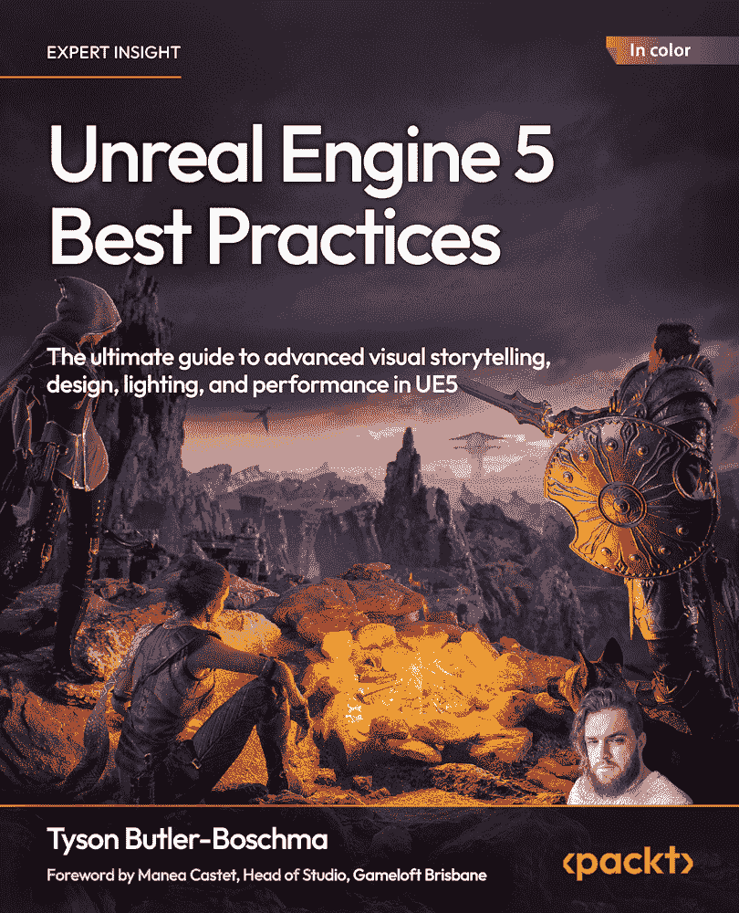


第一版


*献给我我亲爱的伴侣 Ayla、我的家人和亲密的朋友，你们的支持、鼓励和对我的信任支持了职业生涯和对游戏的热爱。这本书属于你们，也属于我。感谢你们无尽的爱与支持。*
*–Tyson Butler-Boschma*

# 前言

每个行业都有稀有的人才，他们不仅使用工具，还能找到利用工具构建出如此独特的东西，以至于别人会想：“他们是怎么做到的？”

Tyson 就是这些创造者之一。

我是在 Tyson 加入 Gameloft 布里斯班工作室时第一次见到他的，我很幸担任该工作室的经理。从一开始就很清楚，Tyson 将迅速将我们的光照、电影、过场动画以及整体场景和沉浸式提升到一个全新的高度。Tyson 迅速在工作室内开辟了一个独特的角色。他带了深厚的技术造诣和优秀的人格品质。他在 `Unreal Engine 5` 方面的专业知识，结合他的艺术感，经常让整个团队目瞪口呆。他交付的场景感觉如魔法一般：叹为观止的环境、惊艳的光照、强大的过场动画以及好莱坞级别的预告片，这些成为我们记忆并参考数月之久的“惊艳时刻”。

让 Tyson 真正独的不仅在于他产出的质量，更在于他创作的方式。他始终在前进、学习并为自己和他人创造机会——即使这些机会并不显而易见。他体现了协作、积极和乐趣。他提升他人，让周围的人们发光并成长。

通过这本书，我信任 Tyson 能让更多的人发光、成长并走上他曾走过的道路。Tyson 正在分享他多年实践提炼出的知识和心态。这不是在教室里，而是在真实的项目中，解决真实的挑战，并推动创意卓越。在这些页面中，读者将找到如何利用 `Unreal Engine 5` 最强大的功能来打造沉浸式体验和震撼视觉效果的指导。Tyson 介绍了工具、工作流和思维方式，使开发者和艺术家能够构建出栩如生、优化且充满奇的世界。

Tyson 代表了视频游戏行业需要的一切。他是一个新一代的创意领导者：有远见、技能高超、技术深厚且极具人性化。任何有机会向他学习的人，无论是通过谈话、会议还是通过这本书的文字，都是真正幸运的。

*Manea Castet*，
*Gameloft 布里斯班工作室负责人*

# 贡献者

# 关于作者

Tyson Butler-Boschma 是一位屡获殊荣的游戏开发者、电影导演和光照艺术家，拥有超过 13 年的行业经验。他是 Gameloft 布里斯班的高级光照和电影艺术家，Toybox Games Studios 的创始人兼创意总监，目前正在开发 `Primordials Legends: Hollow Hero`。

此前，Tyson 曾担任 `Torque Drift 2`、`Battle Kitty (Netflix)` 以及为 `Epic Games` 和环球影业合作的一部名为 `We Will Be Monsters` 的 `Fortnite` 微剧的首席灯光师和虚幻引擎全专家。他还创作了多个获奖项目，包括病毒式传播的 `Superman Flight Experience`，该项目仅在 YouTube 上就获得了超过 1000 万次播放，吸引了超过 10 万名玩家。

Tyson 拥有丰富的教育背景，完成了“动画、游戏与交互硕士学位”、“创意媒体研究生文凭”、“互动娱乐学士学位”以及“信息技术文凭”。

为了表他的才华和奉献，Tyson 在职业生涯中获得了众多荣誉。他于 2019 年被入选 `Develop Pacific 30 Under Thirty`（亚太地区三十岁以下精英），并在 2019 年赢得了 `Unreal Engine Cinematic Summer` 比赛。

他的项目在国内外舞台上也得到了广泛认可。`Primordials Legends: Hollow Hero` (2023) 赢得了 `PAX Australia` 民选奖，并入选 `PAX Australia` 独立游戏展。早期项目 `Primordials: Fireborn` (2018–2019) 在 AVCON 上展示，并成为澳大利亚制作设计协会的决赛获得者。在电影和动画方面，Tyson 在 `Battle Kitty` (2022) 中的工作获得了 `GLAAD 媒体奖` 提名并在 `AEAF` 获得银奖，而 `NBCUniversal: We Will Be Monsters` (2022) 则是 `AEAF` 精神奖决赛入围者。在职业生涯早期，他的游戏 `Heart of Zarar` (2013) 获得了“最佳游戏性”奖，并是民选奖的决赛入围者。

通过这些成就，Tyson 对游戏、叙事和视觉工艺的热情显而易见。他的作品集反映了卓越的创意以及对推动澳大利亚游戏行业发展的承诺。


Varun Kumar Gupta 是印度 Zitro 公司的技术美术师，专注于程序化生成、渲染系统和引擎开发。他拥有爱尔兰三立尼大学学院的计算机科学（增强与虚拟现实）硕士学位，凭借学术背景，结合了他对数学、计算机图形和实时渲染的深厚理解，创建出可扩展且高效的内容生成工具。

在此前在 Technicolor Games 工作期间，Varun 曾为 Rockstar、EA 和 Ubisoft 的项目贡献过力量，负责开发程序化工作流、自动化工具以及优化艺术流水线。他目前的工作涉及 `Godot` 引擎开发，在其中探索色器编程、基于 GPU 的计算以及程序化工作流的复杂奥秘。他致力于突破图形编程的边界，并构建将艺术与代码融合的智能系统。

他还曾担任 *Unreal Engine 5 Character Creation, Animation, and Cinematics*（Packt 出版社，2022 年）的技术评审，并持续对实时图形和引擎开发的发展做出贡献。

我要感谢我的父母、姐姐、亲爱的女友以及朋友们，在我游戏开发的旅程中给予了我不移的支持、鼓励和宝贵的反馈。


# 前言

欢迎阅读 *Unreal Engine 5 最佳实践*！游戏开发是一门艺术，是一门工艺，而且——有时是一场苦战！本书旨在帮助你清晰且自信地面对这一挑战。`Unreal Engine 5` (`UE5`）不仅仅是一个工具；它是一个革命性的生态系统，结合了实时渲染、次世代光照、高级物理、电影级叙事和世界级的优化工作流。掌握这一切可能会让人感到无从下手，但只要方法正确，它就会成为创力的游乐场。

本书旨在成为你穿过这个游乐场的指南。我们将不仅探索*如何*使用 `UE5` 的功能，还将探讨它们*为什么*重要，以及如何将它们转化为设计驱动的工作流来提升你的项目。你可以将其视为一份为复杂性建立秩序的路线，帮助你创造出不仅在技术上可靠而且在艺术上具有冲击力的世界。

在这些章节中，我们将一步步前进：从光照和氛围的基础知识，到高级交互和物理系统，再到电影级叙事的创作，最后进入优化和故障排除等关键现实问题。每一部分都建立在前一部分的基础上，创造出一套完整的技能链，无论你构建什么类型的游戏、电影或交互项目，这些技能都将令你受益匪浅。但这不仅仅一本关于技术清单和可复制设置的书。它更多是关于将虚幻引擎视为一种*创意媒介*。你将学习像艺术家和问题解决者一样去思考，使用 `UE5` 不仅仅是为了构建世界，更是为了通过设计本身来传达思想、情绪和故事。

无论你是单兵作战的独立开发者、刚刚开始旅程的学生，还是应对雄心制作目标的工作团队成员，这里的工作流和原则都将赋予你有目的地去使用虚幻引擎的信心。当你读完时，你将明白这不仅在于知道按哪些按钮，而在于如何使用 `UE5` 的工具以高效、可扩展且令人忘的方式让你的愿景变为现实。

# 本书适合读者

本书为想要将他们的 `UE5` 项目提升上一层楼的游戏设计师、开发者和艺术家编写。无论你是寻求精通光照的环境美术师，还是寻求简化工作流的技术设计师，还是旨在优化性能的开发者，你都能在这里找到实用且具操作性的指导。

它最适合已经对虚幻引擎有一定了解的读者——中级用户和经验丰富的通才者将受益最多——但课程的呈现方式允许有上心的的新人跟上，并成长为高级概念。

材料涵盖了广泛的学科领域：优化、动画、光照、电影设计、环境创建和交互性。如果你是一个寻求精炼流水线的技术美术师、一个进一步压榨有限资源的独立开发者，或者一位磨炼叙事能力和视觉真度的 AAA 老兵，本书将帮助你磨练技能并在 `UE5` 中更高效地工作。

最重要的是，本书是为那些不仅将虚幻引擎视为工具，而是视为创意媒介的创作者准备的。如果你想构建运行流畅、视觉惊艳并讲述强大故事的世界，那么这本书就是适合你的。

# 本书涵盖

- *第一章*，*使用 Lumen 和高级技术进行光照*，探索如何利用 `UE5` 的动态光照来创建写实和风格化的环境。你将学习如何设置用于全局照明和反射的 `Lumen`，以及如何将光照作为设计工具来引导玩家注意力并营造氛围。
- *第二章*，*氛围效果与视觉叙事*，展示了雾雾、天气系统和后处理体积如何为你的项目增加深度和叙事力量。本章涵盖了实用的设置，以及通过氛围唤起情感和强化叙事的创造性技巧。
- *第三章*，*虚幻的高级建模工具*，介绍了引擎内的工作流，无需切换到外部软件即可进行几何体建模、雕刻和精修。你将发现如何快速制作原型、高效迭代，并利用 `UE5` 的建模套件处理简单和复杂的形状。
- *第四章*，*设计引入胜的游戏环境*，深入探讨了布局、流线和以玩家为中心的设计原则。它强调了环境设计如何影响导航、探索和游戏参与度，赋予你设计直觉且迷人空间的工具。
- *第五章*，*集成 Chaos 物理实现动态游戏机制*，演示了如何通过物理驱动的交互为世界注入生命。从可破坏物体到实时模拟，你将看到 `Chaos` 如何让环境变得动态、有反应且具有趣味性。
- *第六章*，*响应式与自适应世界*，探索如何创建对玩家和游戏状态做出反应的系统。你将学习程序化生成、自适应事件和实时环境变化，让世界感觉栩如生且自给。
- *第七章*，*设计高质量电影序列*，教你如何使用 `Sequencer` 制作电影级的过场动画、摄像工作和视觉叙事瞬间。重点是在保持电影感的同时，确保工作流对于迭代和协作是高效。
- *第八章*，*作为叙事与故事的环境*，强调了空间本身如何传达故事和情绪。你将看到道具、光照和关卡设计如何作为叙事设备，让玩家通过探索而非旁白来体验故事。
- *第九章*，*自适应过场动画与交互路径*，研究了分支，即能够保持玩家参与的反应性叙事。你将探索如何设计能够适应玩家决策的过场动画，以及如何将电影级叙事无缝融入游戏。


## 第 10 章：性能分析与优化技术
`Profiling and Performance Techniques` 章节涵盖了如何衡量和诊断性能瓶颈。你将亲手操作性能分析工具，学习如何追踪常见问题并确保项目在开发过程中运行顺畅。

## 第 11 章：实时渲染的高级优化
`Advanced Optimization for Real-Time Rendering` 深入探讨了平衡视觉保真度与效率的最佳实践。它探索了渲染技术、资产策略和引擎设置，使你能够在不牺牲性能的情况下呈现出色的视觉效果。

## 第 12 章：资产管理最佳实践
`Asset Management Best Practices` 解释了如何组织、跟踪和维护整洁且可扩展的项目。从命名规范到版本控制以及重定向器清理（redirector cleanup），本章展示了适当的资产管理如何节省时间并避免头疼。

## 第 13 章：解决常见的开发挑战
`Troubleshooting Common Development Challenges` 为你提供了有效解决崩溃、错误和障碍的策略。你将学习系统性的问题隔离方法、使用 `UE5` 的内置调试工具，并培养让排错变得不再令人畏惧的习惯。

# 充分利用本书的价值

本书基于编写时使用的 `Unreal Engine 5.4` 及其相关工具集。Epic Games 经常更新引擎，虽然书中的原理将保持适用，但某些功能可能会发生变化。请始终参考 Epic 的官方文档以获取前沿功能的最新更新。

## 版权声明

本书引用并包含了源自 `Unreal Engine Marketplace`、`Quixel Megascans`、`Fab.com` 以及类似数字资产平台的第三方资产图像。所有此类资产均已根据各自的许可协议合法获得并使用，包括 `Unreal Engine Marketplace End User License Agreement` 和 `Fab Standard License`。这些资产被整合到 `Unreal Engine 5` 的原始项目和演示中，仅作为此本书的教学和说明之用。

这些资产的所有版权和知识产权仍归其所有所有。包含这些资产或图像并不意味着原始创作者或许可方拥有所有权、背书或赞助。

在适用的情况下，每张图片旁边都提供了来源说明。

## 下载彩色图像

我们还提供了一个 PDF 文件，包含书中使用的截图/图图的彩色版本。你可以在此处下载：`https://packt.link/gbp/9781836205654`。

本书包含了长截图，旨在提供整个 `UE` 界面的概览。因此，这些图像上的文字在 100% 缩放下可能看起来很小。我们参考图形包以便于理解。

## 使用的规范

全书使用了多种文本规范。

`CodeInText`：表示文本中的代码词汇、数据库表名、文件夹名、文件名、文件扩展名、路径名、虚拟 URL、用户输入以及 Twitter/X 账号。例如：“使用 `r.Lumen.Reflections.Enable 0` 或 GI 切换来测试光照成本与质量之间的权衡。”

**粗体**：表示新术语、重要词汇或你在屏幕上看到的单词。例如，菜单或对话框中的单词在文本中的显示方式如下所示。例如：“禁用非必要物体和灯光的 **Cast Shadows**（投射阴影）（例如：瓶子、碎片、贴花或蜡烛）。”

警告或重要注释显示如下。

提示和技巧显示如下。

# 与我们联系

我们随时欢迎读者的反馈。

**通用反馈**：如果你对本书的任何方面有疑问或有任何通用反馈，请发送邮件至 `customercare@packt.com` 联系我们，并在邮件主题中注明书名。

**勘误**：尽管我们已尽一切确保内容的准确性，但错误在所避免。如果你在书中发现错误，如能向我们报告我们将不胜感激。请访问 `http://www.packt.com/submit-errata`，点击 **Submit Errata**（提交勘误）并填写表格。

**盗版**：如果你在互联网上发现任何形式的我们作品的非法副本，如提供位置地址或网站名称我们将不胜感激。请通过 `copyright@packt.com` 联系我们并附上材料链接。

**如果你兴趣成为作者**：如果你在某个领域拥有专业并对编写或贡献书籍感兴趣，请访问 `http://authors.packt.com/`。

# 书籍的免费福利

本书附带免费福利以支持你的学习。现在激活它们即可立即访问（指令请参见“如何解锁”章节）。

以下是你购买后可以立即解锁的内容快速概览：

| **PDF 和 ePub 副本** | **下一代 Web 阅读器** |
| :--- | :--- |
| 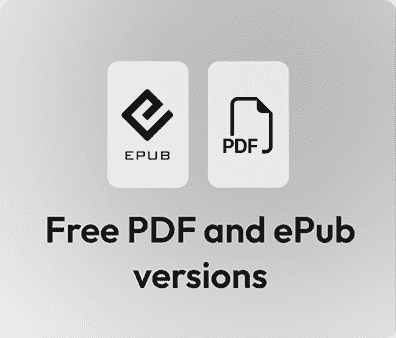 |  |
|  | 获取本书的无 DRM PDF 副本，可在任何地方、任何设备上阅读。 |  | **多设备进度同步**：在任何设备上从上次离开的地方继续。 |
|  | 使用你喜欢的电子阅读器使用无 DRM 的 ePub 版本。 |  | **高亮和做笔记**：捕捉想法并将阅读转化为持久的知识。 |
| | |  | **书签**：随时需要保存并重新访问关键章节。 |
| | |  | **深色模式**：通过切换到深色主题减轻眼睛疲劳。 |

## 如何解锁

扫描二维码（或访问 `packtpub.com/unlock`）。通过名称搜索本书，确认版本，然后按照页面上的步骤操作。 | !(Images/Unlock.png)

| **注意**：直接从 Packt 购买不需要发票。 |

# 分享你的想法

当你读完 `Unreal Engine 5 Best Practices` 后，我们想听听你的想法！请[点击此处访问本书的亚马逊评论页](https://packt.link/r/1836205651)。

你的评价对我们和技术社区非常重要，并将帮助我们确保交付优质内容。

# 第一部分

# 精通光照、氛围与环境设计

在本书的第一部分，我们将探索视觉上赋予游戏世界的基础元素。从 `Lumen` 的力量到氛围效果的艺术性，你将学习如何将光照、雾和高级建模工具不仅作为视觉修饰，更是核心设计原则。通过掌握这些技术，你将能够构建出沉浸式、真实且具有情感鸣的环境。

本书包含以下章节：

*   `第 1 章`：使用 Lumen 光照与高级技术
*   `第 2 章`：氛围效果与视觉叙事
*   `第 3 章`：Unreal 的高级建模工具


Unreal Engine 5 为打造沉浸式游戏、惊人的电影级序列和详细的交互环境提供了前所未有的工具和工作流。本书是你探索 UE5 高级功能并将其集成到项目中的终极指南。从尖端光照技术到优化策略，每一章都将使你具备将创作提升到专业标准所需的实用知识和技能。无论你是在设计引人入胜的游戏环境、创作交互式叙事，还是在不牺牲性能的前提下实现高视觉保真度，我的希望是确保你已准备好应对游戏开发、电影制作和虚拟制作中的现实挑战，创造出难忘的体验。

光影是游戏开发、电影化叙事和虚拟制作中最关键的组件之一，因为它直接影响氛围、真实感和玩家的沉浸感。在我担任艺术家期间，光影曾独自决定一个场景的成败。我曾见过糟糕的资产在良好的光影下焕发新生，也见过优秀的资产因糟糕的光影而毁坏。在本章中，你将深入探索 Unreal Engine 5 全局光照系统 `Lumen` 的威力，并探索将你的场景提升到新层次的高级光影技术。

在本章结束时，你将牢牢掌握 `Lumen` 的功能并对如何将其用于动态实时光照获得深刻见解。你还将获得平衡视觉保真度与性能的宝贵技术，并将 `Lumen` 与其他高级工具（如体积光和发射光照明）相结合，以创建引人入胜的环境。

理解并掌握这些技术将为后续章节奠定坚实的基础，因为光影在环境设计、电影叙事和整体项目质量中起着不可或缺的作用。

在本章中，你将学习：

* 如何在你的 Unreal Engine 项目中设置和优化 `Lumen`
* 实现真实的室内和室外照明的技术
* 集成体积效果、阴影和发射光照明的高级工作流
* 将 `Lumen` 与高级光照技术相结合
* 优化光照以平衡质量与性能的技巧
* 案例研究：实际应用 `Lumen`
* 解决 `Lumen` 相关问题

# 书籍附赠的免费福利

你的购买包含本书的免费 PDF 副本以及其他专属福利。请查看序言中的“书籍附赠的免费福利”章节以立即解锁这些福利并最大化你的学习体验。

# 技术要求

为了跟上本章内容，请确保你的系统已：

* 安装了 Unreal Engine 5.4 或更高版本
* 能够运行 Unreal Engine 5 的 PC，推荐使用支持硬件光线追踪的 GPU
* 具备 Unreal Engine 用户界面和光照工具的基础知识
* 可选：一个带有预制资产的项目以进行测试和练习（或从 Unreal 的示例项目开始）

**重要说明**

本书使用了多个不同的 Fab 市集资产来展示示例。虽然不是强制要求的，但建议准备你选择的预制场景以便跟随，或者使用一个你之前构建过的场景。

# 作为动态全局光照解决方案的 Lumen 概述

`Lumen` 是 Unreal Engine 5 用于动态`全局光照` (`GI`) 的最先进解决方案。与传统的烘焙光照技术（需要预计算，通常需要投入大量时间和计算机计算能力进行烘焙，且缺乏适应性）不同，`Lumen` 提供了实时反馈，并动态计算光如何与表面和环境相互作用。对于需要在不牺牲创作灵活性的情况下获得即时视觉准确性的艺术家和开发者来说，这是一个革命性的工具。

`Lumen` 通过模拟光线在表面反弹、散射和扩散时的复杂相互作用来实现这种真实感。这种技术为环境带来了栩栩如生的真实感，光照条件的变化（如移动光源或更改几何形状）会立即反映在场景中。

## Lumen 相比烘焙方法的优势

烘焙光照长期以来一直是游戏开发的基石，因为它在静态环境中效率很高，也是我在 2010 年初开发游戏时的“首选”解决方案之一，但它也伴随着巨大的局限性。光照条件的变化需要重新烘焙，这非常耗时。此外，烘焙光照在处理动态元素（如移动物体或光源）时表现不利。

`Lumen` 通过以下方式解决了这些瓶颈：

* 节省时间的工作流：艺术家可以调整光照并看到结果，无需等待烘焙过程。
* 动态适应性：`Lumen` 适用于需要不断迭代的项目，例如动态光影。
* 提升真实感：光溢色、色彩反弹和阴影软化等微妙效果是实时计算的，增强了视觉保真度。

## Lumen 的优势场景

`Lumen` 的实时能力使其在以下场景尤为有效：

* 室内和室外环境：无论是在创建昏暗的洞穴还是阳光明媚的草地，`Lumen` 都能动态适应封闭空间和开放地形。
* 实时交互：它对于物体和光源经常移动的游戏非常完美，例如打开门发现新光源或提灯投下的阴影。
* 电影级光照：对于过场或电影序列，`Lumen` 为导演提供了操纵光影的工具，确保场景从任何角度看都很吸引。

尽管 `Lumen` 在许多场景中表现出色并是本书光照部分的重点，但在某些情况下，传统的烘焙光照或其他方法仍具有优势，了解这一点很重要。

## Lumen 的不足之处

以下是 `Lumen` 相比烘焙光照的一些不足：

* 低端硬件的性能：
    * 挑战：`Lumen` 的动态计算需要大量的资源，可能会影响低端设备或旧硬件的性能。
    * 烘焙光照的优势：预计算的光照贴资源消耗低得多，更适合针对移动平台或旧 PC 的游戏。
* 极高分辨率细节：
    * 挑战：`Lumen` 在处理 GI 细节方面可能会遇到困难，特别是在具有复杂几何形状或密集材质的高度细节场景中。
    * 烘焙光照的优势：烘焙贴图可以更精确地捕捉高分辨率这些细节。
* 内存受限的项目：
    * 挑战：`Lumen` 需要额外的内存来处理动态光照数据，对于内存预算紧张的项目可能是问题。
    * 烘焙光照的优势：贴图相对轻量，是内存优化优先项目的理想选择。
* VR 和 AR 应用：
    * 挑战：虚拟和增强现实需要极高的帧率以确保流畅体验，而 `Lumen` 的实时计算会导致性能下降。
    * 烘焙光照的优势：预烘焙光照更具预测性，并为 VR 和 AR 环境提供稳定的性能。

在这里，我设置了一个示例场景，展示了静态光照设置与使用 `Lumen` 渲染相同场景的对比，突出了真实感、适应性和阴影细节方面的差异。

*图 1.1* 显示了不使用与使用 `Lumen` GI 的对比：

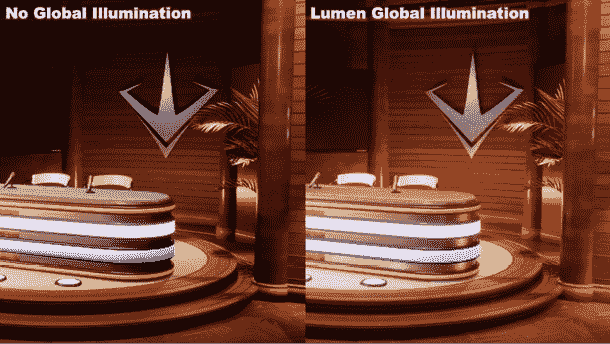


图 1.1：使用 Lumen 展示静态光照与动态光照的对比

图 1.2 显示了 Lumen 在光线反弹和反射方面的视觉拆解：

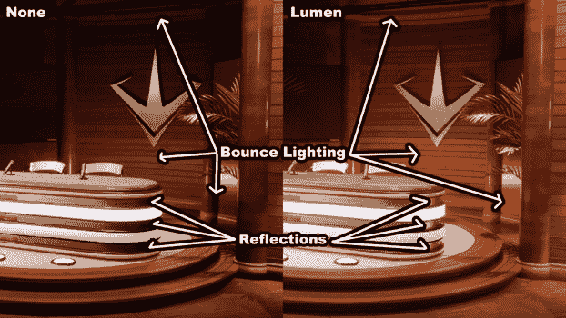

图 1.2：展示光线如何与环境中的表面相互作用

通过理解这些局限性，我们作为艺术家可以做出明智的选择，决定何时利用 Lumen 的功能，以及何时传统的光照方法可能更加合适。

既然了解了 Lumen 作为动态全局光照（GI）解决方案的巨大潜力，让我们深入研究在你的 Unreal Engine 项目中设置它所需的实际步骤。

# 在你的项目中设置 Lumen

要释放 Lumen 的全部潜力，正确设置你的项目至关重要。本节提供了启用 Lumen、优化性能以及避免常见陷阱的逐步指南。在开始之前，请记得检查本章开头的`Technical requirements`（技术要求）部分，并你拥有运行此处所示 UE5 所需的最低配置：[`dev.epicgames.com/documentation/en-us/unreal-engine/hardware-and-software-specifications-for-unreal-engine`](https://dev.epicgames.com/documentation/en-us/unreal-engine/hardware-and-software-specifications-for-unreal-engine)。

## 在项目设置中启用 Lumen

在使用 Lumen 强大的动态光照和反射之前，你需要确保已在项目中开启了它。别担心——这只需要一分钟。以下是在 `Project Settings`（项目设置）中启用 Lumen 的方法：

1. 打开 `Project Settings`：
    1. 导航到 `Edit`菜单并选择 `Project Settings...`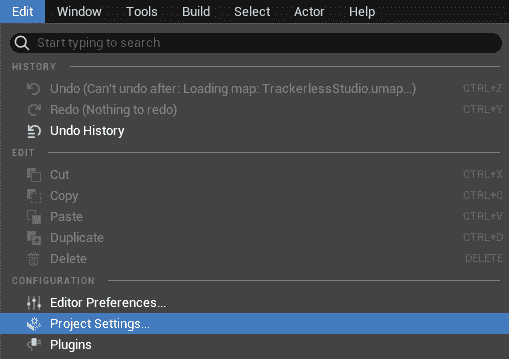
    图 1.3：项目设置 1/3
    1. 在 `Rendering`（渲染）部分，找到 `Dynamic Global Illumination Method`（动态全局光照方法）下拉菜单。

2. 启用 Lumen：
    1. 将 `Dynamic Global Illumination Method` 设置为 `Lumen`。
    2. 确保 `Reflection Method`（反射方法）也设置为 `Lumen` 以最大化其功能。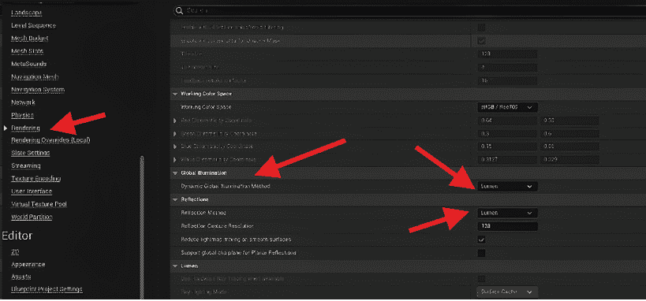
    图 1.4：项目设置 2/3

3. 调整 `Hardware Ray Tracing`：
    * 如果你的系统支持硬件光追，请在 `Ray Tracing`（光追）设置下启用它以增强性能和视觉真实度。
    * 对于没有专用光追硬件的系统，Lumen 将默认使用基于软件的解决方案，资源消耗较低但可能会牺牲一些质量。确保开启 `Generate Mesh Distance Fields`（生成网格距离场）。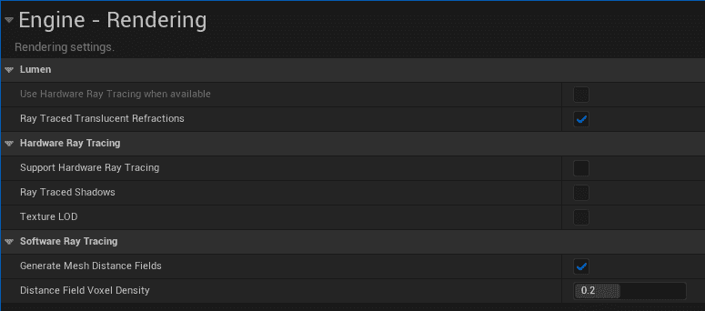
    图 1.5：项目设置 3/3

4. 验证并保存：
    1. 重启你的项目以应用更改。
    2. 测试场景以确保 Lumen 运行正常。

现在我们已经在项目中启用了 Lumen，可以讨论以获得最佳效果的技术规范了。

## 硬件要求和性能考虑

虽然更好的硬件显然很重要，但并非必不可少。例如，我在测试时仍然使用一张中端 10 系列显卡，但为了让你获得最佳体验，我的建议如下：

* **GPU 和硬件建议**：
    * 建议使用具有光追能力的高性能 GPU（例如 NVIDIA RTX 系列或 AMD RDNA 2）以获得最佳效果。
    * 确保你的系统符合 Unreal Engine 5 的硬件基准。在此查看最低系统规格：[`dev.epicgames.com/documentation/en-us/unreal-engine/hardware-and-software-specifications-for-unreal-engine`](https://dev.epicgames.com/documentation/en-us/unreal-engine/hardware-and-software-specifications-for-unreal-engine)。

* **平衡质量与性能**：
    * 在 `PostProcessVolume`（后期处理体积）中，调整 `Global Illumination Quality`（全局光照质量）设置以平衡性能与视觉细节（参见 `图 1.6`）。
    * 使用 Unreal 内置的分析工具来识别瓶颈（例如 `GPU Visualizer`）。

## 针对质量与性能优化设置

现在让我们来调整以下设置以匹配你的项目需求：

* `Final Gather Quality`（最终采样质量）、`Lumen Scene Lighting Quality`（Lumen 场景光照质量）和 `Lumen Scene Detail`（Lumen 场景细节）：较高的值会增强间接光，但可能会影响帧率。
* `Reflections Method`（反射方法）：对于要求较低的场景，考虑使用 Lumen 的软件模式。
* `Reflections Quality`（反射质量）：在 `PostProcessVolume` 中微调此项以在不产生额外开销的情况下提高反射精度。

这些设置如图所示：

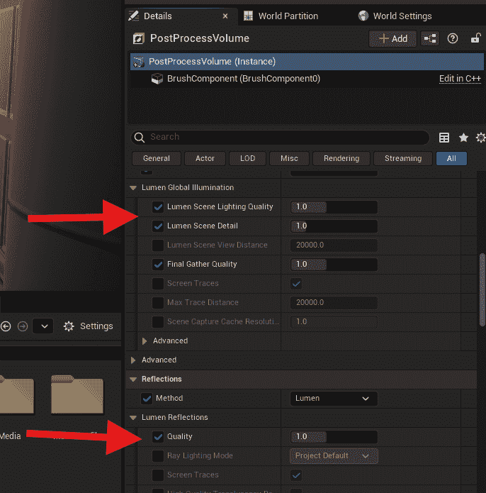
图 1.6：PostProcessVolume 中的 Lumen 优化设置

现在 Lumen 已集成到你的项目中，是时候探索它在室内环境中的应用了。下一节将专注于实现真实的室内光照设置，平衡自然光和人工光以增强氛围和沉浸感。

# 精通用于室内光照的 Lumen

有效地进行室内照明是 Unreal Engine 5 中的一项关键技能，因为它需要在真实感和视觉吸引力之间取得平衡。Lumen 通过实时模拟自然光和人工光的交互，非常适合创建动态且沉浸的室内环境。本节将引导你通过这些技术使用 Lumen 实现生生的室内效果，同时保持性能和艺术控制。

## 平衡自然光和人工光源

室内空间通常依赖于自然光（如透过窗户的阳光）和人工光源（如灯具或吊灯）的混合。Lumen 允许这些光类型进行无缝融合（参见 `Examples` 子节）：

* **自然光设置**：使用 `directional lights`（方向光）模拟阳光，通过其位置来模仿真实世界的角度。调整强度和色温以获得柔和的清晨光或更温暖的晚间氛围。确保窗户和开放空间允许自然光溢入到室内，创建真实的光影图案。
    **提示**：将 Lumen 与 Unreal 的 `Skylight`（天光）结合使用，增强室内真实感的环境光。
* **人工光设置**：添加 `point lights`（点光源）或 `spotlights`（聚光灯）代表人工光源。调整它们的衰减半径和强度，确保它们是补充而非覆盖自然光。使用色彩分级匹配灯泡色调，荧光灯使用冷色调，白炽灯使用暖色调。
    **提示**：避免过度照明；让自然的阴影和高光营造趣味性。

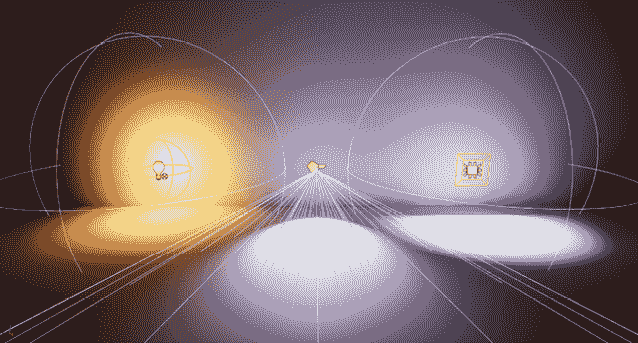
图 1.7：色彩和温度平衡的点、聚光灯和矩形光

## 通过间接光反弹实现深度和对比度

Lumen 的 GI（全局光照）在光线多次反弹的封闭空间表现良好，可以照亮原本黑暗的区域。精通间接光可以提升室内深度和真实感：

* **间接照明设置**：确保主光源具有足够的强度以产生多次反弹。在灯光属性中调整间接照明强度，以微调反弹的距离和亮度。
    **提示**：在一个由窗户照射的房间里，间接光反弹可以照亮角落和家具下方，增加场景的深度。
* **增强对比度**：利用 Lumen 的 GI 创建光影之间的对比。策略性地放置物体以阻挡光线并产生自然阴影，增强真实感。对比有助于引导观众的注意力看向场景中的焦点。
    **提示**：尝试不同的柔和和硬阴影设置来控制氛围，舒适的房间使用柔和阴影，工业环境使用较硬的阴影。


- **创建环境光晕**：将发光材料应用到计算机屏幕、霓虹灯牌或发光面板等表面。将材料的发光强度设置为真实的电级，并调整其颜色以营造氛围灯光效果。

  **提示**

  在温馨的房间里，带有发光材料的发光壁炉或灯具可以增加温暖感和特色。

- **突出细节**：使用发光材料来突出建筑特征或道具。例如，搁架下方的 LED 灯带可以为室内设计增添现代的精致感。

  **提示**

  将发光材料与细微的辉光（bloom）效果结合，可以获得精致的视觉效果。

**注意**

此发光照明功能默认开启的！你可能希望禁用此功能，不让发光材料影响全局光照（GI）。点击发光资产并禁用 `Affect Dynamic Indirect Lighting`（影响动态间接光）来禁用它。

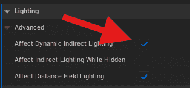

图 1.8：禁用发光 GI，位于资产的细节面板中

## 使用 Lumen 的室内场景示例

这里有几个使用 Lumen 的室内场景快速示例，正如我之前讨论的那样。我使用现有的 Unreal 资产组合了这些场景：

- **温馨的房间**：节日期间一个温暖且宜人的生活空间：

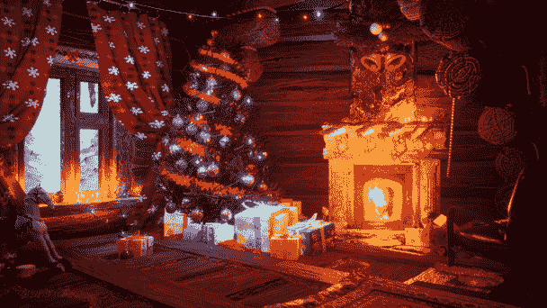

图 1.9：一个温暖且宜人的生活空间，展示了使用软灯光的室内照明（资产来源：Darchall 的 HQ Christmas Room | fab.com）

*设置*：使用方向性光模拟阳光，并以灯光和壁炉上的发光材料进行增强。添加点灯为圣诞树和蜡烛提供局部照明，并使用软阴影以保持柔和的氛围。

**提示**

虽然真实的光照是目标，但这并不意味着它不能以更具风格化的方式使用，就像本例所示。真实是指光线的作用方式，而不仅仅是看起来“真实”。

- **工业仓库**：一个更粗犷、更有戏剧性的设定：

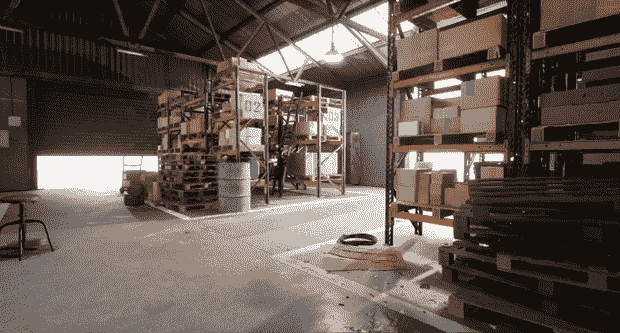

图 1.10：一个更粗犷、戏剧性的仓库，展示了使用软灯光的室内照明（资产来源：Quixel 的 Warehouse | fab.com）

*设置*：使用聚光灯模拟顶部的荧光灯，产生强烈的阴影。调整间接反射以微妙地照亮较暗的角落。

在掌握了 Lumen 室内照明后，让我们来到室。户外环境面临着独特的挑战，从动态天气到广阔的景观，我们将探索如何利用 Lumen 的力量创建令人惊叹的外观。

# 针对户外环境的高级 Lumen

设计令人惊叹的户外环境需要精通自然光和大气效果。Lumen 提供了动态照明能力，使你能够创建响应环境变化的真实沉浸式户外场景。本节将深入探讨使用 Lumen 及其支持功能的户外照明的高级技术。

## 利用方向性光实现自然阳光和阴影

方向性光是 Unreal Engine 中户外照明的骨干。通过 Lumen，它与环境的交互变得动态适应，确保了惊艳的视觉效果：

- **模拟自然阳光**：调整方向性光的强度和色温以代表一天中的不同时间。例如，日出或日落使用较暖的色调，中午使用较冷的色调。

  **提示**

  利用光的角度来定义阴影长度，这会显著影响场景的氛围和真实感

  激活 UE5 内置的 `Sun Position Calculator`（太阳位置计算器）插件，获取根据方向性光位置实时更新的 `Sun & Sky` 资产

- **动态阴影**：动态阴影允许你捕捉环境中物体和角色的自然移动。通过扩大光的半径来调整阴影的软度，以匹配光源的规模和强度。这是一个示例：


图 1.11：对于密集的森林场景，让树冠的阴影在地面上形成斑驳的光影模式（资产来源：FreshCan 的 Mountain Grassland Landscape | fab.com）

## 调整天空光参数实现真实的环境补光

天空光（Skylight）通过模拟由天空创建的环境补光来补充方向性光，为阴影区域提供微妙的照明：

- **配置天空光设置**：使用立方体贴图（cubemap）或实时捕获的天空为场景添加深度和环境颜色。调整强度以平衡环境的整体亮度。

  **提示**

  天空光中微弱蓝色调最能模拟自然户外光的散射。

- **将天空光与 Lumen GI 结合**：`Skylight` 与 Lumen 的 `GI` 无缝协作，填充黑暗角落并柔化生硬的阴影。这在大型、开放的环境中尤为有效。这是一个示例：

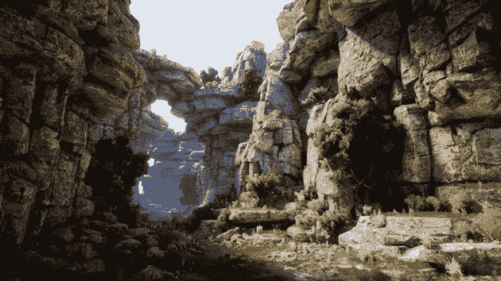

图 1.12：在岩石峡谷场景中，天空光可以照亮阳光无法到达的区域，增加真实的的光影渐变（资产来源：shouhuzhedelang 的 Nature Cave Cliff | fab.com）

## 使用雾和体积效果增强氛围和深度

大气效果（如雾和体积效果）对于需要比例感的户外场景至关重要：

- **配置雾**：使用指数高度雾（exponential height fog）模拟大气散射。调整密度和衰减以获得所需的效果——较薄的雾用于清晰度，较浓的雾用于神秘感。

  例如，晨雾可以营造一种宁静的体验。

- **体积效果**：将雾与体积照明结合，增强光与大气的交互。这创造了可见的光束和微妙的辉光效果，增加了电影质感。

  **提示**

  对于森林场景，使用体积效果模拟穿过树冠的光线

我们将在下一章深入探讨这个主题！

## Lumen 在户外环境中的实际应用

为了真正理解 Lumen 提供了什么，观察它的实际运行很有帮助。这里只是显示时间变化的的一个示例：

- **昼夜循环**：白天和黑夜之间的无缝转换：


图 1.13：UE5 中可能的不同时间展示

*设置*：随时间动画方向性光的强度和色温。配合动态天空光和雾密度的微妙变化以反映一天的时间。

**提示**

查看 Fab 上的 `Ultra Dynamic Sky`，它是关于时间、天气和 Lumen 的极佳展示。

# 将 Lumen 与高级照明技术结合

## 将传统照明方法与 Lumen 叠加


虽然 Lumen 动态处理全局光照（GI），但传统的灯光（如聚光灯、点光源和面积灯）可以对焦点区域和阴影扩散进行精确控制：

*   **使用聚光灯和点光源进行焦点高亮**：使用这些灯光来强调场景中的特定区域或物体，增加戏剧性并引导观众的注意力。

例如，在画廊设置中，聚光灯可以突出一件文物，而点光源则可以为附近的物体添加细微的光芒以营造氛围。

*   **使用面积灯（矩形灯）实现真实的阴影扩散**：面积灯模拟了窗户或荧光灯板等宽大的光源，营造出柔和且弥散的阴影。它们与 Lumen 的 GI 互补，增强办公室或家居等空间的真实感。

提示

将面积灯放置在大型发射表面附近，以自然地模拟其光辉。

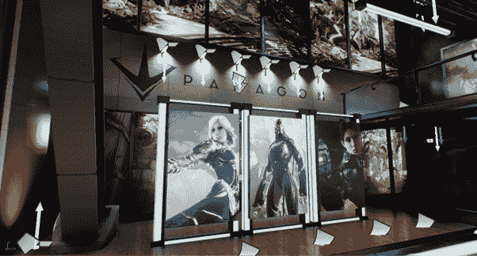

图 1.14：UE5 中可能的不同时间段展示（素材来源：Virtual Studio by EpicGames | fab.com）

## 利用光性文件（IES）提升建筑真实感

以下是关于**照明工程师学会**（**Illuminating Engineering Society**, **IES**）的背景介绍：

*   **他们是谁**：他们是一个成立于 1906 年的专业组织，致力于推动照明艺术、科学和实践的发展。

*   **他们做什么的**：他们为灯光设计、测量和应用制定行业标准，涵盖了从建筑到路灯的所有领域。

*   **为什么在 Unreal/3D 中至关重要**：你在 Unreal 等引擎中使用的“IES 光源配置文件”基于根据其标准发布的真实世界光度学数据。这些配置文件模拟了特定灯具实际分布光线的方式，为虚拟场景带来了真实感。

简而言之，IES 定义了光在现实世界中应该如何被测量和表示，而 Unreal 利用这些数据，使我们能够以数字方式复制现实世界的灯具。

那么，我们如何使用 IES 配置文件来模拟真实灯具的行为，为我们的场景增加建筑准确性呢？

*   **如何使用 IES 配置文件**：将 IES 文件导入 Unreal Engine，以定义来自灯具的光线形状和分布。这就像将遮罩拖放到内容浏览器中一样简单，这些文件对于光照真实性至关重要的环境（如零售空间、博物馆或大堂）非常完美。

*   **与 Lumen 集成**：Lumen 增强了基于 IES 的灯光的间接照明，确保它们真实的图案能为场景的整体氛围做出贡献。

*   **进一步阅读**：我强烈建议阅读关于 IES 光源文件的完整 Unreal 文档，可以在此处找到：

[`dev.epicgames.com/documentation/en-us/unreal-engine/using-ies-light-profiles-in-unreal-engine`](https://dev.epicgames.com/documentation/en-us/unreal-engine/using-ies-light-profiles-in-unreal-engine)。

以下是它们在聚光灯中看起来如何以及放置在何处的示例。

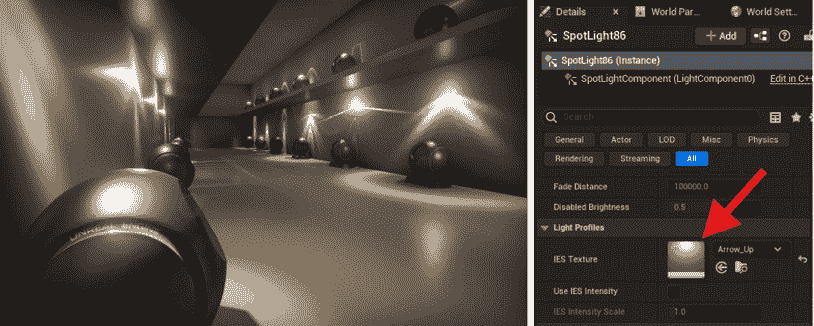

图 1.15：使用 IES 配置文件在墙壁和地板上形成详细光纹图案的房间

涵盖了光性文件后，现在让我们来看看雾气和光轴如何帮助创建更具电影感和氛围的场景。

## 使用体积雾和光轴实现电影效果

体积雾和光轴增强了场景的氛围质量，营造出深度和情绪：

*   **体积雾**：将体积雾与 Lumen 配合使用，使光线与雾气动态交互，为你的环境增加深度。调整密度和衰减（falloff）以获得不同的可见度和氛围。

这里有一个示例：


图 1.16：带有深层瀑布状雾的远山，受阳光动态光照（素材来源：EasyFog by William Faucher | fab.com）

*   **光轴**：开启光轴以创建戏剧性的效果，特别是在具有强方向性光亮的场景中。这些光轴非常适合强调穿过窗户或叶叶的自然光流。

这里有一个示例：


图 1.17：废墟，阳光从上方穿透地面，突出了空气中的尘埃（素材来源：Temples of Cambodia by Scans Factory | fab.com）

虽然 Lumen 提供了令人惊叹的视觉保真度，但保持性能至关重要。在下一节中，我们将探索优化策略，以确保你的项目即使在在中端硬件上也能流畅运行。

# 为性能优化 Lumen

Lumen 的动态 GI 提供了令人印象深刻的结果，但平衡性能和质量至关重要，特别是对于针对各种硬件的项目。本节将探索剖析、调整和优化 Lumen 性能的策略，以便在保持视觉效果的同时实现流畅的游戏体验。

## 分析析 Lumen 性能

在优化之前，识别项目中的瓶颈至关重要。Unreal Engine 提供了强大的性能分析工具来评估 Lumen 对性能的影响：

*   **使用 `ProfileGPU` 命令进行 GPU 分析**：使用 GPU 分析（在控制台命令中使用 `ProfileGPU`）查看渲染每个组件所需的时间，包括 Lumen 的贡献。寻找 Lumen 开销激增的区域，例如具有复杂几何结构或大量光影相互作用的场景。

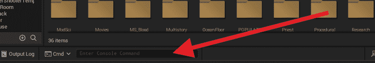

图 1.18：屏幕底部的控制命令

提示

可以通过波浪键（`~`）在编辑器访问控制命令。

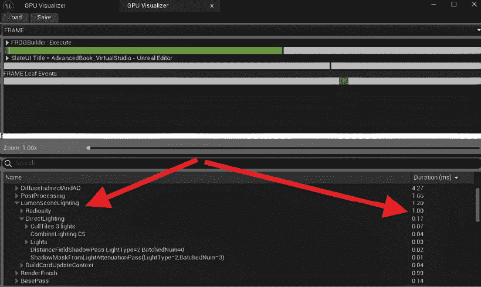

*   **光复杂度可视化器**：Unreal 内置的可视化允许你分析 Lumen 如何计算 GI、屏幕追踪、光重叠以及反射。该工具对于诊断可以改进性能区域非常有价值。

提示

使用彩色条（参见 *1.19* 中的红色箭头）来查看你的光重叠的好坏。

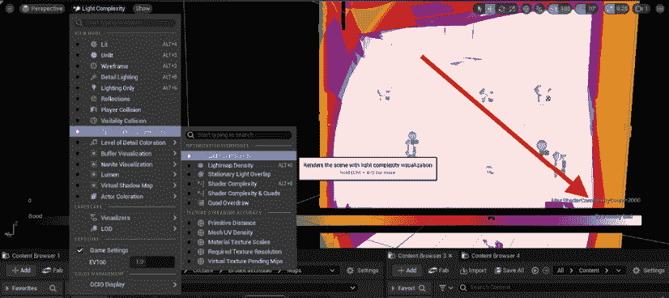

图 2.20：光重叠差的光复杂度可视化器

一旦分析了 Lumen 在场景中的性能，下一步是微调其设置以获得最佳效果，特别是在低端硬件上。

## 针对低级硬件调整 Lumen 参数

对于针对中期项目的，调整 Lumen 设置可以提供显著的性能提升，而牺牲太多视觉保真度：

*   **在屏幕追踪和完整 GI 之间切换**：Lumen 支持用于低成本间接照明的屏幕追踪，可以在场景后期处理中激活。对于不需要完整 GI 的场景使用此模式。

*   **调整 Lumen 细节设置**：降低后期处理中的 Lumen 质量设置，以进行不详细的光照计算。这对于光照细节可能不明显的户外场景特别有效。

*   **屏幕比例和距离设置**：修改**屏幕比例（Screen Percentage）**或设置光源**最大绘制距离（Max Draw Distance）**阈值，以限制远处计算的复杂度。


`Draw Distance`（绘制距离）是指光关闭关闭，而 `Fade Distance`（淡出距离）则是光线从 0 到所需强度的混合距离，允许光线平滑出现，而不是突然弹出。距离以厘米计算（1,500 = 15 米距离）。

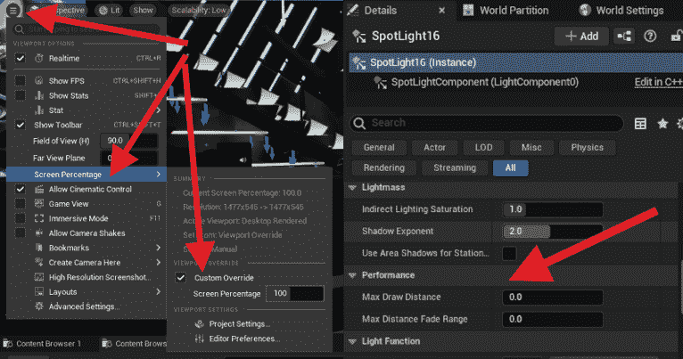

图 1.22: 在此处找到屏幕百分比和性能

掌握了优化策略后，是时候看看 Lumen 的实际效果了。通过真实示例，我们将展示这些技术如何协作来创建沉浸式环境。

# 案例研究：Lumen 的实战

为了充分体会 Lumen 的多功能，我们将探索两个简单的现实世界应用：一个阴郁的地下室场景和一个充满活力的户外市场。

## 案例研究 1：创建一个阴郁的地下室场景

地下室等氛围感室内环境是展示 Lumen 全局光照（GI）和阴影的完美设置：

1. 设置带有发光的闪烁火炬：
    1. 沿墙壁策略性地放置火炬，使用发光材料来实现真实的火焰光泽效果。
    2. 在每个火炬附近添加动态点光源以模拟闪烁效果。随着时间轻微调整光强和颜色以增加真实感。
    3. 启用 Lumen 的 GI 以捕捉从石墙反射的细微光反弹。

这是一个示例：

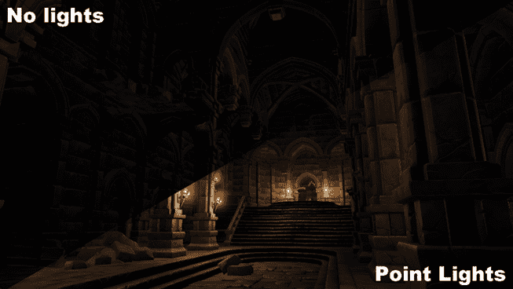

图 1.23: 地下室场景中无光与添加点光源对比（素材来源：Mana Station 的 Multistory Dungeons | fab.com）

1. 添加体积雾以营造阴森深度：
    1. 引入方向性光和体积雾，在地下室内创建氛围层。这是一个示例：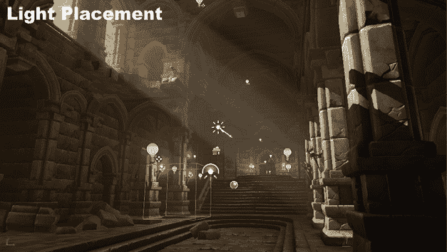
    图 1.24: 地下室场景中方向光与氛围效果对比
    1. 在火炬等光源附近放置雾体积，以增强光线与雾之间的交互。这是一个示例：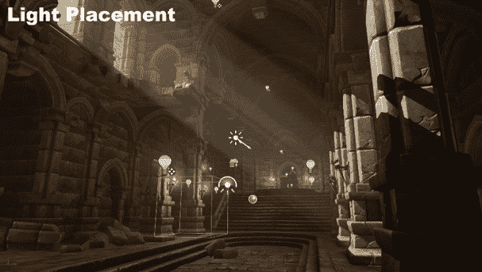
    图 1.25: 地下室场景中光位放置视觉指南
    1. 调整密度和散射属性，以平衡可见性与氛围。

从地下室阴森的深处到户外市场的活力，我们现在将探索 Lumen 如何在繁忙、多彩的环境中增强动态光照。

## 案例研究 2：充满活力的户外市场

Lumen 擅长处理充满活力的户外场景，例如日落时分繁忙的市场。以下是如何有效地光照这种动态、色彩丰富的环境的方法：

1. 使用方向性光实现真实的阳光：
    1. 放置方向性光以模拟落日，带有暖色调和柔和的阴影。
    2. 调整光强和角度，创建由市场摊位和装饰投出的戏剧性长影。

这是一个示例：

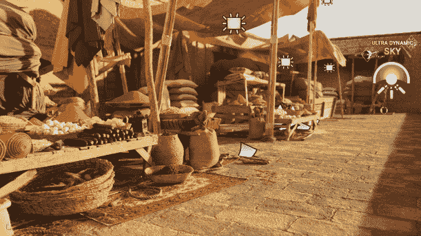

图 1.26: 市场场景中光位放置视觉指南（素材来源：Quixel 的 Bazaar | fab.com）

1. 添加动态光照以高亮：
    1. 放置动态点/矩形光，为市场增加对比度、阴影和活力。
    2. 在需要的地方使用光来“伪造”光线透过材质的效果，例如市场上方的布料。这可以暗示布料并非完全不透明，并让场景感觉更真实。

这是一个示例：

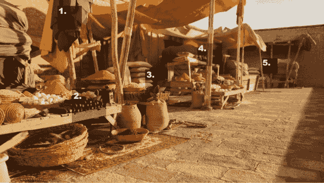

图 1.27: 查看数值，市场场景添加矩形光以增加深度和阴影前的色彩示例对比

最后，即使是最先进的工具也有其挑战。在最后的总结部分，我们将解决 Lumen 的常见问题，提供故障排除技巧和解决方案，以保持您的项目正轨运行。

# 排除 Lumen 问题

虽然 Lumen 是一种强大的光照解决方案，但它并非没有挑战。开发者可能会遇到伪影或性能限制，特别是在复杂场景中。在本节中，我们将识别一些常见问题并提供可行的解决方案，帮助您保持高质量的视觉效果并优化工作流。

## Lumen 的常见问题

以下是 Lumen 的几个常见问题，以及它们的原因和解决方法：

* **光、反射和阴影中的伪影**：
    * *问题*：反射和 GI 可能会出现噪声或扭变，特别是在光滑或反射表面上，而阴影可能会闪烁或缺乏定义。
    * *原因*：这些问题通常源于屏幕空间不足或错误的光照设置。
    * *解决方案*：
        * 在 Lumen 设置下调整 `Reflection Method`（反射方法），优先使用 `Hardware Ray Tracing`（硬件光追踪，如果系统支持）以获得更高质量的反射。
        * 增加 GI 设置中的 `Final Gather Quality`（最终收集质量），以减少反射噪声并提高阴影清晰度。
        * 对于特定对象，在材质或网格属性中启用 `Two-Sided Shadow Casting`（双面投阴影）以确保准确的阴影渲染。

* **复杂场景中的性能下降**：
    * *问题*：在使用 Lumen 时，大型或详细的环境会导致掉帧。
    * *原因*：高三角形数量、过多的动态光或未优化的 Lumen 参数会使硬件过载。
    * *解决方案*：
        * 使用 `Nanite` 优化场景，减少绘制调用并尽量减少冗余动态光。
        * 降低 Lumen 设置中的 `Max Trace Distance`（最大追踪距离），以减少全局光照和反射的计算负载。
        * 对于不重要的区域，使用非投阴影和投阴影光的组合。

## 解决挑战的最佳实践

以下是我建议的解决挑战的最佳实践：

* 使用调试工具：利用 Unreal Engine 的 Lumen 视图来识别光照问题区域，例如 GI 不足或反射过度绘制。
* 尽早且频繁地分析：使用 GPU 分析器和 `stat GPU` 命令来确定 Lumen 的哪些方面对性能影响最大。
* 回退策略：对于难以运行 Lumen 的硬件，实施回退方案，例如较低质量的 `Screen Traces`，并在关键区域保留动态 Lumen 光照。
* 保持更新：确保您正在使用最新版本的 Unreal Engine，因为 Lumen 的改进经常通过更新发布。

通过正面对这些挑战并实施提供的解决方案，您不仅可以提高项目的视觉真实度，还能确保开发过程更加顺畅。通过正确的故障排除和优化，Lumen 将成为交付惊艳实时光照的可靠工具。

# 总结

在本章中我们深入研究了 Unreal Engine 5 Lumen 系统的威力，并探索了增强项目的高级光照技术。现在您应该对如何在各种场景下有效利用 Lumen、优化其性能以及解决常见问题有更深入的理解。

要点列表如下：

* 简化工作流效率：Lumen 消除了耗时的光光烘焙，允许快速迭代并无缝集成到交互和电影级项目中

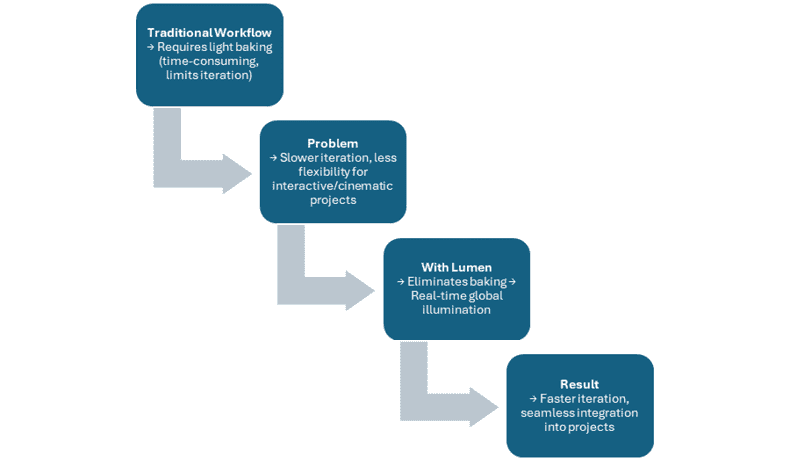

图 1.28: 传统光烘焙与启用 Lumen 的工作流对比


*   **跨场景的写实照明**：在室内平衡自然光与人工光源的技术，以及通过方向光、体积雾和动态天气系统，在户外环境中实现惊人的写实效果。
*   **光照增强的高级技术**：将 `Lumen` 与传统光照方法及体积效果相结合，可以获得更高的真实感和创造性控制。
*   **性能优化**：在视觉保真度与性能之间平衡的实用策略，确保即使在中端硬件上也能获得流畅的结果。
*   **实际应用**：案例研究展示了如何在各种设置（如阴暗的地下室或充满活力的户外市集）中使用 `Lumen`，证明了它的多功能性和影响。

精通 `Lumen` 仅仅是一个开始。实验、学习和精炼将为你的项目解锁更多创意可能。利用本章涵盖的技术和工具作为基础，推向你在 `Unreal Engine 5` 中可以实现的边界，并探索 `Further reading`（延伸阅读）部分以对光照有更深入的理解。

在下一章中，我们将深入探讨如何使用体积雾、粒子系统和后处理等工具来创建引人入胜的环境，增强叙事和氛围。这些技术将进一步基于本章涵盖的光照原理，确保你的项目能够吸引并启发灵感。

# Further reading

*   **光照、曝光与对比**：探索在你的光照设置中实现真实曝光和对比的高级技术。点击此处更多：[`www.artstation.com/blogs/shinsoj/p0Vv/lighting-exposure-and-contrast`](https://www.artstation.com/blogs/shinsoj/p0Vv/lighting-exposure-and-contrast)
*   **日光**：深入研究日光的科学和原理，更好地理解它对光照设计的影响。点击此处更多：[`www.velux.com/what-we-do/research-and-knowledge/deic-basic-book/daylight/daylight-calculations-and-measurements`](https://www.velux.com/what-we-do/research-and-knowledge/deic-basic-book/daylight/daylight-calculations-and-measurements)

# Subscribe to Game Dev Assembly!

我们很高兴地介绍 **Game Dev Assembly**，这是我们全新的、致力于游戏开发一切的新事通讯。无论你是在编写代码、设计、制作动画还是管理工作室，我们都有见解、趋势和专家建议来帮助你创作、创新和蓬荣。现在注册即可获得令人兴奋的福利。

[`packt.link/gamedev-newsletter`](https://packt.link/gamedev-newsletter)


## Get This Book’s PDF Version and Exclusive Extras

扫描二码（或访问 packtpub.com/unlock）。通过名称搜索此书，确认版本，然后按照页面上的步骤操作。 |  |

**Note**：请妥善发票。直接从 Packt 购买的不需要发票。

# 2 大气效果与视觉叙事

**氛围**（Atmosphere）是沉浸式游戏环境和电影级叙事的基石，它塑造了场景的情绪、色调和情感影响。在我开发虚拟世界的多年里，“氛围”这个词出现的频率比其他任何词都高，它暗示了情绪或我们想要唤起的感觉，但从字面上说我们如何实现它？在本章中，我们将探索 `UE5` 用于创建大气效果的高级工具，并学习如何使用它们来强化你的叙事并吸引观众。

在本章结束时，你将理解如何构建具有视觉吸引力的环境，这些环境可以引起玩家和观众的共鸣。你将获得关于使用**体积雾**、**粒子系统**和**后处理**效果的实用见解，以创建深度和氛围，同时整合天气效果以获得真正的整体视觉叙事体验。

精通这些大气技术不仅会提升你项目的视觉质量，还将为后续章节建立连贯的叙事基础，因为氛围在环境设计和情感投入中起着至关重要的作用。在本章中，你将学习：

*   氛围在视觉叙事中的作用
*   如何使用体积雾和光束创建深度和氛围
*   整合天气效果以增强叙事影响的方法
*   使用色彩分级和后处理来设定场景色调的方法
*   结合视觉线索以构建无缝的叙事体验

# Technical requirements

为了跟上本章的进度，请确保你拥有：

*   `Unreal Engine 5.4` 或更高版本
*   支持实时光线追踪的系统（可选但建议）
*   对 `Unreal Engine` 中的界面、`Niagara` 粒子、光照和 `Blueprints` 有基础了解
*   可选：一个带有预构建资产用于测试和练习的项目（或从 `Unreal`ss 示例项目开始）

# The role of atmosphere in visual storytelling

氛围不仅仅是美学——它是叙事的核心元素，用于传递情绪、强化主题并让玩家沉浸在你的世界中。当有效使用时，大气效果可以做到：

*   **唤起情感**：一个雾气缭绕的昏暗洞穴可以引发不安感，而沐浴在温暖光芒下的繁华市集可以唤起舒适感和活力。
*   **引导玩家焦点**：强调古老大门的细微光束或在魔法碎片周围旋转的粒子可以将注意力引向关键叙事元素。
*   **增强世界构建**：如雷雨天气、雾蒙的沙漠或雪覆盖的山峰等天气效果加深了你设定的可信度。

例如，被浓雾笼罩的阴暗森林立即传达了神秘和危险，为探索或冲突奠定了基调。相反，被金色阳光照亮的宁静草地唤起了和平与乐观的感觉。

氛围不仅仅是背景——它塑造了玩家感知和参与你叙事的方式，而且这种影响往往在下意识的情况下完成的。

在这里，我设置了一个示例场景，展示了没有**大气效果**（atmospherics）的设置（*图 2.1 左侧*）与使用**体积高度雾**（Volumetric Height Fog）渲染的相同场景（*图 2.1 右侧*）的对比，突出了情绪、外观和呈现方面的差异。

图 2.1 显示了不使用大气效果与使用大气效果的对比：

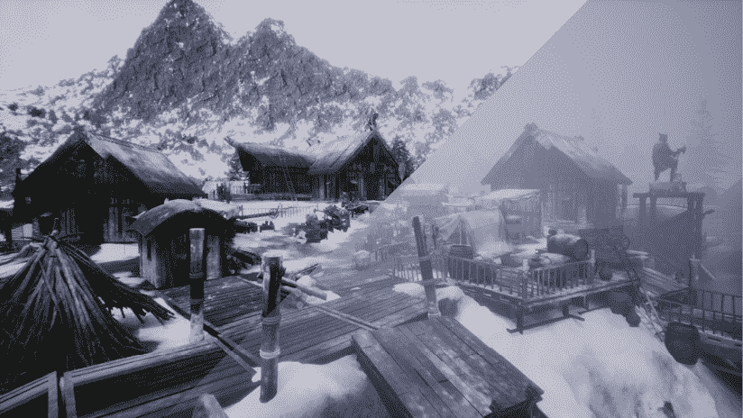

图 2.1：显示无大气效果与对比（资产来源：Viking Village Environment by Leartes Studios | FAB.com）

## Balancing realism and artistic intent

虽然写实性通常将玩家固定在一个可信的世界中，但它并不总是终极目标。风格化或夸大的大气效果可以增强叙事并创造令人记忆的视觉效果。Unreal Engine 提供了在写实与创意表达之间取得完美平衡的灵活性。

*   **何时强调写实性**：像现代城市或军事模拟等写实的环境受益于写实天气条件、准确的天气、光照和材质交互。
*   **何时优先考虑艺术性**：在奇幻或科幻世界中，可以使用大胆、风格化的效果，如发光的雾气、饱和的天空或超现实的粒子旋转来增强异世界的氛围。

## Practical tips for balancing artistic choice and realism

在艺术选择与写实之间寻找界限时，请考虑以下实用建议：

*   使用**后处理工具**来调整**对比度**、**饱和度**和**色彩分级**，放大你想要传达的情绪。
*   层叠雾气、环境光和粒子等效果，为你的场景创建深度和复杂性。


*   尝试使用 Unreal 的大气工具，如 `Sky Atmosphere` 和 `Volumetric Fog`，以实现与你的艺术愿景相一致的视觉效果。

真实感与艺术意图之间的平衡，让你能够以一种既真实又具有冲击力的方式讲述故事，并符合你项目的基调和类型。

*图 2.2* 展示了大气风格化的对比示例，例如超写实的城市公园与风格化的自然环境的对比，展示了不同的方法如何实现不同的叙事目标：

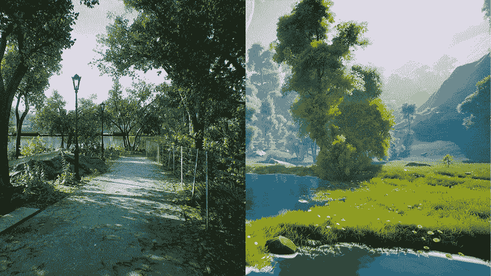

图 2.2：写实与风格化氛围的对比（资源来源：左侧 - SilverTim 提供的 City Park Environment | FAB.com；右侧 - Polyart Studio 提供的 Stylized Environment | Dreamscape）

我们已经确定了氛围如何作为一种强大的叙事工具，让我们深入具体的技术。我们将从探索体积雾（volumetric fog）和光柱（light shafts）开始，这是营造深度和氛围的关键元素，将很好地衔接我们在 *锚点 4*中探索的内容——特别是地下牢场景，该场景已经使用了我们即将讨论的一些技巧。

# 使用体积雾和光柱创建氛围

体积雾是营造环境深度和氛围的强大工具，能够提供即时的氛围感。从幽灵森林中诡异浓稠的大雾，到漂浮在宁静湖面上的柔和空灵，这一功能允许你精细调整场景的情绪基调。

以下章节将指导你如何在雾气和灯光设置方面更好地处理氛围。

## 体积雾

`Volumetric Fog` 是 `Exponential Height Fog`（指数高度雾）组件的一个可选扩展，它让雾看起来具有三维感和动态。它不是一个平面层，而是计算光线在摄像视野范围内与空气中微粒子的相互作用。这意味着雾的密度可以变化，对多个光源产生反应，并创造出如耶稣光（God-rays）或穿过雾的光的光等戏剧效果。

我建议阅读下面的 UE 文档获取更多信息：

[`dev.epicgames.com/documentation/en-us/unreal-engine/volumetric-fog-in-unreal-engine`](https://dev.epicgames.com/documentation/en-us/unreal-engine/volumetric-fog-in-unreal-engine)。

要在 Unreal Engine 中实现体积雾，请按照以下步骤操作：

1.  向场景添加一个 `Exponential Height Fog` actor。
2.  在 actor 的设置中启用 `Volumetric Fog`。
3.  调整关键参数以达到所需效果：
    *   `Fog Density`（雾密度）：控制雾看起来有多厚或多不透明。浓雾使用较高值，细微雾气使用较低值。
    *   `Scattering Distribution`（散射分布）：决定光线如何与雾相互作用，范围从前向散射（亮边缘）到等向性散射（均匀的光线扩散）。
    *   `Albedo`（反照率）：设置雾的基础颜色，这可以极大影响情绪，白色代表纯洁，绿色代表毒性等。

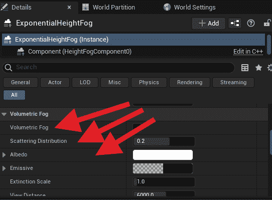

图 2.3：Exponential Height Fog 中的几个参数外观

**注意**

在使用 `Volumetric Fog` 时，`Albedo` 设置会受到场景光线的影响；如果灯光是红色的，蓝色可能看起来不像“蓝色”，以此此类推。

## 分层雾气

创建真实的雾不仅仅是单一的均匀层。操控雾的多个高度衰减（height falloff）设置，引入高度和密度的变化。

示例：在森林场景中，在地面附近应用较浓的雾以营造神秘感，在高处使用较薄的雾以增加深度。

## 大气雾和照明的实际用例

以下是大气雾和照明的一些常见实际用例。

*   **用于恐怖或神秘的浓雾**：将浓雾与昏暗的光结合，以遮挡能见度，唤起悬疑或恐惧。
*   **用于梦幻或空灵场景的薄雾**：使用低密度雾和柔和的光线营造宁静或另一个世界的氛围。

**提示**

细微的调整可以产生巨大差异。过度使用雾会遮盖细节，因此请找到与场景互的平衡点。

*图 2.4* 展示了森林场景中雾的开始，显示了从清晰环境到带有雾层环境的演变。


图 2.4：没有其他元素的基础大气天空（左侧）以及添加了天空渲染和体积云（右侧）

*图 2.5* 延续自 *图 2.4*，显示了森林场景中逐渐层叠的雾层，展示了一个最终充满大气深度的场景。

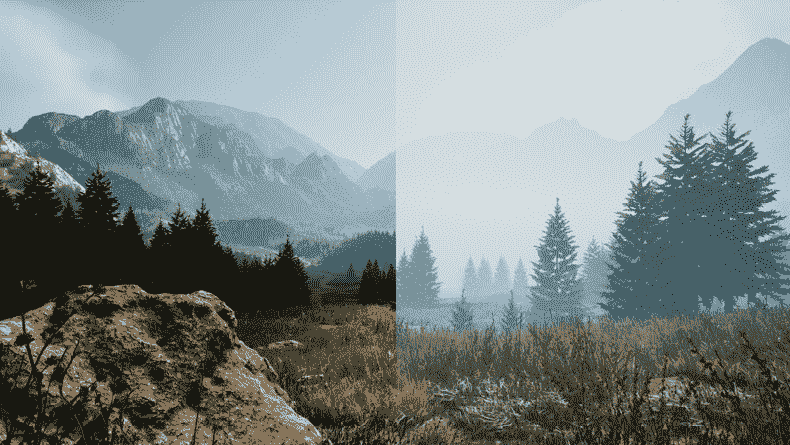

图 2.5：在图像左侧添加体积高度雾（Volumetric Height Fog），然后在右侧添加更浓的雾以进一步改变情绪。

# 增强光柱以获得电影效果

光柱模拟光线通过空气中粒子的散射，创造出引目的光束，为场景增加电影戏剧性和真实感。你可以创建两种光柱，而且它们结合使用的效果非常好。

## 体积光柱

我们已经探索了体积雾，执行以下操作时它会自动创建光柱：

*   调整光源的 `Volumetric Scattering Intensity`（体积散射强度）以控制雾与其相互作用的程度。强度越高，光线在雾中越可见，而强度越低则减少其效果。
*   启用 `Volumetric Shadow`（体积投影）以获得动态光柱。

## 定向光柱

要启用并调整光柱，请从这些步骤开始：

1.  向场景添加一个 `Directional Light`（方向光）并进入其属性。
2.  启用 `Light Shaft Bloom`（光柱泛）和 `Light Shaft Occlusion`（光柱遮挡）以模拟光散射和阴影区域。
3.  调整以下参数进行自定义：
    *   `Bloom Scale`（泛强度）：控制光束的强度。
    *   `Occlusion Mask Darkness`（遮罩蒙深度）：决定物体产生的阴影量。增加此值可获得更强的对比。
    *   `Bloom Tint`（泛着色）：允许对光柱着色，以匹配场景的色调（例如日落时的金色调）。

# 有效使用的技巧

以下是在为充分利用光柱潜力时需要考虑的几点：

*   **策略性放置**：将光源放置在窗户、树冠或墙缝隙等开口处，以创建自然的光柱。
*   **与雾配合**：将光柱与体积雾结合以放大其影响。雾颗粒与光束相互作用，增强其可见性并创造出层次感。
*   **在叙事中使用**：放置光柱位置以引导人们对关键元素的注意力，例如通过教堂彩色玻璃进入的光束照亮的神圣祭坛。

光柱在光影有明显相互作用的区域效果最好。避免过度使用，否则它们会淹没场景并失去其电影价值。

在*图 2.6* 中，我展示了光柱如何极地改善场景，特别是与其他大气元素结合时。上面的图像是一个光照充足的场景，但我想我们认同，在添加氛围和光柱后，下面的场景在情绪和感受上得到了极大提升。

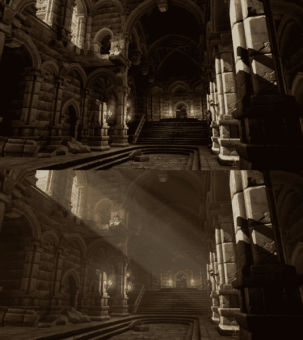

图 2.6：有无大气光柱照明场景对比（资源来源：Mana Station 提供的 Multistory Dungeons | Fab.com）

体积雾和光柱是创建吸引玩家并增强叙事的氛围场景中不可或缺的元素。它们共同为你的虚拟世界带来了深度、情感和电影质感。


在对体积效果如何塑造深度和光照有了坚实的理解后，让我们转向基于天气的粒子系统。虽然像落叶或尘埃之类的粒子系统可以提供更细微的氛围细节，但就本书的语境而言，我们将重点关注可以改变整个环境的大规模天气效果。让我们探索如何模拟雨、、雪和其他动态天气状况，以增强我们项目的沉浸感和叙事性。

# 为动态世界模拟天气效果

动态天气系统可以将静态环境转变为生动如初的世界。通过模拟雨、雪或其他天气现象，你可以为项目添加一个沉浸式的层面，让玩家感到真正置身于环境之中。Unreal Engine 5 的粒子系统、体积雾和 `Blueprints` 提供了创建惊人天气效果的所有工具，这些效果可以提升你的叙事水平。

然而，构建一整套天气系统本身就可以写成一本书，因此在本节中，我们将转向关注一些实用的技术和理论，以使你的天气系统更加先进。

## 雨、雪及其他

在本节中，我们将探讨有关如何设置天气效果的技巧和理论，而不是详细拆解该系统的具体构建方法。创建天气效果涉及将粒子系统与雾和光照相结合，以实现连贯且真实的视觉。我们将讨论创建雨和雪效果，并进一步探索动态分层效果。

### 雨效果

雨效果是为场景添加氛围、紧张感或真实感的极佳方式，无论你是为电影级时刻设定基调，还是增强环境叙事。创建雨有多种方法，根据你的性能需求和艺术目标，每种都有优缺点，但让我们来看看如何开始。

*   **雨粒子**：
    1. 使用 `Niagara` 为雨滴创建长粒子。
    2. 添加细微的速度变化以获得自然的外。
    3. 确保你的雨水材质设置为 `Lit`（受光），这样它就能受到周围雨滴光的影响。关于这里，这是一个非常棒的教程：[`dev.epicgames.com/community/learning/tutorials/5nKZ/unreal-engine-5-rain-and-thunder-tutorial`](https://dev.epicgames.com/community/learning/tutorials/5nKZ/unreal-engine-5-rain-and-thunder-tutorial%0A)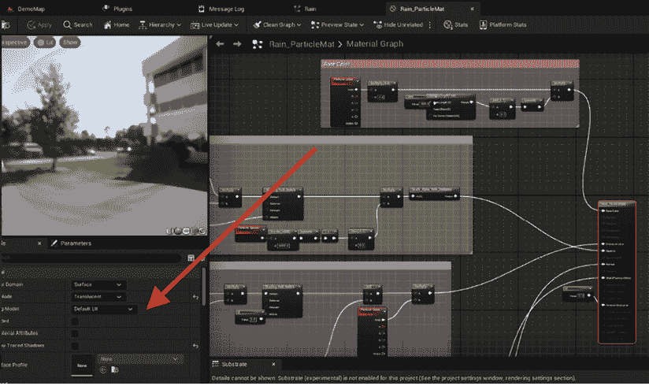
    图 2.7：确保你的雨水材质设置为 `Lit` 的地方

*   **雨雾**：
    1. 配合 `Exponential Height Fog`（指数高度雾）模拟地面或表面附近的雾。
    2. 调整散射和密度，创建雨水在空气扩散的幻象。
    3. 你还可以在远处放置大型半透明平面，并应用循环的雨水纹理或粒子效果。这种技术可以在不渲染成千上万个独立粒子的情况下伪造远处下雨的外观，在帮助性能的同时，仍增加了雨暴的分层和真实深度。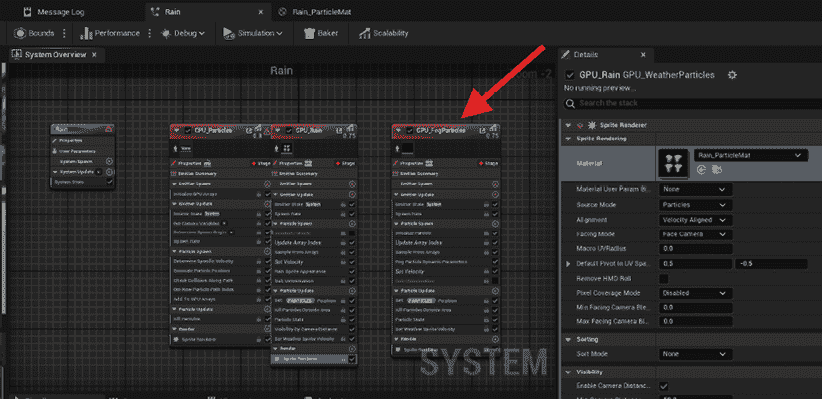
    图 2.8：展示我们如何在一个 `Niagara` 系统中拥有多个系统（如雨雾/雾）

*   **水洼和反射**：
    对表面材质使用“湿润”属性来动态反射环境。这可以通过影响材质的 `roughness`（粗糙度）来轻松控制。

### 雪效果

像雨一样，雪效果可以瞬间改变场景，增加情绪、季节性或孤独与平静的感觉。在 Unreal 中，雪可以通过不同的方法实现，从 GPU 粒子到基于材质的堆积，取决于你所需的视觉效果和性能预算。

**提示**
与其模拟每一片雪花，你可以使用材质让雪看起来像是自然地堆积在表面上。这就是我所说的“基于材质的堆积”。这通常意味着使用基于高度或斜率的掩码在现有资产上混合雪地材质，使雪聚集在平坦的、朝上的区域，而让垂直或避风的区域保持清晰。你还可以添加位移或视差效果来增加深度，但即使是简单的混合着色器也能很好地营造雪随时间堆积的幻象。

以下是思考如何构建具有沉浸感和动态雪环境的方法。

*   **雪粒子**：
    * 创建具有缓慢漂浮速度的粒子，模拟飘浮的雪花。
    * 添加随机旋转和尺寸变化以增强真实感。
*   **雪雾**：
    使用带有冷色调和低密度的雾来模拟雪天的视觉柔和感。
*   **堆积**：
    实现 `dynamic materials`（动态材质），调整以显示物体和地形上的雪堆积。
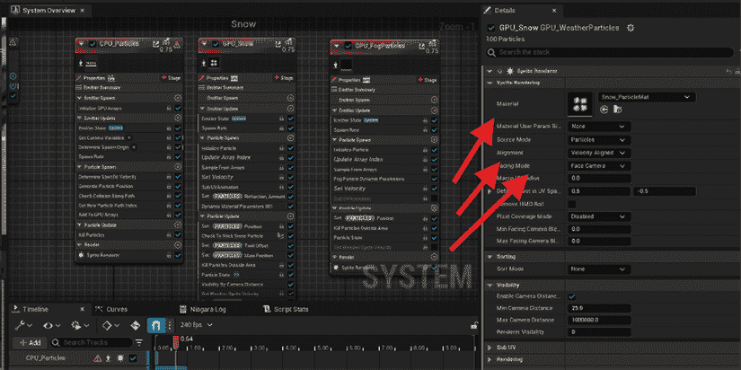
图 2.9：构建雪粒子时在 `Niagara` 中需要考虑的设置

**提示**
虽然我在这里重点讨论雪，但这些建议同样适用于任何其他基于天气的粒子系统，特别是尘暴或沙暴；你基本上只是在改变颜色和速度。

### 动态分层或效果

**动态分层**是对效果进行分层，以实现超越其核心理念的视觉效果。例如，雨是整体效果，但涟漪是增强它的动态分层。

*   **水洼和涟漪**：使用动画贴片（decals）或着色器描述雨滴击中水洼。这些效果可以为表面添加纹理和动作。
*   **雪径**：实现变形或顶点绘制系统来显示雪中的脚印，增加交互性和叙事潜力。
*   **闪电和阴影**：对于风暴，使用方向性光模拟闪电。将这些与阴影的突然变化相结合，产生戏剧且自然的效果。

*图 2.10* 展示了天气如何剧烈影响同一场景的氛围。这里有 5 个示例（从左到右）。我们有：1– 干、2– 雾、3– 湿、4– 沙暴，最后是 5– 雪。同一场景，不同天气：
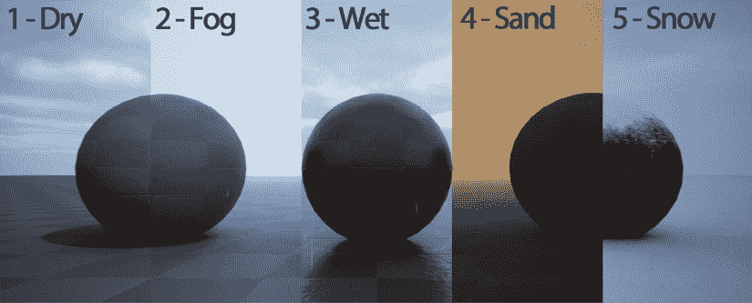
图 2.10：场景的不同天气展示

## 预制系统

我们涵盖了天气对你的项目能做的基础工作，但从零构建这些系统超出了本书的范围。

因此，让我们相反查看 Fab 商店可用的一些优秀系统，然后我们可以使用刚刚讨论的理论，通过这些预制系统来增强我们的世界和叙事。

*   **Ultra Dynamic Sky**：`Ultra Dynamic Sky` (`UDS`) 是一种为了真实和易用而设计的通用天空天气系统。它的设计比许多现有软件包更真实、更通用，通过直观的性能优化界面提供大量的自定义选项。`UDS` 还内置了完整的天气系统，支持从雨、雪到沙暴的所有效果。在 Unreal Marketplace (Fab) 上所有的天气系统中，这是我在职业生涯中最依赖的。
*   **Weather System – Free**：我包含 `Weather System – Free` 仅仅因为它作为一个免费资源非常出色，任何读这本书的读者现在就可以免费获取并测试我们本章中讨论的原则。虽然我不认为它比付费对手 `UDS` 强大，但它仍然是一个不需要任何回报的优秀系统。
*   **Stylized Dynamic Sky and Weather System**：我包含这个资产是因为它提供了风格化的天空，并带有完整的昼夜循环和时间功能——如果你想要 `UDS` 等真实天气系统之外的内容，那么它就适合你。
*   **EasyRain and EasySnow**：`EasyRain` 和 `EasySnow` 是独立的系统，但它们都由 William Faucher 制作，可以和谐工作。


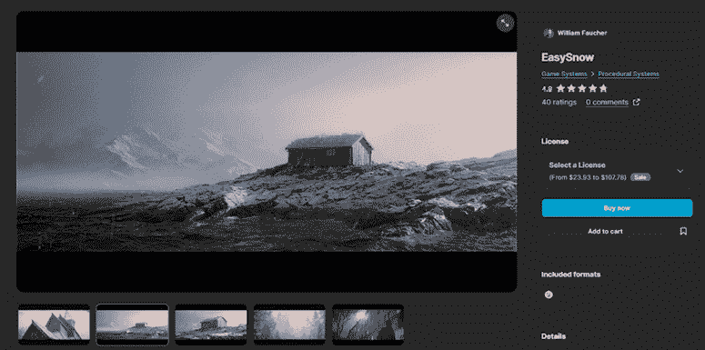

图 2.11: William Faucher 创建的 EasySnow 在 Fab 上的商店页面

`EasyRain` 是一个基于 Blueprint 和 Niagara 的精简系统，旨在帮助我们艺术家快速实现真实的雨效果。无论你的目标是细微的毛雨还是夏季的大倾如雨，它都提供了灵活的控制，让你用最少的设置营造出完美的氛围。相比之下，`EasySnow` 则提供了一个高保真的下雪系统。它让你在几秒钟内就能对冬季场景的氛围和密度进行完全控制。我在游戏开发（无论是专业级还是独立游戏）以及个人电影项目中都经常使用这两个这两个系统。

`免责声明`

我与这些产品没有任何关联，对它们或它们的成功没有任何金钱或个人利益。这些纯粹是我在职业生涯中日常使用的工具的个人意见/推荐。

天气效果如果执行得当，可以增强你世界的真实信度并加深玩家的沉浸感。通过掌握 `UE5` 提供的工具以及 `Fab` 社区提供的系统，你可以构建出适应你叙事需求的动态且视觉吸引力强的天气系统。

虽然天气效果为你的世界增加了动作和纹理，但后处理（post-processing）才是你真正精炼视觉色调的地方。让我们仔细观察调色、曝光调整和其他后处理技术如何提升场景的氛围和凝聚力。

# 使用后处理产生视觉冲击

`Post-processing` 是 `Unreal Engine 5` 中一种强大的工具，用于精炼场景的氛围和情感。通过调整`color grading`调色、`exposure`曝光以及其他设置，你可以引导玩家的情感反应并增强环境的叙事。妥善利用后处理体积（post-process volumes）可以使平淡无趣的场景与吸引观众的场景之间产生巨大差异。作为一名艺术家，后处理是我在 `Unreal` 中最喜欢的工具，因为它在控制场景的外观和感受方面是如此通用。

让我们看看如何通过 `Post Process Volume` 内的调色和曝光来提升你的视觉冲击。

## 用于氛围和情感的调色

调色是设定场景基调最有效的方法之一。通过操纵`colors`颜色、`contrast`对比度和饱和饱和度，你可以让视觉呈现与你的叙事保持一致。

### 调整调色

调整这些值可以获得许多不同的效果，从温暖的怀旧到冰冷的神秘。

*   **用于舒适和怀旧的暖色调**：使用黄色、橙色和红色调的组合来唤起温暖、安全或快乐。这对于日落、舒适的室内或怀旧的回闪非常有效。
    *   在调色面板中增加`Temperature`温度和`Tint`色调以向暖色调偏移。
    *   稍微增强`Saturation`饱和度以使颜色更鲜艳。
*   **用于神秘和紧张的冷色调**：对于冰冷的景观、夜景或悬疑时刻，强调蓝色、紫色和绿色。
    *   降低`Temperature`温度并调整`Contrast`对比度以产生强烈、忧郁的效果。
    *   添加细微的去饱和处理，以获得更内敛、沉闷的色调。

*   **用于戏剧效果的高对比设置**：增加高光和阴影之间的对比可以将注意力吸引到特定区域，或营造更具电影的感觉。
    *   使用`Global Contrast`滑块进行全局调整，或单独微调高光、中间调和阴影。

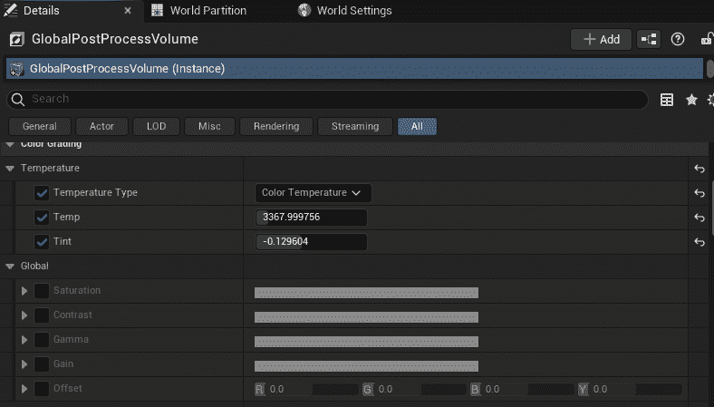

图 2.12: `Post Process Volume` 中的温度控制

### 创建叙事意图

将调色与环境主题相结合，有助于强化场景的情感基调和叙事意图。例如，低饱和度的冷色调色板可以唤起孤独或神秘的感觉，而温暖、高饱和的色调可能暗示着舒适、安全或怀旧。通过将调色与故事的情感节奏对齐，你为玩家创造了一种潜意识的连接，增强了沉浸感和叙事的清晰度。

这里是其他一些例子：

*   **后末日风格**：高对比度的低饱和色彩
*   **梦幻世界**：过曝的白色和柔和色调营造超现实视觉效果
*   **动作序列**：鲜艳、高饱和且对比鲜明的调色板

*图 2.13* 显示了一个我使用我们刚刚讨论的不同调色技术所产生剧烈影响的场景，展示了同一个场景在使用（从左到右分别）中性、冷色和暖色调色时会有多大的差异。

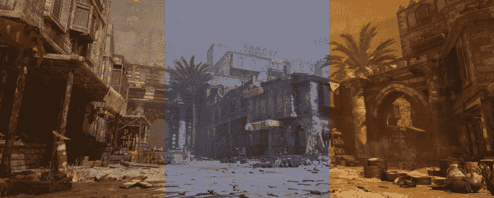

图 2.13: 温度和调色在同一场景上达到的视觉差异（素材来源：The Bazaar by Meshingun Studio | FAB.com）

## 用于真实感和冲击力的曝光调整

曝光设置允许你模仿人类眼睛适应光线的自然方式，为你的场景增加另一层沉浸感。

### 用于动态适应的自动曝光

`Unreal Engine 5` 中的自动曝光会根据相机视野内的光照条件自动调整亮度。这模拟了现实世界中的眼睛适应，在光线水平变化的环境中特别有用，例如：

*   **昏暗的室内通向亮的室外**：当玩家走向户外时，视野将变亮，模拟人类眼睛的调节。
*   **昏暗区域**：自动曝光可以帮助在不牺牲氛围的情况下保持可见性。

若要启用并调整自动曝光：

1.  打开场景中的 `Post Process Volume` 设置。
2.  找到`Exposure`部分。
3.  调整`Min Brightness`最小亮度和`Max Brightness`最大亮度来定义适应范围。
4.  设置`Speed Up`加速和`Speed Down`降速值控制曝光适应变化的速度。

### 用于艺术控制的手动曝光

虽然自动曝光是动态的，但手动设置对于想要完全控制的静态场景非常理想。

1.  调整`Exposure Compensation`曝光补偿以平衡场景的整体亮度。
2.  在视口中使用`Histogram Mode`直方图模式分析曝光，确保没有区域过曝或不足。

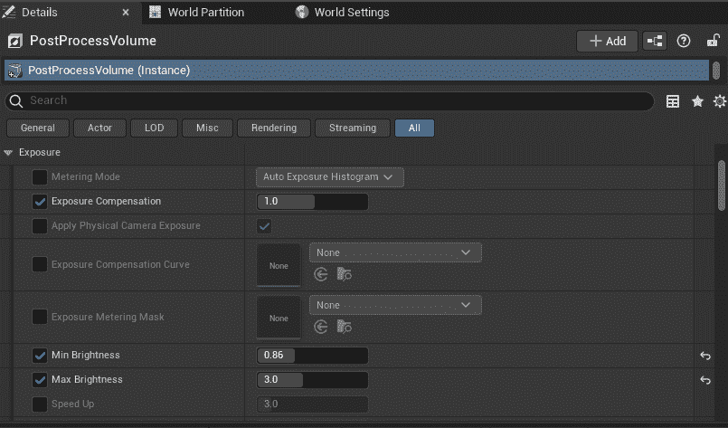

图 2.14: `Post Process Volume` 中的曝光控制

## 实际工作流 – 设置正确的曝光值

这是一个设置场景以使用正确 `Exposure` 值的实际工作流。

1.  从中性设置开始，建立场景的基础光照。
2.  激活后处理体积并逐渐分层叠加调整，从调色开始，然后是曝光，最后是对比度和暗角效果。
3.  经常比较场景的原始版本和后处理后的版本，以确保增强符合你预期的氛围和叙事。


玩家自然地会被场景中视觉对比强烈或动态运动的区域吸引。通过使用氛围效果微妙地引导他们的注意力，你可以确保他们与环境或叙事中的关键元素交互。

## 灯光作为引导

灯光是引导场景内注意力的最有效工具之一。

- **突出关键区域：** 使用对比鲜明的光影来吸引玩家的视线。以下是一些示例：
    - 昏暗走廊中明亮的门口光线
    - 在重要物体或角色上使用聚光灯效果
- **定向光：** 放置光束或光柱来引导玩家沿着路径移动。以下是一些示例：
    - 在茂密的森林中，穿过树冠的阳光可以微妙地指向出口
    - 在室内环境中，透过的窗户或缝隙漏出的光线可以预示下一个待探索的房间
- **用于交互的动态灯光：** 使用闪烁的灯光、发光的物体或色温度的变化来吸引对交互元素的注意力。例如，隐藏杠杆附近闪烁的火炬会鼓励玩家探索。

## 环境线索

氛围效果可以与环境协同工作，为玩家提供视觉或语境上的线索。

- **雾的密度变化：** 使用雾的密度来区分安全区域和危险区域。以下是一些示例：
    - 穿过浓雾的清晰路径可以让玩家确定他们正朝着正确的方向前进
    - 更浓密的雾气配合微弱的红色调可以预示危险或高风险的遭遇
- **用于微妙引导的粒子轨迹：** 添加微妙的粒子效果（如发光的余烬或漂浮的叶子）来暗示移动或引导注意力。以下是一些示例：
    - 通向魔法法物的闪烁粒子轨迹
    - 被风吹落的叶子微妙地向隐藏的小径移动

## 通过氛围营造紧张感

动态的氛围变化是激发情感和提升游戏过程中紧张感的有力方式。

### 动态天气事件

天气的突然变化可以为游戏中的关键时刻奠定基调。

- **临近的风风暴：** 天空逐渐变暗、更强的风效果和远处的雷声可以预示着即将到来的威胁，例如 Boss 战或叙事高潮。
- **用于戏剧性的雨和闪电：** 大雨结合偶尔的闪电可以增强追逐场景或生存序列中的紧张感。
- **从平静到混乱的转变：** 从宁静的环境开始——轻微的雾或柔和的光——用突然的剧性变化（如阵风或旋涡雾气）打破它以预示危险。

### 用于悬感的雾密度变化

雾不仅是营造气氛的工具，也是制造悬和不可预测性的工具。在不确定或紧张时刻增加雾浓度来遮挡玩家的视野。以下是一些示例：

- 探索废弃村庄的玩家逐渐被浓雾包裹，隐藏了潜在的威胁。
- 随着雾消散，远处的敌人或故事关键元素显现，营造出戏剧性的效果。

### 氛围视觉同步

在关注视觉的同时，将氛围变化与微妙的环境效果同步，可以增强沉浸感。以下是一些示例：

- 远处发光的风暴随着闪电短暂照亮地平线而逐渐靠近
- 雾散去揭露了远处一个不安的剪影

## 实际工作流 – 将氛围与叙事元素结合

以下是一个简单的工作流，以开始将氛围与你选择的叙事元素相结合。

1. 首先识别游戏中的关键叙事节奏点或时刻。
2. 规划灯光、雾和天气过渡等氛围元素如何补充这些节奏点。
3. 测试玩家在关键场景中的行为，确保氛围线索能有效引导他们的注意力，而不会感到生硬。

氛围效果与深思熟虑的叙事设计相结合时，是塑造玩家体验的强大工具。无论是引导注意力、营造紧张感，还是强化关键故事时刻，这些技术都能让你打造出沉浸式、具有情感冲击力并留下持久印象的世界。

在这一章中，我们涵盖了广泛的氛围工具、理论和技术。在继续之前，让我们总结一下关键要点，并考虑这些元素如何增强你未来的项目。

# 总结

在 `Unreal Engine 5` 中掌握氛围效果允许你将环境提升为动态的、沉浸式的叙事平台。通过整合体积雾（volumetric fog）、光柱（light shafts）、粒子系统和后处理等技术，你可以打造视觉上令人惊叹的场景，这些场景能与玩家产生情感共鸣，并强化你的叙事目标。

在这一章中，你探索了全面的氛围工具和技术：

- **体积雾和光柱：** 你学习了如何使用体积雾来创建深度和氛围，以及使用光柱来增强电影感。这些工具为你的场景带来了写实感和艺术气息，让你能够激发特定的情感并将注意力集中在关键元素上。
- **粒子系统和天气效果：** 你深入研究了动态天气系统，探索了雨、雪以及天气状态之间的转换如何为你的世界增加生命力和不可预测性，以及你可以在哪里访问这些系统以便轻松将它们引入你的项目。
- **用于视觉影响的后处理：** 后处理体积（Post-process volumes）被强调为精炼场景视觉色调的工具。你发现了如何使用色彩分级和曝光调整来设定氛围并有效引导玩家的感知。
- **氛围与叙事的整合结合：** 最后，你探索了氛围元素如何引导玩家注意力、建立紧张感并强化关键叙事节奏点。通过视觉效果与叙事的和谐统一，你可以创建一个连贯且沉浸的体验。

通过实际工作流、理论和说明示例，你已经获得了能够信地在自己的项目中应用这些技术的知识。

在下一章中，我们将重心从氛围转向形式，深入研究 `Unreal` 的高级建模工具。你将学习如何在编辑器中直接搭建资产（block out assets）并精炼几何形状，无需离开引擎。

# 延伸阅读

为了加深对氛围效果及其叙事潜力的理解，请探索以下资源：

- *Unreal Engine 文档*：官方 `Unreal Engine` 文档提供了所有工具的全面概述，包括设置指南和最佳实践。在此处阅读更多：[`https://dev.epicgames.com/documentation/en-us/unreal-engine/unreal-engine-5-document`](https://dev.epicgames.com/documentation/en-us/unreal-engine/unreal-engine-5-document)
- *视觉叙事中的光的作用*：这篇文章探讨了光和氛围提示对感知的影响，为你的技术技能提供了宝理论背景。在此处阅读更多：[`https://agifineart.com/advice/light-in-visual-storytelling/`](https://agifineart.com/advice/light-in-visual-storytelling/)

# 订阅 Game Dev Assembly！

我们很高兴介绍 **Game Dev Assembly**，这是我们针对游戏开发的全新新闻通讯。无论你是在编程、设计、动画还是管理工作室，我们都能提供见解、趋势和专家建议，帮助你创作、创新和蓬发展。现在订阅即可获得精彩的福利。

[`packt.link/gamedev-newsletter`](https://packt.link/gamedev-newsletter)


# 在 Discord 上加入我们的社区

加入我们社区的 Discord 空间，与作者和其他读者进行讨论：


[`packt.link/unrealengine`](https://packt.link/unrealengine)


# 3 Unreal 的高级建模工具

正如我们在之前的章节中所提到的，UE5 以其尖端的实时渲染能力而广为人知，但它也演变成了一个强大的创作套件，配备了`内置建模工具`，这些工具可以与传统的`3D 软件`竞争。通过这些工具，你可以直接在引擎中进行`建模`、`编辑`和`精炼`资产，从而消除了在外部应用程序之间反复切换的需要。无论你是在设置关卡设计形状、`关卡原型`，还是微调游戏内对象的细节，`Unreal 的建模套件`都能为你提供一个稳健且高效的工作流。

在本章中，我们将深入探讨 UE5 提供的高级建模功能。你将学习如何使用`建模模式`等工具创建和修改资产，探索用于快速原型开发的程序化工作流，并使用`布尔运算`、`雕刻工具`和`UV 贴映射`来精炼模型。这些技术将帮助你在考虑性能和迭代速度的同时，进行初始设计并构建复杂的环境。

在本章中，你将学习到：

* 为什么我们可能在游戏引擎中使用建模工具
* 如何利用 Unreal 的建模模式创建和编辑网格
* 如何使用与第三方软件相似的工具/函数进行非破坏性建模
* 在何处利用程序化建模技术进行高效资产创建
* 使用 UV 贴映射和网格简化优化资产的技术

掌握这些工具不仅将增强你的工作流，还能让你完全在 Unreal Engine 内部创建高质量的环境和资产，使你的开发过程比以往任何时候都高效。

# 技术要求

为了跟随本章节，请确保你拥有：

* `Unreal Engine 5.4` 或更高版本
* 支持实时光线追踪的系统（可选但推荐）
* 基本了解 Unreal Engine 界面、建模原理以及 Unreal Engine 中的纹理
* 可选：带有预制资产的项目用于测试和练习（或从 Unreal 的示例项目开始）

# Unreal 建模工具的演变

多年来，游戏开发者主要依赖 `Blender`、`Maya` 和 `3ds Max` 等外部 3D 建模软件来创建资产，然后将其导入 Unreal Engine 进行场景组装和渲染。这种工作流虽然有效（而且公平地说，我和同事在专业背景下仍在使用它），但往往会引入效率低的问题，需要在软件之间频繁进行反复调整、文件导出和兼容性检查。

意识到需要更具集成性的方法，Epic Games 不断扩展了 Unreal Engine 的内置建模能力。今天，Unreal 的`建模模式`提供了一套强大的工具，允许艺术家和设计师直接在引擎中创建、编辑和精炼 3D 资产。这意味着许多必需的建模任务，如网格编辑、UV 展开和程序化建模，现在可以在不离开 Unreal 的情况下完成。

这些工具的集成对于关卡设计和快速原型开发具有特别的转型意义，这也是我最常用这些工具的场景。与其在引擎中看到资产之前花费小时在外部软件中精炼资产，艺术家现在可以实时进行建模和迭代，根据光照、游戏玩法和比例进行进行调整。这种原生建模工作流不仅可以加速开发，还能培养更直观的创作过程，让我们我们这样的设计师或艺术家能够以前所未有的速度实验和精炼想法。

通过利用 Unreal 不断演变的建模套件，开发者可以实现以下操作：

* 使用基础形状和可编辑网格为关卡设计`快速搭建环境布局（block out）`。
* `使用非破坏性布尔运算`无缝地合并、减去和精炼形状。
* 直接在引擎内`雕刻和精炼资产`，减少对外部雕雕刻软件的依赖。
* `利用程序化建模技术`创建可以随时调整的参数化资产。

随着 Unreal Engine 的持续开发，这些建模工具正成为资产创建流程中不可或缺的一部分。在接下来的章节，我们将更深入地探索这些工具，并演示它们如何简化你的工作流、提高效率并为你的项目开启新的创作可能性。

# 设置和访问建模工具

在深入学习之前，我们需要确保必要的工具已启用并准备就绪。与所有功能可立即访问的传统建模软件不同，Unreal Engine 将某些工具集模块化，以优化性能并简化界面。

## 启用建模模式插件

Unreal 的建模工具包含在一个专用的`建模模式`中，该模式作为一个`插件`提供。默认情况下，此插件可能未激活，因此你需要启用它：

1. 启动 UE5 并打开现有项目或创建一个新项目。
2. 通过导航顶部菜单栏的`Edit（编辑）` | `Plugins（插件）`打开插件窗口。
3. 在搜索栏中输入 `Modeling` 以快速定位 `Modeling Tools Editor Mode` 插件。
4. 通过勾选名称旁边的复选框来启用插件。
5. 在提示时点击`Restart Now（立即重启）`，允许 Unreal 在激活建模工具的情况下重新加载。

一旦启用插件，你将直接在 Unreal Engine 内部获得全套建模功能。


图 3.1：使用 Lumen 显示静态光照与动态光照对比

**重要说明**

在编写时，此功能仍被视为“测试版（beta）”功能，因此仍处于实验阶段。虽然我个人没有发现这有什么问题，但请记住，如果 Epic 决定停止支持，该工具可能会发生变化或完全消失。

## 访问建模模式

现在插件已激活，你可以进入`建模模式`开始创建和编辑 3D 资产。要此此，请执行以下操作：

1. 在 Unreal Engine 界面的左上角找到模式选择器（默认显示 `Select Mode（选择模式）`；见`图 3.2`）。
2. 点击下拉菜单从列表中选择`Modeling Mode（建模模式）`。

**提示**

或者，你可以按下快捷键 `Shift` + `5` 来打开建模模式。

这将标准工具栏替换为扩展的建模面板，让你能够访问网格编辑、布尔运算、变形、UV 编辑和雕刻等多种工具。

*图 3.2* 显示了在编辑器中找到建模模式的位置（左侧）以及在该模式下选项的样式（右侧和下方）：

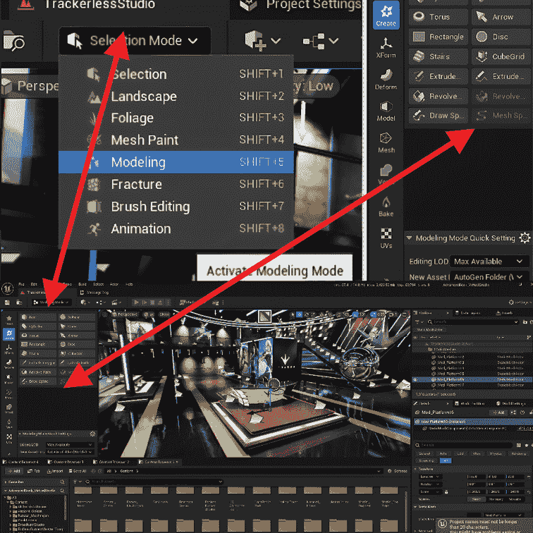

图 3.2：UE 中的建模选项（左上角）和建模模式的位置（右上角）。下方显示了缩放选项的位置。

# 理解建模工具分类

进入建模模式后，你将看到几类关键工具，每种工具都有不同的用途：

* `Create（创建）`：生成基础形状，如立方体、圆柱体、球和平。使用挤出、细分和边/顶点操作来编辑几何结构。
* `XForm（变换）`：修改导入或创建资产的轴心和变换。精确调整位置、旋转和比例。
* `Model（建模）` 和 `Mesh（网格）`：合并、减去和相交网格以创建复杂形状。
* `Deform（变形）`：应用雕刻和平滑操作来精炼你的网格。
* `UVs`：直接在 Unreal 中展开和修改 UV 布局。
* `Texture（纹理）`：涂涂顶点颜色并应用简单纹理用于材质预览。


有了这些工具，你可以直接在 Unreal Engine 中执行一系列基础建模任务，减少对外部软件的依赖，并简化资产创建流程。虽然我们无法在本章中介绍所有工具，但根据我个人的经验，我们将重点介绍我认为在你的项目中心能为你提供最大价值和实用性的工具。

在下一节中，我们将探索如何在 Unreal Engine 中创建和操作几何体，从基础形状开始，逐步转向更高级的建模技术。

# 原型建模与基础几何体

在 UE5 中建模就像在 Maya 或 Blender 中一样，是从`primitive shapes`（原型形状）开始的，它们复杂结构的基础。这些基础几何形式，如`cubes`立方体、`spheres`球体和`cylinders`圆柱体，允许艺术家和设计师快速构建环境原型、精炼空间布局，甚至直接在引擎内创建完成资产。

让我们探索如何使用原型进行有效的关卡布局（Level blockouts）和快速布局原型设计。

## 使用原型进行关卡布局

开始设计环境的最有效方法之一是使用原型几何体对关卡进行`blocking out`（布局）。这种技术广泛应用于关卡设计、建筑可视化和游戏开发，用于在投入高细节资产之前建立布局。

使用原型进行关卡布局的益处如下：

* **快速迭代**：快速测试关卡流线、间距和玩家导航。
* **早期游戏性测试**：在确定资产之前使用粗糙的几何体评估机制。
* **可扩展性**：在添加细节之前轻松调整比例。

以下是使用原型进行关卡布局的步骤：

1. 从 Unreal 编辑器左上角的`Mode`菜单中选择并进入建模模式（Modeling Mode）。
2. 在`Create`面板中，从可用的原型形状中进行选择：
    * `Cube`：适用于墙壁、地板和基础建筑形式。
    * `Sphere`：适用于圆形物体、装饰品或占位符。
    * `Cylinder`：适用于柱子、桶和管道。
    * `Plane`：适用于地面表面、天花板或水体。
3. 通过点击并拖拽到视口，在场景中放置并安排你选择的原型。
4. 修改`Scale`（缩放）、`Position`（位置）和`Rotation`（旋转）值以符合所需的布局。

一旦基础结构就位，你就可以逐渐用详细资产替换原型，或者使用建模工具对其进行精炼。

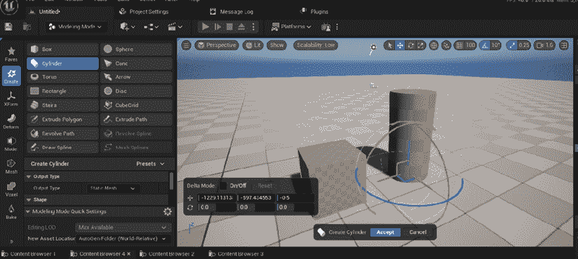

图 3.3：可用基础形状示例

## 调整形状属性：实时几何体编辑

除了简单的放置，Unreal 的建模工具允许对原型形状进行实时编辑，为设计师在塑造环境时提供了更大的灵活性，而无需切换到外部软件。

以下是关键的几何调整：

* **顶点编辑（Vertex editing）**：移动单个点以动态重塑物体。
* **边和面操作（Edge and face manipulation）**：调整边缘和表面以精炼模型。
* **挤出（Extrusion）**：向外延伸几何体以创建新形状。
* **细分和平滑（Subdivision and smoothing）**：增加网格复杂性以实现圆形或有机形状。

在 Unreal Engine 中修改原型的步骤如下：

1. 在视口中选择原型并进入`Modeling Mode`。
2. 选择`PolyEdit`工具集以启用顶点、边和面的选择。
3. 使用`Move`、`Rotate`和`Scale`工具来重塑物体。
4. 应用布尔运算（Boolean operations）来合并或减去形状，以实现更复杂的的设计。
5. 使用变形工具（如平滑和倒角 beveling）来精炼模型。

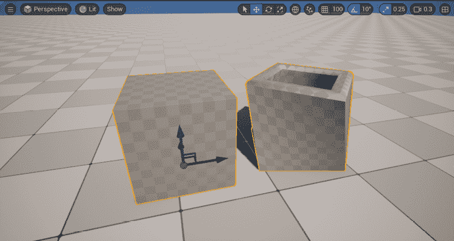

图 3.4：立方体与通过 PolyEdit 和布尔运算修改后的相同立方体的对比图

## 从布局到最终资产

原型不仅仅用于占位符——它们可以使用编辑工具精炼为最终模型。以下是一些示例：

* 一个简单的立方体可以通过挤出和倒角转变为精细的建筑。
* 圆柱体可以通过调整分段和添加边线循环（edge loops）演变成一个雕刻过的柱子。
* 球体可以使用变形工具重塑为有机地形（岩石）。

在理解了原型建模和实时几何体调整后，我们可以创建灵活的、模块化的环境来适应项目需求，且完全无需离开引擎。

现在我们已经建立了原型建模的基础，是时候让你的创作更进一步了。在下一节中，我们将探索布尔运算和网格编辑，解锁直接在 Unreal 内部制作自定义形状和复杂设计的能力。

# 用于复杂形状的布尔运算

`Boolean operations`（布尔运算）是一种强大的建模技术，允许网格的动态合并、减法和交集。这些工具允许艺术家和设计师快速创建复杂结构、复杂的细节和自定义几何体，而无需手动建模每个元素。无论你是在设计未来的科幻走廊、雕刻可破坏物体还是精炼建筑元素，布尔运算都为我们直接在 UE5 中操作形状提供了一种高效的方法。

## 理解布尔运算

在 Unreal 的建模模式中，布尔运算通过根据重叠几何体组合两个或多个网格工作。三个主要的布尔函数：

* **Union（并）**：将两个或多个网格合并为一个对象，同时保持干净的拓扑结构。
* **Subtraction（减法）**：从一个网格中移除另一个体积，适用于切割窗、门或负空间。
* **Intersection（交集）**：提取两个网格之间的重叠区域，适用于创建详细的镂空形状。

## 应用布尔运算

解释布尔运算后，以下是激活布尔模式的步骤：

1. 激活`Boolean`模式：
    1. 选择你想修改的网格。
    2. 在工具栏中导航至`Modeling Mode` | `Model` | `Boolean`。
    3. 选择所需的布尔运算（`Union`、`Subtraction` 或 `Intersection`）。
    4. 调整参数如`Retain Original Meshes`（保留原始网格），允许你在需要时保留原始网格以精炼结果。
2. 使用 `Union` 合并网格：将对象合并为一个无缝的整体。例如，如果你正在构建一个模块化建筑，可以将墙壁、地板和天花板组件合并为一个优化的网格。使用`Union`运算的步骤如下：
    1. 选择两个网格并应用`Union`将其融合。
    2. 启用`Merge Materials`（合并材质）以保留材质。
    3. 使用`Weld Edges`（焊接边）选项确保正确的几何连接。

    **提示**

    以它们的基本形式考虑资产。就像你可能从画圆圈开始来画一个角色一样，椅子只是由一系列基础原型形状构成的，用于制作腿、座垫等。

    然后你就可以单个家具组件（腿、桌面和支撑物）合并成一个统一的资产！

1. 使用 `Subtraction` 创建负空间：`Subtraction`运算通常用于切割开口，例如窗户、门洞或复杂的机械细节。使用`Subtraction`运算的步骤如下：
    1. 将一个切割网格（例如立方体）放置在基础物体内部。
    2. 应用`Subtraction`布尔运算以刻出负形状。
    3. 调整`Offset`（偏移量）参数以微调切割深度。

    **用例**

    在墙壁上刻出管道、通风口或嵌入的科幻面板。


## 1. 使用交集提取细节

`Intersection`（交集）操作仅保留两个网格的重叠部分，非常适合制作独特的模块组件。以下是使用 `Intersection` 提取细节的步骤：

1. 对齐两个具有重叠几何结构的网格。
2. 应用 `Intersection` 布尔运算以分离共享区域。
3. 使用 `Remesh` 确保提取后的拓扑结构整洁。

## 优化布尔工作流

虽然布尔运算非常高效，但它们有时会创建杂乱或密集的几何结构。为了确保结果流畅，请执行以下操作：

* **使用 Remesh 和 Simplify**：执行布尔运算后，使用 `Remesh` 清理拓扑结构以生成均匀的多边形。
* **调整法线平滑**：如果出现阴影伪影，请调整 `Smooth Normals` 设置或使用自动 UV 映射来重新应用纹理坐标。
* **转换为 Nanite 网格**：Unreal 的 `Nanite` 系统可以高效地处理高细节布尔对象，消除了对多边形数的担忧。

*图 3.5* 显示了两个图像，我们从中看到三个对象通过布尔运算创建一个复杂网格的开始和结束状态：

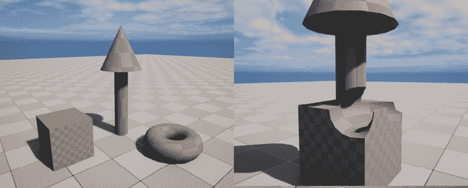

图 3.5：布尔运算前后模型的并排对比。

*图 3.6* 显示了这三个对象在编辑时的两张图像（注意看到使用一个透明圆环来移除网格）：

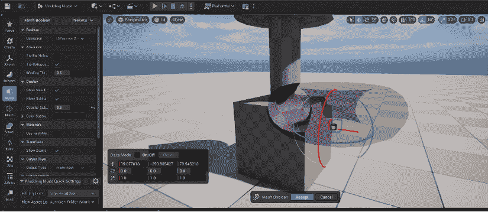

图 3.6：展示并集（Union）、减法（Subtraction）和交集（Intersection）的实际效果

通过布尔运算，你可以快速创建复杂的模型并完善你的设计，而无需外部 3D 软件。无论是制作环境资产、硬表面道具还是建筑元素，UE5 中的布尔建模都能在保持灵活性的同时，简化了创作流程。

现在我们已经探索了布尔运算如何通过合并或切割几何结构来帮助你创建复杂形状，让我们进入**雕刻和网格编辑**。接一步在许多方面与布尔运算相似，但额外的工具提供了更多选项，甚至对模型进行更精细的控制，让你能够使用笔刷工具制作有机形状并完善细节。

# 使用 DynaSculpt 进行雕刻和网格编辑

Unreal 的 `Dynamic Sculpt` (`DynaSculpt`) 工具提供了另一种在引擎内直接精炼和塑造 3D 模型的强大方法。无论你是创建复杂的地形细节、微调角色资产，还是修改环境道具，Unreal 的雕刻工具都提供了增强有机和硬表面模型所需的活性。

## 网格雕刻：完善有机形状

可以在建模工具窗口的 `Deform` 选项卡中找到 DynaSculpt，它提供了一个基于笔刷的界面来塑造几何结构，使其能够创建光滑的有机表面或添加精细的表面细节。这些工具非常适合地形编辑、岩石形成和其他自然资产。

以下是关键的雕刻技术：

* **平滑和膨胀**：使用 `Smooth` 笔刷精炼表面并消除锯齿边缘，而 `Inflate` 工具可以向外推网格区域，增加体积。
* **捏紧和平整化**：`Pinch` 工具可以创建更锐利的折痕，用于雕刻精细细节；而 `Flatten` 工具有助于使结构化的表面平整。

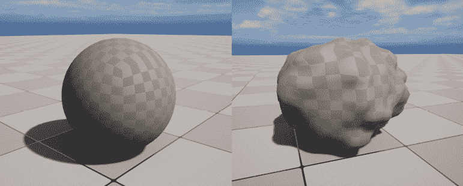

图 3.7：从基础球体雕刻岩石的前后对比，展示了不同的笔刷效果

**重要说明**

这并不是一门关于如何雕刻 3D 模型的课程，因为那远远超出了本章的范围，而且它本身是一门学科。相反，我是在向你展示如何在 Unreal Engine 的上下文中访问和使用这些工具。将我们在这里讨论的内容与*延伸阅读*部分的资源结合，以获得完整的雕刻体验。

## 拓扑优化工具：优化网格拓扑

一旦模型完成雕刻，优化其拓扑结构就至关重要，以确保流畅的变形、高效的 UV 映射和游戏性能。Unreal Engine 提供了内置的拓扑优化工具，用于自动或手动精炼网格拓扑。

以下是拓扑优化技术：

* **减面和多边形减少**：使用 `Remesh` 和 `Simplify` 工具在保持细节的同时减少不必要的多边形。这对于性能优化至关重要，特别是对于移动端和 VR 应用。
* **自适应网格削减**：`Remesh` 功能根据表面复杂度动态调整多边形密度，在需要的地方保持高细节，并在平坦区域减少复杂性。

## 雕刻和拓扑优化在游戏开发中的实际应用

知道拓扑优化工具是什么是一回事，但如何以及为什么要使用它们是另一回事。以下示例：

* **环境雕刻**：艺术家可以直接在 Unreal 中雕刻悬崖、洞穴和有机地面结构，而无需外部工具即可完善细节。
* **角色和生物原型设计**：快速雕刻基础角色形状，然后在外部软件中最终确定之前精炼拓扑。
* **道具创建**：在引擎内修改资产，进行最后时刻的更改而无需返回 3D 建模套件。

直接在引擎中进行雕刻、精炼和优化的能力可以显著提高资产生产的灵活性迭代速度。

一旦你的模型完成了雕刻和精炼，就是时候关注**UV 映射和纹理化**了。适当的 UV 映射可以确保纹理正确应用，为你的模型提供所需的视觉细节和现实感，使其在场景中脱颖而出。

# UV 映射和纹理化

高效且准确的 UV 映射和纹理化对于游戏开发中实现高质量视觉效果至关重要。UE5 提供了一些相当强大的工具，可以直接在引擎内生成、编辑和优化 UV 映射。无论是对道具应用真实的材质，还是为复杂环境微调纹理，了解 Unreal 的 UV 工具都能显著增强你的工作流。

## 自动生成 UV：Unreal 中的快速 UV 映射

Unreal Engine 提供了一种 `auto UV` 功能，可以自动为网格生成 UV 坐标。这对于原型设计或使用过程化纹理特别有用，因为它消除了手动展开的需求。

以下是自动生成 UV 的主要优势：

* **速度和效率**：为资产立即创建 UV 图，减少手动工作。
* **原型设计的理想**：在最终确定 UV 之前快速资产应用材质。
* **适用于动态对象**：适用于没有复杂纹理细节的对象，例如背景道具或生成的资产。

在 UE5 中使用自动 UV 的步骤：

1. 在 `Modeling Mode` 面板中选择静态网格。
2. 导航到 `UV Tools` 部分并启用 `Auto UV`。
3. 调整 `Angle Threshold` 等设置以获得更好的准确性。
4. 在 `UV Editor` 中应用并检查生成的 UV。

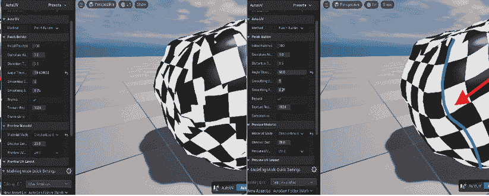

图 3.8：应用自动 UV 前后的模型并排对比，展示了在更改角度阈值时纹理如何对齐。

## 展开技术：用于手动 UV 调整

虽然自动生成的 UV 很有用，但复杂的模型通常需要手动 UV 展开以实现精确的纹理对齐。UE5 包含 `UV Editor`，允许艺术家在无外部软件的情况下展开、调整和优化 UV 布局。

以下是关键的展开技术：

* **平面映射**：最适用于墙壁或地板等平面表面，从单一方向应用 UV。
* **圆柱和球形映射**：适用于圆体物体，如管道、木桶或角色。


- **接缝放置与岛屿装箱**：手动定义 UV 接缝可以确保纹理自然包裹，而不会产生可见的拉伸。

以下是在 Unreal 中进行手动 UV 拆解的步骤：

1. 进入 `Modeling Mode` 并选择你的网格。
2. 打开 `UV Editor` 并选择 `Project UVs`。
3. 使用 `Planar`、`Box` 或 `Custom Projections` 根据对象的形状映射 UV。
4. 调整接缝，展平 UV 岛屿，并对其进行高效装箱，以最大化地减少纹理空间浪费。
5. 应用棋盘格材质以预览畸变，并根据需要进行调整。

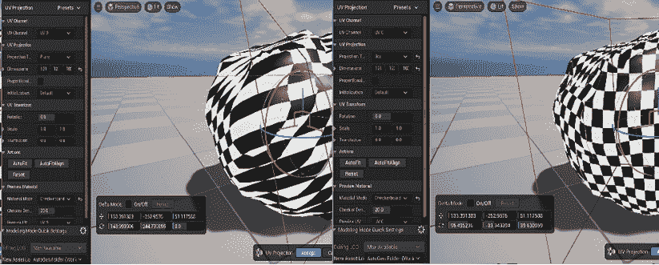

图 3.9：UV 布局对比，显示了使用 `Planar` 投影效果较的 UV 贴图与使用 `Box` 优化后的整洁版本对比。

## UV 映射与纹理绘制的最佳实践

在已经有了坚实基础之后，这里是一些在进行 UV 映射和纹理绘制时需要考虑的最佳实践：

- **避免重叠 UV（除非使用可平铺纹理）**：除非是为了重复图案，否则重叠的 UV 壳会导致视觉伪影。
- **保持均匀的纹像素密度**：确保 UV 岛屿缩放适当，以防止纹理拉伸。
- **使用棋盘格预览材质**：这有助于在应用最终纹理之前识别 UV 拉伸或对齐问题。

通过熟悉 `UE5` 中的 UV 映射，你可以确保纹理无缝地应用到模型上，增强场景的整体真实感和质量，或者至少可以轻松地编辑在其他软件中创建的资产，从而在需要时加速迭代过程。

现在你的模型已经完成纹理绘制并准备就绪，让我们总结一下学到的关键技术和最佳实践作为结束，这些内容将帮助你简化建模管道和工作流。

# 总结

`UE5` 的建模工具已经演变为强大的引擎内方案，可以替代传统的 `3D` 资产创建工作流。Unreal 不再仅仅是一个游戏引擎，它现在提供了一套完全集建模套件，使艺术家和设计师能够在不需要外部软件的情况下进行原型设计、完善和最终定稿。通过利用这些工具，我们可以显著缩短迭代时间并提高创作灵活性，同时在一个减少破坏性编辑的工作流中工作，允许我们在不离开 Unreal 的情况下实时复制、调整和完善模型。

虽然 Unreal 在与某些第三方 `DCC`（数字内容创作）竞争方面还有很长的路要走，但随着每次更新，它正朝着成为全集成建模套件的方向迈进。

在本章中，我们探索了 Unreal 的建模工具如何应用于资产创建的不同方面：

- **基型建模与布尔运算**：构建基础结构并动态完善形状。
- **雕刻与网格编辑**：直接在引擎内创建有机、高细节的模型。
- **UV 映射与纹理绘制**：通过自动生成的 UV 和手动调整确保精确的纹理应用。

通过掌握这些工具，我们可以简化资产创建管道，保持高效的建模工作流，并在不牺牲性能的情况下交付高质量的视觉效果。无论你是在构建沉浸式游戏环境、为新的 `Levels` 设计原型，还是为电影级序列细调细节，这些建模工具都提供了将创意愿景变为现实所需的速度和灵活性。

在继续你的旅程时，请考虑尝试不同的工作流，将程序化技术与手工细节相结合，并将 Unreal 的建模工具与外部软件结合，以构建一个最适合你项目需求的管道。

展望未来，我们将深入交互和动态设计技术与理论，并探索 Unreal 的 `Blueprint` 系统和高级交互工具如何让你的环境活跃起来。

## 重要说明

资产创建是一门庞大且多样化的学科，可以轻松填满几本书的内容，而我们在这一章中仅仅触及皮毛。我希望在本章中读的内容为你提供一些如何在 Unreal 本身进行资产创建的实用建议和技巧，但也建议阅读 `Further reading` 部分的资源，以真正扩展这种复杂且庞大的艺术形式。

# 延伸阅读

这份延伸阅读列表来自 `Packt Publishing` 标签下的其他作者，我推荐通过它们来建立对 `3D` 工作流和设计的坚实基础和理解。虽然它们并非专门针对 Unreal Engine，但这些书中教授的课程与在本章中讨论的内容以及你未来可能进行的任何建模工作（无论是在 `UE5` 还是其他平台）直接重合。

- *Blender 3D Incredible Models*：关于硬表面建模、程序化纹理绘制和渲染的全面指南。点击此处更多：[`amzn.asia/d/7qHZ60G`](https://amzn.asia/d/7qHZ60G)
- *3D Environment Design with Blender*：提升你的建模、纹理绘制和光光技能，创建真实的 3D 场景。点击此处更多：[`amzn.asia/d/d4LKdFa`](https://amzn.asia/d/d4LKdFa)
- *Sculpting the Blender Way*：探索 Blender 的 3D 雕刻工作流和最新功能，包括面集、网格过滤器和 `Cloth brush`。点击此处更多：[`amzn.asia/d/4bPHyBM`](https://amzn.asia/d/4bPHyBM)

# 订阅 Game Dev Assembly！

我们很高兴介绍 `Game Dev Assembly`，这是我们全新的、专注于游戏开发一切事的通讯报。无论你是编写代码、设计、动画还是管理工作室，我们都有见解、趋势和专家建议，帮助你创作、创新和蓬勃发展。现在订阅即可获得令人的福利。

[`packt.link/gamedev-newsletter`](https://packt.link/gamedev-newsletter)


`Level design`（关卡设计）的原则超越任何引擎，这就是为什么本章将侧重于`理论`而非纯技术或实现，但 `UE5` 确实提供了一套全面的工具来帮助为我们的游戏世界注入活力。通过正确的知识，你可以构建出令人惊叹且响应良好的环境，从而增强游戏体验和叙事。然而，掌握环境设计不仅需要对工具或所选引擎的了解；它还需要`艺术感`与`技术诀窍`之间的精妙结合。

在本章中，我们将分解创建引人入胜的游戏空间的核心原则和工作流。我们将涵盖基础设计概念、视觉叙事的高级技巧，以及如何使用 `UE5` 的最新工具来提升你的关卡水平。

在本章中，你将学习到：

*   **游戏环境设计的基础**：探索环境设计的本质核心、其重要性以及如何入门。
*   **有效环境设计的设计原则**：理解构图、比例和玩家心理如何影响游戏世界的感受。
*   **使用 Unreal 的程序化工具进行环境创建**：利用基础的程序化生成技术和 `Blueprint` 高效地创建自然景观和复杂的城市布局。
*   **用于情感影响的光照与氛围**：将从 `Anchor 6`中学到的知识应用于此处，通过使用 `Lumen` 和其他光照工具营造氛围、引导玩家注意力并增强真实感。
*   **案例研究：优秀环境设计的真实世界示例**：分析现有项目中环境设计技术的成功应用。
*   **解决常见的环境设计问题**：讨论一些常见的关键设计问题（特别是在经验较少的设计师构建的环境中），以及如何避免这些问题。

在本章结束时，你将拥有设计丰富、沉浸式环境的知识和技术，这些环境不仅外观良好，而且服务于你的游戏和叙事需求。

# 技术要求

为了跟随本章，请确保你拥有：

*   `Unreal Engine 5.4` 或更高版本
*   支持实时光线追踪的系统（可选，但推荐）
*   对 `Unreal Engine` 界面、设计原则以及 `Unreal Engine` 中的灰白盒建模（grayboxing）有基础了解
*   对 `Unreal` 中的光照和氛围有理解（参见第 1 章和第 2 章）
*   可选：一个带有用于测试和练习的预制资产的项目（或从 `Unreal` 的示例项目开始）

# 游戏环境设计的基础

在深入学习 `UE5` 之前，理解游戏环境设计的一些基本原则至关重要。这些核心概念是构建能够吸引玩家的具有视觉吸引力且功能良好的空间的基础。优秀的环境设计不仅仅让游戏世界看起来好看——它还关乎塑造玩家的体验、引导他们的移动并强化游戏的叙事和机制。

本章是进入本书后续两个章节的基石，在那些章节中，我们将深入探讨这里涵盖的主题。但现在，让我们探索一些更基础的原则吧！

**冷知识！**

在我成为电影和光照艺术师之前，我在本科和硕士阶段都学习了游戏设计。虽然这现在不是我日常工作的主要部分，但它对塑造我的职业道路起了重要作用。

根据我的经验，光照作为一种艺术形式与其他设计原则的合度比任何方面都高，今天我仍然帮助我的设计同事通过光照和环境引导玩家，这就是为什么我想在书中加入这一章。

## 视觉构图：创建统一且易于理解的环境

`Composition`（构图）是环境设计的一个基本方面，影响着玩家如何感知和导航空间。适当使用构图可以确保 `Level` 保持美感、功能性且易于解读。关键的构图技术包括：

*   **取框与视觉焦点**：通过将关键地标、目标或可交互对象放在场景中的突出位置来引导玩家的注意力。`三分法`和`引导线`可以自然地引导玩家的视线。
*   **深度与分层**：通过有效使用前景、中景和背景元素来创造比例和距离感。这种技术增强了空间的可读性，并有助于营造氛围。
*   **对比与层次结构**：使用光线、颜色或独特的建筑特征将重要区域与背景元素区分开。这在保持环境整体和谐的同时，使目标和路径脱颖而出。

要了解更多关于构图、三分法和引导线的知识，请参考“延伸阅读”部分。

*图 4.1* 显示了我在 Epic 的 `Dark Ruins` MegaScans 包中捕捉的一张渲染图，说明了我们在本节中讨论的所有关键点。

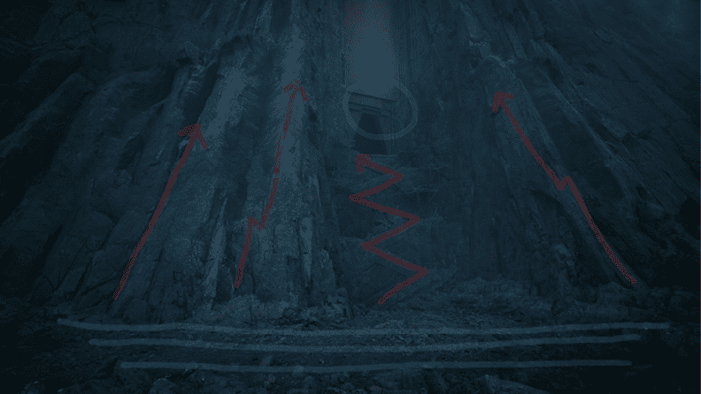

图 4.1：应用构图原则的环境示例，展示了正确的取框、焦点和深度的影响（资产来源：Dark Ruins by Quixel | FAB.com）

红色箭头突出了几何结构中的引导线，将视线向上引导至绿色圆圈标记的焦点。门洞通过强烈的对比被进一步强调，其深色、神秘的剪影在较浅岩石环境的衬托下脱颖而出。此外，悬崖前的前景元素（蓝色线条）营造了深度和分层感，使场景能够清晰且直观地引导玩家走向目的地。

## 引导玩家：环境线索与直觉导航

设计良好的游戏环境可以自然地引导玩家，而不需要过多的 UI 元素或显式指令。可以通过以下方式实现：

*   **将光照作为引导**：明亮的区域、聚光灯或细微的光晕效果可以将注意力吸引到目标、出口或可交互元素。
*   **色彩理论与对比**：暖色（红色、橙色和黄色）往往更容易吸引注意力，而冷色（蓝色和绿色）则营造冷静的背景元素。关键位置与周围区域之间的高对比有助于导航。
*   **建筑流与关卡布局**：路径的结构应该自然地引导玩家向前。弯曲的道路、开放的门以及指向远处地标的视线可以鼓励进度。
*   **环境叙事元素**：利用道具、纹理和环境细节来暗示目标或世界中发生的事件。一座破碎的桥、一条脚印或闪烁的灯光可以微妙地提示玩家下一步。

通过掌握这些技术，你可以创建出直观且沉浸的关卡，而不需要过度的“保姆式引导”。

**提示**

在游戏中，`hand-holding`（牵手式引导）是指通过显式指令、教程或过度直接的提示来引导玩家。虽然这对于新手或休闲玩家有帮助，但过度引导会减少探索欲，削弱玩家的主动性，并降低发现感。

例如，强制相机聚焦在一个不断发出“叮”声的目标物体上会被视为过度引导。

## 平衡美学与游戏性

环境设计中最大的挑战之一是在视觉吸引力和功能性游戏性之间找到正确的平衡。惊艳的环境可以提升游戏的氛围，但过度复杂或杂乱的设计可能会干扰游戏的清晰度。关键考虑因素包括：


*   **保持可读性**：避免过度的视觉噪音或复杂的细节，这些可能会分散或困扰玩家。核心游戏元素应当始终是易于区分的。
*   **减少视觉混乱**：虽然真实感和细节非常重要，但过多的资产或过密的植被会遮挡视线并影响性能。战略性的资产放置可以兼顾美观与实用性。
*   **性能优化**：高细节环境必须针对实时性能进行优化。使用`Level-of-Detail`（`LOD`）模型、剔除技术和高效的材质设置，可以在保持视觉保真的同时防止帧率下降。
*   **确保可玩性**：从玩家的角度测试关卡，可以确保环境保持具有吸引力，且没有无意的瓶颈或混乱的布局。游戏测试可以揭示在开发过程中可能并不明显的问题。

一个平衡良好的环境可以保持美学与功能的无缝融合，确保玩家在沉浸的同时，仍然能够有效地导航并与游戏世界进行交互。

## 提示

游戏性至上！世界上有很多精美但玩起来糟糕的游戏，反之亦然。然而，历史表明，具有强大游戏性和设计的“有趣”游戏往往会获得更大的成功。考虑到这一点，虽然你应该一直追求精美的游戏，但它始终应该始终服务于游戏设计本身。

在追求视觉美感的同时，不要忘记趣味性的重要性；两者都关重要！

通过应用这些基本原则，我们可以打造出不仅视觉上惊艳，而且能够增强玩家参与感、叙事感和游戏流程的环境。

既然我们已经涵盖了游戏环境设计的核心原则，是时候探索如何利用这些元素来讲述故事了。强大的环境叙事始于强大的布局。一旦空间结构和游戏流程确定下来，环境就成了叙事意图的画布。无论是微妙的环境线索还是显而易见的视觉叙事，这些叙事层次都建立在功能性设计的基础上——确保每个空间不仅便于通行，而且在体验上具有意义。基于此，让我们现在探索如何使用不同的工具和技术来打造通过场景、氛围和细节来传达故事的环境。

# 通过设计进行环境叙事

一个精心设计的游戏环境可以在不需要一句台词的情况下讲述故事。通过道具的构思布置、环境线索的使用以及战略性的灯光，设计师可以编织叙事，加深玩家与游戏世界的联系，提升现有的关卡设计基础。`UE5` 为我们提供了强大的工具来实现这种水平的叙事，允许我们通过设计创造出能够开口说话的空间。

## 道具与场景布置

道具和`set dressing`（场景布置）在传达一个地方的故事方面起着至关重要的作用。对象的战略性放置可以为玩家提供世界、历史及其角色的见。

场景布置是在场景中放置道具、装饰和环境细节的过程，以增强真实感、叙性和视觉吸引力。这是我们从电影行业引入的术语，艺术家们“实际上”用真实的道具装饰场景。

在进行场景布置时，我们应该考虑以下点：

*   **选择合适的道具**：选择与你的游戏设定和叙事一致的资产。例如，中世纪村庄一辆损坏的手车暗示了遗弃或过去的冲突。

    ### 提示

    我利用巨大的 `Quixel Megascans` 库来快速高效地匹配我所需的视觉风格。你也可以！

*   **通过放置讲述故事**：排列道具以暗示过去的事件。一把倒下的椅子和泼洒的饮料可以暗示匆忙离开，而一个留有未燃余烬的营地则暗示了最近的活动。

    使用物体簇创建“故事剪影”，玩家在探索时可能会发现它们。

*   **增加细节层次**：融入微小、微妙的细节来奖励观察敏锐的玩家。墙上的涂鸦、留在桌上打开的笔记本或吃了一半的饭都可以增加叙事深度。

    将道具与环境效果结合。例如，使用贴花（decals）在物体周围添加泥土、血迹或水渍，以强化它们的故事。

    ### 提示

    平衡叙事道具与游戏清晰度。避免拥堵重要路径或创建可能分散游戏目标注意的视觉噪音。

*图 4.2* 展示了两幅图片，说明了深思熟虑的场景布置如何显著增强场景。

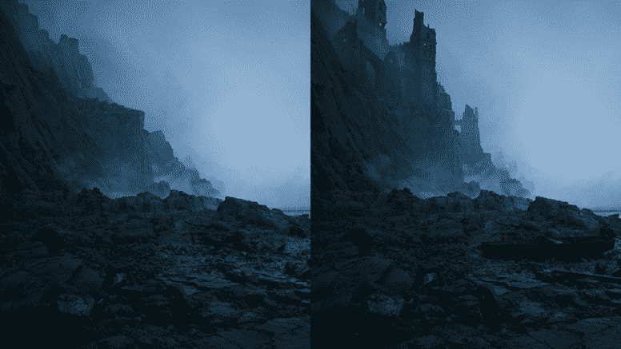

图 4.2：场景布置前后的，展示了添加精心挑选的道具如何将一个普通空间转变为一个故事丰富的环境（资产来源：Quixel 的 Dark Ruins | FAB.com）

左侧，岩石海岸坚固地立着，坦率地说，它本身就很有吸引力。右侧，同样的景观通过额外的场景布置发生了变化，增加了一层第一张图片所缺乏的叙事性。仅需几件额外的资产，场景就从一个普通的崖边变成了被遗忘已久的古代遗迹，前景中有一艘新的小划船。这种微妙的添加引发了好奇心——这是什么地方？这里发生了什么？最近来的人是谁？为什么？这一切在没有一个字的情况下传达了出来。

## 环境线索

环境线索是嵌入环境中的微妙提示，引导玩家对世界及其背景得出结论。这些线索可以简单如一面墙裂开的墙，也可以复杂如一个揭示故事时刻的布置场景：

*   **使用视觉线索**：损坏的结构，如坍塌的桥梁或破碎的墙壁，可以指示一个位置的年代或过去的战斗。

    遗弃的物体，如行李箱或玩具，可以引发情感，并对它们的主人发生了什么引发好奇心。

*   **利用 Unreal Engine 工具**：使用贴花添加非侵入性的叙事元素，如脚迹、血溅或涂鸦。

    利用粒子系统（`Niagara`）制作动态叙事元素——如漂浮的余烬、尘埃或滴水——为环境增添活力。

*   **鼓励玩家解读**：并不是每个线索都需要显而易见。有时，少即是多。为玩家按自己的方式解释故事留空间。

    将线索放在可选路径或隐藏区域，用叙事深度奖励探索。

    ### 提示

    结合线索创建分层次的叙事。例如，一扇封住的门、一个生锈的医药箱和一个闪烁的灯光可以暗示检疫或过去的悲剧。

*图 4.3* 直接基于*图 4.2* 的想法，再次展示了场景如何在不使用一个字的情况下讲述整个故事。

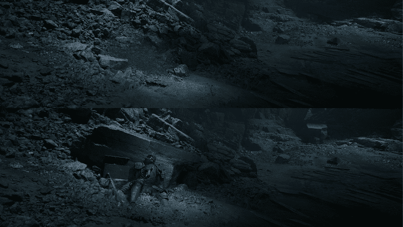

图 4.3：一个小场景，展示了微妙的环境线索——例如一个被金子包围的死战士——如何在没有显式解释的情况下引发背景故事

顶部的图片展示了一个黑暗、神秘的岩石洞。底部图片通过微妙地添加一个被财宝包围的死去的战士，转化了同一个空间。这个简单的变化从多个方面增强了场景——它用财物的承诺吸引玩家，营造了环境内的紧张感，并引发了好奇心。战士是怎么死的？是因为贪婪还是运气，还是财宝被诅咒了？这些细节为世界增加了深度，使其对玩家更具沉浸感和吸引力。

## 用于营造氛围的光照

正如我们在*锚点 5*中讨论过的，`灯光`是营造氛围和强化游戏环境故事的最强大的工具之一。只需进行调整，它就能将一个快乐的村庄变成一个阴森的闹鬼之地：


*   **用色彩设定基调**：使用温暖、柔和的光线来营造安全感和怀旧感，而更冷、更硬的色调可以引起不安或危险感。

在 Unreal 的 `Post Process Volume` 中实现色彩分级，为整个环境应用整体色调。

*   **引导注意力**：通过聚焦光照突出关键叙事元素。例如，使用一束光将注意力引向关键道具或线索。

利用光影控制玩家的移动，引导他们自然地穿过 `Level`。

*   **增强叙事时刻**：使用动态光影变化来指示故事的发展。光线的突然消失可能信号着危险，而穿透云层的阳光可能象征着希望。

利用 Unreal 的光照工具（如 `volumetric fog`、`light shafts` 和 `dynamic light sources`）为场景增添氛围和情感。

**提示**

避免过度光照环境。阴影和黑暗在叙事中同样强大，可以营造出神秘感和张力。

*图 4.4* 显示了仅凭光照如何影响场景。

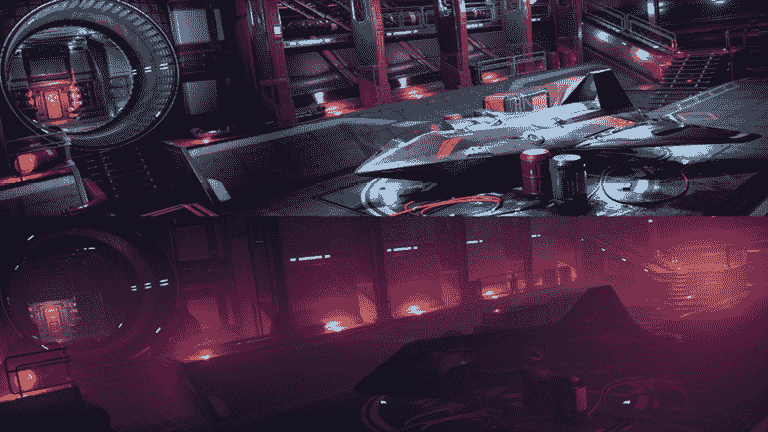

图 4.4：同一场景在不同照明设置下的对比——一个明亮且友好，另一个黑暗且令人不祥——用来说明照明如何影响情绪（素材来源：Scifi Kitbash Level Builder by Denys Rutkovskyi | FAB.com）

在这个场景中，我从一个光线良好的空间站开始，它看起来功能完备且具有吸引力，通过几次光照和氛围调整，将其变成了一个更黑暗、更具“恐怖风格”的场景。你会注意到我们可以如何保持设计理念的完整……我保留了远处黄色门的原样；这是我可能想让玩家去的地方的清晰指示，它在两个示例中都有效。

# 实践案例：废弃木屋中的叙事

让我们想象一下通过以下步骤在生存恐怖游戏中设计一间废弃的木屋：

1. 从场景布置开始——放置破旧的家具、散乱的纸张和一把生锈的灯笼。
2. 添加环境线索，例如破碎的窗户、墙上的爪印以及遗落在地板上的儿童画作。
3. 使用光照来增强氛围。使用单一闪烁的光源投射出硬朗的角角，以引起不安。
4. 引入音频元素，如木头的嘎吱声和远处的私语，以强化叙事氛围。

我预计你已经可以在脑海中想象出这个场景的样子了，道具、线索和光照结合在一起创造了一种强大的场所感和故事感。

环境叙事将游戏世界从静态背景转变为叙事的活跃参与者。通过道具的放置、微妙线索的嵌入以及利用光照唤起情感，你可以创造与玩家产生深层共鸣的沉浸式体验。

虽然环境叙事有助于建立氛围和叙事，但 `Level` 创建的效率同样重要。简化开发并保持一致性的最佳方法之一是使用模块化资产或组件，这些组件可以重复使用并重新排列，快速构建复杂的环境。

# 创建模块化可重复使用的资产

创建复杂的游戏环境是一个耗时的过程。然而，采用`modular`方法可以在保持高质量视觉效果和游戏设计的同时显著提高效率。UE5 让开发者构建模块化套件并实现蓝图变得非常容易。这些技术不仅加速了开发，还有助于形成连贯且精细的成品。

## 模块化套件设计

模块化套件是可重复资产的集合——例如墙壁、地板、门口和道具——它们可以通过不同的方式组合以构建各种环境。通过设计具有统一尺寸和无缝边缘的模块化资产，你可以快速构建环境，同时确保它们视觉上一致：

*   **规划你的套件**：在创建资产之前，分析你需要的环境类型。例如，科幻走廊套件可能包括墙板、地板砖、天花板组件和模块化门框。

将你的设计拆分为可重复的部分。使用基于网格的方法（例如 `1x1 m` 或 `2x2 m`）设计资产以确保兼容性。

*   **构建模块化资产**：创建具有标准轴点和一致比例的资产。这允许资产在 UE5 中组装环境时轻松地对齐。

  使用 Unreal 内置的建模工具或外部软件（如 `Blender` 或 `3ds Max`）设计模块化组件。

*   **组装环境**：将你的模块化资产导入 Unreal Engine，并使用网格吸附功能精确地放置它们。

  尝试同一套件的不同排列方式，以创建既多样又统一的环境。

**提示**

在模块化和独特性之间保持平衡。引入几个“英雄”资产——独特的模型或特征——来打破模块化元素的重复。

*图 4.5* 显示了一个由多个资产组成的蓝图，用于创建一个可重复的模块化资产。


图 4.5：带有标记组件的模块化 `BP` 套件示例

这是通过一次组装就在整个宴会厅创造盛宴的方法。

## 使用蓝图创建动态环境

UE5 的 `Blueprint` 系统允许设计师在不需要深度编程知识的情况下为环境添加交互和动态元素。将蓝图与模块化资产结合，可以通过引入响应的游戏世界来提升玩家体验：

*   **交互元素**：使用 `Blueprints` 创建动态物体，如门、电梯、移动平台或可破坏墙壁。

  实现触发器和事件，让物体对玩家的操作做出反应（例如，玩家靠近时门打开，或按下按钮时平台移动）。

*   **基础程序化生成**：蓝图可以用于随机化环境的某些方面。例如，你可以创建一个蓝图，在每次加载 `Level` 时都生成不同的道具，为模块化设置增加多样性。

*   **增强模块化工作流**：将模块化资产与蓝图结合以创建模块化预制件——预组装的环境块，可以快速放置。

  例如，为模块化走廊构建一个蓝图，在每次放置它时生成随机的装饰。

**提示**

避免蓝图过度复杂化。模块化资产结合简单、可重复的蓝图可以取得令人印象的结果，而不会引入不必要的复杂性。


基于物理的物体使用 UE5 的 `Chaos Physics` 系统来模拟真实的移动、碰撞和交互。这些元素让环境感觉触感且富有生命力，允许玩家自然地推、拉或操纵物体：

- **在物体上设置物理效果**：要让资产具有物理属性，请在虚幻引擎物体的 `Static Mesh Component`（静态网格组件）中启用 `Simulate Physics`（模拟物理）。

调整`mass`(质量）、`friction`(摩擦力）和`damping`(阻尼）等属性以匹配预期的行为。例如，金属箱应该比橡胶球更重且弹性更小。

- **添加物理约束**：约束限制物体的移动方式。例如，门可能只在其合页上旋转，或者摆钟可能在固定的弧度内摆动。

使用 `Physics Constraint Components` 来设置这些限制，并创建更受控的交互。

- **结合游戏机制**：将基于物理的物体与蓝图结合以触发事件。例如，通过在压力板上放置重物来激活它可以打开门或揭示隐藏路径。

创建依赖于真实物理交互的谜题，例如滚动的巨石或可堆叠的物体。

**提示**

避免在复杂环境中过度使用基于物理的物体，因为过多的动态元素会影响性能或导致不可预见的错误。要有策略地使用它们，在最重要的地方增强交互性。

*图 4.6* 显示了在“细节面板”（details panel）中勾选哪个复选框可以让资产受物理效果影响。


图 4.6：显示 UE5 中基于物理的物体设置的图表，突出了模拟和约束的关键设置

## 可破坏环境

可破坏环境允许玩家动态地改变游戏世界，无论是通过战斗、探索还是脚本事件。实现可破的墙、易碎的物体或变形的地形增添了真实感和刺激感，增强了游戏性和叙事。这只是非常浅的视角，我们将在下一章进一步探讨，但现在，让我们来看一些基础知识！

- **创建可破坏网格**：使用 UE5 的 `Chaos Destruction` 工具将静态网格转换为可破坏资产。

根据所需的效果设置 `fracture types`（破碎类型），例如 `clustered`（聚类）、`uniform`（均匀）或 `radial`（径向）。

- **在游戏中实现破坏**：使用蓝图触发破坏事件。例如，当玩家投掷爆炸物时，墙壁可能会真实地断裂。

将可破坏物体与游戏机制挂钩。也许打破地板会揭示一条秘密通道，或者粉碎屏障会解锁一个新区域。

- **性能考虑**：限制场景中活跃的可破坏物体数量以保持性能。

交互式环境是打造难忘游戏体验的关键。通过利用 `Chaos Physics`、可破坏系统和动态元素，你可以创建出不仅看起来惊艳，而且对玩家动作有意义反应的世界。当处理得当时，这些交互将静态空间转变为`生生的世界`，将玩家参与感和叙事推向新的高度。

我们探索了构建高效、有趣游戏环境的各种技术，但这些原则如何应用于现实项目呢？在本节中，我们将检查展示不同类型游戏中有效环境设计的案例研究。

# 案例研究：有效的游戏环境设计

研究现实世界的环境设计案例可以为我们提供讨论过的工具和技术的实际应用提供有价值的见解。因此，在本节中，我们将探索两个不同的案例研究：一个`未来科幻研究设施`和一个`密集的中世纪村庄`。每个场景都展示了模块化设计、氛围营造和交互性的不同方法，为构建吸引人的游戏环境提供了全面的视角。

## 案例研究 1：设计科幻研究设施

设计科幻研究设施涉及将整洁、未来感的美学与神秘感和不安感相结合。这种环境设计利用 `modular assets`（模块化资产）、`real-time reflections`（实时反射）和 `atmospheric lighting`（氛围光照）来营造精致的氛围。

### 使用模块化资产构建未来场景

模块化设计对于构建科幻环境中常见的流畅、重复建筑至关重要：

- **套件设计**：创建一个模块化套件，包括墙壁、地板、天花板、过门框和修饰件，它们可以无缝对接在一起。这种方法能够在保持设计一致性的同时实现快速的 `Level`（关卡）构建。

- **高效迭代**：通过使用模块化资产，我们可以快速测试不同的布局并对 `Level` 设计进行迭代，而无需建模资产。

- **自定义**：引入 `material instances`（材质实例）来调整表面属性（例如金属光泽或发光效果），并在不创建新资产的情况下增加变体性。

### 用于高科技美学的实时反射

为了强调设施的先进技术，使用 `Lumen` 集成 `real-time reflections`：

- **反射表面**：在地板、屏幕和玻璃隔断应用 `highly reflective materials`（高反射材质）。动态反射有助于传达清洁和精确的感觉。

- **光交互**：使用带有发光材质的灯光板创建发光元素，增强科幻氛围。

- **优化反射**：为了性能考虑，策略性地放置 `reflection captures`（反射捕捉），并考虑在不重要的区域使用 `Screen Space Reflections` (`SSRs`）。

### 用光营造营造的氛围

科幻研究设施往往走在高科技奇迹和怪异孤独之间的边缘。使用光照和声音来营造紧张感：

- **光照技术**：用冷蓝色和无菌白色创建对比光，然后引入阴影区域以唤起神秘感。

- **动态照明**：添加由游戏事件触发的闪烁灯光或应急照明序列。

*图 4.7* 显示了基于我们刚刚讨论的案例研究，科幻设施的氛围感光照设置结果：


图 4.7：案例研究 1：科幻设施的渲染示例（资产来源：Jonathan Fredrick Scifi Modular | FAB.com）

## 案例研究 2：构建密集的中世纪宴会

设计中世纪宴需要不同的方法——专注于有机布局、生活化的纹理和繁忙的交互。该项目强调了`procedural tools`（程序化工具）和`atmosphere`来创建一个沉浸式的历史背景。

### 使用程序化工具构建和道具放置

在中世纪背景下，密集的自然布局增加了真实感和玩家沉浸感：

- **程序化生成**：使用预制的食物和饮料道具蓝图快速构建场景。

- **随机化**：引入轻微的旋转和缩放变化，打破程序化放置食物的网格模式。

- **自定义规则集**：设置放置规则，确保植物、食物和椅子等物品出现在逻辑且故事驱动的位置。

### 用光照营造充满活力的氛围

中世纪宴会通常散发出温暖和庆祝的感觉。用暖色调和柔和的阴影创建对比光照。

## 动态交互

许多中世纪游戏（例如《上古卷轴 5》）通过开启桌子上所有食物的物理效果让玩家玩耍，让他们可以踢和扔资产：

- **趣味性物理**：在虚幻引擎中开启物体的 `Simulate Physics`，让玩家弄乱环境。可选的玩家触发混乱增加了幽默感和沉浸感。

*图 4.8* 显示了基于我们刚刚讨论的案例研究，温暖且宜人的光照设置结果：


图 4.8：案例研究 2：中世纪宴会的渲染示例（素材来源：Medieval Banquet by Quixel | `FAB.com`）

## 案例研究的核心收获

虽然每个环境都有独特的挑战和要求，但它们都受益于以下几点：

* **模块化设计**：简化构建过程并实现快速迭代。
* **光照与氛围**：定制视觉和听觉元素以强化叙事。
* **交互性**：通过动态和响应式元素吸引玩家。

这些案例研究展示了 `UE5` 在创建环境方面的多功能性，不仅能让视觉效果震撼，还能增强游戏性和叙事。通过采用这些技术，无论背景设定或类型如何，你都可以将类似的策略应用于自己的项目中。

随着这些研究的结束，你掌握了一套新的工具和技术，让我们通过查看如何解决可能会损害环境设计的常见设计陷阱来结束本章。

# 解决常见的环境设计问题

设计引人的游戏环境是一个复杂的过程，即使是经验丰富的开发者也会遇到挑战。无论是处理布局平坦，还是空间杂乱的问题，及早识别并解决这些问题都可以节省时间并提升最终产品。本节涵盖了我在环境设计中看到的几个常见陷阱，并提供了使用 Unreal 工具和工作流的某些实用解决方案。

## 平坦且无趣的布局

平坦的环境会导致枯燥且缺乏灵感的游戏体验。如果没有高度上的变化或视觉趣味，玩家可能会觉得这个世界平淡无奇或难以导航。

以下是关键解决方案：

* 添加高度变化：
    * 引入**山丘**、**斜坡**、**平台**或**多层结构**来创造垂直感。
    * 利用 Unreal 的 `Landscape` 工具雕刻出具有自然高度起伏的地形。
    * 应用**模块化资产**（如楼梯、梯子和桥梁）来促进探索。
* 创建焦点：
    * 使用**地标**（例如，高耸的雕像或发光的门户）来吸引玩家的注意力。
    * 通过路径、光线或资产放置在环境环境中实施**引导线**以引导移动。
* 鼓励探索：
    * 设计*隐藏*的路径、高处视角或地下区域以奖励好奇心。
    * 将收集物品或环境叙事元素放置在不明显的位置，以吸引玩家探索。

> **提示**
> 使用相机预览玩家视角，在开始游戏测试之前，识别出感觉平坦或在视觉上单调的区域——相信你的直觉和眼睛！

## 过于拥挤或稀疏的区域

平衡细节密度至关重要。过度拥挤的区域会让玩家无所措并遮盖重要的游戏元素，而稀疏的环境可能会感觉未完成或毫无生命力。

以下是关键解决方案：

* 从玩家视角评估密度：
    * 定期在第三人称或第一人称视角下*测试环境*，以衡量杂乱程度。
    * 使用 Unreal 的编辑器视图模式，如**线框（Wireframe）**或**仅光照（Lighting Only）**来发现不需要的对象或空白区域。
* 平衡视觉细节：
    * 引入**装饰性资产**，如**植物**、**道具**或**小型碎片**来自然地填充空区域。
    * 在杂乱的空间中，逻辑性地分组物品并移除非必要的资产以提高可读性。
* 通过设计选择引导玩家：
    * 使用**光照**、**色彩对比**或**运动**（例如飘扬的旗帜或流动的水）来引导注意力。
    * 在交互对象上实施**视觉驱动的高亮**，以确保它们在密集的环境中脱颖而出。

通过主动识别和解决这些简单的常见环境设计问题，你可以创建更有沉浸感和视觉吸引力的游戏世界。

在对环境设计原则、叙事技术、模块化工作流和交互元素有充分理解之后，你现在拥有了创建引入胜、沉浸世界的工具。在我们进入后续章节中更多实用的课程（例如如何使用 Unreal 的物理引擎 **Chaos**）之前，让我们回顾一下本章的核心收获。

# 总结

设计游戏环境不仅仅是组装资产——它关乎打造增强游戏性、叙事和玩家体验的沉浸式世界。

在整个章节中，我们探索了环境设计的几个基本组成部分，从构图和玩家引导的基本原理到程序化生成等高级技术。通过结合这些策略，你可以创建出感觉生动、有响应且叙事丰富的 `Levels`。

在整个章节中，我们探索了在 `UE5` 中设计引人的游戏环境背后的以下原理和工作流：

* **游戏环境设计的基础**：利用构图、光照和玩家引导创建沉浸式空间。
* **设计的环境叙事**：通过道具、光照和环境线索增强世界构建。
* **高效关卡设计的模块化工作流**：利用可重复资产、蓝图和材质变体来简化开发。
* **交互和动态元素**：添加基于物理的对象和响应的游戏元素。
* **案例研究：有效的游戏环境设计**：检查这些技术在科幻和中世纪背景中的真实应用。
* **解决常见的环境设计问题**：解决平坦布局和资产放置的最佳实践。

掌握环境设计是一个迭代过程，将创造力与技术问题解决结合在一起。通过完善你的工作流并深思熟虑地放置资产，我们可以打造捕捉玩家并提升整体游戏体验的环境。

凭借本章涵盖的知识和技术，你完全有能力设计出不仅视觉上震撼，而且增强游戏性和叙事的 `Levels`。当你继续精炼技能时，请记住，最吸引人的游戏世界是那些将艺术性与交互性无缝融合的世界——每一个元素都有其目的，每一个细节都为玩家的旅程做出贡献。

> **重要说明**
> 类似于上一章的“建模”一样，“设计”是一门巨大且多样化的学科，可以很容易填满几本书的内容，这也是我在高等教育阶段学习半年的内容。我希望在本章中阅读的内容为你在 Unreal 本中创建关卡提供一些实用的技巧，但也建议阅读*延伸阅读*部分中的资源，以进一步扩展这一复杂而微妙的学科。

# 延伸阅读

这份延伸阅读列表来自 Packt 出版的其他作者，以及我推荐的一些个人收藏，用于建立游戏设计作为一种艺术和学科的基础理解。虽然这些书并非与 Unreal Engine 直接相关，但书中教授的课程与在本章中讨论的内容以及你未来可能进行的任何游戏设计和世界构建工作直接相关，无论是在 `UE5` 还是其他平台。

* *Practical Game Design*：视频游戏设计的现代且全面的指南。更多信息：`https://amzn.asia/d/3mHna9`
* *Rules of Play: Game Design Fundamentals*：这是一本经典之作，仍是我硬装收藏中个人喜爱的之一，常备翻阅。更多信息：`https://amzn.asia/d/6tFIKNG`


*   *制作视频游戏：创建数字世界的艺术*。点击此处阅读更多：[`amzn.asia/d/gQlNaRn`](https://amzn.asia/d/gQlNaRn)

# 订阅 Game Dev Assembly！

我们很高兴地介绍 `Game Dev Assembly`，这是我们全新的专注于游戏开发一切的通讯报。无论你是在编写代码、设计、动画还是管理工作室，我们都有深度的见解、趋势和专家建议，帮助你创作、创新并蓬勃发展。现在注册即可获取优厚福利。

[`packt.link/gamedev-newsletter`](https://packt.link/gamedev-newsletter)


# 在 Discord 上加入我们的社区

加入我们社区的 Discord 空间，与作者和其他读者进行讨论：

[`packt.link/unrealengine`](https://packt.link/unrealengine)


# 5

# 集成 Chaos 物理以实现动态游戏机制

`物理驱动的交互`通常是沉浸式游戏的核心组件，以一种切实且迷人的方式塑造了`玩家与游戏世界的交互方式`。UE5 的 `Chaos Physics` 系统为模拟真实的运动、破坏和环境交互提供了一个强大且高效的框架。无论是`动态破坏`、`实时布料模拟`还是基于物理的字符交互，Chaos Physics 都能允许我们创建高响应的游戏世界。

在本章中，我们将探索 `Chaos Physics` 的关键特性，以及如何将其有效地集成到你的 UE5 项目中。你将学习如何利用 `Chaos 刚体`的力量，实现可破坏环境，并利用软体动力学等高级物理模拟。

在本章中，你将学习：

*   `Chaos Physics` 的基础及其相对于传统物理系统的优势
*   实现用于动态对象交互的 `Chaos 刚体`
*   使用 `Chaos Destruction 系统` 设置可破坏环境
*   实现布料物理以实现真实的运动

在本章结束时，你将牢掌握如何将 `Chaos Physics` 集成到你的项目中，使你能够创建更具互动性和视觉吸引力的游戏环境。

# 技术要求

为了跟上本章的内容，请确保你拥有：

*   Unreal Engine `5.4` 或更高版本
*   支持实时光线追踪的系统（可选但推荐）
*   对 Unreal Engine 界面有深入了解
*   对物理术语有一定了解
*   可选：一个带有预构建资产的项目以供测试和练习（或从 Unreal 的示例项目开始）。

# 什么是 Chaos Physics？

`Chaos Physics` 是 Unreal 先进的`物理模拟系统`，旨在提供比传统的 `PhysX 系统`更准确、更具扩展且对性能更友好的物理交互。Chaos 的设计是为了处理大规模破坏、实时刚体交互、软体动力学和复杂的车辆物理，使其成为我们这些寻求创建沉浸式和互动性游戏世界的开发人员至关重要的工具。

在 Chaos 出现之前，Unreal 依赖 NVIDIA 的 `PhysX` 进行物理模拟，虽然它有效，但在大规模破坏、实时性能和布料模拟等方面存在局限性。Chaos Physics 通过提供更精确的碰撞检测、实时碎裂和改进的求解器克服了这些限制，求解器能够高效地处理物体之间的复杂交互。这让开发者在大多数情况下能够集成感觉更自然、更灵敏的物理驱动机制，而不会导致性能瓶颈。

**冷知识！**

我的游戏开发之旅始于硕士学位期间在 `Unreal Development Kit` (`UDK`) 和 UE4 中尝试 `PhysX`，当时我制作了一个游戏，让玩家射击彩色弹球来粉刷房间。那很有很有趣，我对此也有美好的记忆，但我们现在通过 Chaos 所能实现的成就足以让那个游戏提升到一个全新的水平！

具体来说，让我们来看看 `Chaos Physics` 的一些关键优势：

*   **更准确且高效的物理计算**：Chaos Physics 引入了强大的求解器系统，在优化性能的同时提高了物理交互的准确性。这意味着我们可以模拟具有多个交互物体的高度动态环境，而不会产生过度的计算开销。
*   **实时破坏和碎裂模拟**：Chaos 的突出特性之一是其模拟实时破坏的能力。`Chaos Destruction 系统`允许墙壁、桥梁或整个建筑等物体根据冲击力、爆炸物理或脚本事件动态地破解。。与传统的预烘焙破坏序列不同，Chaos 允许`程序化碎裂`，确保每次破坏结果都是独特的。这使得游戏体验感觉更加灵敏且不可预测，增加了沉浸感。
*   **用于真实运动的布料和软体物理**：Chaos 超越了刚体物理，包含了软体和布料模拟，实现了与织物、绳索和变形物体的真实交互。该系统支持对风、运动和碰撞做出反应的动态布料物理，允许创建更真实的服装、旗帜或有机材料。

Chaos Physics 代表了 UE5 物理模拟的巨大飞跃，为我们提供了创建高度互动和视觉吸引力游戏世界的工具。通过利用其强大的功能集，我们可以创建物理驱动的游戏机制，从而增强真实感、沉浸感和玩家参与度。

现在我们已经了解了 Chaos Physics 的基础，让我们探索它最常用的特性——刚体动力学。无论是物体对力的反应，玩家交互还是环境影响，刚体物理都是 UE5 中真实运动和交互的基础。

# 刚体动力学和对象交互

刚体物理形成了 UE5 中大多数物理驱动交互的骨干。无论是物体从山上滚落、箱子对玩家碰撞的响应，还是碎片从爆炸中散落，Chaos 刚体确保了这些交互的感觉是自然的。Chaos 对质量、摩擦和恢复等物理属性提供了精细的控制。与`动力学`或`静态`物体不同，刚体可以根据作用力和重力和碰撞进行运动和旋转。这使得各种物理驱动机制成为可能，从简单的物体移动到复杂的相互连接系统（如可破坏道具、摇摆平台）。

**注意**

在 Unreal 中，动力学指的是手动移动而非不受物理影响的物体。

实现 Chaos 刚体相对简单。通过在网格上启用物理模拟，你可以让物体对重力和碰撞和外力的反应。以下是设置和精炼刚体交互的步骤指南。

## 将对象转换为刚体

要将任何 `Static Mesh` 转换为物理驱动对象，请遵循以下步骤：

1.  选择`Static Mesh`：在蓝图中点击 `Static Mesh` 或将网格放入场景中。
    2.  在`Details`面板中，找到`Physics`部分。
    3.  启用`Simulate Physics` 以允许物体自由移动。

2.  调整`Static Mesh` 的物理属性：
    1.  **Mass (质量)**：定义物体重量。Unreal 可以根据体积和密度自动计算质量，但你可以对其覆盖以获得更精确的控制。


2. **线性与角阻尼**：控制运动和旋转随时间减慢的速度。增加阻尼会让物体感觉更重，且对运动的阻力更大。

3. **开启重力 (Enable Gravity)**：控制物体是否受 Unreal 内置重力值的控制，并且可以通过操作之前的值来产生影响。


图 5.1：静态网格体实例（Static Mesh Actor）作为物理对象的细节设置

**提示**

如果物体出现抖动或行为不可预测，请确保碰撞设置与预期行为匹配。Unreal 提供了如 `Simple Collision`（简单碰撞）用于优化性能，以及 `Complex Collision as Simple`（复杂碰撞作为简单碰撞）用于实现更准确的物理交互。这些设置可以在资产详情的 `Collision Complexity`（碰撞复杂度）下找到。

## 施力和冲量

要动态地移动或与 Chaos 刚体交互，你可以通过蓝图或 C++ 施加力和冲量：

* **力 (Forces)** 是随时间推推或拉物体的持续影响（例如重力或风）。
* **冲量 (Impulses)** 是在单时刻施加的瞬时力（例如爆炸）。

要通过蓝图施加力，请遵循以下步骤：

1. 选择物体并确保启用了 `Simulate Physics`（模拟物理）。
2. 打开物体的蓝图编辑器。
3. 使用 `Add Force` 节点并指定以下内容：
    * **力向量 (Force Vector)**：力的方向和强度（例如，`Z` = `1000` 在世界空间内施加一个向上的推力）。
    * **应用位置 (Apply Location)**：力是施加在特定点还是质心，通过 `Bone Name`（骨骼名称）完成。
    * **加速度变化 (Acceleration Change)**：如果你希望施加的力相对于物体的质量，则应勾选此框，使物体根据物体的质量以更真实的方式加速或减速（如前所述）。


图 5.2：Add Force（来自位置的线性力）节点

冲量的工作原理类似，但最适用于爆炸或碰撞等短暂、突然的运动。例如，如果玩家扔出手榴弹，附近的物体应该根据它们与爆炸中心的距离真实地散开。要为瞬时运动施加冲量，请使用 `Add Radial Impulse` 节点并设置以下：

* **冲量起点 (Impulse Origin)**：施加冲量的特定点。
* **半径 (Radius)**：力效果生效的尺寸。
* **冲量强度 (Impulse Strength)**：推力的幅度。
* **衰减 (Falloff)**：`Strength` 值根据 `Radius` 从 `Origin` 点衰减的快慢。


图 5.3：Add Radial Impulse（类似爆炸的径向衰减力）节点

**重要说明**

正如你在之前的截图所示，还有 `Falloff`（衰减）和 `Vel Change`（速度变化）设置。我在这里还没有充分使用它们，因此不做评价，但我发现大多数情况下，只需让它们保持默认值即可实现我的需求。但如果你想在我们讨论的内容之外对这两个值进行实验，我鼓励你进行自己的研究。

在涵盖了力和冲量之后，让我们更进一步，看看如何使用 Chaos 创建动态破坏效果和可破碎物体。

# Chaos 破坏：创建动态可破碎物体

破坏是游戏开发中一种强大的工具，通过允许环境对玩家动作做出动态响应，增强真实感和沉浸感。无论是墙壁在爆炸力下崩塌，还是箱子在碰撞时破碎，`Chaos Destruction` 为 Unreal 中的可破碎物体提供了一个稳健且可扩展的系统让我们让我们如何实现它。

## 启用 Chaos 破坏

在使用 Chaos Destruction 之前，请确保已在项目中启用它：

1. 转到 `Project Settings`（项目设置） | `Physics`（物理），并启用 `Chaos Physics` 和 `Chaos Destruction`。
2. 系统将提示你重启 Unreal 编辑器以应用更改。

**提示**

在 UE5 及更高版本中打开新项目时，Chaos Physics 和 Destruction 默认应该是激活的，但如果没有，请按照上述步骤操作。

要使物体变得可破坏，请将其标准的 Static Mesh（静态网格）替换为 Geometry Collection（几何体）。选择网格，然后在工具栏中打开 `Fracture Mode`（破碎模式） | `New`（新建） | `Create Geometry Collection`（创建几何体）。

这将物体转换为一个准备好物理处理的可破坏资产。


图 5.4：创建一个新的 Geometry Collection，为文件命名并保存

## 破碎物体

破碎编辑器允许精确控制物体如何碎裂：

1. 应用 `Uniform, Radial, or Custom Fracture Patterns`（均匀、径向或自定义破碎模式）来定义可破碎区域。
2. 调整 `Cluster Num Min & Max`（簇数量最小/最大）来控制碎片分布——较大的簇会破碎成更大的块，而较小的簇则会产生更细的碎屑。
3. 使用 `Explode Amount`（爆炸数量）查看物体是如何破碎的。

**提示**

在游戏关键资产中要避免过度碎片化，以保持性能并避免视觉错误。


图 5.5：不同的破碎类型、簇数量和爆炸数量

## 触发破坏

为了让破坏具有交互性，你可以使用蓝图或 C++ 根据游戏内事件激活破碎。

在蓝图中实现碰撞时破碎，请遵循以下步骤：

1. 选择 Geometry Collection 并启用 `Simulate Physics`（模拟物理）。
2. 在蓝图编辑器中，使用 `On Hit`（命中）或 `Apply Impulse`（施加冲量）事件来触发破坏。


图 5.6：触发 On Hit 事件的简单设置

Chaos 使得动态和交互的可破碎物体成为可能。通过微调破碎设置并使用蓝图，你可以在不牺牲性能的情况下创建引人的交互。

现在我们探索了如何触发破坏，让我们转换一下，看看如何应用布料物理来为我们的场景引入真实感。

# 应用布料物理

**布料模拟**通过让织物、柔性材料以及某些情况下物体对重力、风和碰撞做出反应来增强真实感。无论是风中飘动的披风，还是在移动时变形的连衣裙，UE5 中的 `Chaos Cloth` 都提供了创建引人物理驱动运动的工具。让我们学习如何实现它。

## 为网格分配布料物理

要对资产应用布料物理，请执行以下操作：

1. 在内容浏览器中导入或选择 `Skeletal Mesh`（骨骼网格）。
2. 打开骨骼网格编辑器并导航到 `Cloth` 面板。
3. 点击 `Create New Cloth Asset`（创建新布料资产），然后在对应区域绘制布料约束（例如袍上的宽松织物）。


图 5.7：在哪里添加新衣物

在绘制布料时，有几个关键点需要注意，你可以参考图 5.8：

* 图 5.8 中的红色箭头：`Paint Value`（绘制值）基本上是布料移动的程度：100 表示完全移动，0 表示完全不移动。这与角色骨骼的权重绘制类似。
* 图 5.8 中的粉色箭头：显示角色上不会发生物理运动的区域。
* 图 5.8 中的白色箭头：显示角色上*会*发生物理运动的区域。
* 图 5.8 中的黄色箭头：你需要按下此按钮来访问布料绘制功能。


图 5.8：布料绘制的箭头引用

## 提示
使用固定点（pinned points）将你不希望模拟的某些区域固定，以确保模拟过程中的稳定性。固定点是网格在模拟过程中保持位置不变的区域，起到锚点的作用。例如，这可以是裤子的腰带或织物连接盔甲的接缝。

## 配置约束实现真实的变形

布料物理需要适当的约束才能产生真实的行为：

* **弯曲和拉伸约束**：定义织物的柔性或刚性程度。
* **碰撞设置**：确保布料与角色或物体正确交互。
* **自碰撞**：防止布料相互穿模。


图 5.9：在哪里找到编辑布料物理设置的配置

在 `ChaosClothConfig` 中调整这些设置，以微调材料在不同力作用下的表现。

## 调整风力和环境效果

为了让布料动起来，请应用风等环境效果：

* 向你的关卡添加风向性风源。
* 调整 `Wind Strength`（风力）、`Speed`（速度）和 `Direction`（方向）来影响布料运动。


图 5.10：关卡中风向性风源的简单展示

布料物理可以将静态环境和简单角色转变为生动的生物和响应式世界。通过仔细配置约束、碰撞设置和环境影响，你可以创建增强沉浸感的动态资产。

通过结合刚体物理、破坏机制和布料模拟，Chaos Physics 能够构建高度动态且极具交互性的游戏世界。然而，成功实现这些系统需要在现实性和性能之间取得平衡。在下一节中，我们将总结关键要点，帮助你充分利用 UE5 中 Chaos Physics 的强大功能。

# 总结

UE5 中的 `Chaos Physics` 为开发者提供了一个健壮且灵活的系统，用于创建动态的、物理驱动的游戏机制。无论是真实的物体交互、可破坏的环境还是布料模拟，Chaos Physics 都能让交互世界对玩家的动作做出自然响应。

然而，尽管这些功能带来了惊人的现实感，但优化至关重要（我们将在后续章节中深入探讨），以确保在不同平台上的性能保持稳定。一种良好的物理模拟平衡方法既能实现高保真交互，又能保证高效性能。

在整个章节中，我们探索了 UE5 Chaos 物理背后的以下原理和工作流：

* **Chaos 刚体**：通过力、约束和碰撞响应实现真实的物体交互。
* **Chaos 破坏（Chaos Destruction）**：实现可破坏物体，以增强环境叙事和玩家沉浸感。
* **布料模拟**：为织物、有机材料和可变形物体添加流畅、自然的动作。

通过涵盖这些基础的 `Chaos Physics` 原则，我们开发者可以推向交互和现实性的边界，打造出引入胜的、物理驱动且真实真实的世界。探索了 Chaos Physics 之后，下一章的重点将转向`响应式和自适应世界`——即能够对玩家动作和不断变化的游戏状态做出智能反应的环境。

### 注意事项
正如上一章中的“设计”一样，“物理”是一个庞大的学科，可以轻松写满好几本书的内容，甚至我随着 Epic 对该系统的不断更新，也在不断学习更多。因此，我也建议查看*延伸阅读*部分中的资源，以真正理解这一复杂且细微的学科。

# 延伸阅读

这份延伸阅读列表来自 Packt Publishing 旗下的其他作者，以及我关于更深入了解 Unreal 和整个游戏引擎物理的一些个人建议。这些书中教授的课程与我们在本章中讨论的内容直接重叠，并对学习引擎物理（无论是在 Unreal 中还是其他引擎）提供了极佳的见解。

* *Unreal Engine Physics Essentials*。点击此处更多：[`amzn.asia/d/fMqM1BM`](https://amzn.asia/d/fMqM1BM)
* *Game Physics in One Weekend*。点击此处更多：[`amzn.asia/d/5KC1CrW`](https://amzn.asia/d/5KC1CrW)
* *Game Physics Simulation with C++: Mastering real-time collision detection, response and optimization techniques for 2D and 3D game worlds*：Unreal 使用 C++，因此对于更通编程的读者来说，这是一个非常好的资源。点击此处更多：[`amzn.asia/d/cELXOif`](https://amzn.asia/d/cELXOif)

# 订阅 Game Dev Assembly！

我们很高兴介绍 `Game Dev Assembly`，这是我们全新的专注于一切游戏开发的时通讯。无论你是在编写代码、设计、制作动画还是管理工作室，我们都有见解、趋势和专家建议，帮助你创作、创新和繁荣。现在注册即可获得诱人的福利。

[`packt.link/gamedev-newsletter`](https://packt.link/gamedev-newsletter)


| 获取本书的 PDF 版本和独额外内容 |
| 扫描二维码（或访问 packtpub.com/unlock）。通过名称搜索此书，确认版本，然后按照页面上的步骤操作。 |  |
| **注意**：请妥善保存发票。直接从 Packt 购买不需要发票。 |

# 6

# 响应式和自适应世界

现代游戏世界不再是静态的背景——它们是活生生的、会进化、会反应并做出动态响应的空间。响应式游戏世界的核心是对玩家做出有意义的反应。这可能简单如雪地上的脚印，也可能复杂如根据游戏事件变化的生态系统。通过利用 UE5 的程序化工作流和物理模拟，我们开发者可以创建有机且不可预测的自适应环境。这些技术不仅增强了视觉和交互吸引力，还加深了玩家的代理感——让他们觉得自己是世界真正的一部分，而不仅仅是游客。

在本章中，我们将探索构建响应式和自适应环境的核心理论，并为你提供书中之外的探索`线索`，以实践这些理论，确保玩家的每个动作在周围环境中都有意义的反馈。我采用的是硕士期间学习的方法。假设你已经掌握了 Unreal 以及之前章节的基础知识，因此现在我想为你提供扩展这些技能的路径。

本章作为本书的一个“半中站”检查点，涵盖了我们之前探索过的许多主题，并确保你知道如何在 Unreal 中逻辑地应用它们，同时提供额外的外部工具，让你超越书中有限的页面。我们将再次查看`程序化系统`和`实时环境变化`，以创造突发性的叙事时刻。此外，我们还将研究如何利用物理来使交互更直观，从可破坏物体到动态天气效果。

在本章中，你将学习：

* 程序化生成创建不断进化的游戏世界


*   根据玩家操作实现实时环境变化
*   通过物理驱动的世界交互增强沉浸感
*   开发交互式世界逻辑，根据游戏选择改变环境

在本章结束时，你将掌握创建具有有机感、交互性，且对玩家做出真实感应的游戏世界的知识。但更重要的是，你将学会如何持续学习，以超越本书所教授的内容；*我将教你如何去钓鱼，而不是直接给你一条鱼*。让我们在本书在前几章所学知识的基础上，深入研究这些高级技术，并探索如何让游戏世界看起来比以往任何时候都更有生机。

**冷知识！**

NPC 是由游戏而非玩家控制的角色，通常作为敌人、盟友、商人或任务发布者。它们的行为由`artificial intelligence`（`AI`）驱动，这决定了它们如何对玩家和游戏世界做出反应。`AI` 系统可以控制移动、决策、战斗策略甚至环境交互，使 NPC 显得栩栩如生且响应迅速。

# 技术要求

为了跟本章节的学习，请确保你拥有：

*   `Unreal Engine 5.4` 或更高版本
*   支持实时光线追踪的系统（可选但建议配备）
*   对 `Unreal Engine` 界面有深入了解
*   已阅读本书的之前的章节，特别是 *Anchor 3*
*   可选：一个带有预制资产用于测试和练习的项目（或从 `Unreal’s sample projects` 开始）

# 过程化世界生成：创建动态环境

手动创建大型、详细的游戏世界既耗时又对于现代游戏开发来说通常是不切行的，特别是当目标是扩张或高度交互的环境时。`Procedural generation`（过程化生成）允许开发者在自动化创建环境的同时保持艺术控制。这种技术实现了动态的关卡布局、地形演变和物体放置，使得每次游戏体验都是独特性，同时减少了手动工作量。

通过利用 `UE5’s` 程序化工具，我们可以生成景观、智能分布资产，甚至实时构建整个关卡。这对于开放世界游戏、roguelike 游戏和沙盒体验特别有用，在这些游戏中，多样性和适应性会增强游戏性。

**重要说明**

在本章中，我将引入一种名为 `threads`（线索）的策略——建议你自己在自己的学习中进一步探索的路径。例如，如果我说，*“这里有一些可以遵循的线索，”*，尝试在谷歌搜索列出的主题，以发现超出单章节涵盖范围的见解。这些线索将作为指南——冒险由你来开启！

在这些简要介绍之后，让我们来看一些过程化生成技术。

## 地形自动材质系统

与其在宏大的景观上手动绘制地形层，不如`landscape auto-materials`（地形自动材质）使用过程化混合，根据坡度、高度或生物群规则动态应用纹理。这确保了悬崖、河岸和草地能够自然过渡，而无需手动调整。

这里是一些可以遵循的线索：

*   在 `UE5` 中根据地形属性*自动混合纹理*的过程化材质
*   使用 `Erosion masks`（侵蚀掩罩）、`height-based layering`（基于高度的分层）和 `biome logic` 生成真实的表面
*   动态修改参数，允许 `UE5` 中*季节性变化*或*天气驱动的地形变化*
*   尝试以下内容作为可靠的推荐起点：*Unreal Sensei 的 UE5 地形自动材质教程*

## 基于规则的资产生成

在大型环境中手动放置每棵树、每个石头或灌木是不现实的。`Rule-based asset spawning`（基于规则的资产生成）允许过程工具根据预定义的逻辑智能地填充世界。在 `Unreal` 中，这被称为 `Procedural Content Generation`（`PCG`，过程化内容生成），提供了一种灵活的方法来分散资产，同时保持对其放置的控制。

这里是一些可以遵循的线索：

*   如何使用 `PCG framework` 动态分布树木、植被甚至交互道具
*   如何在 `PCG` 中设置约束以避免资产的不自然放置
*   尝试以下内容作为可靠的推荐起点：*UE5 PCG 框架文档*

## 蓝图驱动的过程化关卡设计

对于需要动态生成关卡的游戏，`Blueprint-driven procedural level design`蓝图驱动的过程化关卡设计允许我们创建随机的地下城、洞穴网络甚至整个城市。通过利用过程化逻辑，每个关卡布局都可以提供新鲜体验，而无需手工制作的变体。

这里是一些可以遵循的线索：

*   使用 `Blueprints`（蓝图）为关卡、房间或道路生成随机布局
*   `Unreal` 中的模块化构建，不同的资产和瓦片动态连接
*   尝试以下内容作为可靠的推荐起点：*Mathew Wadstein 的蓝图过程化关卡生成*

过程化生成*不仅仅关乎效率*——它关乎适应性。无论是用于*扩张的开放世界*、*交互式景观*还是*可重复关卡*，它通过让游戏环境感到动态且生动来增强沉浸感。通过将过程化技术与手工细节相结合，我们开发者可以在效率和艺术意图之间取得平衡，确保为玩家提供精良且迷人的体验。

在看了过程化世界生成之后，现在让我们探索环境如何根据玩家操作实时变化。

# 基于玩家操作的实时环境变化

一个真正沉浸的游戏世界能够根据玩家输入做出动态反应，让每个动作都显得有用。无论是时间的移动、影响游戏性的的天气变化，还是随时间改变的可毁环境，自适应环境都创造了代理感和现实感。

`Unreal` 提供了强大的工具和系统，允许开发者让环境栩栩如生。通过实现实时环境变化，我们可以确保游戏世界*不仅仅是背景，而是一个交互且演化的空间*。让我们学习一些环境适应的技术。

## 时间系统：动态光照和天空转换

动态的**时间系统**可以将静态世界转变为令人惊叹的环境。随着时间的推移，光照、阴影甚至大气状况会自然变化，创造出影响可见性、游戏机制和世界美学的沉浸式昼夜。

这里是一些可以遵循的线索：

*   使用 `Sky Atmosphere` 系统生成真实的日月切换，调整颜色渐变和雾密度
*   实现 `Volumetric Cloud`（体积云）和 `Exponential Height Fog`（指数高度雾），随时间切换天气效果
*   将 NPC 进度、敌人行为或潜行机制与循环循环，使某些活动在晚上更容易或更难
*   尝试以下内容作为可靠的推荐起点：*Epic 动态天空文档*

## 天气系统：实时雨、雪和风效果

虽然天气可以只是视觉上的，它可以以有趣的方式影响游戏性。动态天气系统允许开发者创建这样的世界：雨会让道路湿滑，雪会积聚，风会改变弹道准确性。

这里是一些可以遵循的线索：

*   使用 `Material Parameter Collections` (`MPCs`）动态更新着色器，允许在雨期间形成积水，或在雪暴期间结霜
*   使用 `Niagara` 粒子系统实现体积雨、雪和雾，并具有表面的实时积累
*   根据天气状况调整玩家移动、AI 感知和物理交互
*   尝试以下内容作为可靠的推荐起点：*Ultra Dynamic Sky*

**用例**


这是一款基于潜行的游戏，其中大雨会掩盖玩家的脚步声，使其更容易溜过敌人，而强风会使投射物偏离轨迹，增加了真实感和挑战性。

## 破坏与重建：物理驱动的环境变化

游戏世界在技术上并不一定是可以破坏的，但当它具备此特性时，我觉得它应该超越于此——它应该根据玩家的交互进行修改。无论是建筑物在爆炸中坍塌，还是地形的动态移动，实时破坏与重建都能创造出引人且具有响应性的游戏时刻。

以下是一些可以关注的线：

* 使用 `Chaos Physics` 实现在碰撞时会自然碎裂的可破坏结构
* 实现基于蓝图的重建机制 (`Blueprints-based rebuilding mechanics`)，允许玩家随时间修复环境
* 如何将破坏事件与 AI 行为及世界进度同步，创建自适应关卡设计
* 尝试以下内容作为可靠的推荐起点：`Chaos Destruction Overview – Unreal Docs`

**用例**

我个人——和许多人一样——目前非常喜欢《漫威对决》。这款游戏是这种理念的完美例子。去玩玩吧，观察地图是如何同时被破坏和重建的！

通过结合这些实时环境系统，我们可以创造出一个充满生命力并对玩家选择做出有意义反应的世界。无论是通过魔法改变景观、适应天气模式，还是影响基于时间的机制，自适应环境都能增强沉浸感并创造动态的、玩家驱动的叙事。

虽然通过程序化生成和环境变化的世界适应可以创造沉浸式空间，但玩家交互也应该在机械层面影响世界。接下来，我们将探索物理驱动的交互如何让环境感觉更加真实且生动。

# 物理驱动的世界交互

再次，一个视觉上惊艳的世界只是等式的一部分——真正的沉浸来自于该世界的运行方式。我知道我已经对你说过几次了，但这很重要。一个响应良好的环境不仅应该对玩家的动作做出反应，还要以一种令人信服的方式遵循物理定律，或者至少由构成世界物理和运动的法则来定义；《超级马里奥奥德赛》就是一个例子。无论是摇晃的桥梁、滚动的巨石，还是玩家走过水面时细微涟漪，基于物理的交互都能以简单超越静态视觉的方式赋予环境生命。让我们学习如何实现它们。

## 交互对象的物理约束——为静态世界带来结构和运动

`Physics Constraints`（物理约束）允许物体之间进行受控运动和交互，在保持结构的同时模拟真实的运动。这对于铰链、绳索、悬挂系统和可碎连接等元素非常有用。

以下是一些可以关注的线：

* 在蓝图 (`Blueprints`) 中使用 `Physics Constraints` 创建在定义范围内移动的对象
* 应用铰链 (`hinges`)、弹簧 (`springs`) 和滑块 (`sliders`)来实现受控的物理运动
* 将约束与力及冲量（impulses）结合，创建动态但稳定的结构
* 尝试以下内容作为可靠的推荐起点：`Physics Constraints Documentation – Unreal Engine`

## 动态物体反应——让世界感觉活起来

玩家期望他们的行动会对世界产生可见的物理影响。无论是踩入水里产生的涟漪、掠过植物时它们的摇动，还是脚下雪被压实，微小的交互都贡献了更具沉浸感的体验。

以下是一些可以关注的线：

* 使用 `Niagara` 粒子系统在物体移动时创建实时水波纹或尘云
* 实现 `AnimDynamics` 或基于物理的顶点动画 (`physics-based vertex animation`)，让藤蔓、旗帜和衣服随玩家接触而摇动
* 利用材质位移图 (`material displacement maps`) 在沙子或雪中创建脚印，并使其随时间逐渐消失
* 尝试以下内容作为可靠的推荐起点：`Interactive Grass & Foliage Tutorial (YouTube)`

## 重量与力学机制——模拟真实的物体行为

世界中的物体应该根据其重量和作用力做出适当反应——轻箱子应该容易推，而巨大的巨石需要巨大的力才能移动。适当的重量和力模拟可以让解谜和穿越机制变得更有趣。

以下是一些可以关注的线：

* 为物体分配质量值，以确定它们在 `Unreal` 中如何对力做出反应
* 在蓝图中图中 `Add Force` 和 `Add Impulse` 节点，在物体被推或碰撞时应用真实的运动
* 实现物理材质 (`Physics Materials`) 以精调表面属性，如摩擦力和弹性（反弹）
* 尝试以下内容作为可靠的推荐起点：`Physics Asset and Physics Materials Docs – Unreal Engine`

通过整合物理驱动的交互，你的世界将不仅仅是一个场景——它变成了一个动态且交互的游乐场。从水面上微小的涟漪到大规模的破坏机制，良好的物理实现增强了沉浸感，让每一次玩家交互都充满意义。

现在我们已经涵盖了基于物理的交互，让我们更进一步，探索 AI 驱动的世界逻辑，让游戏环境智能地对 NPC 行为和程序化决策做出反应。

# 环境 AI 与自适应世界逻辑

虽然玩家的直接动作可以产生一种真正响应迅速的世界的感觉，但它也可以根据自主 AI 系统进一步演化。AI 驱动的逻辑可以影响从世界重建到天气驱动的游戏机制的一切方面，让游戏感觉更有活力、更有响应性。通过将程序化系统与 AI 结合，我们可以创造出随时间适应、改变并讲述故事的环境。

让我们深入了解一些的 AI 驱动的环境技术。

## AI 驱动的世界适应——NPC 随时间塑造世界

我们的世界在破坏后并保持“静态”——我们根据事件动态地进行重建、演化和反应。AI 控制的系统可以在虚拟世界以类似的方式处理世界修复、定居点增长和破坏后的恢复，确保玩家的行动留下持久的影响。

以下是一些可以关注的线：

* NPC 触发重建动画、路径清理或防御结构放置
* 实现定时世界变化 (`timed world changes`)，除非玩家干预，否则区域将缓慢恢复到原始状态
* 尝试以下内容作为可靠的推荐起点：`UE5 AI Perception and Environment Query System (EQS) Tutorial`

## 程序化叙事元素——随时间演化的世界

AI 驱动的程序化叙事通过响应玩家选择修改环境元素来创造活的世界叙事。这让游戏世界感觉是有机且不断演化的，而不依赖于预设事件。

以下是一些可以关注的线：

* 使用程序化植被系统在破坏或砍伐森林木后随时间重新生长植物
* 实现结构退化机制 (`structure degradation mechanics`)，让废弃的建筑在长时间忽视后坍塌或被植被覆盖
* 让 NPC 对世界变化做出动态反应，识别地形或故事事件的变化
* 尝试以下内容作为可靠的推荐起点：`GDC Talk: “Between Tech and Art: The Vegetation of Horizon Zero Dawn”`

**用例**

如果玩家离开一个村庄太久，道路会被植被覆盖，建筑会开始坍塌，自然会收回该区域，从而在游戏世界中创造出时间流逝的感觉。

## 天气对游戏的影响——AI 驱动的环境挑战


AI 控制的天气系统可以为穿越、战斗和生存机制引入策略性的变化。

以下是值得关注的方向：

*   `AI 如何根据天气状况调整 NPC 行为`（例如：村民在风暴中寻找避难所，商人关闭商店）
*   `基于物理的天气效果`，例如泥泞路减慢移动速度，或强风影响投射物精度
*   `AI 驱动的天气预报`，NPC 会警告玩家即将到来的风暴，或根据此改变他们的日常行程
*   尝试将以下内容作为一个稳固的推荐起点：`UE5 中的动态天气 AI 反应 (YouTube)`

    **用例**

    一场大雪暴席袭来，导致敌方巡逻队采取替代路线，桥梁结冰，火属性攻击效力降低，迫使玩家调整其策略。

通过利用 AI 驱动的环境逻辑，开发者可以创造出能够自然反应并超越脚本事件演进的世界。我们已经探索了程序化生成、基于物理的交互以及 AI 驱动的行为如何有助于构建响应式世界，以及应该从哪里开始寻找以扩展你的知识库。现在，让我们来看看这些技术可以并已经成功实施的真实案例。

# 案例研究 1：具有响应性和自适应世界的游戏

在许多现代开放世界游戏中，沉浸感超越了震撼的视觉效果，它们创造了一个有机的、自给自足的生态系统，对玩家的操作和流逝做出反应。通过使用 AI 驱动系统、PCG（程序化内容生成）和基于物理的交互，这些游戏的开发者打造了环境不仅是背景，而且是活跃参与者的世界。

## 创建动态的世界

实现世界动态的一种方法是模拟一个相互关联的生态系统。动物狩猎和迁徙，森林从砍伐中恢复，NPC 派系对环境变化做出反应。这些机制创建了一个不断变化的世界而非静态环境，玩家的存在感觉就像是更大系统中的一部分。

以下是一些示例：

*   `野生动物 AI` 遵循生存本能——捕食者追踪猎物，而草食动物在感知到危险时逃跑。
*   `植被再生`系统允许被砍的树木随着时间的推移长出新苗，影响资源的可用性。
*   `天气和季节变化`影响动物行为和 NPC 的行为周期。
*   **资源**：`GDC Talk – 在 RDR2 中创建生态系统`

《荒野之客 2》和《之地平线西》等游戏展示了动物和 NPC 独立于玩家交互的生态系统，赋予了世界深度和真实感。

在《Primordials Legends: Hollow Hero》中，我们对世界中的动物使用了类似的方法（参见 `Figure 6.1`）。


图 6.1：Primordials Legends: Hollow Hero 的截图，显示了世界上的一些生物及其不同状态（图像来源：Primordials Legends: Hollow Hero，Toybox Games Studios 开发）

在 **Small Animal Behavior Pack** 中，我们有一个设置好的基础小动物逻辑包，供我们解构和实验。请看该包的以下截图。


图 6.2：Small Animal Behavior Pack 的引擎内截图，一个用于快速 AI 原型的极佳系统（图像来源：Living Systems | FAB.com 的 Small Animal Behavior Pack）

响应式和自适应世界依赖于感觉有生命的系统——在这些生态系统中，AI、植物和 NPC 的行为独立于玩家，创造出一种真实感和不可预测性。通过模拟狩猎、再生和天气驱动的变化等循环，你将环境从静态背景转变为有呼吸的空间。

现在我们已经查看了能够适应和演化的生态系统，让我们转向转向另一种强大的世界响应形式——**可破坏的战场环境**，在这里地形本身成为了行动的一部分。

# 案例研究 2：可破坏的战场环境

在战斗密集型游戏中，破坏不仅仅是为了视觉效果——它是一种强迫玩家进行策略调整的游戏工具。通过利用物理学、AI 驱动的决策和程序化破坏，战场可以实时演进，提供新的挑战和机会。

## 作为游戏机制的战术破坏

与静态环境不同，可破坏的世界要求玩家动态调整策略。曾经可靠的掩体可能被炸毁，结构可能在火力下坍塌，地形在战斗中发生变化，产生不可预测的战斗情景。

以下是一些示例：

*   `玩家向建筑内发射 RPG`，导致部分结构坍塌并暴露内部的敌人。
*   `AI 敌人做出相应反应`，改变他们的寻路，寻找新的掩体，甚至撤退到更安全的地面。
*   `被破坏的环境持续存在`，为任务/游戏的剩余部分塑造战场。
*   **资源**：`彩虹六围行动：破坏系统解析 (GDC)`

《漫威：对决》和《彩虹六围行动》等游戏整合了实时破坏，迫使玩家在战斗中重新思考位置、掩体和移动移动。

在《Primordials Legends: Hollow Hero》中，实时破坏用于可破碎的墙壁、地板和秘密通道。

`Figure 6.3` 显示了 `Hollow Hero` 在玩家摧毁墙壁后的游戏截图。


图 6.3：显示 Hollow Hero 中可以进行地图破坏的游戏图像（图像来源：Primordials Legends: Hollow Hero – Toybox Games Studios 开发）

`Figure 6.4` 显示了 Epic 的 Content Examples 的引擎内截图。对于理解 Unreal 的多个功能来说，这是一个极佳的项目，但对于超出本书范围的 Chaos 破坏原理来说！


图 6.4：Epic's Content Examples 的引擎内截图（来源：FAB.com – Epic Games）

可破坏的环境为游戏带来了更强的即时感和冲击力。通过使用物理驱动的破坏系统，玩家可以改变战场本身——推倒结构、坍塌掩体或实时开辟新路径。这些机制不仅增加了视觉效果，还创造了战术深度，迫使玩家在世界重塑周围时调整策略。

随着可以在游戏过程中破碎和重塑的战场，我们已经看到了破坏如何改变玩家交互。让我们对讨论的内容进行简单总结以结束本章。

# 总结

现代游戏世界不再仅仅是静态背景；它们需要感觉是有生命的、有响应的相互关联的。在 UE5 中以及一般的游戏中，这是通过程序化生成、实时环境适应、物理驱动的交互以及 AI 驱动的世界逻辑来实现的。通过有效实施这些系统，我们开发者可以创造出对玩家操作做出反应并随时间演进的沉浸式动态环境，保持新鲜感和趣味。


从自动生成的景观和程序化内容放置，到交互式破坏和 AI 驱动的行为，本章探索的线索以及之前章节中学到的知识，为打造自适应世界及其他内容提供了一个工具包。无论是能够重新生长的森林、对战场破坏做出智能反应的 AI，还是影响游戏性的天气系统，创建一个引人入胜世界的关键在于让它`感觉响应`。

在本章中，我们探索了以下原则和线索：

*   **程序化生成**：利用 `PCG` 工具和 `Blueprint` 驱动的逻辑来生成动态地形、生物群和关卡布局，创造独特的游戏体验。
*   **环境适应**：实现实时天气变化、时间段切换和可破坏环境，使游戏世界对玩家的选择做出反应。
*   **基于物理的交互**：使用 `Chaos Physics`、软体模拟和实时物体约束，为游戏内物体添加真实的运动、破坏和重量感。
*   **AI 驱动的适应**：设计 NPC 行为、路径规划调整和动态交互，使世界对不断演变的场景做出智能反应。

通过掌握这些系统，我们可以超越静态的游戏设计，创造出与玩家共同进化的栩栩如生的世界，增强沉浸感和参与度。

这是本书的半程点，也是方向上的重大转折点——我们将从世界构建转向 Unreal 中的电影化和叙事，最后我们将通过一些关于优化和项目管理的我最喜欢的技巧窍门结束结束。

**重要说明**

我强烈、强烈建议探索本章列出的`线索`，以探索和演进你现有的学习基础。我写这本书的意图不仅是向你展示如何做，而是教你如何自己寻找解决方案。这就是为什么我们包含了`延伸阅读`部分，在此语境下，我希望你`顺着线索深入`，看看在你通往 Unreal 和游戏开发大师之路的途中，解开了并发现了些什么。

# 延伸阅读

这份延伸阅读列表来自 Packt Publishing 旗下的其他作者，以及我关于深入了解 Unreal、AI 和游戏中不断变化的世界的的一些个人建议。这些内容旨在补充在本章中已经推荐的`线索`，并且当你在各自领域成长时，它们也将引导你走向属于自己的道路。

*   *Unreal Engine Physics Essentials*。在此处阅读更多：[`amzn.asia/d/fMqM1BM`](https://amzn.asia/d/fMqM1BM)
*   *Blueprints Visual Scripting for Unreal Engine 5*。在此处阅读更多：[`amzn.asia/d/5ycEJwN`](https://amzn.asia/d/5ycEJwN)
*   *Mastering AI Game Development with Unreal: Unleash creativity, empower gameplay, and transform player experiences with advanced AI techniques in Unreal Engine (English Edition)*。在此处阅读更多：[`amzn.asia/d/9mUjP9x`](https://amzn.asia/d/9m-UjP9x)

# 订阅 Game Dev Assembly！

我们非常激动地介绍 **Game Dev Assembly**，这是我们全新的专注于游戏开发一切的通讯杂志。无论你是在编写代码、设计、动画制作还是管理工作室，我们都有见解、趋势和专家建议，帮助你创作、创新和蓬勃发展。现在注册即可获得惊喜的福利。

[`packt.link/gamedev-newsletter`](https://packt.link/gamedev-newsletter)


# 加入我们的 Discord 社区

加入我们社区的 Discord 空间，与作者和其他读者进行讨论：

[`packt.link/unrealengine`](https://packt.link/unrealengine)


# 第 3 部分

# 打造沉浸式电影化叙事

在这一部分，我们将注意力转向通过电影透镜进行叙事。你将学习如何使用 Unreal 的电影化工具来设计过场动画、构建叙事驱动的环境，并制作对游戏性做出动态反应的自适应序列。无论你的目标是紧凑的剧本驱动剧，还是分支的玩家驱动体验，这些章节将向你展示如何以清晰且有冲击力的方式赋予故事生命。

本书的这一包含以下章节：

*   *Anchor 2*, *设计高质量电影化序列*
*   *Anchor 3*, *作为叙事和故事讲述的环境*
*   *Anchor 2*, *自适应过场动画和交互路径*

# 7

# 设计高质量电影化序列

游戏通常展示了它们不仅仅是交互式体验——它们是完整的叙事平台。这些故事可以深刻影响人们的生活，这也是为什么游戏作为一种娱乐艺术形式受到如此广泛的喜爱的原因。对我来说，在 2007 年玩过并完成《光环 3》后，我被这种经历深深打动了，在那一刻，我决定要成为一名游戏开发者。从那时起，这个决定一直是我前进驱动力。

无论你是在构建一个叙事驱动的作品、一部感性的短片，还是一个动作游戏的史诗级过场动画，UE5 中的**电影化叙事**都能让你实现与大银幕相媲的视觉效果和瞬间。实时与离线渲染之间的界限继续模糊，UE5 将强大的工具直接交给了艺术家、设计师和开发者。

从精确的相机控制到写实的光影，再到动画表演，UE5 提供了设计情感丰富、技术完备序列所需的一切。

但构建一个出色的电影不仅仅是拖入相机并按下录制。它需要**电影语言**、**技术知识**和**创作直觉**的结合。在本章中，我们将不仅探索工具，还将如何有效地使用它们——如何有目的地构图、如何为色调布置灯光、如何有目的地移动相机，以及如何以生产级标准渲染序列。

在本章中，你将学习：

*   UE5 电影化设计的基础：如何像电影制作一样使用开发者工具
*   如何使用 `Sequencer`（Unreal 强大的基于时间线的编辑系统）构建和管理场景
*   电影构图、框架和相机移动技巧——包括如何在实时场景中应用经典电影理论
*   灯光技术和环境叙事策略，以引导氛围、清晰度和叙事基调
*   使用 `Movie Render Queue` 导出高质量序列，包括渲染设置和后期处理策略
*   在实时和预渲染电影工作流中处理动画、角色、音频和视觉效果的最佳实践

在本章结束时，你将拥有在 Unreal 中规划、构建和完善自己的高质量电影所需的技能和知识——无论是为了*游戏*、*短片*、*营销预告片*还是*交互叙事体验*。让我们进入实时叙事的艺术——并学习如何制作令人惊叹且难忘的序列！

# 技术要求

为了跟随本章，请确保你拥有：

*   Unreal Engine 5.4 或更高版本
*   支持实时光线的系统（可选但建议）
*   对 Unreal Engine 界面有实的了解
*   已阅读本书之前的章节
*   可选：一个带有预制资产的项目用于测试和练习（或从 Unreal 的示例项目开始）


## 电影化设计基础

在启动 `Sequencer` 或为单个相机制作动画之前，理解什么让一个场景具有电影感至关重要。虚幻引擎提供了强大的工具来创建视觉上令人震撼的序列——但艺术性在于如何使用这些工具来服务故事。

当你构建过场动画、预告片或具有叙事重要性的游戏时刻时，强大的电影化设计依赖于对*构图*、*节奏*、*光影*和*情感调*的刻意选择。本节将引导你学习这些基础，让你创作出不仅好看而且能够产生*共鸣*的场景。

那么，是什么让一个场景具有电影感呢？

* **视觉清晰度与意图**：每一帧都应该传达某些信息——情感、故事进展或世界观。如果一个镜头没有目的，就会削弱观众的参与感。

    ### 示例

    在《最后生还者第二部》中，宽大的远景镜头通常展示被自然侵没的废墟城市景观。这些不仅仅是美丽的图像——它们强化了衰败、韧性以及人类在世界中渺小地位的主题。然而，在室内，机会收紧成更近、更局限的镜头。这种转变营造了幽闭感和紧张感，让玩家感受到探索黑暗、敌对空间时的恐惧和不确定性。

* **情感调性**：照明、调色和节奏塑造了观众的情感反应。柔和、低饱和度的色调可能暗示忧郁，而戏剧性的对比和阴影可以营造悬疑或紧张气氛。

* **空间意识**：电影化叙事玩的是近距离游戏——知道何时拉远，何时放大。远景提供背景，中景展示关系，而特写则传递情感强度。

* **运动与节奏**：相机移动，无论是细微的还是戏剧性的，都有助于建立能量和流动。

    ### 示例

    在《战神（2018 年）》中，近乎不断的“一镜到底”相机移动在动作和对话之间无缝切换，创造了亲密感和动力。相比之下，《神秘贼客：归归》在场面式的追逐和坍塌期间经常使用大幅的电影化摇摇，在增强兴奋感和规模的同时，让玩家在混乱中保持方向感。

**提示**

正如在第*1*和第*2*章中所讨论的，我们可以使用 `Post Process Volumes` 动态调整整个场景的调性，帮助我们的镜头带来电影感。

*图 7.1*、*7.2*和*7.3*显示了使用同一场景的远景、中景和特写镜头的三个渲染图，以帮助视角上的差异以及它们的使用方式。

远景确立了地点和基调：


图 7.1：远景

中景强调了角色互动和肢体语言：


图 7.2：中景

特写镜头聚焦于情感表达或关键细节：


图 7.3：特写

在了解电影化设计基础的基础上，让我们转向实践，看看虚幻引擎中的 `Sequencer` 如何将这些想法变为现实。

## Sequencer 概述

UE5 电影能力的核心是 `Sequencer`——它是一个强大的非线性时间轴编辑器，允许你导演、制作动画并精调场景的每一个方面。无论你是在创作复杂的角色表演，还是在策划大规模的环境镜头，`Sequencer` 都是你电影愿景变为现实的地方。

它的功能类似于专业的视频编辑软件，但额外的好处具有完全的实时 3D 控制、动画和交互性——这一切都在虚幻编辑器（Unreal Editor）内部完成。`Sequencer` 还是完全可扩展的，支持从关键帧动画到 `Control Rig` 驱动的表演、VFX 时序以及动态音频集成的所有内容。

## 设置你的第一个序列

开始使用 `Sequencer` 非常快速且直观。以下是设置基础场景的方法：

1. 创建一个 `Level Sequence` 资源文件：
    1. 在内容浏览器中右键点击并选择 `Cinematics` | `Level Sequence`。
    2. 给它起一个清晰、具有描述性的名称（例如 `Intro_Cinematic_Shot01`）。


图 7.4：选择 Cinematics | Level Sequence

2. 添加一个 `Cine Camera Actor`：
    1. 从 `Place Actors` 面板拖入一个 `Cine Camera Actor`。
    2. 调整并旋转相机以获得所需的镜头构图。


图 7.5：在哪里可以找到 Cine Camera Actor

3. 打开 `Sequencer` 并填充时间轴：
    1. 双击你的 `Level Sequence` 以在 `Sequencer Editor` 中打开它。
    2. 点击 `+ Add` 按钮，在 `Actor to Sequence` 选项下添加你的相机，以及任何你想制作动画的 Actor、道具、灯光或声音。


图 7.6：+ Add 按钮

4. 开始设置关键帧：
    1. 移动时间轴滑块，并开始为 `Transform`（位置和旋转）、`Camera Settings`（焦距和光圈）、`Material Changes`、`Animation Clips` 等设置关键帧。


图 7.7：Sequencer 编辑器

在了解电影化设计基础的基础上，让我们转向实践，看看虚幻引擎中的 `Sequencer` 如何将这些想法变为现实。

## Sequencer 关键要功能

`Sequencer` 对你的电影效果提供了令人深刻的控制水平。以下是创建专业级过场动画的一些核心功能：

* **相机切割与混合**：使用 `Camera Cuts Track` 在摄像机之间切换。你还可以在镜头之间平滑地混合。


图 7.8：相机切割轨道

* **关键帧自动化**：使用传统的关键帧或曲线对 Actor、道具或环境元素制作动画。使用曲线编辑器调整缓动和插值。


图 7.9：曲线图

* **轨道多功能性**：为从光照强度和颜色、材质参数、音频触发、可见性切换到粒子系统激活的所有所有内容制作动画。


图 7.10：通过 Sequencer 对 Actor 控制的广泛内容示例

* **Control Rig 集成**：对于角色动画，`Sequencer` 支持 `Control Rig`，允许在引擎内部精确控制。你可以直接在时间轴中为面部表情、手势甚至捕捉设置关键帧。


图 7.11：Sequencer 中的 Control Rig 设置


`Cine Camera Actor` 设计用于模拟真实相机的外观和感受，配备了可调节镜头、物理光圈、对焦跟踪等功能。这些工具允许你控制场景的视觉语言，并精调每个镜头的质感。

以下是关键相机设置列表：

* `Filmback (sensor size)`：
    * 从 `Super 35mm`、`Full Frame`（全画幅）或 `Custom settings`（自定义设置）等预设中选择。这将影响相机的视角以及焦距的行为。
    * 大画幅提供更宽的视野和更浅的景深——非常适合宏阔的景观或以角色为中心的特写。


图 7.12：画幅对比图

* `Focal length and zoom`：
    * 控制场景的可视范围和图像压缩程度。使用较短的镜头（18 mm–35 mm）拍摄宽幅远景镜头，使用长焦镜头（85 mm–135 mm）拍摄具有强背景模糊的戏剧性特写。

* `Aperture (f-stop)`：
    * 影响景深。较低的光圈值（例如 f/1.4）会产生奶油般的背景虚化（散斑），而较大的值（例如 f/8）则能保持图像更多部分清晰。

* `Manual and tracked focus`：
    * 手动调整对焦距离，或开启对焦跟踪以动态追踪在场景中移动的角色或物体。
    * 这可以用于戏剧性的 `focus pulls`（焦点转换），即焦深在拍摄过程中从一个主体转移到另一个主体。

**提示**

    开启 `Draw Debug Focus Plane`（绘制调试对焦平面）可以查看相机对焦距离的具体位置！你可以在图 7.11 显示的 `Focus Settings`（对焦设置）下拉菜单找到它。你也可以在面板顶部的搜索栏中搜索单个属性。

* `Camera tracking and constraints`：
    * 将相机附加到样条或运动路径上，或使用 `Lookat Tracking`（看向跟踪）让角色或物体保持在帧内。
    * 为了获得更自然的手持运动，可以考虑使用相机抖动或程序化运动修改器。

`Figure 7.11` 显示了三个对应于我们刚刚讨论的关键相机设置的箭头：绿色代表 `Lookat Tracking`，红色代表 `Filmback`（画幅）和 `Sensor Settings`（传感器设置），蓝色代表 `Focus Settings`（对焦设置）。


图 7.13：电影级相机的细节面板，带有用于更改不同值的相应箭头

我们已经涵盖了摄像工作和构图的基础知识。让我们深入研究特定的电影构图技术，这些技术可以进一步提升你的镜头效果！

# 电影构图技术

一个漂亮的镜头不仅关乎镜头设置，更关乎视觉叙事。构图是引导观众视线、营造氛围和传达意义的手段，往往不需要一言一语。在构图拍摄镜头时，可以使用以下一些基础原则：

* `Rule of thirds`（三分法）：
    * 将帧划分为 3x3 的网格。将关键主体放置在交点或线线上，以创建平衡且愉悦的视觉效果。
    * 例如，将角色的眼睛放置在左上网格点，或者在拍摄风景时将地平线对齐在下三分之一处。

三分法用于相机是因为它有助于在镜头中建立平衡和视觉趣味。通过将关键主体或焦点放置在网格线或其交点上，观众的视线自然地被引导向它们，而不会让画面显得静态或平淡。这是一个简单的准则，让镜头比一切都居中的时感觉更有动态、自然且吸引人。


图 7.14：开启了“三分法”网格的电影相机

**重要说明**

    以下指向 Epic Games 的链接是另一个你可以关注的话题，它涵盖了 Unreal 中提供的各种构图和网格模式的各种属性和注意事项。我强烈建议阅读该文档，以更好地理解前面的原理和通用视口控制：

[`dev.epicgames.com/documentation/en-us/unreal-engine/cinematic-viewport-controls-in-unreal-engine`](https://dev.epicgames.com/documentation/en-us/unreal-engine/cinematic-viewport-controls-in-unreal-engine)

* `Leading lines`（引导线）：
    * 使用道路、走廊、栏杆或建筑将观众的目光引向主体（参见 `Anchor 4`）。
    * 这创造了视觉动力，并可以在不强迫的情况下微妙地引导注意力。

* `Foreground, midground, and background`（前景、中景和背景）：
    * 镜头的分层增加了深度和真实感。
    * 在前景中引入环境元素，如雾、植物或碎片，以在平面之间创造分离感深度（参见 `Anchor 3`）。

* `Contrast and silhouetting`（对比与剪影）：
    * 强光影对比可用于使角色呈现剪影，或突出帧内的动作。
    * 这在情感激烈的时刻或揭示镜头中尤为有效。

接下来，我们将查看 `Sequencer` 的实际应用，深入研究如何调度场景、制作动画以及安排编辑时间，以实现最大的叙事影响。

# 在 Sequencer 中调度、动画化和定时镜头

现在我们已经探索了摄影的构建模块——相机设置、构图和视觉叙事——现在是时候将这一切通过运动结合起来了。Sequencer` 不仅仅是一个时间轴工具——它是你的虚拟导演椅。

## 场景调度：引导动作

**调度 (Blocking)** 指的是规划场景和机的运动和定位——类似于戏剧中的编舞或电影中的预演。

以下是一些调度的考虑因素：

* 角色从哪里进入？
* 他们的情感状态和目标是什么？
* 相机在此需要强调什么？

在 Sequencer 中调度场景：

1. 首先将你的角色和关键道具放在场景中。
2. 使用 `Transform` 关键帧制作动画。
3. 尽早引入基础分场——决定谁在前景，谁在背景，以及这些元素如何随时间变化。

**重要说明**

    此时道具和角色可以是静态的或“T 字形”；这只是为了获得想法，就像我们在之前的章节中对 `Level` 或环境进行灰盒搭建一样。

**提示**

    使用参考素材来引导自然的角色运动和调度。当动画遵循人类的时机、预期和跟随原则时，即使是基础动画也会提升。

## 在 Sequencer 中制作动画

相机运动讲述故事的方式与台词一样多。缓慢的推入可以增强紧张感。手持相机增加混乱感。横扫摇臂镜头能唤起规模感和奇奇。

以下是可以在 Sequencer 中动画化的相机运动类型列表：

* `Static composition`（静态构图）：无运动，纯构图。适用于对话或紧张时刻。
* `Dolly and trucking shots`（推拉和平移镜头）：平滑的前后或侧向移动。
* `Panning and tilting`（摇摄和俯仰）：跟随或发现主体的旋转运动。
* `Crane shots`（吊臂）：垂直运动，通常用于切换地点或强调范围。
* `Handheld feel`（手持感）：使用相机抖动修改器或通过手动关键帧运动曲线添加细小的抖动或摇晃。

## 为叙事进行编辑定时


我在游戏开发中看到的最大的电影化陷阱之一就是`误判节奏`。即使是动画精美的序列，如果节奏太慢或令人混乱，也会变得平庸。`Sequencer` 让你能够对镜头的节奏和时机进行帧级的控制。

像剪辑师一样思考：

*   **开头强有力，结尾更有力**：镜头的第一帧和最后一帧应该传达情感或情节进展。
*   **停顿节奏以增强冲击力**：让情感时刻呼吸——不要切换得太快。
*   **动作顺剪辑**：如果角色正在转身或伸手，在动作中途切换到另一个角度，以获得更平滑的过渡。
*   **匹配运动方向**：通过保持屏幕方向来维持镜头之间的连续性（例如，从左到右的移动保持一致）。

这里是一个工作流示例：

1. 从全景远场镜头开始，展示场景。
2. 当角色开始说话或移动时，切换到中景。
3. 切换到特写以进行情感表达或反应。


图 7.15：带有多个摄像剪辑的摄像剪辑轨道展示

现在我们已经对处理摄像有了坚实的感觉，让我们探索如何为场景渲染灯光，构建氛围深度，然后使用 `Movie Render Queue`（`MRQ`）准备惊人的输出结果。

# 电影化灯光

我们已经详细讨论过灯光在视频游戏中的重要性，电影片段也不例外。`电影化灯光`是电影序列中最强大的叙事工具之一。在熟练艺术家的手中，它能传达情感、吸引注意力、增强氛围并增加视觉深度。在 `UE5` 中，电影化灯光将传统的电影灯光原理与引擎提供的强大实时渲染技术融合在一起。

我不想在这个主题上再次花费太多时间；如果你需要回顾灯光，请回到第 `1` 章和第 `2` 章。相反，我想介绍我作为灯光师时使用的通用灯光实践，这些实践与电影化灯光原则高度重合，这样你就知道自己的练习重点在哪里了。

## 艺术灯光原则

即使在数字电影摄影中，我们也从经典的`三点灯光系统`中汲场景构图的基础：

1. 主光 (Key light)：
    *   主要的光源。
    *   它定义了主体的形状、形式和情绪。
    *   通常位于相机一侧 45° 角处，以创建深度和对比。
2. 补光 (Fill light)：
    *   柔化主光产生的阴影。
    *   有助于控制对比度和可见性，特别是在脸上。
    *   通常放在主光的对侧，并保持较低的强度。
3. 轮廓光 (Rim light/back light)：
    *   放置在主体后面，创建一个光边缘或“轮廓”。
    *   有助于将主体与背景分离，增强轮廓和清晰度。

`图 7.16` 展示了单个灯光（补光、主光和轮廓光），它们构成了`图 7.17` 中完整的三点灯光设置：


图 7.16：单个灯光（补光、主光和轮廓光）


图 7.17：完整的三点灯光设置


图 7.18：从上方看到的完整三点灯光设置

**提示**

有意识地使用阴影。黑暗可以增加神秘感或紧张感——不要觉得你需要过度照亮一切。

暖色光与冷色光会极大改变色调。考虑使用暖色主光配合冷色补光/背景，或反之亦然。

## UE5 灯光实战技巧

现在你已经理解了灯光原理，这里有一些在 `UE5` 中实现它们的技巧：

*   **灯光卡 (Light cards)**：用于虚拟制作和受控灯光，灯光卡是大型柔光箱状表面，用于塑造场景中的灯光——对于肖像式特写或反射表面特别有用。
*   **IES 灯**：这些灯使用真实的光的光测量数据来塑造光束形状和衰减模式，增加真实感和细节。
*   **后处理体积体 (Post Process Volume)**：这是你的数字调色室。它控制图像的最终颜色、对比度、光晕、曝光色调——就像电影调色师一样。
*   **用灯光营造视觉戏剧性**：某些电影片段需要戏剧性的触感——强烈的轮廓、戏剧性的色彩变化或极端的对比。这就是你可以实验并有意识地推向视觉叙事的地方。

例如：一个带有背光和红色点缀补光的反派登场，一个具有过曝白色和高光晕效果的梦境序列，或者一个具有低补光和强轮廓分离的亲密对话。

在确立了电影化灯光后，下一步是学习如何使用 `MRQ` 将这些精细的场景从 Unreal 中导出。

# 电影渲染队列 (MRQ)

虽然 `UE5` 中的实时渲染非常强大，但有时你的电影片段需要`最高视觉保真度`——无论是用于营销镜头、预告片、过场动画还是预渲染的电影级序列。这就是 `MRQ` 介入方程式的地方。

`MRQ` 作为旧 `Matinee Movie Capture` 系统的替代品被引入，它让创作者能够完全控制输出分辨率、采样和渲染通道——允许获得照片级真实的结果、分层 VFX 工作流以及精确的图像序列，可以轻松与传统的离线渲染器竞争。

**冷知识！**

在我担任灯光师期间，我曾通过 `3ds Max` 使用 `Unreal Engine` 和 `Redshift` 处理过几个游戏预告片。虽然 `Redshift` 对经过训练的眼睛来说提供了卓越的视觉输出，但我们很快发现 `Unreal` 在 10 分钟内就能完成。

## 高质量渲染设置：逐步阶段

让我们走一下使用 `MRQ` 渲染高质量电影片段的基础知识：

1. 访问 `MRQ`：
    *   前往 `Window` | `Cinematics` | `Movie Render Queue` 打开界面。
    *   通过选择你的 `Level Sequence` 创建新的渲染任务。

    **重要说明**

    `MRQ` 是一个插件，默认禁用。你可以通过进入 `Edit` | `Plugin` | `Movie Render Queue` | `Movie Render Queue Additional Passes` 来启用它。

2. 基础输出配置（设置）：
    *   **输出目录 (Output Directory)**：选择帧导出的位置。
    *   **文件格式 (File Format)**：选择 `PNG` 或 `EXR` 进行无损、逐帧输出（推荐用于后期处理）。
    *   **分辨率 (Resolution)**：对于高端预告片或营销资产，目标设为 `3840x2160` (4K) 或更高。
    *   **游戏覆盖 (Game Overides)**：这非常适合覆盖 Unreal 的优化设置，以便以最高质量获得清晰但昂贵的渲染。

3. 抗锯齿和时间采样：
    *   **抗锯齿方法 (Anti-aliasing method)**：坚持使用 `Temporal Super-Resolution` (`TSR`) 作为 Unreal 的内置解决方案。或者，覆盖 `Anti-Aliasing Method` 设置并增加 `Temporal Sample Count` 值以获得更有电影感的平滑度。
    *   **时间采样计数 (Temporal sample count)**：增加采样数以获得超平滑运动并减少闪烁。此设置对于玻璃、粒子、运动模糊和其他复杂的图像细节至关重要。过去，我曾增加到 64 次采样，但似乎随着数值增加，效果会递减，并急剧增加渲染时间。

## 高级 MRQ 功能和技巧

一旦设置好基础任务，请探索这些高级渲染功能以提升你的电影化工作流：

*   **渲染通道 (Render passes)**：为后期合成开启额外的**渲染层**：
    *   **色彩 (Beauty)**：最终色彩图像
    *   **环境光遮 (Ambient Occlusion)、深度 (Depth)、世界法线 (World Normals) 和 仅光照 (Lighting Only)**：对于 VFX 团队或风格化效果非常有用。


## 3. 导出渲染通道需要使用延迟渲染

**重要说明**

延迟渲染是 Unreal Engine 中的默认渲染路径。它不像 `forward rendering`（前向渲染）那样直接渲染每个物体，而是首先将表面数据（如颜色、法线、粗糙度和深度）存储在名为 `G-buffer` 的屏幕缓冲区中。然后作为一个独立的渲染层应用于整个场景。这在渲染上下文中很重要，因为你只会在 VR、移动端或灯光极少且追求极致性能的项目中使用真正的前向渲染。

*   **TAA/上采样调整**：为了增强图像清晰度，请执行以下操作：
    1. 使用 `MRQ Settings` 中的 `Anti-Aliasing Overrides` 设置。
    2. 启用 `Override Anti-Aliasing` 并微调 `Screen Percentage` 值进行超采样（例如，将其设置为 200%）。
*   **运动模糊和相机设置**：MRQ 将使用你的 Cine Camera Actor 的运动模糊、快门速度和焦点设置——但请务必双检 `Sequencer` 和 `Post Process Volume` 中的曝光和 `DOF` 设置，以确保准确性。

**提示**

在你的相机或 `Post Process Volume` 上设置 `Priority`，以确保根据你的喜好始终决定使用哪些值。

## 获得可靠渲染的技巧

制作用于最终输出的电影级画面可能是非常复杂的，微小的疏忽往往会导致沮丧的重复渲染。为了节省时间并确保结果一致性，以下是一些让你的渲染更可靠的实用技巧：

*   *始终渲染到图像序列，而不是视频*。这可以防止崩溃并允许对逐帧进行调整。
*   在 `Settings` | `Warm Up Frames` 下设置几帧（例如 10 帧），以便粒子或灯光等效果在捕捉开始之前稳定下来。
*   在 `Post Process Volume` 中关闭 `Auto-Exposure`，以保持跨帧的亮度一致。
*   通过 MRQ 中的 `Command Line Arguments` 使用 `Console Variables` (`CVars`) 进行精细化调整（例如，`r.TemporalAA.Upsampling 1` 或 `r.MotionBlurQuality 4`）。

**重要说明**

Unreal 中有成百上千的 `CVars` 可以实现各种功能，因此我建议当你需要某些功能时通过 Google 搜索它们，并查看是否有 `CVar` 解决方案。

*图 7.16* 显示了五个对应我们刚刚讨论的 MRQ 设置的箭头：绿色用于添加渲染，红色用于 `Sequencer` 和 `Level settings`，粉色用于为渲染添加设置，蓝色用于 `Anti-aliasing` 位置，黄色用于设置输出位置。


图 7.19：电影摄像机的细节面板，带有用于更改不同值的相应箭头。

在下一节中，我们将缩小视野并探索基础的电影制作工作流——如何让你的场景易于管理、结构化，并针对迭代和反馈进行优化。

# 如何管理电影

随着你的电影项目的增长，管理它的复杂性也会随之增加。从单个 `Level Sequence` 开始的项目可能会迅速膨胀为几十个镜头摄像机、角色、音频轨道和灯光事件。如果没有清晰的组织，即使是最前景的场景也可能变得难以处理，相信我的吧。

幸运的是，Unreal 为我们提供了管理大规模序列所需的一切——从 `Subscene` 和 `Shot Tracks` 到文件夹、颜色编码和元数据标记。

## 使用主序列和子序列进行模块化序列化

就像游戏关卡一样，电影应该是模块化的。使用 `Master Sequences` 将你的电影或过场动画组织成易于理解的部分。

`Master Sequence` 充当容器，将多个 `Level Sequences`（通常称为 `Sub-Sequences` 或 `Shot Tracks`）连接在一起。每个 `Sub-Sequence` 可以代表一个单一镜头或相机设置。

以下设置会有帮助：
*   保持单个镜头的隔离以便于编辑。
*   允许多个艺术家同时处理不同的镜头。
*   允许快速重新排序或替换整个场景。

你可以这样设置 `Master Sequence`：

1. 创建一个 `Master Level Sequence`（这只是一个你想作为主序列的 `Level Sequence`，而不是其他种类的序列）。
2. 向其添加 `Shot Tracks`。
3. 在每个 `Shot Track` 中插入或创建 `Sub-Sequences`（每个都有自己的相机、动画和时序）。
4. 使用 `Camera Cut Track` 在每个 `Sub-Sequence` 的相机之间切换。

将其想象成像在 `Premiere Pro` 或 `DaVinci Resolve` 等编辑程序中工作：每个 `Sub-Sequence` 都是自己的镜头，而 `Master Sequence` 充当完整的时间轴，这些镜头在那里按顺序排列、剪辑和播放。换句话说，它是 `Sequencer` 内部的 `Sequencer`——镜头嵌套在一起形成你完整的电影。

## 组织你的 Sequencer 时间轴

一旦你开始处理多个相机、角色、VFX、音频和灯光轨道，就很容易晕目从心。在 `Sequencer` 中保持组织良好是关键。

### Sequencer 组织技巧

*   *使用文件夹*对相似轨道进行分组（例如，所有的角色动画、音频提示或灯光关键帧）。
*   *对轨道进行颜色编码*以提高可读性（例如，红色代表相机，蓝色代表动画，黄色代表灯光）。
*   使用*轨道标签和注释*来标记重要时刻，如“高潮”、“节奏变化”或“反应特写”。
*   *折叠非活动轨道*以保持你的工作区整洁。

### 针对大型场景的 Sequencer 工具

UE5 包含了一些方便工具来管理大型：

*   **轨道过滤器**：按 Actor、类型（例如相机）或动画过滤以隔离你正在工作的内容。
*   **涟波编辑 (Ripple editing)**：在调整时序时移动后续的所有关键帧——非常适合重新计时。
*   **标记 (Markers)**：为叙事节奏、镜头注释或时间参考添加时间标记。
*   **慢动作和时间扩张**：使用 Sequencer 的 `Play Rate` 或时间扩张来实现慢动作或戏剧节奏。

### 协作与版本控制

如果你在团队中工作或进行大型项目，请执行以下操作：

*   使用 `Multi-User Editing` 让多个艺术家协作同一个场景。
*   版本控制系统（如 `Perforce`）对于处理共享序列和防止覆盖至关重要。
*   使用一致的命名规范清晰地命名你的序列（例如，`Cutscene_A_Shot03_CameraTrack`）。

**重要说明**

`Perforce` 是游戏开发和其他大型创意项目中广泛使用的版本控制系统。它允许团队通过将其存储在集中存储中来管理、跟踪和协作文件（如代码、资产和 Level）。通过 Perforce，开发者可以回滚更改、解决冲突，并确保团队中的每个人都使用最新的内容。它对于 Unreal Engine 项目特别有用，因为大型二进制文件和复杂的资产依赖需要强大可靠的源控制。


图 7.20：一张显示了整洁高效的颜色编码设置图像。

# 电影工作流的最佳实践

在完成 Sequencer 管理之后，下一步是查看一些有助于简化你整体电影工作流的最佳实践。


-   **保持序列模块化**：不要构建一个长且难以处理的序列，将你的场景拆分为易于管理的镜头或区块。这会让编辑、调试和重新排列镜头变得简单得多。

-   **清晰地命名每个轨道和关键帧**：命名规范看起来很繁琐，但随着时间的推移将变得无价：
    - 避免使用如 `Camera_01` 或 `Track_3` 等通用名称。
    - 相反，使用特定的标签，例如 `HeroCam_CloseUp` 或 `Villain_WalkCycle_Start`。
    - 这可以减少大型团队中的困惑，并在版本审查或修改期间提供帮助。

-   **在大纲（Outliner）中使用文件夹结构**：通过清晰的文件夹和标签在大纲视图中组织你的演员（Actors）、相机和灯光：
    - 为 `Cameras`、`Lighting`、`Props`、`Characters` 等创建文件夹。
    - 这使得场景更容易导航，并有助于避免关键元素的重复或错放。

-   **始终对你的工作进行版本控制和备份**：Sequencer 非常强大——但复杂的时间线和沉重的资产可能会导致意想不到的问题：
    - 频繁保存增量版本（例如 `Shot_05_v02`、`Shot_05_v03`）。
    - 使用 `Perforce` 或 `Git` 等版本控制进行团队协作，防止数据丢失。

-   **其他实用技巧**：
    - 使用 `Camera Cuts Track` 锁定相机切割以防止意外覆盖。
    - 临时静音轨道以排除动画或灯光的故障。
    - 在 `Timeline` 中使用标记标记关键的叙事或视觉节奏点。
        1. 要添加标记，右键点击 `Timeline` 并选择 `Add Mark`。


图 7.21：添加标记

# 奖励章节：音频与音乐整合

我想在这里加入这个非常短的章节，既是向我过去合作过的音频同事们的一封情书，也是为了让你们花时间学习在电影级场景中使用音频的基础知识。我不是音乐家，无法教你们如何创作优听的音乐，但音频在我所有的电影工作中都起着至关重要的作用，因此我认为应该在这里增加一个快速的章节，确保我们不要忘记这种经常被忽视的艺术形式。

电影叙事不仅取决于你看到的什么，也取决于你听到的。事实上，强大的音频可以将一个平庸的序列提升为一个难忘的瞬间。UE5 自然直接在 `Sequencer` 中为音频整合提供了强大的支持，这使得对话、音乐和音效与相机切割、动画以及视觉节奏的同步比以往任何时候都容易。

“声音是体验的 50%。” —— 乔治·卢斯

## 在 Sequencer 中添加音频轨道

Sequencer 允许你将声音视为电影流水线的一等公民。你可以直接将音频轨道拖入 `Timeline`，并将其与角色表演、相机移动和环境变化对齐。以下是入门方法：

-   **添加音频轨道**：将 `.wav` 或 `.cue` 文件拖入 `Timeline` 以实现立即播放和同步。
- **对白同步**：使用音频波形预览，将角色口型同步或面部动画与录制的对话对齐。
- **环境匹配**：使用衰减（attenuation）和混响体积（reverb volumes）根据电影环境使声音空间化——例如，角色在洞穴中的回声与在纯净录音室的声音的区别。


图 7.22：音频轨道在 Sequencer 中的外观

## 产生情感影响的声音标记

音乐和音效设计对情感调性的驱动作用往往比视觉效果更大。缓慢的弦乐增强可以提升戏剧性；突然的打击乐节奏可以强化紧张感。在 Sequencer 中，声音标记可以精确对时以实现以下操作：

- **动作匹配音乐**：将音乐节拍与切割、冲击时刻或角色动作对齐，以增强节奏和流（非常适合预告片）。
- **拟音（Foley）和环境分层**：添加细微的环境细节，如脚步声、衣服摩擦或风声，让世界具有真实感。
- **情感过渡**：逐渐淡出音频或更改音乐调性以匹配故事中的色调变化——从忧郁到希望，从冷静到混乱。

**示例**

在一个假设的戏剧性对峙场景中，当两个角色交换眼神时，音乐缓慢地营造紧张气氛。在拔剑的瞬间，一个沉重的低音节奏恰好落在切换到特写镜头的瞬间，并伴随着一阵尖锐的风声和角色移动时细微的皮革吱呀声。这个序列感觉很有力量，不仅是因为你看到的，更是因为你听到的。

通过将音频和音乐分层到你的电影中，你现在拥有了不仅吸引眼睛，还能吸引耳朵的工具——创建感觉完整且具有情感共鸣的序列。

# 总结

在 UE5 中创建电影序列和过场动画是艺术性与技术执行的强大交汇。通过 `Sequencer`、`Cine Cameras` 和 `MRQ` 等工具，你拥有所需的一切来实时实现电影级的叙事。

通过应用构图（composition）、灯光（lighting）、相机移动和节奏控制（pacing）的经典原则，并将其与 Unreal 的渲染功能相结合，你可以交付与 AAA 制作并拟的情感共鸣叙事。

无论你是在制作游戏过场动画、营销预告片，还是创建完整的动画短片，最重要的是意图：每一帧都应该为故事服务。

在本章节中，我们探索了以下原则：

- `Sequencer` 是你管理动画、相机和场景指导的核心工具。
- `Cine Cameras` 对焦距、光圈和焦点提供了深度控制。
- `lighting`（灯光）引导情感和视觉清晰度。
- `MRQ` 通过高级渲染通道提供顶级的视觉效果。
- `Management and planning`（管理与规划）至关重要——场景始于清晰的意图。

掌握这些工具和工作流可以让你创建出提升观众水平的电影时刻。

# 延伸阅读

此延伸阅读列表来自 Packt 旗其他作者，以及为了更深入理解 Unreal 中的 `Sequencer` 和电影制作过程的一些个人建议。这些旨在帮助你了解一般的电影理论、相机原则等，帮助涵盖并提升你在 Unreal 中的电影工作。

- [使用虚幻引擎制作电影 (Virtual Filmmaking with Unreal Engine 5)：制作动画短片的分步指南](https://amzn.asia/d/9143F)
- [虚幻引擎 5 角色创作、动画与电影 (Unreal Engine 5 Character Creation, Animation, and Cinematics)](https://amzn.asia/d/d6Vguf9)
- [电影理论：通过感官入门 (Film Theory: An Introduction through the Senses)](https://amzn.asia/d/4TowzqV)
- [捕捉电影时刻：电影摄像机的艺术与科学 (Capturing Cinematic Moments: The Art and Science of Motion Cameras and Lenses)](https://amzn.asia/d/gubQxg0)

# 订阅 Game Dev Assembly！

我们很高兴介绍 **Game Dev Assembly**，我们专注于游戏开发的全新通讯。。无论你是在编码、设计、动画还是管理工作室，我们都有见解、趋势和专家建议，帮助你创作、创新和蓬发展。现在注册即可获得精彩益处。

[`packt.link/gamedev-newsletter`](https://packt.link/gamedev-newsletter)


|

## 获取本书的 PDF 版本和独家额外内容


扫描二维码（或访问 [packtpub.com/unlock](http://packtpub.com/unlock)）。按书名搜索此书，确认版本，然后按照页面上的步骤操作。 |  |

注意：请妥善保存发票。直接从 Packt 购买不需要发票。


# 作为叙事与故事讲述的环境

到现在，我们已经知道游戏环境不仅仅是场景装饰或美丽的风景；它们是精心设计的，通过这些设计引导玩家走向我们的预期目标。因此，虽然确保环境设计从游戏性的角度始终保持可读性和一致性非常重要，但我认为，一个良好的空间需要的不仅仅是在设计上提供一个看起来“漂亮”的视觉层；它需要表达某些信息。它应该传达基调、揭示历史，并在不发一言的情况下塑造玩家的情感之旅。在许多游戏中，环境可以、并且已经是叙述者。

在前面的章节中，我们提到了**氛围效果**、**光照**和**氛围营造**：这些都是支持场景视觉叙事的工具。在本章中，我们将更进一步。我们将探索**空间**、**结构**和**交互**如何结合在一起创造能够*讲述*故事的环境，而不仅仅是支持故事。这意味着在每一个建筑决策、每一个道具放置和每一处留白中分层意义。这是“展示”而非“叙说”的艺术，是游戏比任何其他媒体做得更好的这一点。

无论你是在建造一座坍塌墙壁暗示着失败战争的宏伟堡垒，还是一个充满了关于角色过去细微线索的安静卧室，本章都将引导你设计出不发一言就能的空间。你将学习如何将叙事嵌入设计和布局中，利用环境节奏来控制玩家的旅程，并为每一处视觉信息赋予意图性。

在本章中，你将学习到：

* 如何设计支持并讲述故事的游戏环境
* 通过建筑、道具和光照进行视觉叙事的技巧
* 如何利用空间设计引导玩家的情感和意图
* `Unreal Engine 5`（虚幻引擎 5）中环境叙事的实用示例
* 强化叙事主题的高级设计最佳实践

在本章结束时，你将拥有知识和实用工具，来打造不仅仅是看起来良好的环境；它们将传达意义、情绪和故事。你将在之前讨论的基础上，更深入地理解如何有意图地引导玩家的视线，通过环境线索强化叙事弧线，并构建引起情感共鸣且留下深刻印象的空间。无论你是在设计安静的、角色驱动的场景，还是充满背景故事的宏大世界，本章都将帮助你创建能够*自言自*的环境。

# 技术要求

为了跟随本章，请确保你拥有：

* `Unreal Engine 5.4` 或更高版本
* 支持实时光线追踪的系统（可选但建议））
* 对 `UE Interface` 有深入了解
* 具有一些关卡和环境设计经验
* 阅读过本书书之前的章节
* 可选：一个带有预制资产的项目以供测试和练习（或从 `Unreal` 的示例项目开始）

## 理解环境叙事

在深入研究如何做之前，让我们花一点时间理解“为什么”。**环境叙事**是一门通过空间、通过玩家看到、感知和探索的内容来传达叙事的艺术。与电影化过场或书面对话不同，环境叙事是被动发生的，邀请玩家按照自己的方式观察、解释并与空间产生情感连接。

一个良好的环境不会大声宣布它的故事；它在*低语*。它激发好奇心并奖励关注。无论是一个凝固在时间中的战场、一座被破坏的纪念碑，还是一个充满过去生活细微迹象的舒适房间，环境都可以承载情感重量、世界观深度和叙事意图。

## 空间的语言

环境使用视觉语言。作为设计师和艺术家，我们的工作是将这种语言塑造成意义。

* **基调与氛围**：每个环境都会立即传达一种感觉；这可能是不祥、安全、悲伤或怀旧。这是通过光照、色调、建筑和氛围实现的。玩家进入空间的瞬间，他们的情感反应在开口之前就开始了。
* **环境线索**：道具、杂物、衰败和比例提供了背景。一个被死外星人包围的士兵会暗示一场史诗般的最后斗争。破碎的门可能暗示有人逃脱或闯入。这些线索增加了历史层次感，让世界感觉真实且有气息。
* **隐含叙事**：有时，*缺失*的东西讲述了故事。一个空婴儿床、一份没吃完的饭或一个荒废的小镇。这一切都邀请玩家想象之前发生过什么。

**用例**

一个废弃的房子，床上还放着一个孩子的玩具，其表达的信息比同样短时间内任何过场动画能表达的都要多。在没有对话的情况下，我们知道这里发生过什么。某些突然的事情，也许是悲剧性的。它激发了想象力，让玩家在情感上建立起联系。

现在我们已经涵盖了空间作为叙事工具的力量，让我们通过检查使环境叙事真正有效的关键要素来进一步拆解它。

## 环境叙事的核心元素

在涵盖了环境叙事的基础之后，让我们来探索赋予其生命的各个独立构建块。将每个环境视为一个**构图**，每一个放置的资产、每一道投出的光和每一处老化的纹理都具有叙事潜力。

如果做得好，这些元素不仅创造了视觉趣味；它们还构建了一个生生的、可信的世界，充满了等待被发现的未竟故事。让我们来看看这些*构建块*。

### 建筑即历史

**建筑**不仅仅是结构性的，它还是时间的。建筑被建造、修改或损坏的方式可以讲述过去的故事，通常比对话更有说力。

* **设计反映目的**：思考功能是如何嵌入形式的：工业复合体是巨大且实用的，而神庙则华丽且庄严。形状、材质选择和布局都暗示了特定的文化或历史角色。
* **磨损与衰败**：裂缝的墙、水渍、坍塌的屋顶：这些视觉细节暗示了时间的流逝或灾难性事件。例如，一个被自然侵入的堡垒意味着遗弃，甚至可能是失败。
* **作为线索的修改**：封堵的门口、临时修理或在旧建筑上的新加部分可以揭示绝望、适应或世界的演变。

建筑通常占据环境的大部分（取决于场景），它的历史可以成为实现设计和叙事意图的完美方式。坍塌的柱子可能会挡住门，但在墙上开出一个洞，为玩家提供逃生路径。*设计*、*艺术*和*叙事*协同工作！

### 道具作为个人线索

道具是向空间中构建个人故事的最直接方式之一。它们的功能像**环境对话**，亲密、沉默且充满性格。让我们看看如何做到：

* **杂物讲述生活故事**：物品的摆放方式说明了很多问题。凌乱的工作台可能讲述了一个沉浸在思考中的发明家；整齐的餐桌可能暗示了传统或执念。
* **物体的状态**：烧焦的纸、破碎的玻璃或仍在燃烧的蜡烛暗示了最近的活动或突然的冲突。使用道具微妙地揭示事件，无需显性叙事。


-   **个人细节**：墙上的孩子涂鸦、一只磨损的泰迪熊，或留在柜台上的一把钥匙，都能让环境充满人性化气息。这些微叙事让玩家产生情感投入，并让世界感觉是生活过的且真实可信的。

`Figure 8.1`提供了这种应用的一个强有力例子：一架静止在海底的坠毁飞机。残骸本身不仅仅是风景；它立刻讲述了一个关于灾难、损失和时间流逝的故事，引导玩家去想象在他们到达之前发生了什么。


`Figure 8.1`：展示水下的坠毁飞机（素材来源：Ocean Floor Environment by Anil Isbilir | FAB.com）

这些技术与 *Anchor 7*和 *Anchor 5*中讨论的光影基础相辅相成。在这里，我们将这些原则扩展到叙事应用中，打造出的场景让光不仅仅是为了可见性；它可以是声音、情感和故事。

接下来，让我们看看空间布局和玩家移动如何也能用于引导情感反应，并在没有语言的情况下强化叙事。

### 引导玩家进入故事

一旦你环境的核心元素开始讲述故事，下一步就是以一种有意义且引人胜的方式引导玩家通过这段叙事。这就是**空间叙事**和微妙的**引导（signposting）**成为关键工具的地方。

与传统电影或文学不同，游戏允许玩家按照自己的节奏移动，因此挑战在于如何设计环境，轻轻地引导他们通过叙事高潮，而不会强制方向或破坏沉浸感。需要注意的是，我指的不是关卡设计；那应该在此之前完成并进行适当的测试，正如我们讨论的那样。我说的是我们如何利用环境故事来鼓励玩家通过关卡的“欲望”，激发他们的好奇心等。那么，让我们看看如何实现这一点。

### 空间叙事

玩家穿过空间的方式本身可以也应该是一种叙事体验，那么我们如何实现这一点呢？

-   **通过空间展开叙事**：设计你的环境，让故事随着时间的推移逐渐揭开，就像书的章节一样。一片焦黑的战场通向一座宁静的教堂，可以讲述一段绝望的最后抵抗。一座绕过杂草后巷的断桥可能会将色调从动作转向内省。像《瘟疫传说 2》（*A Plague Tale*）这样的游戏就是这很好的例子。

-   **节奏与发现**：思考玩家*何时*学到什么，而不仅仅是学到了*什么*。他们是早早偶然某个发现，还是它被留到了戏剧性的时刻？使用视觉分层（前景、中景、背景）根据距离和角度来安排叙事的揭示。

-如果你想让玩家注意一个坍塌的塑像或关键物品，不要把它放在杂乱的区域；相反，要用一种方式使其在空间内自然地颖出来。

`Figure 8.2`展示了上述*控制玩家眼睛*概念的引擎内示例，展示了一个经过设计和光亮的场景，清晰地显示塑像是关键元素。


`Figure 8.2`：带有石雕像的空间叙事示例（素材来源：Temples of Cambodia by Scans Factory | FAB.com）

### 环境引导

良好的关卡设计会促使玩家去发现，而不是用霓虹灯箭头指向它。正如我们之前讨论过的，目标是在不进行过度指令或手把手的情况下进行引导。

-   **用光线和对比吸引注意力**：在冷色环境中使用暖色调、阴暗室内的光束，甚至是摇动的织物或产生火花的电线等动作来吸引注意力。无论玩家是否知道，他们会被对比自然的吸引。

-   **作为叙事灯标色彩**：色彩的使用可以建立联系。红旗可能标记敌对派系的路径，而冷蓝色灯光可能表示安全或技术。这些线索帮助玩家将空间与特定的情感或叙事预期联系起来。

**用例**

你是否曾在游戏中来到一扇大门，看到附近有一个倒下的盟友，注意到地上有一堆绿色健康物品？你可能想：“噢哦……Boss 战！”

这是设计引导标志的绝佳例子，因为它为你提供了准备的物资，让你喘口气，还通过环境叙事告诉你大事情即将发生。

-   **鼓励有机探索**：避免让你的引导过于明显。相反，设计环境能自然激发好奇心的场景。一扇留了缝的门、一条脚印、或一堵透着光的裂墙，都暗示了值得调查的地方，而无需一句对话。

**用例**

昏暗走廊里闪烁的光线将玩家的眼睛引向一个遗忘的侧房间。在里面，他们发现了一张满灰的桌子、散落的纸张和褪色的照片。这些元素提供了关键的背景，奖励了观察，而从未强制互动。

现在我们已经探索了如何引导玩家通过叙事空间，让我们深入研究情感基调和环境象征如何叠加，为你的场景增加更多意义。

# 环境层次与发现

一旦玩家有意识地在你的世界中移动，下一层叙事就来自他们*沿途*发现的东西。真正丰富的环境提供了深度、隐藏在角落的微妙叙事线索、奖励好奇心的小细节，以及反映时间流逝的变化。

这些层次创造了一个感觉是活、有反应的、可信的世界，表面之下充满了意义。让我们看看如何添加这些层次以及我们如何影响玩家好奇心。

### 为好奇心设计

当环境叙事不是大声大叫，而是*温柔地邀请*时，它是最有效的。将你的关卡看作一张画布，每个额外细节都是对玩家的邀请。

-   **探索者的分层细节**：优秀的环境奖励那些仔细观察的人。一张杂乱的桌子可能揭示科学家的痴迷，为角色提供更多背景，或者一条血迹可能通向一个被遗忘的地下室。这些安静的时刻不需要参与游戏，但它们为留意的玩家增加了深度。

-   **次要世界构建**：使用道具、听过的谈话、涂鸦、损坏的机器和时间变化在背景中讲述故事。即使是像吃完的饭或最近熄灭的火这样微妙的东西，也能暗示最近的活动、损失或中断的生活。

-   **环境对话**：你并不总是需要 NPC 来讲述故事。背包旁破碎的自动售卖机告诉我们绝望。在破碎塑像下的祭坛可能暗示了对倒下人物的崇敬。这是没有解释的叙事；让场景自己说话。

### 世界状态变化作为叙事

加深叙事影响的一种强大方法是让你的数字世界做出*响应*。这扩展了我们在自适应环境中探索的动态系统 *Anchor 5*，但具有更强的叙事意图。

-   **可见玩家影响**：让环境反映玩家行为的后果。如果玩家在游戏早期选择帮助一个小镇，在稍后显示它变得繁荣，窗户修好了，花园盛开，孩子们在玩耍。如果他们忽略了，同一个小镇可能会变得荒凉或被占据。查看 **Obsidian** 的 *Avowed* 可以获得这方面的绝佳例子。


- **随时间变化的叙事**：环境的变化也可以缓慢进行。也许随着紧张局势的上升，一个定居点变得更加军事化，或者一个城市逐渐屈于扩散的感染。使用演变的视觉效果来支持长叙事弧。

随着现在世界分层了许多鼓励玩家好奇心的系统，我们确实开始看到我们世界的概念汇聚在一起；但这个拼图中还有最后一块我们需要讨论的内容，这通常是游戏中真正令人难忘的时刻——`story beats`（叙事节点）和`set pieces`（大场景）！任何玩过《使命召唤》战役的人都知道我在说什么！

# 环境叙事节点与大场景

在有了如此坚实的叙事基础上，让我们探索最后一个关键原则：如何利用环境来传递`极具影响力的叙事`时刻——我们称之为环境叙事`story beats`。这些是高潮、情感或揭示性的时刻，玩家完全通过世界本身学到有意义的内容。

伟大的环境的核心是沉浸式的，但我发现真正令人惊叹的环境还有其他东西；它们是`记忆深刻的`。这些清晰或情感的时刻往往构建在世界本身中，不需要旁白或对话。

- **Set pieces（大场景）**：`set piece`是一个为了服务特定的叙事或情感功能而设计的定制空间。这可能是一个揭示游戏核心谜的废废神庙，或者一个让被长期遗忘的角色变得人性化的温馨木屋。这些区域通常具有独特的建筑、灯光、音乐提示或可交互元素，以强化它们的重要性。

- **节奏**：通过环境进行叙事并不总是需要大声或戏剧化。事实上，对比是关键。战区中心一个寂静的、未受破坏的卧室可能和坍塌的塔楼一样有力。思考这些`beats`如何在游戏流程中着陆，并将你最强力的揭示留给玩家有空间吸收它们的时刻。

**用例**

游戏工作室 `Naughty Dog` 是这种叙事时刻的大师，他们热门系列《神秘海域》中的游戏基本上完全是由极佳的 `set pieces` 构建的。我强烈推荐玩这个系列，或者至少在 YouTube 上看通关视频，看看 `Naughty Dog` 如何将叙事织入其游戏的每一个方面——特别是环境。

*图 8.3* 显示了《神秘海域 4》的截图，展示了团队对我们讨论的所有环境原则的卓越运用。


图 8.3：《神秘海域 4》截图，展示了环境原则（图片来源：Matt Morgan 的 Cave Descent | Uncharted 4 ©Sony Computer Entertainment | ArtStation.com）

**提示**

将你的环境看作一个独立的角色。它应该有一个情感弧线、上升动作、揭示和反思，镜像了玩家的旅程。问问自己：“这个空间感觉如何？它现在揭示了什么以前没有揭示的东西？”

随着现在世界充满了`story beats`，层层叠加着隐藏含义和反应性系统，通过引导和路标进行设置，并受到环境叙事核心原则的加强，我们已经涵盖了构成伟大的环境故事所需的背后的重要基础理论。现在，让我们探索此书的核心内容：我们如何在 Unreal 中实现这一切！

# 在 UE5 中构建叙事空间

一旦你创作了环境背后的叙事意图，就是时候使用 Unreal Engine 5 强大的工具包来让那个故事活起来了。在本节中，我们将分解一些工作流和技术，帮助你将抽象的叙事目标转化为具体的、可的空间。

## Unreal 中的实际工作流

UE5 允许高度模块化和迭代的世界构建，同时仍支持深层次的叙事。无论你是单兵作战还是作为团队的一部分，以下技术都可以帮助你在整个项目中保持一致性和叙事深度。

### 用于叙事建筑的模块化组件

`模块化构建`不仅仅是为了效率；它也是一种强大的叙事工具。正如我们在`Anchor 4` 中讨论的那样，`kits`或`Blueprints` 可以极大提高工作输出，通过设计和使用带有视觉叙事细节的可重用组件，你可以相对地构建出感觉真实且富有生活气息的环境。

这里是一些工作流技巧：

- 设计带有磨损变体的模块化部件：
    - 创建墙、地板和门的替代版本：洁的、开裂的、烧焦的、加强的等。
    - 使用 `Material` 实例或 `decal`（贴花）层程序化切换损坏类型。
- 考虑到历史背景组装房间：
    - 在放置时提问：“这个空间被加固过吗？被掠夺过吗？有人躲在这里吗？”
    - 显示重新利用的证据（例如，餐厅厅变成了医疗分诊室）。
- 巧妙地添加叙事标记：
    - 一扇封死的门可能暗示了之前的威胁。
    - 废弃基地中一洁如新的走廊暗示有人仍在维护它。

**提示**

一旦某个部分完成，使用 `Merge Actors` 工具来优化性能，同时保留故事几何结构。

*图 8.4* 显示了在哪里访问 `Merge` 工具以及一些需要考虑的关键设置。


图 8.4：UE5 中 Merge 工具的截图

### Blueprint 驱动的道具放置系统

Blueprints 可以极大地简化场景装扮（set dressing），同时增加叙事的丰富性——特别是在手动放置变得不可持续的大型环境中。

以下是随机放置道具的逐步步骤说明：

1. 创建一个新的 Actor Blueprint（例如，`BP_PropScatterer`）。
2. 添加一个 `Static Mesh Array`（静态网格体数组）作为道具。
3. 使用 `Construction Script` 执行以下操作：
    - 遍历定义区域（盒体或网格）。
    - 使用 `Add Static Mesh` 从数组中随机生成道具。
    - 随机偏移变换和旋转以避免统一。
    - 使用暴露的变量如 `Clutter` 来调整密度。
4. 添加环境感知逻辑：
    - 使用追踪（traces）或碰撞检查检测有效表面。
    - 在损坏区域或剧情关键角色附近触发更高的杂物密度。
5. 如果放置大量道具，使用 `Instanced Static Mesh` 组件进行优化。


图 8.5：书籍散射 Blueprint 

**更多信息**

查看 Fab 平台上 RadbarZaremba 的 *Populate Books*，这是一个道具放置 Blueprint 的优秀示例。

## 用于有机叙事的样条工具

Splines（样条）非常适合注入动态的、非网格叙事元素，如电缆、藤蔓、破坏痕迹。

一些用例如下：

- 工业或科幻空间中的电力电缆和管道
- 恐怖/悬疑中的血迹、拖拽痕、脚印
- 废弃或收回环境中的藤蔓或过度生长

以下是添加基于样条的剧情元素的逐步说明：

1. 创建一个带有 `Spline` 组件的新 Actor Blueprint。
2. 使用你的网格添加一个 `Spline Mesh` 组件（例如，藤蔓段或电缆）。
3. 暴露参数如分段网格、随机比例或材质。
4. 添加适应周围环境或状态的逻辑。
5. 放置并编辑控制点以有机布局。


图 8.6：更复杂的墙体样条 Blueprint 截图

**线程**

查看 Fab 平台上 Karl Mullera 的 *Procedural Spline Walls System*，这是一个样条系统的优秀示例。

## 手工资产放置与场景装扮


虽然模块化工作流和 Blueprint 工具在扩展性和一致性方面非常强大，但在涉及场景润色和情感叙事时，老派的艺术化布局是不可替代的。

有时候，讲述故事最好的方式是有目的地地手动放置每个物体。与单纯的程序化方法相比，这能更有效地传达人类的存在感、情感重量或电影化的场景调度。我的建议是？两者结合使用。先从程序化放置开始，然后手动对更重要的细节进行后期完善。

遵循以下这些手动放置的最佳实践：

- **按叙事分层进行工作**：从结构或建筑元素开始，然后添加叙事道具（例如：翻倒的椅子、打包好的行李、未完成的餐食），最后以灰尘、纸张或光束等微小细节收尾。
- **利用资产的比例和朝向引导情感**：一张歪斜的肖像、一把背对门的椅子或柜台上散落的药物，都能无声地强化角色的瞬间。
- **刻意地使用留白**：有时，没有放置的东西同样强大。空架子上一个孤零的相框引发的问题比一面装饰齐全的墙要多。

**提示**
> 专门花出时间进行最后的装点通常是值得的；这里是情感所在。

### 快速复习：在 UE5 中放置资产

这是一本高级书籍；我假设你们中的许多人已经对如何使用 Unreal 有了基本的了解。因此，我会假设你已经熟悉如何从`Content Browser`（内容浏览器）将资产拖入`Level Editor`（关卡编辑器），使用`Translate`移动）、`Rotate`(旋转）和`Scale`缩放）工具，并配合`Snapping`（吸附）来实现精度。然而，这里有几个高级技巧：

- 使用 `Alt` + `拖拽` 快速复制并分散变体
- 使用 `Foliage`（森林）工具进行有机资产绘画（对于碎片或碎石效果良好）
- 在重复细节杂物时，使用 `Hierarchical Instanced Static Meshes`（`HISM`）来优化性能。
- 对物品进行分组或设置父级（`Ctrl` + `G`），以便更清晰地管理场景。

*图 8.7*是一张值得包含的趣味图片，它是我即将推出的独立游戏*Primordials Legends: Hollow Hero*的截图。我将其放在这里是因为我认为它很好地展示了程序化和手动放置这两个学科如何共存：背景元素（如植物）是程序化放置的，而关键设计和叙事元素（如生物、雕像和蘑菇）则是手动放置的。


图 8.7：展示在“Primordials Legends: Hollow Hero”中使用程序化和手动场景装扮的截图

有了这些实用的工作流，你已经准备好用独特且有趣的方式利用传统的电影化工具来更深地推动叙事意义。

# UE5 中的实时叙事工具

过场动画和电影化片段非常棒。我喜欢观看和制作它们，它们在游戏开发中绝对有独特的地位，但在许多情况下，最有影响力的时刻可能是玩家在探索、观察和有机发现叙事碎片时动态展开的时刻。UE5 提供了一套出色的工具包来创建这类世界时刻（我们已经探索了部分），在保持沉浸感的同时传达戏剧性的叙事高潮。

## 电影化片段与环境瞬间

并不是每个叙事都需要严谨的编排。知道何时使用 `Sequencer` 以及何时让玩家驱动时刻，是掌握节奏和沉浸感的关键。

在以下情况下使用 `Sequencer`：

- 你需要对摄像、动画、VFX（特效）和时机进行精确控制。
- 你想要获得一个保障的情感点，例如角色的死亡或揭示。
- 你正在呈现电影化的过渡、闪回或过场动画（请参见 *锚点 4* 获取完整的 `Sequencer` 工作流）。

在以下情况下使用世界内触发器：

- 你想保持玩家的控制权。
- 你想让玩家感觉自己发现了一些东西。
- 瞬间是情境化或响应式的——光线揭示、声音提示或环境变化。

**提示**
> 在某些情况下，你实际上可以使用 `Sequencer` 来实现世界内时刻——只需按照你想象的样子构建序列，然后移除相机即可！这样，玩家可以自由移动，但你的 `Sequencer` 场景的动作仍会执行。

在我的游戏*Hollow Hero*中，我们使用放置玩家路径上的触发器来激活本质上属于序列化的环境瞬间。你可以在*图 8.8* 中看到高亮触发器及其放置的示例。


图 8.8：展示在“Primordials Legends: Hollow Hero”中使用世界内叙事触发器的截图

让我们通过直接在你的世界中创建故事事件的逐步过程，将前面的触发器系统想法付诸实践。

## 在 UE5 中分步创建世界内故事事件

以下是使用 `Blueprint` 和关卡元素设置实时叙事揭示的方法。

想象以下场景：“密封之门的揭示”。

玩家打开一扇密封的防爆门。灯光闪烁。远处传来回声。一条血迹暴露出来。

以下是逐步设置：

1. 在门前放置一个 `Trigger Box`（触发盒）。
2. 在`Level Blueprint`（关卡蓝）或`Actor Blueprint` 中执行以下操作：
    - 使用 `OnActorBeginOverlap` 检测玩家。
3. 触发一系列事件：
    - 使用 `Set Intensity` 或 `Set Visibility` 播放灯光闪烁的时间轴（Timeline）。
    - 使用 `Play Sound at Location` 发出机器噪音。
    - 让预置的贴图显示血迹。
    - 临时锁定玩家后方的门以引导注意力。
    - 快速返回玩家控制。


图 8.9：在 Unreal 中设置基于触发器的事件的关键元素截图

在建立了这些实用工作流之后，让我们使用 `Data Layers` 和 `Level Streaming` 来控制何时、何地以及为谁显示。

## 使用 Data Layers 和 Level Streaming

UE5 的 `Data Layers` 和 `Level Streaming` 允许环境根据玩家的操作演变，在不需要过场动画或加载界面的情况下实现叙事转变。我们将在 *锚点 4*再次讨论，但让我们先来看基础。

### Data Layers（基于状态的变化）

使用 `Data Layers` 来存储空间的不同版本：完好与被毁、黑暗与明亮、和平与敌对。

工作流如下：

1. 在`Level Editor` 中打开 `Data Layers`面板。
2. 将 Actor 分配特定的数据层（例如：`Hideout_Clean`、`Hideout_Destroyed`）。
3. 在 `Blueprint` 或 `Level Blueprint` 中执行以下操作：
    - 根据故事进展在运行时使用 `SetDataLayerVisibility` 或 `ActivateDataLayerByLabel`。
4. 结合触发器在玩家返回空间时切换层。

### Level Streaming（用于空间或内存效率）

使用 `Level Streaming` 根据玩家位置或故事触发器控制加载或卸载的环境部分。

逐步工作流如下：

1. 将关卡划分为流式子关卡（例如：`Hideout_Calm`、`Hideout_Destroyed`）。
2. 在 `Level Blueprint` 或 `World Partition`（世界分区）设置中定义流式逻辑：
    - 使用 `Load Stream Level` 和 `Unload Stream Level` 进行加载/卸载。
    - 使用玩家重叠或触发器初始化。
3. 考虑使用 `Blueprint Interfaces`（蓝图接口）来协调多个系统、灯光、音频和特效的同步转换。


流传输（Streaming）对于大型、内存密集型地图特别有价值，因为你可以在不完全重新加载的情况下更改视觉效果和色调。然而，你可能需要使用 `HLODs` 来确保关键资产（如大塔）从远处始终可见。

*图 8.10* 展示了如何使用 Unreal 简单易用的工具转换非世界分区（non-world partition）地图。


图 8.10：访问世界分区的关卡及推荐设置

*在转换现有大型地图时要小心，因为数据（如蓝图）可能会在过程中丢失！*

现在让我们来看一个关于返回已更改（编辑过）空间的实际工作流，看看这些技术在实践中是如何运作。

## 示例工作流：返回已更改的空间

在这个示例中，请想象以下场景：玩家返回一个之前安全的基地，却发现它现在已经破败并被遗弃了。

我们将应用以下叙事影响技术：

- **数据层 (Data Layers)**：激活受损的道具、闪烁的灯光、涂鸦或环境特效（尘土、火花）。
- **关卡流 (Level Streaming)**：卸载和平的版本并无缝加载受损的版本。
- **音频提示 (Audio Cues)**：将环境音乐替换为不祥的风声或沉默。
- **光照偏移 (Lighting Shifts)**：使用 Light Actor 上的暴露参数将暖色光转变为冷色调。

以下是这些技术的实现栈：

1. 触发区域 → 蓝图逻辑 → 激活新的数据层或流式关卡。

**线程**

查看 **Epic** 的 *Valley of the Ancient Free Demo*，可以获取上述数据层应用的绝佳示例——然后在 YouTube 上查看其拆解。搜索 *Changing Environments with Data Layers in UE5*，那里有很多优秀的教程可以参考，这些教程能帮你更好地理解如何动态更改空间。

1. 更改后处理 → 调整光照或应用镜头特效（例如：去饱和）。
2. 播放环境音景 → 淡入低嗡嗡声、远处的回声、水滴声。
3. 启用新的贴花、特效 → 血迹、闪烁的招牌、破碎的家具。

**提示**

当玩家记得这个空间曾经是什么感觉时，这些变化会变得更加强大；不要在早期的迭代中过度使用。

*图 8.11* 展示了一个场景如何从玩家可以熟悉的船上一个熟悉且安全的房间，转变为随后在攻击中被摧毁，墙上溅满了血迹以增强戏剧效果，并展示冲突的激烈性。


图 8.11：船只受攻击前后的空间对比（资产来源：Modular Scifi Bundle by Jonathan Frederick | FAB.com）

通过这些实时工具和叙事技术，你现在可以构建出不断演变、响应并让玩家*印象深刻*的叙事空间——且不会破坏沉浸感。接下来，让我们快速看看环境叙事的另一另一面：音频。

# 作为叙事手段的环境音频

我之前说过过，现在还会说一遍，**声音**是叙事中最被低估的工具之一，但当有目的地地使用它时，它会变成一个强大的叙事层。在 UE5 中，音频不仅仅是背景纹理；它是设定色调、暗示过去事件和引导情感反应的活跃参与者。让我们探索声音如何胜过万言。

## 通过声音讲述故事

位置恰当的音频增强了空间和视觉所讲述的故事。利用它来营造紧张感、暗示活动，或传达视野之外的内容。

- **环境循环 (Ambient loops)**：穿过破碎窗户的风声、远处的雷声或机械嗡嗡声可以增强色调并暗示位置。
- **现场音 (Diegetic sound)**：世界中的音频源，如收音机、闪烁的灯光、安静走廊里的脚步声或滴水声，提供了真实感和故事提示。是什么在发出那个声音？它为什么还在播放？

这些声音元素帮助玩家在完全*看到*空间的故事之前先*感受*到它。让我们看看如何在 UE5 中添加音频。

### 在 UE5 关卡中添加音频

以下是关于如何将音频引入环境的快速步骤指南。我绝不是这个领域的专家，但仅凭这些步骤就能帮助在任何环境中营造良好的听感。

1. 导入你的音频：
    - 进入内容浏览器（Content Browser）。
    - 右键点击并选择 `Import to /YourFolder/`。
    - 选择你的 `.wav` 文件。
    UE 将其转换为 `Sound Wave` 资产。

2. 创建 Sound Cue（推荐用于灵活性）：
    - 右键点击导入的音频并选择 `Create Cue.`。
    - 打开新的 `Sound Cue` 资产：
        - 添加如 `Modulator`、`Random` 或 `Looping` 等节点来创建变化或控制播放。
        - 将节点连接到 `Output`。

**提示**

使用 `Sound Cues` 而非原始 `Sound Waves` 以获得更多控制（例如：随机环境、音量调制等）。

3. 在关卡中放置音频：
    - 将你的 `Sound Cue` 拖入关卡视口。
    - 它会在世界中创建一个 `Sound Cue Actor`。

2. 设置声音属性：
    - 选中 `Sound Cue Actor`，在 `Details`（细节）面板中，执行以下操作：
        - **自动激活 (Auto Activate)**：**开启**（如果应该在关卡加载时播放）。
        - **循环 (Looping)**：**开启**
    2. **衰减设置 (Attenuation Settings)**：使用或创建 `Attenuation` 资产来控制衰减、空间混合和范围。

3. 使用蓝图触发音频（可选）：
    - 使用 `Trigger Box` 检测重叠。
    - 在关卡蓝图或自定义 `Actor` 蓝图中，执行以下操作：
        - 使用 `Play Sound at Location` 或 `Play Sound Attached` 触发单次音频或循环。
        - 添加延迟、淡入或基于环境状态的逻辑。

在掌握了 UE5 添加音频的基础知识后，让我们现在进入进阶内容。

## 叙事的进阶技术

除了对话和音乐，音频可以通过强大的方式进行塑造来支持叙事。通过使用混响、滤波器和音频域等工具，你可以让声音对空间产生反应，加深沉浸感。

- **混响域 (Reverb volumes)**：添加到房间以模拟声学空间（例如：洞穴中的回声）。
- **音频域 (Audio volumes)**：动态调整区域的环境混合。
- **EQ 和滤波器**：使用蓝图逻辑改变声音的感知（例如：水下的闷响）。

*图 8.12* 展示了我经常使用的一种用于实现声音基础随机化的简单设置。这种设置特别适用于通用音效或风暴声。


图 8.12：用于闪电的 Sound Cue 随机器

# 案例研究：通过空间讲述故事

为了将所有原理结合，让我们来看一个实际示例，展示如何设计空间在没有对话或过场的情况下*传递叙事*。这个案例研究展示了氛围、布局、光照和道具放置如何引导玩家经历丰富情感的体验。

## 被遗弃的公寓

该场景位于一个长期遗弃并正被植物侵蚀的建筑内，这间被遗弃的公寓曾是一个热爱足球的家庭。现在，它静立，*对可能发生的问题进行了视觉剖析*。

- 一个没气的**足球**，上面长了植物，显示了一个被留下的珍爱物品。
- 一**桌子**堆满了旧家庭的杂物，可能还有新在此露营过一段时间的人留下的。
- **塌陷的屋顶**是由某个事件造成的，还是缺乏维护的结果？让玩家来决定或发现。


- 人类迹的缺失是刻意的，让玩家自己去想象最后的时刻。

## 叙事流

1. 玩家通过一扇破损的门进入并逐渐探索公寓。
2. 环境叙事按顺序展开——随着他们在空间中移动，建筑会有更多部分坍塌，提供新的探索区域。
3. 小小的发现——`一顿没吃完的饭`、`一个瘪的足球`、`瓦砾上的汤锅`——构建出情感弧线，在单一场景中展示多个故事。

## 开发笔记

- 使用 `Decals and mesh decal`（贴花和模型贴花）用于污垢、碎片和溢出等叙事线索。
- `VFX`（细微的尘埃）支持氛围营造和视觉层次。
- `Blueprint interactions`（蓝图交互）驱动剧情节点：
    * 靠近墙壁时墙壁会崩塌。
    * 风根据玩家的距离而吹起。

环境音频动态切换，以反映更深层的故事维度。

*图 8.13* 展示了案例研究中的一个场景：


图 8.13：上述案例研究截图（素材来源：Quixel Megascans Abandoned Apartment | FAB.com）

正如我们所看到的，通过空间进行极出色的叙事，既取决于你选择展示什么，也取决于你如何揭示它。让我们用几个指导原则结束本章，以确保你的叙事环境保持真实、情感化且具有冲击力。

# 环境叙事设计的最佳实践

设计丰富的叙事环境不仅仅需要视觉上的润色，还需要清晰的意图、克制以及对玩家如何通过空间吸收故事的深刻理解。这些最佳实践为在 Unreal Engine 5 中构建情感情感、故事驱动的关卡提供了最后的指导原则。

- `将叙事目标构建到你的白模（blockout）中`：不要等到打磨阶段才考虑叙事。从第一组几何体开始，就要确定每个区域想要讲述什么故事。这里是安全、失去、神秘还是紧张的地方？
- `避免“背景设定杂乱”`：每一个环境细节都应该有目的。太多的注释、道具或脱节的细节可能会让你的故事无从从或或稀释。专注于有意义的物体和叙事信号。
- `像摄影师一样思考`：考虑玩家将如何接近、观察和穿过空间。利用构图、引导线和剪影来引导视觉并强调叙事元素。相机可能由玩家控制，但你的设计仍然框定了整个体验。
- `平衡清晰度与神秘感`：出色的环境叙事往往能引发好奇心。不要直接解释一切；要创造视觉问题。让玩家去推断和想象剩余部分。这能建立情感投入并奖励探索。
- `创建一个简短清单`：在最终确定叙事空间之前，执行以下操作：
    * 该区域的情感目标是什么？
    * 环境告诉了玩家哪些对话或 UI 没有表达的信息？
    * 是否有任何冗余或视觉上的干扰内容？
    * 玩家会记住这个空间吗？

最后，让我们反思这些技术如何组合成一个完整的叙事工具箱，以及你如何随着项目的发展不断演进你的方法。

# 总结

环境叙事是开发者工具箱中最强大且最具沉浸感的工具之一。当细心且有目的地地使用时，它将静态场景转化为动态叙事，允许玩家按照自己的方式与世界互动。这并不是告诉他们发生了什么；而是让他们去发现。

从建筑选择和灯光到空间节奏和响应式环境，每一个元素都可以为故事服务。无论你的世界是通过一个破碎的相框低语其历史，还是通过坍塌的天际线大声宣告其历史，请记住：在出色的关卡设计中，环境永远不仅仅是背景，它是故事讲述者。

在本章中，我们探索了以下原则：

- `通过空间讲述故事，而不仅仅是剧本`：每一个物体、灯光和每一个角落都有传递叙事的潜力。
- `使用 Unreal Engine 的工具集构建丰富、响应式的世界`：从 `Blueprints` 和数据层到声音线索和视觉效果，UE5 赋予了环境叙事力量。
- `用情感进行规划，用意图进行设计`：跳出布局；关注感受。构建能够引起共鸣、惊喜并引导玩家提问的场景。

当你将这些工具与书中其他章节的策略相结合时，你将开始对如何处理自己项目中的故事有一个全面的“全局”视角，并能够创造出提升游戏环境的故事时刻，这种方式将令玩家永难忘记。

# 延伸阅读

此延伸阅读列表来自 Packt Publishing 旗下的其他作者，以及我为了更深入理解 Unreal 中的 3D 设计和通用叙事的的一些个人建议。这些书现在已经有点旧了，但对于任何认真研究 Unreal 及之外环境叙事的人来说，仍然是非常扎实的读物。

- `3D Game Design with Unreal Engine 4 and Blender`。在此阅读更多：[`amzn.asia/d/eyVBBfE`](https://amzn.asia/d/eyVBBfE)
- `Video Game Storytelling: What Every Developer Needs to Know about Narrative Techniques`。在此阅读更多：[`amzn.asia/d/j2GVnAA`](https://amzn.asia/d/j2GVnAA)
- `Procedural Storytelling in Game Design`。在此阅读更多：[`amzn.asia/d/4AF51yf`](https://amzn.asia/d/4AF51yf)

# 订阅 Game Assembly！

我们很高兴地介绍 **Game Assembly**，我们专注于一切游戏开发的全新事报。无论你是在编码、设计、动画还是管理工作室，我们都有相关的见解、趋势和专家建议，帮助你创作、创新和繁荣。现在注册即可获得令人的福利。

[`packt.link/gamedev-newsletter`](https://packt.link/gamedev-newsletter)


# 在 Discord 上加入我们的社区

加入我们的社区 Discord 空间，与作者和其他读者讨论：

[`packt.link/unrealengine`](https://packt.link/unrealengine)


# 自适应过场与交互路径

过场长期以来一直是游戏叙事交付的支柱，但传统上它们是固定的、被动的时刻。它们暂停游戏向玩家传递故事。但现代叙事，尤其是在叙事丰富或选择驱动的体验中，往往需要更多。

通过 UE5，你可以设计上下文相关的过场，它们会根据玩家是谁、做了什么以及他们在世界中的什么位置做出反应。这些被称为**自适应过场**，它们将被动叙事转化为主动参与。你甚至可以更进一步，将**玩家控制的时刻**、**触发的环境揭示**和**分支对话路径**整合到你的电影结构中。自适应叙事不仅仅是关于选择自己的冒险；它是以微妙、引起情感的方式向玩家反映世界的状态。

本章接在章节 4 之后，并从之前的几个章节中汲取技术和原则，深入探讨如何在不失去沉浸感或创意控制的情况下让这些时刻动态化。

在本章中，你将学习以下内容：

- 如何使用 `Sequencer` 和 `Blueprint` 构建分支过场
- 如何创建响应玩家选择或世界状态的游戏内事件
- 将电影化叙事与玩家控制相结合的最佳实践


* 如何使用 `Actor` 标签等 UE5 工具让过场动画动态化
* 自适应摄像机切换、镜头逻辑和无缝集成的实用技巧

现在，我们已经明确了过场动画的定义，以及我们将涵盖的内容，以帮助你制作出具有交互性和响应性的内容。现在，让我们从构建坚实的基础开始。我们将介绍一些 `terminology`（术语）：这些定义在我们深入学习本章节之前至关重要。让我们开始吧！

# 技术要求

为了跟上本章的内容，请确保你已拥有：

* `Unreal Engine 5.4` 或更高版本
* 支持实时光线追踪的系统（可选但推荐）
* 对 `Unreal Engine` 界面有深入的了解
* 具有一些 `Level` 和环境设计的经验
* 已读过本书中之前的章节
* 可选：一个带有预制资产的项目以供测试和练习（或从 `Unreal` 的示例项目开始）

## 关于术语的说明：过场动画（Cutscenes）与电影化效果（Cinematics）

在深入研究自适应叙事之前，弄清我在本书中一直做的一个区分非常重要，特别是 `cutscenes`（过场动画）与 `cinematics`（电影化效果）的区别。虽然许多开发者（以及玩家）交替使用这些术语，但我会根据上下文、目的和制作风格刻意在它们之间划清界限。

当我提到 `cinematics` 时，特别是在 *Anchor 6* 中，我通常指的是高质量的、通常是预渲染的序列、预告片、营销资产，或强调精细动画、高端光照和电影级视觉效果的脚本场景。这些通常经过严密编排，并遵循更传统的电影制作原则，即使是实时渲染的也是。

另一方面，我所定义的 `cutscenes` 使用类似的工具构建，但它们被更直接地集成到游戏过程中。它们通常会*切断*玩家的实时控制，但会使用游戏内世界、实时角色以及运行时光照、VFX 和性能优化。过场动画倾向于优先无无缝和沉浸感，让叙事在不中断游戏流程的情况下发生。

凭借现代游戏技术，特别是在 `UE5` 中，两者之间的视觉差距正在迅速缩小。实时渲染的保真度意味着许多游戏内过场动画在质量上可以媲美电影序列。然而，我发现在概念上将它们分开仍然很有用：

* **Cinematics（电影化效果）**：制作精良、通常预算更高的场景，专注于呈现，有时脱离了玩家自主性。
* **Cutscenes（过场动画）**：游戏内的、与玩法相邻的序列，更灵活且能对玩家驱动的事件做出响应。

值得注意的是，在 `Unreal` 中，这两种体验通常都是使用 `Sequencer` 构建的，并且更像是视觉叙事的时间轴或容器。`Sequencer` 指的是文件类型和系统，而不是场景的风格或保真度。无论你是在创建一个电影化的片头，还是一个响应式的途中过场动画，它们可能都发生在 `Sequencer` 内部。

理解这种区别将有助于我们继续后续，特别在本章中，我们专注于能够响应玩家动作和游戏状态的自适应过场动画，这些动画是构建在早期章节中介绍的相同工具之上的。

现在，语义问题已经解决，让我们深入研究 `adaptive cutscenes`（自适应过场动画），推向项目的高级功能。这一切始于我们如何*思考*过场动画。

**重要提示**

在本章中，我们将再次使用 *Anchor 3* 策略——**线程 (threads)**！再次，我将为你提供建议的路径，以便在你自己的学习中进一步探索。例如，如果我说“*这里有一些可以遵循的线*”，请尝试在 Google 上搜索列出的主题，以发现超出单章节涵盖范围的见解。本章依赖大量的代码支持，在阅读本章时请记住这一点。

# 重新过场动画

`Cutscenes` 通常被视为到达游戏关键点后的非可游戏性奖励。在传统工作流中，它们是锁定的序列、经过动画处理、配音并精确构图的，但最终与游戏玩法脱节。无论你是如何到达那一刻的，过场动画都会以相同的方式播放。虽然这种方法绝对可以提供精度和控制力，但在大多数情况下，它并没有反映定义游戏作为一种媒介的交互性。

但如果你的过场动画能够响应呢？如果它们能够*感知*到玩家做了什么、世界发生了什么变化，甚至是玩家的感觉如何呢？

## 什么是自适应过场动画？

`adaptive cutscene`（自适应过场动画）旨在根据游戏上下文、玩家选择或游戏期间跟踪的动态变量进行调整。

这并不意味着复杂的分支逻辑或对话树。有时，最有影响的自适应是微妙的：

* **摄像机偏移**：当玩家健康状况危急时，以及紧凑的构图、手持抖动或低饱和度的 `LUTs`。
* **面部表情或角色语气**：根据之前的选择发生变化：支持、怀疑、甚至是沉默。
* **环境变化**：在过场动画中反映出来，例如在角色说话期间动态光照的移动或风暴系统的侵入。
* **自定义资产**：可以根据玩家携带的武器或物品发生变化，并且它们可以出现在过场动画中。
* **自定义角色**可以更进一步，玩家可以在游戏中随心所改变外观。这是过场动画的一种自适应形式。

这些自适应层让故事感觉很个性化，就像它在*承认*玩家的旅程一样。

## 实践中的自适应过场动画

让我们分解你引入自适应性的几种方法：

| **场景** | **自适应技术** | **使用的工具** |
| :--- | :--- | :--- |
| 玩家在不同条件下（白天/晚上，下雨/晴天）到达村庄 | 改变天空、光照和 NPC 行为 | Data Layers, Blueprint 触发器 |
| 如果角色之前被拯救或忽略 | 替换动画 | Sequencer  |
| 根据潜行进入或激烈战斗显示独特的视角 | 使用 `Sub-Sequences` 和摄像机触发器 | `Sequencer` + 游戏变量 |

表 9.1：显示假设场景、响应技术和使用工具的表格

**提示**

即使是几秒钟的摄像倾斜或语气变化也能让场景感觉是定制的。

现在我们已经从不同的视角看了过场动画，为了创建这些时刻，我们首先需要一个坚实的电影基础。在下一节中，我们将回顾如何在 `Sequencer` 中构建灵活的过场动画，并为分支逻辑和运行时变化奠定基础。

在将其动态化之前，让我们先建立基线。

# 基础：构建 Sequencer 驱动的场景

在创建动态、响应式的电影化效果之前，我们首先需要一个坚实的电影基础。在 `UE5` 中，`Sequencer` 是制作游戏内过场动画的主要工具，从简单的摄像机移动到带有动画、音频和照明控制的完整场景。

如果你已经学习了 *Anchor 5*，许多内容将是熟悉的。但在这里，我们将回顾一些关键的 `Sequencer` 技术，特别关注*为你的场景的交互和自适应做准备*。

## Sequencer 复习

这是在 UE5 中构建电影的核心步骤快速概述：

1. 创建新的 `Level Sequence`：
    1. 打开你的 **Level** 并进入 **Cinematics** | **Add Level Sequence**。
    2. 命名并保存你的序列资产。
    3. 将其拖入 `Level` 或附加到 `Level Blueprint` 或 `Trigger Volume` 以进行场景内激活，或者简单地将序列资产设置为 **Auto Play**（自动播放）。

2. 放置并动画化电影摄像机：


1. 使用 `Cine Camera Actor` 进行高级电影级控制，例如焦距、光圈和跟踪。
2. 使用关键帧或 `camera cut tracks` 对变换、焦距变化或摄像切换进行动画处理。
3. 使用 `binding overrides` 以便以后启用 Actor 切换——这对于自适应镜头非常理想。
4. 为角色和道具制作动画：
    1. 将角色或道具拖入 Sequencer。
    2. 使用以下功能：
        * `Transform tracks` 用于移动。
        * `Animation tracks` 用于骨骼动作（例如来自 `AnimBP` 或导入的 FBX）。
        * `Control Rig` 用于程序化绑定和姿态调整。
    3. 你也可以待机姿态之间进行混合，或者让角色拥有不同服装、表情或动画的不同版本。
5. 添加声音、灯光和特效：
    1. 通过 Audio Tracks 轨道丢入环境音或对话音频。
    2. 使用 `Niagara` 配合可见性轨道触发烟雾、火花或灯光闪烁等粒子。
    3. 为光照强度、温度和颜色设置关键帧，以实现情感氛围的变化。

**注意**

虽然它现在是一个遗留系统，但你可能会遇到需要使用旧的 `Cascade Particle Systems` 的情况。大部分情况下，Sequencer 中的基础功能（如可见性和关键帧控制）与其有很多重叠，但它缺乏 `Niagara` 提供的一些高级功能。

*图 9.1* 展示了一个引擎内的示例，说明了在考虑之前的基础的基础上如何布局 Sequencer。


图 9.1：一张显示包含这些轨道类型的基础 Sequencer 设置的截图：角色、动画、摄像机剪辑、音频和光照强度

## 为未来的自适应性进行构建

即使在这一基础阶段，提前考虑你的场景以后如何进行分支或自适应也是值得的。你现在不需要实现逻辑，但要考虑如何让你的 Sequencer 保持模块化：

* *将镜头结构化为短子序列*，这有利于以后进行轮换。
* *早期尽量减少摄像机剪辑*，如果你希望让玩家输入影响流程。
* *清晰地命名你的轨道*（例如，`Hero_LowHealth_React` 相对于 `Hero_NormalReact`）。
* *使用 Actor 绑定 ID* 而不是硬引用的 Actor。这将允许你跨角色或游戏状态动态地复用 Sequencer。

**提示**

将你的电影场片视为一个工具箱，而不是一个时间轴。你不是在固定一个故事；你是在准备灵活的节拍，可以根据玩家的行为来部署它们。

在 *Anchor 3 中，我们涵盖了以下内容：

* 电影级灯光设置
* 用于戏剧效果的摄像机移动和场调度
* 用于最终输出的电影渲染队列 (Movie Render Queue)

如果你是 Unreal 电影级设计的新手，该章节为**视觉构图**、**镜头设计**和**渲染质量**提供了更深入的指导。在这里，重点发生了转移：我们的目标不仅是视觉忠实度，更是上下文的响应能力。

有了这个基础场景，我们现在可以探索如何让具有自适应性。

在下一节中，我们将深入研究**逻辑层**，构建 `Blueprint` 系统，根据实时变量和玩家选择来决定你的电影场片显示什么。

# 引入自适应性

现在你已经使用 Sequencer 构建了一个简单的电影场片场景，现在是时候解锁 UE5 最强大的叙事工具之一：**自适应性 (adaptivity)**。

线性过场动画有许多用途，但在游戏等交互媒体中，当你的故事能够对玩家过去的选择、当前状态或世界内变量做出反应时，它会变得更有沉浸感。无论是触发多个备选过场动画之一，还是微妙地改变单个镜头的色调或内容，自适应电影场片将被动观看转化为主动参与。

## Blueprint 在自适应过场动画中的作用

Unreal 的 **Blueprint 系统** 是你电影逻辑的控制中心。它允许你根据变量、世界状态或游戏触发器驱动序列。你不需要重新构建电影场片，只需控制它们*何时*以及*如何*播放即可。

让我们看看使用 Blueprint 的三种核心自适应技术。

### 切换整个序列

假设你的故事可以分支为两个主要的情感结果：和平解决或全面战争。每个结果都有一个的电影场片，`LS_Peace_Cutscene` 和 `LS_War_Cutscene`。

以下是 Blueprint 的工作流：

1. 使用 Sequencer 创建两个过场动画。
2. 在关卡 Blueprint 中，检查游戏变量（例如，`PlayerMadePeace`）。
3. 使用简单的 `If/Else` 节点设置来播放相应的电影场片。

**重要说明**

我在这里假设你或你的编程同事已经提供了代码支持，以允许受玩家影响的游戏变量（如 `PlayerMadePeace`）。游戏系统背后的系统是一项超出本书范围的极其复杂的技能组合，我们只关注如何设置你的 Sequencer，同时假设这些逻辑已存在于你的项目中。

*图 9.2* 显示了上述 Blueprint 工作流的基础 Blueprint 设置：


图 9.2：基础 Blueprint 设置

**提示**

将你的电影场片视为一个工具箱，而不是一个时间轴。你不是在固定一个故事；你是在准备灵活的节拍，可以根据玩家的行为来部署它们。

### 在一个序列内分支摄像机镜头

有时，你不需要完全不同的过场动画，只需要根据当前状态提供*不同的视角*或*情感*。

你可以在 Sequencer 中创建一个电影场片，然后使用**可见性轨道**、**可拥有者 (possessables)** 或 **Blueprint 控制的绑定**来动态切换摄像机角度。

**用例**

如果健康值低于 25%，显示玩家角色跛行；如果 NPC 愤怒，则使用高角度“主导性”镜头；如果他们伤心，则使用低角度共情镜头。

**提示**

使用 **Actor 标签**或向 Blueprint 暴露的变量来决定哪个摄像机轨道或角色动画应该是可见的。

### 条件表达式和动画混合

面部表演是一个微妙但强大的叙事工具。你可以通过以下方式进行自适应驱动：

* 使用控制绑定切换不同的动画轨道。
* 根据决定切换“中性”、“快乐”和“愤怒”表情。
* 根据内部统计数据（例如压力水平或疲劳度）触发空闲行为（如不安或叹息）。

你不需要完全手动制作这些动画。在本章节中，我们将找回 *Anchor 7 中的*线程*策略。这里是帮助动态动画的一些参考线程：

* 用于混合姿态的动画蓝图。
* 用于运行时驱动面部骨骼的 Control Rig Blueprint 节点。
* 带有调节输入的 Live Link Face 或 MetaHuman 面部曲线。

*图 9.3* 显示了更详细但简单的自适应过场动画切换步骤：

1. 在你的实例或 `PlayerController` 中创建一个布尔变量（例如 `bBetrayedCompanion`）。
2. 将两个序列都添加到关卡并禁用自动播放。
3. 在关卡 Blueprint 中，执行以下操作：
    1. 使用 `BeginOverlap` 或 `Input Trigger` 节点。
    2. 添加 `Branch` 节点检查布尔值。
    3. 将 **True** 连接到一个 `Play Level Sequence` 节点，将 **False** 连接到另一个。


图 9.3：一张显示基础自适应过场动画触发器的 Blueprint 截图

现在你已经了解如何使用 Blueprint 驱动电影逻辑，让我们更进一步。


接下来，我们将介绍如何将这些过场动画无缝地融入游戏玩法，让玩家永远感觉不到故事与控制之间存在“断层”。

让我们进入交互式电影化集成的世界。

# 使用子场景（subscenes）和嵌套序列

随着你的过场动画变得更具适应性，你会很快发现自己正在管理更多的内容、片段的备选版本、条件序列以及玩家驱动的结果。为了保持工作流的整洁、可扩展和模块化，`subscenes`（嵌套的 Level Sequences）将变得至关重要。

与其试图在一个巨大的序列中管理所有逻辑，不如将内容拆分为`较小的、自包含的片段`，让你让你以更大的灵活性构建、测试和复用内容。

## 为什么要使用子场景？

`subscenes`也称为`嵌套序列`，是可以嵌入主序列（Master Sequence）中的 Level Sequences。将它们想象成电影的构建块。你可以用它们完成：：

*   将过场动画逻辑模块化。
*   复用的开头、结尾或过渡片段。
*   在不重复共享内容的情况下，分支到完全不同的结果。
*   通过更少的重叠轨道保持更整洁的时间轴。

## 设置：带有分支结果的共享开头

假设你有一个场景，玩家正对峙一个叛徒。开头总是相同的，对话开始，紧张气氛上升，但结局会根据过去的选择而改变。

以下是分步骤的工作流：

1.  创建一个主序列（例如，`LS_Confrontation_Master`）。
2.  在该序列中添加以下内容：
    *   `LS_Confrontation_Intro_Subscene`：共享的设定对话和摄像移动。
    *   `LS_Confrontation_Betrayal_Subscene`：如果玩家背叛了他们。
    *   `LS_Confrontation_Loyalty_Subscene`：如果他们保持了忠诚。
3.  使用`Blueprint`决定播放哪个子场景（通过可见性轨道、绑定覆盖或单独的播放逻辑）。

**提示**
使用子场景而不是在单个时间轴内进行分支，可以减少混乱，并让你更容易孤立地迭代和测试特定片段。

## 管理可见性和时机

为了确保只播放正确的内容，请执行以下操作：

*   在主序列中使用可见性轨道，根据上下文隐藏/显示 Actor 或摄像机。
*   或者，从`Blueprint`中`仅触发正确的子场景`，而不是嵌入所有选项。
*   在`Sequencer`中使用`binding overrides`（绑定覆盖）在运行时重新分配场景中的 Actor（非常适合 NPC 变体或更换的道具）。

## 事件轨道：从 Sequencer 调用 Blueprint 逻辑

Sequencer 不限于视觉效果。通过`Event Tracks`（事件轨道），你可以在时间轴的特定点触发`Blueprint` 事件，如下所示：

*   在武器开火的瞬间触发粒子效果
*   在过场动画途中更新任务状态
*   淡入 UI 元素或字幕
*   启动摄像抖动或慢动作时刻

以下是设置事件轨道的方法：

1.  在你的 Level Sequence 中，为任何 Actor 添加一个 Event Track（事件轨道）。
2.  添加一个关键帧（keyframe）并命名该事件（例如，`TriggerExplosion`）。
3.  在你的`Level Blueprint`或绑定的`Actor Blueprint`中实现一个名称完全相同的事件。

**用例**
你可以使用`Event Track`调用一个`Blueprint`函数，在戏剧性的转折点将环境淡入为红色。

## 可复用的构建块 = 更智能的工作流

使用子场景不仅是为了模块化，更是为了`像设计游戏系统一样设计电影效果`。通过这种设置，你可以做到：

*   在五个不同的故事路径中复用同一个开头。
*   混合匹配结尾而无需重新编写核心时刻。
*   允许叙事设计师在不干扰其他分支的情况下对特定分支进行迭代。

**提示**
将子场景视为叙事设计中的制体（prefabs）。场景越原子化、越自包含，越容易在不破坏流水的情况下扩展故事。

*图 9.4*显示了一个主序列的截图，其中三个子场景按顺序堆叠在轴上，蓝色箭头显示子场景轨道，红色箭头是你需要去那里添加它们或通过`Insert Shot`创建新的地方。


图 9.4：在时间轴上顺序堆叠了三个子场景的主序列截图

现在你已经将过场动画内容模块化，是时候让这些内容实时响应了。在下一节中，我们将深入研究`Blueprint Communication`（Blueprint 通信），如何使用事件、触发器和接口调用动态地将游戏逻辑连接到你的电影效果。

让我们探索 Unreal 的`Blueprint`系统如何让你的过场动画`监听并反应`。

# 用游戏数据驱动过场动画

Unreal 的强大之处之一是能够`连接实时游戏系统与电影化内容`，让你的过场动画感觉像是玩家动作的延伸，而不是从中中断。

在本节中，我们将探索如何使用游戏数据（如变量、标记、物品或角色状态）来动态地塑造过场动画内容，创建出感觉真实且个性化的分支或响应性结果。

## 使用游戏状态影响电影效果

无论是细小的细节还是重大的叙事分支，过场动画都可以根据各种玩家驱动的因素进行调整。这些因素可能包括：

*   `Inventory/resources`：他们有弹药、关键物品或血包吗？
*   `World decisions`：他们站在哪一个派的一营？谁还活着？
*   `Alignment/morality`：他们是仁慈还是激进？
*   `Player stats`：他们的健康值低还是带有加益？
*   `Environmental variables`：区域着火了还是完好？

这些变量可以`实时读取`以影响过场动画的播放。

## 示例：上下文过场动画变体

假设你有一个时刻，角色在提供帮助。

以下是游戏内场景：

*   `Condition A`：如果玩家`没有弹药`，NPC 说：“拿着这个！”并给玩家一把武器。
*   `Condition B`：如果玩家`弹药充足`，NPC 说：“看起来你准备好了，我们吧。”

这产生了一种世界和角色正在`注意到并响应`玩家的感觉，而不需要复杂的路径分支。

## 线程：数据驱动的电影变体

为了设置数据驱动的电影变体，请执行以下操作：

1.  跟踪游戏变量：
    *   使用`Game Instance`、玩家状态或保存系统存储值。
    *   对于一次性的故事时刻，可以使用`Level Blueprint`变量或标记。
2.  在`Blueprint`中检查条件：
    *   在播放过场动画之前，检查变量（例如弹药数量）。
    *   路由到相应的`Level Sequence`或修改序列内容。
3.  驱动可见性或动画逻辑：
    *   使用可见性轨道切换摄像镜头或道具。
    *   根据游戏状态的输入切换动画段。

**提示**
为了获得更细粒度的控制，通过`Blueprint`接口或`Sequencer`的自定义事件将游戏变量直接传递给 Level Sequence。

## 线程：通过游戏实例集中状态

为了确保跨关卡和场景的叙事分支一致，在`Game Instance`中存储持久变量。这允许你执行：

*   跟踪长期决策或统计数据。
*   在加载新地图后引用这些决策。
*   避免逻辑的过度重复。

例如，`PlayerChoseMercy = True` 可能会影响整个游戏的对话、过场动画甚至战斗反应。

*图 9.5*显示了根据前述`PlayerChoseMercy`示例，动态过场动画可能如何播放的基本流程图。


图 9.5：显示一个具有多个动态结果的单一过场动画的流程图

**提示**

我建议使用流程图来规划你的动态电影化/过场动画流程，因为这样更容易管理你的分支路径，尤其是当路径变得越来越复杂时。

这种逻辑可以扩展到几十种微变化，而不会让你的 `Timeline` 变得臃肿，只要你或你的代码团队保持状态驱动条件的整洁和易读。

现在你已经学会了如何使用游戏数据来个性化你的电影化内容，让我们更进一步。在下一节中，我们将探索**对话**——即玩家不仅是旁观者，更是参与者的过场动画。

# 集成对话与过场动画

游戏中的电影化叙事在玩家感到他们的选择至关重要，并且这些选择不仅反映在游戏结果中，还反映在游戏世界的视觉语言中时，其影响力是最大的。通过将`对话系统`直接集成到 `Sequencer` 和 `Blueprint 触发的过场动画` 中，你可以创建对话有机演变为过场动画、反之亦然的时刻，而不会沉浸感。

在本节中，我们将简要查看**叙事对话系统**、电影化响应以及如何利用面部动画、摄像构图和视觉反馈来呈现这些时刻。

## 对话作为电影分支的催化剂

在设计自适应叙事时，通常是`对话选择`引发了主要的叙事或环境变化。关键在于确保：

*   选择感觉是有意图且符合上下文的。
*   后果是可见的、电影化的且具有情感的。
*   从交互到过场动画的过渡是无缝的。

在 *Anchor 6* 中，我们探讨了游戏状态和世界系统如何实时反映玩家决定。在这里，我们通过过场动画和对话驱动分支的角度来应用同样的原则。

## 专题：Narrative 插件

从零开始开发健壮的对话和任务系统是一项艰巨的任务。幸运的是，**Narrative** 插件为你的 UE5 项目提供了一个全面的、开箱即用的解决方案，这也是我作为专业人士每天都在使用的解决方案。

Narrative 是一个基于节点的插件，旨在方便创建复杂的任务和对话，而无需进行大量的自定义开发。它提供了以下功能：

*   **基于节点的编辑器**：用于构建分支对话和任务线的直观视觉化编辑器。
*   **状态机架构**：允许创建具有多个结果的非线性任务。
*   **电影化工具**：与 Unreal 的电影功能集成，实现沉浸式叙事。
*   **保存/加载功能**：用于持久化玩家进的内置系统。
*   **多人支持**：服务器权威网络允许在多人设置中共享任务。
*   **MetaHuman 兼容性**：与 MetaHuman 角色无缝集成，实现高保真交互。

**重要说明**

我与 Narrative 没有任何关联，对其或其成功没有金钱或个人利益。这纯粹是我职业生涯中每天使用的一个工具的个人观点/推荐，它可以极大地提高你游戏的对话质量。

## 在你的项目中实现 Narrative

要集成 Narrative，请执行以下操作：

1.  **下载插件**：从 Fab 市场获取 Narrative。
2.  **启用所需插件**：在 Unreal Engine 中，导航到 `Edit` | `Plugins` 并启用 `Narrative 3` 和 `Narrative Common UI`。如果提示，请重启编辑器。
3.  **利用教程模板**：从提供的 **Narrative Tutorial Template** 开始，它包含了预配置的设置和资源。
4.  **创建任务和对话**：使用基于节点的编辑器设计你的叙事结构。
5.  **测试和迭代**：测试你的内容，利用内置的调试工具完善玩家体验。

有关详细指导，请参考 Narrative Tales 文档和快速上手视频指南，两者都商店详情中找到。


图 9.6：Narrative 商店截图，突出了作为插件套件部分提供的某些关键功能。来源：narrativetools.io

利用 Narrative 插件可以显著加速你游戏中丰富的、交互式叙事元素的开发。通过提供一个开箱即用的强大框架，它允许你专注于创作引人入胜的叙事，而无需陷入系统开发的复杂细节。当你继续探索叙事线索和系统时，考虑深入研究高级功能和自定义，以充分释放你游戏的叙事潜力。

## 呈现情感冲击

一旦对话分支进入过场动画，你的工作并没有结束。玩家的投入来自于*视觉和语调反馈*：

*   **面部动画**（专题：MetaHuman Animator 工作流）
*   **摄像机构图**（特写对比 vs 广角 = 权力动态）
*   **光影变化**以增强情感基调
*   根据选择的**音效提示**和**音乐切换**

即使是一个微小的决定，如果紧接着的是一个*看起来和感觉上*独特的过场动画，它也是有分量的。

在下一节中，我们将介绍如何将这些电影化时刻带回游戏玩法，使用在玩家控制段落和世界脚本场景之间进行无缝过渡的技术。

# 自适应过渡和摄像逻辑

游戏中最令人记忆的电影化体验通常*不是*从黑屏开始的；它们在你仍然拥有控制权时就开始了。玩法和过场动画之间的界限变得越来越模糊，Unreal 给了我们工具让这种过渡感觉平滑、动态并为玩家定制。

在本节中，我们将探索如何在使用玩家驱动的游戏玩法和 Sequencer 驱动的电影化内容之间设计**自适应过渡**，使用如**摄像机混合 (camera blending)**、**触发器体 (Trigger Volumes)** 和**淡入轨道 (Fade Tracks)** 等工具。我们还将探索如何选择正确的**摄像逻辑**，使时刻与玩家在此之前的旅程保持一致。

## 为什么过渡很重要

电影化过渡不仅仅是装饰；它们是我们*保持沉浸感*的方式。突然切换到新的摄像角度、硬淡入或突兀的传送会立即提醒玩家他们正在看一个构建出来的时刻。

但通过自适应系统，你可以做到以下点：

*   在不让玩家离开世界就开始电影化动画。
*   反映玩家*如何或何时*进入某个空间。
*   无缝地从电影化退出到玩法而无需。

## 设置：从玩法触发过场动画

要开始你的自适应过渡，请使用以下项：

*   关卡中的触发器体或碰撞检查。
*   检测进入方向、玩家状态或上下文的 **Blueprint 逻辑**。
*   一个**序列选择器**，为时刻选择正确的 Level Sequence。

**提示**

在 Game Instance 中存储玩家进入方向或最后位置，以实现更具感知能力的过渡。

## 摄像混合技术

UE5 的 Sequencer 允许强大的摄像机交接技术。不要进行硬切，请执行以下操作：

*   在摄像切割轨道 (Camera Cuts Tracks) 上使用混合时间。
*   使用淡入轨道 (Fade Track) 进行软过渡，特别是在切换色调或位置时。
*   考虑**摄像机匹配 (camera matching)** 游戏摄像机，以平滑进入第一个镜头。


图 9.7 显示了引擎内的截图，展示了可以在 `Sequencer` 界面（左侧）访问 `Fade Track`（淡入轨道），以及通过右键点击镜头混合（右侧）在镜头之间使用的某些混合选项。


图 9.7: 显示了引擎内的截图，展示了可以在哪里访问淡入轨道和镜头淡入

表 9.2 列了一些常用的相机混合技术：

| 技术 | 适用场景 |
| :--- | :--- |
| 硬切 (Direct cut) | 慎用。最适合营造紧张气氛或惊悚跳跃效果。 |
| 缓入混合 (Ease-in blend) (1–2 秒) | 适用于情感场景或戏剧性的转折。 |
| 淡入黑/白 (Fade to black/white) | 用于时间跳跃或梦境序列。 |
| 相机匹配 (Camera match) | 对齐电影相机与玩家相机以实现无缝过渡。 |

表 9.2: 相机混合技术

## 自适应远景镜头

如果你的过场动画以全景远镜头开头，请考虑使用 `contextual logic`（上下文逻辑）来决定显示哪个镜头：

* **玩家的进入点**（例如，从北方进入城镇与从南方进入会显示不同的平摇镜头）。
* **时间点**（例如，日落营造的情感基调与日光完全不同）。
* **游戏进度或世界状态**（例如，场景的和平版本与战争蹂躏版本）。

图 9.8 显示了另一个基础流程图，展示了基于以下事件序列动态过场动画是如何运行的：

* 玩家进入 `Trigger Volume`（触发器区域）。
* `Sequencer` 将相机从游戏状态混合到电影化状态。
* 带有动态元素的电影化播放（例如，NPC 根据之前的选择而改变）。
* 过场动画以淡出或相机混合切回玩家控制而结束。


图 9.8: 动态过场动画流程图，展示了一个具有多个动态结果的基础过场动画

## 最佳实践：不破坏沉浸感的“无缝切换”

在可能的情况下，执行以下操作：

* 在玩家当前的环境中启动电影化动画。
* 在开始时匹配相机构图或玩家姿态。
* 在过场动画结束的地方精确恢复游戏玩法。
* 避免控制权的突然夺取或玩家的传送。

**用例**

玩家打开金库大门。相机向后缓慢拉远，展示宝库的全景。几秒钟后，控制权交还，但相机保持在原处，现在由玩家控制。没有黑屏，没有控制切换；过场动画与玩法合二为一。

在本章的最后部分中，我们将查看管理和扩展这些自适应系统的一些基本实践：如何组织、优化和模块化你的分支和响应式电影化动画，以确保随着游戏增长，保持其易于制作的特性。

# 调试和迭代自适应过场动画

随着你的自适应过场动画系统变得复杂，包含分支路径、动态相机、条件动画和游戏驱动的触发器，`彻底测试每个条件` 以及 `在构建序列时考虑到迭代` 变得至关重要。

即即使是看起来最好的动态过场动画，如果它在错误的时间播放、触发不一致，或没有反映玩家过去的选择，也会事与愿违。在本节中，我将要求你思考关于你的 `Sequencers` 的问题，为本书的最后几个章节做准备。在 `第 10–13 章` 中，我们还将扩展通组织和优化技术，因此如果你正在寻找我们在过去九章中讨论过的所有学科的关键技术和最佳实践，请继续阅读。

## 保持可管理性：复杂度增加的陷阱

在构建自适应内容时，很容易做得过度。每一个新分支都会倍增测试需求、设计工作量和潜在的 Bug。

问自己以下问题：

* 这个分支是有意义的差异，还是仅仅是微小的变体？
* 我是否可以通过单个序列配合条件动画或相机切换来实现这一点，而不是复制整个场景？
* 玩家甚至会注意到这种变化吗？它对故事支持吗？

现在你的自适应过场动画已经具有响应性、模块化并准备好进行优化，下一步一步是将它们与你更大的游戏循环、项目和玩家自主权无缝集成。让我们通过总结我们讨论的核心原则以及它们如何与早期的系统、光照、环境和实时叙事联系来结束本章。

# 总结

我坚信，游戏中最强大的故事不仅仅是被讲述的；它们通过玩家的决策、行动和视角被经历和感知到。自适应过场动画让你能够创建出感觉个性化、获得感且情感共鸣的序列，因为它们直接对玩家做了什么以及变成了什么做出反应。

凭借 UE5 的工具集——`Sequencer`、`Blueprint`、`Data Layers` 等——你不只是在制作电影内容；你正在构建实时响应的动态叙事系统。

你的目标不仅是展示故事，而是让玩家觉得他们正在与你共同创作。

无论是根据忠诚度变量变化的微妙眼神，还是重塑 `Level` 遍历的完全不同的结果，自适应叙事应该具有以下特征：

* 有意的（它不是随机的）
* 有响应的（它反映了发生过）
* 有意义的（它带有情感或机制权重）

**重要说明**

当然，存在某些并不一定让你控制结果的例外，但它们通过卓越的叙事和电影时机让前面的原则大放异彩。《战神 (2018)》和《战神：诸神黄隙 (2022)》是很好的例子，但它们显然是由许多叙事作家的大型团队支持的。

在本章中，我们探索了以下原则：

* **结合使用 Blueprint 逻辑 Sequencer**：结合 UE5 视觉脚本和电影工具的力量来驱动分支、条件和响应式内容，避免过度重复。
* **让世界反映玩家**：输入游戏数据、世界状态或叙事标记（例如，道德、物品或关系）来改变过场动画的播放方式，或是否播放。
* **清晰优于复杂**：一个简单的相机移动、改变的动画或台词通常比创建三个版本的场景更有意义。关注有意义的时刻，而不仅仅是机械。
* **为了扩展性进行模块化**：使用 `Sub-Sequences`、嵌套结构和 `Blueprint` 驱动的系统，以便在场景增长时保持可管理性。

电影和过场动画不再仅仅是切镜头；它们可以成为游戏世界和系统的生动的、响应式的扩展。通过精心设计、清晰和正确的技术基础，你的场景可以实时做出反应，强化玩家的故事，并交付定义了我们熟悉且喜爱的游戏的的情感回报。

# 延伸阅读

这份延伸阅读列表来自 Packt 出版社的其他作者，以及我针对深入理解 Unreal 中的 3D 设计和通用叙事的的一些个人建议。这些书现在已经有点过时了，但对于任何认真研究环境环境叙事的人来说，它们仍然是非常扎实的读物。

* *使用 Unreal Engine 4 和 Blender 进行 3D 游戏设计*
* *视频游戏叙事：每位开发者都需要了解的叙事技巧*


*游戏设计中的程序化叙事》（Procedural Storytelling in Game Design）。点击此处阅读更多：[`amzn.asia/d/4AF51yf`](https://amzn.asia/d/4AF51yf%0A)

# 订阅 Game Dev Assembly！

我们很高兴地推出 **Game Dev Assembly**，这是我们专注于游戏开发的全新通讯。无论你是在编写代码、设计、动画还是管理工作室，我们都有深入洞解、趋势和专家建议，帮助你创作、创新并蓬勃发展。现在注册即可获得丰厚福利。

[`packt.link/gamedev-newsletter`](https://packt.link/gamedev-newsletter)


## 获取本书的 PDF 版本及独家额外

扫描二维码（或访问 [packtpub.com/unlock](https://packtpub.com/unlock））。按名称搜索此书，确认版本，然后按照页面上的步骤操作。 |  |

| **注意**：请妥善保留发票。直接从 Packt 购买不需要发票。 |

# 第 4 部分

# 优化性能与克服复杂挑战

任何项目如果没有解决性能、扩展性和稳定性问题，是不完整的。这最后部分涵盖了性能分析、优化和资产管理的关键实践，以及解决常见开发障碍的策略。通过掌握这些工作流，你将确保项目在不同平台上平畅运行，并在真实条件下保持生产就绪。

本书的这一部分包含以下章节：

*   *Anchor 4*, *性能分析与性能技术*
*   *Anchor 2*, *实时渲染的高级优化*
*   *Anchor 4*, *资产管理最佳实践*
*   *Anchor 2*, *解决常见开发挑战*

# 10

# 性能分析与性能技术

在 UE5 中优化性能不仅是为了挤出更高的帧率；更是为了提供一种一致的、高质量的体验，这种体验能够跨设备、平台和内容需求平滑扩展。随着现代流水线将视觉保真度推向前所未有的高度，性能是一项关键的设计考量，而不仅仅是技术上的补救。

无论你的目标是在高端 PC 上实现电影级体验，还是在移动硬件上追求稳定性能，理解你的项目*为什么*会表现得那样以及如何根据这些数据采取行动，是维护视觉和游戏完整性的关键。好消息是，Unreal 提供了一套极其强大的性能分析和优化工具，帮助我们快速且迭代地发现并解决问题。

在本章中，你将学习到：

*   **如何使用 UE5 内置工具对渲染性能进行分析**：我们将涵盖 GPU 性能分析器、`stat` 命令、Unreal Insights 和场景分析器等工具，帮助你识别实时性能瓶颈。
*   **如何优化关键渲染系统以获得更高的帧率**：我们将探索实用的策略来减少 GPU 和 CPU 开销，简化材质，并在不牺牲视觉质量的情况下优化阴影、光照和后期处理。
*   **如何在细粒度级别上诊断资产和材质成本**：我们将分解着色器复杂度、纹理流送和 Nanite 的使用，帮助你保持视觉效果高效且可扩展。
*   **如何使用世界划分（World Partition）和 HLOD 系统优化大型环境**：我们将学习如何通过调整 HLOD 设置、控制流送单元和有效管理数据层来简化开放世界。
*   **如何实现测试和迭代的反馈循环**：我们将建立一个性能分析、修复和重新测试性能的逐步工作流，将优化转变为你开发过程中持续的一部分。

无论你正深陷生产阶段，还是刚刚开始扩展你的关卡设计，本章都将为你提供工具和心态，让你以自信、清晰和掌控的态度对待性能问题。

# 技术要求

为了跟本章的学习，请确保你拥有：

*   Unreal Engine 5.4 或更高版本
*   支持实时光线追踪的系统（可选，但推荐）
*   对 Unreal Engine 界面有深入的了解
*   已阅读本书的之前的章节
*   可选：一个带有测试和练习的预制资产项目（或从 Unreal 的示例项目开始）

# 性能心态：从成本角度进行设计

在我们讨论修复性能问题之前，改变我们*思考*性能的方式至关重要。优化不应该被视为留到生产末尾的清理工作；到那个时候，决定已经定型，内容已经锁定，对性能的牺牲往往意味着视觉上的妥协。相反，只有当优化从第一天起融入到你的设计过程中时，才能获得最佳结果。

重要的一是，针对性能进行优化并不意味着牺牲雄心。我经常提醒我的团队，即使我们的目标是低端硬件，我们也应该在*创意上追求高远目标*，因为这种雄心可能是令人难忘的游戏与被遗忘的游戏之间的区别。

然而，这意味着我们需要关注性能成本，理解瓶颈通常出现在哪里，并在从资产设置、关卡布局到脚本逻辑和光照设计的每个层面做出更明智的决策。

即使是现在，作为一名艺术家，我仍在与性能限制作斗。但找到方法让作品看起来既*美观*又能在较弱的硬件上流畅运行，这比创建一个高端环境更有成就感。

*“好吧，这些都很好，但这些限制具体是什么？”*你可能会问。嗯，让我们来看看常见的限制。

## 识别常见的嫌疑人

UE5 中的性能问题通常源于几个罪魁祸首。虽然我们很快就会讨论工具，但从一个高成本系统的心理清单开始会有帮助：

*   **过度绘制（Overdraw）和透明度**：如雾、玻璃和效果等材质会在视觉上堆叠，并严重影响 GPU 性能，特别是在底层硬件上。
*   **Tick 频率和蓝图逻辑**：每帧运行的昂贵逻辑（特别是跨多个 Actor）会迅速消耗 CPU 资源。优化 Actor 的生命周期，并在事件驱动逻辑可行的情况下避免过度 Tick。
*   **着色器复杂度和材质图**：具有多次纹理查找、沉重数学运算或昂贵功能（如像素偏移）的复杂材质扩展性较差。
*   **Lumen 反弹和反射**：Lumen 提供了惊人的动态光照，但这是有代价的。多次反射、发光材质和高表面复杂度会增加光照计算。
*   **Nanite 流送和距离场**：虽然 Nanite 对高多形资产非常高效，但如果虚拟纹理使用不当、MIP 偏移或缺少裁剪设置，仍可能导致压力，特别是在大型开放世界场景中。

**提示**

多级映射（Mipmaps）是 Unreal Engine 自动生成的纹理的预计算缩小版本。每一层（称为 mip 级别）都是原始纹理的较小、低分辨率的副本。当从远处观察物体时，Unreal 会动态切换到较低的 mip 级别。这减少了锯齿并提高了性能，因为 GPU 采样的是较小的纹理而不是全分辨率图像。

这些系统不需要被避免；它们只需要被理解。在设计时考虑到它们，你的游戏在跨硬件和场景复杂度时将更加优雅地扩展。

## 基于已知知识


在 `Anchor 6` 中，我们接触了关注性能关卡布局和资产组织。在 `Anchor 5` 中，我们将深入探讨高级优化策略、LOD 生成、剔除、实例化以及数据驱动流送。但在这里，我们的重点更倾向于基础：心态和诊断。在修复性能问题之前，你需要知道性能损耗发生在哪里以及`why`。

现在我们已经通过“性能优先”的心态奠定了基础，让我们从理论转向工具。在下一节中，我们将探索如何使用 UE5 的性能分析系统实时查看哪些环节消耗了资源。

# 性能分析概述：对症下药的工具

UE5 中的性能问题很少有“一通百治”的解决方案。帧掉落可能是由于过度绘制（overdraw）、Blueprint 逻辑、复杂的着色器，或者仅仅是简单的光照异常引起的。这就是为什么任何性能优化的第一步都是知道在何时使用什么工具。

UE5 提供了一套强大的性能分析工具，每种工具都旨在揭示游戏性能的特定方面。无论你是在追逐电影时刻的帧时间下降，还是调查为什么某个系统在 Xbox 上比在 PC 上运行更慢，使用`right`工具都能节省数小时的猜测。

让我们拆解 UE5 中提供的核心性能分析工具，并对它们的理想使用场景以及需要关注的内容进行说明。

## stat 命令 – 你的实时雷达

要对性能进行快速脉检，`stat` 命令是你的首选：

* `stat unit`：显示实时的帧详细拆分、游戏线程、绘制线程、GPU 时间和总帧时间。
* `stat fps`：显示帧率和增量时间（delta time），对于发现不一致性很有用。
* `stat SceneRendering/stat RHI/stat Streaming`：显示更粒度的渲染或资产流送数据。

  **Unreal 5.6 变化**

  * `stat SceneRendering` 命令已移除。
  * `stat RHI` 命令已重命名为 `Stat D3D11RHI`

上述内容对于 5.6 版本之前的用户/团队仍然有效，并为早期 Unreal Engine 版本的开发者保留。

**提示**

在编辑器内或独立构建中使用这些命令进行快速迭代。当你通过切换阴影或 VFX 等功能来查看其即时影响时，它们尤为有用。

*图 10.1* 显示了另一种始终显示性能的方法：只需进入编辑器设置，在 **Performance** 下，勾选 **Show Frame Rate and Memory**，它就会出现在编辑器的顶部。


图 10.1：在 Unreal 中访问其他性能设置的位置

## Unreal Insights – 长期趋势与深度分析

当你需要跨时间进行详细分析，或者在诊断棘手的峰值波动时，Unreal Insights 关无价之宝：

* 它会记录随时间变化的 CPU 和游戏线程活动。
* 它显示事件耗时、资产加载、线程使用等。
* 它非常适合跨关卡加载、大型电影场景或游戏循环跟踪行为。

**提示**

发现了一个每 30 秒发生一次的持续卡顿？Insights 可以确切显示哪个线程或函数导致了它。

## GPU 分析器 – 逐通道帧成本

**快捷键**：`Ctrl` + `Shift` + `*` (逗号)

如果你的瓶颈在 GPU 端，例如光照、后处理、Nanite 或粒子，那么这就是你应该查看的地方。

* 拆分每个渲染通道（pass）的 GPU 成本。
* 高亮昂贵的 `Materials`、阴影、半透明和 Lumen 弹光。
* 非常适合视觉内容调试，特别是在复杂场景中。

**提示**

寻找高成本通道，如 **Translucency**（半透明）、**Base Pass**（基础通道）或 **Lumen Reflections**（Lumen 反射）。这可以快速告诉你帧的部分部分消耗 GPU 时间。

*图 10.2* 显示了激活 GPU 分析器后你应该看到的内容：


图 10.2：激活 GPU 分析器

## CPU 分析器 – 调查逻辑和 Tick 负载

**命令**：`stat startfile` → 然后在 Unreal Insights 中打开会话

CPU 分析器捕获性能轨迹并将其发送到 Unreal Insights，专门关注 Tick 密集的系统：

* 分析 Blueprint 逻辑、AI、Tick 速率和自定义系统。
* 当逻辑开始拖慢帧率（即使在视觉简单的场景中）时使用它。
* 与 `stat Game` 结合使用效果，识别基于脚本的峰值。

**提示**

每帧都有太多 Actor 在 Tick？有几个过度使用的延迟节点（delay nodes）？分析器可以帮助你跟踪时间究竟花在哪里。

## Lumen 场景可视化器 – 光照成本调试

如果你使用 Lumen 进行 **全局光照**或反射，此工具可以帮助视觉化弹光细节和光照复杂性：

* 调试间接弹光成本和发射光贡献。
* 理解你的表面如何将光线回馈到场景中。
* 减少来自小型或密集发射区域的不必要的 GI 贡献。

**提示**

结合 `r.Lumen.Reflections.Enable 0` 或 GI 切换使用它，测试弹光成本与质量之间的权衡。

*图 10.3* 显示了你可以在编辑器中访问 Lumen 分析器的位置：


图 10.3：在 Unreal 中访问其他性能设置的位置

现在我们知道如何访问不同的性能分析技术了，让我们重点转移到我们如何*解释*这些数据，以及你可以采取哪些行动。

# 快速获胜：常见瓶颈与修复

一旦你对场景进行了性能分析并识别出高成本区域，下一步就是知道该先看哪里。虽然每个项目都是独特的，但某些性能杀手在 Unreal Engine 中反复出现，特别是在视觉上勃勃的场景中。本节介绍了一些最常见的瓶颈，并提供了快速、实用的修复。

## 过度绘制与透明度 – 隐藏的问题

大量使用半透明 `Materials`、粒子、玻璃、植被或雾气会导致 `overdraw`（过度绘制），即像素每帧被渲染多次。这会迅速消耗 GPU 性能，特别是在 Lumen 场景中。

### 快速修复

* 当不需要完全透明时，将半透明着色器替换为遮罩（masked）或抖动（dithered）透明度。
* 使用植被 LOD 来降低复杂度并消除远处的透明度。
* 限制透明 VFX 的屏幕空间覆盖范围。例如，不要让一个带有数千个透明纹理的火焰 FX 相互生成，导致大量的半透明重叠。

**提示**

在视口中使用 **Shader Complexity**（着色器复杂度）或 **Quad Overdraw**（四边形过度绘制）视图来视觉化问题区域。


图 10.4：在编辑器中访问 Shader Complexity 和 Quad Overdraw 视图的位置

## 阴影投影 – 消除噪音

### 问题是什么？

每个动态阴影都有渲染成本。投射的小道具、贴图或内部杂物会产生巨大的累积负载，特别是在使用 Lumen 或虚拟阴影映射（Virtual Shadow Maps）时。

### 快速修复

* 在非必要的物体和灯光（例如瓶子、碎片、贴图、蜡烛）上禁用 **Cast Shadows**（投射影子）。
* 对远处的风景或非交互背景元素使用静态或烘焙光照。
* 在移动端或性能受限的目标上，仅为与游戏相关的对象优先考虑影子。

**提示**

使用 `stat shadow-rendering` 或在 GPU 分析器中查看阴影图集来发现问题 Actor。

## Tick 开销 – 10,000 次更新的死法

### 问题是什么？

每个 Tick 的 Actor 每一帧都会运行其逻辑。如果不加检查，这将成为实时游戏中最大的 CPU 消耗者之一，对于开放世界游戏尤其如此。

### 快速修复

* 在不需要的 Actor 上禁用 **Tick** (`SetActorTickEnabled(false)`)。


- 使用定时器、事件或 `Sequencer` 触发器，而不是基于 tick 的轮询。
- 在可能的情况下，将 ticking 整合到 `manager systems` 中（例如，控制所有敌人的生成器）。

## 蓝图过度使用 —— 好过过头

### 问题出在哪里？

蓝图（Blueprints）对于快速开发和迭代非常出色，但如果使用不当，它们可能会成为隐藏的性能瓶颈，特别是在逻辑密型的 `Actors` 或复制系统上。

### 快速修复方案

- 如果关键或循环密集型系统影响了帧时间，请将它们移动到 `C++`。
- 在构建时使用 `Blueprint Nativization`（蓝图原生化），特别是在发布版平台上。这是一个非常值得讨论的话题——请查看以下 Epic 文档：[`dev.epicgames.com/documentation/en-us/unreal-engine/nativizing-blueprints?application_version=4.27`](https://dev.epicgames.com/documentation/en-us/unreal-engine/nativizing-blueprints?application_version=4.27)。
- 优化蓝图逻辑：避免深层循环、冗余的类型转换（casting）以及 tick 的使用。

这些优化不需要等到制作结束。请将它们视为常规开发流程的一部分，特别是当你的目标是多个平台时。

现在我们已经解决了一些最大（也是最容易修复）的问题，让我们来看看如何解释性能分析数据，以便对下一步优化的位置做出明智决策。

# Unreal Insights: 捕获和读取性能数据

一旦你应用了一些快速修复方案，更深层的优化就需要理解性能下降的*原因*以及*在何处*。这就是 `Unreal Insights` 大显身手的地方，它是一个强大的实时性能分析器，可以记录所有主要系统的细粒度性能数据。

与屏幕上的 `stat` 命令不同，Unreal Insights 为你提供了*完整的事件时间线*，让你能够追踪性能峰值、监控逻辑执行，并确切看到你的游戏在底层是如何运行的

## 设置和记录会话

以下是设置和记录会话的方法：

1. **启动 Unreal Insights**:Unreal Insights 内置在 UE5 中，你可以直接从 Unreal 编辑器启动 `Unreal Insights`，或者运行位于引擎二进制文件夹下的 `UnrealInsights.exe`，如下：`"Drive:\UE_5.4\Engine\Binaries\Win64\UnrealInsights.exe"`。
2. **记录追踪会话**:在 Unreal 编辑器中，前往编辑器底部的 **Trace**，然后执行以下操作：
    1. 转到标签页以编辑设置：
        - `Channels` 让你选择 Insights 将跟踪的内容（例如，光照、动画等）。
        - `Trace Storage` 带你进入外部存储记录的地方（如果需要，这与队友共享非常有用）。
        - `Recent Traces` 显示你最近的追踪记录，方便访问，也是*打开*它们进行查看的最简单方法。


图 10.5: 在编辑器中访问 Unreal Insights 的

1. 点击 **Start Tracing** 开始记录性能数据。
2. 在游戏中执行你想要进行性能分析的操作。
3. 点击 **Tracing** 结束会话。
4. 记录的会话将出现在 **Recent Traces** 列表中。点击打开 Unreal Insights。


图 10.6: 在哪里开始记录 Unreal Insights 会话

**提示**

在你最初学习 insights 时，勾选 tick **Stat Named** 事件可以让情况变得更清晰。运行成本会高一点，但作为一种学习经历是值得的。

## 解读时间线：线程和峰值

进入查看器后，时间线分为几个主要的线程通道：

- **Game thread (游戏线程)**：逻辑、事件、AI、输入和蓝图。
- **Render thread (渲染线程)**：场景提交和绘制调用（draw calls）。
- **GPU**：实际的渲染工作、光照、后处理和粒子。

每个线程都显示帧的时间线以及在其中执行的任务。

以下是寻找峰值的方法：

1. 悬停在时间线上的高峰值上，并识别导致它的函数或任务。
2. 你可以放大并按线程或事件类型进行过滤。

**提示**

游戏线程通常是你处理逻辑瓶颈的首选地。渲染线程和 GPU 峰值通常指示材质、光照或场景复杂度问题。

## 寻找昂贵的函数

使用 **Event Timers** 标签执行以下操作：

- 按累计时间查看*最昂贵的函数*。
- 按线程、每帧时间或调用次数进行排序。
- 识别意外的离群值，即那些你没有预料会产生如此开销的函数。


图 10.7: Unreal Insights 截图以及指向性能峰值的箭头

**用例**

如果一个简单的蓝图动画触发器是每帧调用的而不是按需调用，它可能会显示出惊人的 CPU 开销。

Insights 是一个极其强大的系统，而且是一个**线程**（回溯 *Anchor 8* 的比喻！）！如果你想真正精通优化，你应该自己去深入研究它。

现在你已经知道如何捕获和分析性能，下一步是确定修复的优先级。让我们在下一部分探索这一点。

# 实时 GPU 调试：理解开销

当你的游戏运行缓慢或卡顿，且确定这不是逻辑问题时，是时候进入 **GPU 性能分析**了。Unreal 的 **GPU 分析器** 允许你实时、逐帧、逐阶段地分解渲染开销。

## 使用 GPU 分析器

要在编辑器中打开 GPU 性能分析器，请执行以下操作：

- 按 `Ctrl` + `Shift` + `,`。
- 或者使用以下控制命令：`profilegpu`。

这将显示*每帧 GPU 开销*，显示每个阶段花费的时间。

## 解读阶段名称

以下是你在分析器中看到的常见阶段及其含义：

| **Pass (阶段)** | **描述** | **常见瓶颈** |
| --- | --- | --- |
| **BasePass** | 不透明几何体的主要渲染（材质和光照） | 昂贵的 Shader、分层材质 |
| **ShadowDepths** | 阴影深度和级联阴影 | 重叠的光源、大型阴影生成物 |
| **Translucency** | 透明物体和粒子 | 过度绘制（Overdraw）、大型透明材质 |
| **PostProcessing** | 泛光、调色和色彩 | 复杂的后期处理栈或自定义效果 |
| **LumenSceneLighting** | 全局光照和反射 | 高反弹次数、动态光照 |
| **NaniteRaster** | Nanite 网格的渲染 | 三角形数量过多、回退设置不当 |
| **DiffuseIndirectAndAO** | 屏幕空间和 Lumen 反射 | 多个反射捕获、粗糙表面 |

表 10.1: 分析器中的常见阶段

*图 10.8* 显示了 GPU 分析器中上述的渲染阶段：


## 解读数字

一旦你识别了性能分析器中不同的渲染阶段，下一步就是理解这些数字的真实含义。正确解释这些数值将帮助你发现瓶颈，并决定在哪里投入优化精力：

- 寻找**高毫秒值**（每个阶段超过 2-3 ms 的都值得调查）
- 按**消耗时间**对项目进行排序，找到你的头号祸首


*   结合使用 `GPU Visualizer (profilegpu)` 和 `Shader Complexity viewmode` 来关联数据

## 优化策略

一旦你确定了是哪个渲染通道（pass）导致了变慢，请应用针对性的修复：

* `BasePass`:
    * 简化分 `Materials` 和复杂的着色器。
    * 尽可能使用 `Material` 实例而非动态参数。
    * 移除过多的像素特效（例如高开销法线或视差遮挡）。

* `Translucency`:
    * 使用 `Dithered Opacity` 或带罩的 `Materials` 代替全透明。
    * 避免大面积重叠的半透明网格（尤其是在粒子和雾中）。
    * 限制视图中堆叠的透明层数量。

* `Lumen`:
    * 在 `Post Process Volume` 中降低 `Bounce Intensity`（反弹强度）。
    * 限制动态光投射影。
    * 对于远处的发射细节使用静态光照或网格卡片（mesh cards）。
    * 在不需要的地方禁用 `Global Illumination`（全局光照）或 `Reflections`（反射）。

* `Decals`:
    * 在不需要的资产上关闭 `Receive Decals`。
    * 减少 `Decal Draw Distance`（贴花绘制距离）和粒子的寿命。

* `Lights`:
    * 避免重叠的投影型 `Movable Lights`。
    * 尽可能使用 `Stationary`（固定）或 `Static`（静态）光。
    * 使用 `View` 模式（`Alt` + `7`）限制 `Light Complexity`（光照复杂度）。

*图 10.9* 显示了随着重叠投影光的增加，光复杂度是如何提升的：


图 10.9：更多重叠投影光导致光复杂度增加

**提示**

`Lumen` 和 `Nanite` 在按预期方式使用时极其高效，但它们并非魔法。过度使用动态投影生成器、高发射 `Materials` 或配置不当的 `Nanite` 回退网格会导致高昂的成本。

现在你已经知道如何更详细地识别 GPU 瓶颈，下一步是实际的优化策略和流程。让我们转向资产和关卡优化。

# 资产级优化：材质、LOD 和流传输

精美的资产固然很好，但如果没有优化，即使是最惊人的视觉也会拖累性能。在 UE5 中，大多数与资产相关的性能峰值源于 `Material complexity`（材质复杂度）、`mesh density`（网格密度）和纹理流压力。

本节介绍了如何使用内置工具和智能资产实践来分析并优化资源型场景。

## 分析材质复杂度

高成本 `Materials`（尤其是半透明或分层的材质）会迅速使移动端和高端系统负载。

`Material Analyzer View Mode` 是你的首选工具。视口中的 `Shader Complexity` 查看显示了渲染每个像素的成本有多大：绿色 =良好，红色 = 贵，白色 = 非常糟糕（过度绘制）。

以下是需要遵循的一些最佳实践：

* 尽量减少材质中的 `if/else` 分支。
* 将昂贵的功能（例如高开销的视差）替换为烘焙的法线贴图或细节纹理。
* 减少透明度和遮罩；尽可能使用 `dithered opacity`（抖动不透明）。

## 智能使用 LOD 和 Nanite

`Nanite` 处理网格复杂度非常出色，但它不是万灵药。

你可以遵循这些最佳实践：

* 为动画对象使用 `custom fallback meshes`（自定义回退网格）。
* 检查 `Nanite` 回退设置，避免过度绘制小物体。
* 对于非 `Nanite` 资产，执行以下操作：
    * 设置具有激进屏幕尺寸阈值的 `LOD chains`。
    * 对于远处的背景资产使用替身符（impostors）或看板（billboards）。

**提示**

对于移动端或非 `Nanite` 平台，`LOD` 设置仍然是王道。在资产流水线早期优先创建 `LOD`。

## 优化纹理流传输

纹理消耗大量内存，如果流传输不当，会导致掉帧。

以下是一些实用的命令：

* `r.TextureStreaming 1`:  UE5 仅流传输所需的纹理。
* `r.Streaming.PoolSize`: 控制虚幻引擎可以使用多少纹理内存。
* `r.Streaming.FullyLoadUsedTextures 1`: 为了调试立即加载所有可见纹理。

以下是需要遵循的一些最佳实践：

* 保持纹理大小为 `power-of-two`（2 的幂），并使用 `lower MIP bias` 优化性能。
* 对地形和大型表面使用 `Virtual Texture`（虚拟纹理）。
* 注意小物体上的高分辨率纹理；设置正确的 `LOD bias` 和流传输距离。

在对资产进行运行时效率调优后，让我们通过缩小视角，回顾整体项目性能分析以及一些生产级的优化工作流来结束。

# 优化工作流：分步循环

性能优化不是一次性任务；而是分析、改进和验证的持续循环。无论你是在主机、PC 还是移动端上发布，这种可重复的工作流都将帮助你在整个开发过程中控制游戏的性能。

## 第 1 步：分析基准性能

从建立清晰的性能基准开始：

* 使用 `stat unit`、`stat fps` 和 `stat Streaming` 进行实时诊断。
* 使用 `Unreal Insights` 记录更深层的性能会话，以获取 CPU/GPU/线程计时数据。
* 测试最坏情况和平均游戏状况（例如：密集场景、特效密集的时刻或大型人群）。

**提示**

记录多个数据点；仅有帧率是不够的。捕获帧时间的一致性、卡顿（hitching）和线程压力。

## 第 2 步：识别瓶颈

一旦获得数据，请确定位哪些系统性能不佳：

* `GPU-bound`？检查渲染通道（`Lumen`、`translucency`、`shadows`）。
* `CPU-bound`？检查逻辑密集的 `blueprints`、`ticking`。
* `Scene-bound`？查看过度绘制、`HLODs` 或 `streaming`。

**提示**

优先处理前两个最重要的瓶颈；一次性处理所有问题会分散精力。

## 第 3 步：优化针对性系统

现在你已经找到了罪祸，请应用针对性的优化策略：

* 减少着色器复杂度、LOD 成本或阴影级。
* 禁用不必要的 `ticking` 或将逻辑移出主线程。
* 简化复杂的 `Materials`。

不要试图一次性达到完美；改进可以随时间不断积累。

## 第 4 步：重新分析并迭代

在更改后重新测试你的场景：

* 优化是否显著提升了性能？
* 是否出现了新问题（例如：视觉 Bug 或其他领域的退化）？
* 验证峰值和平均性能。

这一步确保你不会在修复一个系统的同时悄悄破坏另一个系统。

## 第 5 步：尽可能自动化

将自动化构建到性能工作流中：

* 使用自动化工具跟踪跨版本的 FPS 和内存。
* 在测试图中构建自定义性能检查点。
* 记录时间结果以尽早发现性能退化。

# 总结

性能不是开发结束时的复选框；它应该是贯穿生产每个阶段的思维。目标不仅仅是达到 60 FPS，而是提供一种稳定、一致且玩起来良好、视觉出色且在所有目标平台上运行良好的体验。UE5 提供了优秀的分析和优化工具，让你能够做出明智的决策，而非妥协。

通过采用性能优先的方法，你可以避免开发后期的恐慌，并在技术限制内为艺术创作留出空间。可扩展的场景是可持续的场景，它不会随着项目的增长而崩溃。

在本章中，我们探讨了以下原则：


*   **尽早分析，频繁分析**：使用 UE5 内置工具持续监控性能。
*   **优化紧要部分**：不要靠猜测。让真实数据引导你的决策。
*   **保持模块化和整洁**：可扩展的环境更易调试、迭代和发布。
*   **在真实硬件上进行测试**：在玩家体验之前，先模拟他们的体验。
*   **建立反馈循环**：定期进行小规模、专注的改进，比最后一刻的大大改更有成效。

当你将这些工具与书中其他章节的策略相结合时，你将开始在自己的项目中拥有一完整的开发流水线和生产策略，使你能够创建出既美观又高效的游戏。

# 延伸阅读

这份延伸阅读列表来自 Packt Publishing 旗下的其他作者，以及我为了让你更深入地理解 Unreal 中的游戏性能和分析（Profiling）而提供的个人推荐。这些内容确实很偏向编程，因为编程天生利于优化，但我尝试在下一章中更深入地涵盖艺术方面的内容，以弥补涵盖该主题书籍的不足。

*   *Unreal Engine 5 Game Development with C++ Scripting: Become a professional game developer and create fully functional, high-quality games*. 点击此处更多：[`amzn.asia/d/0KDx5Nc`](https://amzn.asia/d/0KDx5Nc)
*   *Unreal Engine Pro: Advanced Development Secrets*. 点击此处更多：[`amzn.asia/d/91eNRO0`](https://amzn.asia/d/91eNRO0)
*   *Unreal Engine 5 Game Development with C++ Scripting: A Practical Guide for Developers of all Levels, Optimize & Troubleshoot High-quality Games from Start to Finish*. 点击此处更多：[`amzn.asia/d/gNa1y4q`](https://amzn.asia/d/gNa1y4q)

# 订阅 Game Dev Assembly！

我们很高兴介绍 **Game Dev Assembly**，这是我们全新的致力于游戏开发一切的新通讯。无论你是在编写代码、设计、动画还是管理工作室，我们都有相关的见解、趋势和专家建议，帮助你创作、创新和蓬勃发展。现在注册即可获得优厚福利。

[`packt.link/gamedev-newsletter`](https://packt.link/gamedev-newsletter)


# 加入我们的 Discord 社区

加入我们社区的 Discord 空间，与作者和其他读者进行讨论：

[`packt.link/unrealengine`](https://packt.link/unrealengine)


# 11

# 实时渲染的高级优化

在高端实时开发中，优化并不是为了将你的项目精简到最低；而是做出深思熟虑、高效的决策，同时支持性能和视觉质量。事实上，Unreal Engine 5 中许多视觉最好的项目也是优化程度最高的项目。为什么？因为优化鼓励对玩家所看到和体验内容的清晰度、意图和控制。

本章直接建立在 [*第 6 章* 中探讨的分析工作流之上。现在你已经知道如何寻找性能问题，我们将专注于针对渲染的特定策略来解决它们。这些是实用的、高影响的技术，你现在就可以应用它们，以在任何平台（从电影画级的 PC 配置到性能受限的移动设备）上获得更好的结果。

在本章中，你将学习：

*   如何诊断昂贵的渲染特性，如半透明、阴影和后期处理
*   为了可扩展性而优化材质和光照设置的技术
*   以支持关设计的方式改进流送（Streaming）和 LOD 策略
*   平衡实时视觉真实度与项目特定的帧预算目标

让我们从一些最常见的渲染成本驱动因素开始，以及如何在不牺牲项目视觉特性的情况下减少这些成本。

# 技术要求

为了跟进本章，请确保你拥有：

*   Unreal Engine 5.4 或更高版本
*   对 UE 界面和 Unreal Engine 中通用流水线最佳实践的基础了解
*   阅读过上一章（[*第 5 章*]）

# 渲染成本明细：哪些是昂贵的？

在优化视觉效果之前，你需要了解时间到底花在了哪里。在 UE5 中，性能由几个核心系统塑造。常见的高成本系统包括：

*   **Lumen 反射和全局光照** (`GI`)：Lumen 提供了无需烘焙的动态 GI 和反射，但它可能是性能最密集的系统之一。
*   **虚拟阴影贴图** (`VSMs`)：VSM 提供了精细的阴影细节并支持 Nanite，但可能会 GPU 时间的负担。
*   **透明度和过度绘制（Overdraw）**：半透明材质（如玻璃、烟雾和 UI）会导致过度绘制。它们跳过了深度测试并需要额外的渲染。
*   **材质复杂度**：具有多个纹理采样器、昂贵的数学运算或逐像素光照模型的多层材质将影响性能。复杂的主材质应该被简化。

用于诊断的工具包括：

*   **GPU Profiler** (`Ctrl` + `Shift` + `,`)：获取场景渲染通道的实时快照，包括**基础通道（Base Pass）**、**半透明（Translucency）**、**阴影深度（Shadow Depths）**和 **Lumen** 成本。
*   **着色器复杂度视图** (`Lit` | `Shader Complexity`)：直接在视口中可视化材质的像素成本。绿色便宜，红色昂贵，白色是你需要开始快速修复的地方。

*图 11.1* 显示了引擎内**着色器复杂度**视图的热力图示例，展示了如何找到它，以及高材质成本、过度透明或 Lumen 密集表面的区域。


图 11.1：着色器复杂度视图的热力图

# Lumen 优化：从 GI 获取最大收益

Lumen 是 UE5 的特色功能之一，提供了无需烘焙的动态 GI 和反射，但它可能是场景中性能最密集的系统之一。有效优化它可以让你在保持视觉丰富性的同时符合渲染预算。

减少 Lumen 开销的实用技巧包括：

*   **在适当的情况下使用静态或固定光**：动态灯光是昂贵的，特别是当有很多灯时。如果灯光不需要动态移动或闪烁，考虑将其转换为**静态（Static）**或**固定（Stationary）**以降低成本。


*   **调整 Lumen GI 质量**：使用 `Post Process Volume` 中的 `Lumen Scene Lighting Quality` 滑块来降低整体光照细节。降低此设置可以显著提升性能，特别是在低端硬件上。

*   **降低 Lumen 反射质量**：在相同的的 `Post Process Volume` 设置中，减少 `Lumen Reflections` | `Quality` 值以降低动态反射的开销。这有助于减少反射密集场景中的 GPU 负载。

*   **限制 Lumen 场景视距离**：使用 `Lumen Scene View Distance` 滑块来控制详细 GI（全局光照）的渲染距离。通过降低此距离，可以减少远距离计算的高保真光照量来提高帧率，代价是远处的几何体视觉效果损失等。

## 诊断工具：Lumen 场景视图

使用 `Lumen Scene` 视图（`Lit` | `Lumen` | `Overview`）检查 Lumen 如何观察你的世界。它揭示了以下内容：

*   表面属性如何影响反弹光照
*   哪些区域使用了表面缓存（surface cache）数据
*   何时以及何处应用了屏幕追踪（screen traces）

此视图对于理解什么导致了反弹开销和反射行为至关重要，并有助于发现隐藏的性能陷阱，例如发射光泛滥或过亮的表面。

图 11.2* 显示了引擎内 `Lumen Scene` 视图的示例以及在何处找到设置。


图 11.2: Lumen 场景视图概览

**提示**

Lumen 在不同的质量分级中表现不同。始终在多个扩展性级别上测试你的场景，以确保跨设备和玩家设置的性能一致性。

# Nanite 优化：高效的几何体

Nanite 通过允许极低绘制调用开销处理海量三角形数量，彻底改变了实时渲染。但有效使用 Nanite 不仅仅是启用它；明智的使用意味着峰值性能与隐藏减速之间的区别。

遵循以下提示，明智地使用 Nanite，而不是盲目使用：

*   **对半透明或变形网格避免 Nanite**：Nanite 不支持半透明材质、骨骼网格（有限支持）或顶点动画。将 Nanite 应用此类资产可能会导致渲染问题或意外行为。建议将植被、角色网格、FX 元素和玻璃物体排除在 Nanite 使用之外。

    **注意**

    Epic Games 继续在解决这些许多限制性方面取得重大进展。例如，据报道 Nanite 对植被的支持正在开发中，且引擎随着每次新发布而快速演进。因此，本书中的某些信息可能会过时，取决于你阅读时的时间。请务必咨询 Epic 的官方文档以获取这些尖端功能的最新详细信息。

*   **在轮廓允许时烘焙细节**：对于复杂细节不会显著影响轮廓的表面，考虑将这些细节烘焙到法线贴图中。虽然 Nananite 擅长保持几何保真度，但并非所有网格都需要高三角形数量。这种方法可以在不损害视觉质量的情况下优化性能。

*   **实施有效的剔除策略**：只要 Nanite 网格位于相机视野，无论其大小或遮挡状态如何都会保持渲染。为了增强性能，请使用以下方法：

    *   **剔除距离体积 (Cull Distance Volumes)**：利用 `Cull Distance Volumes` 定义 `Actors` 不再被渲染的距离。
    *   **分级细节水平 (HLOD)**：采用 `HLOD` 系统合并并简化远处的网格。
    *   **打包层级实例 (Packed Level Instances)**：使用 `Packed Level Instances` 将静态网格转换为实例化静态网格，实现距离剔除。

## 诊断工具

*   **Nanite 统计数据**：在控制台中使用 `r.Nanite.ShowStats 1` 检查实例计数、内存使用和每个网格的三角形预算。这有助于确定特定资产意外的性能消耗。
*   **Nanite 可视化叠加层**：在 `Viewport` | `Nanite Visualization` 菜单中，`Triangles`、`Instances` 和 `Overdraw` 等选项可以帮助你直目检查几何密度和场景组成。

图 11.3* 显示了引擎内 `Nanite Overview` 的示例，以及我目前正在开发的独立游戏 *Primordials Legends: Hollow Hero* 中在何处找到它。


图 11.3: Nanite 概述窗口及其查找位置（图像来源：Primordials Legends: Hollow Hero, 由 Toybox Studios 提供）

Nanite 的三角形流非常强大，但在非常密集的场景中，它可能会成为瓶颈，特别是在低配置机器上。尽早且经常测试你的环境，特别是在快速移动或同时看到许多 Nanite 资产时。

# 阴影技术：不妥协性能

阴影在视觉真实中起着重要作用，作为一名光光艺术家，我认为阴影对于我在许多环境和场景中追求氛围和色调至关重要，但它们也是虚幻引擎中最贵且危险的渲染功能之一，特别是对于那些不知道如何处理它们的人。然而，通过仔细的阴影设置，你可以在控制性能的同时保留保真度。

让我们对比虚拟阴影映射（Virtual Shadow Maps）和级联阴影映射（Cascaded Shadow Maps）：

*   **虚拟阴影映射 (VSMs)**：UE5 用于 Nanite 场景的默认系统。在不同距离提供更锐利、更稳定的阴影，但在低端硬件上开销很大。非常适合高端视觉，但请务必监控内存和每个灯光的阴影开销。
*   **级联阴影映射 (CSMs)**：传统系统，在非 Nanite 或移动项目中仍然具有良好的性能。廉价但细节较少。非常适合用于带有静态对象的广阔大型户外场景。

你可以通过以下方式优化产生阴影的对象：

*   **限制动态投射者**：在小型或扁坦资产上禁用动态阴影。在 `Details` 面板中将 `Cast Shadow` 设置为 `false`，或通过蓝图运行时控制。
*   **使用光照通道进行选择性渲染**：将灯光和网格分配到单独的光照通道，以限制哪些对象影响哪些灯光。这对于需要特殊处理的角色物体非常有用。
*   **阴影退出的距离淡化**：设置阴影淡化距离以减少远处对象的阴影渲染。这在保持近处保真度的同时节省了远距离的渲染开销。此外，在不需要时，限制整个灯光的 `Draw Distance`（绘制距离）。
*   **能力允许时烘焙——静态元素上的烘焙阴影**：对于道具、建筑和背景装饰，使用带有烘焙阴影和 Lightmass GI 的 `Stationary` 或 `Static` 灯光。这减少了实时负载；然而，它的扩展性不好，而且从开发角度来看，大型地图是不现实的，因为烘焙时间可能变得无法接受。

即使光照经过完美优化，如果材质太重，也救不了一个场景。让我们看看简化材质设置如何大幅提高帧时间，无论你的项目是风格化的还是写实的。

# 材质复杂度：保持简单，无论风格化与否

无论你的项目是写实的还是风格化的，复杂的材质都会迅速拖慢性能。优化材质逻辑是减少 GPU 开销且不牺牲风格或细节的最简单方法之一。让我们看看如何：

*   **提升性能的材质技巧**：
    *   **限制纹理采样器和指令**：每次纹理查找都会增加开销。尽可能坚持较少的采样器。将掩码合并到通道中并跨材质复用纹理。


- **优先使用更简单的混合模式**：`Opaque`（不透明）材质最快。`Masked`（遮罩）成本更高，`Translucent`（透明）最贵；除非必要否则避免使用。

  **提示**
  在兼容的资产上使用抖动透明度（dithered opacity）来实现伪透明效果。

- **预计算昂贵的特效**：复杂的数学计算意味着昂贵的 Shader。将曲率、污垢或边缘磨损等效果烘入纹理或贴花（decals）中，而不是动态生成它们。

- **分析材质性能**：
    - **Shader 复杂度视图** (`Alt` + `8`)：这是一个显示每个像素渲染复杂程度的可视化热图：
        * 绿色 = 良好。
        * 红色 = 昂贵。尽可能追求绿色或浅黄色。
        * 白色 = 昂贵！
    - **Stat GPU**：这可以提供游戏过程中每个材质和每个渲染绘制调用（draw call）的成本。

      **提示**
      材质层和函数对于模块化非常有帮助，但不要过度嵌套或过度构建。保持逻辑高效且可复用。

*图 11.4* 显示了使用 `Stat GPU` 时你应该看到的内容：


图 11.4: Stat GPU

一旦你的世界结构构建得高效，下一个挑战就是管理数据的加载内容以及何时加载。让我们探索纹理和资产流送，以保持你的游戏内存占用轻量且响应敏捷。

# HLOD 与实例化：世界优化

大型且详细的世界会消耗大量性能，特别是当每个资产都独立渲染时。HLOD 和网格实例化是 UE5 中优化绘制调用、内存占用和流送速度的必备工具。

以下是提高世界渲染效率的关键技术列表：

- **利用 HLODs**：UE5 可以自动将远处的 Actor 合并为简化的代理网格。这些 HLOD 减少了远距离下的绘制调用和材质复杂度。
- **使用实例化静态网格分组静态 Actor** (**ISMs**)：如果你在重复相同的静态网格（例如岩石、箱子、树木），将它们转换为 `ISMs` 或层级 `ISMs`。这通过批量处理相同的几何形状显著减少绘制调用开销。
- **减少密集场景中的 Actor 数量**：每个 Actor 都有 Tick 开销，即使是静态的也是如此。将密集区域（例如场景装饰或碎片）中的静态网格合并为单个网格资产，以减轻场景负载。
- **集成 World Partition (世界分区)**：HLOD 直接与 World Partition 流送单元配合。使用 `World Partition Debug` 视图在复杂场景中测试流送过渡和可见性逻辑。

*图 11.5* 显示了 `World Settings` 标签页中推荐的 `World Partition` 和 `HLOD` 设置：


图 11.5: World Settings 中 World Partition 和 HLOD 的最佳设置

一旦你的世界结构构建得高效，下一个挑战就是管理数据的加载内容以及何时加载。让我们探索纹理和资产流送，以保持你的游戏内存占用轻量且响应敏捷。

# 流送与内存占用

高效的资产流送和内存管理对于实时渲染至关重要，特别是在移动端或主机等内存受限的平台上。糟糕的流送设置会导致物体弹出（pop-in）、加载时间过长甚至崩溃。

以下是一些纹理流送的良好实践：

- **使用纹理池预算**：根据目标平台使用 `r.Streaming.PoolSize` 控制纹理内存（例如，中端 PC 使用 1000–1500 MB，移动端使用 500–800 MB）。
- **调整 Mip Bias**：降低 Mip 偏差值 (`r.MipMapLODBias`) 以降低纹理清晰度，从而节省内存。适用于背景物体或远景风景。
- **避免过大纹理**：将 4K 或 8K 纹理限制用于核心资产（hero assets）。大多数物体可以使用 2K 甚至 1K 纹理而质量损失极小。
- **使用实时流送命令**：在游戏或测试期间使用运行时命令来评估流送性能：
```
r.Streaming.FullyLoadUsedTextures 1
r.Streaming.CheckBuildStatus
stat Streaming
```
- **优化资产和网格 LOD**：
    - 对于经常从远处观察的资产使用更激进的 LOD。
    - 最小化每个 LOD 的材质复杂度。
    - 在 Nanite 不适用或不支持的地方烘制复杂的几何形状。

在涵盖了优化的基础之后，我们现在可以进入更高级的技术，以微调系统级性能并将所有这些原理结合在一起。

# 高级技巧与系统性优化策略

高级优化意味着要跨越单个元素，关注系统如何在大规模上交互。许多渲染变慢不是由单一因素引起的，而是由多个重叠的过程共同造成的。

## 减少渲染线程负载

大量的性能损失可能源于过载的渲染线程。在关注 GPU 密集型系统之前，学习如何减少这个隐藏瓶颈是的：

- **最小化后期处理重叠**：避免堆叠沉重的后期处理特效（例如色差 + 深度景深 + 屏幕空间反射）。每一层都会增加累积成本。
- **清理视觉 Blueprint 逻辑**：任何由 Blueprint 驱动的视觉变化——例如切换 VFX、更改材质或更新 UI——都可能产生渲染线程峰值。可能时缓存结果或延迟更新。
- **降低特效分辨率**：对以下项使用低分辨率缓冲区：
    - **运动模糊** (`r.MotionBlurQuality`)
    - **深度景深** (`r.DepthOfFieldQuality`)
    - **环境光反射** (`r.AmbientOcclusionLevels`)

这些项在高设置下成本巨大，且在快节奏的游戏中提供的视觉收益通常很小。

## 明智使用可扩展性组

可扩展性设置允许你根据设备类型定义视觉质量。关键组包括：

| 组 | 关键设置 | 对性能的影响 |
| :--- | :--- | :--- |
| `sg.ShadowQuality` | 阴影分辨率、距离 | 高 |
| `sg.EffectsQuality` | 粒子特效、贴花 | 中 |
| `sg.PostProcessQuality` | 景深、SSAO、光光 | 高 |
| `sg.ViewDistanceQuality` | LOD 偏差、流送范围 | 中 |

表 11.1: 关键可扩展组

使用这些组在不直接接触资产内容的情况下进行性能调优。

## 自动化性能测试

使用或寻找能使用 Commandlets 或 **自动化框架 (Automation Framework)** 等工具的人执行以下操作：

- 运行无头构建以捕获性能 (`perf`)
- 跨设备配置进行测试
- 在流水线早期检测回归问题

这对于大型团队或需要持续跟踪性能的服务型游戏特别强大。

# 总结

针对实时渲染进行优化不仅仅是为了压榨每秒帧数；更是为了做出深思熟虑、明智的视觉决策并随项目扩展。性能和质量并不是对立的力量；通过精心的设计它们可以共存。

UE 5 提供了 Lumen、Nanite 和 VSM 等强大工具，但它们是有代价的。关键在于理解何时、何地以及如何使用它们。

在本章中，我们探索了 UE5 实时优化的以下原则和工作流：

- **Lumen 和 Nanite 强大但并非免费**：策略性地使用它们，频繁进行分析，并跨硬件测试。
- **简化材质和阴影**：减少材质复杂度、透明度和动态阴影生成器可以带来巨大收益。
- **将优化融入工作流**：将性能分析、流送预算和可扩展性测试成为日常开发循环的一部分，而不是最后一步。


性能感知的创造力能够带来视觉效果极佳、运行流畅且触达更多玩家的内容。这正是一个出色的实时开发的精髓所在。这里讨论的内容通常需要专业团队提供某种代码支持，但对于独立开发者来说，有时你只需要亲力而为，这正是我们开始拓展眼界的地方——不仅作为艺术家，更是作为高效的游戏制作者。

## 重要笔记

与前几个章节中的“建模”或“设计”一样，“优化”是一门庞大且多元学科，可以轻松写满好几本书的内容，而且在我的职业生涯十年后，我仍在为此苦战。我希望在本章中读到的内容能为你提供关于如何在 Unreal Engine 本身进行优化的一些实用技巧和窍门，但也建议进行自学，并参考以下`延伸阅读`资源，以真正扩展这一复杂且细微的领域。

# 延伸阅读

以下资源是本章涵盖的优化原则的绝佳伴侣。虽然某些资源直接关注 Unreal Engine 5，但另一些资源对性能分析、渲染管线和实时图形优化提供了更广泛的见解。对于任何认真想要从项目中获得最佳性能的人来说，无论目标是电影级保真度还是在游戏中推向 90+ FPS，这些都是实实的读物。

如果你正在为 VR、移动设备或主机构建帧预算极其紧张的性能关键型体验，这些书籍将特别有用：

*   `Real-Time Rendering (4th Edition)`：图形程序员和技术美术师的黄金标准。虽然它不是针对 Unreal 的，但它解释了影响任何实时引擎中渲染性能的底层概念。在此处阅读更多：[`amzn.asia/d/7ACAaAo`](https://amzn.asia/d/7ACAaAo)。
*   `3D Math Primer for Graphics and Game Development`：一本基础性书籍，涵盖了空间变换、裁剪、细节层次（LOD）以及其他通常在底层实现的优化的数学原理。在此处阅读更多：[`amzn.asia/d/iEtexFn`](https://amzn.asia/d/iEtexFn)。
*   `Unreal Engine 5 Shaders and Rendering Cookbook`：为构建高效材质、减少 Shader 复杂度以及理解 UE5 渲染系统的工作原理提供了实践配方。在此处阅读更多：[`amzn.asia/d/6XE0AFJ`](https://amzn.asia/d/6XE0AFJ)。

# 订阅 Game Dev Assembly！

我们很高兴向大家介绍 `Game Dev Assembly`，我们全新的致力于游戏开发一切的通讯杂志。无论你是在编写代码、设计、动画还是管理工作室，我们都有深度见解、趋势和专家建议，帮助你创作、创新并蓬发展。现在注册即可获得惊喜的福利。

[`packt.link/gamedev-newsletter`](https://packt.link/gamedev-newsletter)


## 获取本书的 PDF 版本和独家额外内容扫描二维码（或访问 packtpub.com/unlock）。通过书名搜索此书，确认版本，然后按照页面上的步骤操作。 |  |

*   `Note`：请妥善保留发票。直接从 Packt 购买不需要发票。

# 12

# 资产管理最佳实践

高效的资产管理是任何成功游戏项目（无论 UE5 还是其他）的骨干。无论你是在构建高保真的电影级体验，还是针对优化的移动端性能，你构建、组织和维护资产的方式直接影响开发工作流的稳定性、可扩展性和速度。

如果没有清晰的系统，即使是视觉上最惊艳的项目也会变得难以管理，导致构建包膨胀、引用损坏以及数小时不必要的清理。然而，拥有`坚实的资产管理基础`，团队可以更快地迭代、无缝地协作并充满信心地扩展项目规模。

在本章中，我们将探索在 Unreal Engine 5 中有效管理资产的核心原则、工作流和工具。从文件夹结构、命名规范到版本控制和重定向器（redirector）清理，本章旨在为你提供一套实用的工具包，以保持项目整洁、一致且面向未来。

在本章中，你将学习：

*   为什么资产管理在 UE5 中非常重要
*   可扩展的文件夹结构和命名规范
*   导入和组织资产的最佳实践
*   管理资产依赖和重定向器
*   实用的资产清理和优化技巧

在本章结束时，你将拥有一套清晰、结构化的方法来组织和维护你的 UE 项目资产库，这种方法既支持单人工作流，也支持高级的全规模团队生产。你将获得实用的知识，帮助消除 `Content Browser` 中的混乱，减少项目膨胀，并确保你的文件从预制作到最终交付始终保持可访问且高效。

无论你是从 DCC 软件导入数百个资产，还是为复用设置材质，还是通过版本控制进行团队协作，这些最佳实践都将帮助你节省时间、减少错误并充满信心地扩展项目规模。

让我们从理解`为什么`资产管理在 Unreal 中如此关重要，以及忽视它会发生什么开始。

# 技术要求

为了跟上本章节，请确保你拥有：

*   Unreal Engine 5.4 或更高版本
*   基本熟悉 `Content Browser` 和导入工作流
*   读过本书的之前的章节
*   可选：访问版本控制的权限（例如 `Git`、`Perforce`）以查看版本控制示例
*   可选：一个带有预构建资产的项目以便进行测试和练习（或从 Unreal 的示例项目开始）

# 为什么资产管理很重要

在 Unreal 中，很容易沉于导入资产、构建复杂场景并将视觉保真度推向新高度——我就是如此！但每一个看起来很棒的游戏或电影背后都隐藏着一个隐形结构：一个维护良好、智能组织的资产库。没有了它，即使是最美的项目也会在低效率压力下崩溃。

良好的资产管理不仅仅是为了保持整洁；它是项目健康的关键部分。它直接影响从性能、迭代速度到协作和可扩展性的一切。当被忽视时，糟糕的资产管理将成为生产流程中瓶颈、Bug 和崩溃最大的来源之一。

以下是其重要的原因：

*   **更快的加载速度和编辑器性能**：Unreal 在你工作时加载并索引资产。一个臃肿、混乱的项目会导致启动时间延长、编辑器性能卡顿以及不必要的内存占用。保持资产库的精简和逻辑清晰意味着更快的加载、更流畅的编辑和更少的减速，这在处理大型关卡或项目时至关重要。

    **示例**

    我工作过的一些项目，管理不当的 `Content` 文件夹导致项目体积增加到 100 GB 以上，其中一半是未使用的纹理和重复的材质。清理后，不仅引擎加载速度显著加快，而且打包时的崩溃问题也完全消失了。

*   **稳定的引用 = 更少的 Bug**：Unreal 使用软引用和硬引用系统将资产连接在一起。当你不在进行妥善清理的情况下`重命名`、`移动`或`删除`资产，可能会破坏蓝图、关卡、Sequencer 时间轴等更多内容的引用。这些`隐形`错误通常在很久之后才出现，在冲刺阶段浪费精力和时间。

    **专业贴士**

    如果你曾遇到过由于资产丢失而无法加载关卡，或者蓝图突然抛出空错误，你可能已经遇到了未管理的重定向器或损坏引用的后果。


-   **面向团队和长期项目的可扩展性**：小型项目可以*随意混乱*——即使我也曾在高强度的游戏黑松（game jams）等开发时间线紧凑的项目中走过这条路。但只要你的团队扩大或项目达到一定规模，组织无章的资产就会成为所有人的阻碍。清晰的文件夹层级、命名规范和一致的结构可以让入职变得更简单，减少误解，并确保每个人都能找到他们需要的内容。

**专业提示**

  资产命名规范不仅适用于程序员。艺术家、设计师和特效（VFX）团队都能从可预测的模式中获益。当你搜索 `SM_Chair_Oak` 时，你不应该同时搜到十几个个 `chair_1`、`test_obj` 或 `import_042` 文件。

-   **优化构建和减少膨肿**：如果不进行定期清理，项目会积累未使用的贴理、旧的几何体、占位符资产和临时文件。这些会膨胀构建体积，增加烘焙和打包时间，并占用磁盘空间，在配合版本控制或将构建发送给 QA 或发布平台时，这尤为痛苦。

定期审核和自动化工具可以帮助识别哪些是实际使用的、哪些是重复的、哪些可以安全地删除，确保你的项目保持轻量化和高效。

-   **改进协作和源码控制集成**：如果你正在使用 Perforce、Git 或任何源码控制系统，一致的资产结构至关重要。随意重命名或移动资产会破坏他人的工作副本或导致严重的冲突。结构化、有意识的资产管理方法可以减少这些风险，并实现更顺畅的团队协作。

简而言之，资产管理是让你的项目保持*理智*的关键。

老实说，这可能不是虚幻引擎中最闪眼的部分，我在做这件事时感到的快乐并不像点亮一个精美场景那样*兴奋*，但它是让其他所有事情成为可能的基础：更快的迭代、更少的 Bug、更整洁的关卡以及快乐的团队。无论你是独立开发者还是在工作室工作，你围绕资产卫生建立的习惯在整个开发过程中将获得十倍的回报。

现在我们已经探索了“为什么”，让我们来看看“如何做”，从构建一个可扩展的文件夹结构开始。

# 结构化你的内容浏览器：文件夹规范

一个强大的文件夹结构是你在虚幻 5 中对抗混乱的第一道防线。无论你是独立工作还是团队合作，尽早组织内容浏览器（Content Browser）并坚持清晰的系统将为你节省数小时（甚至几天）的未来烦恼。

虚幻引擎并没有强制特定的结构，这既是幸运也是诅咒。如果不加检查，资产可能会堆积成一片平坦、不可读的混乱。但只需一点规划，你就可以创建一个支持可扩展性、协作和长期维护的布局。

## 推荐的文件夹布局

*图 12.1*显示了一个经过实战的顶层结构，它可以作为小型大型项目的坚实起点基础：


图 12.1：虚幻引擎中基础性文件夹结构的截图

这种结构将资产*类型*而不是*场景*分开，这有助于避免重复并保持相关内容的集中。随着项目的增长，你可以随时添加子文件夹，例如 `Art`/`Environments`/`Forest` 或 `Blueprints`/`AI`。

**专业提示**

避免用特定的场景或关卡命名文件夹（例如 `/Level01Assets`）。这会助长重复并让全局更改难以管理。

## 智能子文件夹

不要将资产埋在五层深；这会减慢导航速度并让迁移变得痛苦。追求清晰性而非复杂性。

*图 12.2*显示了一个虚幻文档的流程图，代表了某些良好的子文件夹结构可能的样子。


图 12.2：虚幻文档子文件夹流程图

*图 12.3*紧接上一个图，显示了虚幻引擎中相同的结构。


图 12.3：在虚幻引擎中表示图 12.2 中的流程图

**专业提示**

使用简短、一致的文件夹名称。使用 `Materials` 而不是 `MaterialLibrary_v2`；使用 `FX` 而不是 `SpecialEffects_Market`。

清晰的文件夹结构有助于所有人移动得更快、快速定位资产并一目了然项目。在下一节中，我们将通过定义一致的**命名规范**来强化这种清晰性，因为良好的名称与良好的文件夹一样重要。

# 命名规范：无名英雄

如果说文件夹结构让你的项目整洁，那么命名规范就让它*易用*。一致的命名系统让资产更容易搜索、管理和引用，特别是在使用蓝图（Blueprints）、序列器（Sequencer）或使用源码控制工作时。

如果没有命名标准，你很快就会遇到一堆如 `mesh_1`、`NewMat` 或 `Final_Final_V2` 之类的混乱文件，没人知道这些东西是什么。乘以团队人数后，问题会几何倍数增长。

**快速规则**

每个资产都应该仅凭名称就能立即识别；无需打开或预览它就能了解它是什么。

以下是一些建议常用前缀和后缀列表：

| **资产类型** | **前缀** | **后缀** |
| :--- | :--- | :--- |
| 关卡/地图 | `LV_` | |
| 子关卡 (音频) | `SLV_` | |
| 子关卡 (光照) | `SLV_` | |
| 子关卡 (几何体) | `SLV_` | |
| 蓝图 | `BP_` | |
| 材质 | `M_` | |
| 材质实例 | `MI_` | |
| 静态网 | `SM_` | |
| 骨骼网 | `SK_` | |
| 贴图 | `T_` | |
| 粒子系统 | `PS_` | |
| 小部件蓝图 | `WBP_` | |
| 关卡序列 | `LS_` | |
| 镜头 | `Master` (用于主镜头) |

表 12.1：用于命名文件夹/子文件夹的前缀和后缀

**示例**

`SM_Chair_Oak` 比 `WoodChair_Mesh` 或 `Chair_123` 好得多。以下是关于命名规范的一些额外最佳实践：

*   **具体且可读**：`MAT_Glass_Stained` 比 `MAT_01` 好。
*   **避免空格或特殊字符**：坚持下划线和字母数字。
*   **需要时使用后缀**：用于变体或 LOD（例如 `SM_Tree_Large_LOD1`）。
*   **使用小写或大驼峰**：只需保持一致！

命名规范看起来很小，但它们的影响是指数级增长的。一致的系统有助于从艺术家到程序员的每个人保持同步，避免重复、混乱或因识别错误导致的 Bug。

现在我们已经探索了“为什么”，让我们来看看“如何做”，从干净导入资产并保持那样开始。

# 导入资产：从开始保持干净

你导入虚幻引擎的方式决定了后续一切。糟糕的导入会导致命名不匹配、材质损坏、比例问题以及重复工作的浪费。干净的导入流程确保了一致性，减少了手动清理并加速了迭代，特别是在团队交接时。

**黄金规则**

在引入虚幻引擎之前准备好你的资产。在 DCC 工具中修复，而不是在引擎内修补五次。

## FBX 和静态网格导入清单

*   **在导入前正确命名文件**。避免使用通用名称，如 `model1.fbx`。
*   **在你的 DCC 工具中重置变换并应用缩放**（例如 Blender：*Ctrl+A* → **应用所有**）。
*   **对于 Blender 或 Maya 使用 .01 到 1.0 的缩放比例**（虚幻引擎使用厘米）。
*   **关闭** **导入材质**，如果你在使用自定义着色器或实例化。
*   **启用** **合并网格**仅当该对象应该是单个资产时（例如模块化墙与多个道具）。

    **专业提示**


对于模块化套件，请将组件作为单个 FBX 导入，并确保其轴点一致且与网格对齐。这使得它们在引擎内更容易吸附在一起。

## 材质与纹理

- **使用主材质 + 实例**；不要为每个资产创建新的着色器。
- **以正确的分辨率导入纹理**；不要在后期进行放大处理。
- **尽可能在导入前压缩纹理**，但也可以放心地使用 Unreal 强大的压缩设置！
- **命名要与其对应的资产保持匹配**（例如，`T_Chair_Oak_Albedo`）。

## 骨骼资产与动画

- **确保所有动画之间的骨骼层级保持一致**。
- **避免重复导入骨骼**；尽可能复用单个基础骨骼。
- 在导入前**验证动画帧率和根节点位移（root motion）设置**。

整洁的导入流水线可以避免后期产生技术债。无论你的资源来自 Megascans、商城还是你自己的 3D 软件套件，都要从结构和纪律开始；这比以后去清理混乱要容易得多。

接下来，我们将通过理解依赖关系和清理重定向器（redirectors）来保持资产的健康。

# 管理资产依赖关系与重定向器

Unreal Engine 中的每个资产都是连接的：网格依赖材质，蓝图引用动画，关卡加载纹理。随着项目的增长，这些**依赖关系**可能会迅速变得错综复杂。当资产被重命名、移动或删除时？那就是**重定向器**派上用场，这也是为什么妥善管理它们如此重要。

## 什么是重定向器？

当你在 UE5 中移动或重命名资产时，它不会删除原始引用。相反，它会留下一个**重定向器**，这是一个指向新位置的占位符。重定向器有助于在开发过程中保持引用的完整，但随着时间的推移，它们会堆积并导致以下问题：

- 减慢资产加载和烘焙（cooking）
- 如果不清理会导致打包失败
- 在版本控制中引起伪文件冲突

**警告！**

在不修复重定向器的情况下移动资产是导致“找不到资产”或“烘焙失败”错误常见原因之一。

## 如何清理它们

Unreal 让这一切变得简单：

1. 在内容浏览器中，右键点击你想清理的顶层文件夹。
2. 选择**更新重定向器引用（Update Redirectors References）**。
3. 在提示时保存所有资产。

**提示**

定期执行此操作，特别是在大型重构或资产重组之后。*但*请确保在清理之前将重定向器推送到版本控制，因为这也会导致其他团队成员的引用中断。

## 使用引用查看器管理依赖关系

引用查看器（`右键点击资产` | **引用 Viewer**）显示了资产依赖的内容以及哪些内容依赖于它的可视化映射。使用它执行以下操作：

- 追踪未使用或冗余的资产。
- 找出某个资产无法删除的原因。
- 避免会导致编译或烘焙错误的循环依赖。

随时掌握重定向器和依赖关系可以使你的项目保持轻量、可靠并准备好发布。现在，让我们通过一些最后的清理和优化工作流结束结束，以确保一切运行顺畅。

# 实用的清理与优化技巧

即使拥有最好的结构和工作流，项目随着时间的推移也可能变得混乱，尤其是在截止日期压力下。这就是为什么定期的资产清理至关重要。定期检查和优化你的内容浏览器可以提高性能、减小项目尺寸，并让未来的迭代更快、更安全。

以下是一些针对性的策略，帮助你维护资产健康状况。

## 使用资产审计工具

UE5 包含一个内置的**资产审计（Asset Audit）**工具（`右键点击资产`/**文件夹**` → **Asset Audit**），它可以快速提供以下内容的概览：

- 资产内存占用
- 资产加载时间
- 纹理分辨率和压缩

这是捕捉掉入构建的超大纹理、未使用材质或高模模型的极佳方法。

*图 12.4* 显示了上述“**控制‘玩家视角****概念的引擎内示例，展示了一个设计和灯光处理旨在清晰显示雕塑作为关键元素的场景。


图 12.4：Unreal 审计窗口截图

## 识别并移除未使用资产

使用尺寸映射（Size Map）或引用查看器识别未被引用的资产。如果一个资产没有任何依赖关系，且未在关卡或蓝图中引用，那么它是可能是安全的。


图 12.5：Unreal SizeMap 窗口示例

复杂的材质会减慢渲染并增加着色器编译时间。在可能的情况下，执行以下操作：

- 将材质复杂性烘焙到纹理中（法线、AO、粗糙度）
- 使用*材质实例*而不是完全的副本
- 合并共享材质的静态网格以减少绘制调用（draw calls）

## 清理重定向器

如前所述，将清理重定向器纳入你每个里程碑的总结过程中。不要等到项目结束；要在执行过程中不断修复它们。

保持项目的精简高效不仅有助于性能；还能节省数小时的调试时间，加速交付，帮助在不向技术妥协的情况下维护你的艺术愿景。

让我们通过对本章涵盖内容的快速总结来结束吧。

# 总结

资产管理可能不是 Unreal Engine 最显眼的部分，但它是最关键的部分之一，特别是对于长期成功而言。一个整洁、结构良好的库让你的项目更易导航、性能更高且更不容易出错，无论你是单兵作战还是作为团队成员。

在本章中，我们涵盖了帮助保持项目有序、可扩展且健康的基础：

- **文件夹结构和命名规范**：随着资产数量增加，简单的组织可以防止混乱和重复。
- **干净的导入流水线**：在引入 UE5 之前准备资产可以避免规模问题、引用损坏和重复工作。
- **重定向器和依赖关系**：保持引用整洁可以减少肿肿并防止 Bug。
- **清理与优化工作流**：定期的资产审计、未使用资产检查和材质简化有助于你维护轻量、高效的项目。

通过从一开始应用这些原则，并在项目增长时不断强化，你将建立一个支持快速迭代、减少 Bug 以及更好的跨学科协作的内容流水线。

无论你是发布电影预告片、开放世界 RPG 还是移动游戏，强大的资产管理将有助于确保你的项目保持整洁、稳定并准备好应对未来。

让我们带着这种势头进入下一章也是最后一章，我们将深入*解决常见的开发挑战*，以为你惊人的世界和你精管理的内容带来最棒的 Unreal 技巧。

让我们开始吧，我们已经进入了冲刺阶段！


*   *Unreal Engine 5 Game Development with C++ Scripting*: 涵盖了 UE5 开发的全流程，包括资产组织、引用管理以及围绕游戏系统构建内容结构。更多请访问：[`amzn.asia/d/5WtChh1`](https://amzn.asia/d/5WtChh1)
*   *Game Development Projects with Unreal Engine*: 这是一份优秀的循序渐进指南，强调了建立可重用系统、干净导入资产以及维护项目的可扩展性。更多请访问：[`amzn.asia/d/74g7jO5`](https://amzn.asia/d/74g7jO5)
*   *Agile Game Development with Scrum*: 虽然本身不是关于资产的，但它提供了关于高效组织游戏制作的关键见解。更多请访问：[`amzn.asia/d/2Lzihmt`](https://amzn.asia/d/2Lzihmt)

# 订阅 Game Dev Assembly！

非常激动地向大家介绍 **Game Dev Assembly**，这是我们全新的专注于游戏开发一切事务的通讯杂志。无论你是在编写代码、设计、动画还是管理工作室，我们都提供见解、趋势和专家建议，帮助你创作、创新并蓬发展。现在注册即可获得丰人的福利。

[`packt.link/gamedev-newsletter`](https://packt.link/gamedev-newsletter)


# 在 Discord 上加入我们的社区

加入我们社区的 Discord 空间，与作者和其他读者进行讨论：

[`packt.link/unrealengine`](https://packt.link/unrealengine)


# 13

# 常见开发挑战的故障排除

无论你的经验多丰富，或者你的项目结构有多良好，开发过程中的障碍都是不可避免的。UE5 是一套极其强大的工具集，但这种力量也伴随着复杂性。崩溃、错误、性能问题、引用丢失以及“昨天还好好的，今天就不行了”等问题都是旅程的一部分。

现实情况是：*每一个 Unreal 项目在某个时刻都会崩溃*。这并不是规划的失败，而是构建宏大实时内容时的正常部分。将经验丰富的开发者与沮丧开发者区分开来的，在于*有目的地进行故障排除*的能力。知道*如何*解决问题与知道*如何*构建系统同样重要。

随着时间的推移，你将开始识别常见问题的迹象，例如由于 UV 错误导致的光照错误、不支持 Nanite 的损坏材质，以及由于 Blueprint 作用域错误导致未触发的游戏事件。诀窍在于学会如何*有方法地*应对这些挑战，使用 UE5 的内置工具和一些经过实战检验的工作流。

无论你是单兵作战还是跨学科团队工作，能够高效地隔离并修复问题将为你节省时间，降低风险，并让你对项目有更多的创意控制力。

在本章中，你将学习：

*   如何有方法地处理问题并隔离问题
*   导致崩溃和卡死的最常见原因
*   材质和光照错误的故障排除
*   修复损坏的引用、重定向器和隐藏资产
*   调试 Blueprint 逻辑和游戏行为
*   诊断性能卡顿和运行时掉帧
*   每个 UE5 开发者都应该了解的核心故障排除工具

在本章结束时，你将拥有一可以在任何 UE5 项目中信赖的实用故障排除工具箱，它将帮助你自信且清晰地应对我们在书中讨论的所有内容的技术挑战。我们已经进入了最后的冲刺阶段，所以让我们从重新定义问题出现时的处理方式开始。

# 技术要求

为了跟上本章，请确保你拥有：

*   Unreal Engine 5.4 或更高版本
*   对 UE 界面有深入了解
*   已读过本书的之前的章节
*   可选：一个带有预构建资产的项目用于测试和练习（或从 Unreal 的示例项目开始）

# 开发故障排除思维

在深入研究常见问题和修复方法之前，让我们谈谈有效故障排除所需的心态。根据我的经验，Unreal 开发中最被低估的技能之一不是技术性的，而是*你如何思考问题*。我认识的最棒的游戏开发者不仅是出色的创造者，他们还是出色的问题解决者。

Unreal 5 是一个复杂的环境。它是基于 C++、Blueprint、着色器、流式系统、资产引用、实时渲染和编辑器工具的混合构建的。当某些东西坏掉时，人们往往会恐慌、随机点击设置，或希望重启就能解决问题。但最高效的开发者不会恐慌；他们会*观察*、*隔离*并测试。

当出现问题时，请遵循以下实用心态：

## 第 1 步：一致地重现问题

在进行任何操作之前，确保问题可以被可靠地触发。你可以在干净的场景中重现这个 bug 吗？它只在特定的输入或特定的时间发生吗？

如果你无法重现，就无法修复。先找到触发点。

## 第 2 步：缩小范围

问自己以下问题：

*   此问题是特定于关卡、资产还是全局的？
*   这是在最近的更改或导入之后开始发生的吗？
*   问题是否与渲染、逻辑、音频或打包有关？

将场景简化到基础。临时禁用功能、移除 Actor，或将场景迁移到空地图。逐个隔离变量。

## 第 3 步：排除常见罪首

有些问题就是*不现实的（unreal）*。从检查以下内容开始：

*   损坏的资产（特别是来自外部的）
*   缺失的依赖项或重定向器
*   不支持的材质设置（Nanite、Lumen、半透明）
*   插件
*   可能被更改的项目设置

**专家提示**：大量的错误是由资产被移动、重命名或删除但未清理重定向器引起的。

## 第 4 步：使用可用工具

UE5 为你提供了一个强大的工具箱来进行调查：

*   使用输出日志（Output Log）和消息日志（Message Log）捕获引用丢失或编译错误
*   使用 Blueprint 调试器（Blueprint Debugger）逐步执行逻辑
*   启用缓冲区可视化（Buffer Visualization）视图来分析光照/渲染问题
*   运行 Unreal Insights 分析性能瓶颈
*   使用命令（如 `stat unit`, `stat fps`）获取即时反馈

我们在之前的章节中介绍过这些内容，并在本章的晚些部分将再次详细讨论每一个项。

## 第 5 步：隔离测试

如果有疑问，创建一个**测试关卡**或精简版的场景。只从引起问题的资产或系统开始。如果它在隔离状态下正常，那么问题可能是系统之间的相互作用引起的，而不是资产本身。

这种方法对于调试复杂的 Blueprint、光照错误或运行时故障特别有效。

采用这种结构化的心态可以帮助你在压力下保持冷静，减少停机时间并更有信心地解决问题。现在我们已经奠定了基础，让我们探索开发者遇到的一些常见崩溃和卡死，以及解决方法。

# 常见编辑器崩溃和锁定修复

Unreal Engine 5 极其强大，但也非常敏感。当引擎层面出现问题时，结果通常是崩溃、卡死或项目无法加载。这些时刻可能会带来压力，特别是当你有截止日期时，但许多崩溃遵循可识别的模式，如果你知道从哪里寻找，就可以快速解决。

以下是导致不稳定的一些常见原因，以及实用的修复方法和预防建议。

## 损坏资产

部分导入、外部重命名或迁移不当的资产是崩溃的主要来源。

### 症状

*   UE 在启动项目时崩溃
*   打开关卡时崩溃
*   崩溃引用了资产路径或 `UUID`


### 修复

* 在空白关卡（`DefaultEmptyMap`）中打开项目
* 使用 `Output Log` 识别崩溃前加载的最后一个资源
* 从文件系统中手动移动或删除可疑资源，并正确重新导入

  **专业提示**

如果你的项目因启动时的关卡损坏而无法打开，可以在 `DefaultEngine.Ini` 中更改启动关卡，以此强制进入引擎并尝试修复问题。

## 载载材质或着色器

高指令数量的材质会导致编译缓慢或完全冻结，特别是在大型 Nanite 网格体上预览它们时。

### 修复

* 降低材质复杂度（尤其是带有半透明或密集的世界位置逻辑的材质）。
* 使用 `Material Stats` 评估着色器指令计数。
* 在编辑高复杂度材质时禁用预览网格体。

## 插件冲突或引擎版本问题

第三方插件（甚至是市场商店内容）在引擎更新后或项目迁移不当时可能会出现损坏。

### 修复

* 在 `.uproject` 文件或通过 `Plugin` 窗口逐个禁用插件。
* 在大版本升级后重新生成项目文件（右键点击 → `Generate Visual Studio Project Files`）。
* 在启用未知插件之前务必备份。

## 关卡损坏问题

流式关卡和分区世界有时会损坏，特别是在频繁撤销操作后或版本控制合并错误之后。

### 修复

* 加载到不同的关卡并手动打开问题的关卡。
* 通过 World Outliner（如果可以访问）从关卡中移除错误的 Actor（Actor）。

## 通用恢复技巧

* **尝试自动保存**：检查 `Saved` | `Autosaves` 获取最近的地图或蓝图版本。
* **清理 Intermediate/Saved/DerivedDataCache**：特别是在编译期间崩溃后。
* **使用日志文件**：`Saved` | `Logs` | `YourProject.log` 包含详细的崩溃信息（搜索 `Critical Error`）。

崩溃无法避免，但它们很少意味着毁灭。一旦你熟悉了常见原因，它们就会变成创作工作流的一部分。接下来，我们将深入一个更有针对性的主题：影响视觉效果的渲染和光照 Bug。

# 材质与光照 Bug

视觉 Bug 可能是最令人困惑的诊断，尤其是当编辑器中看起来一切正常，但在运行或打包构建中却崩溃时。无论是阴影闪烁、黑色材质、损坏的 Nanite 表面还是错误的光照响应，这些问题通常都归结为几个罪魁祸首。

让我们来看看 UE5 中一些常见的材质和光照 Bug 及其修复方法。

## 黑色或损坏的材质

这是最常见的问题之一，特别是在导入市场资源或在项目之间迁移内容后。

### 产生

* 缺失或断开的纹理输入
* 不支持的着色模型（例如 Nanite 网格上的半透明）
* 着色器编译错误

### 修复

* 打开材质并检查 `Material Stats` 选项卡中的错误或警告。
* 确保所有纹理采样节点都正确连接。
* 避免在 Nanite 上使用 `refraction`、`translucent blend modes` 或 `volumetric shading`。

  **提示**

如果你看到网格上渲染了 `DefaultMaterial`，则实际材质引用可能完全丢失。尝试手动重新分配。

## 光照看起来错误或不一致

光照问题可能源于多个因素：UV、法线、引擎设置，甚至是 Lumen 的独特特性。

### 症状

* 表面过亮/过暗
* 光漏或边缘发光
* 阴影伪影或闪烁

### 修复

* 在 `Static Mesh Editor` 中检查网格的 `Lightmap UVs`（`Channel 1`）。
* 使用静态/固定光照时重新构建光照（即使在 Lumen 中也是）。
* 确保 `Normal maps` 没有翻转或反转（特别是在非标准格式下制作时）。
* 使用 `Buffer Visualization` → `Lighting Only` 来隔离贡献问题。

  **专业提示**

使用 Lumen 时，错误的网格比例或反转的法线会完全破坏光照。使用 `Nanite Visualization` > `Overview` 验证网格状态。

## Lumen 特有的光照故障

UE5 的动态全局光照（GI）系统 Lumen 非常强大，但仍有一些开发者需要注意的怪癖。

### 问题

* 软阴影未正确显示
* 反弹光照看起来“发白”或充满噪声
* GI 似乎滞后于动态变化

### 修复

* 避免使用不支持的平台。遗憾的是，Lumen 消耗资源很大，即使在 PC 上，有时也可能过载；有时修复方法就是不要使用它。
* 在 Post Process Volume 中设置 `Lumen Quality` 和 `Reflection Quality` 设置。
* 确认网格在 `Details` 面板中没有无意中影响 `Global Illumination`。

## 材质闪烁或 Z-fighting

闪烁（特别是在远处）通常是由几何体重叠或 LOD 切换不匹配引起的。

### 修复

* 确保只有一个表面占据相同空间（没有重复网格）。
* 调整 LOD 切换距离和材质的 `Dither` 设置。
* 除非绝对必要，否则避免堆叠具有 Alpha 或遮罩混合模式的平面。

## 视口与打包构建的视觉差异

有时东西在编辑器中看起来完美，但在烘焙后却变得一糊涂。

### 修复

* 避免仅通过编辑器引用资源（例如通过关卡编辑器工具小组件）。
* 使用 `Primary Asset Labels` 或 `Asset Manager` 确保包含在打包构建中。

光照和材质 Bug 可能会令人沮丧，但只要对 Unreal 如何处理着色器、GI 和网格渲染有清晰的理解，它们也是容易隔离和修复的问题之一。

接下来：让我们看看另一个头疼的问题：缺失、不可见或神秘损坏的资源。

# 缺失或“不可见”资源

这是一个经典的 UE 问题：昨天还在的东西，今天消失了。无论是在游戏中未显示的网格、空白材质，还是在编辑器中正常但在运行时消失的 Actor，缺失或“不可见”资源都是常见的挑战，特别是在具有分层流或版本控制的大项目中。

以下是快速诊断和修复它们的方法。

## 重定向未清理

如果移动或重命名资源后没有修复重定向，引用会静损坏。

### 修复

* 在内容浏览器中，右键点击项目根文件夹并选择 `Update Redirector References`。
* 之后重新构建或编译受影响的蓝图、材质或关卡。

  **提示**

在重新组织资源后务必清理重定向，特别是在打包或迁移之前，但如果使用版本控制，请提交重定向，这样其他团队成员的项目也能感知重定向，并知道它们已清理，等等。

## 世界分区或关卡流式问题

流式关卡或分区世界会导致资源意外卸载或在运行时无法显示。

### 症状

* Actor 在编辑器中可见但在游戏中不可见
* 物在相机靠近时加载，然后又消失
* 资源仅在打包构建中缺失

### 修复

* 打开 `World Partition Outliner` 并验证流式单元格已激活。
* 检查你的 Actor 是否位于已禁用或过滤掉的 `Data Layer` 上。
* 确保想要流式的资源勾选了 `Is Spatially Loaded`，并且在 `Details` 面板中处于正确的运行时网格。
* 如果资源必须从开始就存在，请取消勾选 `Is Spatially Loaded`。

## 错误的 Actor 缩放或 LOD 设置

如果网格不可见，可能是因为缩放为零、被距离裁剪，或被交换到了空的 LOD。

### 修复


*   检查 `Details` 面板中的 `Actor Scale`（特别是在复制或导入之后）。
*   打开 `Static Mesh Editor` 并检查 LOD 设置。

## 缺失纹理或材质引用

如果缺少材质或纹理，根据设置的不同，网格可能会渲染为默认的灰色棋盘格纹，或完全消失。

### 修复方法

*   手动重新分配正确的材质。
*   在加载时检查 `Output Log` 中是否有 `missing asset` 警告。
*   确保材质扇域（material domain）设置正确（`Surface`、`Post Process` 等）。

## 未包含在打包构建版本中的资源

UE5 有时会排除未被直接引用、或仅通过编辑器脚本或实用小组件使用的资源。

### 修复方法

*   使用 `Primary Asset Labels` 显式标记需要包含在构建中的资源。
*   避免依赖 `Get Asset by Name`，除非有 `Asset Registry` 条目的支持。
*   确认你的地图和流送关卡列在 `Packaging Settings` | `List of Maps to Include` 下。

资产消失可能会让你感到无从下手，但通常只是缩小问题范围并使用正确工具的问题。接下来：让我们详细查看这些工具，以及它们如何帮助你追踪即使是最隐蔽的问题问题。

# UE5 调试工具与技术

Unreal 为你提供了一套异常强大的内置工具套件，用于帮助你追踪逻辑错误、性能问题、视觉 Bug 和打包问题。学习如何有效使用这些工具可以节省你数小时的猜测，并将随机问题转化为可解决的任务。

以下是每个 UE5 开发者都应该知道的核心调试工具的重点分类介绍。

## 输出日志 (Output Log) 和消息日志 (Message Log)

这是你处理任何意外行为的首站。我知道这听起来显而易见，但大有其因——你将一直使用它们！

*   `Output Log`（`Window` | `Developer Tools` | `Output Log`）：显示编译错误、运行时警告、资源加载问题和插件问题。
*   `Message Log`：实时突出蓝图编译错误和材质警告。

**专业提示**

在打包或加载关卡时观察日志；它通常会直接指向罪魁祸首。

## 蓝图调试器 (Blueprint Debugger)

这对于游戏逻辑和变量流测试至关重要。

*   在节点上设置断点（Breakpoints）以暂停游戏并逐步执行逻辑。
*   支持逐步 `Tick`、`timelines` 和自定义事件。

**提示**

如果你想在不控制角色的情况下进行调试，请使用 `Simulate`（模拟）而不是 `Play`（播放）。

## Stat 命令（编辑器内或控制台）

快速的引擎内性能快照：

*   `stat unit`：显示帧时间分解（游戏、绘制、GPU）。
*   `stat fps`：显示当前帧率。
*   `stat memory`：监控纹理池和资源流。
*   `stat anim`：特定类别的指标。

这些是轻量级的，不需要 `Unreal Insights`，尽管实际上你最终还是会用到它。说到这里……

## Unreal Insights

这是 UE5 的全功能性能分析器：

*   记录随时间推移的游戏和渲染性能。
*   追踪峰值、卡顿（hitching）、资源加载和线程计时。
*   是诊断 CPU/GPU 瓶颈或运行时内存压力的理想选择。

## 缓冲区可视化视图模式 (Buffer visualization view modes)

这些对于诊断光照和着色问题至关重要：

*   `viewmode lightingonly`：仅直光。
*   `viewmode roughness`：可视化粗糙值。
*   `viewmode naniteoverview`：查看 Nanite 网格状态。
*   `viewmode virtualtexturing`：用于调试基于 VT 的材质。

这些模式有助于隔离 GI（全局光照）、影子或表面属性的问题。结合使用时，这些工具将*发生了什么？*转化为*确切的故障在哪里*。无论你是在构建电影、系统驱动的游戏还是高性能关卡，这些都是你实现稳定和精度的首选工具。

正如你所看到的，其中许多是艺术技术型、艺术驱动的解决方案。我建议对于更复杂的解决方案进一步研究或寻求专业程序员的帮助；然而，这些对于任何艺术家、游戏设计师、电影制作师甚至是初级程序员来说都应该是完美的。

在最后部分，我们将用一些通用习惯和故障排除提示作为结束，这些提示适用于*任何*类型的 Unreal 项目。

# 实用技巧与习惯

故障排除不仅是一种反应，更是一种习惯。在 Unreal Engine 5 中处理 Bug、崩溃和技术问题的最佳方法是养成日常习惯，在问题滚雪球之前*防止*它们。以下是一些经过真实世界测试的习惯，我用它们来节省时间、减轻压力并保持项目从头到尾的稳定。

## 增量保存

使用带版本的保存，如 `Level_Forest_v03` 或 `BP_BossFight_v07`。这比版本控制的回滚更快，并允许你快速比较工作状态和损坏状态。不过，这可能会失控，需要自律；不要掉入我们在 *Anchor 5* 中学会避免的坏习惯！

**提示**

定期使用 `Save All` 快捷键（`Ctrl` + `Shift` + `S`），特别是在编译或烘焙之前。

## 尽早测试烘焙构建

不要等到制作结束才测试打包构建。许多 Bug（特别是逻辑错误、资源遗漏和着色器问题）只有在烘焙后才会出现。

*   创建一个包含关键系统的 `test map` 并定期测试 `development packaging`（开发打包）。

## 在重大更改前备份

在引擎升级、大型重构或安装插件之前，对你的项目进行备份或压缩。如果某些东西坏了，你会感谢过去的自己的。

**专业提示**

在进行重构或彻底修改之前，使用版本控制标签或分支。

## 有策略性地使用 Print String

`Print String` 可能很基础，但它仍然是调试逻辑的最快方法。在蓝图的关键点放置打印节点以确认执行情况或检查变量值。

只需在交付前清理它们即可！

## 创建专门的调试关卡

一个极简的调试地图可以让你在加载完整环境的情况下隔离问题。用它来测试资产、光照设置或系统原型。

## 记录并记录修复

如果你在团队工作，或者为了未来的自己，请保留已知问题和修复方法的文档。当问题几个月后再次出现时，它可以节省大量时间。

## 利用社区资源

如果你卡住了，你并不孤单。Unreal 论坛、AnswerHub、Discord 服务器和开发者社区充满了可能解决过相同问题的开发者。

**提示**

在寻求帮助时，始终包含引擎版本、平台、复现步骤和错误日志。

良好的习惯不会消除每一个 Bug，但它们*会*让你更好地发现、修复并从遇到的问题中学习。

# 总结

在 Unreal Engine 中进行故障排除是创作过程的一部分，而不是偏离。随着项目的复杂性增加，故障也会随之增加。资深游戏开发者之间有一句名言：“视频游戏真的并不想被制造……它们会一直反抗。”但只要有清晰的思路、正确的工具和足够的耐心，即使是最令人生的问题也可以被拆解、诊断和解决。

在本章中，我们探讨了 UE5 中一些常见的技术挑战以及处理方法：

*   培养*系统性的故障排除思维*
*   解决*崩溃、死机和项目启动问题*
*   修复*材质和光照错误*，从 Nanite 冲突到 Lumen 异常
*   解决重定向器、LOD 或流导致的*资源缺失或不可见*
*   利用 `Unreal Insights`、`Blueprint Debugger`、`stat 命令` 等工具
*   养成*预防和记录 Bug*的良好日常习惯


通过培养强大的故障排除直觉，你不仅自己节省数小时的沮丧时间，还将成为一个更具适应性、更可靠的开发者。在游戏开发中，问题是不可避免的，但它们也是提升技能和加深对 Unreal 内部机制理解的机会。

无论项目规模、平台或范围如何，稳定性、清晰度和解决问题将始终是工作的一部分。凭借本章的知识，你已经准备好直面这些挑战了。

# Aaaaannnnnd 完！大功告成！

随着最后一章的完成，你现在已经探索了 Unreal Engine 5 高级开发的完整视觉流水线，从光照和电影级叙事到性能、优化和稳定性。你深入了技术底层，与创意性挑战作斗争，并对能够帮助即使是最宏大的想法变为现实的工作流有了深刻的见解。

感谢你与我共同开启这段旅程。我们一起导航了驱动 Unreal Engine 5 的复杂系统，不仅深刻地理解了这些系统*如何*运作，还理解了它们*为什么*重要，以及如何在在本书教学之外扩展我们的知识。让我们花时间回顾一下你已经走了多远……

我们从学习如何利用 Unreal Engine 的光照、大气效果和建模工具来塑造视觉上惊艳且情感丰富的环境开始。在这一过程中，我们探索了如何将氛围、色调和叙事直接嵌入世界本身，同时简化引擎内部的创意工作流。

从那里，我们转向设计对玩家操作和物理驱动系统做出动态响应的交互式自适应空间。我们还发现了如何使用电影化和环境叙事将游戏玩法与叙事无缝融合，创造出既沉浸式又具有电影感的体验。

最后，我们专注于开发的开发的技术支柱——性能分析、优化和资产管理。这些实践确保了宏大的视觉和游戏想法能够保持性能和可扩展性。

我们通过为自己配备故障排除和克服常见挑战的策略结束结束，帮助我们在任何项目中都能信心地向前迈。

这本书不仅仅关乎功能或工具；它关乎赋予你像问题解决者、艺术家和开发者一样思考的能力，能够自信地应对 Unreal Engine 5 的复杂性。

无论你是独立开发者、学生，还是工作室团队的一员，我希望这本书不仅带给了你实用的工具，还带给了你应对复杂项目的信心、学习本书之外概念的能力，以及进一步推你工艺的灵感。

记住，每一个伟大的项目都始于好奇心的火花，你克服的每一个挑战都会增加你作为创造者的力量。Unreal Engine 5 是一个巨大的画布。现在，无论你的下一个项目带你走向何方，无论是一个小的个人原型、一个电影级体验、一个面向数百万玩家的游戏，还是一个激励他人的工具，`你现在拥有了将其变为现实的知识和自律`。

所以，敬未来：大胆构建，明智迭代，永停止探索、学习和成长。

干杯！

Tyson Butler-Boschma

# 订阅 Game Dev Assembly！

很高兴推出 **Game Dev Assembly**，这是我们全新的专注于游戏开发的一切通讯。无论你是在编写代码、设计、动画还是管理工作室，我们都有见解、趋势和专家建议来帮助你创作、创新和蓬勃发展。现在注册即可获得诱人的福利。

[`packt.link/gamedev-newsletter`](https://packt.link/gamedev-newsletter)


## 获取此书的 PDF 版本和独家额外内容扫描二维码（或访问 packtpub.com/unlock）。按名称搜索此书，确认版本，然后按照页面上的步骤操作。 |  |

**注意**：请妥善保存发票。直接从 Packt 购买的不需要发票。 |

# 解锁你的专属福利

你购买的书包含以下独家福利：

*    下一代 Packt Reader
*    无 DRM 的 PDF/ePub 下载

按照下方指南解锁它们。该过程只需要几分钟，只需完成一次。

# 通过 3 个简单步骤解锁此书的免费福利

### 第一步

准备好购买发票用于*第 3 步*。如果你有纸质版，使用手机扫描并将其保存为 PDF、JPG 或 PNG。

有关如何查找发票的更多帮助，请访问 [`www.packtpub.com/unlock-benefits/help`](https://www.packtpub.com/unlock-benefits/help)。

**注意**：如果你直接从 Packt 购买此书，不需要发票。在*第 2 步*之后，你可以立即访问你的独家内容。 |

### 第二步

扫描二维码或访问 [packtpub.com/unlock](http://packtpub.com/unlock)。 |  |

在打开的页面（类似于桌面端的*图 14.1*）上，按名称搜索此书并选择正确的版本。


图 14.1：桌面端的 Packt 解锁落地页

### 第三步

在选择书籍后，登录你的 Packt 账户或免费创建一个帐户。然后上传你的发票（PDF、PNG 或 JPG，最大 10 MB）。按照屏幕上的指令完成操作。 |

### 需要帮助？

如果你遇到困难并需要帮助，请访问 [`www.packtpub.com/unlock-benefits/help`](https://www.packtpub.com/unlock-benefits/help) 获取有关查找发票的详细常见问题解答。此二维码将带你进入帮助页面。  |

**注意**：如果你仍面临问题，请联系 `customercare@packt.com`。


packpub.com

订阅我们的在线库，充分访问超过 7000 本书籍和视频，以及帮助你规划个人发展的行业领先工具。更多信息请访问我们的网站。

# 为什么要订阅？

*   通过来自 4000 多名行业人士的电子书和视频减少学习时间
*   通过专为你定制的技能计划提高学习
*   每月获得一本免费电子书或视频
*   全文搜索，方便访问关键信息
*   复制、打印和书签内容

在 www.packpub.com，你还可以阅读免费的技术文章，订阅系列免费资讯，并获得 Packt 书籍的折扣和优惠。

# 你可能喜欢的其他书籍

如果你喜欢这本书，可能对 Packt 的其他书籍感兴趣：


**Unreal Engine 5 角色创建、动画与电影**

None Venter, None Ogterop

ISBN: 978-1-80181-244-3

*   在 UE5 场景中创建、自定义并使用 MetaHuman
*   使用 Blender 和 Quixel Mixer 为你的电影制作自定义 3D 资产
*   使用 Nanite 结合 Quixel Megascans 资产构建 3D 场景
*   在 UE5 内部使用 Control Rig 工具骨骼并动画角色和 3D 资产
*   在 Sequencer 中组合 3D 资产，包含最终效果，并渲染出高质量电影场景
*   使用 UE5 中的 Lumen 光照点亮你的 3D 场景


ISBN: 978-1-80181-158-3

*   在蓝图（Blueprints）中理解编程概念
*   快速创建原型并迭代新的游戏机制
*   构建用户界面元素和交互菜单
*   使用高级蓝图节点管理游戏的复杂性
*   探索蓝图编辑器的所有功能，例如组件标签页（Components）、视口（Viewport）和事件图表（Event Graph）
*   熟悉 OOP 概念并探索游戏框架（Gameplay Framework）
*   在 UE Blueprint 中进行虚拟现实开发
*   实现程序化生成并创建产品配置器

# Packt 正在寻找像你这样的作者

如果你对成为 Packt 的作者感兴趣，请访问 `authors.packt.com` 并立即提交申请。我们已经与成千上万像你这样的开发者和技术专家合作过，帮助他们向全球技术社区分享见解。您可以提交通用申请、申请我们正在招募的特定热门主题，或提交自己的想法。

# 分享你的想法

现在你已经完成了 *Unreal Engine 5 最佳实践*，我们非常想听听你的意见！如果你是从亚马逊购买的这本书，请[点击此处直接进入本书的亚马逊评论页](https://packt.link/r/1836205651) 并分享你的反馈，或在你购买的网站上留言。

你的评价对我们以及技术社区都至关重要，并将帮助我们确保交付高质量的内容。

# 索引

### A

*   Actor 标签 (Actor tags) 216
*   自适应过场动画 (adaptive cutscenes) 207-210
*   最佳实践 210, 211
*   蓝图系统，角色 214-217
*   调试 231, 232
*   迭代 231, 232
*   对比电影级动画 208, 209
*   自适应过渡 227
*   自适应性 214
*   AI 驱动的环境技术 133
*   案例研究 135-139
*   NPC，用于随时间推移世界 133
*   程序化叙事元素 133, 134
*   实时天气对游戏性的影响 134, 135
*   AI 驱动的程序化叙事 133, 134
*   AI 驱动的世界自适应 133
*   AI 驱动的世界逻辑 133
*   架构 180
*   人工智能 (AI) 126
*   资产审计工具 (Asset Audit tool)
*   使用 288
*   资产级优化 254
*   LOD 和 Nanite, 使用 255
*   材质复杂度，性能分析 254
*   纹理流送，优化 255
*   资产管理，结构化 280
*   依赖关系和重定向器，管理 286, 287
*   命名规范 283-285
*   优化技巧 287-289
*   实际清理 287-289
*   意义 278-280
*   将资产到 UE5 285, 286
*   未包含在构建中的 302
*   修复 302
*   氛围 35
*   使用光束创建 39
*   使用体积雾创建 39, 40
*   雾和光照，案例 41, 42
*   雾的分层 40
*   在视觉叙事中的角色 36
*   氛围，在视觉叙事中
*   艺术选择与现实性的平衡 38, 39
*   现实性与艺术意图的平衡 37
*   结合叙事元素的氛围 56
*   通过氛围特效引导玩家 56, 57
*   实际工作流 58
*   通过氛围营造紧张感 57, 58
*   大气
*   特效 36
*   音频作为环境叙事 199
*   在 UE5 中添加关卡 199, 200
*   技术 201
*   使用 199
*   在 Sequencer 中添加音频轨道 172
*   自动化框架 (Automation Framework) 274
*   黑色的原因 298
*   修复 298
*   阻塞 158
*   蓝图驱动的程序化设计 128
*   蓝图驱动的道具放置系统 188, 189
*   蓝图系统在自适应过场动画中的角色 214-217
*   用于动态环境 96
*   蓝图触发的过场动画 224
*   布尔运算 61, 69
*   应用 69, 70
*   用于复杂形状 69
*   工作流，优化 70-72
*   UE5 中的瓶颈与修复 244
*   蓝图过度使用 246, 247
*   过度绘制与透明度 244
*   阴影投射 245, 246
*   Tick 开销 246
*   损坏关卡问题


# fixes [297]

## C

### 相机混合 [227]
### 相机逻辑 [227]

### 级联阴影映射 (CSM) 对比虚拟阴影映射 (VSM) [268]

### Chaos 布料 [119]
### Chaos 破坏
- 动态可破坏物体，创建 [115]
- 启用 [116]
- 对象，破碎 [117]
- 触发 [118]
- Chaos 破坏系统 [111]

### Chaos 物理 [109]-[111]
- 作用力与冲量，应用 [113]-[115]
- 对象，转换为刚体 [112]
- 对象相互作用 [111]
- 刚体动力学 [111]

### 电影摄像机 Actor
- 在 UE5 中使用 [154]-[156]

### 电影构图
- 技巧 [156], [157]

### 电影设计
- 基础知识 [146]-[149]
- 电影灯光 [160]
- 艺术灯光原则 [160]-[162]
- 在 UE5 中的实用技巧 [162], [163]

### 电影时刻，技巧
- 自适应过渡 [227]-[231]
- 相机逻辑 [227]-[231]

### 电影制作工作流
- 最佳实践 [169], [170]
- 管理 [167]
- 使用主序列和子序列进行模块化序列 [167]
- Sequencer 时间轴，组织 [168], [169]

### 电影过片
- 从游戏游戏中触发 [227]
- 对比自适应过场动画 [208], [209]

### 电影场景
- 音频与音乐整合 [171]-[173]

### Sequencer 中的电影镜头
- 动画制作 [159]
- 场景，分镜调度 [158]
- 用于叙事的时机控制与剪辑 [159], [160]

### 电影叙事 [145]
### 电影过渡的意义 [227]

### 布料物理
- 应用 [119]
- 应用到网格 [119], [120]
- 用于变形的约束配置 [120], [121]
- 调整风和环境影响 [121], [122]

### 布料模拟 [119]

### 色调调整-调整 [52]

### 构图
- 技巧 [85]

### 控制变量 (`CVars`) [166]

### 内容浏览器
- 推荐的文件夹布局 [281]
- 智能子文件夹 [281]-[283]
- 结构化 [280]

### 损坏的资产
- 修复 [296]
- 症状 [296]

### 带有游戏数据的过场动画
- 数据驱动电影变体，设置 [221], [222]
- 驱动 [220]
- 示例 [221]
- 状态，使用游戏实例集中化 [222]-[224]
- 状态，用于影响电影 [221]

## D

### 密集中世纪宴会
- 构建 [101], [102]

### 依赖关系
- 使用引用查看器管理 [287]

### 可破坏战场环境 [137]-[139]
### 可破坏环境 [98]
- 破坏与重建 [130], [131]

### 平射光
- `Lumen` 全局光照，`Lumen` 概述 [43]

### 动态阴影 (`DS`)
- `mesh` [72], [73]
- `topopology` 应用 [72], [73]
- `动态阴影` [18]

## E

### 环境设计
- 最佳实践 [203], [204]
- 环境叙事 [178]

### 个研究 [201]-[203]
- 基础知识 [179]-[181]
- 图层与发现 [184], [185]
- 场景道具 [185], [186]
- 引导 [183]
- 空间叙事 [182]
- 故事情节 [185], [186]
- 视觉语言 [179]

### 事件计时器
- 使用 [249], [250]
- 事件轨道 [219]

### 指数高度雾组件 [39]

## F

### 淡入轨道 [227]

### 雾
- 分层 [40]
- 雾参数 [18]

## G

### 游戏环境设计
- 审美与游戏性的平衡 [87], [88]
- 蓝图系统使用 [96]
- 案例研究 [99]-[102]


## 可破坏环境 98, 99

环境线索 90-92

基础 84

游戏性，通过交互式环境增强 97

问题，故障排除 103, 104

灯光，用于氛围渲染 92, 93

模块化可复用资产，创建 94

模块化套件设计 94, 95

基于物理的对象 97, 98

玩家，引导 86

实际示例 93, 94

道具与场景置景 88-90

叙事性，通过 88

视觉构图 85, 86

## 游戏性

电影过场，触发自 227

G-buffer 165

全局光照 (GI) 5, 262

GPU 分析分析器 263

数字，解读 252

优化策略 252-254

Pass 命名，读取 251, 252

使用 251

## H

层级实例化静态网格 (HISM) 192

高成本渲染系统 262, 263

HLOD 和网格实例化 270, 271

## I

照明工程学会 (IES) 21

沉浸式昼夜交替 129

错误的 Actor 缩放或 LOD 设置

修复 302

交互式电影集成，配合嵌套序列 217-220

配合子场景工作 217-220

## K

运动学学对象 111

## L

景观自动材质 127

细节层级 (LOD) 模型 87 使用 255

灯光 92

灯光问题 299

症状 299

光线 23 用于营造氛围 39

光线，用于电影效果 43

定向光 43 增强，有效使用的技巧 42, 44

体积光 42

低端硬件

Lumen 参数，针对优化调整 25-27

Lumen 3 作为动态照明方案 5 优点，优于烘焙灯光方法 5 案例研究 27-30

缺点 6-8

在项目设置中启用 8-10

硬件要求 10

问题，故障排除 30-32

性能考虑 10

实时能力 5

设置，针对质量与性能的优化 11, 12

在项目中的设置 8

Lumen，用于室内灯光 12

通过间接光反弹增加深度和对比度 13

发光材质，用于增强环境光 14

自然与人工光源的平衡 12

使用，作为室内场景的示例 12

Lumen，用于户外环境 16

定向光，用于自然阴影 16, 17

体积雾和光线，用于电影效果 22, 23

实际使用 19

Skylight 参数，调整环境光填充 17, 18

Lumen 优化 23, 24

诊断工具 24, 25

参数，针对低端硬件的调整 25-27

分析 23-25

Lumen 特有的灯光故障 299

修复 302

问题 299

Lumen，配合高级灯光技术 20

灯光配置 (IES)，利用实现建筑实感 21, 22

传统灯光方法，层叠 20

## M

主序列

模块化序列配合 167

材质分析器视图模式 254

材质复杂度

分析 254

材质逻辑

优化 268-270

材质参数集合 (MPCs) 130

材质闪烁或深度冲突


# 修复
- 修复 [300]
- 网格雕刻 [72], [73]
- 缺失资源 [300]
- 打包构建中未包含资源 [302]
- 错误的 Actor 缩放或 LOD 设置 [302]
- 缺失的纹理或材质引用 [302]
- 重定向器未清理 [301]
- 世界划分或层级流送问题 [301]

## 缺失的纹理或材质引用
- 修复 [302]

## 建模模式
- 建模模式 [61]
- 访问 [64]
- 建模模式插件
- 启用 [63], [64]

## 模块化构建
- 模块化方法 [94]
- 用于叙事架构 [187]

## 渲染队列 (MRQ)
- 电影渲染队列 (MRQ) [160], [163]
- 特性与技巧 [164], [165]
- 高质量渲染设置 [163], [164]
- 确保可靠渲染的技巧 [165], [166]

## N
- 命名规范 [283]-[285]
- Nanite 智能使用 [255]
- Nanite 优化 [265], [266]
- 诊断工具 [266], [267]
- 叙事对话系统 [224]
- 作为催化剂，用于电影分支 [224]
- 情感影响，呈现 [226]
- 叙事插件 [224]
- 叙事插件，在项目中的实现 [225], [226]
- UE5 中的叙事空间 [187]
- 手工资产放置 [191], [192]
- 实用工作流 [187]-[190]
- 场景布景 [191], [192]
- 自然光模拟 [16], [17]
- Niagara 粒子系统 [130]
- 非玩家角色 (NPCs) [125]

## O
- 优化工作流
- 逐步循环 [256], [257]
- 过载的材质或着色器
- 修复 [297]

## P
- 打包构建对比视口 [300]
- Perforce [169]
- UE5 中的性能
- 考虑到成本的设计 [238]-[240]
- 基于物理的物体 [97]
- 物理约束 (Physics Constraints)
- 用于交互式物体 [131]
- 物理驱动的交互 [109]
- 物理驱动的世界交互 [131]
- 动态物体反应 [132]
- 用于交互式对象的物理约束 [131]
- 重量与力学机制 [132]
- 物理模拟系统 [110]
- PhysX 系统 [110]
- 玩家好奇心
- 设计 [184]
- 插件或引擎版本的修复 [297]
- 后期处理，用于调色和调整 [52]
- 叙事意图的创建 [53]
- 设置曝光的实用工作流 [55]
- 真实感与冲击力，曝光调整 [54]
- 使用 [51]
- 程序化破碎 [111]
- 程序化生成 [127]
- 程序化系统 [126]
- Blueprint 驱动的程序化关卡设计 [128]
- 动态环境的创建 [127]
- 陆地材质系统 [127]
- 基于规则的资产生成 [128]
- UE5 中的性能分析系统
- CPU 分析析器 [243]
- GPU 分析析器 [242]
- Lumen 场景可视化器 [243], [244]
- 概述 [240]
- 统计命令 [240], [241]
- Unreal Insights [241]

## R
- 基于玩家行为的环境实时变化 [129]
- 破坏与重建 [130], [131]
- 时段系统 [129]
- 天气系统 [129]
- UE5 中的实时叙事工具 [193]
- 电影时刻与环境时刻 [193], [194]
- 数据层 (Data Layers)，使用 [196]
- 示例工作流 [197]-[199]
- 逐步创建世界中的故事事件 [194], [195]
- 层级流送 (Level Streaming)，使用 [196], [197]
- 重定向器 (redirectors) [286], [287]
- 重定向器未清理
- 修复 [301]

## 引用器 (Reference Viewer)
- 用于管理依赖的引用器 [287]
- 拓扑工具 [73]
- 刚体物理 [111]
- 物体转换 [112], [113]
- 基于规则的资产生成 [128]

## S
- 科幻研究设施
- 设计 [99], [100]
- Sequencer [209]
- 音频轨道，添加 [172]


# 特性 152, 153
# 组织，技巧 168
# 概述 149
# 设置 149-151
# 音效提示，用于情感影响 172, 173
# 时间轴，组织 168
# 工具，用于大型场景 168

# 序列器驱动的场景构建
## 构建 211
## 构建，用于未来的适应性 213, 214
## 习习 211, 212

# 场景布置 88
# 场景道具 185, 186

# 着色器复杂度视图 263
# 阴影技术 267, 268
# 引导标记 183

# 天光光参数
## 调整，用于真实的环境光填充 17

# 空间叙事 182
# 样条工具 190
## 用于有机叙事元素 190, 191
# 静态物体 111
# 故事节拍 185, 186
# 流式传输与内存管理 272

# 子场景
## 事件轨道 219
## 性 218
## 设置 218
## 更智能的工作流 219, 220
## 可见性与时机，管理 219
## 使用 217, 218

# 子序列
## 使用 167 进行模块化序列化

# 系统性优化策略
## 高级技巧 272-274

# T
## 时间超分辨率 (TSR) 164
## 线程 125-127, 209

# 时间轴
## 解读 249
## 一天时间系统 129

# 传统照明方法
## 结合 Lumen 分层 20
## 触发体积 227
## 常见元凶，排除 295
## 开发 294
## 隔离，测试 296
## 窄范围 295
## 问题复现 294
## 使用工具 295

# U
## UE5 的程序化工具 127
## UE5，工具与蓝图调试器 303
## 缓冲区模式 304
## 调试 302
## 输出日志与消息日志 303
## 统计命令 303
## unreal 洞察 304

# U Unreal 开发包 (UDK) 110
## Unreal Engine 基础几何 66
## 最终资产 68
## 原始体建模 66
## 使用原始体进行原型设计 66
## 属性调整 67, 68

# U Unreal Engine 5 (UE5) 296
## 损坏关卡问题 297

# U Unreal Engine 5 (UE5), 调试 [304]...
## 使用电影摄像机 154-156
## 电影照明，实用技巧 162, 163
## 损坏资产 296
## 载载材质或着色器 297
## 插件冲突或引擎版本问题 297
## 恢复技巧 298
## 构建，测试 305
## 更改，备份 305
## 社区资源，使用 306
## 创建专用调试关卡 305
## 日志与文档修复 305
## 使用 `Print String` 305
## 使用保存的版本 304

# U Unreal Insights 247
## 高消耗函数，搜索 249, 250
## 会话，记录 247, 248
## 设置 247, 248
## 时间轴，解读 249

# U Unreal 的建模工具
## 访问 63
## 分类 65
## 演进 62, 63
## Modeling Mode，访问 64
## 启用 Modeling Mode 插件 63, 64
## 设置 63
## UV 贴图与纹理 74
## 自动 UV 功能 74
## 最佳实践 76
## 展开技术 75, 76

# V
## 视口，对比打包版本
## 修复 300
## 虚拟阴影映射 (VSMs) 262
## 级联阴影映射 (CSM) 267
## 视觉错误 298
## 黑色或损坏材质 298
## 灯光问题 299
## Lumen 特有的光光闪烁 299
## 材质闪烁或深度冲突 300

# 视觉叙事
## 氛围，作用 36


# 体积效应 [18]

- 体积雾 [22]
- 用于营造氛围 [39], [40]
- 体积高度雾雾 [36]
- 体积光柱 [42]

# 天气系统 [129]

- 动态分层或特效 [49]
- 预制系统 [49]-[51]
- 雨效果 [45]-[47]，用于模拟动态世界 [45]
- 雪效果效果 [47], [48]

# 世界分区或关卡流传输问题

- 修复 [301]
- 症状 [301]

